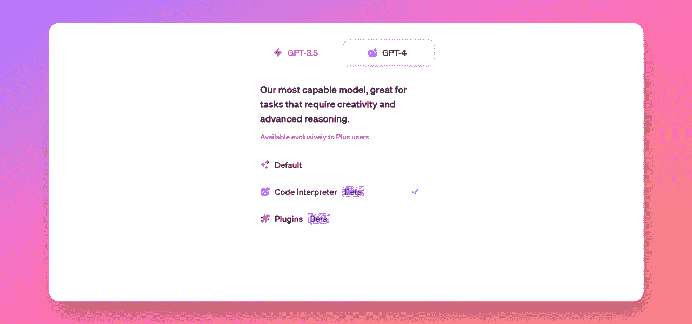
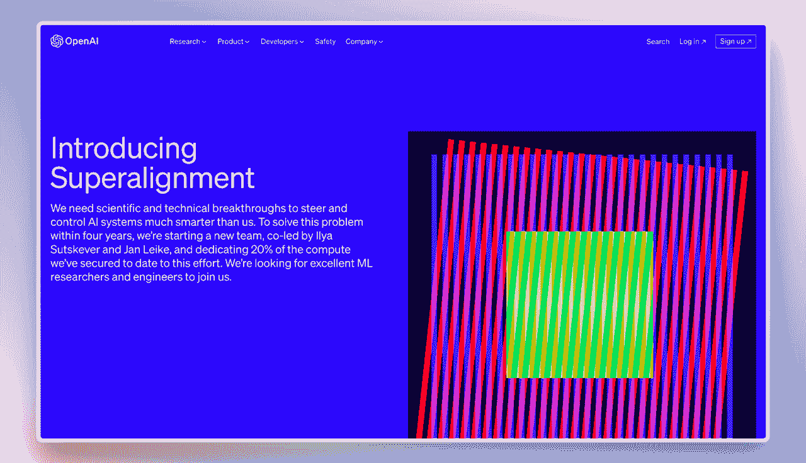
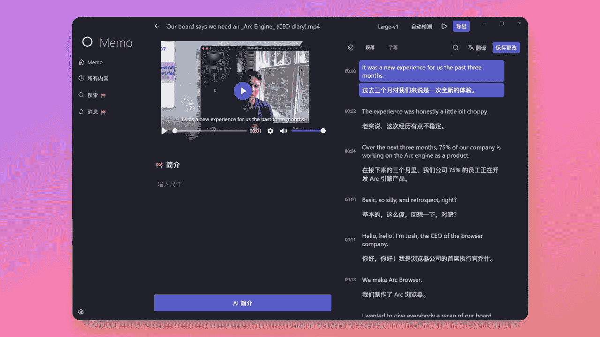
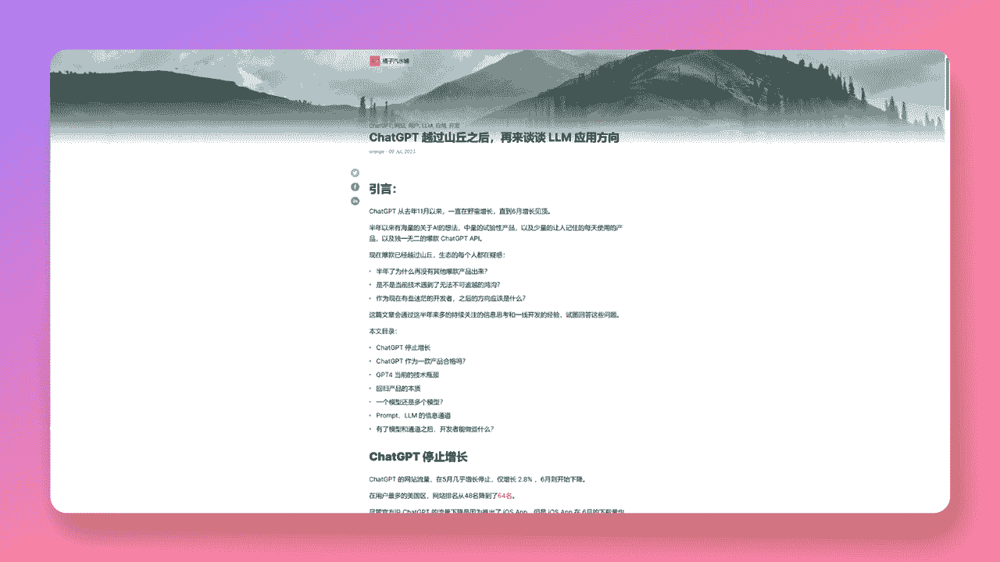
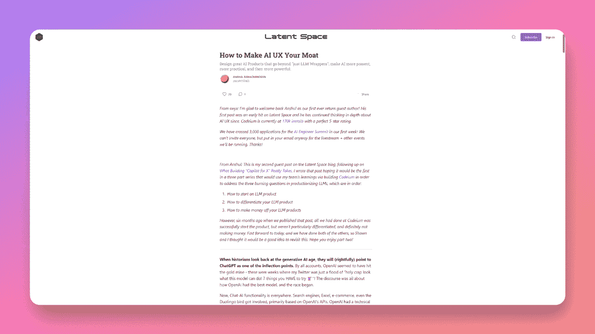
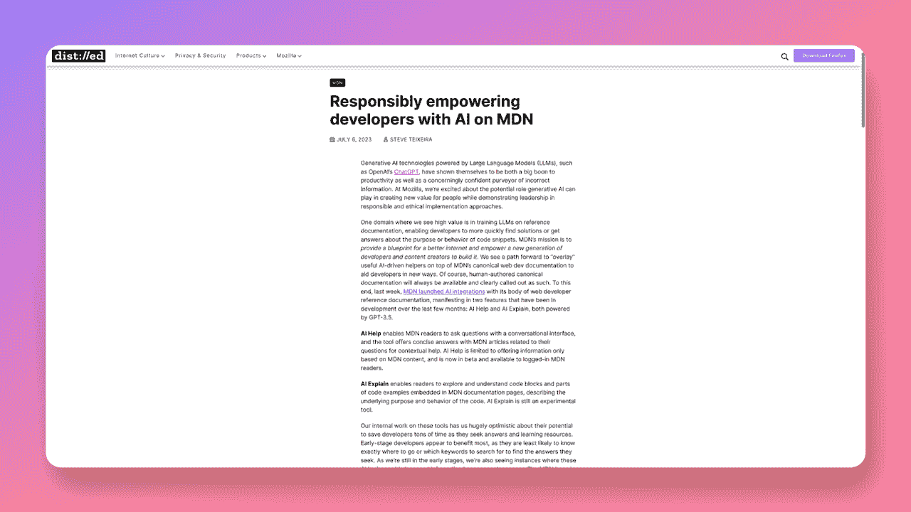
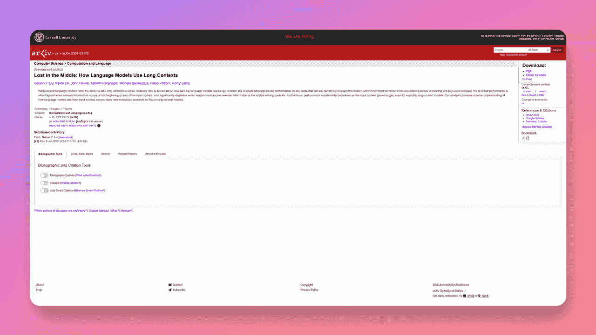

# AIGC Weekly #29

> 来源：[https://waytoagi.feishu.cn/docx/Qha7dNXg9o2vulx9uHZcLljQn6b](https://waytoagi.feishu.cn/docx/Qha7dNXg9o2vulx9uHZcLljQn6b)

> 🔗 原文链接： h[ttps://op7418.zhub](https://op7418.zhubai.love/posts/2290220131978477568)ai.love/posts/22...

> 发表时间：2023-07-11

工具：Nijijourney v5

A close up of an object with a lot of blue light, in the style of dark white and dark indigo, Low saturation, post - modern minimalist style, smooth gradient, light black and dark amber, smooth curves, national geographic photo, atmospheric horizons, webcam photography --ar 3:2

另外最近Notion中文社区负责人Linmi和他的朋友们做了一款，视频播客转文字和翻译的工具 Memo，对于没有时间看视频或者播客和英语苦手非常有用，转成文字后大幅提高内容吸收效率，于是我白嫖了5个邀请码，可以进后面的问卷输入邮箱领取，点不进去的话就是已经领完了。

https://wj.qq.com/s2/12734199/b7c8/

[没有领到的也可以在这里主动申请： https://mxmefbp9](https://mxmefbp9p0g.feishu.cn/share/base/form/shrcnsxtPkCciZ32iQVSkEpgIWg)p0g.feishu.cn/share/base/form/shrcnsxtPkCciZ32iQVSkEpgIWg

周末找时间整理了一下我最近用Midjourney做的图，基本上四月以后的都在这里了，对提示词感兴趣的和单纯的想要找一些比如海报背景、PPT背景素材的都可以来看看。

[https://walling.app/kDaEnjcPrTTkWyNieSa](https://walling.app/kDaEnjcPrTTkWyNieSaG/e6adb8e8978fe79a84aie7b4a0e69d90e5ba93)G/e6adb8e8978fe79a84aie7b4a0e69d90e5ba93

# ❤️上周精选

## Open AI 动态：代码解释器、GPT-4 API开放、对齐计划

代码解释器全量发布

Open AI 上周动态还挺多的，比较重要的就是代码解释器所有Plus 用户都可以用了，虽然名字叫代码解释器但是它不止可以解释代码还可以做很多事情。

我们知道之前 ChatGPT 有几个比较 重要的问题 就是：

+   无法做一些逻辑性比较强的运算，比如一些数学计算

+   大语言模型一直有的幻觉问题，它会编一些不存在的答案

+   之前虽然 GPT-4 可以生成一些代码，但是没有办法运行导致门槛还是比较高

那代码解释器的原理就是每一个会有一个沙箱，沙箱里有一个可以执行 python 代码的环境，ChatGPT 可以在这个环境里执行它自己生成的 python 代码，同时你也可以上传 100M 以内的文件让他通过代码处理。这就在不同程度 解决了刚才说的几个问题 。

+   逻辑性比较强的运算比如数学可以交给代码去完成

+   幻觉问题由于你会上传自己的数据，他执行的时候也是通过代码执行的可以一定程度避免这个问题

+   现在它可以直接执行自己生成的代码并且有问题会自己尝试修复，不需要你把代码复制下来配置环境在运行了。

那基于上面的特性 玩法就比较多了 ，这里简要列举一部分比如：

+   最基本的上传你写的代码让他补充新的或者修复已有的问题

+   上传相关文档MD 格式、PDF 格式等都可以，让他对文档内容进行处理，比如改格式或者找出对应内容

+   上传一些数据它可以帮你进行分析并生成可视化图表，这里由于环境里没有中文字库所以中文显示可能会有问题，你可以上传一个中文字体给他让他尝试修复。

+   让它对视频进行处理比如截取某一段，或者截取某几帧。由于它的内存是有限的所以大一些的视频和复杂人物有可能失败。

+   对图片进行处理比如反色图片，或者制作 gif 图之类的。

+   生成流程图，帮你生成流程图思维导图之类的图表。

最后是一些 注意事项 ：

+   由于 GPT-4 是不知道你现在的时间的，所以在处理数据分析问题时，不要跟它说最近一个月这种词，时间的描述需要尽量精准。

+   当它反复出错的时候可以看一下出错的原因，之后可以给他提供一些帮助比如他缺少一些新的信息的话你可以搜完发给他。

+   代码解释器的内容是有时效性的所以一些他生成的内容如果有用的话可以先存到本地。

+   最后就是他代码运行的沙箱配置是有限的所以一些复杂的运算和比较大的文件都有可能把内存占满导致运行失败。

详细的信息 可以看下面的四个内容：

我自己的代码解释器使用实践： [https://mp.weixin.qq.com/s/no](https://mp.weixin.qq.com/s/nob0sd6NYgbP1vwRyoQvig)b0sd6NYgbP1vwRyoQvig

[@lencx_ ](https://twitter.com/lencx_)发的内容整理： [https://mp.weixin.qq.com/s/K_](https://mp.weixin.qq.com/s/K_csi1oWDv5tEaeeKSlvwA)csi1oWDv5tEaeeKSlvwA

机器之心的相关内容： [https://mp.weixin.qq.com/s/K_](https://mp.weixin.qq.com/s/K_csi1oWDv5tEaeeKSlvwA)csi1oWDv5tEaeeKSlvwA

还有这篇代码解释器入门： [h](https://www.oneusefulthing.org/p/what-ai-can-do-with-a-toolbox-getting)ttps://www.oneusefulthing.org/p/what-ai-can-do-with-a-toolbox-getting

GPT-4 API 权限全量开放

上周Open AI 还宣布了 GPT-4 的 API 即将全量放开的消息，直到 7 月底所有已经付费过的账号都将获得 GPT-4 的 API 权限。目前今年 1-4 月已经绑卡的用户应该已经放开了，可以去 Open AI 的后台看一下。

还有一些其他消息：

+   Completions API的使用量占 GPT总使用量的97%。

+   Chat Completions API中的旧版模型将会在 24 年 1 月停止使用。

+   旧嵌入模型也将会在 24 年 1 月停止使用

+   Edits API 及其相关模型弃用。

Open AI 的人工智能对齐计划

还发布了在未来十年解决 AI 对齐问题的计划，“我们的目标是建立一个与人类水平相当的自动化对齐研究员，并利用大量的计算资源来扩大我们的努力，逐步实现超级智能的对齐。我们正在组建一个由顶级机器学习研究人员和工程师组成的团队来解决这个问题，并计划在未来分享更多的路线图和研究重点”

具体的方法是：

+   为了针对人类难以评估的任务提供训练信号，我们可以利用人工智能系统来协助评估其他人工智能系统（可扩展监督）。此外，我们希望了解和控制我们的模型如何将我们的监督推广到我们无法监督的任务（泛化）。

+   为了验证我们系统的一致性，我们自动搜索有问题的行为（鲁棒性）和有问题的内部结构（自动可解释性）。

+   最后，我们可以通过故意训练未对准的模型来测试我们的整个流程，并确认我们的技术可以检测到最严重的未对准类型（对抗性测试）。

## [SDXL 0.9 模型泄漏](https://huggingface.co/stabilityai/stable-diffusion-xl-refiner-0.9)

上周 Stable Diffusion 最新的大版本模型 SDXL 0.9 泄漏了，下面是收集到的一些信息，整体模型质量应该相当于 Midjourney V5 的版本比不上现在的 5.2，但是跟现有的 Lora 和模型混合之后就不好说了，而且这个是可以在消费设备上跑的，到时候人手一个 MJ V5 那有点强的。

## 模型效果如何

+   模型对色情内容做了限制，但没有那么离谱，通过提示词还是可以生成

+   3060显卡下，生成一张1024x1024图片需要22秒

+   从效果上来看，图像质量接近Midjourney V5刚发布的那个版本

+   下面是C 站的一些测试图可以看一下效果

## 为什么效果好

+   模型规模较大：SDXL使用了比之前版本的Stable Diffusion大三倍的UNet主干，具有更多的注意力块和更大的交叉注意力上下文，从而提高了视觉保真度。

+   引入新的条件策略：SDXL引入了多种新的条件策略，可以改善生成图像的质量，并能够在多种长宽比例的图像上进行训练。

+   引入改进模型提高样本质量：SDXL引入了一个改进模型，在SDXL生成的潜变量上应用去噪过程，从而提高样本的质量。这个改进模型能够通过后处理的图像技术改善生成样本的视觉质量。

这里是 stability AI 关于 SDXL 官方的报告： https://t.co/b5FfcVHWbl

## 配置需求

+   需要注意的是泄露的模型是不能在Web UI中直接使用的

+   Automatic1111的适配工作正在进行，正式版发布的时候有可能能够使用

+   你现在可以通过ComfyUI运行泄露的版本

+   泄露版本需要的显存最低为7G，所以建议还是12G显存的显卡稳妥一些，貌似3060 6G也可以运行

## 如何使用

+   下载的时候只下载 sd_xl_base_0.9.safetensors 和可选的 sd_xl_refiner_0.9.safetensors 就行

+   之后需要将模型文件放进：ComfyUImodelscheckpoints

+   [复制下面链接所有代码并粘贴到 ComfyUI 上 https://gith](https://github.com/comfyanonymous/ComfyUI/issues/817#issuecomment-1615162251%E2%80%A6)ub.com/comfyanonymous/ComfyUI/issues/817#issuecomment-1615162251…

## 关于 Langchain是否有效的讨论

Hacker News有一篇关于 LangChain 是否有效的帖子引起了广泛讨论，这个帖子的核心观点是“Langchain是无意义的原因在于它试图解决无法支持的技术基础之上的问题。目前的技术没有可重用性。Langchain试图建立抽象以实现一切的重用，但实际上只是得到了一个平庸的DAG框架，其中传递的指令和数据都是垃圾。随着链条越长，输出中的垃圾越多。因此，目前的Langchain或类似产品在实际生产规模中构建有价值的用户功能方面是无用的。”

多数的批评都集中在 LangChain 为了抽象而抽象，浪费的非常长的时间适配以后没有观察到更好的效果，还有就是过于复杂，文档写的很差学习和使用的时候得去看源码了解逻辑，很浪费时间。

还有就是因为 LangChain 是开源的，所以即使有问题很多人也不敢批[评](https://twitter.com/mckaywrigley/status/1677812146925895680?s=20)怕被扣上打击开源积极性的帽子。@mckaywrigley也表达了类似的看法： https://twitter.com/mckaywrigley/status/1677812146925895680?s=20

[@perplexity_ai ](https://twitter.com/perplexity_ai)的 CEO [@AravSrinivas ](https://twitter.com/AravSrinivas)说他们也没有使用 LangChain 主要是下面原因：

1.  其原因与HN文章一致：次优，模型变化很快需要迅速调整，调试，定制，没有明显的性能或抽象优势。

1.  Rust后端可能具有性能优势，这正是spolu试图用Dust做的事情。但我们还没有尝试过。

同[时 ](https://python.langchain.com/docs/modules/chains/popular/openai_functions#getting-structured-outputs)LangChain 也在上周支持了OpenAI Functions和结构化数据，相关文档在这里： https://python.langchain.com/docs/modules/chains/popular/openai_functions#getting-structured-outputs

# ⚒️产品推荐

## Memo：YouTube、播客链接一键下载转换文字

1.  Notion中文社区负责人Linmi和他的朋友们做的工具

1.  离线语音转文字，杜绝隐私信息泄露；

1.  支持中、日、英、韩、德、法、西、葡、泰等九十种语言转换，翻译；

1.  导出支持字幕、Markdown，以及 Notion 等常见笔记工具

## [Equals：AI辅助数据分析](https://equals.com/command-k/)

Equals是一款可以直接从数据库中获取数据进行分析的工具，无论你是否了解SQL。它与本地数据连接，构建和自动化分析更加简单，提供从群组报告到漏斗审查再到董事会报告的各种分析。它具有零学习曲线，使用方式类似于Excel和Sheets，可以节省学习新数据工具的时间。此外，Equals还可以保证分析的可复现性，让其他人了解分析的过程。

## Found：AI图像资产管理和编辑工具

国产的一款AI资产编辑工具，几乎支持现在常见的各类多媒体编辑功能，还有AI的相关能力，很多都是SD的能力再次打包，不过体验做的还可以。

## Knit：即刻推出的提示词管理工具

1.  支持OpenAI/Anthropic/Azure等多个服务商提供的模型。

1.  以项目管理prompt，每个prompt有独立的版本历史记录，可随时查看历史并恢复，不再丢失任何记录。

1.  独特的填充式prompt编辑器，支持内嵌多变量调试prompt。

1.  独特的对话式prompt编辑器，支持最新的function call调用以及模拟返回值。

1.  支持团队协作，可为成员设定不同的管理权限。

1.  支持prompt的成本和回复速度计算，让你对prompt的性能和消耗有更好的理解。

## tinyvector：纯Rust编写的小型嵌入式数据库

tinyvector是一个纯Rust编写的小型嵌入式数据库。它非常轻巧，只有大约600行代码，非常容易定制。在处理小到中等规模的数据集时，它的速度应该与高级向量数据库相当，并且准确性稍微更好。它可以在内存中存储所有索引，以实现快速查询，并且非常容易扩展到拥有1亿多个向量维度。它还计划支持强大的查询功能和集成模型，以及提供Typescript/Python库和Docker容器。

## CodiumAI pr-agent：开源的Github PR分析工具

CodiumAI pr-agent是一个开源工具，旨在帮助开发人员更快、更高效地审查PR。它会自动分析PR，提供反馈和建议，并可以回答自由文本的问题。它提供了四种运行方法：使用Docker镜像、从源代码运行、作为轮询服务器运行和作为Github App运行。该工具提供了两种交互方式，即"PR Reviewer"和"PR Q&A"，分别用于自动分析PR和回答有关PR的问题。此外，它还提供了配置文件来定制工具的行为，以及路线图中的一些计划，如支持开源模型、支持其他Git提供者和添加更多工具等。

## Journey：AI PPT生成工具

又一个AI PPT生成工具每个人都值得有一个故事，用Journey来讲述你的故事——响应式幻灯片、视频录制、交互式块以及来自你最喜欢的工具的嵌入。受到讲故事者的信任，Journey被数百人使用。每个人都值得有一个故事，用Journey来讲述你的故事——响应式幻灯片、视频录制、交互式块以及来自你最喜欢的工具的嵌入。

# 🔬精选文章

## 使用SD和Controlnet生成二维码的教程

介绍了使用AI生成二维码的方法，作者使用了SD+controlnet的软件环境，并结合了QR Toolkit插件和ADetailer插件来生成二维码。作者还提到在文生图中填写一些容易和二维码融合的提示词，如森林、树木、花朵，以达到自然融合的效果。作者还分享了一些调整参数的技巧，如将Starting Control Step改为0.05可以得到更好的效果。

## ChatGPT 越过山丘之后，再来谈谈 LLM 应用方向

[orange.ai ](https://twitter.com/oran_ge)写的关于LLM应用的相关文章，这篇文章会通过他这半年来多的持续关注的信息思考和一线开发的经验，试图回答 半年了为什么再没有其他爆款产品出来？ 是不是当前技术遇到了无法不可逾越的鸿沟？ 作为现在有些迷茫的开发者，之后的方向应该是什么

## [人工智能设计：超越聊天机器人](https://uxdesign.cc/designing-for-ai-beyond-the-chatbot-5edc0efe84a3)

未来几年人们与技术和人工智能的互动方式的可能性是无限和令人兴奋的。但回到目前人工智能的现实状态，大多数企业仍在努力找到利用这项技术为客户提供价值的最佳方式，并尝试探索他们的首个整合想法。不幸的是，我看到很多产品只是在应用程序中添加一个自由形式的AI聊天界面，希望人们在需要时会调用助手，提出问题，并希望得到一个好的回答。然而，这仍然要求用户切换上下文，起草一个好的提示，并找出如何在他们的工作中使用生成的响应（如果有用）。然而，在当前世界中，仍然有许多未开发的领域，人工智能可以以有意义的方式提供帮助。

## 如何让AI的用户体验成为你的护城河

本文探讨了AI产品的用户体验（UX）在生成式人工智能（LLM）产品中的重要性。作者以ChatGPT为例，指出其成功不在于模型本身，而在于优秀的用户体验。文章分析了ChatGPT的两个重要UX改进：文本输入和流式输出，以及抽象化状态管理。作者还提出了三个阶段的UX改进：将AI更加“存在”、使AI更加实用和使AI更加强大。最后，作者强调了优秀的UX是AI产品的真正壁垒。

## [为什么英伟达不断获胜](https://www.chinatalk.media/p/why-nvidia-keeps-winning-the-rise)

我们聚焦于英伟达（Nvidia）——它是如何崛起的，它对大型语言模型革命的重要性，以及其万亿美元估值的企业和政策影响。在下面的对话中，我们涵盖了以下内容：英伟达在图形卡行业的起源，以及首席执行官黄仁勋创建了一个GPU生态系统，使英伟达成为主导者；AI中Transformer模型的崛起如何受益于英伟达的计算和软件生态系统，使得模型更大、更可扩展；目前（暂时）在中国没有外国和国内的英伟达竞争对手；美国对中国硬件的出口管制对中美人工智能竞争意味着什么；以及中国可能接入外国云服务的限制和机遇。

## 市场地图与分析：人工智能合成数据公司

随着大型语言模型的出现，合成数据也越来越多地用于其他数据类型，如文本、表格和时间序列。有多家公司专门从事合成数据，包括医疗保健和金融服务等特定领域，也有通用工具。这些合成数据可以生成各种类型的数据，包括物理地址、电子邮件和HTTP地址、个人和企业名称、日期和时间、文件名、电话号码和社会安全号码、SKU和产品名称、互联网使用和浏览器历史信息等。计算机视觉的应用领域也在不断扩展，包括零售货架设计和管理、健身应用、服装和化妆品虚拟试穿、建筑安全和情报应用等。

## 在 MDN 上负责任地为开发人员提供人工智能支持

由大型语言模型（LLMs）驱动的生成式AI技术，如OpenAI的ChatGPT，既是提高生产力的重要工具，也是一个令人担忧的自信的错误信息提供者。Mozilla对生成式AI在创造新价值、展示负责任和道德实施方法方面的潜在作用感到兴奋。我们认为，对参考文档进行LLMs训练的领域具有很高的价值，可以帮助开发人员更快地找到解决方案或获取有关代码片段目的或行为的答案。MDN的使命是为更好的互联网提供蓝图，并赋予新一代开发人员和内容创作者构建互联网的能力。

## 合成数据与真实数据：为什么模型在合成数据上训练时表现更差？

深入探讨 Anthropic 首席执行官的评论，今天我们将讨论在合成数据和真实数据上训练模型的过程。在这篇文章中，真实数据通常指的是人类生成的数据，但也可以指来自公司数据湖等真实世界数据。它还可以来自博客、新闻文章、Reddit等论坛、Twitter等社交媒体平台等。这些数据的来源是人类或某种人类派生的行为。相反，合成数据是指模型生成的数据。例如，假设你想在1到10之间生成一个随机数。你可以使用Excel中的随机数函数来选择一个数字，而不是让你的同事提供一个数字（这将是人类生成的数据）。当然，合成数据可能会比这复杂得多。本文将介绍一些示例。激发这个讨论的一个关键问题是研究人员关注的AI生成文本在网上的日益增多。

## [向量数据库技术鉴赏](https://www.bilibili.com/video/BV11a4y1c7SW/?spm_id_from=333.1007.top_right_bar_window_default_collection.content.click&vd_source=e99f85042059f2864f5cca20d71575f0)

向量数据库的介绍视频，视频做的非常好，动画可以很好的帮助理解这些概念。借助向量化的数据表达概念可以实现图像搜索和智能问答系统的功能。 向量数据库通过将向量分组和利用位置敏感的哈希函数来解决最近邻搜索问题。 除了最近邻搜索，哈希函数也是向量数据库中的一个重要组件，用于减少碰撞和提高查询效率。聚类算法如k-means可以用于在向量数据库中进行分类和搜索。

## [语言模型的评估](https://arxiv.org/abs/2307.03109)

大型语言模型（LLM）在学术界和工业界越来越受欢迎，因为它们在各种应用中表现出了前所未有的性能。随着LLM在研究和日常使用中继续发挥重要作用，对其评估变得越来越关键，不仅在任务层面上，还在社会层面上，以更好地理解其潜在风险。过去几年，人们已经做出了大量努力，从各个角度对LLM进行评估。

## [语言模型如何使用长上下文](https://arxiv.org/abs/2307.03172)

LM 上下文窗口变得越来越大，但它们实际上_使用_长输入上下文的效果如何？

我们发现，当相关信息出现在长输入上下文的开头或结尾时，LM 性能最高，而在中间会显着下降。

最[后为了感谢王凯大佬的帮忙推广，这里介绍一下他的小报童 AI项目商业](https://xiaobot.net/p/aiyanjiu?refer=a99b14af-e977-43a8-9c7b-2ca3808386b9)解[析](https://xiaobot.net/p/MJ2023?refer=a99b14af-e977-43a8-9c7b-2ca3808386b9)主要研究可以变现的AI项目，群里也有很多大佬。https://xiaobot.net/p/aiyanjiu?refer=a99b14af-e977-43a8-9c7b-2ca3808386b9同时刘飞的Midjourney进阶创意库的内容也非常值得推荐，如果想系统的学习Midjoureny不容错过，我和莱森也会在里面发布一些教程。https://xiaobot.net/p/MJ2023?refer=a99b14af-e977-43a8-9c7b-2ca3808386b9

感谢大家看到这里，如果有觉得有意思的相关内容也可以私信我或者[给我](https://okjk.co/V8F4dO)发邮件[投稿。](https://twitter.com/op7418)你可[以在这里找](https://op7418.zhubai.love/)到我：| 即刻 | 推特 | 竹白订阅 | 微信公众号：歸藏的AI工具箱 |邮箱：guohao631@gmail.com

感谢大家看到这里，如果你也有相关内容的话可以私信我或者给我发邮件投稿。也可以分享给更多的朋友，让大家都有机会了解这些内容。我也会一直努力，为大家带来更多有趣的内容。

