# AIGC Weekly #28

> 来源：[https://waytoagi.feishu.cn/docx/QksTdaSJuo0ZoLxt6cTclWNYn1f](https://waytoagi.feishu.cn/docx/QksTdaSJuo0ZoLxt6cTclWNYn1f)

> 🔗 原文链接： h[ttps://op7418.zhub](https://op7418.zhubai.love/posts/2287680226249306112)ai.love/posts/22...

> 发表时间：2023-07-03

工具：Midjourney v5.2

black illustration, folded paper style diagonals, silver metallic edges, metallic glitter details, strong lights, matte blacks, minimalist background, clean stacked shapes, clean edges --ar 3:2

# ❤️上周精选

## 上周 AI 领域的大规模融资

上周可能到了一个爆发点所以在 AI 领域出现了非常多的融资，这里总结了一下，可能不全：

+   美团 以约 20.65亿元人民币 的价格完成对 光年之外 的股权收购。此次收购将加强美[团在快速增长的人工智能行业中的竞争力，](https://www.36kr.com/p/2322793489129097)并支持光年团队在大模型领域的探索和研究。 https://www.36kr.com/p/2322793489129097

+   Runw[a](https://twitter.com/c_valenzuelab/status/1674426838544965634?s=20)y 的文本转视频工具从 Google、Nvidia 和其他公司筹集了 1.41 亿美元 的融资，Runway在过去五年中一直在推动人工智能创意的边界。在2023年，他们推出了第一代和第二代视频生成模型。这笔资金将使我们能够进一步扩大他们的内部研究工作，继续推出最先进的多模态AI系统，并构建愉快和直观的产品体验。 https://twitter.com/c_valenzuelab/status/1674426838544965634?s=20

+   In[f](https://twitter.com/inflectionAI/status/1674420076202840064?s=20)lection AI 宣布，该公司在由微软、里德·霍夫曼、比尔·盖茨、埃里克·施密特和新投资者NVIDIA领导的一轮新融资中筹集到了 13亿美元 。这轮新融资将使该公司的 总筹资额达到15.25亿美元 。 https://twitter.com/inflectionAI/status/1674420076202840064?s=20

+   Typeface 由Adobe的前首席技术官Abhay Parasnis于2022年创立，专注于企业应用案例。最近，[Typeface获得了由Salesforce Ventures领投的 1亿美元B轮融资 ，使其 估值达到10亿美](https://techcrunch.com/2023/06/29/typeface-which-is-building-generative-ai-for-brands-raises-100m-at-a-1b-valuation/)元 。 https://techcrunch.com/2023/06/29/typeface-which-is-building-generative-ai-for-brands-raises-100m-at-a-1b-valuation/

+   Gleamer 筹集了 2950 万[美元](https://techcrunch.com/2023/06/28/gleamer-which-provides-ai-software-for-radiologists-raises-29-5m/) ：面向放射科医生的人工智能软件。 https://techcrunch.com/2023/06/28/gleamer-which-provides-ai-software-for-radiologists-raises-29-5m/

+   Slang AI 获得 1200 万美元[ 的](https://techcrunch.com/2023/06/28/slang-taps-ai-to-answer-phone-calls-for-brick-and-mortar-businesses/) A 轮融资，为实体企业接听电话。 https://techcrunch.com/2023/06/28/slang-taps-ai-to-answer-phone-calls-for-brick-and-mortar-businesses/

+   Celestial AI 融资 1 亿[美元 ，用于使用基于光的互连传输数据。 https://techcrunch.com/2023/](https://techcrunch.com/2023/06/28/celestial-ai-raises-100m-to-transfer-data-using-light-based-interconnects/)06/28/celestial-ai-raises-100m-to-transfer-data-using-light-based-interconnects/

+   Zenarate 融资 1500 [万美](https://techcrunch.com/2023/06/27/zenarate-an-ai-powered-agent-coaching-platform-raises-15m/)元 ：提供AI模拟培训平台的公司。 https://techcrunch.com/2023/06/27/zenarate-an-ai-powered-agent-coaching-platform-raises-15m/

+   Augmedics 获得 8250 万美元 [：使用 AR 和 AI 进行脊柱手术。 https://techcrunch.com/2023/0](https://techcrunch.com/2023/06/27/augmedics-snaps-up-82-5m-advance-spinal-surgery-navigation-using-ar-and-ai/)6/27/augmedics-snaps-up-82-5m-advance-spinal-surgery-navigation-using-ar-and-ai/

+   CalypsoAI 筹集了 2300 [万美](https://techcrunch.com/2023/06/27/calypsoai-raises-23m-to-add-guardrails-to-generative-ai-models/)元 ：用于生成 AI 模型的护栏。 https://techcrunch.com/2023/06/27/calypsoai-raises-23m-to-add-guardrails-to-generative-ai-models/

+   Reka 宣布秘密拨款 5800 万美元 [，用](https://reka.ai/announcing-our-58m-funding-to-build-generative-models-and-advance-ai-research/)于构建生成模型和推进人工智能研究。 https://reka.ai/announcing-our-58m-funding-to-build-generative-models-and-advance-ai-research/

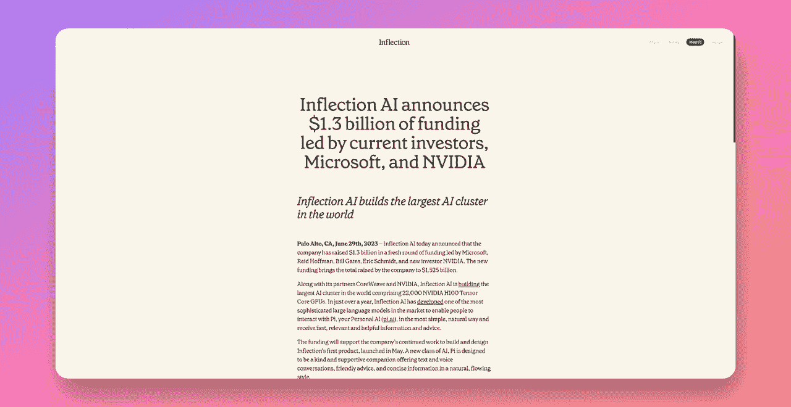

## Midjourney 上周的一些更新

+   推出了一个新的模式 Turbo 模式，这个模式的生成速度会比fast模式快 2-4 倍，但是会占用两倍的 fast 模式时间。

+   Midjourney新推出了一个付费等级，一个月120美元，区别就是fast模式时间长了一些，同时Turbo 模式消耗的 fast 时间不会变。

+   另一个更新是推出了--weird命令。这个命令可以让你的图片更加的前卫和怪异，数值越大越离谱，支持从0-3000，可以尝试和--stylize命令一起使用效果会更好，如果要和--stylize搭配使用的话建议两个的值使用相同的。下面是我的一些测试，第一张没有加任何命令，第二张--weird 250，第三张--weird 250和--stylize 250，第四张--weird 1000

# ⚒️产品推荐

## [Wonder Studio开放测试](https://wonderdynamics.com/)：将视频中的人物替换为 3D CG 角色

Wonder Studio是一个AI工具，可以自动将CG角色动画化、照明和合成到真人场景中。用户只需使用相机，无需摄影动作捕捉、复杂的3D软件和昂贵的生产硬件。该系统可以自动检测剪辑并在整个镜头序列中跟踪演员，无需逐帧进行繁重的特效工作。Wonder Studio可以自动检测演员的表演，并将其转移到用户选择的CG角色中，实现自动动画化、照明和合成。该系统可以与现有的工作流程无缝集成，自动化80%-90%的“客观”VFX工作，让艺术家留下“主观”工作。用户可以将结果导出到他们已经使用的软件中。

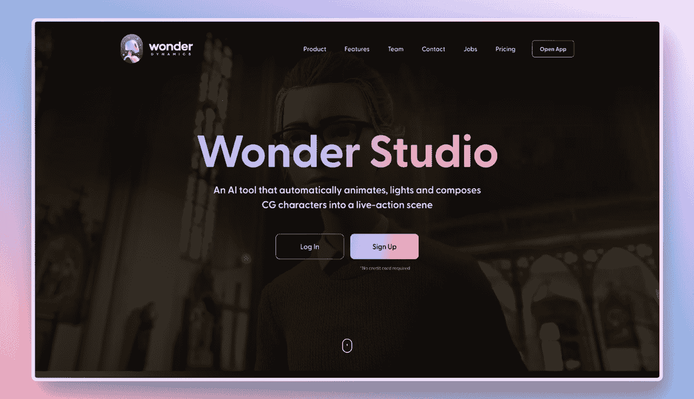

## AI 帮个忙：即刻出的AI 文案润色和优化工具

这个工具提供了多种写作助手功能，包括生成文章、模拟小红书风格、降重润色文章、生成工作总结、写方案、生成周报、生成标题、翻译文本、生成情书、文本校对等。这些工具可以帮助用户快速生成各种文案和写作内容。

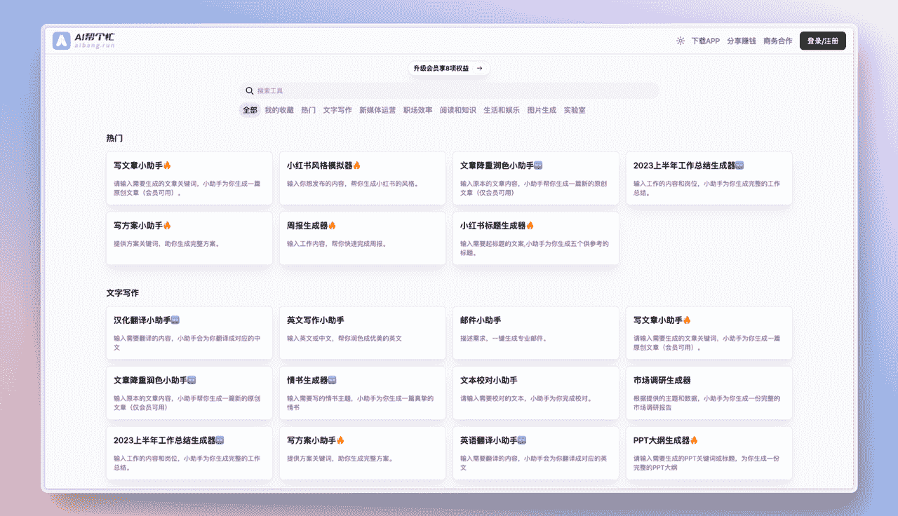

## Cue：AI 驱动的主动回忆记忆工具

多源支持，支持文本粘贴，即将支持Google Docs和Notion强大的复习功能，可保存AI生成的问题供以后复习。什么是主动回忆？主动回忆是一种学习技巧，它涉及从记忆中主动检索信息，而不仅仅是复习笔记。这已被证明可以增加长期记忆和提高对材料的整体理解。

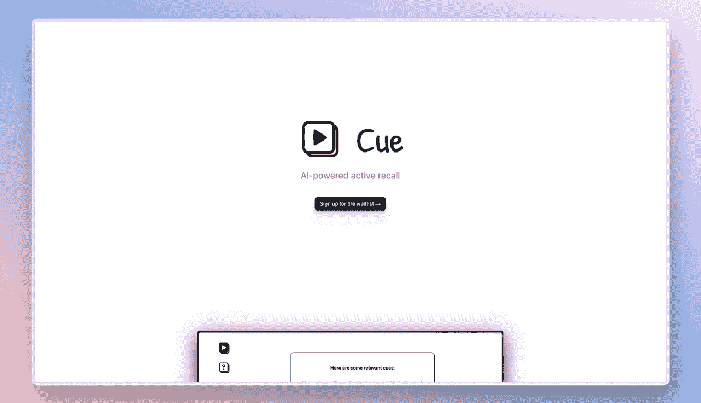

## Novel：带有 AI 能力的简洁记录工具

介绍NovelNovel是一款具有AI驱动的自动补全功能的Notion风格的所见即所得编辑器。使用了Tiptap和Vercel AI SDK。特点包括斜杠菜单和气泡菜单、AI自动补全（输入"++"激活或从斜杠菜单选择）、图片上传（拖放/复制粘贴或从斜杠菜单选择）。支持在Vercel上部署你自己的版本。

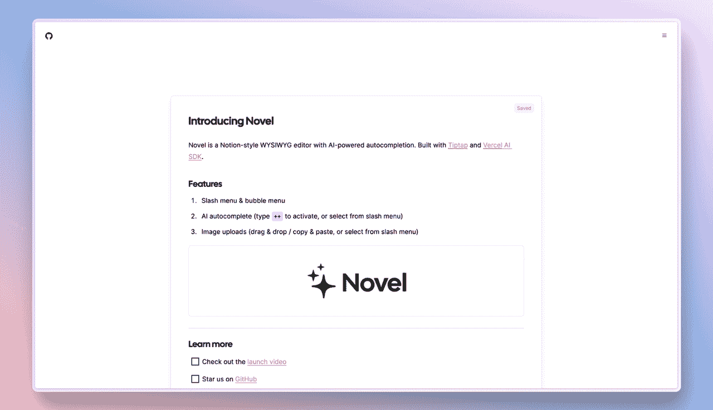

## WebPilot：流行 ChatGPT 插件的浏览器扩展版本

Webpilot是一个免费的开源工具，它是一个“网页副驾驶员”，可以让你与网页进行自由对话，或者与其他用户进行自动辩论。与ChatGPT不同，它不需要聊天或切换页面，也不需要不断地复制和粘贴。当前版本的Webpilot是基于gpt-3.5-turbo开发的，它绑定了一些常见的提示与快捷命令，请求API，并显示结果以操作所选的网页文本。

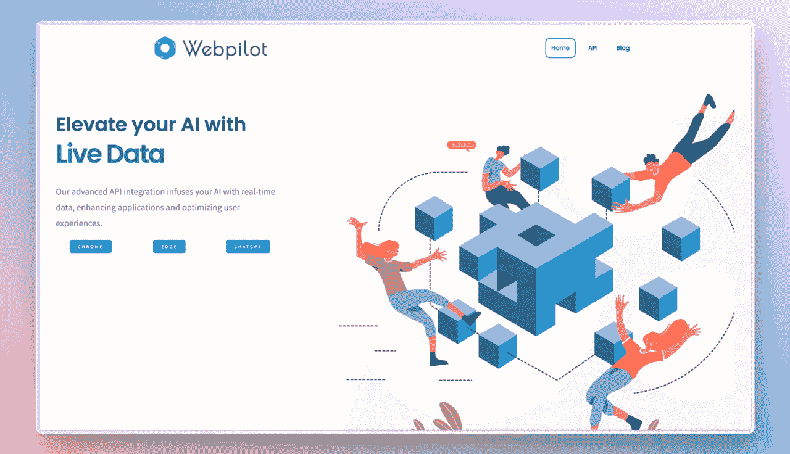

## Mondyfi：下一代 AI 驱动的设计工具

类似 Figma 不过可以做矢量图和平面的内容，跟 AI 能力高度集成，同时还支持 webGPU 从现在的宣传来看太强了。可能这些原有的工具都会被 AI 重塑一遍。

下一代图像编辑结合创造力和生产力，在一个软件包中体验世界级图像编辑、直观的矢量工具和基于人工智能的艺术指导。AI原生设计，AI在你的掌控之下，这是图像编辑的未来。将面向设计师的人工智能与可调整的控制相结合，获得在现实世界中可行的惊人效果。更进一步，一起前行，将项目和资源整合在一个地方，简化协作流程。分享进展并获得反馈从未如此简单，无需导出。高效，无需经验，不成问题，只需在命令栏中输入即可快速实现。功能更多，拥有终极灵活性的非破坏性编辑，无与伦比的自由和能力来探索和迭代设计。闪电般快速，基于浏览器的首个WebGPU启用的图像编辑平台。无需切换应用程序，将直观的矢量和光栅工具结合在一个编辑器中。库存图像浏览，基于节点的非破坏性图像处理，提供更多创意灵活性。

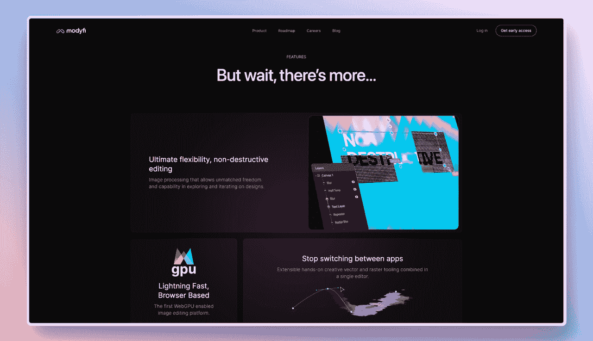

## 大饼 AI 变声：AI 变声工具

上周在 LKS 视频里推荐的一个工具，变声效果非常不错，感觉是我之前教程的 SVT 的产品化应用。在线变声游戏开黑角色的声音补完功能，可以像换皮肤一样变换音色。还提到了社交直播中使用滤镜让声音更好听，摆脱社交恐惧。该变声工具支持在多个游戏和应用程序中使用，并提供了教程和支持。

## Sudowrite：AI 辅助写小说的工具

本文介绍了Sudowrite的功能和特点。Sudowrite是一款创意写作AI工具，它可以帮助写作者提高写作质量。它具有多种功能，如Describe、Expand、Write、Rewrite、Feedback、Canvas、Brainstorm和Visualize，可以帮助写作者更好地描写角色、构建情节、改写文本、获得反馈、生成创意等。Sudowrite基于GPT-3和GPT-4模型，可以生成独特的文本，避免抄袭。

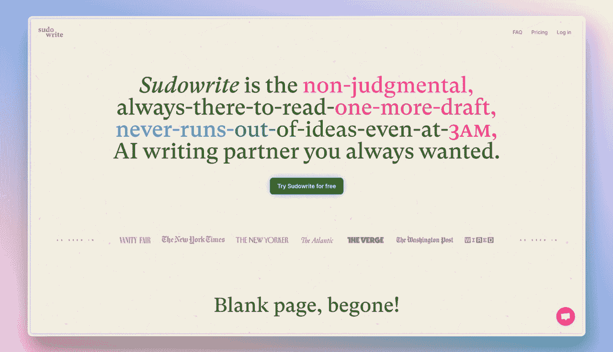

## e2b smol developer ：专属于你的 AI 代码开发助手

在e2bStar上运行我们在GitHub上的个人AI开发者。只需点击一次，就可以获得由smol开发者AI代理驱动的自己的AI开发者。您指定指令，然后让smol开发者为您完成工作。由smol ai的代理驱动。

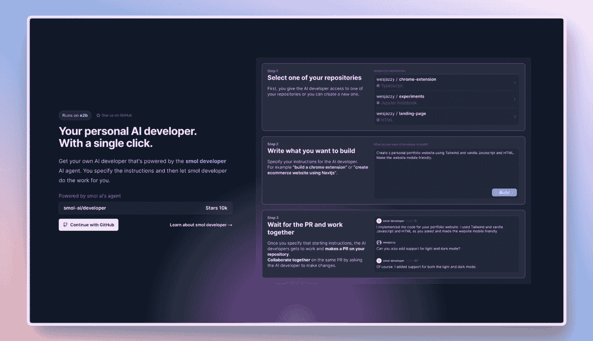

## PosterStudio：AI 帮助创建广告素材

PosterStudio帮助大型企业的营销团队和中小型企业主们，无需设计技能即可创建社交媒体广告。您只需提及广告的信息，PosterStudio将负责一切，轻松生成引人注目的广告，并在转化率、参与度和品牌忠诚度方面实现显著增长。

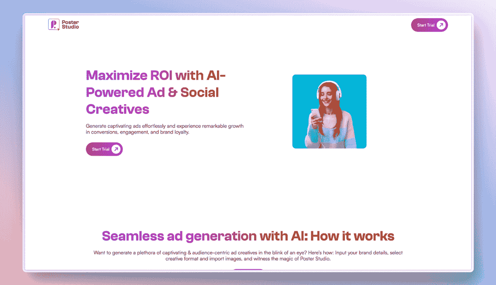

## Promptspot：用于提示和输入的 开源单元测试 套件

Promptspot是一个简化Prompt测试的工具，它可以帮助用户在单个测试套件中测试多个输入（应用程序数据）的Prompt。此外，Promptspot还支持团队协作、便捷的克隆测试、输出对比和离线分析等功能。它使用Stack Rails 7、Stimulus、TailwindCSS、Postgres、Goodjob和Minitest等技术栈。用户可以通过克隆仓库、填写.env文件、安装依赖并启动服务来开始使用。Promptspot还提供了关于Prompt、输入和测试等概念的解释，并介绍了未来的发展计划和贡献方式。该项目采用Apache License v2.0开源许可证。

## Hovercode：SD 生成二维码图片的线上工具

上周比较火的 SD 那个二维码图片生成模型的线上工具，输入你的链接，选择你喜欢的风格输入对应的提示词之后就可以生成对应的二维码图片。

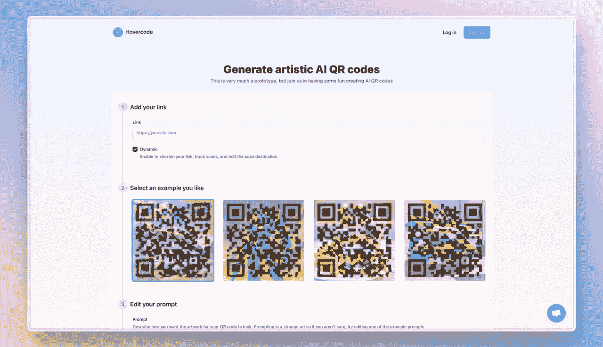

# 🔬精选文章

## 谷歌免费课程：生成式人工智能介绍

这是一门入门级微学习课程，旨在解释生成式人工智能（Generative AI）是什么，如何使用以及与传统机器学习方法的区别。课程还介绍了谷歌工具，帮助您开发自己的生成式人工智能应用程序。完成本课程大约需要45分钟。在学完课程后，您可以获得结业徽章，展示您掌握的技能，并拓展在云领域的职业之路。

## 八家人工智能初创公司赢得技术人才大赛

这篇文章介绍了生成式人工智能（Generative AI）的发展和未来的AI公司的竞争情况。目前，有八家领先的纯AI公司在争夺最优秀的技术人才，它们已经取得了一定的融资成功，并且在产品市场上取得了一定的成果。此外，还有11家下一代AI公司也吸引了高质量的人才加入。文章还提到了一些与AI人才有关的数据和趋势。

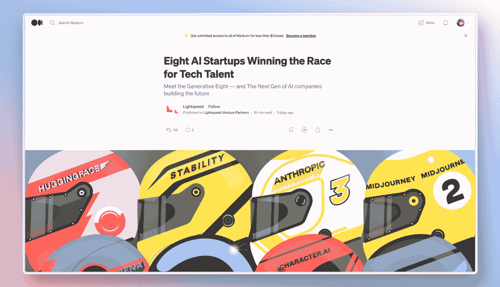

## Meta关于人工智能如何影响他们的推荐算法的内容

Meta发布了关于其社交媒体算法的深入解析，旨在向用户揭示Instagram和Facebook上内容推荐的原理。他们提供了22个“系统卡片”，详细介绍了这些平台的AI系统如何对内容进行排序和推荐。此外，Meta还宣布将推出内容库和API，为研究人员提供公开数据，并满足数据共享和透明度合规义务。这些举措是Meta回应监管机构对AI技术和个人数据使用的关注的一部分。

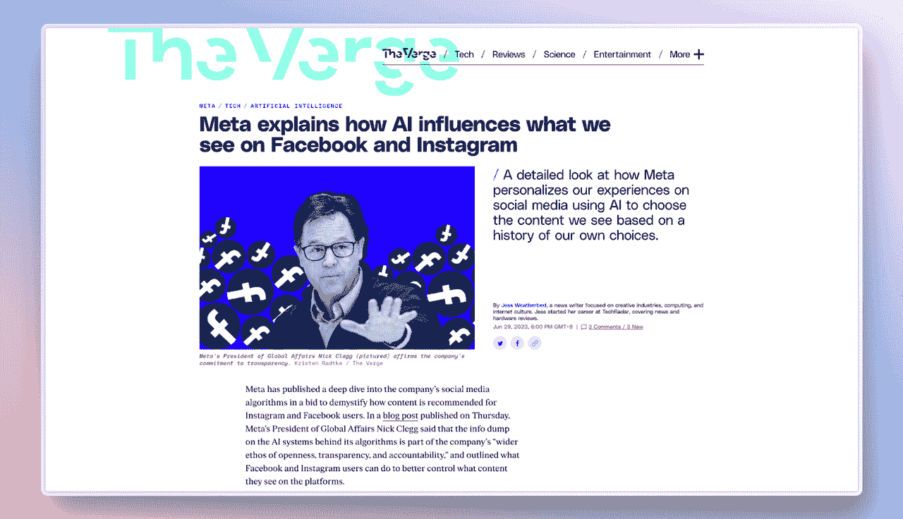

## [使用LangChain、Activeloop和GPT](https://notes.aimodels.fyi/reddit-source-code-langchain-chat-gpt-4-activeloop-embeddings/)-4逆向工程Reddit源代码的简明指南

本文介绍了使用GPT-4和Activeloop与Langchain代码理解技术来逆向工程Reddit的公开源代码的指南。LangChain是一个强大的工具，可以分析GitHub上的代码存储库，它结合了VectorStores、Conversational RetrieverChain和LLM（语言模型）三个重要部分，帮助理解代码、回答相关问题，并在GitHub存储库中生成新的代码。通过使用LangChain，可以更深入地理解代码，获得与上下文相关的答案，并在GitHub存储库中生成代码片段。

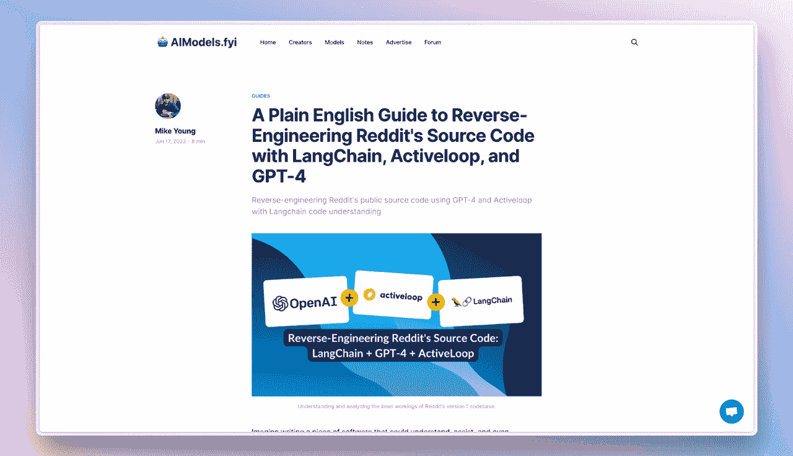

## 开源人工智能至关重要：HF CEO 美国国会质询内容

Hugging Face首席执行官Clement Delangue在美国国会科学委员会的听证会上表示，开放科学和开源人工智能对激励和与美国的价值和利益高度一致。Delangue还指出，今天的人工智能进展是由开放科学和开源推动的，没有美国发明的开源PyTorch、Tensorflow、Keras、transformers和diffusers，美国可能不会成为领先的人工智能国家。Hugging Face是一个快速增长的纽约初创公司，去年估值达到20亿美元，成为开源代码和模型的中心，并成为开源人工智能社区的领导者。

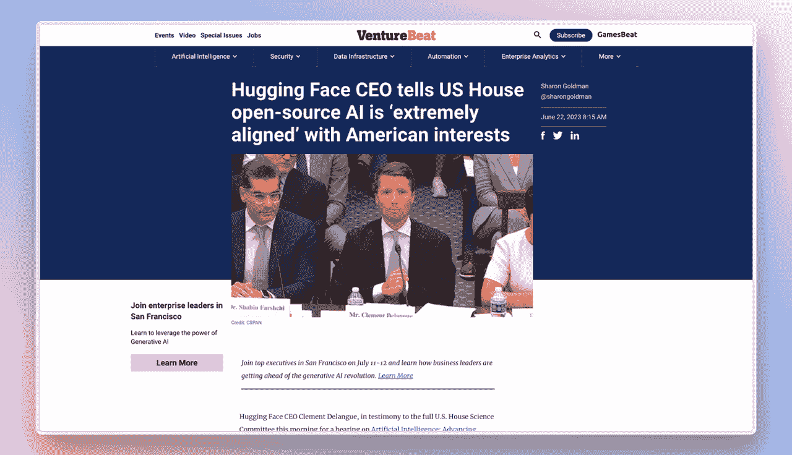

## LeanDojo ： 一个开源精益游乐场

由用于定理证明的工具包、数据、模型和基准组成；还开发了 ReProver，这是一种基于 LLM 的检索增强证明器，用于使用庞大数学库中的前提进行定理求解。

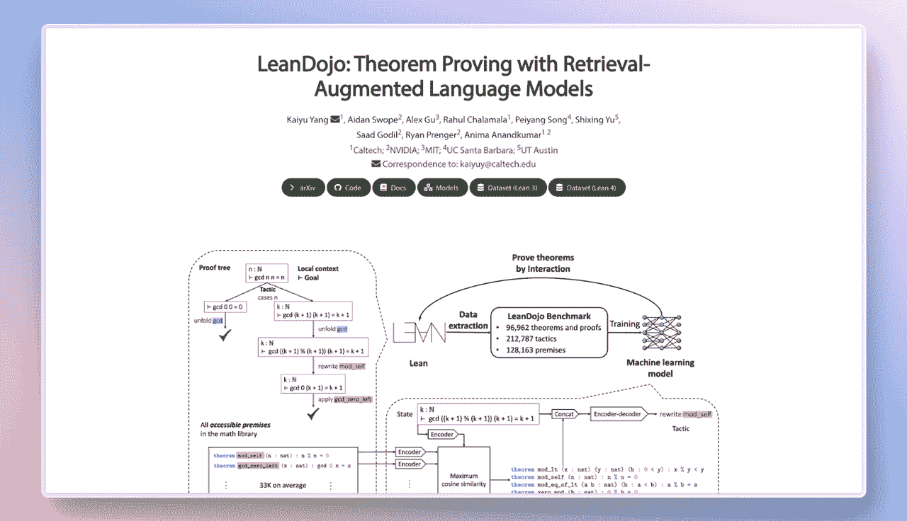

## [扩展LLMs的上下文窗口](https://arxiv.org/abs//2306.15595)

本文介绍了一种称为位置插值（PI）的方法，可以将基于RoPE的预训练LLM的上下文窗口大小扩展到32768个位置，并在各种任务上展示了强大的实证结果。该方法通过线性缩小输入位置索引来实现扩展，同时保持了模型在原始上下文窗口内的质量。通过位置插值扩展的模型保留了原始架构，并可以重复使用大部分预先存在的优化和基础设施。

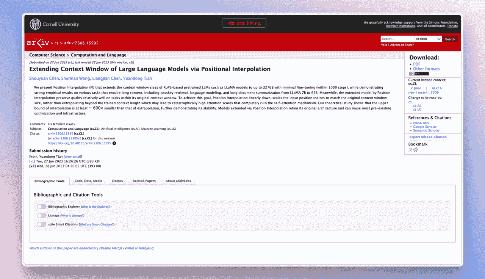

## Visual Navigation Transformer

ViNT是一个目标条件的导航策略，通过多样化的跨体培训数据进行训练，可以零-shot控制许多不同的机器人。它还可以高效地进行微调或适应新的机器人和下游任务。ViNT使用Transformer-based架构进行编码，并通过图形规划器和启发式方法实现对新环境。

## [使用ChatGPT来丰富数据](https://www.nocodecamp.xyz/blog/using-chatgpt-for-data-enrichment)

在这个视频中，作者测试了ChatGPT是否可以用于数据库的数据丰富。在这个具体的例子中，作者提交了一个不完整的街道地址，并使用ChatGPT为该地址的州、邮编和国家代码进行了数据丰富。

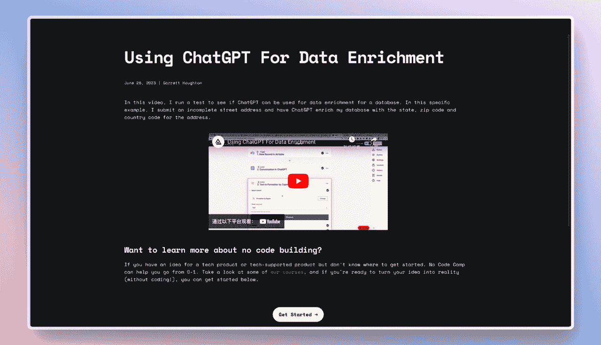

## 大语言模型（LLM）后训练数据准备相关笔记

本文是关于对LLM进行微调和二次预训练时的学习笔记，包含了一些经验总结。参考资料包括了流程化大语言模型数据准备、OpenAI微调文档等。

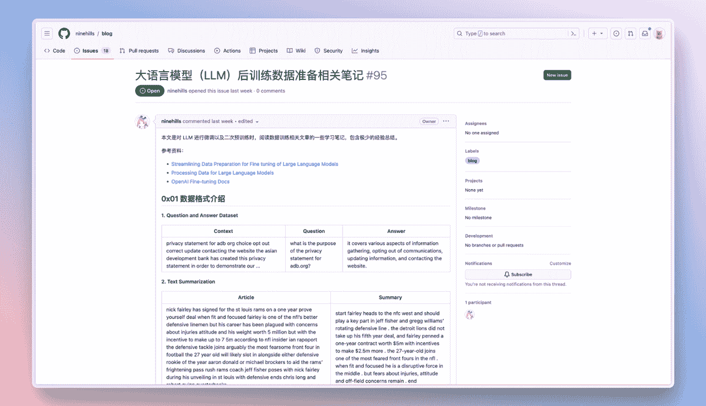