# AIGC Weekly #27

> 来源：[https://waytoagi.feishu.cn/docx/Att2d5gdEoxZDOxRmkJcMfAInCh](https://waytoagi.feishu.cn/docx/Att2d5gdEoxZDOxRmkJcMfAInCh)

> 🔗 原文链接： h[ttps://op7418.zhub](https://op7418.zhubai.love/posts/2285090979197644800)ai.love/posts/22...

> 发表时间：2023-06-26

工具：Midjourney v5.2

a bright red and blue abstract image, in the style of dark amber and red, organic flowing forms, sepia tone, digitally enhanced, high quality photo, rubens, light crimson and white, smooth curves, in the style of distorted form, 8k resolution, minimalist beauty, rounded forms, grainy, rim light --ar 3:2

## Figma Config 大会发布了自己的 AI 设计功能

今天的Figma Config大会类似设计界的WWDC，在会上Figma CEO除了宣布变量和开发者模式等一系列新的能力之外，也宣布了他们的AI能力包括：

+   为你提出设计稿的优化建议

+   帮助你寻找设计系统的变体

+   自动生成设计系统展示画板

+   自动为设计系统的组件创建变体和动画

+   自动调整不同分辨率的设计稿

[同时他们还宣布收购](https://twitter.com/Diagram)了一直专注 [AI 设计领域的 ](https://twitter.com/Diagram)@Diagram 公司。同时 @Diagram 的开发人员和负责人也在第二天的会上单独做了AI设计相关的分享。 整个分享前面的部分几乎全是他们在AI上的探索，只有后面四分钟的内容是他们将要发布的AI设计助手Genius Chat的一些能力。 我把这段演示的字幕翻译了一下，下面是Genius Chat能力的一些介绍：

+   选择你的画板之后你可以让Genius编辑画板中的内容

+   Genius也可以向画板中添加信息，比如相关组件和填充组件中的文案。

+   Genius Chat也可以帮助你连接到Figma之外的事物。比如接入图片生成API以后你可以通过对话生成图标。

+   Genius Chat具有一定的个性化特征，例如使用表情符号，提供更人性化的交互体验。

原始视频链接：

[https://youtube.com](https://youtube.com/watch?v=bslH4Mv1ZHA)/watch?v=bslH4Mv1ZHA

## Stability AI 发布了 SDXL 0.9，图片素质大幅提升

Stability AI 发布了 SDXL 0.9，其成像质量和细节相较于Beta版本大图提升。左Beta、右0.9。

SDXL 0.9 组合进步的关键驱动因素是其参数数量大幅增加。 SDXL 0.9 是所有开源图像模型中参数数量最多的模型之一，拥有 3.5B 参数基础模型和 6.6B 参数模型集成管道。 最重要的是尽管具有强大的输出和先进的模型架构，SDXL 0.9 仍能够在现代消费类 GPU 上运行，只需要Nvidia GeForce RTX 20 显卡（同等或更高版本）标准）配备至少 8GB VRAM。

现在可以通过 ClipDrop 访问该模型，API 即将推出。 SDXL 0.9 之后将全面开放发布 SDXL 1.0，目标是 7 月中旬（时间待定）。

## Midjuourney 发布 V5.2 版本，包括图片放大和提示词分析

Midjourney上周终于更新了V5.2版本，虽然版本号没有改变但是增加了一些比较重要的新功能，他们分别是：

新的美学风格 ：改进了审美和更清晰的图像，略微提高了连贯性和文本理解，增加了内容输出的多样性。左边为V5.1 右边为V5.2 。

stylize 命令已修复 ：对应用于图像的风格化程度产生较强的影响（更像 V3）。此命令的范围是 --stylize 0 到 --stylize 1000，默认值是 --stylize 100。左边为默认stylize 100 右边为stylize 1000

新的“高变异模式” ：默认开启，使所有变异任务具有更高的多样性，要切换此设置，请输入 /settings 然后点击另一个变异模式。在所有升级的图片下面，还可以选择变异的强度。

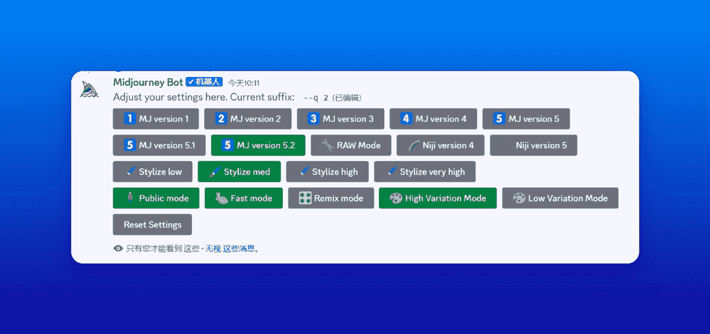

新的 /shorten 命令 ：这让你可以“分析”一个提示，获得关于哪些词可能没什么作用和哪些词可能是关键的建议，这个对于优化提示词非常重要。点击 show details 可以显示提示词中每个词的具体权重。

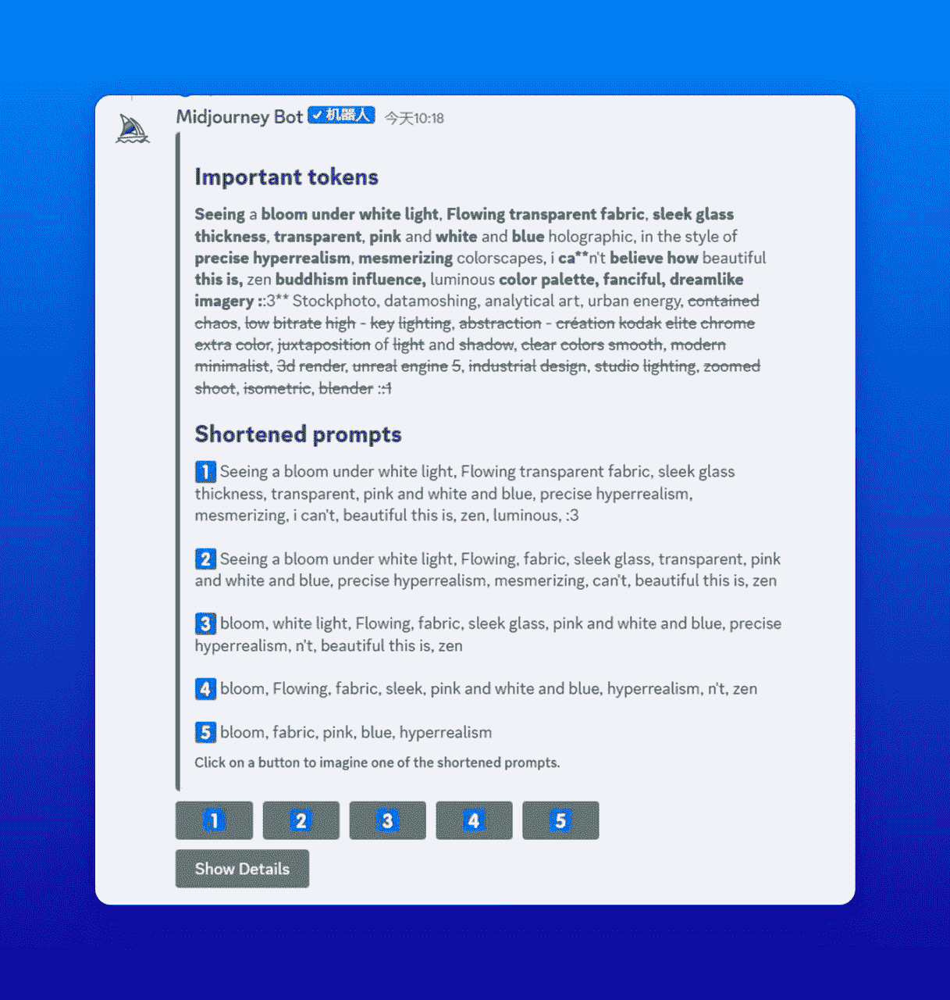

图片填充功能 ：类似PS AI的图片填充。[Zoom Out 1.5x] [Zoom Out 2x] 缩小镜头，并在四周填充细节。[Make Square] 在两侧添加细节，将非正方形图像变为正方形。[Custom Zoom]（高级）为您提供一个弹出文本框，允许你在缩小的同时更改提示以及宽高比或精确缩小。

其中比较值得注意的是 Zoom out这个功能，连续放大之后就可以形成一个连续的视[频帧，用补帧工具就可以连起来做成视频，挺好玩的，我也写了一](https://mp.weixin.qq.com/s/aPcHHgkhrkIqzxX3E8dv1w)个教程帮助大家使用： https://mp.weixin.qq.com/s/aPcHHgkhrkIqzxX3E8dv1w

这里还是有一些其他人用 Zoom Out 做的好玩的视频：

[h](https://twitter.com/_akhaliq/status/1672721480139014144?s=20)ttps://twitter.com/_akhaliq/status/1672721480139014144?s=20

[h](https://twitter.com/Merzmensch/status/1672346749845884935?s=20)ttps://twitter.com/Merzmensch/status/1672346749845884935?s=20

[h](https://twitter.com/nickfloats/status/1672055696953573376?s=20)ttps://twitter.com/nickfloats/status/1672055696953573376?s=20

[h](https://twitter.com/mreflow/status/1672470475522584576?s=20)ttps://twitter.com/mreflow/status/1672470475522584576?s=20

[h](https://twitter.com/ai_s_a_m/status/1672270029184811008?s=20)ttps://twitter.com/ai_s_a_m/status/1672270029184811008?s=20

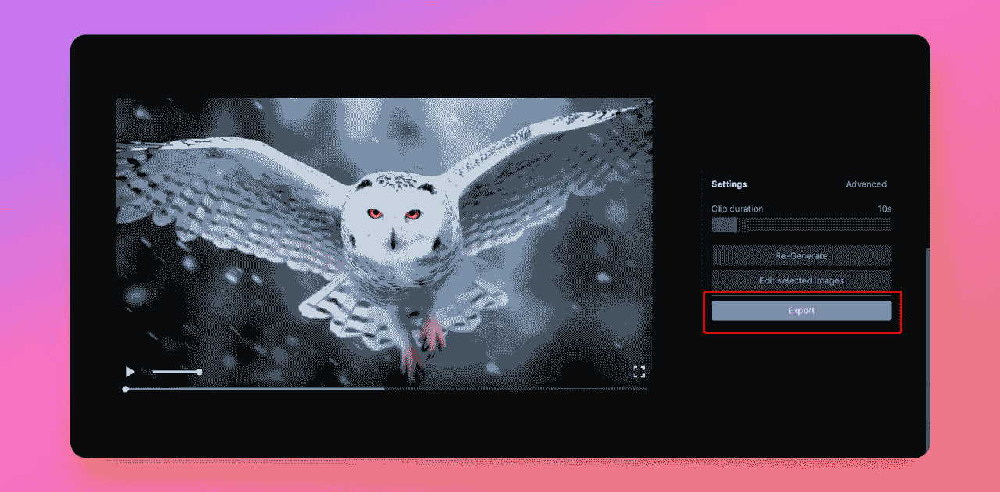

## ChatGLM2-6B 模型发布

之前效果不错的 ChatGLM模型发布了第二代。他们的6B 可以部署在消费级设备上的。

[ChatGLM 2 -](https://github.com/THUDM/ChatGLM-6B)6B 是开源中英双语对话模型 ChatGLM-6B 的第二代版本，在保留了初代模型对话流畅、部署门槛较低等众多优秀特性的基础之上，ChatGLM 2 -6B 引入了如下新特性：

+   更强大的性能 ：基于 ChatGLM 初代模型的开发经验，全面升级了 ChatGLM2-6B 的基座模型。

+   更长的上下文 ：将基座模型的上下文长度（Context Length）由 ChatGLM-6B 的 2K 扩展到了 32K，并在对话阶段使用 8K 的上下文长度训练，允许更多轮次的对话。

+   更高效的推理 ：基于 Multi-Query Attention 技术，ChatGLM2-6B 有更高效的推理速度和更低的显存占用：在官方的模型实现下，推理速度相比初代提升了 42%，INT4 量化下，6G 显存支持的对话长度由 1K 提升到了 8K。

+   更开放的协议 ：ChatGLM2-6B 权重对学术研究 完全开放 ，在获得官方的书面许可后，亦 允许商业使用 。

更[离谱的是](https://twitter.com/9hills) ChatGLM2-6B 在 Leaderboard - C-Eval 这个测试的评分居然超过了 GPT-4 。 九原客 推测可能是因为国内经常用c-eval和gaokao这两个数据集测评大模型，其实这些测试集都是单项选择题，所以即使是蒙都能蒙 25 分，而且有可能测试数据集在训练的时候就被灌给了模型，相当于开卷考试了才会这样。

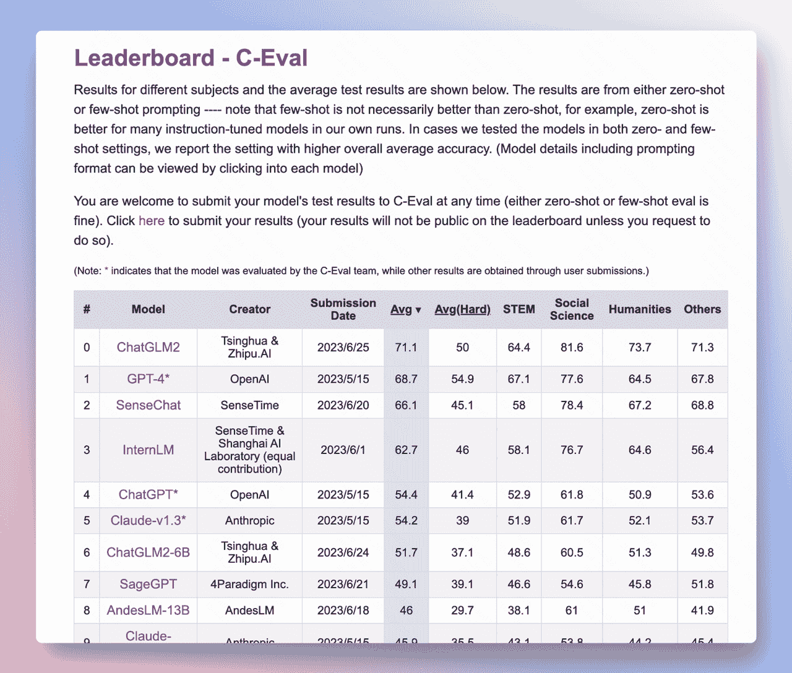

# ⚒️产品推荐

## 1024 Code：线上 AI 编程和协作社区

1024Code是一个集成AI编程助手和编程社区的轻量级协同IDE环境，可以随时随地共同创造多人在同一个代码空间中协作编程，并在线运行任何语言、大小项目。用户可以利用AI助手更快、更高效地编程，并将作品托管在1024Code上轻松地与他人分享。同时，用户可以通过交互式编程合集和个人编程主页总结知识点、技术栈、学习和思考过程，自我沉淀的同时，更好地对外分享和展示，进而收获更多成就，反哺学习动力。

## Syne：AI 生成现实环境可交互 3D 模型

这是一款名为XR的应用程序，可以直接从Google Drive导入3D模型到增强或虚拟现实中。AI可以自动生成纹理和环境，用户可以通过语音与AI交互，探索不同的材料和环境。此外，还可以探索多个设计版本，包括重力、不同的光照效果、保存快照并与团队分享。

## Consensus：AI 从论文中提取你问题的答案

Consensus使用人工智能来查找研究论文中的答案。最好的搜索方式是提出问题。可以问关于概念之间的关系、简单的是/否问题以及概念的影响等问题。搜索的主题范围从生物学到社会科学。可以分享结果、建议博客主题和报告问题。

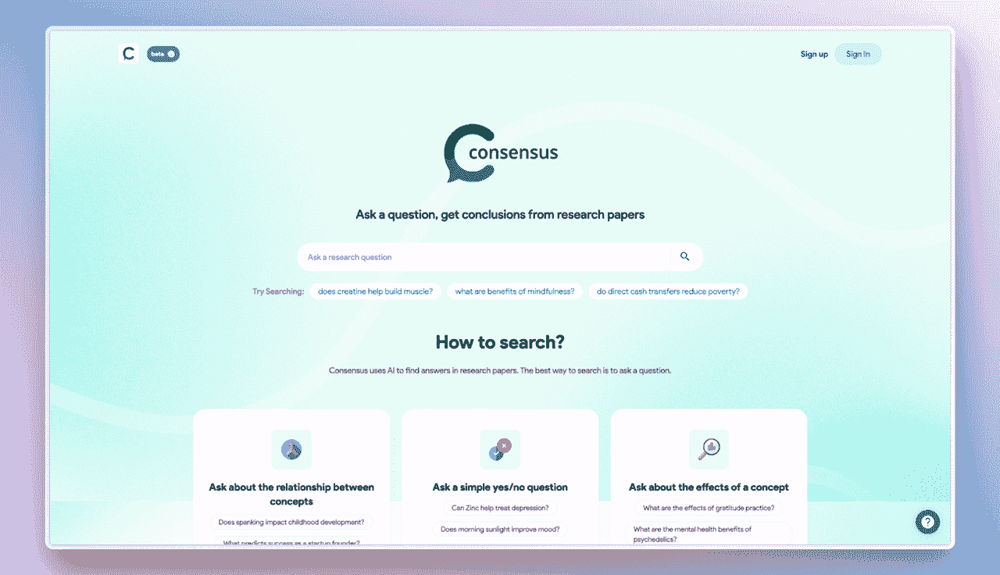

## CustomGPT Plugins：快速创建 ChatGPT 的插件

CustomGPT是一种新的构建ChatGPT插件的方法，可以在几分钟内无需编码构建插件。它是一个无代码工具，可以在CustomGPT的云平台上安全地托管端点。该平台可以快速创建面向客户的ChatGPT插件，无需IT支持，大大减少了构建ChatGPT插件所需的时间和费用。CustomGPT Plugins具有多源数据集成功能，可以快速从各种来源（包括网站、帮助台、YouTube视频、播客等）摄取数据，创建定制化的ChatGPT插件。该平台还具有高级向量数据库和语义搜索功能，确保插件能够准确理解和回答查询，优化查询相关性。CustomGPT Plugins是一个业务级平台，可以支持企业的快速增长。

## ailcoustics：AI 音频处理工具

这个工具可以提高录音、社交媒体内容、语音笔记、播客、讲座、历史内容等语音的质量，支持上传或拖放.mp3、.wav、.m4a格式的文件，大小不超过30MB，时长不超过10分钟。

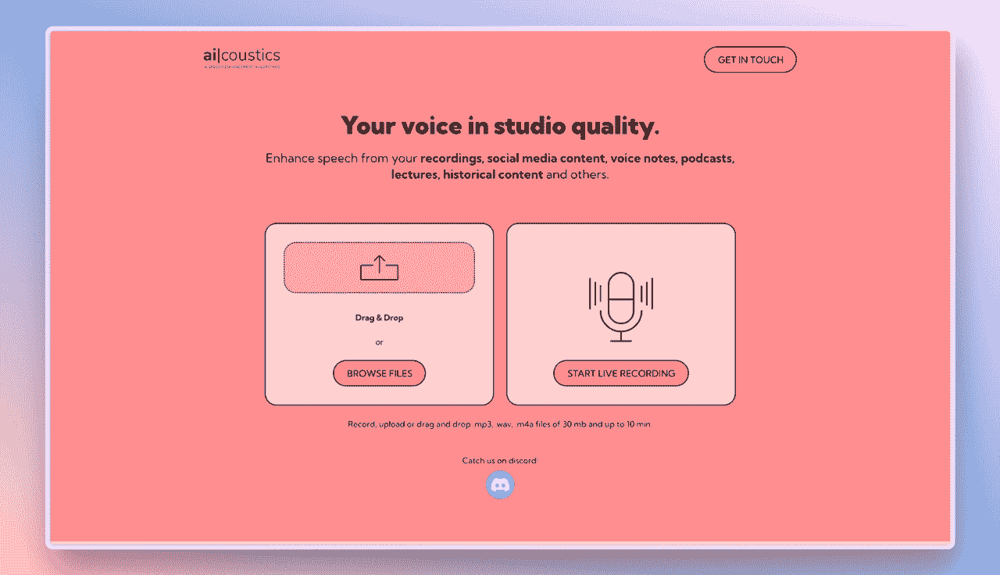

## KickResume：AI 帮你改写简历

该平台提供了AI简历重写服务，使用OpenAI的GPT-4语言模型，可以在几秒钟内修复简历中的错误、使其更加专业，并使用行业术语和关键词优化简历，帮助用户通过ATS筛选，并生成与求职职位匹配的求职信。

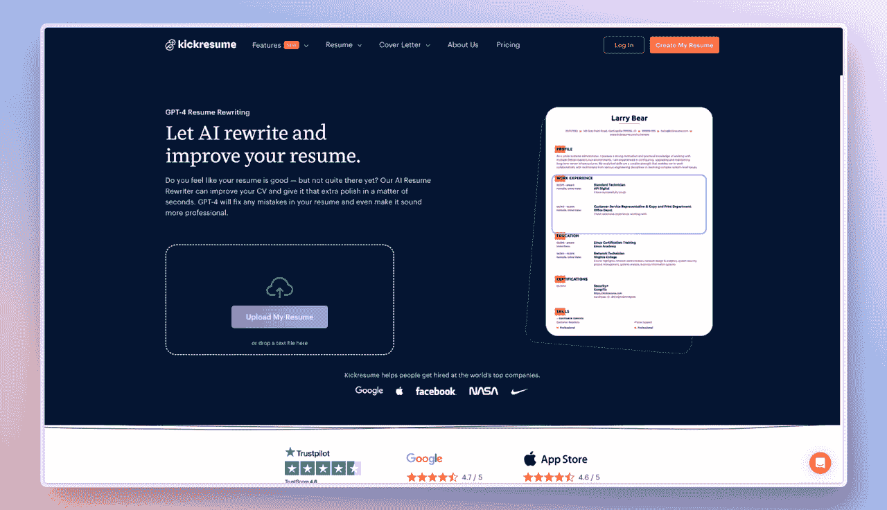

## 吐司tusi.art：SD 模型分享和 AI 画图平台

开放的模型分享社区，所有模型不仅能下载还能在线运行；免费的在线生图工具，海量可选的模型，无需显卡，无需安装任何软件，手机上也能使用；生成的图片作品可以一键分享到社区，社区内的作品都能一键做同款。类似的国内模型平台还有： https://www.liblibai.com/

## Encord Active： 用于计算机视觉的开源主动学习工具包

Encord Active是一个可定制的工具包，可用于数据、标签和模型。它可以帮助您找到模型中的故障模式，优先处理高价值数据进行标注，并进行智能数据筛选以提高模型性能。它可以快速调试数据集并提高模型性能，适用于机器学习工程师和数据科学家。只需一行代码即可开始导入数据、标签和模型预测。Encord Active是一个全面的开源工具包，可用于提高数据质量和模型性能。使用直观的UI或以编程方式访问所有功能。它还提供了智能模型评估功能，可基于质量指标找到模型故障模式，并针对高价值数据进行数据收集和标注。您还可以将模型性能与每个质量指标相关联，以了解哪些数据和标签特征影响模型性能。

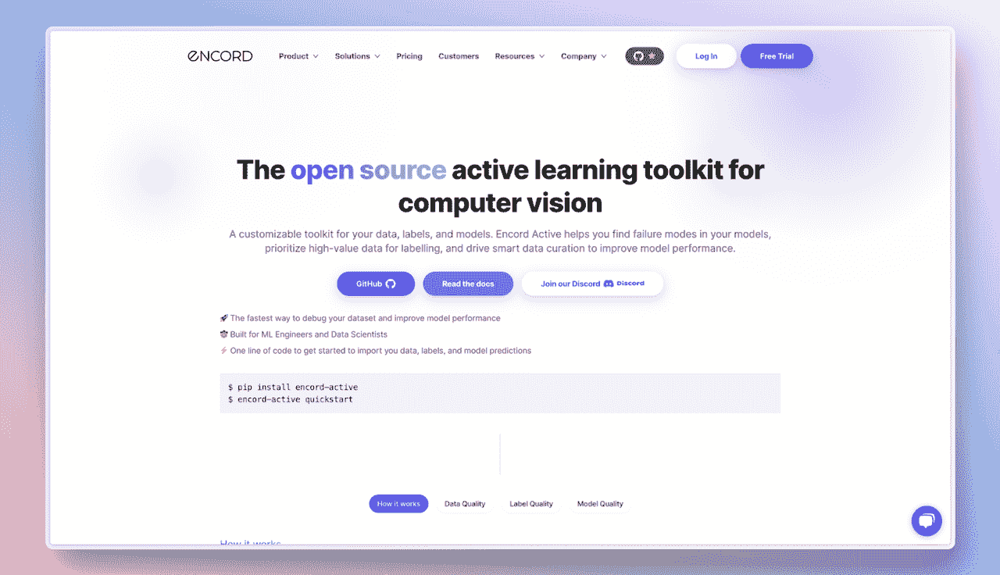

## Upword：AI 内容分析工具

Upword，可以帮助用户在一个平台上完成整个研究工作流程，包括提取关键思想、添加评论、附加链接和图片、捕捉信息等。此外，文章还介绍了Generative Tech的概念，即使用AI模型和深度学习引擎来生成新内容和想法，创造新的工作机会和提高生产力。最后，文章还介绍了如何使用Building a Second Brain方法来保存和系统地提醒我们通过经验获得的想法、灵感、见解和联系。

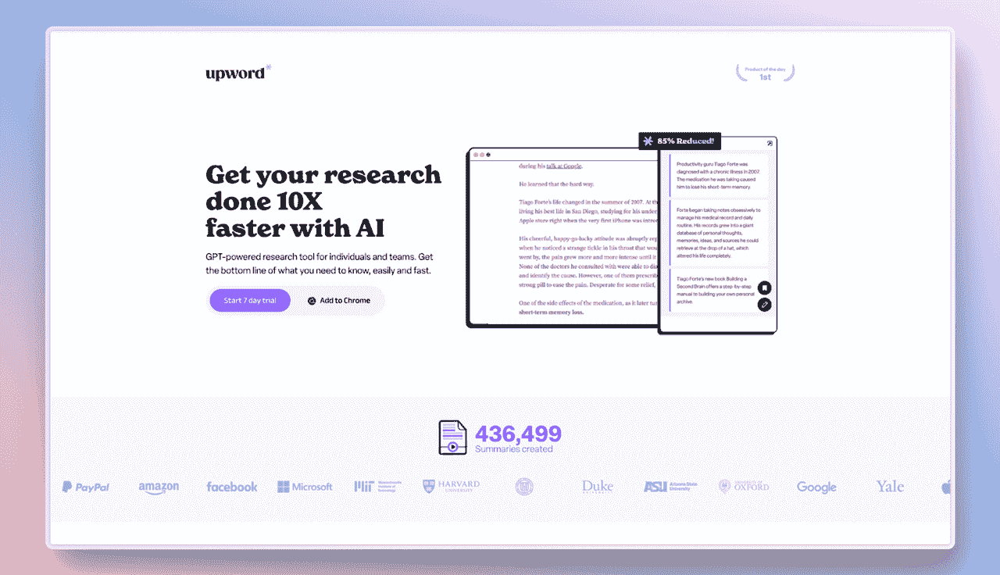

## Gamma：AI 生成 PPT 工具支持导出 pptx 格式

Gamma 团队发布了一个他们说过永远不会构建的功能：Powerpoint 导出。他们意识到，创业公司的存在是为了解决客户问题，而引入新技术通常是最好的方式。但是，他们花费了一些时间才意识到，关键是要专注于解决实际问题，而不是仅仅着眼于技术本身。Powerpoint 导出是为了更好地满足用户需求，让用户更容易地将 Gamma 作为他们日常工作流程的自然延伸

# 🔬精选文章

## MPT-30B：提高开源基础模型的标准

MosaicML发布了新的开源模型MPT-30B，比之前的MPT-7B更强大，性能超过了原始的GPT-3。同时，他们还发布了两个基于MPT-30B的模型：MPT-30B-Instruct和MPT-30B-Chat，分别用于单轮指令跟随和多轮对话。这些模型都具有独特的特点，如8k令牌上下文窗口、支持更长的上下文等。此外，MosaicML还提供了MPT-30B的训练和推理服务，可以根据需要进行定制和部署。模型在编程方面表现出色，还在人类评估中取得了很高的分数。

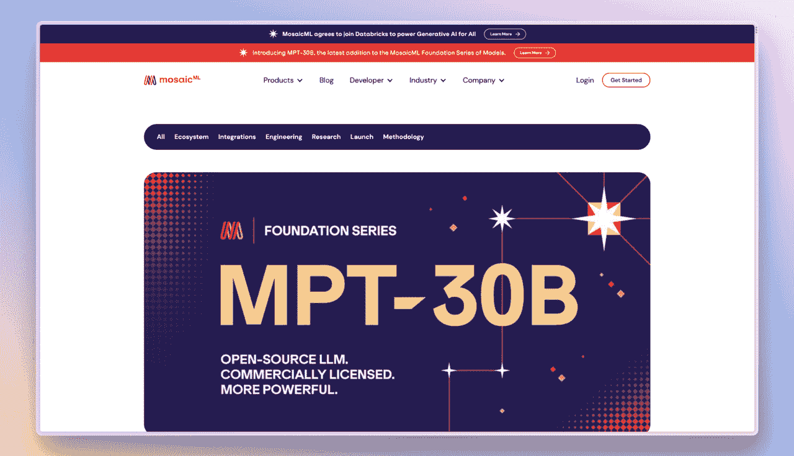

## RLHF的实际工作原理以及我们何时能在开源项目中看到它

本文讨论了强化学习从人类反馈中学习（RLHF）为什么有效的问题，作者认为RLHF在两个条件下才能长期有效：第一，需要有一些信号表明仅应用基本监督学习不起作用，即成对偏好数据；第二，它也在需要缓慢改变以实现成功的复杂优化景观上表现出色。此外，本文还探讨了RLHF的数据和优化方面，以及其在遇到困难时的应用。作者指出，RLHF在数据方面需要非常准确和可靠的数据，而在优化方面需要匹配分布以获得最佳效果。此外，本文还探讨了RLHF的规模问题，以及一些仍需解决的问题。

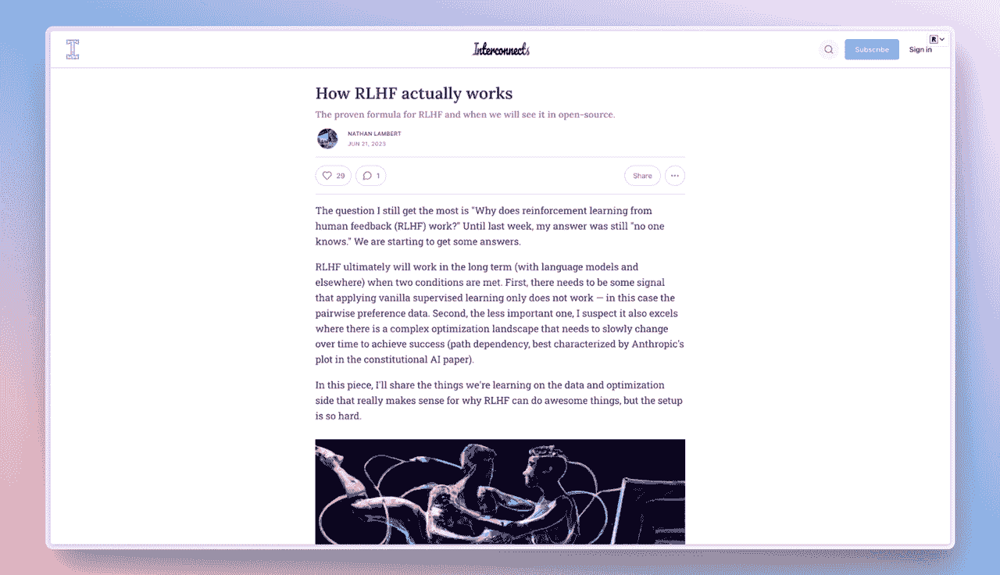

## Inflection-1：Pi 背后的基础语言模型

Inflection发布了个人AI产品Pi，旨在为每个人打造个性化的AI。他们开发了自己的LLMs模型，Inflection-1，能够比GPT-3.5、LLaMA、Chinchilla和PaLM-540B等LLMs模型更快、更好地完成任务。他们计划在未来几个月内继续扩大规模和创新，以实现他们的使命：构建最有能力和安全的AI产品，让数百万用户可访问。

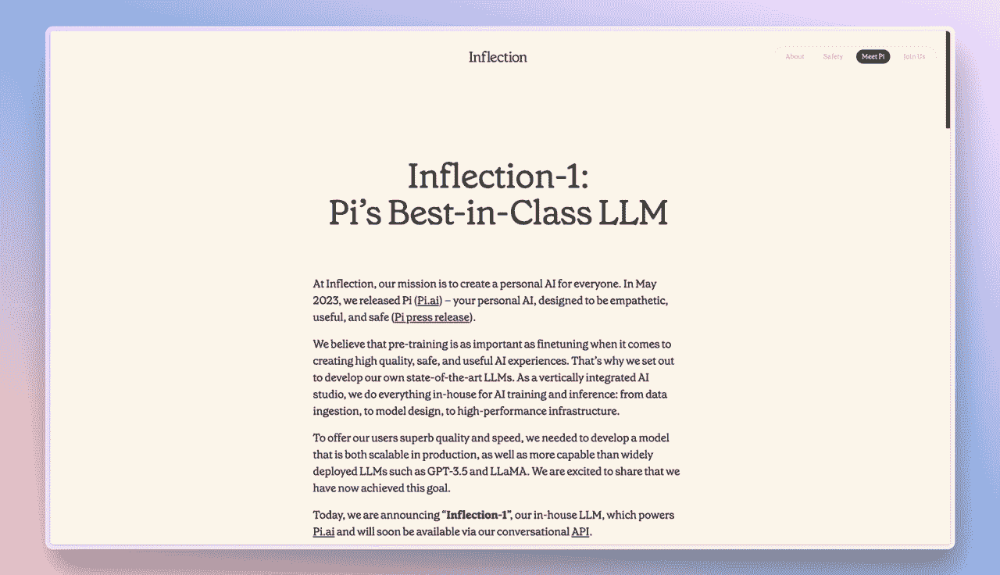

## 谷歌发布SoundStorm： 高效的并行音频生成

近年来，生成式人工智能的进展使得在文本、视觉和音频等多个领域中创造新内容成为可能。这些模型通常依赖于将原始数据首先转换为一系列标记的压缩格式。在音频方面，神经音频编解码器可以将波形有效地压缩为紧凑的表示形式，这可以被反转以重构原始音频信号的近似值。通过将音频表示为一系列离散的标记，可以使用基于Transformer的序列到序列模型进行音频生成。与AutoLM等许多生成音频模型不同，SoundStorm能够并行生成标记，从而将推理时间减少了100倍，并产生了相同质量的音频和更高的语音和声学条件一致性。

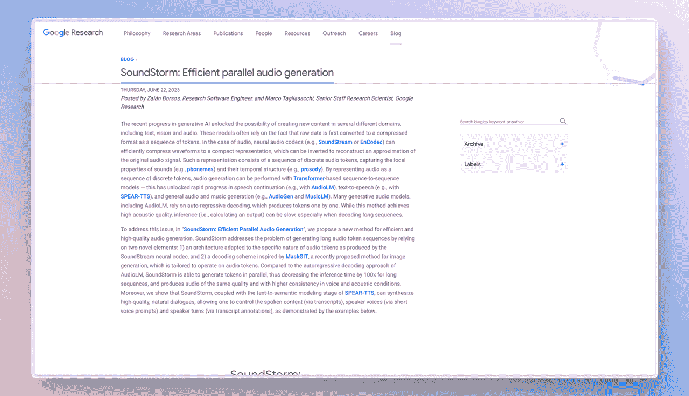

## [AI或死亡：引领用户研究新时代](https://bootcamp.uxdesign.cc/ai-or-die-ushering-in-a-new-era-of-user-research-1d4ce89a9660)

本文讨论了传统用户研究方法在现代产品开发中的局限性，以及人工智能（AI）在用户研究中的应用。随着产品交付速度的加快，传统用户研究方法已经无法跟上节奏，导致产品团队在决策过程中缺乏及时、丰富和可行的用户见解。AI可以帮助用户研究克服这些挑战，通过处理复杂任务、快速筛选大型非结构化数据集并进行智能预测和判断，AI已经开始重塑行业。AI在用户研究中的潜在价值巨大，可以限制偏见、弥合文化和语言障碍、进行上下文、定位和触发式研究、24/7收集数据、无限扩展并在采访时分析数据，以实时揭示行为和态度。AI在用户研究中的应用已经开始出现，分为“启动器”和“执行者”两种类型的工具。在未来，AI将成为用户研究的重要工具，帮助企业更好地理解和满足用户需求。

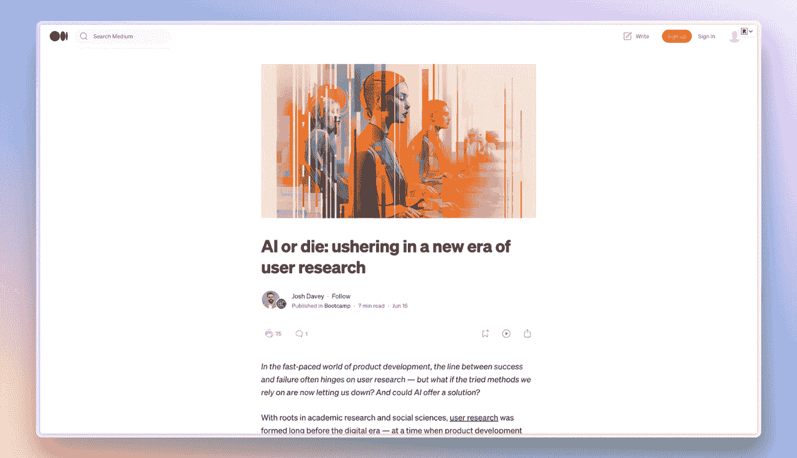

## 使用JavaScript开始AI堆栈-a16z

a16z基础架构团队创建了一个简单的“AI入门”模板，旨在帮助初学者快速入门，摆脱认证、托管和工具选择等附属问题。该模板包括JavaScript堆栈、Clerk认证、Pinecone/Supabase pgvector向量数据库、Langchain.js LLM编排和Replicate图像/文本模型。该团队计划不断完善该模板，以支持更多选项。

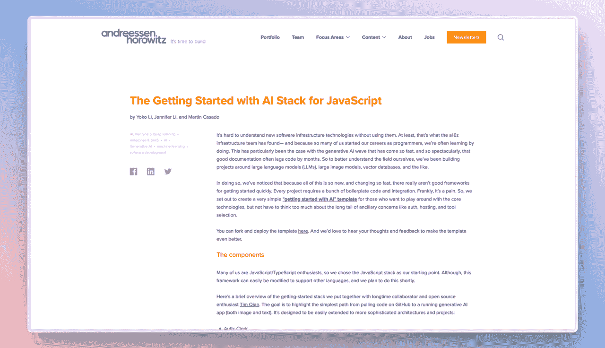

## 新的护城河：为什么智能系统仍是下一个可防御的商业模式

这篇文章回顾了六年前的一篇博客，提出了AI可以构建可持续的商业模式的观点。作者认为，AI可以成为下一个防御性的商业模式，而开源AI模型的出现可能会将部分价值转移到初创公司和基础设施周围。文章列举了传统经济护城河的一些例子，并探讨了AI时代下的新护城河。作者认为，初创公司需要构建智能系统，即AI驱动的应用程序，以建立新的护城河。

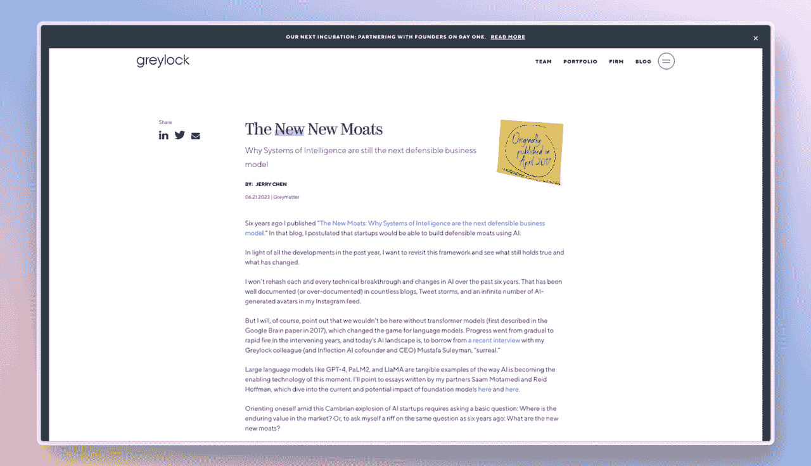

## 哈佛CS50将把人工智能融入课程教学中

哈佛大学旗舰编程课程《计算机科学50：计算机科学导论》将于今年秋季开始使用人工智能辅助学习工具。学生可以利用AI帮助他们找到代码中的错误，给予反馈，解释陌生的代码行或错误信息，并回答个别问题。该课程的工作人员正在尝试使用GPT 3.5和GPT 4模型。该AI将帮助学生找到代码中的错误，而不是直接提供解决方案。AI还将以更简单的术语解释潜在的复杂错误消息，并为学生提供可能的“学生友好建议”来解决它们。该AI将进一步减少课程工作人员的时间，以便将时间重新分配给更有意义的与学生的交流。

## 比 SAM 快 50 倍的图象分割

SAM模型在计算机视觉任务中产生了显著影响，成为许多高级任务的基础步骤，如图像分割、图像标题和图像编辑。然而，其巨大的计算成本阻碍了其在工业场景中的广泛应用。本文提出了一种速度更快的替代方法，通过将任务重新定义为分段生成和提示，我们发现一个常规的CNN检测器与实例分割分支也可以很好地完成这项任务。我们使用SAM作者发布的1/50 SA-1B数据集直接训练现有的实例分割方法，仅使用我们的方法，我们在50倍的运行时间速度下实现了与SAM方法相当的性能。我们提供充分的实验结果来证明其有效性。

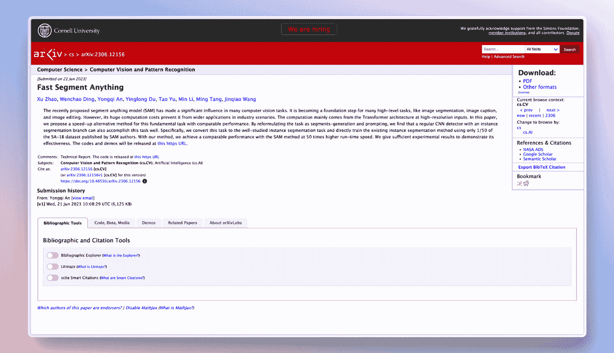

## RoboCat：DeepMind新发布的机器人代理

RoboCat - 一个新的基础代理，可以操纵不同的机械臂，只需要100个演示就可以解决任务；AI代理可以自我生成新的训练数据来改进其技术，并更有效地适应新任务。

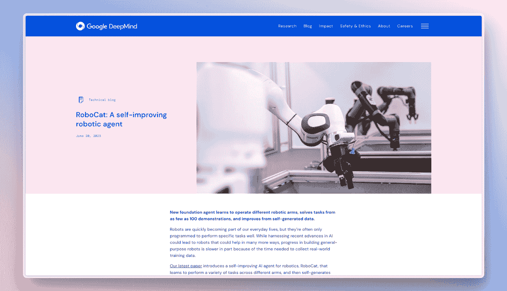