# AIGC Weekly #26

> 来源：[https://waytoagi.feishu.cn/docx/G2xJdXyJ7ojrtgxOxx8cMvPAn7c](https://waytoagi.feishu.cn/docx/G2xJdXyJ7ojrtgxOxx8cMvPAn7c)

> 🔗 原文链接： h[ttps://op7418.zhub](https://op7418.zhubai.love/posts/2282531383102836736)ai.love/posts/22...

> 发表时间：2023-06-19

工具：Midjourney v5.1

Abstract lighting background.a close up of an object, large area blank, dark mode, Low saturation, post-modern minimalist style, smooth curves, bright blue and purple, in the style of distorted form, 8k resolution, minimalist beauty, rounded forms, grainy, rim light --ar 3:2

# ❤️上周精选

## Open AI 大动作，模型更新、函数调用、费用降低

Open AI 上周三发布了一大批模型相关的更新，包括了GPT-4和3.5的新版本模型，模型都支持函数调用以及关于模型 费用的调整。

## 模型更新

gpt-4-0613 包括一个更新和改进的模型，带有函数调用。 gpt-4-32k-0613 包括与 gpt-4-0613 相同的改进，同时上下文长度再度扩展，以便更好地理解更大的文本。

gpt-3.5-turbo-0613 包括与 GPT-4 相同的函数调用以及通过系统消息提供的更可靠的可控性。

gpt-3.5-turbo-16k 的16k 上下文意味着该模型现在可以在单个请求中支持约 20 页文本。

## 价格调整

text-embedding-ada-002 将成本降低 75% 至每 1K Token 0.0001 美元。 gpt-3.5-turbo-16k 的定价为每 1K 输入Token 0.003 美元，每 1K 输出Token 0.004 美元。 gpt-3.5-turbo’s 输入Token的成本降低了 25%

比较遗憾的是GPT-4还是没有降价，看来GPU短缺和成本问题依然存在。

## 函数调用

开发人员现在可以向 gpt-4-0613 和 gpt-3.5-turbo-0613 描述函数，并让模型智能地选择输出包含调用这些函数的参数的 JSON 对象。这是一种更可靠地将 GPT 功能与外部工具和 API 连接的新方法。主要解决的是低成本和稳定的从GPT获得结构化的问题，以前这些问题需要非常长的提示词来完成，而且不是很稳定。

[详](https://platform.openai.com/docs/guides/gpt/function-calling)细的介绍可以看Open AI的相关 API 文档： https://platform.openai.com/docs/guides/gpt/function-calling

也可以看哥飞的这个介绍：

## 其他动作

+   未来几周内邀请候补名单中的更多人试用 GPT-4，直到完全删除候补名单，如果还没申请的可以申请一下。

+   Chat GPT的开发者权限已经授予了所有等待列表的Plus会员，各位可以检查一下自己的邮箱。

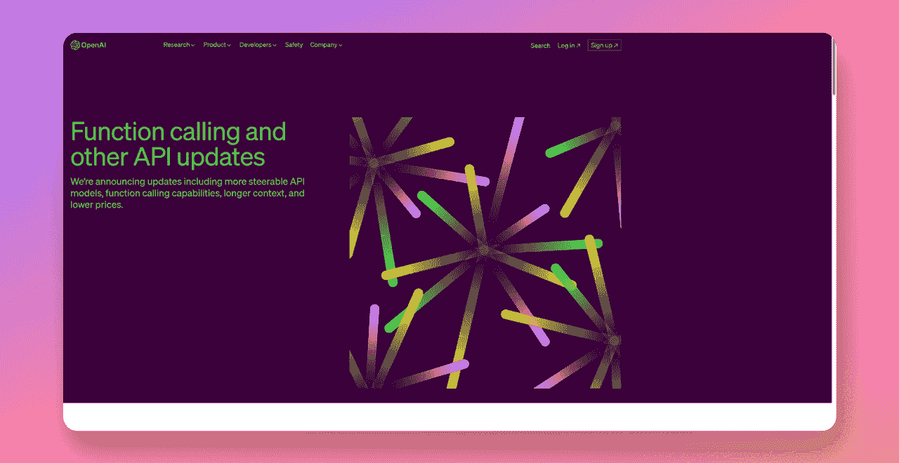

## Meta 推出 Voicebox，一个全能语音生成模型

Meta 最近瞄准了除了大语言模型之外的其他媒体生成式模型开始发力，比如上周推出了 Voicebox，一个全能语音生成模型，这是一个支持六种语言和多种语音处理功能的模型，可惜的是暂时不开源，功能和原理包括：

## 大致原理

在Voicebox之前，生成式语音AI需要使用精心准备的训练数据为每个任务进行特定的训练。Voicebox采用了一种新的方法，仅通过原始音频和相应的转录来学习。与用于音频生成的自回归模型不同，Voicebox可以修改给定样本的任何部分，而不仅仅是给定音频片段的末尾部分。

## 基于上下文的文本转语音合成

使用仅为两秒的输入音频样本，Voicebox可以匹配样本的音频风格并用于文本转语音生成。未来的项目可以在此基础上发展，为无法说话的人提供语音，或者允许人们自定义非玩家角色和虚拟助手使用的声音。

## 跨语言风格转换

给定一段英语、法语、德语、西班牙语、波兰语或葡萄牙语的语音样本和文本段落，Voicebox可以产生该语言的文本朗读。

## 语音降噪和编辑

Voicebox的上下文学习使其在生成语音以无缝编辑音频录音片段方面表现出色。它可以重新合成被短时噪音破坏的语音部分，或者替换掉错误发音的单词，而无需重新录制整个语音。

## 多样化的语音采样

通过从多样化的野外数据中学习，Voicebox能够生成更贴近现实世界中人们交流方式的语音，覆盖了上述六种语言。将来，这种能力可以用于生成合成数据，以帮助更好地训练语音助手模型。

[更详细的信息也可以去看他们的论文： https://research.facebook.com/public](https://research.facebook.com/publications/voicebox-text-guided-multilingual-universal-speech-generation-at-scale/)ations/voicebox-text-guided-multilingual-universal-speech-generation-at-scale/

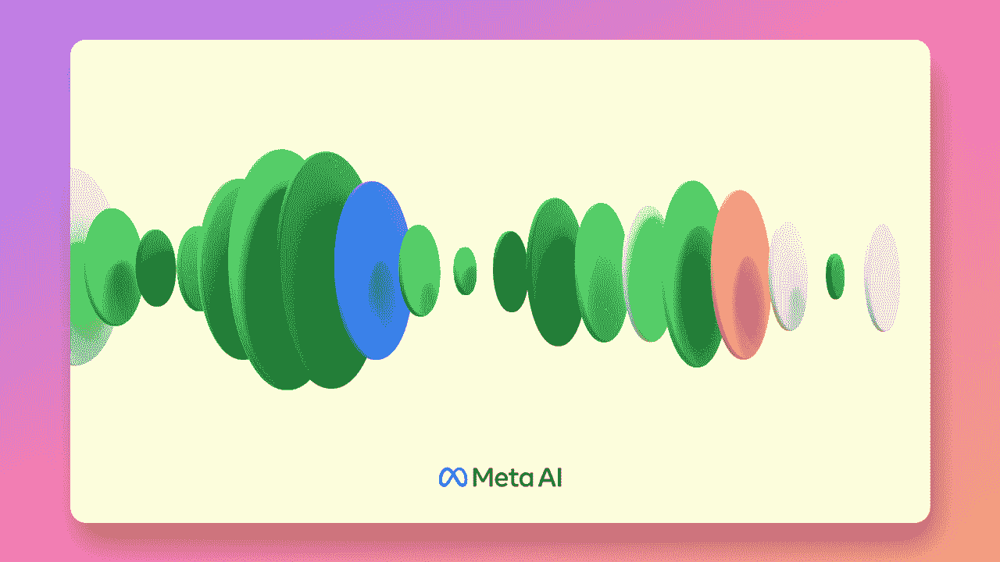

## 其他的生成式模型进展

## Midjourney最新的工作报告进展

上周Midjourney工作时间官方的一些消息，比较重要的有：

v5.2的相关消息

在几天之内发布，计划尽快发布，可能在当天结束或接近本周末， 与v5和v5.1类似

将包括：有限的与Discord兼容的外描功能，例如，缩小视野、更改画面比例。新的美学内容 ，略微提高连贯性和对单词的理解能力。

提示分析器

不知道这是否会与v5.2一起发布或分开发布

旨在减少没有任何作用的冗长提示，并推动文化朝着简洁并能够实现您想要的目标的提示方向发展。

V6相关信息

V6发布延迟了；加大了人力投入；不得不停止训练，很快会恢复；预计将在7月发布

包括：更好的提示理解能力；更高分辨率；更具组合性（难以描述；看到后你就会明白）；能够处理更复杂的概念。

v5.3相关信息

另一个用于更新美学的系统，另一个用于更新美学的系统，另一个用于更新美学的系统，在质量和多样性之间存在挑战：高质量但同时多样，难以做到，但David认为他们可以做到。

新的Web和移动端

进展比预期慢，全球范围内有一个庞大的团队在开发，它将非常好，不确定何时发布，重点是具备良好的独立功能。

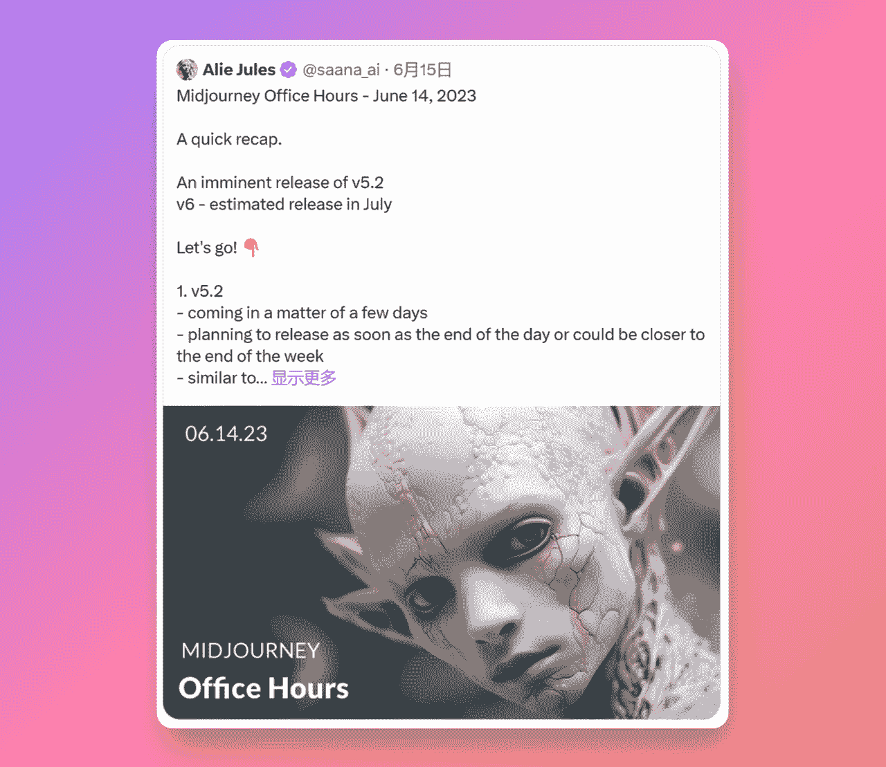

## [谷歌的AI试衣模型](https://blog.google/products/shopping/virtual-try-on-google-generative-ai/)

谷歌前两天发了一个AI试衣模型 TryOnDiffusion，想解决的是用户提供一张自己的全身照，就可以获得自己穿上对应服装的样子。

需要一张用户的全身照和服装模特穿着的照片，效果看起来非常好。

他们主要解决了两个问题：1）通过交叉注意机制隐式地对服装进行变形，2）服装的变形和人物的融合作为一个统一的过程，而不是两个独立任务的序列。

从数据和参考图上来看服装在人物上的变形非常自然，服装的细节也还原的非常好，现在的主要问题就是，演示所有的服装都没有LOGO和文字，不知道他们解决了没有，如果不能有文字的话实用性就大打折扣了。目前没有开源。

## Stable Diffusion稳定生成视频的突破

现在基本所有的SD生成视频都存在稳定性和闪烁的问题，只是有的多有得少。上周发布的这个方案看起来很大程度解决了这个问题。

关键帧翻译和完整视频翻译。第一部分使用适应性扩散模型生成关键帧，并应用分层交叉帧约束来强制形状、纹理和颜色的一致性。第二部分通过时间感知的补丁匹配和帧混合将关键帧传播到其他帧。

最重要的是与现有的图像扩散技术兼容，使框架能够利用它们，例如使用LoRA自定义特定主题，并使用ControlNet引入额外的空间引导。

过几天应该会开源可以到时候关注一下。

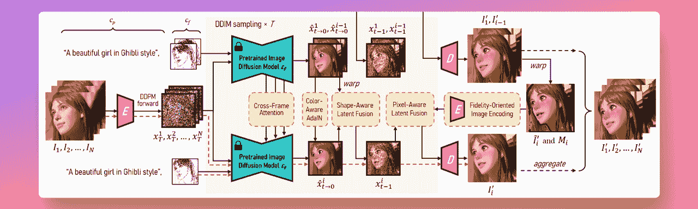

# ⚒️产品推荐

## Framer AI ：AI 帮你创建网页

Framer 提供了从想法到实际网页的快速建站服务，用户可以提供更多细节以获得更好的输出。每个部分都有独特的布局、文本和样式组合，用户可以自由调整和删除。该平台提供了艺术指导功能，用户可以自由搭配字体和颜色，制作自己的主题。此外，该平台还提供了AI写作功能，用户可以通过点击按钮，让AI自动生成更好的文本。

我也写了一个如何使用 FramerAI 的简易教程，感兴趣可以看一下： https://twitter.com/op7418/status/1668932141995167744?s=20

## [Foreplay 2.0：大量制作高转化率的 ](https://www.foreplay.co/)Facebook 和 TikTok 广告

Foreplay是一种必不可少的工具，可以帮助您进行创意策略研究、为客户编制内容想法甚至个人内容开发。收集了 facebook 和 tiktok 非常多的广告范例，可以给广告创作提供内容和数据参考，同时可以利用 AI 集合已有的广告内容和你自己的宣传内容生成文案和视频脚本。

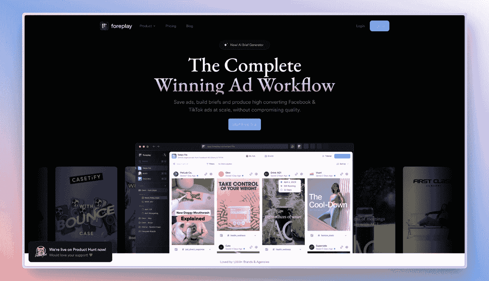

## 腾讯智影：腾讯推出的 AI 画图应用

腾讯推出的AI绘画生成器可以生成多种主题和风格的画面，包括人物、风景、灯光等，可以根据用户的选择和设置生成不同的画面，也可以通过金币购买更多次数。就是拿 SD 打包了一下，调教的还不太行。

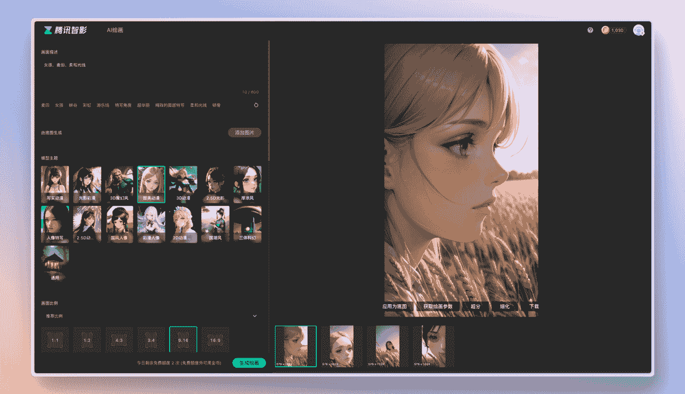

## Locofy：利用AI 和设计系统直接将设计稿转换为前端代码

Locofy是一个前端开发工具，可以将设计转化为Web和移动应用的前端代码，帮助开发者更快地构建应用、屏幕、组件和设计系统，从而使产品的交付速度提高10倍。Locofy支持Figma和Adobe XD到React、React Native、HTML/CSS、Gatsby、Next.js等多种框架，可以节省80%-90%的开发时间。Locofy还提供了预构建组件、API集成和实时原型等功能，让开发更加高效。

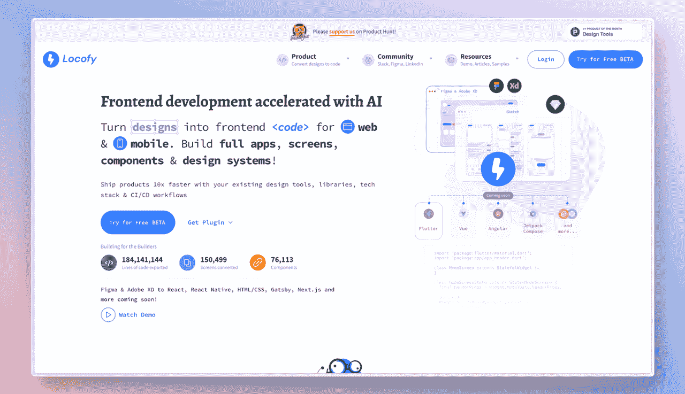

## BeforeSunset：AI 驱动的 To-Do 应用

自动化的任务清单应用，AI 帮你规划你的清单和对应的时间并给出建议。提高你任务的可操作性、为你创建合适的子任务、提供建议的会议室时间以及用 AI 计划你的一周。

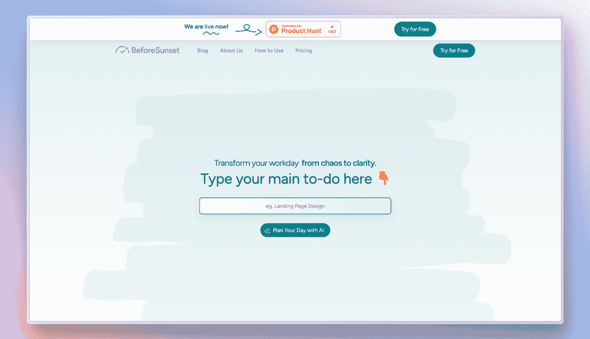

## Spell AI：AI 自动完成你安排的任务

Spell是一款使用GPT4技术的AI工具，可以将任务委派给自主的AI代理人，加快工作效率。同时，Spell还提供插件、聊天等功能，帮助用户更智能地工作。

## Freeflo：一个精美的 AI 生成图片素材库附带有提示词

Freeflo是一个免费的服务，旨在激发您的AI图像创作灵感。您可以浏览我们不断增长的图像库，找到适合您下一个创意项目的内容。一旦您找到了合适的图像，可以通过下载我们的高分辨率示例图像进行测试。如果您对其效果满意，可以使用提示并前往Midjourney创建自己独特的图像。该项目旨在帮助创意行业开发新机会，推动行业向前发展。

## [Hotjar AI for su](https://www.hotjar.com/product-ai-surveys/)rveys：AI 帮助创建调研问卷和分析

Hotjar AI for Surveys是一个可帮助你节省大量时间的调查工具，可以在几秒钟内为任何目标创建调查，并自动生成摘要报告。使用调查生成器快速启动调查，使用摘要报告减少分析回复的工作量，让AI来处理研究工作，让你专注于用户体验。

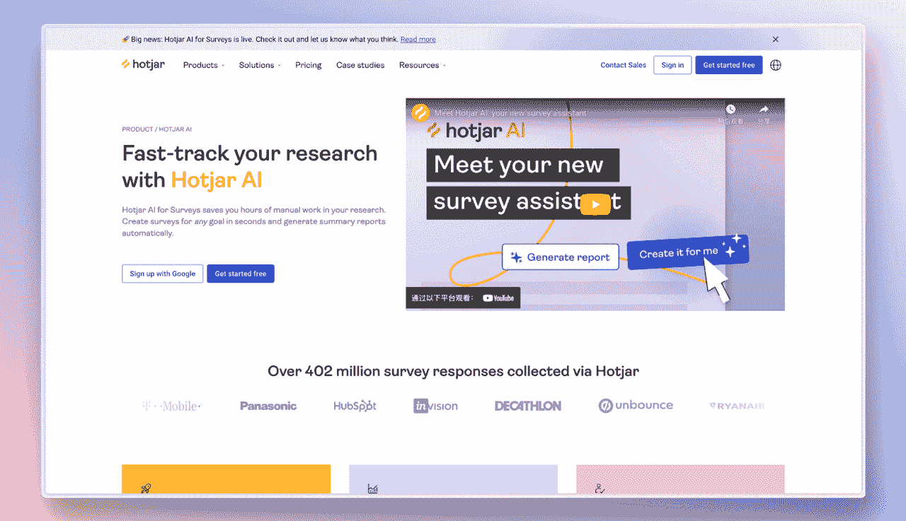

## Vercel 推出了 AI SDK加速构建 AI 应用的过程

推出了新的工具来改进Vercel上的AI体验，包括Vercel AI SDK和Chat & Prompt Playground等。SDK是一个开源库，旨在帮助开发人员在JavaScript和TypeScript中构建对话、流媒体和聊天用户界面。Playground是一个交互式在线提示工具，提供20个开源和云LLM，可以实时比较各种语言模型结果，调整参数，并快速生成Next.js、Svelte和Node.js代码。

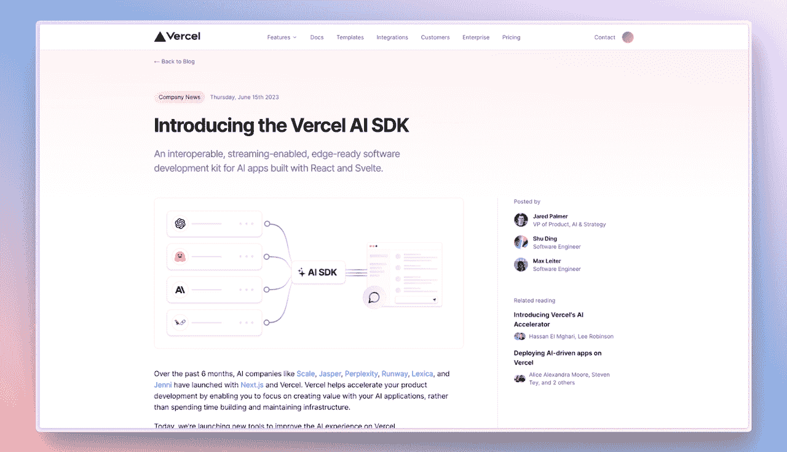

## [Millie：AI交友助手](https://www.meetmillie.app/)

Millie是一款AI交友助手，能够根据你的情况提供个性化的建议，帮助你在约会应用上获得更多成功。Millie能够为你打破僵局，提供完美的开场白，并根据你所在的城市位置为你提供创意活动建议。如果你缺乏灵感，Millie还能为你编写创意简介和回复。

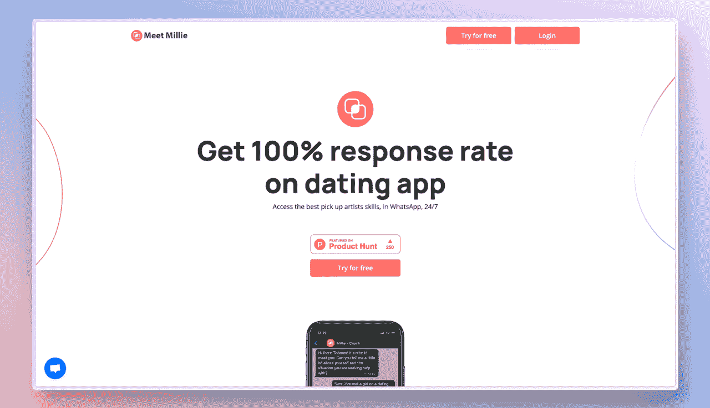

## Lancey：产品增长平台，快速启动PLG实验

AI 帮助你生成产品增长实验，并进行分析

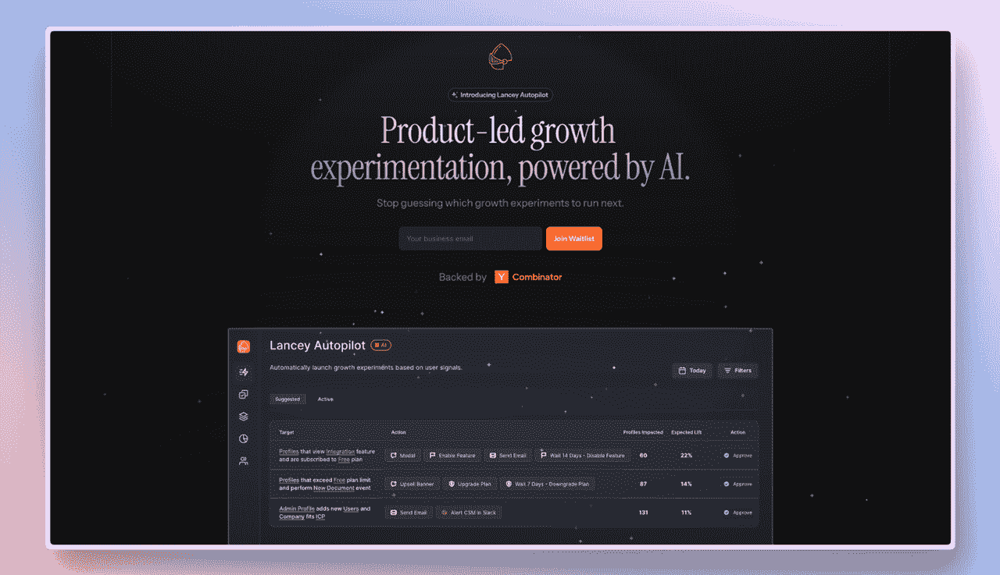

## Octopulse AI：AI 驱动的用户增长分析平台

该平台基于LLM技术，旨在通过“5个正确”（正确的用户、信息、渠道、数量和时间）来最大化激活、转化和保留。利用SynthAI技术，可以发现数据驱动的用户细分来进行定向投放，同时利用GenAI技术来为每个细分定制高度相关的内容。此外，该平台还可智能优化消息的数量和投递时间，最大化业务成果，同时最小化退订率。

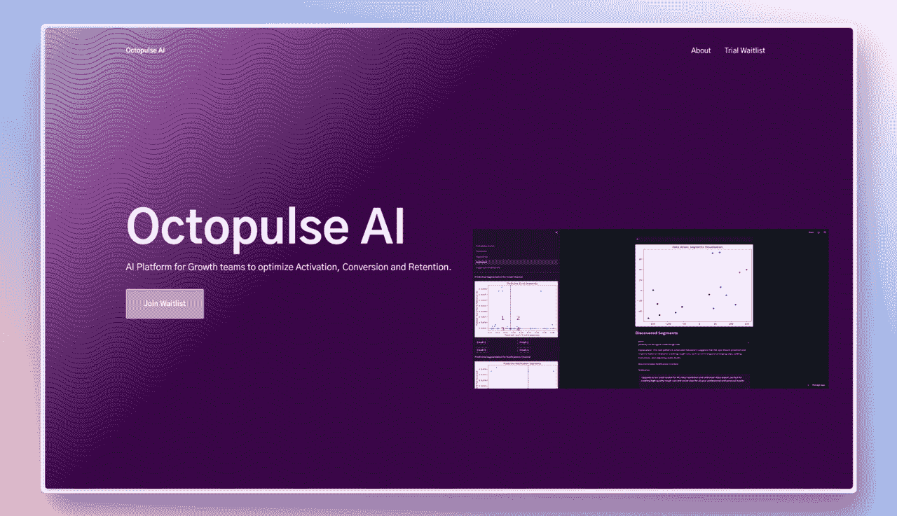

## Writesonic：AI 辅助你撰写品牌宣传文章

Writesonic是一款AI文章生成器，可以在5分钟内以你的品牌声音撰写准确、个性化的文章。该软件可以根据你的品牌风格定制文章，搜索Google获取准确信息，并使用你的关键词进行SEO优化。它是一款基于GPT-4-32K的AI文章写作工具，可以训练你的文档和品牌声音，轻松生成SEO优化的内容。该软件可以生成百万级别的文章，为你的品牌打造可信、引人入胜的内容，并确保文章不会抄袭。此外，它还可以帮助你优化博客，让你的文章轻松排名谷歌搜索结果。

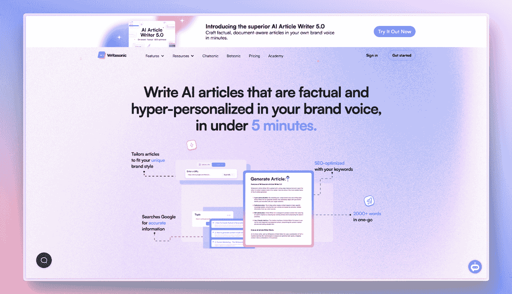

## Logo livery：AI 生成 LOGO

Logo AI生成器。尝试使用我们的AI为您的产品或业务创建标志。初创企业创始人，本地企业所有者，影响者，太空猫SVG。真正的，不再有像素化和模糊的边缘。我们的AI在纯SVG中生成更专业和响应的标志。商业条款由LogoliveryAI创建的所有标志都可以自由用于商业目的。

## Obviously AI：无需编写代码即可构建AI模型的工具

Obviously AI是一款无需编写代码即可构建AI模型的工具，可以在几分钟内从原始数据到行业领先的预测模型，无需几个月的时间。该工具可以实现分类、回归和时间序列等多种预测功能，并提供模型构建、部署、监控、集成和共享等功能。同时，用户可以获得24小时的数据科学团队支持，节省大量的时间和成本。许多用户都对Obviously AI给予了高度评价，称其为一个易于使用、美观且易于推荐的数据科学解决方案。

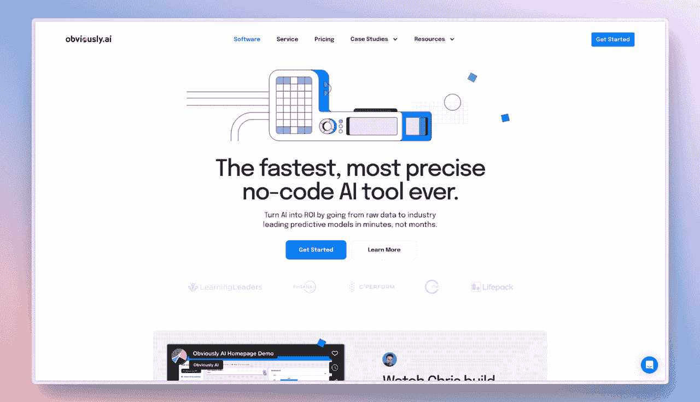

# 🔬精选文章

## [欧盟人工智能法案的介绍](https://www.forbes.com/sites/forbeseq/2023/06/15/a-machine-learning-engineers-guide-to-the-ai-act/)

6月14日，欧洲议会通过了欧盟人工智能法案（AI Act）。该法案将对组织开发、部署和维护其AI系统的方式产生重大影响，同时为其他立法机构采取进一步监管行动铺平了道路。AI/ML从业者应该了解这个新的监管未来，并采取一些措施来适应。AI Act将于2024年初生效，全面实施将在2026年。机器学习和数据科学从业者将需要确保AI使用案例得到适当记录、审查和监测。

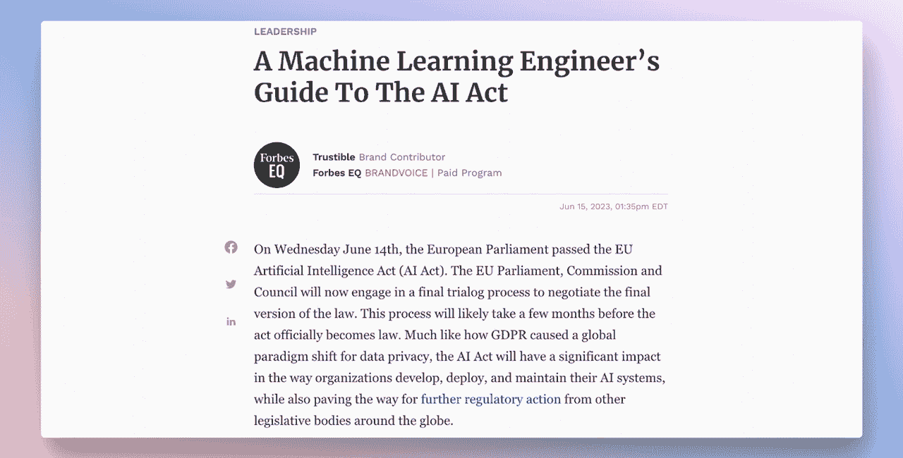

## ChatGPT 代码解释器插件对财务和金融从业者的影响

本文介绍了ChatGPT 的 Code Interpreter的插件，可以通过上传文件让ChatGPT编写Python代码来理解和分析数据。作者通过上传财务报表测试了这个插件的功能，发现它可以自动化大部分的财务工作。作者认为这是一个50亿美元的机会，可以让一家公司成为会计和财务领域的主导工具，甚至可以取代QuickBooks或Oracle。

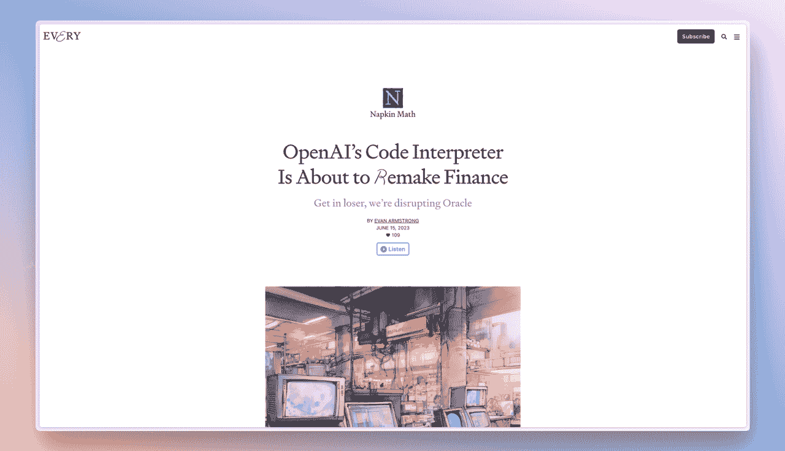

## [第一个基于 Yann LeCun](https://ai.facebook.com/blog/yann-lecun-ai-model-i-jepa/) 对更像人类 AI 的愿景的 AI 模型

Meta公司的首席人工智能科学家Yann LeCun提出了一种新的架构，旨在克服目前最先进的人工智能系统的关键限制。他的愿景是创建能够学习世界运作内部模型的机器，以便它们可以更快地学习，规划如何完成复杂任务，并能够轻松适应陌生情况。他们现在推出了第一个基于LeCun愿景关键组成部分的人工智能模型，名为Image Joint Embedding Predictive Architecture（I-JEPA）。I-JEPA通过创建外部世界的内部模型来学习，这比比较图像的抽象表示要更有效率，而且学习到的表示可以在许多不同的应用中使用，无需进行大量的微调。

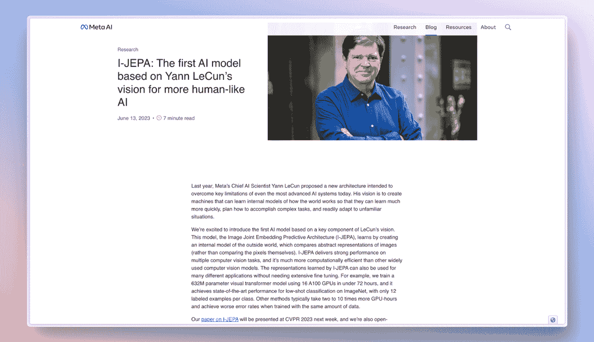

## [LLM的不同发展路径](https://www.interconnects.ai/p/llm-development-paths)

本文探讨了开源社区发展语言模型的可能性和前景。在 ChatGPT 推出之前，大多数语言模型被视为主要是研究项目，因此模型的易用性和成本扩展性方面的问题并不太重要。然而，开源社区正在探索一系列不同的语言模型，包括前期成本、预测能力、控制程度等。因此，开源社区的语言模型很可能会与 OpenAI 和 Google 的模型有很大不同。本文认为，开源社区应该发展出更具有针对性的语言模型，而不是试图复制 ChatGPT。同时，本文还分析了不同类型的公司和机构对语言模型发展的影响。

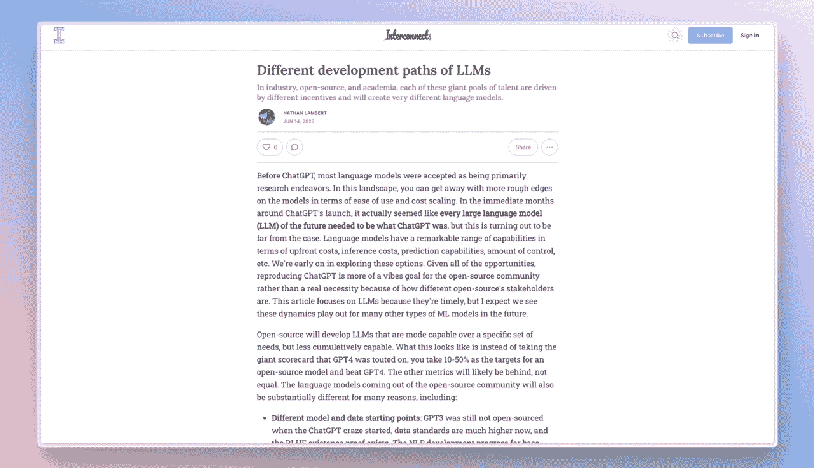

## [成规模的 AI 领域市场地图](https://alexsandu.substack.com/p/market-map-gen-ai-companies-with)

2023年第一季度，生成式人工智能创业公司获得了超过17亿美元的融资，为市场开发基础模型。Inflection和Character.ai专注于消费者个人助理领域，Anthropic、Cohere和AI21Labs则专注于企业领域的文本处理和生成工具。Adept则开发了一个AI队友，用自然语言提示执行任务。Runway专注于图像、视频和音频编辑，Stability.ai专注于增强图像组合和人脸生成，Midjourney则帮助艺术工作者生成原型。生成式AI模型是AI空间发展的加速器，将为所有领域提供各种应用，并改善日常生活。

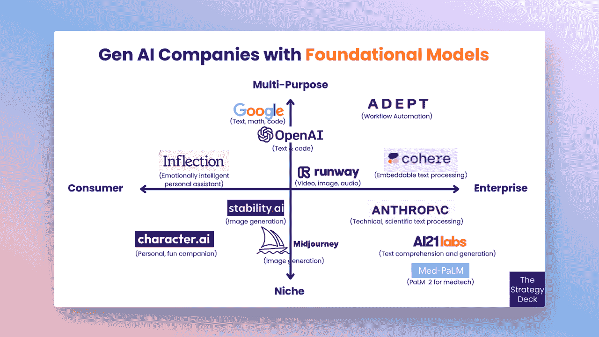

## Reddit实际上是OpenAI的护城河

本文提出了一个有趣的理论：Reddit实际上是OpenAI的附庸。OpenAI需要扩大自己的优势，而Reddit作为一个训练数据非常宝贵。此外，Reddit的数据对OpenAI来说更容易获取，而对于谷歌等公司和新兴AI组织来说则更难。因此，Reddit的未来数据对OpenAI非常重要，而且保护这些数据是OpenAI的首要任务。Reddit可以通过关闭第三方API访问来保护数据，但是必须避免破坏社区。最后，作者强调这不是一个阴谋，而是两个公司的股东可能会利用其中一个公司来造福另一个公司。

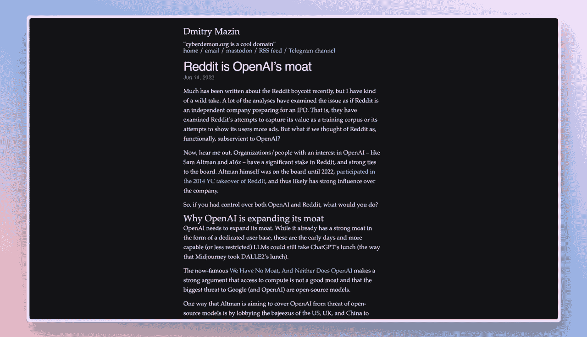

## [用长期记忆增强语言模型](https://huggingface.co/papers/2306.07174)

该论文提出了一种名为LongMem的语言模型增强长期记忆的框架，可以使大型语言模型记忆长期历史，并利用长期记忆进行语言建模。LongMem采用了一种新颖的解耦网络结构，将原始骨干语言模型冻结为记忆编码器，并使用自适应残差侧网络作为记忆检索器和读取器。实验结果表明，该方法在长期上下文建模基准测试中优于强长期上下文模型，并在记忆增强的上下文学习上取得了显着的改进。该方法对于帮助语言模型记忆和利用长期内容是有效的。

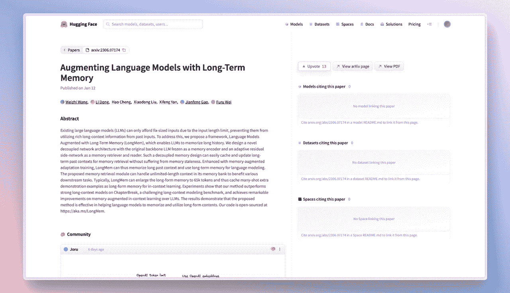

## [FinGPT：开源金融 LLM](https://arxiv.org/abs/2306.06031)

本文介绍了一种名为FinGPT的开源大型语言模型，用于金融领域。与专有模型不同，FinGPT采用数据为中心的方法，提供可访问和透明的资源，以开发金融LLMs。作者强调了自动数据筛选管道和轻量级低秩适应技术在构建FinGPT中的重要性，并展示了几个潜在应用，如机器人顾问、算法交易和低代码开发。FinGPT旨在通过开放源代码的AI4Finance社区的协作努力，刺激创新，民主化FinLLMs，并在开放金融中开启新的机遇。

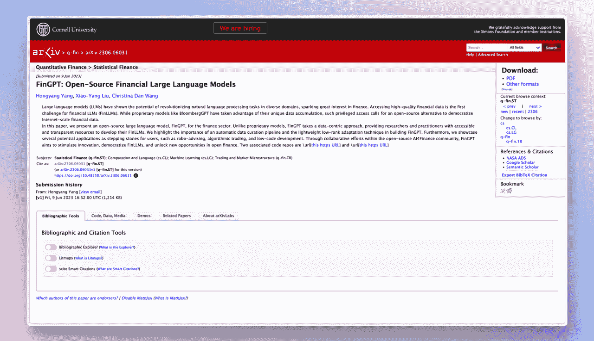

## [LLM 输出内容水印的可靠性](https://arxiv.org/pdf/2306.04634.pdf)

本文探讨了大型语言模型（LLMs）的水印可靠性问题。水印是一种简单有效的策略，可通过检测和记录LLM生成的文本来减轻垃圾邮件、社交媒体机器人和无价值内容等问题。本文研究了水印在现实环境中的鲁棒性，发现即使在人类和机器改写的情况下，水印仍然是可检测的。我们还比较了水印与其他检测器的鲁棒性，发现水印在样本复杂度方面更具优势。

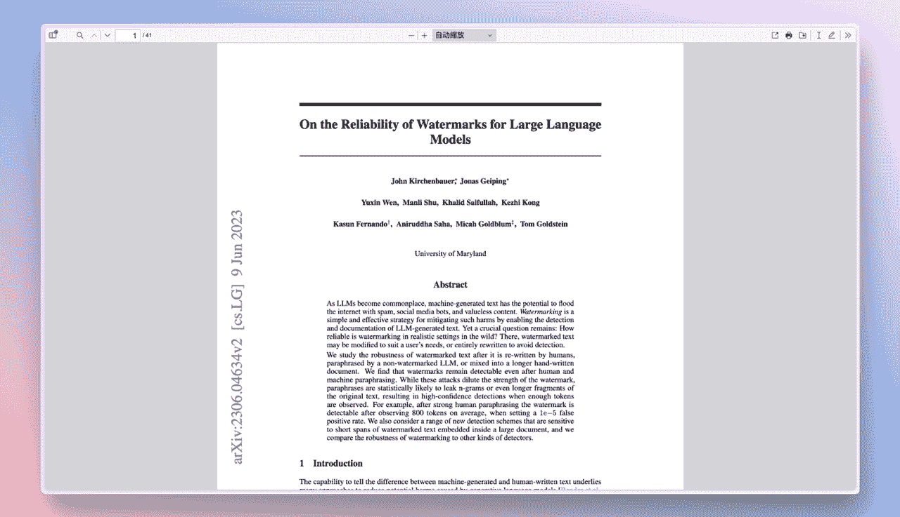

## [Transformer模型调研](https://arxiv.org/abs/2306.07303)

本文通过对2017年至2022年提出的Transformer模型进行广泛调查，概述了Transformer在自然语言处理、计算机视觉、多模态、音频和语音处理以及信号处理等五个领域中的应用，并对高影响力的Transformer模型进行了分析和分类。本文旨在为热心的研究人员提供Transformer技术的现有潜力和未来可能性，从而促进对这一突破性技术的更广泛理解。

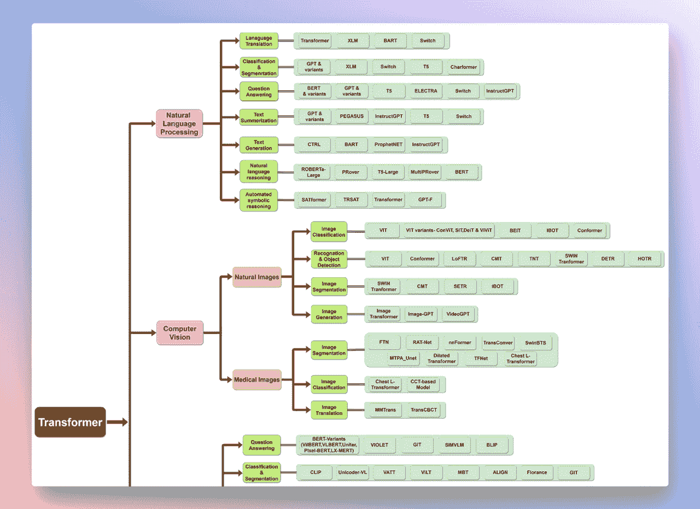

## TAPIR：使用每帧初始化和时间细化跟踪任何点

该论文提出了一种新颖的模型，名为TAP，可以在视频序列中有效地跟踪任何查询点在任何物理表面上的位置。该模型采用两个阶段：匹配阶段和细化阶段。该模型在TAP-Vid基准测试中表现优异，平均Jaccard（AJ）的改进幅度约为20％。该模型可以快速推断长时间高分辨率的视频序列。源代码、预训练模型和可视化结果可以在项目网页上找到。

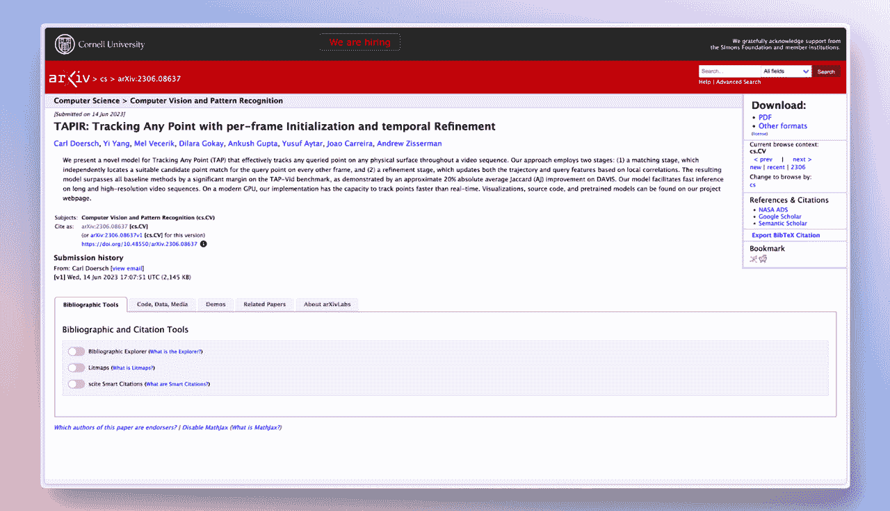