# AIGC Weekly #25

> 来源：[https://waytoagi.feishu.cn/docx/OKpzdI96jo6EMLxEB0qcWBEvngh](https://waytoagi.feishu.cn/docx/OKpzdI96jo6EMLxEB0qcWBEvngh)

> 🔗 原文链接： h[ttps://op7418.zhub](https://op7418.zhubai.love/posts/2280020561709400064)ai.love/posts/22...

> 发表时间：2023-06-12

工具：Midjourney v5.1

a close up of an object with a lot of blue light, in the style of dark white and dark indigo, Low saturation, post-modern minimalist style, smooth gradient, light black and dark amber, smooth curves, in the style of distorted form, 8k resolution, light black and dark amber, minimalist beauty, rounded forms, grainy, rim light --ar 3:2 --style raw

由于上周拖更到了周三有,一部分上周内容在周三那期已经更新了，所以这期的内容会相对少一些。可能有的朋友没注意到上周更新了，如果还需要看的话可以去这里看一下https://op7418.zhubai.love/posts/2278279250169987072。

# ❤️上周精选

## Meta 开始发力？宣布给旗下所有软件加入AI功能

马克扎克伯格周四向员工宣布了一项计划，该计划将把生成人工智能文本、图像和视频生成器放入其旗舰产品，比如 Facebook 和 Instagram。具体的措施包括：

+   其中一个将允许客户使用文本提示来修改自己的照片并在 Instagram 故事中分享。

+   将带来具有不同个性和能力的人工智能代理来提供帮助或娱乐。这最初主要用于 Messenger 和 WhatsApp。

+   还将会在在 7 月举办了一场专注于生成 AI 的内部黑客马拉松。

+   还在 7 月举办了一场专注于生成 AI 的内部黑客马拉松。

另外Meta还发布了一个根据输入的文本生成音乐的工具叫做MusicLM，跟 Google 的 MusicLM 不同的是，MusicGen 易于使用，不需要多个步骤或任何特殊设置。它的工作速度非常快，可以在一秒钟内做出 50 段音乐。

可以在这里试用： [https://huggingface.co/spac](https://huggingface.co/spaces/facebook/MusicGen)es/facebook/MusicGen

Github页面： [https://github.com/faceboo](https://github.com/facebookresearch/audiocraft)kresearch/audiocraft

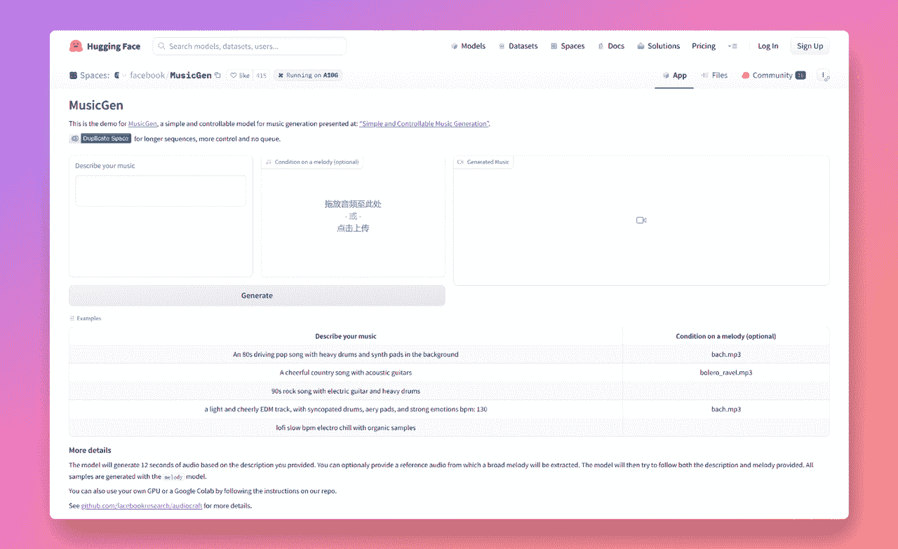

## ChatGPT APP 开始支持 Siri 和快捷指令

ChatGPT 的 APP 上周发布了一个比较重要的更新，内容包括带来了原生 iPad 支持、Siri、快捷指令集成。重点是支持了 Siri。

这个更新也使得 ChatGPT APP 的安装量再创新高，它在短短一周内以 50 万次安装量飙升至 App Store 榜首。来自超过 421,000 条评论的 4.8 星评级也充分说明了它的受欢迎程度。

Mckay Wrigley 做了一个 ChatGPT 捷径。我优化了一下。主要支持的内容有：

+   通过 Siri 使用 ChatGPT

+   开始一个新的聊天

+   继续上次聊天

+   同步聊天记录到应用里

+   支持中文回复

+   提示文案都改为中文

+   优化了提示文案

+   “嘿 Siri”之后说“ChatGPT”就可以触发

这里使用快捷方式： [h](https://www.icloud.com/shortcuts/0013f23bec8b4aac9f337fa5d9628b13)ttps://www.icloud.com/shortcuts/0013f23bec8b4aac9f337fa5d9628b13

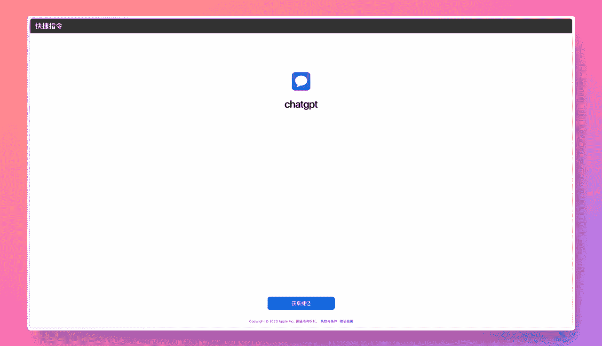

# ⚒️产品推荐

## Clipdrop 发布免费图像编辑工具

Clipdrop 刚刚发布了一款名为 Uncrop 的新人工智能“图像扩展”工具，它允许用户通过生成扩展背景来修改任何图像的比例。这看起来像是迄今为止我们所见的 Photoshop 新生成填充的最佳免费替代品。

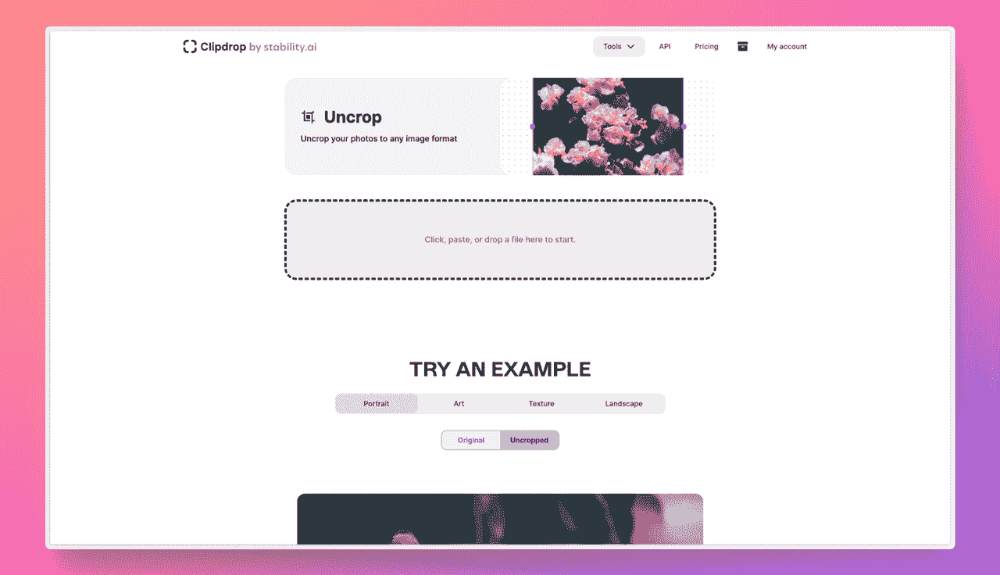

## Blobr：五分钟用任何 API 创建 ChatGPT 插件

Blobr是一款可以连接任何API的工具，用户可以使用它创建和管理ChatGPT插件，并在实时日志和分析报告中管理访问和跟踪使用情况。用户可以过滤暴露的端点并随意创建插件，决定谁可以访问他们的插件并实时跟踪使用情况。用户还可以根据自己的需求选择按使用量支付或订阅模型来实现插件的变现。

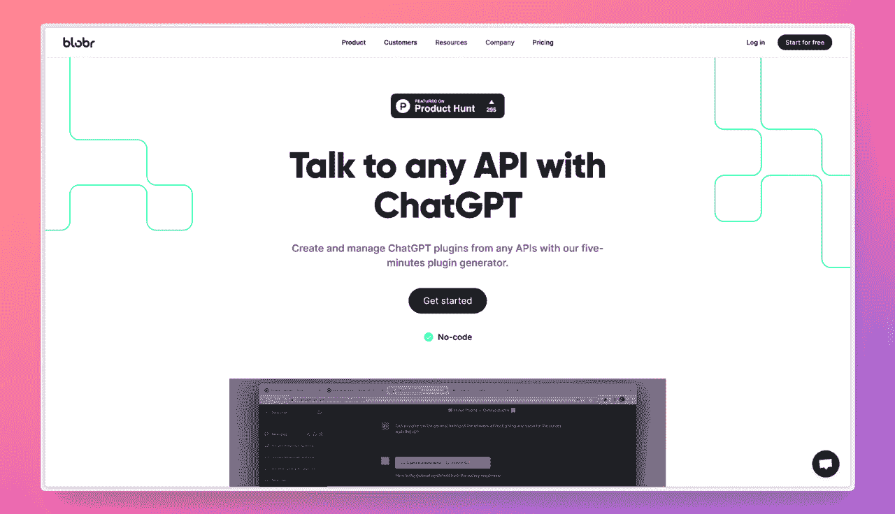

## Runway 的 Gen-2 正式开放测试

Gen-2是一种多模态AI系统，可以生成包含文本、图像或视频片段的新视频，而无需灯光或摄像机。它可以通过将图像或文本提示的构图和风格应用于源视频的结构（视频到视频）或仅使用文字（文本到视频）来实现。Gen-2还提供了其他功能，如样式转移、故事板、遮罩等。根据用户研究，Gen-2的结果优于现有的图像到图像和视频到视频翻译方法。Runway Research致力于构建多模态AI系统，以实现新形式的创造力。

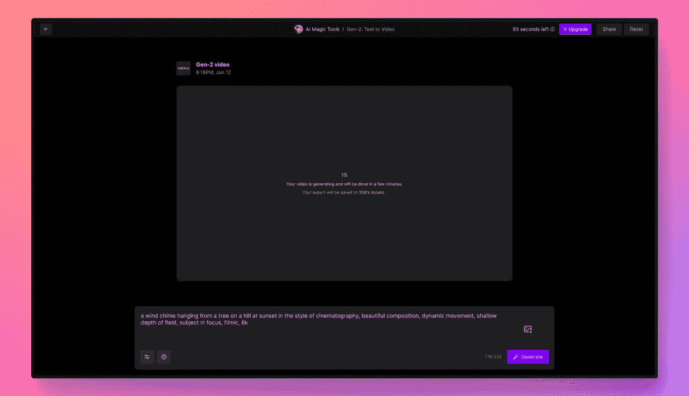

## TimeComplexity：代码复杂度计算器

运行时间计算器。使用人工智能分析代码的运行时复杂度。适用于多种语言，无需头文件、导入或主语句 - 只需代码本身。请注意，结果可能不准确，使用时自行承担风险。

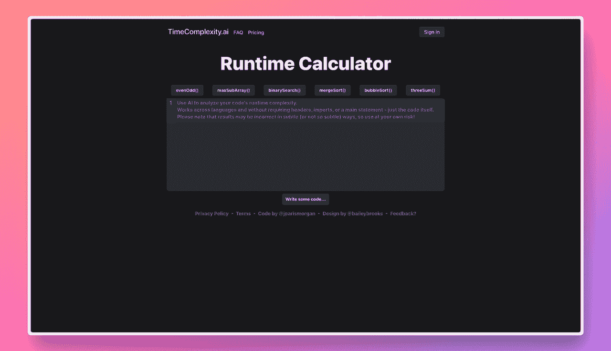

## Miero：借助 AI 创建引人入胜的课程

该内容介绍了一个AI驱动的教育内容创建工具，可以在几分钟内创建测试、测验和文字游戏，用户可以自由定制并享受最佳互动体验，还有其他多种功能可供选择。该工具还具有防止重复尝试、基于分数的结果等特点。

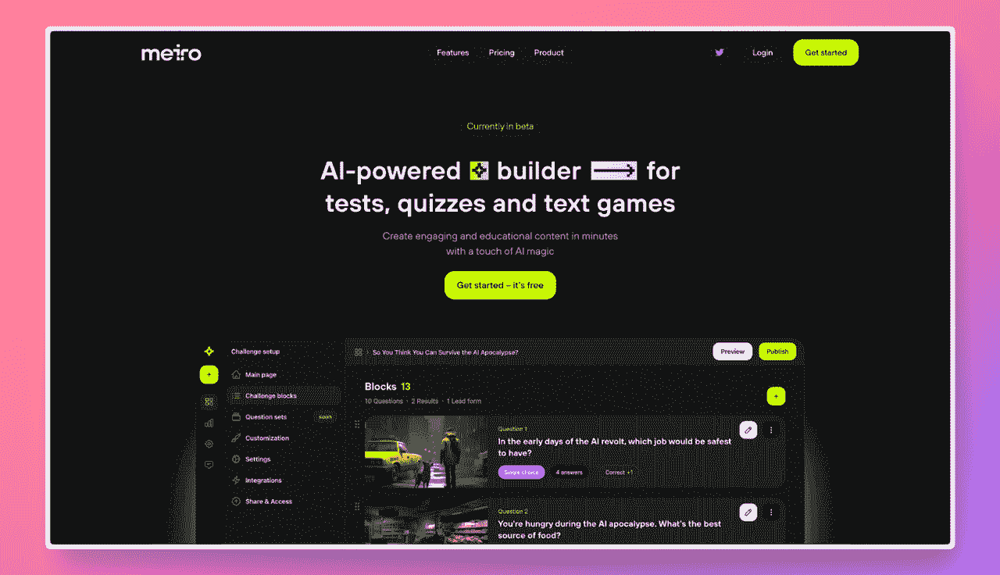

## Albus：AI 驱动的知识管理工具

Albus是一款AI驱动的知识管理工具，可以帮助用户以不同的方式处理知识，发现新的角度和问题，并通过添加笔记和图片来组织内容。用户可以轻松地控制和展示他们的内容。Albus还可以快速形成一个主题板，允许用户探索、混合、编辑和展示内容。

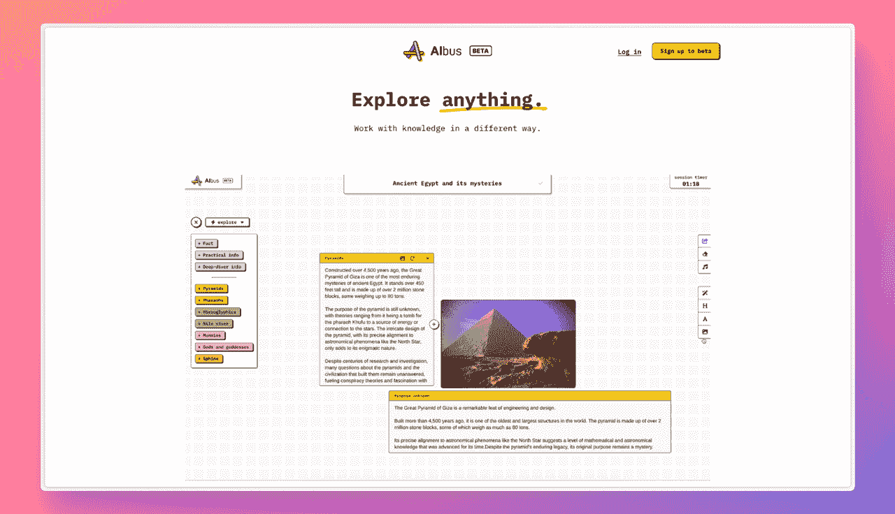

## Granica：AI 效率平台，可降低存储和访问数据的成本

Granica AI Efficiency Platform是一个开发者优先的、PB级别的、AWS/GCP原生的平台，它通过使用新颖的压缩算法，降低Amazon S3和Google Cloud Storage的存储和传输对象的成本，从而将S3/GCS的成本降低高达80%。Granica还提供了Byte-Precise Detection功能，可以检测Amazon S3和Google Cloud Storage中的PII和自定义敏感数据，成本仅为传统扫描成本的1/10。

## Show Me：为任何内容创建可视化解释的 ChatGPT 插件

可以为任何内容创建流程图、思维导图等可视化内容的 ChatGPT 插件，可以很好的帮助你理解相关知识，而且会给出引用内容的来源。在 ChatGPT 插件列表里面搜索show me 使用。提示词：帮我画一张图来解释{主题}。

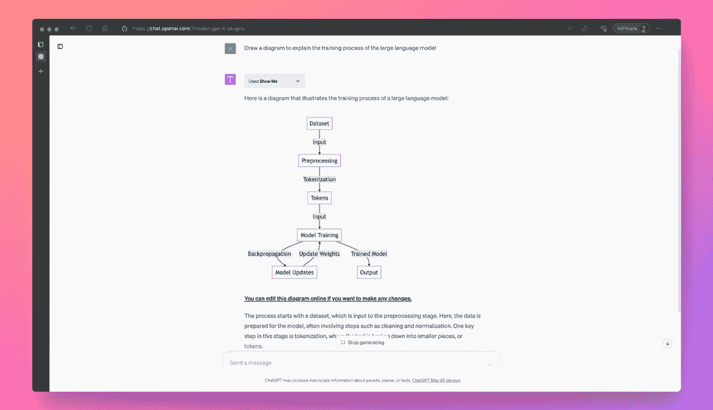

## Synthesis Tutor：AI 驱动的数学辅导软件

该软件将于2023年秋季推出适用于7-10岁儿童的数学课程，2024-2025年陆续推出适用于11-18岁青少年的代数、概率、函数等课程。同时，该软件将于2024-2025年推出适用于7-18岁学生的STEM课程。

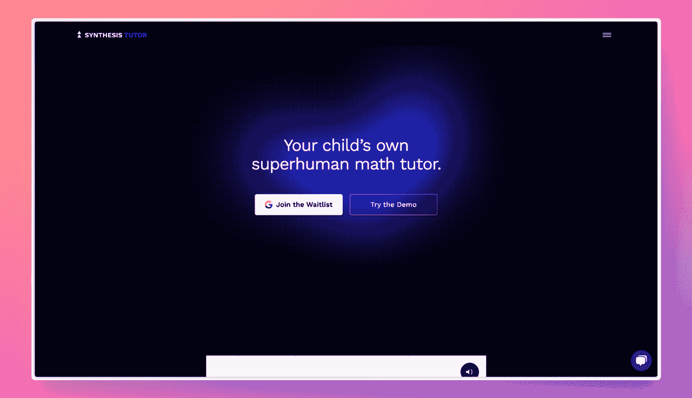

## [RayCast：提示词合集](https://prompts.ray.so/code)

RayCast 的 AI 功能是可以自己通过自定义提示词创建机器人的，所以他们把相关的提示词都整理了一下搞成了一个网站，还根据功能进行了分类，有时间可以去看看有没有适合自己的。

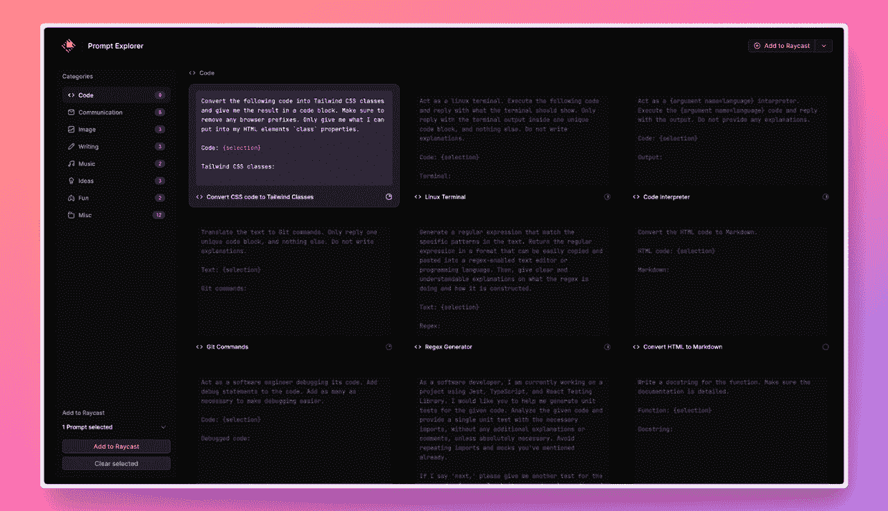

## [一个构建可控 AI 代理的框架](https://github.com/TransformerOptimus/SuperAGI)

TransformerOptimus/SuperAGI是一个开源框架，用于构建、管理和运行有用的自主AI代理。它具有多种功能，如提供、生成和部署自主AI代理、扩展代理功能、无缝运行并发代理、图形用户界面、多个向量数据库、多模态代理、代理轨迹微调、性能遥测、优化的令牌使用、代理存储、循环检测启发式和资源管理器等。用户可以从Github或终端下载并安装SuperAGI，并使用OpenAI API密钥、Google密钥和自定义搜索引擎ID等配置文件。SuperAGI目前还在积极开发中，可能存在问题。

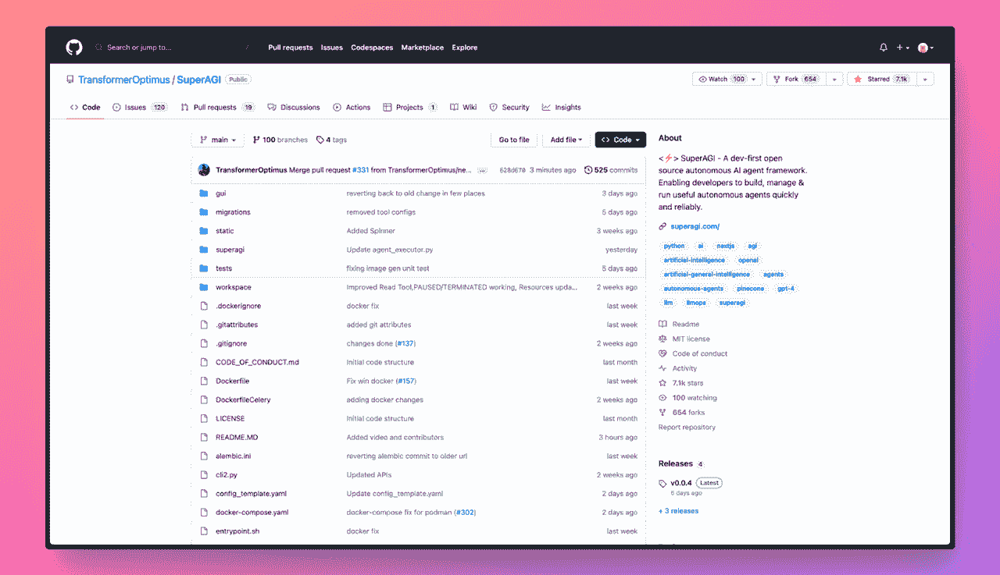

# 🔬精选文章

## 你需要知道的 28 个人工智能术语

人工智能术语越来越多，难以理解。DZone编辑团队为读者定义了人工智能世界中的一些重要术语，如算法、人工神经网络、聚类分析、决策树等。此外，还介绍了决策树、遗传算法、启发式搜索技术等高级术语。

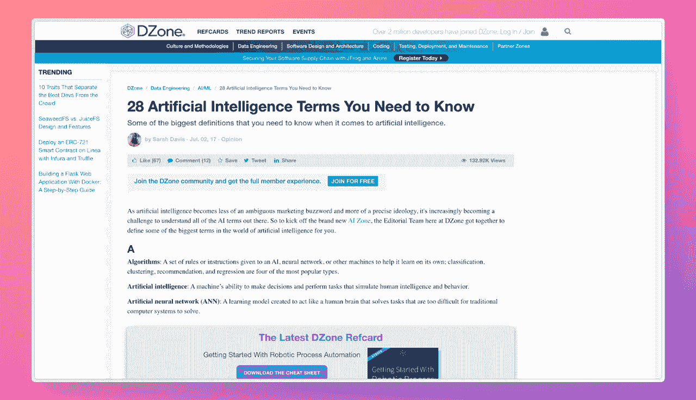

## Sam Altman在智源大会演讲全文

在2023年的北京智源大会上，OpenAI联合创始人Sam Altman首次向中国观众发表演讲。他强调人工通用智能发展对全球合作至关重要，并提倡建立全球的AGI治理机制和共享安全问题的发现。Altman认为，全球范围内的深度合作可以最大程度地发挥AGI的潜力，同时防止可能带来的风险。他还呼吁国际科学技术社区合作，增加透明度和知识共享的机制，以涉及AGI安全的技术进步。

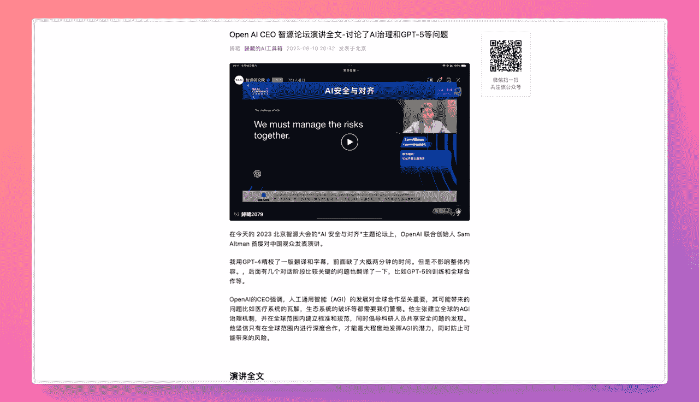

## [查](https://www.empireonline.com/tv/news/charlie-brooker-chatgpt-black-mirror-episode-exclusive-image/)理·布鲁克 (Charlie Brooker) 让 ChatGPT 写了一部《黑镜》剧集，但它是“狗屎”

黑镜与技术的关系一直不稳定，包括意识转移、不祥的植入物、监视和追踪系统、可疑的社交网络、邪恶的应用程序以及杀手机器狗和蜜蜂。黑镜创作者查理·布鲁克对AI驱动的软件ChatGPT的态度并不乐观，认为它只是将所有黑镜剧集的简介混合在一起，缺乏创意。在第六季中，布鲁克试图打破黑镜剧集的规则，创造新的惊喜。其中一集“Beyond The Sea”讲述了一个不可能的任务，设定在一个1969年的替代现实中。该季将于6月15日在Netflix上播出。

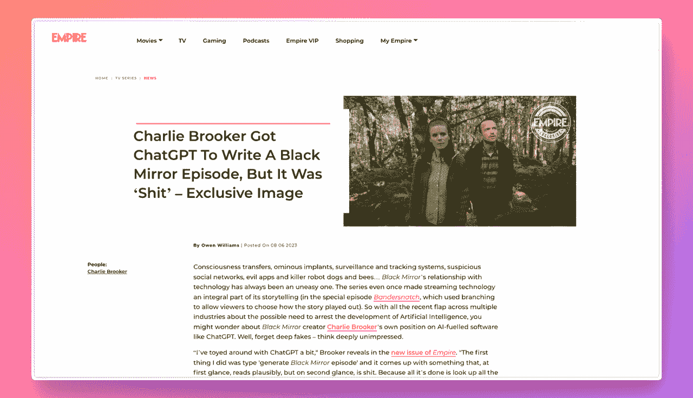

## LlamaIndex 和 Transformers 的代理

本文介绍了如何使用LlamaIndex来增强LLM代理，通过实现一个Text2Image Prompt Assistant工具，与Transformers Agent一起使用。使用从DiffusionDB创建的向量数据库，LlamaIndex可以在生成图像时建议更好的提示。Transformers Agents中的自定义工具可以使用Hugging Face Spaces轻松分发和共享。

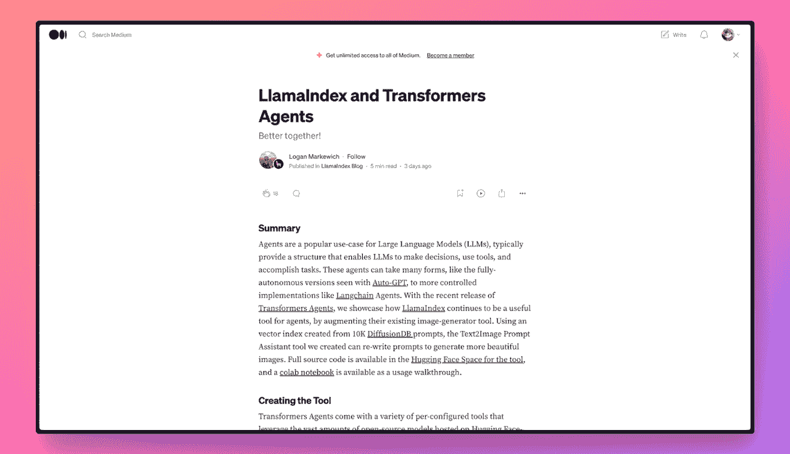

## [简单可控的音乐生成](https://huggingface.co/papers/2306.05284)

该论文介绍了一种名为MusicGen的单一语言模型，它能够在多个压缩离散音乐表示流中操作，不需要级联多个模型。该模型能够生成高质量的样本，并能够根据文本描述或旋律特征进行条件生成，从而更好地控制生成的输出。通过大量的实证评估，该方法被证明优于标准文本到音乐基准测试的基线。

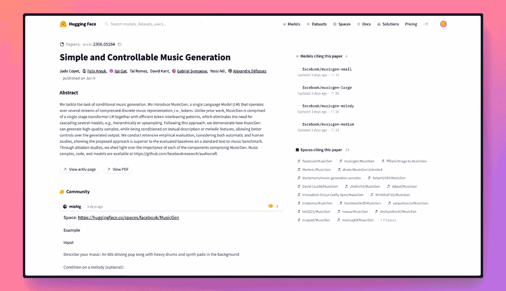

## [AI 教育行业地图](https://medium.com/@LaurenceHolt/map-of-ai-for-education-cd6863fecf87)

2022年后，教育界将迎来技术进步的重大变革。人工智能(AI)工具将为教师提供支持，例如生成课程计划、提供教学建议、记录学生项目工作、分析学生数据等。这些工具可能会改变传统的教学方式，提高教学效率，使学生更加参与和投入。AI工具的应用可能会带来教育领域的革命，但也需要注意数据隐私和教育质量等问题。

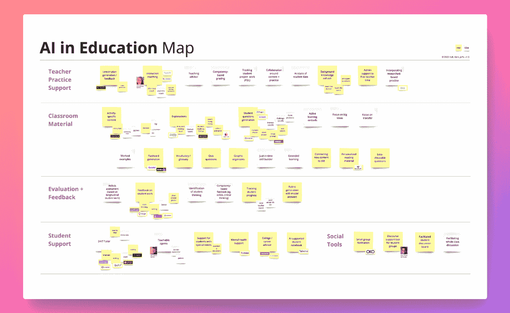

## ChatGPT 插件没有 PMF

Sam Altman在一篇已被删除的博客中表示，他认为ChatGPT插件除了浏览插件外，没有产品市场适配性，并且不会很快进入API。原因可能是：概念正确但还不够好、杀手级插件尚未开发、聊天不是插件的正确用户体验、价格太高等。此外，他还提到LLMs将拥有“水平”扩展，但需要特定的接口。

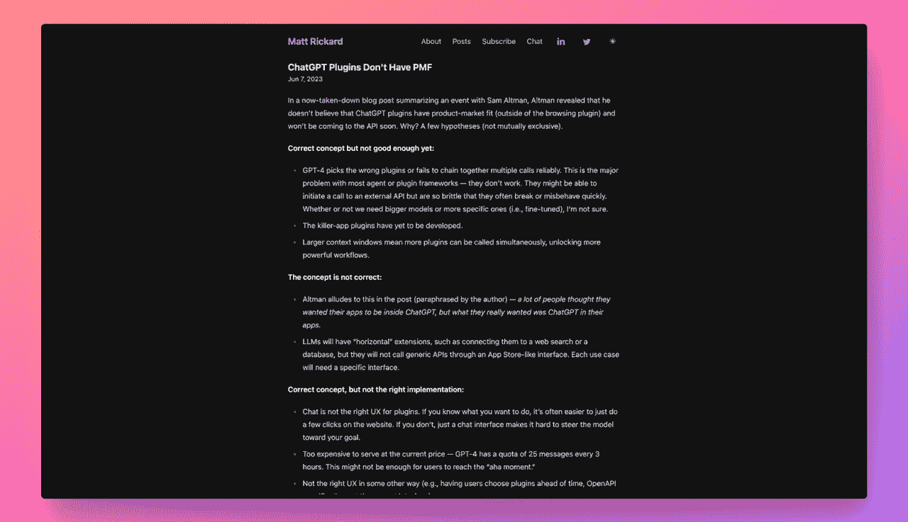

## 如何将Supabase与LlamaIndex集成

本指南将向您展示如何将Supabase与LlamaIndex集成，LlamaIndex是用于LLM应用程序的数据框架。该指南将通过使用LlamaIndex SupabaseVectorStore的基本示例来指导您。首先需要创建一个新的Postgres数据库，然后在Colab中启动LlamaIndex笔记本，将DB_CONNECTION替换为您在第一步设置的数据库连接字符串，然后按照笔记本的指导完成集合的创建、数据的添加和查询。您可以通过选择架构下拉菜单中的vecs架构来查看插入的项目。

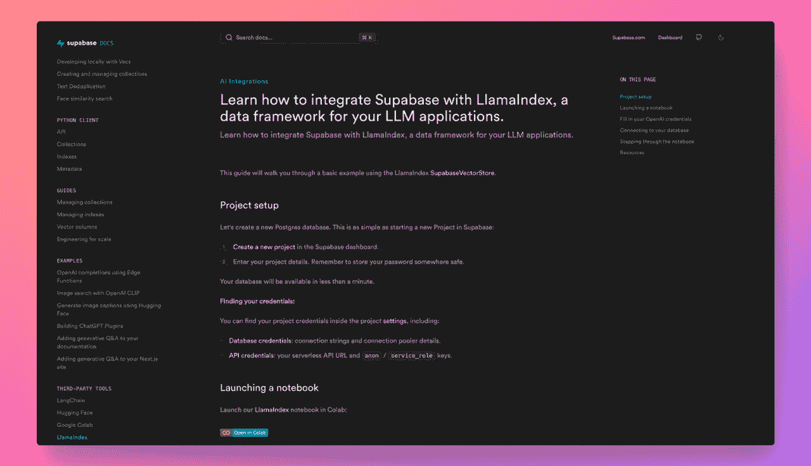