# AIGC Weekly #24

> 来源：[https://waytoagi.feishu.cn/docx/CXIcdmdnCoQm3Nx2y7fcntsqned](https://waytoagi.feishu.cn/docx/CXIcdmdnCoQm3Nx2y7fcntsqned)

> 🔗 原文链接： h[ttps://op7418.zhub](https://op7418.zhubai.love/posts/2278279250169987072)ai.love/posts/22...

> 发表时间：2023-06-08

工具：Midjourney v5.1

a close up of an object with a lot of blue light, in the style of dark white and dark indigo, Low saturation, post-modern minimalist style, smooth gradient, light black and dark amber, smooth curves, national geographic photo, atmospheric horizons, webcam photography --ar 4:3 --style raw

抱歉各位，这两周太忙了，所以这是AIGC Weekly第一次拖更。

# ❤️上周精选

## StyleDrop：任何风格的文本到图像生成

谷歌发布了一个StyleDrop的论文，这个工具只需要一张图片和提示词就能生成相同风格的其他图片，从演示的内容上来看效果非常好。不知道这东西能否跟 SD 相结合如果可以一起使用的话 LoRA用来复制风格就没必要了。

在训练和生成时，自然语言的风格描述符会附加到内容描述符上。与扩散模型的微调相比，基于离散Token的视觉变换器Muse上的StyleDrop在风格调整方面表现更好。

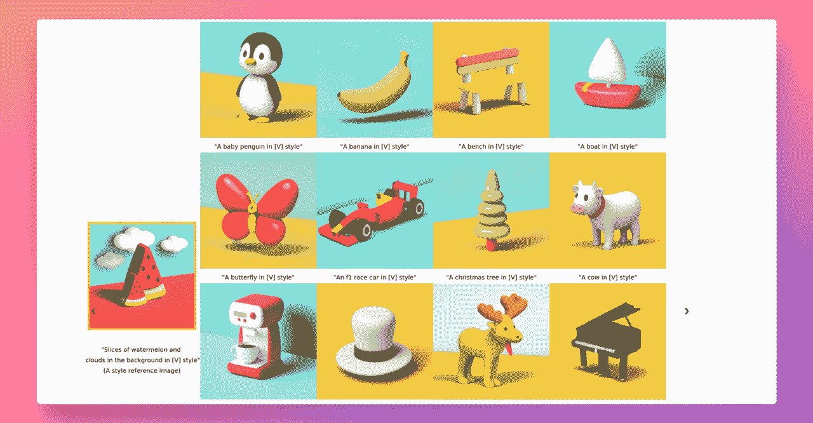

## Open AI 发布了 GPT 最佳实践指南

最近很多人在 Twitter 上说感觉 GPT 最近模型质量下滑，怀疑 Open AI 偷偷更换了模型，所以 Open AI 重拳出击掏出了一个 GPT 提示词书写的最佳实践指南，这个指南只针对 GPT-4 会有更好的效果。感觉潜在的意思是不是模型差是你不会用。

[如果你还没有 GPT-4 的API](https://openai.com/waitlist/gpt-4-api) 权限可以在这里申请： https://openai.com/waitlist/gpt-4-api

另外他们还推出了一个检测模型质量的工具，你可以随时用这个工具来检测模型的输出质量是否下降可以在这里使用： https://github.com/openai/evals

他们还强调他们不会在不通知用户的情况下偷偷更改模型。

我这里也大概整理了一下最佳实践指南里的一些信息，他们一共整理了获得更好输出结果的六种提示策略：

+   写清楚说明： GPT 无法读懂你想法。如果输出太长，要求简短的答复。如果输出太简单，请要求专家级的写作。如果你不喜欢这种格式，请展示你希望看到的格式。GPT 对你想要什么的猜测越少，你获得好的结果的可能性就越大。

+   在你的查询中包含详细信息以获得更相关的答案

+   给模型设定对应的角色

+   三重反引号、XML 标记、章节标题等分隔符可以帮助区分要区别对待的文本部分。

+   有些任务最好指定为一系列步骤。明确地写出步骤可以使模型更容易理解

+   提供适用于所有示例的一般说明通常比通过示例演示任务的所有排列更有效，但在某些情况下提供示例可能更容易

+   要求模型生成具有给定目标长度的输出。目标输出长度可以根据单词、句子、段落、要点等的计数来指定

+   提供参考文本： GPT 可以自信地编造假答案，尤其是当被问及深奥的话题或引用和 URL 时。就像一张笔记可以帮助学生在考试中取得更好的成绩一样，为 GPT 提供参考文本可以帮助以更少的捏造来回答。

+   如果我们可以为模型提供与当前查询相关的可信信息，那么我们可以指示模型使用提供的信息来编写其答案。

+   如果输入已补充相关知识，则可以直接要求模型通过引用所提供文档中的段落来为其答案添加引文。

+   将复杂任务拆分为更简单的子任务： 正如在软件工程中将复杂系统分解为一组模块化组件是一种很好的做法一样，提交给 GPT 的任务也是如此。复杂的任务往往比简单的任务有更高的错误率。此外，复杂的任务通常可以重新定义为更简单任务的工作流，其中早期任务的输出用于构建后续任务的输入。

+   对于需要大量独立指令集来处理不同情况的任务，首先对查询类型进行分类并使用该分类来确定需要哪些指令可能是有益的。

+   对于需要很长对话的对话应用，总结或过滤之前的对话。另一种解决方案是动态选择与当前查询最相关的对话的先前部分

+   要总结一个很长的文档，比如一本书，我们可以使用一系列查询来总结文档的每个部分。节摘要可以被连接和总结生成摘要的摘要。这个过程可以递归地进行，直到总结了整个文档。

+   给 GPT 时间“思考”： 如果要求将 17 乘以 28，你可能不会立即知道，但随着时间的推移仍然可以计算出来。同样，GPT 在试图立即回答而不是花时间找出答案时会犯更多的推理错误。在回答之前询问一系列推理可以帮助 GPT 更可靠地推理出正确答案。

+   有时，当我们明确指示模型在得出结论之前根据第一原则进行推理时，我们会得到更好的结果。

+   内心独白的想法是指示模型将本应对用户隐藏的输出部分放入结构化格式中，以便于解析它们。然后在将输出呈现给用户之前，对输出进行解析并仅使部分输出可见。

+   通常可以通过使用后续查询提示模型来查找它在先前传递中遗漏的任何摘录来获得更好的性能。

+   使用外部工具： 通过为 GPT 提供其他工具的输出来弥补它们的弱点。如果一项任务可以通过工具而不是 GPT 更可靠或更有效地完成，请卸载它以充分利用两者。

+   如果作为输入的一部分提供，模型可以利用外部信息源。这可以帮助模型生成更明智和最新的响应。嵌入可用于实现高效的知识检索，以便在运行时将相关信息动态添加到模型输入中。

+   不能依赖 GPT 自行准确地执行算术或长计算。在需要的情况下，可以指示模型编写和运行代码，而不是进行自己的计算。

+   系统地测试更改： 如果可以衡量，提高绩效会更容易。在某些情况下，对提示的修改会在一些孤立的示例上获得更好的性能，但会导致在更具代表性的示例集上的整体性能变差。因此，为确保更改对性能产生积极影响，可能有必要定义一个综合测试套件（也称为“评估”）。

+   参考黄金标准答案评估模型输出：假设已知问题的正确答案应该参考一组特定的已知事实。然后我们可以使用模型查询来计算答案中包含了多少所需事实。

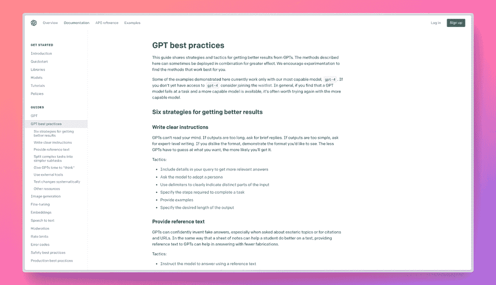

# ⚒️产品推荐

## [Asana推出了他们的AI能力](https://asana.com/product/ai)

Asana推出了AI功能，帮助组织做出更好的决策并最大化影响。通过数据驱动的智能快速做出决策，获得自动推荐以消除瓶颈，重新分配资源并实现目标。基于目标的资源管理，监控和调整团队资源以满足不断变化的业务需求。通过Asana优化工作流程，提高生产力。

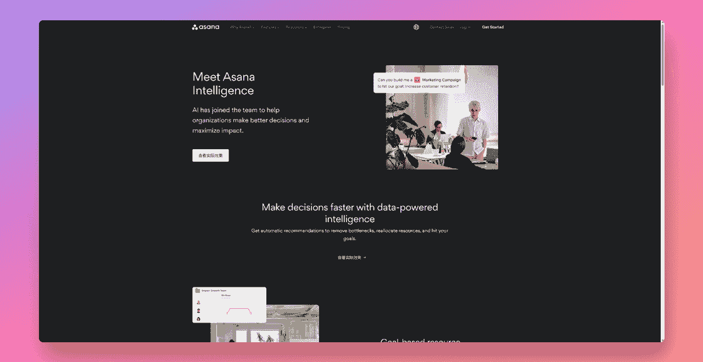

## Cyte：智能搜索你的所有历史操作数据

Cyte是一款能搜索你整个数字历史记录的工具，包括桌面应用和浏览器使用。它是自主托管的，私密且智能化的，可以使用OpenAI API密钥或本地LLM来增强搜索结果。你可以排除不想被记录的应用或网站。Cyte是开源的，可以根据自身需求进行定制。它还可以监控你的使用情况，并且支持文本搜索。你可以将个人数据存储在本地文件夹中，且目前只支持英语。如果你不想记录某些内容，可以选择禁用记录或删除记录。

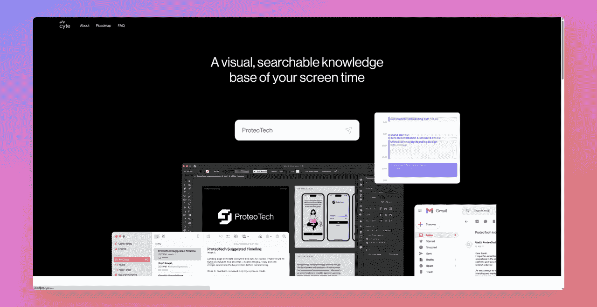

## Coefficient：AI表格处理助手

Coefficient推出AI Copilot，使用GPT技术升级电子表格，自动连接数据、生成报告和加速数据分析。用户可以使用文本命令从Salesforce、Tableau、Shopify、Stripe等系统中连接实时数据，使用15种强大的公式清理、格式化、查询、丰富和分析数据。AI数据探索功能可以自动创建漂亮的图表和透视表。

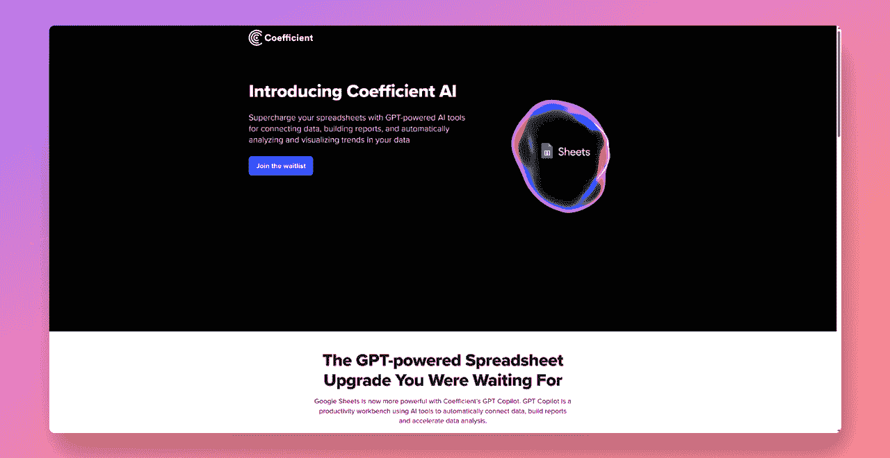

## [Pimeyes：给黑白照片上色](https://palette.fm/)

用AI给黑白照片上色，而且可以选择不同的色彩风格，还原你想象中的色彩。

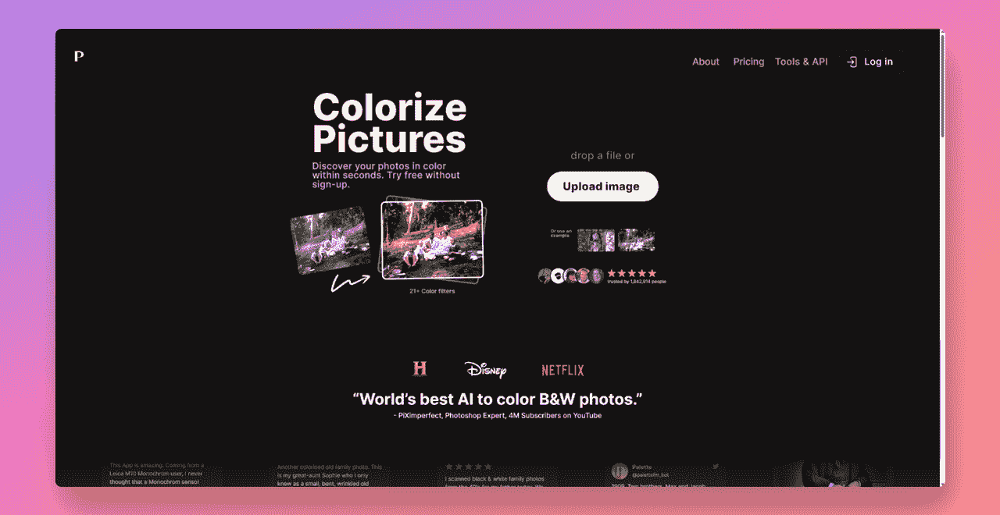

## Discord机器人帮助管理服务器

这是一款可以做到社区管理员所能做的一切的机器人。通过训练机器人，添加到聊天中，见证其类似人类的行为——比人类管理员更好。只需几次点击，你就拥有了一个24/7工作的个人社区管理员。训练机器人，添加到聊天中，让社区提问并看到机器人完美回答。

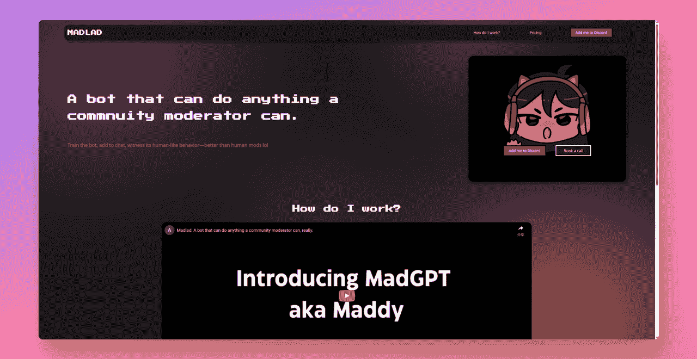

## Process AI：流程自动化管理

Process AI是全球领先的AI驱动流程管理平台。其深度ChatGPT和LLM模型可帮助您创建、管理和自动化任何重复性流程。使用Process AI，将繁琐的手动流程转化为强大的AI驱动工作流，只需点击几下即可。AI工作流生成器能够理解您的独特需求，仅需几个指令或上传现有文档，即可在几秒钟内生成个性化的工作流。使用AI最小化手动干预，减少错误，释放资源集中精力处理高价值工作。AI任务可以执行各种任务，包括数据转换、情感分析和语言翻译服务。数据安全得到保障，您的数据不会用于AI模型的训练。同时，AI或工作流中创建的任何数据都是独特的，不会被其他方式访问。

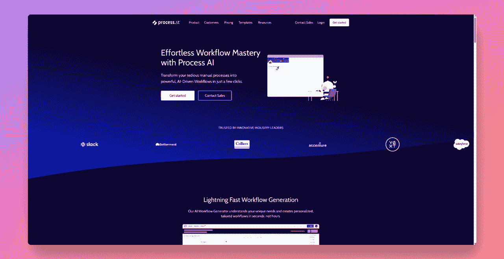

## Screen App：AI 屏幕录制工具

将您的视频转换为书面文档，以便更轻松地查看和搜索教学视频、演示文稿、网络研讨会和会议，在这些情况下，对讨论内容进行书面记录很重要。利用尖端的 GPT AI 技术。技术教程、培训课程或会议的理想选择，以总结、简化、比较和收集见解。

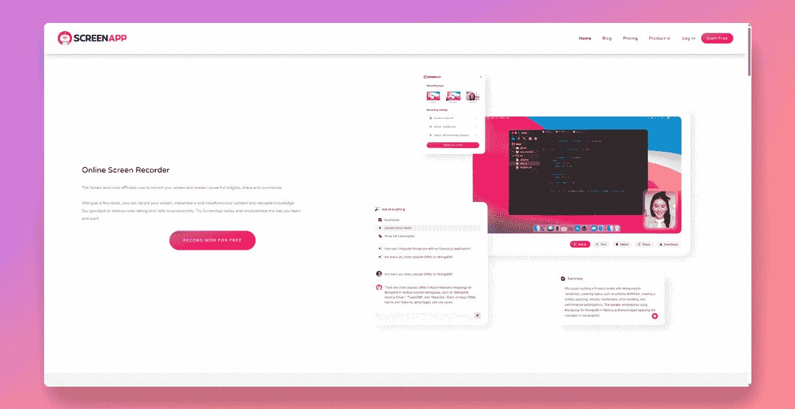

## Summate：每周总结你订阅的内容并发给你

该内容介绍了一种可以帮助用户节省时间的服务，每周通过邮件向用户发送订阅内容的重点摘要，涵盖了各种主题，如人工智能、多巴胺控制、被动收入等。此外，该服务还提供了自动添加订阅、个性化摘要等功能，可以帮助用户节省时间和精力。

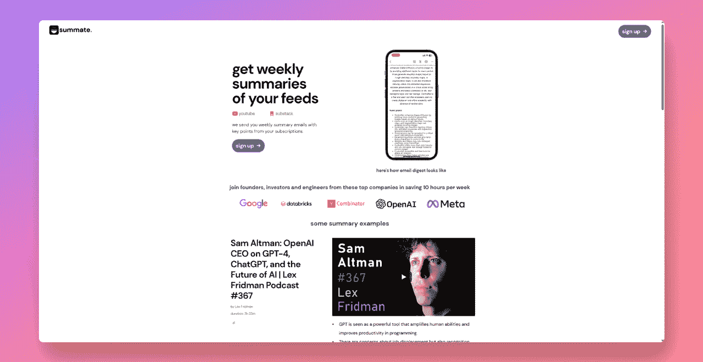

## Astral：将你的专业知识变为聊天机器人

该工具可以将您的文章、播客、课程和书籍转化为个性化的对话，帮助您节省时间，专注于解决新的问题和与客户联系。该工具通过推断上下文和使用您的专业知识生成个性化回复，旨在帮助您减少个人工作量。该工具不会完全取代您与客户的个人互动，而是帮助您更有效地管理时间和提供服务。

## [Notion：AI自动填充功能](https://twitter.com/NotionHQ/status/1666111153301254145?s=20)

Notion推出了AI自动填充功能，可以无缝集成到数据库中，生成摘要、提取关键信息和运行自定义提示，支持一次跨越数百页。用户可以尝试自定义提示，但目前仅支持文本类型，希望未来可以支持选择和多选类型。

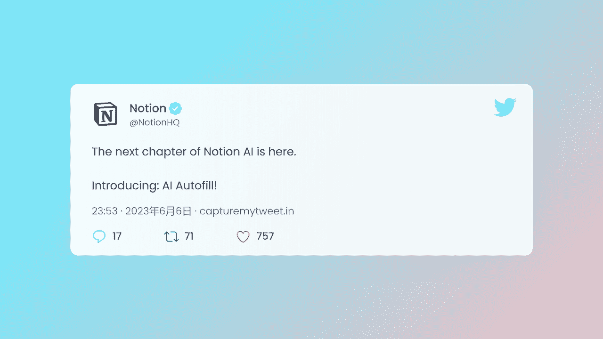

## [通义听悟：AI会议记录工具](https://tingwu.aliyun.com/)

阿里发布的AI会议记录工具支持实时的语音转文字，也支持总结和归纳会议中的关键节点信息，最后可以把相关信息快速导出各种格式分享。

# 🔬精选文章

## AI 生成可扫码图像 — 新 ControlNet 模型展示

这篇文章介绍了一种新的二维码生成方法，使用了扩散模型ControlNet和QR Code。通过加入三个定位点，可以将一张风格化图像转化为可扫描的二维码。作者介绍了该项目的缘起、训练过程和生图结果，并感谢同学和实验室提供的支持。模型发布和技术文档可以在公众号后续更新和文档更新中查看。

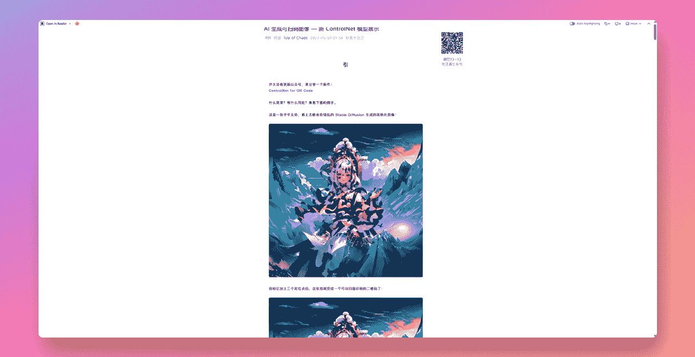

## 用一杯星巴克的成本训练你自己的 ChatGPT 模型

本文介绍了使用Apache DolphinScheduler进行开源大规模模型训练和部署的方法。只需花费一杯星巴克的费用和两个小时的时间，就可以拥有自己的训练好的开源大规模模型。该模型可根据不同的训练数据方向进行微调，以增强各种技能，如医学、编程、股票交易和爱情建议。使用Apache DolphinScheduler可以解决复杂的预处理、模型训练和优化步骤，并只需要1-2小时的简单操作和20小时的运行时间即可构建更“理解”您的ChatGPT大规模模型。

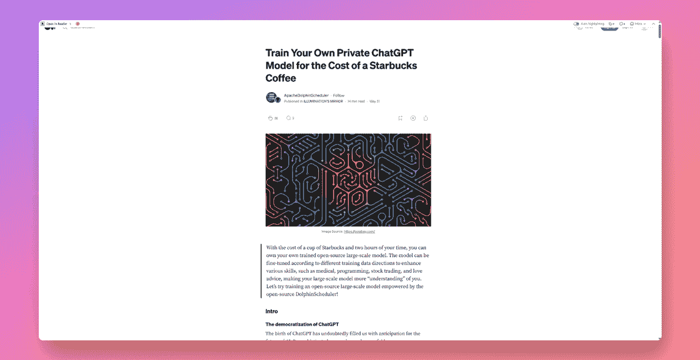

## [微软为初学者提供的 AI 课程](https://microsoft.github.io/AI-For-Beginners/?id=artificial-intelligence-for-beginners-a-curriculum&utm_source=www.theaivalley.com&utm_medium=referral&utm_campaign=time-magazine-is-giving-me-aixiety)

这是一个为期12周、24节课的人工智能初学者课程，涵盖了人工智能的不同方法，包括符号方法、神经网络和深度学习，以及处理图像和文本的神经架构等。课程提供了可执行的Jupyter笔记本和实验室，同时也推荐了Microsoft Learn模块和学习路径作为进一步学习的资源。对于学生，还提供了学生中心页面和Microsoft Student Learn大使社区。

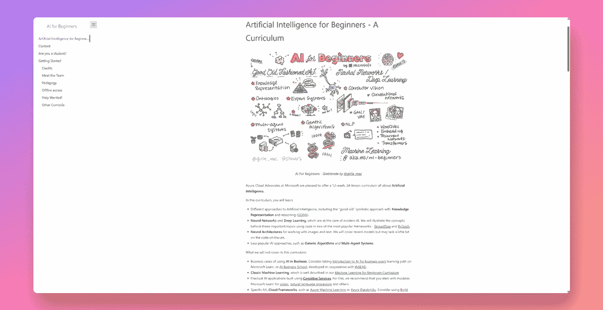

## 使用微软 Azure OpenAI API 的一些提示工程技巧

本文介绍了一些高级的提示设计和提示工程技术，包括系统消息、少样本学习、非聊天场景、清晰的指令、重复指令、输出前的提示、清晰的语法、任务分解等。文章还提到了在使用提示工程时需要注意模型的局限性，并建议验证模型生成的响应。同时，文章还介绍了 Azure OpenAI GPT 模型中 Chat Completion API 和 Completion API 两种不同的 API，以及如何在这些 API 中使用提示工程技术。

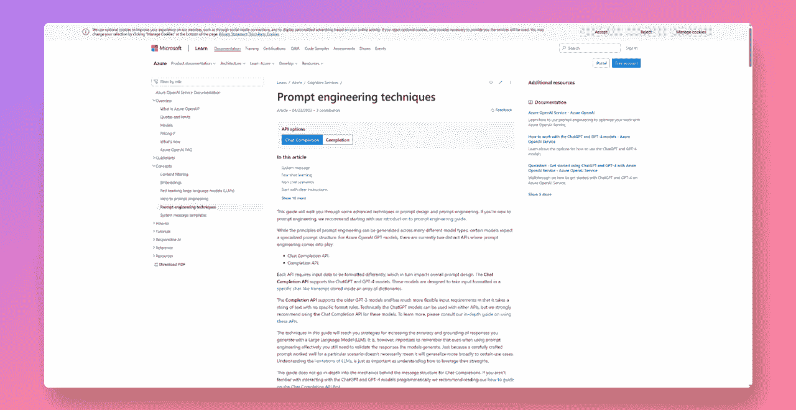

## 用 21 行 Python 构建一个 OpenAI 问答机器人

这篇文章介绍了如何使用Python编写OpenAI Q&A机器人，并与OpenAI的API交互。作者在Replit上提供了免费的课程，旨在帮助初学者入门AI开发。此外，作者还建议学习Python和OpenAI API，以自动化基本任务。API的访问权限因模型而异，但本课程使用的模型是公开的。对于想学习编程的初学者，这篇文章是一个很好的起点。

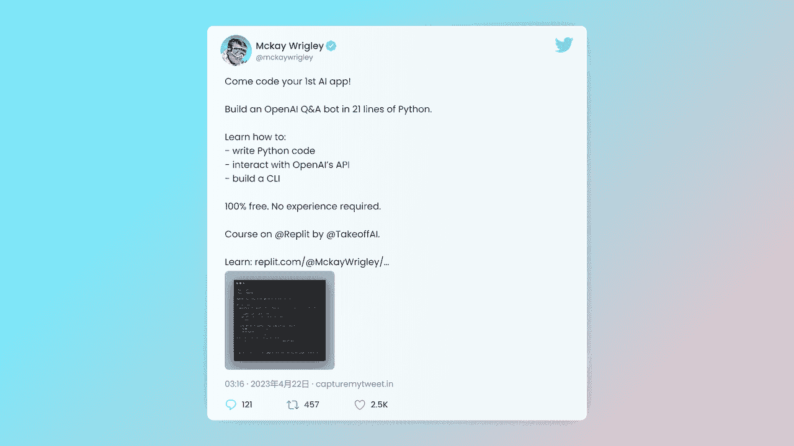

## Donut：无需 OCR 理解文档内容

Donut是一种新的文档理解方法，使用无OCR端到端Transformer模型，在各种视觉文档理解任务上显示出最先进的性能。此外，SynthDoG是一种合成文档生成器，帮助模型预训练在各种语言和领域上具有灵活性。预训练模型和Web演示可用于文档解析、文档分类、文档VQA和（伪）文本阅读任务。代码和数据集在MIT许可下在GitHub上可用。

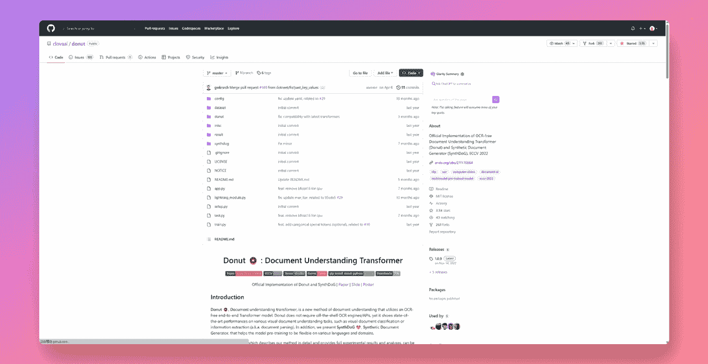

## [谷歌的生成式 AI 学习课程](https://www.cloudskillsboost.google/paths/118)

这个学习路径为您提供了关于生成式 AI 产品和技术的内容，从大型语言模型的基础知识到如何在谷歌云上创建和部署生成式 AI 解决方案。

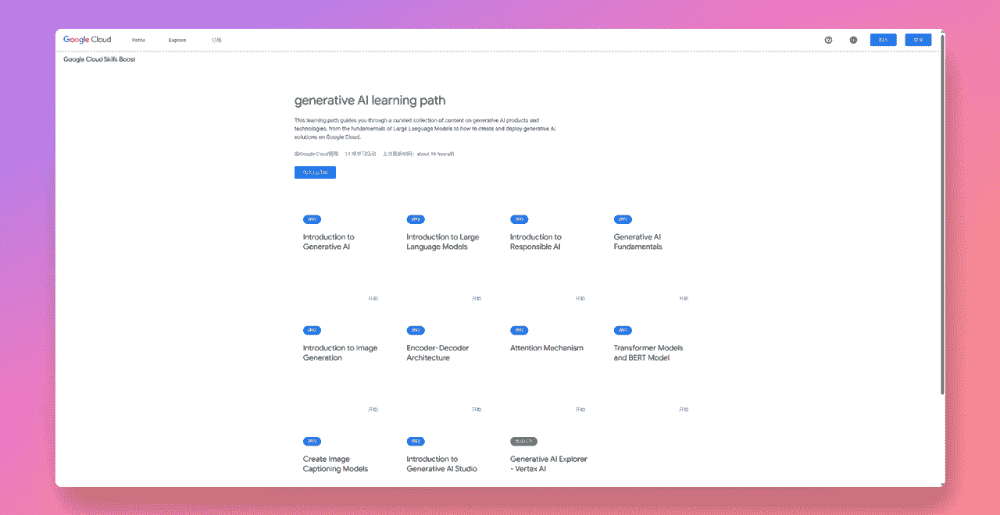

## [人工智能存储架构师指南](https://thenewstack.io/the-architects-guide-to-storage-for-ai/)

在机器学习项目中选择最佳存储方案是至关重要的。研究工程师需要创建多个数据集版本并尝试不同的模型架构。当模型被推广到生产环境时，它必须在处理新数据时高效运行。一个在生产环境中运行良好训练的模型是将人工智能添加到应用程序中的最终目标。存储选项包括传统的文件系统变体和专为大型语言模型和其他生成式人工智能系统的性能扩展要求而设计的现代云本地对象存储。对于生产环境，强烈推荐使用对象存储，因为它在可靠性、安全性、性能、可扩展性和简单性方面都表现出色。

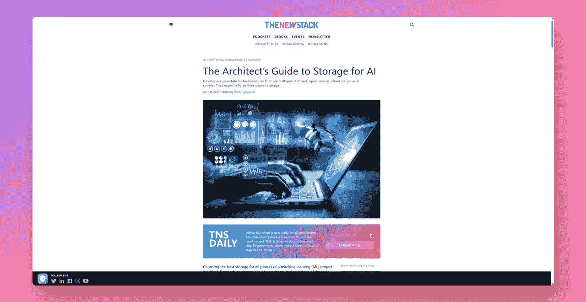

## Falcon：一个效果很好的开源模型

Falcon是阿布扎比技术创新研究所创建的最新语言模型系列，其中Falcon-40B是第一个“真正开放”的模型，其功能可与许多当前的闭源模型相媲美。Falcon-7B和Falcon-40B分别接受了1.5万亿和1万亿令牌的训练，主要基于RefinedWeb——一种基于CommonCrawl的新型海量网络数据集。Falcon模型的另一个有趣的特征是它们使用多查询注意力，这极大地提高了推理的可扩展性。

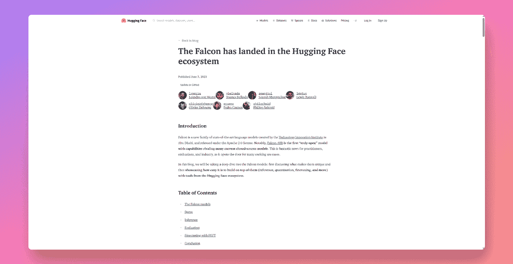

## 使用 ChatGPT 增强提示工程的提示模式目录

本文介绍了一种用于与大型语言模型（LLMs）如ChatGPT进行有效交流的重要技能——提示工程。提示是给LLMs的指令，用于执行规则、自动化过程以及确保生成的输出具有特定的质量和数量。本文为提示工程研究提供了以下贡献，应用LLMs自动化软件开发任务。首先，它提供了一个框架，用于记录结构化提示模式以解决一系列问题，以便它们适应不同的领域。其次，它提供了一个成功应用于改进LLM对话输出的模式目录。第三，它解释了如何从多个模式构建提示，并说明了受益于与其他提示模式组合的提示模式。

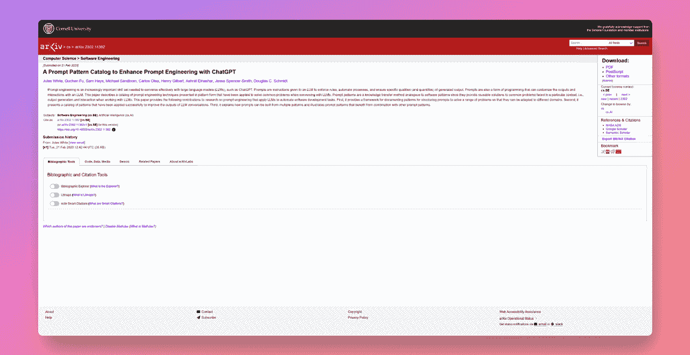

## [人工智能时代的产品设计](https://bootcamp.uxdesign.cc/product-design-in-the-age-of-ai-10edd832b16d)

在[2023年，将看到AI工具](http://xn--x-8e8as2bd6aq7uc9qxngv9xiu8b.ai/)的快速推出并引发计算领域的巨大范式转变，科技行业也随之发生变化。OpenAI、 谷歌和即将到来的X.AI （Elon的AI冒险）之间正在进行AI军备竞赛。公司正迅速将人工智能功能添加到他们的产品中。这种计算方式的转变将导致人机交互的迭代，使人类更容易让计算机用更少的输入做他们想做的事情，而且计算机正在理解人类说话的方式，而不是人类必须学习如何说话电脑说话。产品设计角色也将发生变化，数字体验开始更多地关注设计个性和基调，而不是布局和层次结构。

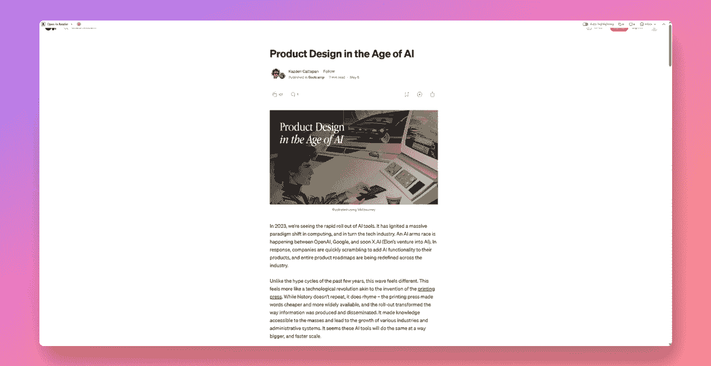

## LoRA训练界面 AutoDL云端使用教程-秋葉aaaki

本文介绍了如何使用AutoDL进行机器学习，包括注册、选择社区镜像、进入JupyterLab等基础操作。同时，还介绍了如何使用ssh端口转发将云端界面转发到本地访问。最后提醒注意网速，避免出现not found的问题。

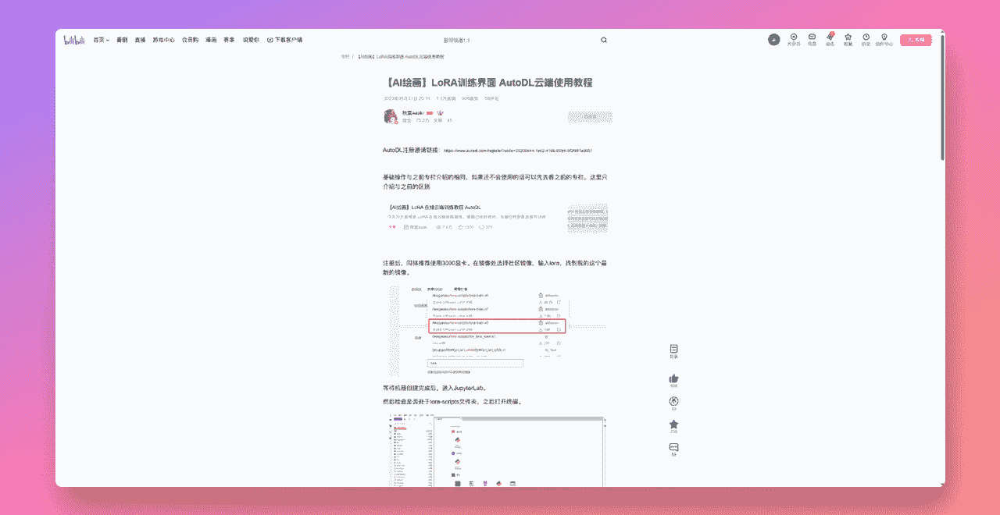