# AIGC Weekly #23

> 来源：[https://waytoagi.feishu.cn/docx/WKYOdX11gowcyDxOPDMc834DnXd](https://waytoagi.feishu.cn/docx/WKYOdX11gowcyDxOPDMc834DnXd)

> 🔗 原文链接： h[ttps://op7418.zhub](https://op7418.zhubai.love/posts/2275010075007725568)ai.love/posts/22...

> 发表时间：2023-05-30

工具：Midjourney v5.1

Light coming through a pink glow, in the style of distorted form, 8k resolution, dark maroon and dark gray, minimalist beauty, rounded forms, grainy, rim light --ar 3:2 --q 2 --v 5.1 --style raw

最近一直有很多朋友问我之前也得东西在哪，我发现确实没有一个地方能看到我所有的长文内容，所以就写了一个整合的帖子，感兴趣的朋友可以看一下。下面两个链接的内容是一样的都会定期更新。

国内的朋友可以去即刻看： [h](https://web.okjike.com/originalPost/6473767e5cbffec7e519c6a7)ttps://web.okjike.com/originalPost/6473767e5cbffec7e519c6a7

可以访问推特的在推特看也行： [h](https://twitter.com/op7418/status/1662849274005311489?s=20)ttps://twitter.com/op7418/status/1662849274005311489?s=20

# ❤️上周精选

## Windows 即将支持一系列系统级的 AI 功能

上周微软宣布了 Windows 上即将更新的一系列 AI 能力比较重要的就是会在 Windows 11 推出类似于Bing的系统级 AI 助理，区别就是它会对系统上安装的所有应用生效。还有一些其他的 AI 功能即将推出：

+   正在推出 Windows Copilot，使 Windows 11 成为第一个宣布集中式 AI 协助的 PC 平台，以帮助人们轻松采取行动并完成工作。

+   正在将 Bing Chat 插件扩展到 Windows，使开发人员能够将他们的应用程序集成到 Windows Copilot 中，以更好地服务于他们的客户并增加对原生 Windows 应用程序的参与。

+   正在引入新的混合 AI 循环，以支持跨平台和跨 Azure 的 AI 开发，以支持来自 AMD、Intel、Nvidia 和 Qualcomm 的新芯片。

+   正在推出 Dev Home，旨在帮助每个开发人员在 Windows 上提高工作效率。

+   正在 Windows 上的 Microsoft Store 中引入新的 AI 功能和体验，包括专门的 AI 应用推荐位、AI 生成评论摘要帮助开发者节省浏览时间等。

其中Windows Copilot的功能会在 6 月的开发者预览版里面推出，Microsoft Store 中的 AI 功能已经可以使用了。

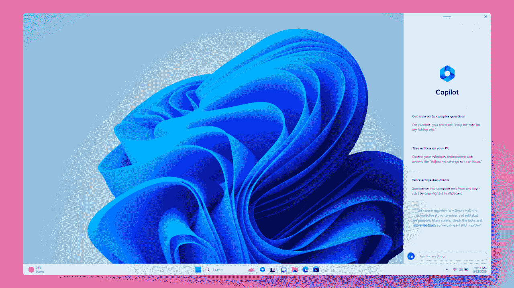

## Windows Build 大会上 Open AI 成员的演讲

微软2[0](https://twitter.com/dotey/status/1662603594799935489)23年的Build大会OpenAI的AI 研究员Andrej Karpathy做了一个主题为GPT的现状的演讲，这是GPT3.5的那篇简短的论文之后第一次有Open AI的成员透露关于他们模型训练的细节，不过也没有提到关键的部分。下面部分来自宝玉的总结也可以直接去他那里看： https://twitter.com/dotey/status/1662603594799935489

[中文版可以去看哔哩哔哩这个视频： https:/](https://www.bilibili.com/video/BV1ts4y1T7UH/)/www.bilibili.com/video/BV1ts4y1T7UH/

演讲主要有两部分内容：

1.  OpenAI是如何训练GPT的

1.  我们如何有效应用GPT

首先对于如何训练GPT

通常来说是四个阶段预训练（Pretraining），有监督的微调（Supervised Finetuning），奖励建模（Reward Modeling）和强化学习（Reinforcement Learning），这几个阶段通常是依次进行，每个阶段都有不同的数据集。

预训练（Pretraining）： 这个阶段的目标是让模型学习一种语言模型，用于预测文本序列中的下一个单词。训练数据通常是互联网上的大量文本。模型从这些文本中学习词汇、语法、事实以及某种程度的推理能力。这个阶段结束后，模型可以生成一些有意义且语法正确的文本，但可能无法理解具体任务的需求。

有监督的微调（Supervised Finetuning）： 在预训练后，模型会进入微调阶段。在这个阶段，人类评估员将参与并给出指导，他们会给模型提供对话样本，样本中包含了输入和期望的输出。这使得模型能更好地适应特定任务或应用，例如回答问题或编写文章。

奖励建模（Reward Modeling）： 评估员将对模型生成的不同输出进行排名，以表示它们的质量。这个排名将被用作奖励函数，指导模型优化其生成的输出。

强化学习（Reinforcement Learning）： 强化学习阶段是一个迭代的过程，模型会试图优化其行为以获得最大的奖励。在这个阶段，模型会产生新的输出，评估员会对这些输出进行排名，然后模型根据这个反馈调整其行为。

然后是如何有效应用GPT：

从本质上看，Transformer只是标记模拟器，它不知道自己知道什么不知道什么，它不知道自己擅长什么或不擅长什么，它只是尽力生成下一个标记，它也不会进行反思，也不会不进行任何合理性检查。它不会纠正自己的错误，它只是产生抽样的标记序列，它没有像人类那样的内心独白流。

但是，GPT有一些优势，如它们拥有大量的基于事实的知识，并且拥有相对大的并且完美的工作记忆。GPT通过自我注意力机制，能立即获取到上下文窗口中的信息，从而进行无损记忆。然而，GPT在推理和判断方面的能力相对较弱，如果提出的问题需要更复杂的推理，单凭一个标记的信息，GPT往往无法给出正确的答案。

一些技巧可以提升GPT的表现，比如Cot（Chain of Though）设定步骤来引导GPT展示其工作过程，或者通过多次抽样然后选择最佳结果等，或者可以让GPT检查自己的输出，比如询问它是否完成了任务，最好是在Prompt中明确的要求它检查自己的输出。

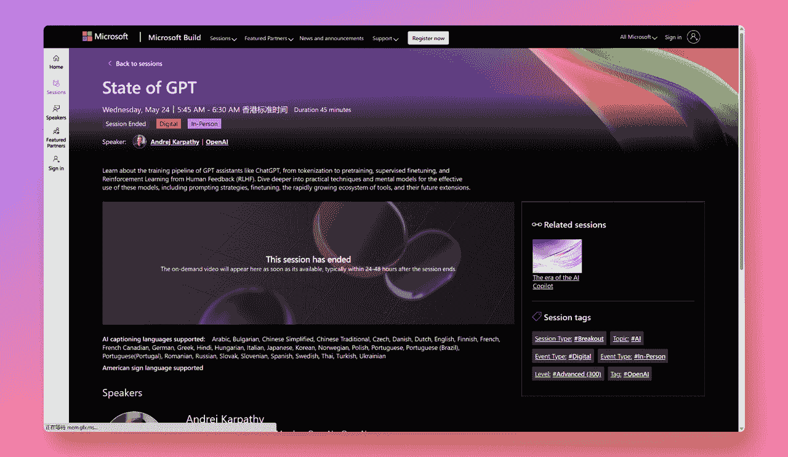

## AI 画图的动态汇总

Nijijourney发布了新的默认模型

他们没有明确说这个风格与之前风格的不同点，从上周的开发者周报来看，他们对整个模型的风格倾向性做了微调。 对一些之前没有过但是在Niji中非常流行的风格做了优化比如图1这种偏3D的风格效果会更好，同时在人像的表现上会有更多细节貌似整个模型的效果都有一定的提升。 下面是我测试的一些图片，他们关于这次默认模型的调整逻辑可以在下面链接看。 新模型默认启用不用特意开启，如果想回到旧模型/settings中选择 original 就行。

[https://sizigi.notion.site/A-New-Nij](https://sizigi.notion.site/A-New-Niji-Style-fa8b42b0f72a4295877711827c8eba4f)i-Style-fa8b42b0f72a4295877711827c8eba4f

ContorlNet 新模型

ContorlNet新模型inpaint only支持在text2img的时候对蒙版区域进行重绘，而且可以在不改变mask区域外面的画面下进行inapint。本质上和原来的img2img的inapint没什么区别就是效率高了点。

[h](https://github.com/Mikubill/sd-webui-controlnet/discussions/1442)ttps://github.com/Mikubill/sd-webui-controlnet/discussions/1442

赛博活佛秋葉的 LoRA 模型训练器正式发布

再也不用对着原来的脚本改参数了.需要训练LoRA模型的可以试试 可以在一个web界面中完成从打tag到训练到数据分析的一系列操作。 同时还区分了新手和专家模式，增加了保存预设参数的功能，内置了Tagger 和对应的参数设置教程。 这里下载：

[https://bilibili.com/video/BV1AL411q7Ub/?vd](https://bilibili.com/video/BV1AL411q7Ub/?vd_source=e99f85042059f2864f5cca20d71575f0)_source=e99f85042059f2864f5cca20d71575f0

Midjourney 工作会内容总结

上周Midjourney的办公时间他们回答了一些大家都关心的问题和产品未来的规划这里整理一下：

+   首先国内QQ频道的内测是官方的

+   v6版本的模型对图像的控制程度会提高

+   会增加取消裁切按钮来扩展图像可能会在v6上线

+   v7版本每个账户的时间额度会大幅增加 -考虑推出涡轮模式，比现在的快速模式更快，但也会更贵

+   将会为niji推出新风格，类似于v5.1这种

+   正在围绕web版本和移动版本来扩大他们的开发团队

+   打算增加一个订阅阶梯，会以更低的价格提供更多快速模式时间。可能会允许一次性生成16张图而不是4张

+   还在考虑如何优化免费试用流程

+   会持续改进内容审查的方式

+   正在研究3D模型生成的方式，正在研究Drag GAN这类型的东西，他们会在某个时间段推出视频生成的功能，但是这玩意很难。

原文来自Nick的整理： [h](https://twitter.com/nickfloats/status/1661459838071652354?s=20)ttps://twitter.com/nickfloats/status/1661459838071652354?s=20

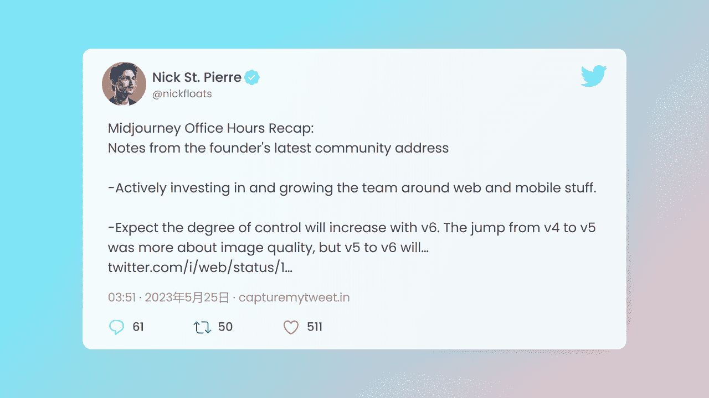

Adobe Firefly开放使用以及PS AI画图功能使用教程

Adobe Firefly上周全量开放了，所有人都可以使用，试了一下生成的图片质量确实不太行，同时PS最新的测试版也内置的AI画图的功能，类似于SD里面i2i的局部重绘，完全生成图片全是不行，但是用来补全图片和去掉水印和图上的文字这种还是挺方便的。

下面大概写一下如何试用这个功能：

+   首先你需要有一个美国地区的Adobe账号，自己的不是的话用美国ip新注册一个就行

+   [之后](https://creativecloud.adobe.com/apps/all/desktop?action=install&source=apps&productId=creative-cloud)下载一下Adobe Cloud的安装包： https://creativecloud.adobe.com/apps/all/desktop?action=install&source=apps&productId=creative-cloud

+   正常安装之后登录你的账号就行

+   之后在左边导航找到“Beta应用程序”

+   找到最新的PS测试版下载安装就行

这里有试用的演示视频： [h](https://twitter.com/juliewdesign_/status/1660982724356628482?s=20)ttps://twitter.com/juliewdesign_/status/1660982724356628482?s=20

## [如何评估大语言模型](https://lmsys.org/blog/2023-05-25-leaderboard/)

语言模型效果的评估一直是一个比较头疼的问题，如果差距很大其实我们是可以感知出来的，但是一些能力上差不多的模型就不太好进行排名，有时候数值上的优势并 不能代表整体感受。

所以这里介绍一下Chatbot Arena 排行榜这个项目。他们采用了 Elo 评分机制来评价语言模型，简单来说就是让用户使用同一条提示判断两个匿名语言模型的输出结果的好坏。然后将所有用户的评分汇总之后进行计算最终得分。

ELO 评分体系是一种为棋类和其他竞技性游戏设计的评级和排名系统。ELO 评分体系的基本原理是，每位选手都会被赋予一个初始评分，然后在与其他选手比赛后，根据比赛结果对评分进行调整。如果一个选手在比赛中获胜，他们的评分将上升，而失败的选手的评分将下降。评分的调整幅度取决于选手之间的评分差异，以及比赛结果是否符合预期。

所以这样的评分体系是最接近语言模型带给人的感受的，而且很很好的评价他们的综合能力。

下面是截止目前的一些语言模型的评分排名，前四名的排序几乎没变，这周是谷歌的PaLM2 第一次加入评分，现在看来跟前面几名都有不小的差距，甚至都比不上 Vicuna-13B。他们通过对评分的分析觉得可能是下面几个原因造成的：

+   PaLM 2 似乎比其他模型受到更严格的监管，这影响了它回答某些问题的能力。

+   当前提供的 PaLM 2 只有有限的多语言能力。

+   当前提供的 PaLM 2 的推理能力不是很令人满意。

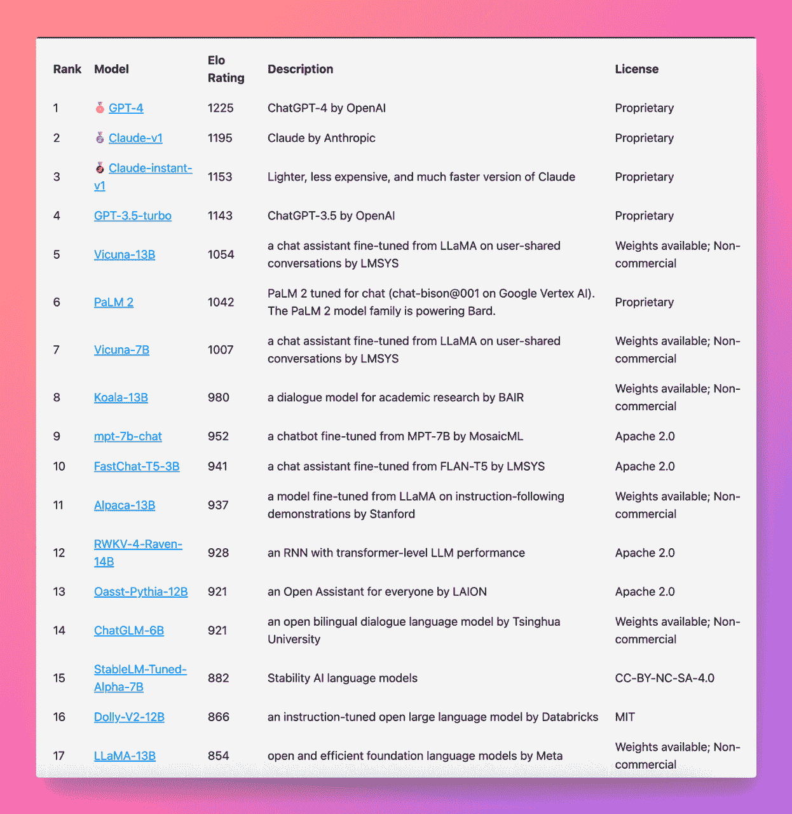

那有的人可能发现了可能上面的中国模型不太多，在 Github 也有一个项目是专门对中文语言模型进行评价的，中文通用大模型基准（SuperCLUE）。

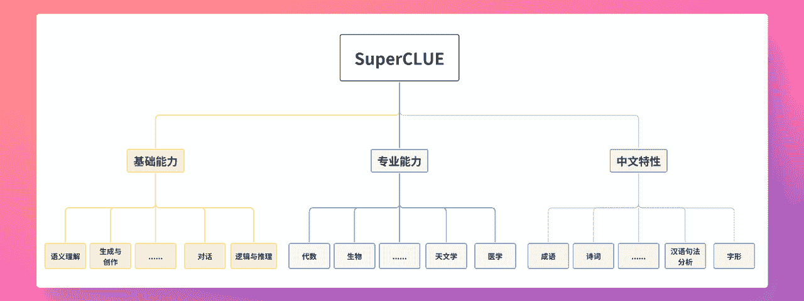

上面这张图可以比较清晰的解释他们的整个评价体系，SuperCLUE从三个不同的维度评价模型的能力：基础能力、专业能力和中文特性能力。具体的细节可以到他们的项目页面查看：

[https://github.com/CLUE](https://github.com/CLUEbenchmark/SuperCLUE)benchmark/SuperCLUE 下面是目前他们 1.0 的中文语言模型排行：

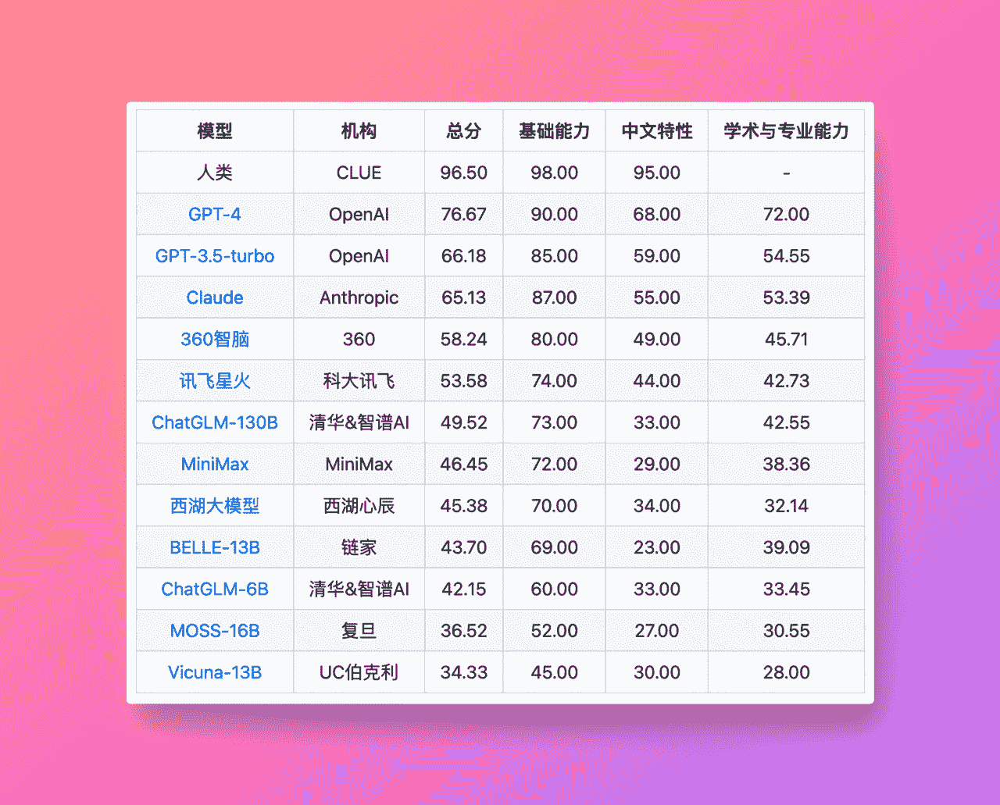

# ⚒️产品推荐

## Diagram：专为 UI 而生的 AI 模型

Diagram上周更新了他们的官网，之前语焉不详的AI 生成界面 UI 的工具 Genius 的功能也全部披露了包括通过文本生成UI 设计稿、在你设计的过程中自动给出建议、给出改善易有设计的方案、使用你的设计系统规范生成界面设计以及解答你的设计疑问。他们还发布了一个为设计师制作的用户界面 AI 模型可以生成图表图片字体等一系列 UI 资产。

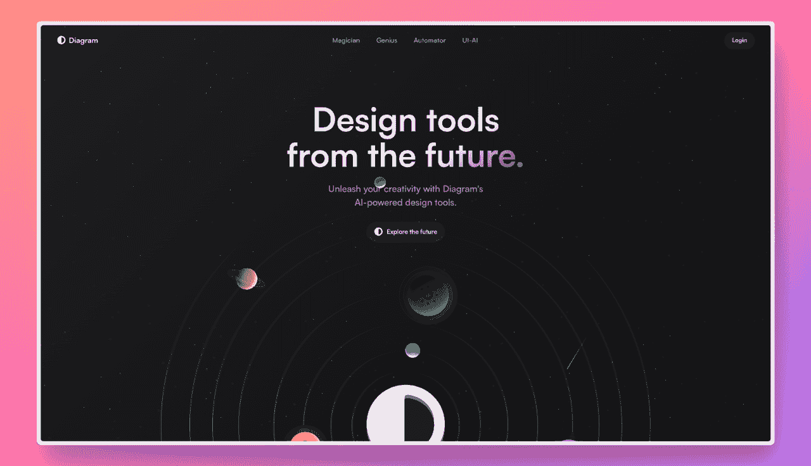

## Plus：AI生成免费的市场分析报告

Plus AI提供了多项服务，包括实时网站截图、定制市场研究报告、自动生成客户报告、创建在线课程和培训材料、自动生成策略和研究报告等。通过安装Chrome扩展程序，用户可以轻松地捕捉网站快照，并将其嵌入到多个工具中，快照自动更新，版本历史可追溯。

## Graphy：图表生成和分析工具

AI图表生成和美化应用Graphy。生成的图表非常漂亮，而且不用自己手动创建，用自然语言输入需求之后他会自动创建对应的图表。同时也支持对你上传的数据进行分析，给出对应的结论。做PPT必备家人们。上周在推特上推荐了一下，给他们塞了一堆新用户进去，非要给我寄周边。。。

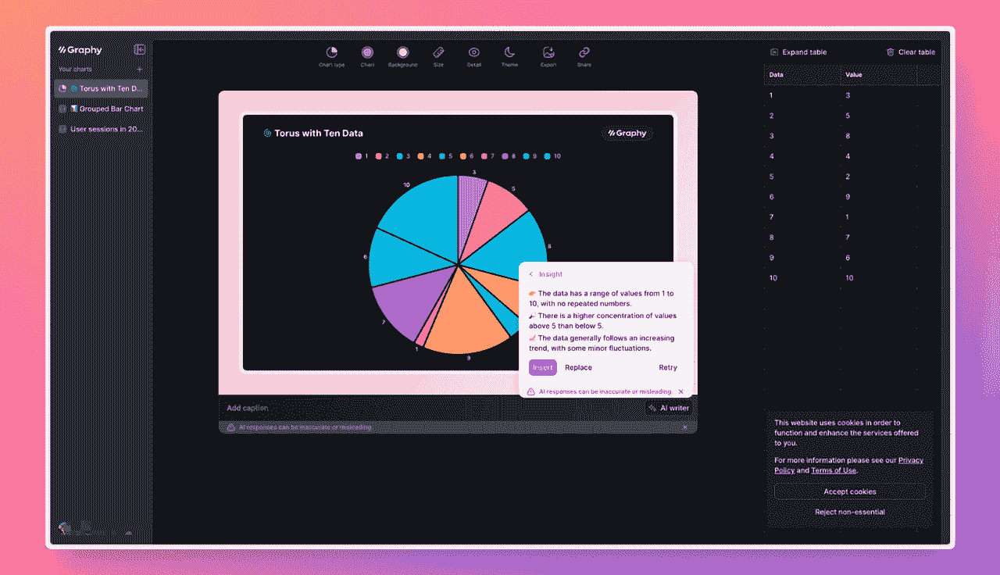

## [DEXA：AI 驱动的播客助手](https://dexa.ai/)

英语不好又想摄入英文播客的话这个工具不错，可以针对你喜欢的播客跟机器人交谈获得播客内容的信息。

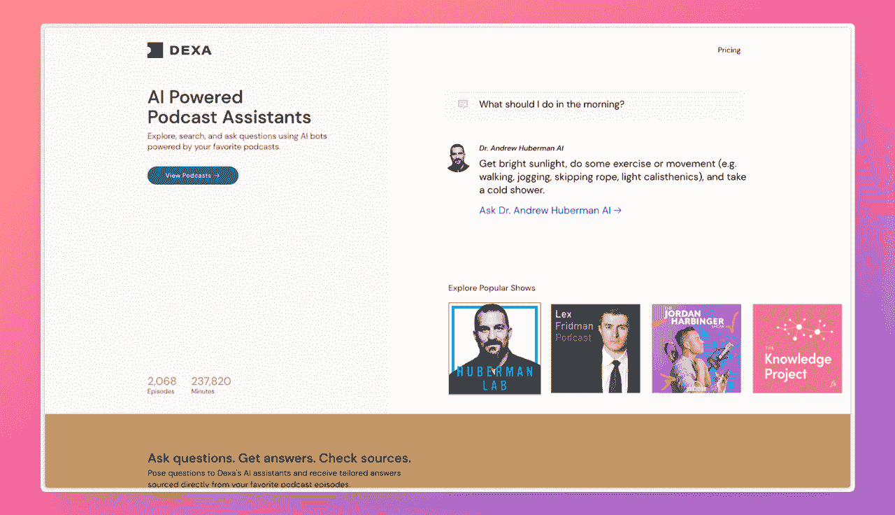

## Dream 3D：生成 3D 素材和渲染场景

AboutDream3D 是一家位于纽约布鲁克林的软件公司，致力于构建用于 3D 创意工具。我们将直观的界面与机器智能相结合，使任何人都能轻松创建美丽的计算机图形。

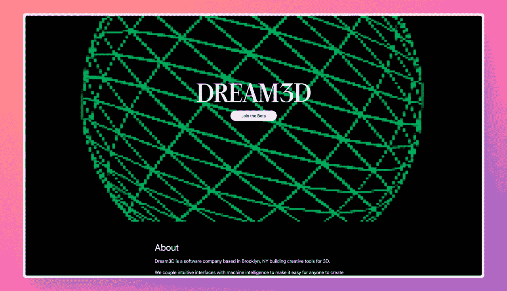

## MetaVoice：实时在线转换自己的声音

MetaVoice Studio和MetaVoice Live是两个基于人工智能技术的语音转换工具。MetaVoice Studio可以为内容创作者提供高质量的语音转换和角色创建服务，而MetaVoice Live则可以在保护隐私的前提下实时转换语音身份。这两个工具都可以在800多个平台上使用，并且都可以免费试用。目前下载完应用之后才让你加等待列表，有点鸡贼。

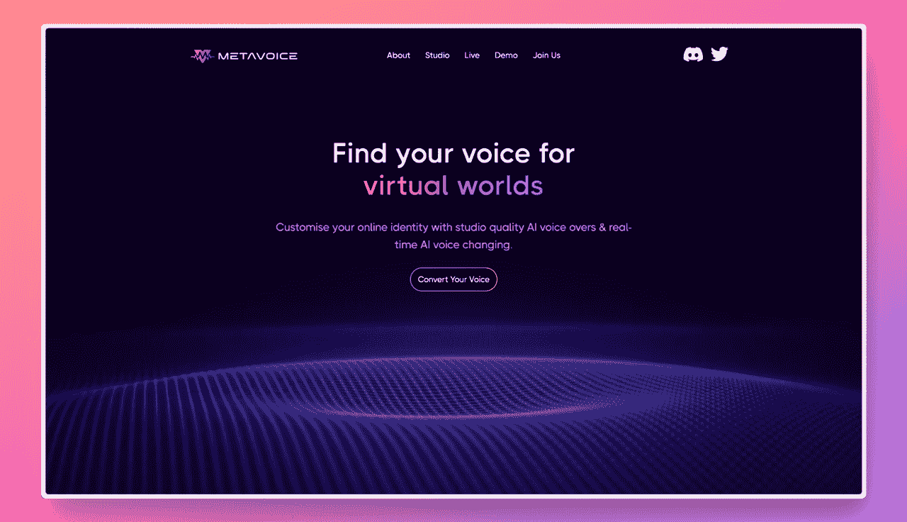

## Felo Translator：同声传译 APP

@JefferyTatsuya 开发的应用，Felo Translator是一款能够提供六种不同语言的实时语音翻译的应用程序，采用Open GPT AI技术。该应用程序能够自动识别说话者的语言，并即时翻译。适用于国际旅行和全球会议中的面对面交流，Felo Translator简化了沟通过程，消除了语言障碍。

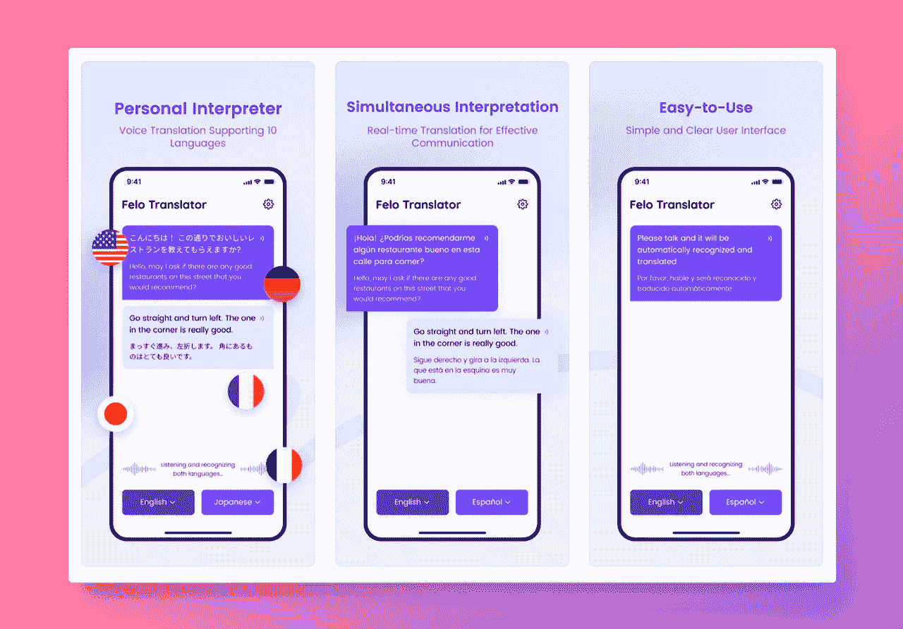

## Humbird AI：AI招聘工具

Humbird AI是一款利用人工智能和自动化优化招聘流程的工具。它有助于建立人才储备管道，简化候选人互动，识别和筛选顶尖人才，并避免候选人失联。该工具还提供定制报告和仪表板，以实现高质量的招聘，并与一系列工具集成，从ATS到生产力和通信平台。它旨在将人才招聘团队的效率提高10倍。

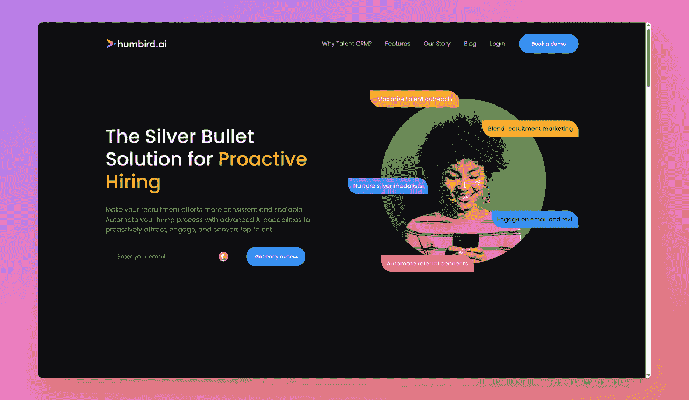

## Desku：AI驱动的CRM软件

Desku是一款客户支持和保留软件，集成了实时聊天、电子邮件和社交媒体，实现无缝沟通。它提供了基于人工智能的统一Omni渠道平台，为个性化体验、工单管理、聊天机器人创建、知识库、营销自动化以及准确的报告和分析提供支持。

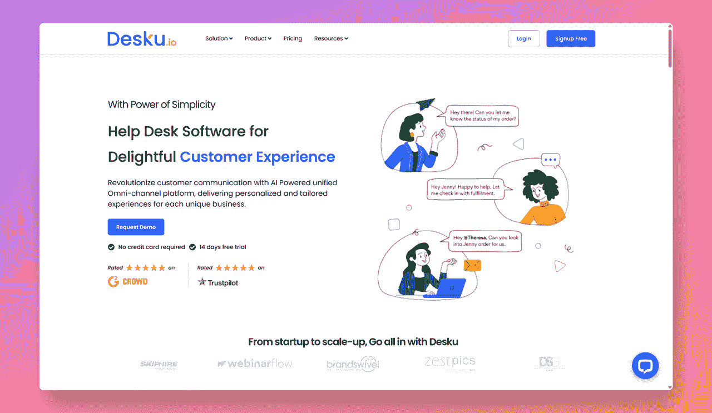

# 🔬精选文章

## 和 OpenAI CEO Sam Altman 对话

在这个视频中，Sam Altman讨论了GPT-3的意外成功以及GPT-4和未来版本的潜力。他还探讨了人工智能如何影响人类和社会，并讨论了人工智能是否有可能进行原创性的科学研究。他提到，人工智能的发展将是一个逐渐的过程，它们将成为人类工作的一部分，而不是取代人类。

## 利用 GPT-4、DALL.E 2 和ChatGPT 构建 AI 应用

Scrimba课程，学习者将学会如何使用OpenAI API添加人工智能功能到应用程序中。课程将涵盖Dall-E、GPT-4和ChatGPT API的使用，并教授如何使用自己的数据微调模型。课程包括三个项目，第一个项目将介绍OpenAI API的基础知识，第二个项目将涉及构建聊天机器人，第三个项目将教授微调模型的技能，以使聊天机器人能够回答特定于数据的问题。

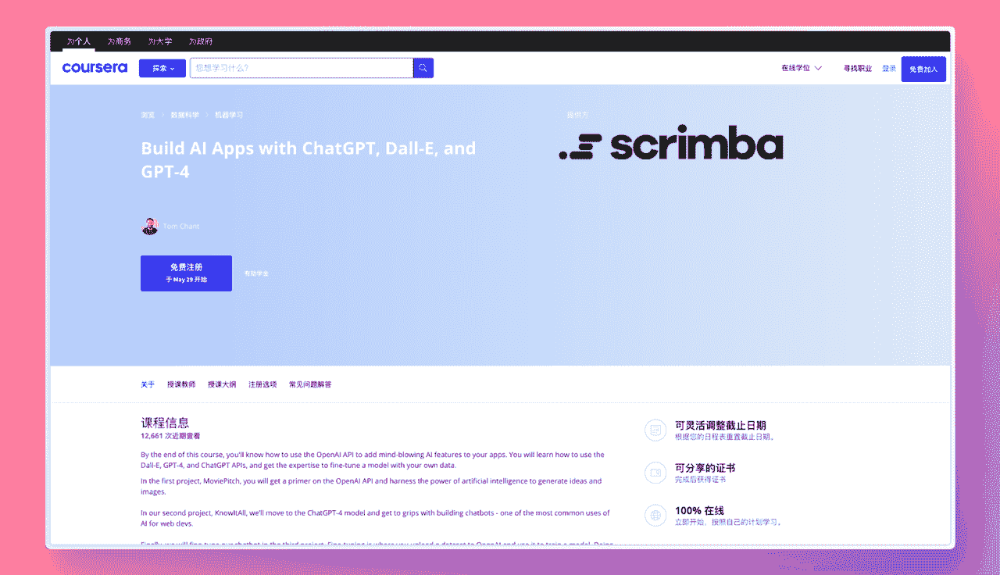

## [超级智能的治理-Open AI](https://openai.com/blog/governance-of-superintelligence)

OpenAI 最近发表了一篇博文，讨论了超级智能的治理，它指的是比 AGI 更强大的人工智能系统。他们表示，这些先进的人工智能系统可以在未来十年内超越人类的专业知识，我们需要积极应对它们的发展。

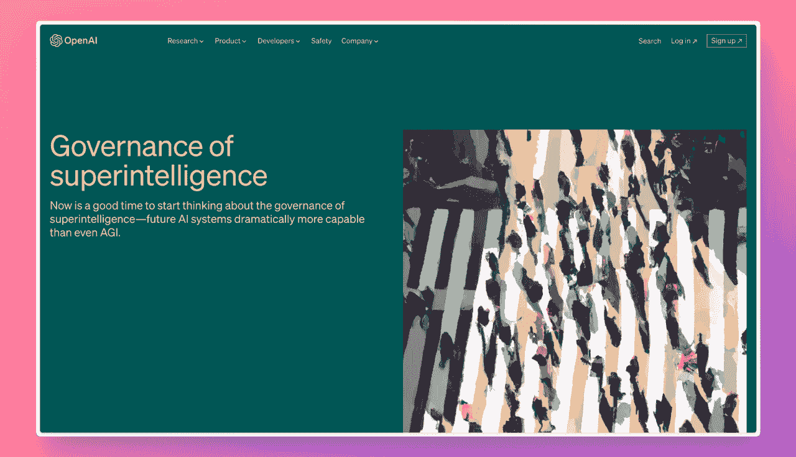

## 如何利用 ChatGPT 生成图标

本文介绍了如何使用 ChatGPT 生成图标创意。首先，作者撰写了一个简短的设计说明，然后通过 ChatGPT 生成与烹饪相关的“简单”物理对象，并提出了关于如何表示“简单烹饪”的图标的不同想法。作者还提供了一些有用的提示，例如限制结果数量、添加详细信息以及使用 Midjourney 生成图像等。最后，作者强调了这一过程的简单性，并提供了有关 AI 产品设计的工作坊的信息。

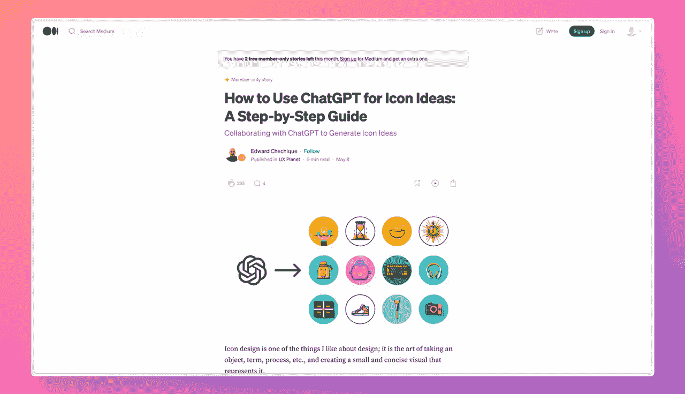

## 动态界面：如果未来 UI 可以自己设计自己会怎么样

该文章探讨了人工智能在软件应用层和用户界面方面的发展，并提出了动态界面的概念。作者认为，随着人工智能的加速学习周期，未来的界面将会自动迭代并根据用户反馈重新设计。此外，界面也可以更多地访问上下文数据，以预测用户需要什么。作者认为，模型、视图控制器将成为未来许多年的持续标准，并与软件高度分离。

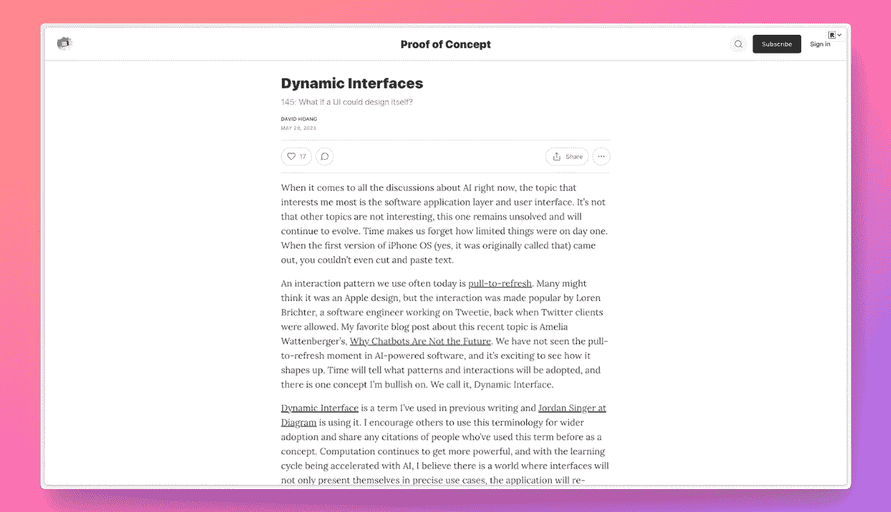

## [ChatGLM-6B 微调：P-Tuning](https://www.bilibili.com/video/BV1fd4y1Z7Y5/?vd_source=e99f85042059f2864f5cca20d71575f0)，LoRA，Full parameter

ChatGLM 的官方教程，本教程详细介绍了GLM的技术背景和ChatGLM-6B的微调方案，包括P-tuning、LoRA和Full-Parameter等。P-tuning可以显著提高模型的性能，而LoRA和Full-Parameter可以在不增加计算成本的情况下提高模型的性能。

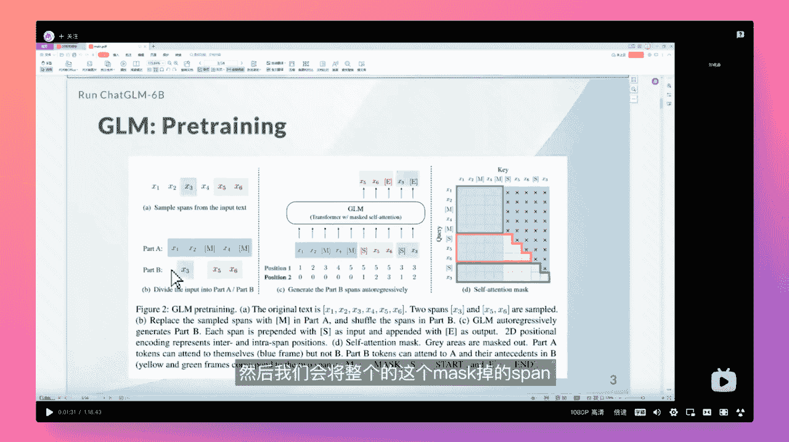

## [可以减少内存使用的模型微调方法](https://arxiv.org/abs/2305.14314)

QLoRA - 一种有效的微调方法，可减少内存使用量，足以在单个 48GB GPU 上微调 65B 参数模型，同时保留完整的 16 位微调性能。

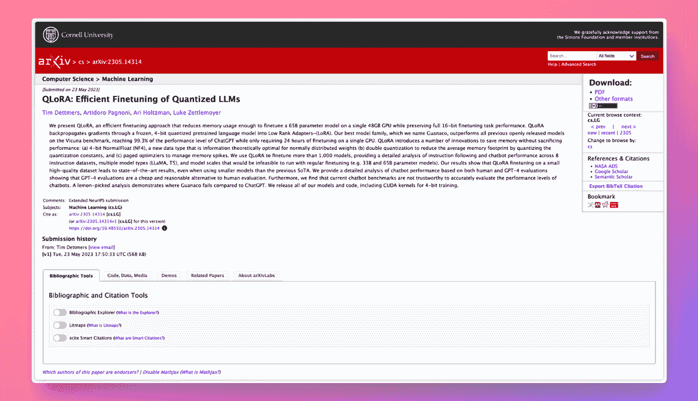

## 在 Minecraft 中接入 GPT-4 会怎样？

Voyager，这是第一个完全在上下文中玩 Minecraft 的终身学习代理。 Voyager 通过编写、提炼、提交和从技能库中检索 代码 不断改进自己。Voyager 迅速成为经验丰富的探险家。在 M inec raft 中，它获得的独特物品增加了 3.3 倍，行进距离增加了 2.3 倍，解锁关键科技树里程碑的速度比之前的方法快了 15.3 倍。软件以及开源，有代码基础的可以试试。

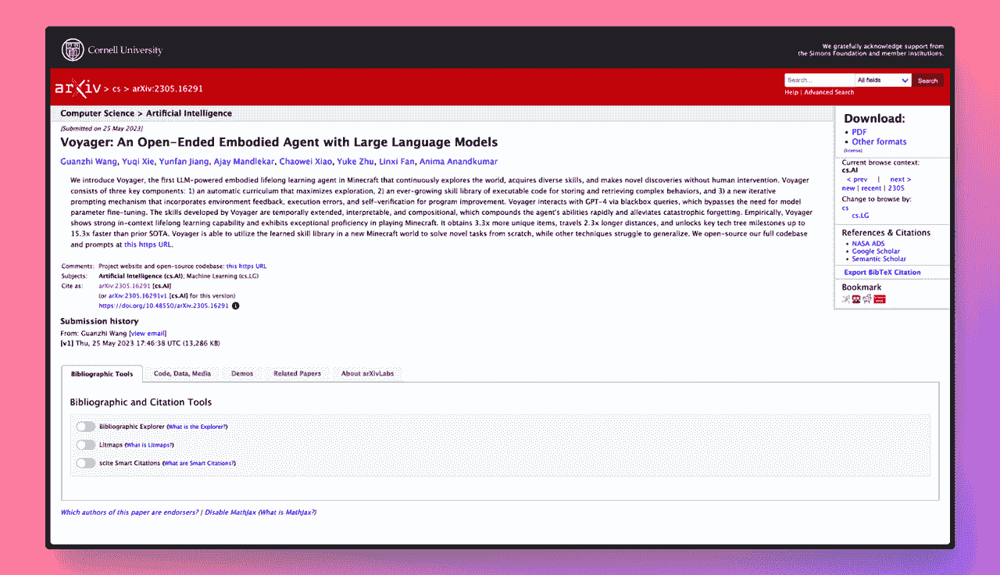

## [极端风险模型评估](https://arxiv.org/pdf/2305.15324.pdf)

讨论模型评估对于解决极端风险和做出有关模型训练、部署和安全的负责任决策的重要性。

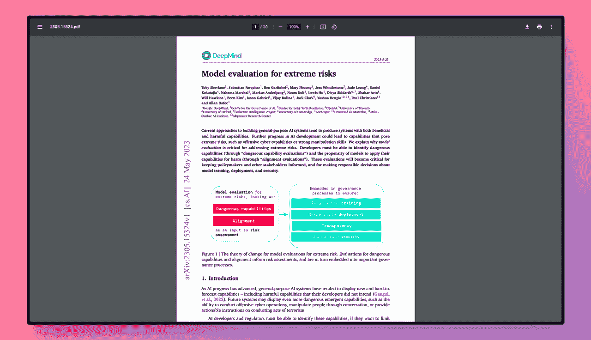

## NVIDIA 黃仁勳台大畢業致詞：請用 AI 做出不可思議之事

英伟达CEO黄仁勋在台湾大学演讲，分享了三个失败的故事，向学生们传授成功的秘诀。他强调了人工智能在各个方面重新定义了计算，是一个千载难逢的机遇，未来10年，新的AI计算机将取代价值超过一万亿美元的传统计算机。他还提醒企业和个人必须学会利用人工智能，做出令人惊奇的事情，并在AI作为副驾驶的情况下取得成功。

这里还有爱范儿整理的版本： [https://mp.weixin.qq.com/s/Yd](https://mp.weixin.qq.com/s/YdtyRrUcfE844y45ASdz9g)tyRrUcfE844y45ASdz9g

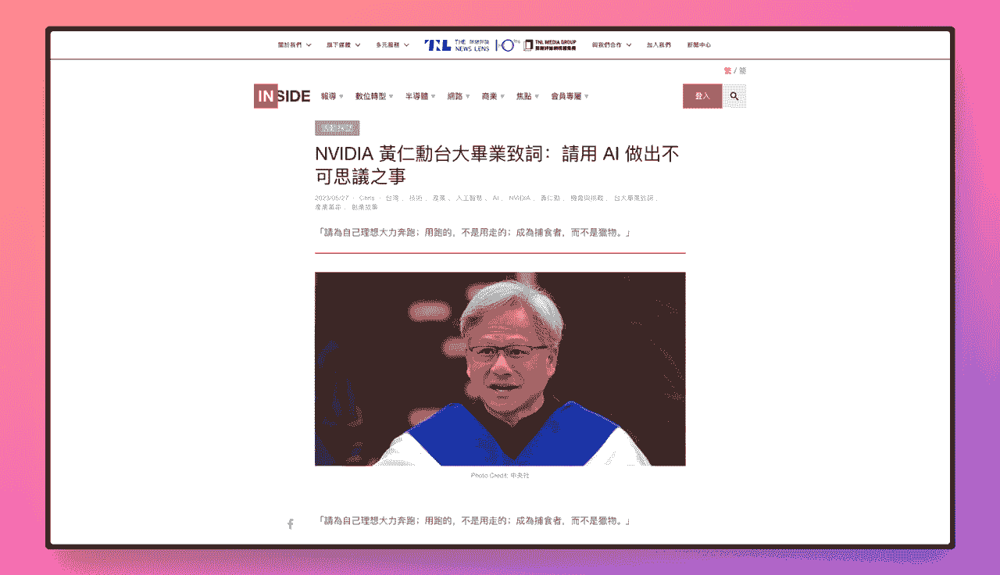

## 产品设计师应该开始变得更加技术化

这篇文章介绍了作者是如何偶然进入设计领域的，以及他目前的工作日常和设计工作中面临的挑战。作者认为，产品设计师应该开始变得更加技术化，因为未来AI将会影响设计领域。最后，作者介绍了他们正在创建的Dive项目，旨在帮助设计师不断学习。

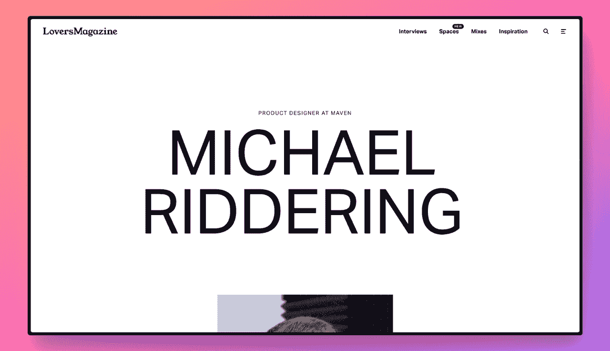

## [利用无监督学习提高语言理解能力](https://openai.com/research/language-unsupervised)

以下是 OpenAI 在 2018 年 6 月发布的 GPT-1 公告。

5 年前，扩大规模的决心已经存在。这么早的时间就对这条路线如此笃定。罗马不是一天建成的。

“我们越来越有兴趣了解我们在训练模型上花费的计算与结果输出之间的关系……”

“我们希望我们的结果能够激发进一步的研究，将这一想法应用于更大、更多样化的数据集。”

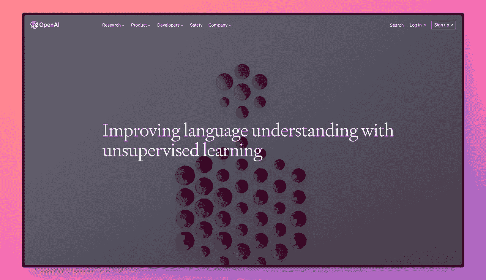