# AIGC Weekly #22

> 来源：[https://waytoagi.feishu.cn/docx/Rjdzdfzcboru7GxPyE2cF8SDnld](https://waytoagi.feishu.cn/docx/Rjdzdfzcboru7GxPyE2cF8SDnld)

> 🔗 原文链接： h[ttps://op7418.zhub](https://op7418.zhubai.love/posts/2272458017364848640)ai.love/posts/22...

> 发表时间：2023-05-22

工具：Midjourney v5.1

Seeing a bloom under white light, Flowing transparent fabric, sleek glass thickness, transparent, pink and white and blue holographic,in the style of precise hyperrealism, mesmerizing colorscapes, i can't believe how beautiful this is, zen buddhism influence, luminous color palette, fanciful, dreamlike imagery::3 Stockphoto, datamoshing, analytical art, urban energy, contained chaos, low bitrate high - key lighting, abstraction - création kodak elite chrome extra color, juxtaposition of light and shadow, clear colors smooth, modern minimalist, 3d render, unreal engine 5, industrial design, studio lighting, zoomed shoot, isometric, blender::1 --ar 3:2

这周我们周刊的订阅人数达到了5000人，本期主要内容有ChatGPT的iOS应用以及Sam Altman参加国会质询的一些内容，还有上周非常火的拖动锚点编辑图片的Drag Your GAN这篇论文的内容。

上周我发了两篇内容其中一篇是《 Civitai顶级大神SD作图流程分享 》另一篇是《 教你十几分钟不用代码创建自己的AI应用 》感兴趣可以看一下。

# ❤️上周精选

## Open AI发布了ChatGPT iOS应用

上周Open AI终于发布了ChatGPT的iOS应用，应用将首先在美国推出，之后会扩展到其他国家。Android版本也会在之后很快上线。下面是ChatGPT iOS值得注意的一些点：

+   应用下载地址： [h](https://apps.apple.com/app/openai-chatgpt/id6448311069)ttps://apps.apple.com/app/openai-chatgpt/id6448311069

+   应用支持GPT-3.5以及GPT-4两个模型，有人也发现iOS应用的3.5模型跟web端的版本号不一样后面的单词是mobile。

+   可以使用插件但是不能直接切换，你需要在web端创建一个使用了插件的历史纪录才能使用。

+   支持语音输入，中英文都支持，配合锁屏插件随时随地使用ChatGPT，极大提高效率。

+   可以查看以前web 端的沟通历史纪录，页面向右滑拉起历史记录，向左滑新建聊天窗口。

+   手机端支持购买Plus会员，所以你可以通过使用美区App Store账号充值礼品卡的方式用国内的支付方式购买Plus会员。

+   前几天有一次更新，主要修复了使用时间长后会导致电池过热的问题，低电量模式会禁用触觉反馈。

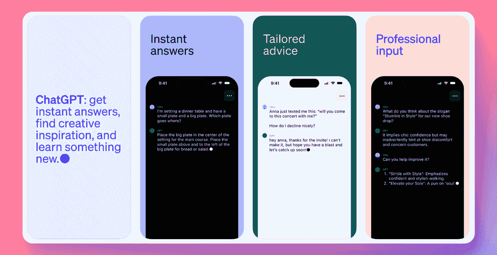

上周发布以后很多朋友不知道怎么下载ChatGPT iOS应用以及通过App Store购买Plus会员，这里写一下详细教程，包括如何注册美区账号以及如何购买礼品卡充值，还有就是经常出现的支付失败怎么办。

## 注册美区Apple ID

这里你首先需要一个美区App Store账号，不止可以下载ChatGPT很多应用都需要，下面是注册的具体步骤：

+   首先需要先访问 https://appleid.apple.com/account 注册页面，按要求填写就行。需要注意的是邮箱需要之前没有注册过Apple ID，地区选择美国，出生日期要大于18岁，手机号那里选择中国大陆，输入你的的手机号就行。

+   点击继续之后输入发给你邮箱的验证码就行。

+   登录之后切到付款方式那一栏，选择添加付款方式。付款方式那里选择无就行，下面的地址从这里生成 https://www.meiguodizhi.com/ 。建议选择五个免税州的地址，不然你买啥都要扣税。蒙大拿州（Montana）俄勒冈州（Oregon）阿拉斯加州（Alaska）特拉华州（Delaware）新罕布什尔州（New Hampshire）

+   之后就是登录了，在你手机的App Store搜索页面右上角点击头像拉到最下面，退出原来的账号。之后登录你新注册的账号就行。

## 购买礼品卡及充值

这里主要有两种购买方式一种是支付宝里面的可以用支付宝支付，另一种是直接Apple美国官网购买这个需要你有国内的Visa卡或者Master卡。首先是支付宝的购买教程。

在你支付宝右上角把地区调整到美国任何一个城市，下拉找到大牌礼品卡9折的banner。进去以后拉到最下面找到 更多大牌折扣礼品卡，点进去搜索App Store，之后就是正常注册购买支付就行。

接下来是美国Apple官网的购买流程。访问Apple美国官网 https://www.apple.com/ ，拉到最下面找到Gift Cards，按流程购买就行。

这里登录Apple ID的时候填写你国内的ID就行。填写地址还是用上面说的美国地址生成器生成美国免税州的地址就行。这个需要你有国内的Visa卡或者Master卡，之前有人说银联卡也行，不知道现在行不行了。试过的朋友可以说一下。

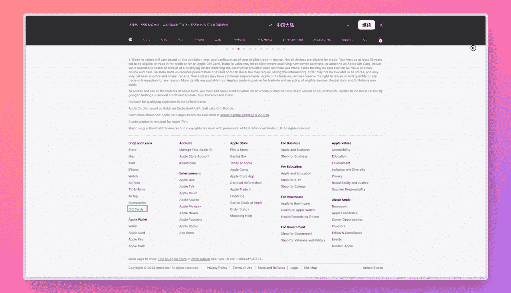

## 支付失败怎么办

有的朋友在购买Plus的时候出现了（Your Purchase Could Not Be Completed）这个报错。解决方式就是在手机上下载Apple support找客服解决。找之前把手机的地区，IP地址和语言都设置成美国的，用英语提问。不然客服可能会直接封你号。

注意：如果你的ChatGPT已经在web购买了Plus不要取消再去手机端买用完无法续费再说。不要在淘宝购买账号和礼品卡，不然有可能钱和账号都拿不到。

支付失败解决方案来自： [h](https://twitter.com/oran_ge/status/1659412600118218755?s=20)ttps://twitter.com/oran_ge/status/1659412600118218755?s=20

## Open AI CEO Altman 参加国会质询

OpenAI首席执行官Sam Altman参加举行了一个长达三个小时的会议，他讨论了与AI相关的风险以及制定规则和法规以确保其道德使用的重要性。主要内容是下面几点：

+   参议员布卢门撒尔在会议开始时播放了一段模仿他声音的人工智能生成录音。

+   就工作替代的担忧提出了讨论，阿尔特曼认为人工智能可以创造新的就业机会，但如何准备劳动力的责任尚不明确。

+   当被问及他收购该公司时，阿尔特曼表示他在OpenAI没有任何股权。

+   随着即将举行的选举，阿尔特曼担心生成式人工智能可能传播不适当的信息。

+   参议员们还就与生成式人工智能音乐相关的所有权和版权法提出了合理的问题。

+   阿尔特曼敦促国会对大型科技公司实施新的监管，以确保人工智能的负责任和道德发展。

Stability AI也来凑热闹他们CEO Emad Mostaque发布了一份详细的文件，强调了开放模型在透明、竞争和弹性数字经济中的重要性。

地址在这里： [h](https://stability.ai/blog/stability-ai-letter-us-senate-ai-oversight)ttps://stability.ai/blog/stability-ai-letter-us-senate-ai-oversight

## Drag Your GAN 拖动锚点来调整图像

上周Drag Your GAN这篇论文的演示视频刷屏了，简单来说就是通过拖动锚点来精确调整画面，比如让闭嘴的狗张嘴。从演示视频来看效果不错。这个论文的工具使用的是GAN模型与我们现在比较流行的Diffusion模型在训练方式上有很大的不同。

这里简单介绍一下GAN模型：生成对抗网络（GAN）是一种深度学习模型，由两部分组成：生成器和判别器。生成器的任务是创建新的、看起来像真实数据的样本，而判别器的任务是区分生成的样本和真实的数据样本。这两个网络相互对抗，生成器试图欺骗判别器，而判别器试图不被欺骗。这个过程导致生成器逐渐学会生成越来越逼真的样本。

这个工具基于之前的一个叫StyleGAN2的项目来开发的，GAN模型在图像的质量和分辨率比较好，同时生成速度比Diffusion模型要快很多。但是也存在训练过程不稳定、训练结果难以评估和潜在空间不连续等问题。

演示视频的内容和图片都比较单一，代码将会在6月份发布，所以建议谨慎期待。

Github地址： [https://github.co](https://github.com/XingangPan/DragGAN)m/XingangPan/DragGAN

论文地址： https://arxiv.org/abs/2305.10973

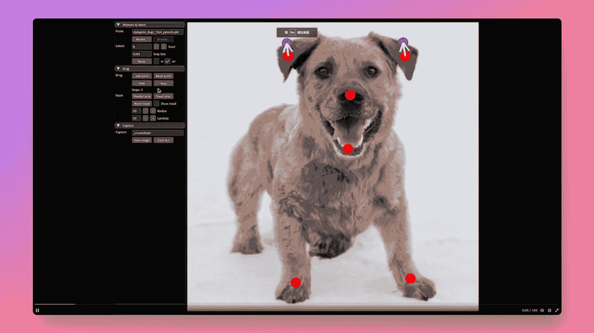

# ⚒️产品推荐

## [Clay：AI驱动的CRM软件](https://clay.earth/)

Clay是一款AI驱动的联系人应用软件，自动整理联系人信息，帮助你更好地管理个人和职业人脉，为你深化人际关系提供有力帮助。该软件提供多种功能，能够快速记录关键信息，实现对人际关系的更多思考和努力。

## Promptden：提示词交流和交易社区

该社区提供刺激工程、启发和分享，可以探索、发现和分享从ChatGPT和Bard文本提示到MidJourney，Stable Diffusion等AI生成的图像。

## Parthean AI：AI财务助理

Parthean AI是一款财务教练，它将AI工具与个人财务信息集成，可以立即提供定制答案。该平台帮助用户制定预算并规划财务目标，并且与Parthean的预算、投资和信用管理工具紧密集成。此外，Parthean AI提供主动学习建议、财务仪表板追踪和沉浸式手册。

## TinyStudio：AI字幕生成软件

TinyStudio是一款免费的Mac应用程序，它利用M1 / M2芯片的强大功能来提供快速高效的性能。它为用户提供了一键式解决方案，无需任何技术专业知识即可为其视频和音频文件生成字幕。由@tinyfool 开发。

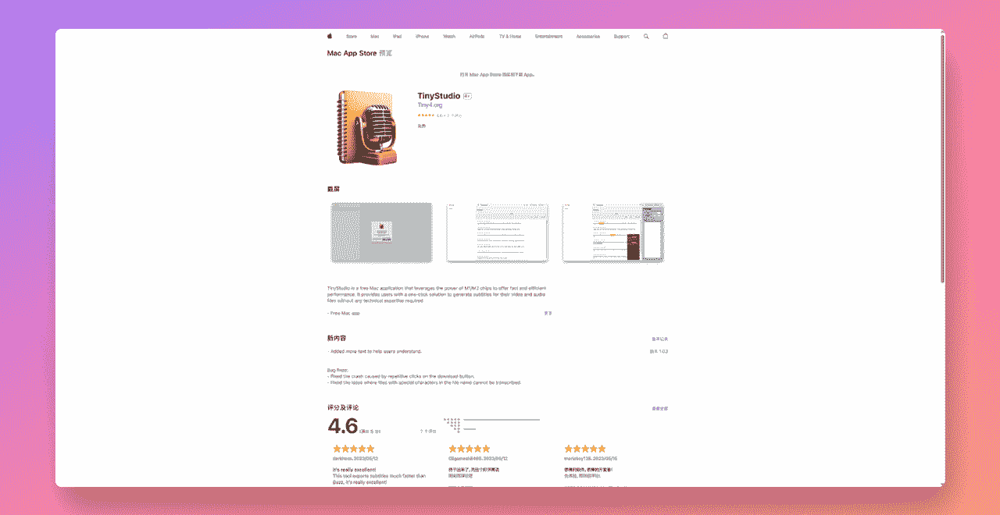

## [Pagegpt：AI生成落地页](https://pagegpt.pro/)

该平台可以提供个性化的网页设计，为您的产品和主题量身定制原创网页设计，同时提供AI生成的文案和图片，可以帮助您更好地吸引和转化顾客。使用五个简单步骤，就可以实现无需学习新工具、自然语音定制和高性能优化等功能。

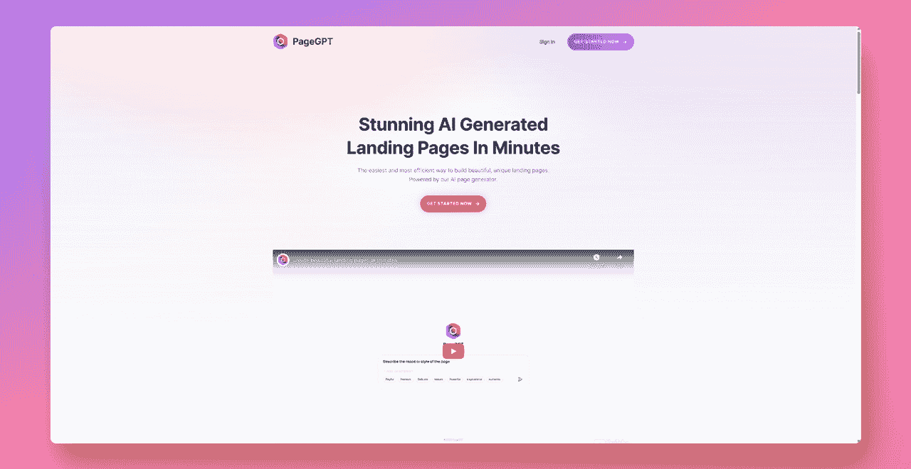

## Audionotes：语音笔记工具

Audionotes.app 是一款基于语音的笔记工具，可以捕捉、组织、转录、概述和生成内容，使语音转文本转换变得无缝和高效。该应用程序提供无限的语音笔记、高质量的转录、有效的摘要、音频日记、一键生成内容以及与朋友共享笔记和摘要等功能。

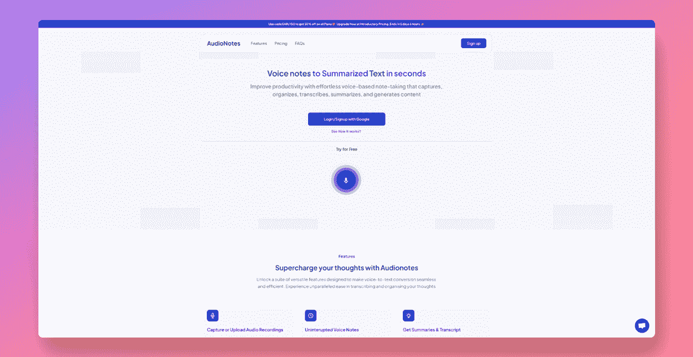

## [书译：AI驱动的全书翻译工具](https://apps.apple.com/cn/app/%E4%B9%A6%E8%AF%91-ai-%E5%85%A8%E4%B9%A6%E7%BF%BB%E8%AF%91%E5%B7%A5%E5%85%B7/id6447665417)

[@DottChen ](https://twitter.com/DottChen)开发的APP。"书译" 是一款基于人工智能技术的全书翻译工具，支持简体中文、英文、繁体中文、日文、韩文等多种语言的翻译。它能够快速准确地将整本书的文本翻译成您想要的语言，让您轻松阅读全球的图书。

## Dora AI：无代码网站建设工具

前幕布产品负责人做的产品。Dora AI是一款能够生成、自定义和部署自然语言的网站的智能AI工具，用户只需在Dora的强大无代码编辑器中输入一行指令即可创建具有可编辑和奖项获奖特性的网站，用户还可以使用Dora的3D交互生成器将静态设计转换为沉浸式体验。用户可以加入等待列表，体验Dora AI的全部功能。

## Takomo：可视化部署和链接AI模型

Takomo 是一个拖放式 AI 模型构建器，通过单个 API 调用提供多模型流水线的访问。它提供模板、预训练模型和上传自己的模型权重的能力。Takomo 支持生成图片、视频等自定义解决方案。它的 API 运行在经过 ISO 认证的云基础设施上，并提供可伸缩、价格实惠的产品和专家支持。用户可以加入 Takomo 社区、分享知识、学习他人的经验，并通过订阅 Takomo 的新闻简报保持最新更新的了解。

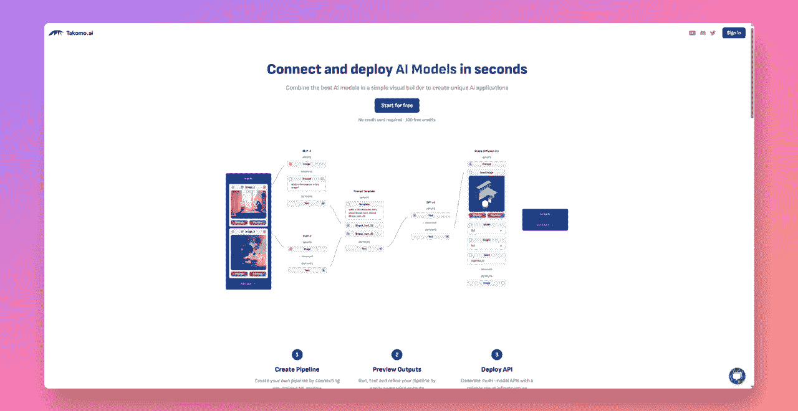

## Databerry：根据你的数据构建你的AI机器人

可在几秒钟内基于您的数据训练定制的 AI 聊天机器人，并用于优化客户支持和团队沟通效率。ChatGPT 插件将帮助您将数据整合到 ChatGPT 中，以与个人文档对话，插件存储库可帮助增加品牌知名度并提供互动统计数据。AI 聊天机器人能够提高效率、个性化体验、自动化重复任务、节省成本。Databerry 支持 90 种语言，文档存储在欧洲的安全 AWS 服务器上。

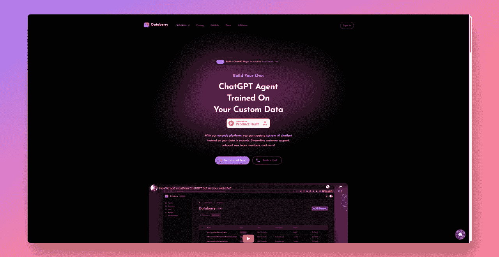

## [Vidio：AI视频编辑](https://www.vidio.ai/)

无需安装任何软件，用户只需简单几步操作即可利用AI去除视频背景等。应该是利用了前几天发布的那个视频版本的SAM模型，可以选择视频特定内容抠出来进行处理，比如为其它地方增加模糊效果或者调色。

## CaptionCreator：AI添加字幕

CaptionCreator是一种高级的在线字幕创作工具，可轻松生成准确的视频字幕，并支持50种语言的转录和翻译。该工具还支持多语言音频、嘈杂音频和多种口音。它极大地提升了在线展示的SEO和排名。用户只需上传视频或音频文件，点击生成字幕，进行修改和下载即可。每个credit等同于1分钟的转录/翻译时间。

## [Cue：AI浏览器助手](https://www.getcue.ai/)

AI浏览器助手，它可以创建复杂的自动化操作，用户只需使用简单的文本界面即可。

# 🔬精选文章

## [范德堡大学的提示工程课程](https://www.coursera.org/learn/prompt-engineering)

本课程将教您如何成为这些生成 AI 工具的专家用户。本课程将展示令人惊叹的示例，说明如何利用这些生成式人工智能工具的新兴智能和推理，如何使用它们来提高日常工作效率，并让您深入了解它们的工作原理。

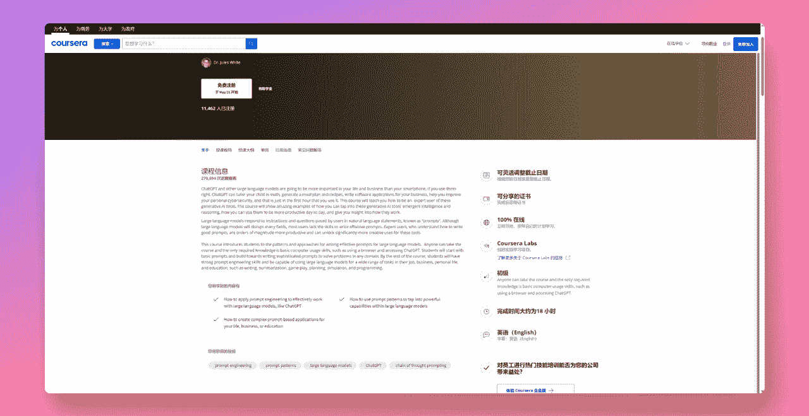

## [了解大型语言模型背后的理论](https://www.edx.org/course/large-language-models-foundation-models-from-the-ground-up)

这门课程深入探讨了自然语言处理（NLP）中基本模型的细节。 学习创新技术，促进了基于Transformer的模型（包括BERT，GPT和T5）的广泛应用，以及推动ChatGPT等应用的关键突破。 课程还涉及到少量学习和知识蒸馏等转移学习技术，以改善大型语言模型（LLMs）。 课程聚焦于新的LLM发展方向，如多模态模型和LLM决策制定，展望这个变化快速的领域的未来。 本课程需要有中级Python水平和深度学习概念的初步了解。 可以选择免费或购买付费课程。

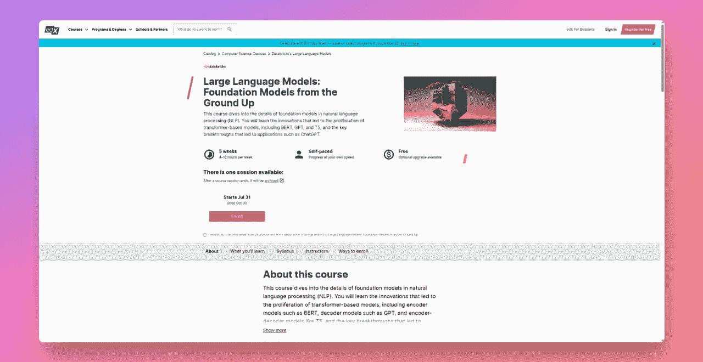

## 赋予 GPT “无限”知识-如何让GPT接受大量数据

OpenAI的大型语言模型（LLMs）受到它们可以训练和依赖的数据量的限制，这可能会导致不准确性和幻觉。将实时、相关的数据存储和提供给LLMs以向量数据库可以帮助提高它们的准确性和灵活性。但是，对于初始提示和响应生成，存在ToKen限制，并且监控ToKen计数对于防止超过ToKen限制至关重要。自主代理可以用于实时获取LLMs的数据。随着信息不断演变，可以预期持续改进和解决方案。

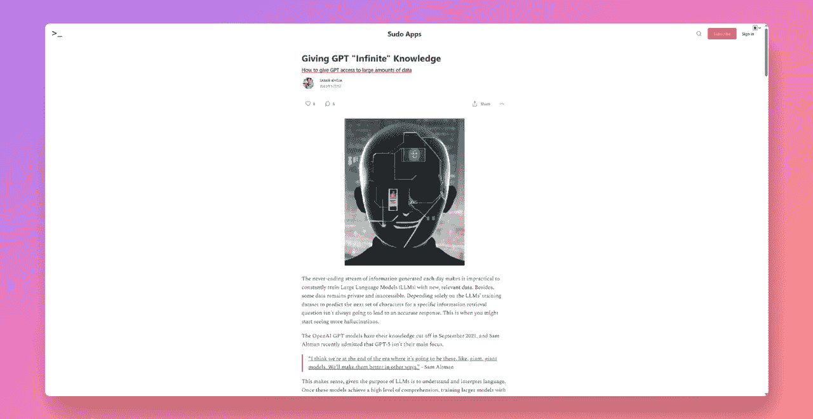

## [阿里妈妈推出一系列AI功能](https://mp.weixin.qq.com/s/zAjKiQp4CWul4KQ9NxDmBw)

阿里商业化团队阿里妈妈在近日推出了可变字体和虚拟人3大AI创意能力升级的创意工具，以满足品牌的创意需求。该工具提高了创意生成效率、创意质量和多元经营场景的适配性，展示了AI设计对商业的无限可能性。阿里妈妈的创意中心还提供视频制作工具、落地页搭建工具等，以帮助商家一站式内容经营提效。

## 使用 Supabase Edge 运行时构建 ChatGPT 插件

Supabase发布了一个ChatGPT插件模板，使用TypeScript编写并在Supabase Edge Runtime上运行，以帮助用户快速上手。您可以在GitHub上复制模板，并使用swagger-jsdoc注释端点以生成OpenAPI定义。最后，您可以在本地测试插件，并使用fly.io部署到全球。

## 英国电信巨头BT因AI裁员55000人

英国电信巨头BT计划在本十年末削减员工人数，其中高达五分之一的员工将由人工智能取代，以降低成本。预计将裁掉工作人数的40%。

## 苹果公司限制员工使用ChatGPT，与其他公司一起警惕泄密事件的发生

苹果公司已经限制了员工使用ChatGPT和其他外部人工智能工具来开发自己类似的技术，因为它担心工人可能泄露机密数据。苹果公司正在开发自己的大型语言模型，旨在保护未来产品和消费者数据的机密性。许多企业已经警惕这种技术，因为他们的员工已经开始将它用于电子邮件、营销材料编制和软件编码等方面，并且已经禁止其使用。

## 在程序上训练的语言模型中的意义证据

这篇论文主要探讨了语言模型在训练过程中是否能学习到语义信息。论文首先训练了一个Transformer模型，该模型在程序的语料库上进行训练。然后，他们探测了模型在给定规格完成程序时的隐藏状态。他们发现，尽管没有提供学习语言语义的归纳偏差，但线性探测器能够从模型状态中提取出当前和未来程序状态的抽象。此外，探测器的准确性与模型生成满足规格的程序的能力之间存在强烈的、统计显著的相关性。

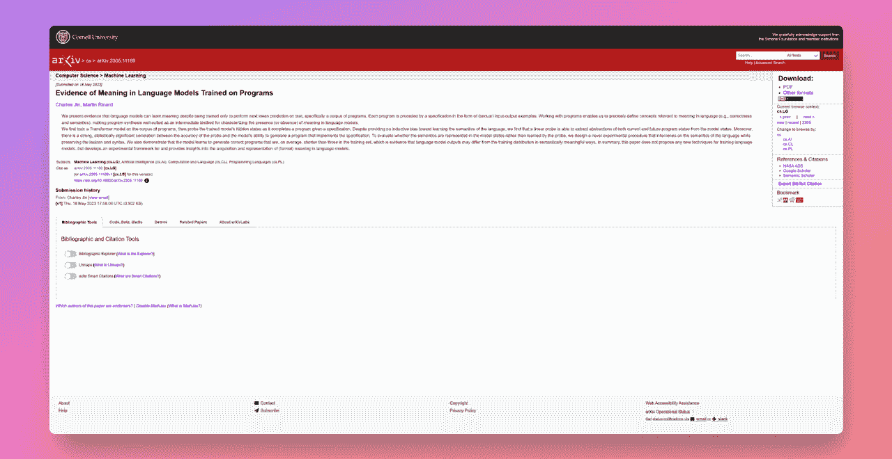

## [CodeT5+代码编写模型](https://arxiv.org/pdf/2305.07922.pdf)

一个新的开源代码 LLM 系列，用于代码理解和生成，在 HumanEval 上实现了新的 SoTA 代码生成性能，超过了所有开源代码 LLM。

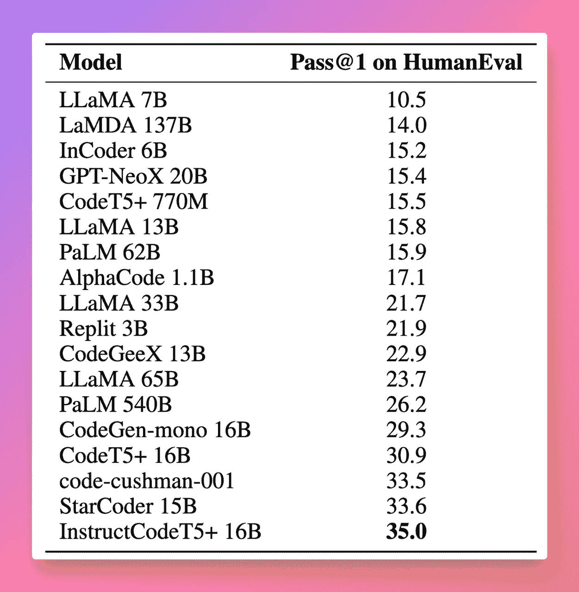

## 谷歌将会在Colab发布自己的代码编写模型

Google Colab将很快介绍使用Google最先进的代码模型Codey的人工智能编码功能。Colab将使用建立在PaLM 2上的Codey家族代码模型，这些版本已经为Python和Colab特定用途进行了定制。这些功能将逐步推出，从美国的付费用户开始，然后才推广到免费用户层。Colab用户可以享受强大的编码功能，包括自然语言到代码生成、代码补全和集成聊天机器人等功能。它对于机器学习、数据分析和教育都是一个很好的工具。

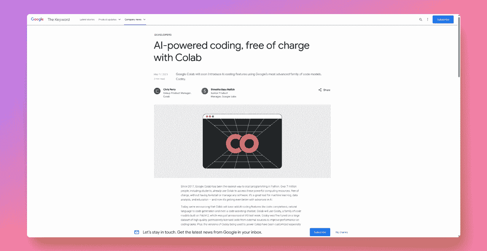

## [Stability AI发布了DreamStudi](https://www.theverge.com/2023/5/17/23726751/stability-ai-stablestudio-dreamstudio-stable-diffusion-artificial-intelligence)o的开源版本——StableStudio

这一举措标志着该平台迎来了“新篇章”，并展示了对开源发展的“承诺”。该公司表示，通过开源DreamStudio，社区开发人员可以对接口进行改进和实验，从而为公司带来潜在收益。此外，Stability AI的开源开发方法也帮助了其产品的推广。然而，该公司的开源方法有时也似乎缺乏方向，例如StableStudio将与DreamStudio并存，这一策略的成功程度尚不明确。最近的报道指出，该公司正在烧钱，而其最重要的模型Stable Diffusion是与其他合作方一起建造的。

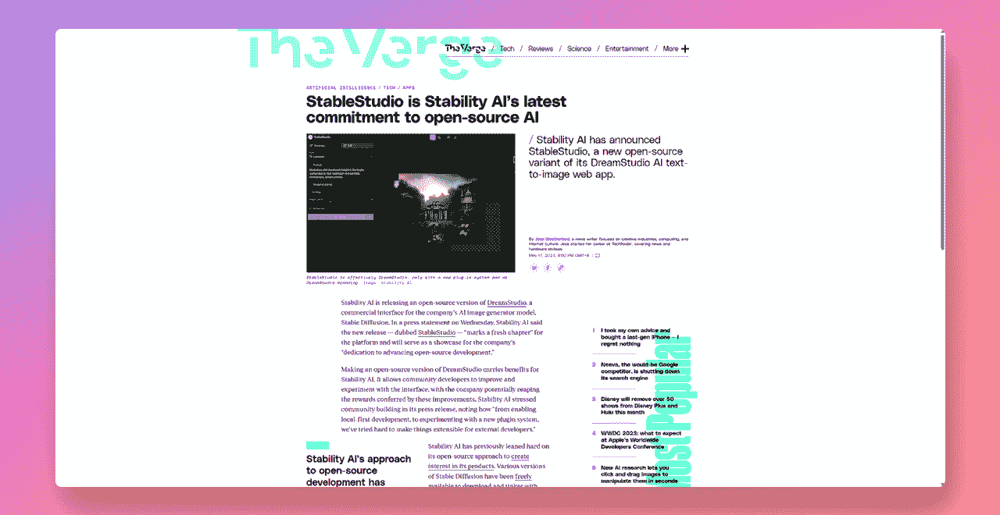

## Anthropic的100K上下文窗口测评-LangChain

LLM问答模型通常需要检索与问题相关的文档，并将检索到的内容合成为答案。由于LLM上下文窗口相对于文本语料库的大小有限，因此检索步骤通常是必要的。Anthropic最近发布了一种具有100k标记上下文窗口的Claude模型，因此有理由怀疑对于许多Q+A或聊天应用用例，文档检索阶段是否必要。检索器架构包括词汇/统计、语义、带元数据过滤的语义、文档摘要的kNN和后处理，以及不需要检索器的方案。Anthropic 100k模型的性能与kNN（FAISS）+ GPT3.5-Turbo相当，在有一些挑战的情况下，不需要检索器的架构具有吸引力，尤其是当LLM上下文窗口增加且模型变得更快时。

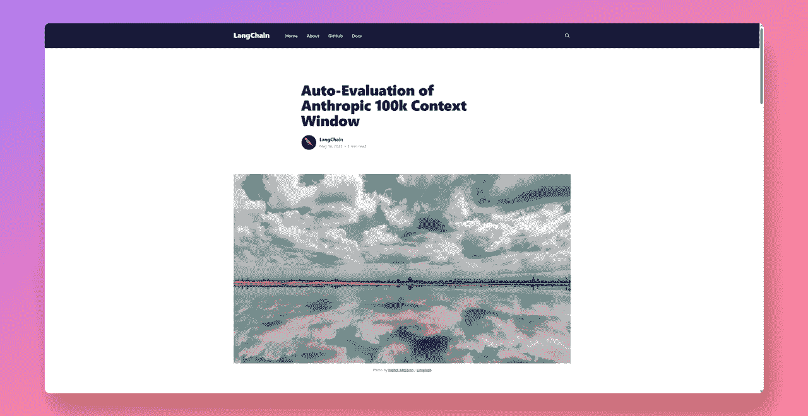

## 人们对历史上最伟大的发明是如何反应的： 从印刷术到人工智能

自从人类有历史以来，就一直不愿意接受新的发明，从印刷机到现代生成AI创新。但最终，他们始终会接受的。本文将探讨一些历史上最伟大的发明，它们一次又一次地改变了我们消费信息、学习和相互交流的方式。但这些发明并不总是得到人们的好评。从印刷机到电话、个人电脑再到生成AI，这篇文章涵盖了大部分信息技术的早期历史，描述了人们对它们的初始反应和改变文化的方式。

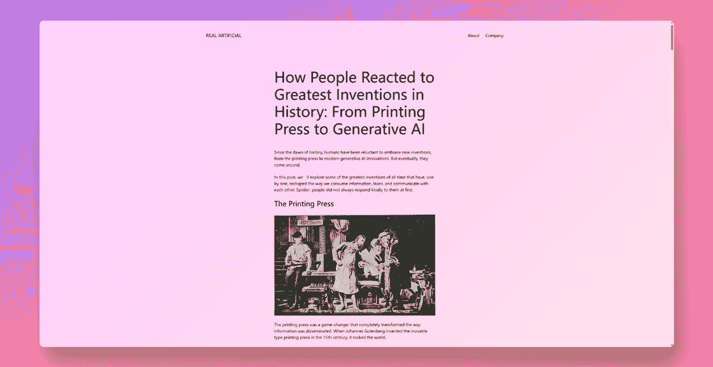

## Lightspeed正在阅读、聆听和思考AI的内容

Lightspeed的合作伙伴们在这个领域进行了深入和广泛的阅读，包括从技术到理论到哲学的所有内容。他们在这篇文章中分享了一些他们在过去几个月里发现最引人入胜的阅读材料，包括一些在新的兴奋情境下阅读的经典文本，以及一些解释最新发展和困境的最近的文章，这些文章描绘了AI领域和风险资本的总体情况。他们还包括了一些在他们的报道和分析中能看到未来趋势的行业和学术界的优秀聚合器。

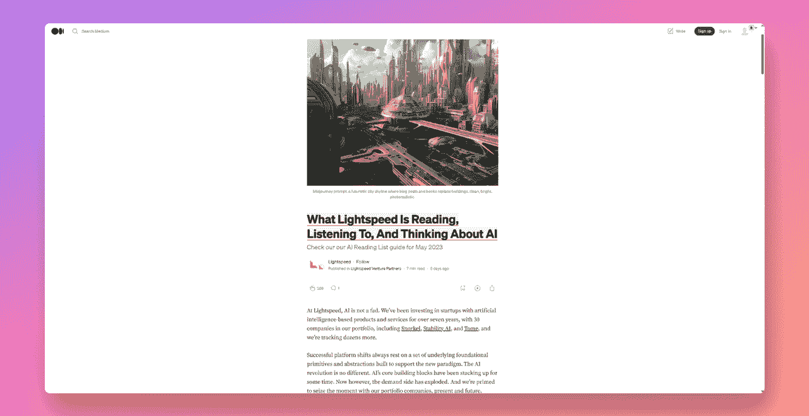