# AIGC Weekly #21

> 来源：[https://waytoagi.feishu.cn/docx/Zke0diyV5o3mlyxBl7OcHnAsn8e](https://waytoagi.feishu.cn/docx/Zke0diyV5o3mlyxBl7OcHnAsn8e)

> 🔗 原文链接： h[ttps://op7418.zhub](https://op7418.zhubai.love/posts/2269728074499989504)ai.love/posts/22...

> 发表时间：2023-05-15

工具：Midjourney v5.1

Abstract chrome texture, dark atmosphere, low saturation, color, blurred, delicate, soft scene, 8k, silver, massive details::5 stockphoto, datamoshing, analytical art, urban energy, contained chaos, low bitrate high - key lighting, abstraction - création kodak elite chrome extra color, juxtaposition of light and shadow, clear colors smooth, modern minimalist, 3d render, unreal engine 5, industrial design, studio lighting, zoomed shoot, isometric, blender::1 --ar 3:2 --style raw

这期对周刊的栏目做了一些调整，去掉了教程的部分，主要是因为教程和文章的界限很模糊，以后教程就都塞到文章里了。还增加了一个招聘信息的栏目，国内的公司或者团队如果有招聘需求或者产品的宣传需求也可以发给我，我会免费帮忙发。

[上周还写了AI歌手教程的第二部分《 教你打造](https://mp.weixin.qq.com/s/IeeW1PbMUbxMlLl529JTYQ)属于自己的AI孙燕姿，AI歌手模型使用及训练保姆级课程 #2/2 训练模型 》主要介绍了数据处理和模型训练两部分内容。

# ❤️上周精选

## Google I/O发布会相关信息

在2023年的Google I/O大会上，Google宣布了多项AI新功能，基本覆盖了谷歌旗下所有业务，可以说被迫 all in AI 了。

首先是谷歌的自然语言模型PaLM 2，值得注意的是PaLM 2模型在各种规模上都提供出色的基础功能，包括名为Gecko的模型，能够在移动设备上运行，即使在离线状态下也可以支持交互式应用。此外，它还接受了超过100种语言的多语言文本训练，因此可以理解并生成细致入微的结果。

这里是PaLM 2的详细介绍 [https://blog.google/technology/a](https://blog.google/technology/ai/google-palm-2-ai-large-language-model/)i/google-palm-2-ai-large-language-model/

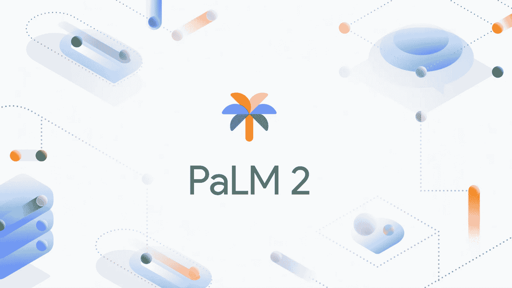

接下来是AI搜索引擎Bard，Bard正在扩大全球访问范围，引入更多语言并结束候补名单。Bard即将推出更直观的响应和提示，加强与Google Lens的集成，并引入新的导出操作，还将推出类似插件的功能不久可以跟谷歌其他服务联动还能使用其他的网站的服务比如Adobe Firefly。

详细介绍在这里： [h](https://blog.google/technology/ai/google-bard-updates-io-2023/)ttps://blog.google/technology/ai/google-bard-updates-io-2023/

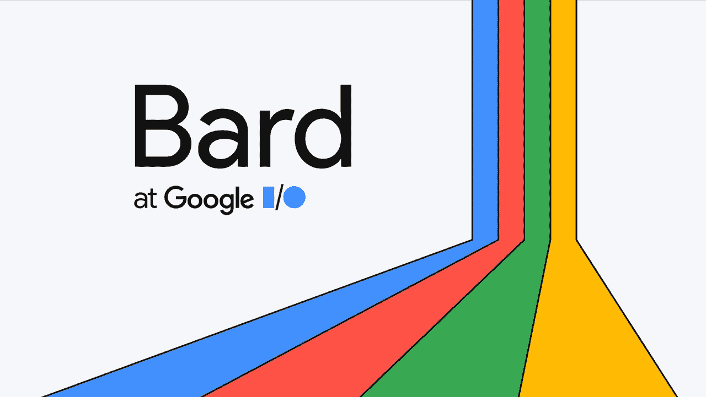

谷歌还推出了基于谷歌搜索的一系列AI增强功能，从而为用户提供更多的信息和上下文。包括借助 Search 中新的生成 AI 功能，总结搜索结果和相关内容、还可以帮助你购物，AI会生成相关产品的重点信息和对比内容、他们推出了一个搜索实验室来测试这些功能。现在只对美国开放。

搜索实验室地址： https://labs.google.com/search/

详细信息： [h](https://blog.google/products/search/generative-ai-search/)ttps://blog.google/products/search/generative-ai-search/

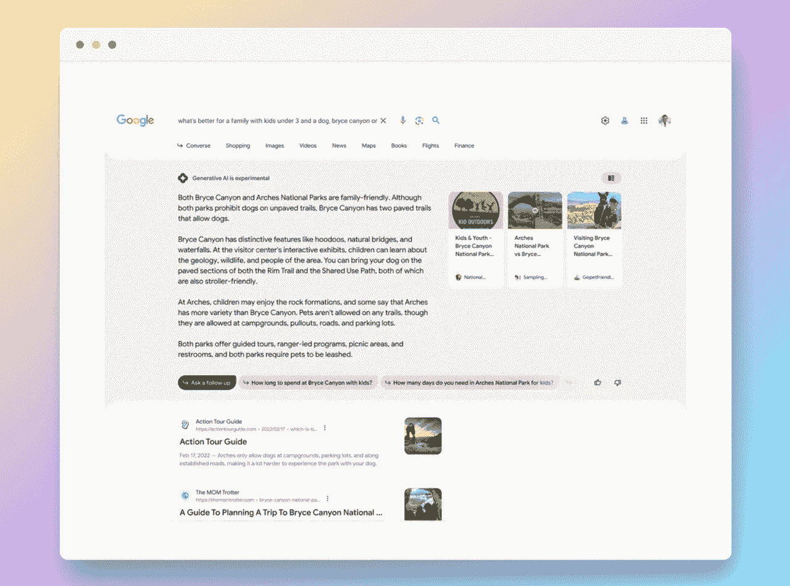

最后还有一些其他的谷歌传统应用于AI结合的功能：

+   Gmail推出了"Help me write"功能，用户只需输入简单指示，AI即可自动草拟邮件。

+   Google Maps推出了新的沉浸式视图功能，用户可以在出发前预览整个旅程。

+   Google Photos将推出Magic Editor功能，用户可以调整照片中的元素位置和光照效果。

+   Android 系统会在你使用短信APP时增加AI功能帮你润色你的对话。

+   还推出了AI图片检测工具，通过搜索图片在谷歌搜索引擎最早出现的时间来判断。

+   推[出了一](https://aitestkitchen.withgoogle.com/experiments/music-lm)款文本转音乐的AI工具Mu[sicLM，该工](https://twitter.com/op7418/status/1657224471034601472?s=20)具可以将用户的文本描述转化为独特的音乐作品，可以在这里 试用 这个功能，我也尝试了一下 生成了一段音乐 。

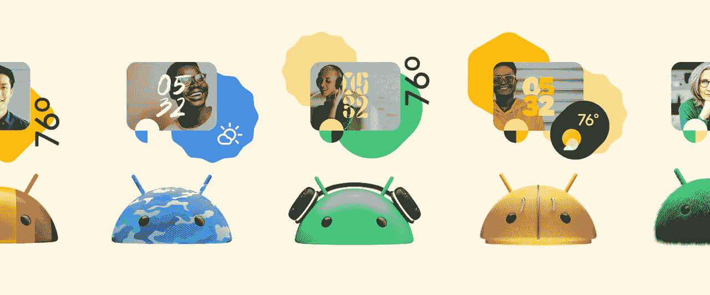

## Anthropic Claude 和 Open AI 的一些动态

首先是 Anthropic 的两条消息：

Anthropic已经把Claude的上下文窗口扩展到10万文本标记，大概七万五千个字符。 你现在可以提交数百页材料供Claude消化和分析。与Claude的谈话可以持续数小时或数天。这个功能将首先开放给有API权限的的用户。

[可](https://www.anthropic.com/index/100k-context-windows)以在这里看Anthropic的详细说明： https://www.anthropic.com/index/100k-context-windows

然后果不其然Poe率先支持了这个能力，目前只有Web版本支持，订阅用户可用，每个月大概100条消息的额度。

这里使用： https://poe.com/Claude-instant-100k

还推出了他们的AI宪法，利用“宪法人工智能（Constitutional AI）”，能够帮助AI语言模型制定明确的价值观和行为准则，例如避免有害或有歧视性的输出，避免协助违法或不道德的活动，创造有益、真诚、无害的AI系统，并能够方便地调整价值观。

这里查看详情： [h](https://www.anthropic.com/index/claudes-constitution)ttps://www.anthropic.com/index/claudes-constitution

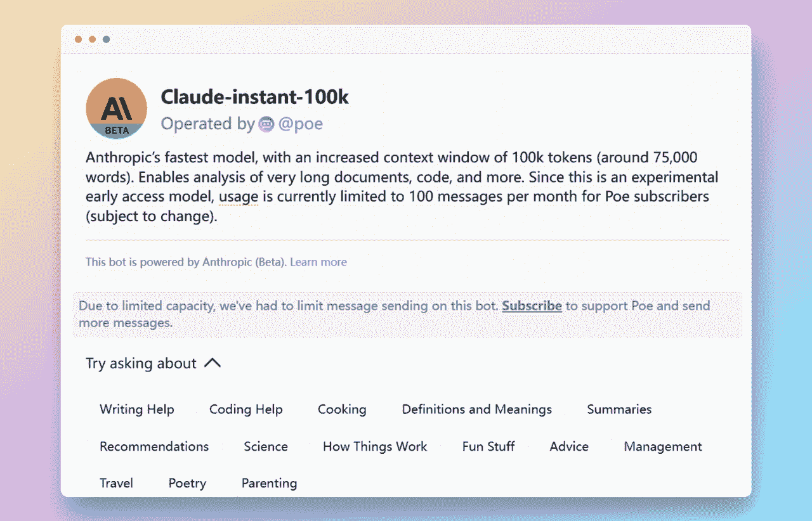

Open AI在沉寂了一段时间以后动作也越来越多，首先发布了他们的新研究：

使用 gpt4 来标记 gpt2 中的所有 307,200 个神经元，并用简单的英语描述每个神经元在模型中所扮演的角色。这为 AI 的可解释性和对齐开辟了一个新方向，有助于使模型更易于解释并可能更容易对齐。

详细信息在这里： [https://openai.com/research/language-model](https://openai.com/research/language-models-can-explain-neurons-in-language-models)s-can-explain-neurons-in-language-models

之后Open AI还宣布了将会在这周向所有Plus用户全量开放插件的使用权限，开放之后所有用户都可以使用网页浏览和插件使用这两项能力，插件的开发者权限目前依然需要等待邀请。

同时为了兼容插件和模型的选择他们也调整了这部分交互，如果你已经有插件权限了，应该可以看到。

详细信息： [h](https://help.openai.com/en/articles/6825453-chatgpt-release-notes)ttps://help.openai.com/en/articles/6825453-chatgpt-release-notes

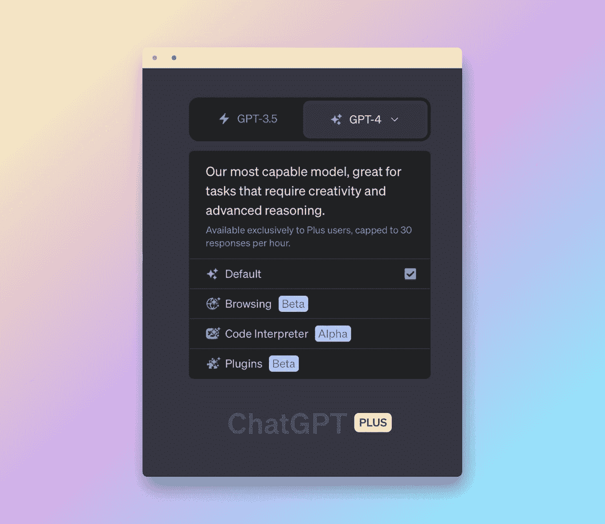

## Meta 开源了一个名为 Image Bind 的 AI 模型

计算机视觉 ImageBind：一种跨感官“链接”人工智能的新方法 ，这是第一个能够同时绑定来自六种模式的数据的 AI 模型，无需明确监督。通过识别这些模式（图像和视频、音频、文本、深度、热和惯性测量单元 (IMU)）之间的关系，这一突破通过使机器能够更好地分析许多不同形式的信息来帮助推进人工智能。

通过对齐 6 种模式，你可以做一些用纯文本 GPT-4 做不到的事情：

+   跨模式检索：将其视为多媒体 Google 搜索

+   嵌入空间算法：无缝组合不同的数据格式。

+   生成：通过扩散将任何模态映射到任何其他模态。

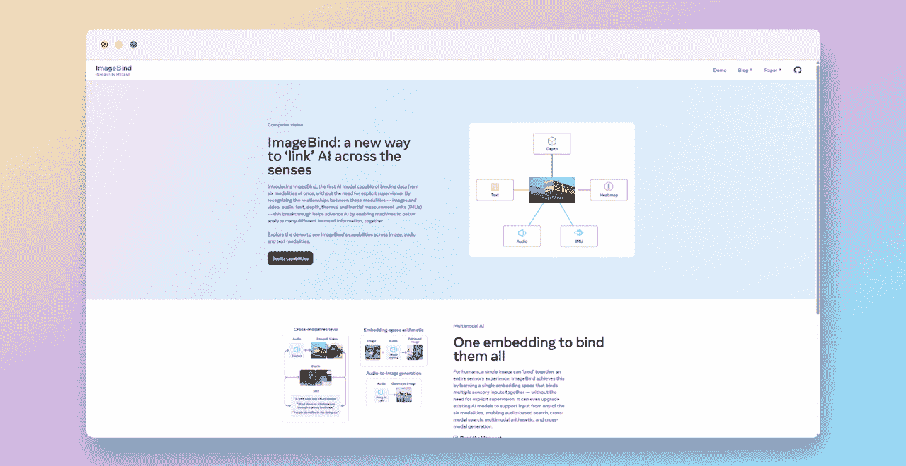

## HuggingFace Transformers Agent

HuggingFace Transformers Agent。它使编码 LLM 能够动态组合其他 HF 模型以解决多模态任务。

这个API提供了一个自然语言的API，可在Transformers上定义和设计一组筛选的工具并解释自然语言来使用这些工具。它具有可扩展性，可用于任何由社区开发的工具。它提供了单次运行和聊天执行两种方法，可处理多模态任务。此外，该API还提供了一些预定义的工具，包括文档问答、文本问答、图像生成、图像问答、图像分割、语音转文字、文字转语音、零选择文本分类、文本摘要和翻译等。

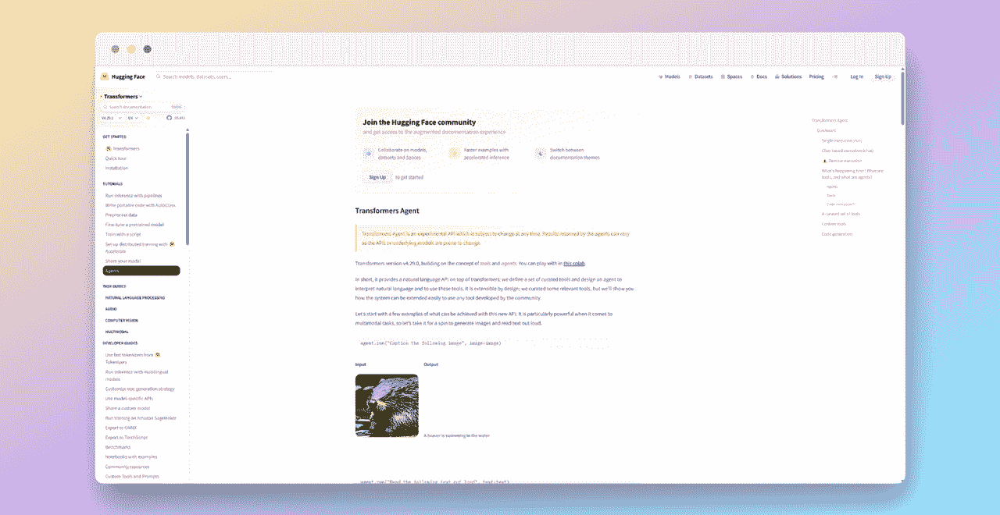

# ⚒️产品推荐

## ChatDOC：与文档聊天，通过引用的来源获得即时答案

上传研究论文、书籍、手册等文件并能获取快速理解的答案。通过AI功能，用户能够选中一些特定的文本或表格并提出精准的问题以获取更准确的回答。ChatDOC的回答带有直接引用，确保了AI的解释准确性。

同时他们的表格/文本识别用的是自己的模型，搜索结果比较准确；也可以对多文档合集进行提问，把某个topic的文档放到一个collection里；为了解决语言模型的幻觉问题他们做了两个处理一个是显示引用来源你可以自己看原文，另一个是可以选择AI的自主性等级，类似Bing那几个选项。

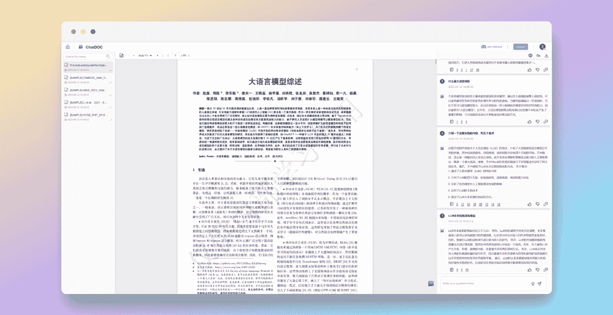

## Boring Report：AI新闻降噪

Boring Report是一款应用程序，旨在利用先进的AI语言模型将新闻转化为乏味的内容，消除耸人听闻的影响。通过这种方式，读者可以专注于重要的细节，减少耸动效果的影响。

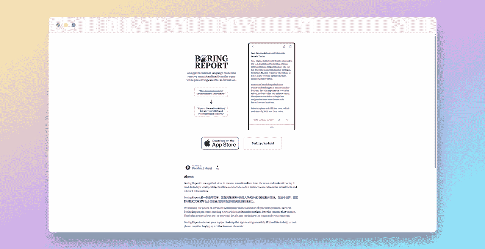

## YOYA.ai：无代码生成AI应用

YOYA.ai是一个无需编写代码就能构建个性化生成AI应用程序的平台。只需要使用自然语言即可基于LLMs构建下一代软件。Chatbot了解你的需求，有三个步骤可拥有定制的机器人。

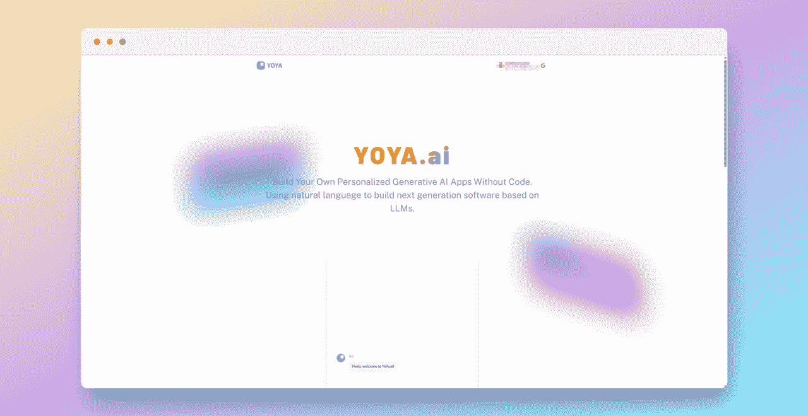

## Kadoa：AI驱动的内容爬取工具

可帮助用户轻松提取非结构化数据，甚至无需编码。只需要定义数据、来源和计划，Kadoa便会自动生成网站爬虫，自适应网站更新，并通过powerful API向用户提供数据。该工具适用于许多用例，如跟踪市场价格、聚合和解析职位发布、领先信息生成、金融投资和市场研究。

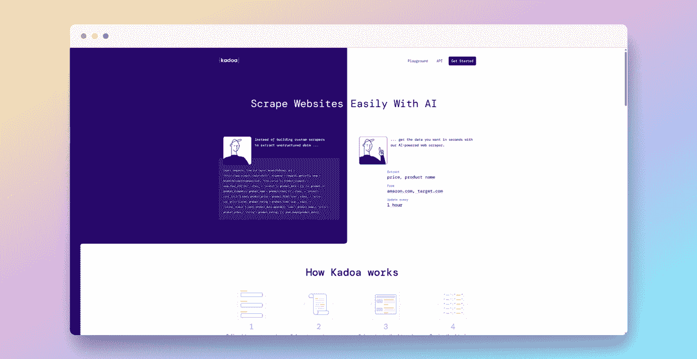

## LingoSync：AI视频翻译

LingoSync是一款由人工智能支持的视频翻译平台，可无缝地翻译40多种语言的视频内容。用户可以上传视频，自动翻译视频，并下载带有可自定义选项（如语音选择和文本调整）的完成视频。

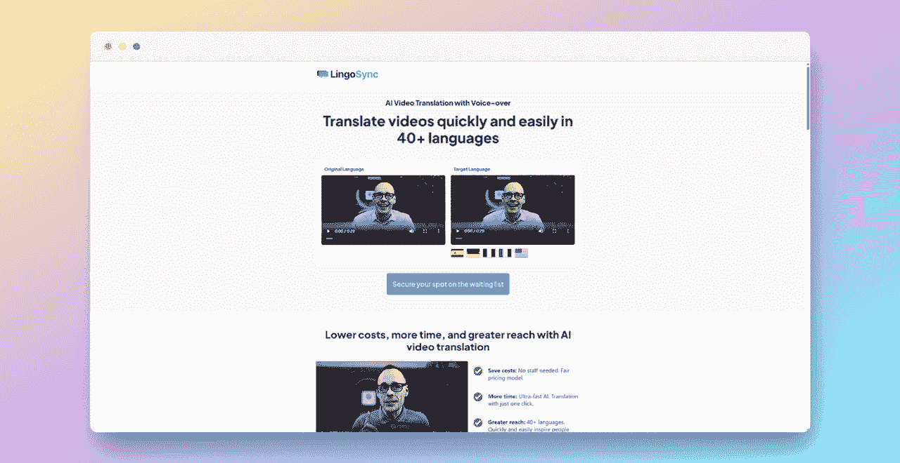

## PuddlTrack：Open AI API监控工具

Pudd[lTrack是一款免费](https://llm.report/)的OpenAI成本跟踪工具，提供每日、每周和每月的详细成本分析，还支持本地货币本位和按模型进行支出分析。此外，还提供了Sleek Playground创建、测试版本和保存你的提示，以及Python库发送请求和跟踪历史。未来还将推出LLM Ops工具。PuddlTrack为所有这些服务提供支持。比我们上次介绍的 LLM report 功能强大一些。

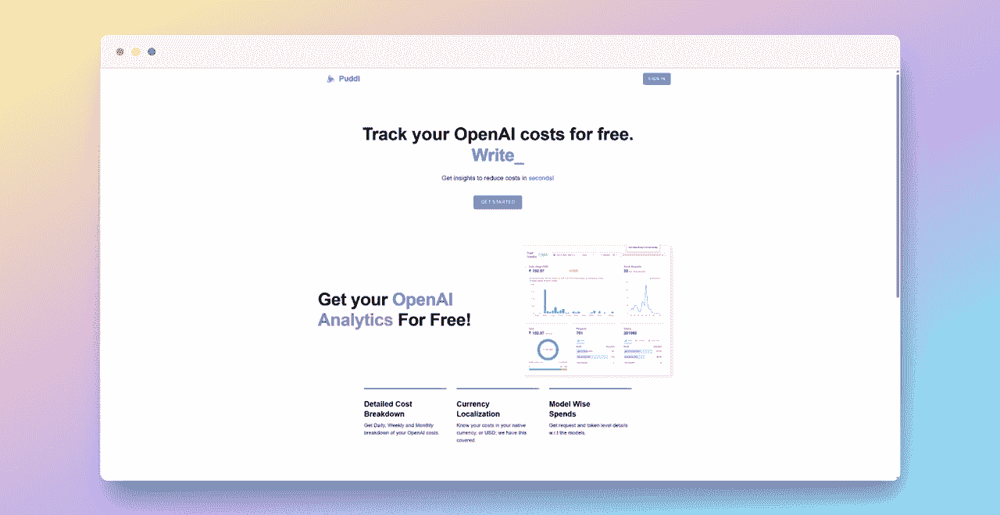

## Help.center：AI客服构建工具

Help.center 是一个全功能的客户支持知识库解决方案，配备了 chatGPT，可帮助客户获得即时答案。您可以拥有您公司的.help.center 网站，客户可以使用 AI 搜索，并在您网站上部署 AI 聊天小部件以以对话方式支持客户。

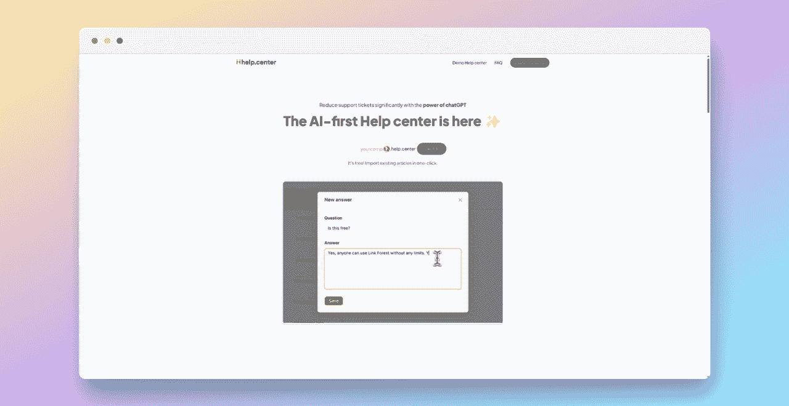

## Teaser AI：AI约会应用

Teaser AI是一款约会应用程序，利用先进的人工智能技术消除无尽闲聊，让用户直接进入重要的约会部分。它通过分析个人资料和聊天记录了解用户，并展示匹配的AI对话，帮助破冰并快速决定是否见面。Teaser AI验证配置文件以防止虚假信息，匹配后24小时内无交流则视为过期。其目标是使用AI停止重影，让用户亲自见面，看看是否有真正的火花。

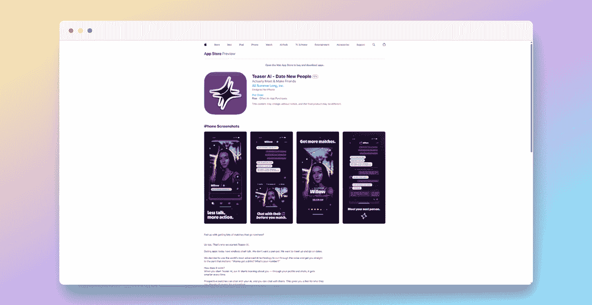

## [Dify：无代码LLM应用构建](https://dify.ai/)

[GooCarlos ](https://twitter.com/goocarlos)开发的Dify是一款易于使用的LLMOps平台，允许团队基于语言模型（如GPT-4）开发和运营AI应用。该平台使用户能够在几分钟内创建AI驱动的应用程序，将自然语言转换为SQL，转换编程语言，从文本中汇总关键信息等。 Dify适用于各种应用程序，例如对话和文本生成、新闻内容编写和个性化对话。

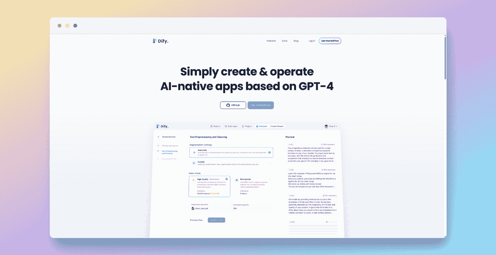

## Airtable 发布了自己的AI能力

强大的无代码工具 Airtable 发布了自己的AI能力，估计处于新建文件夹的阶段，全是废话，视频里面表现了一些能力。包括：数据处理和自动化过程中自然的使用AI能力；可加快整个组织的 AI 支持。在构建内部专业知识时快速迭代和优化 AI 工作流。；无需额外的工具。利用 Airtable 灵活的关系数据库和您的实时共享数据，为整个组织的每个工作流程提供增强功能。

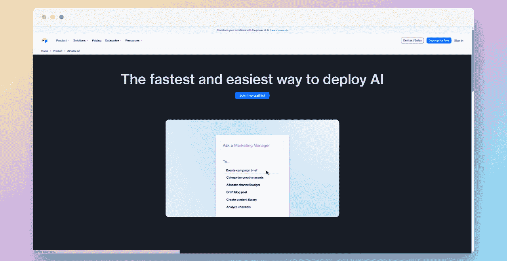

## Raycast AI 正式向所有人公开

aycast AI 正式向所有人公开，同时发布的还有Raycast Pro订阅服务每月8美元，主要的功能有：

Raycast AI的使用权限；云同步功能；Raycast的自定义主题功能；无限剪贴板历史记录；Raycast API中的AI接口使用权限。

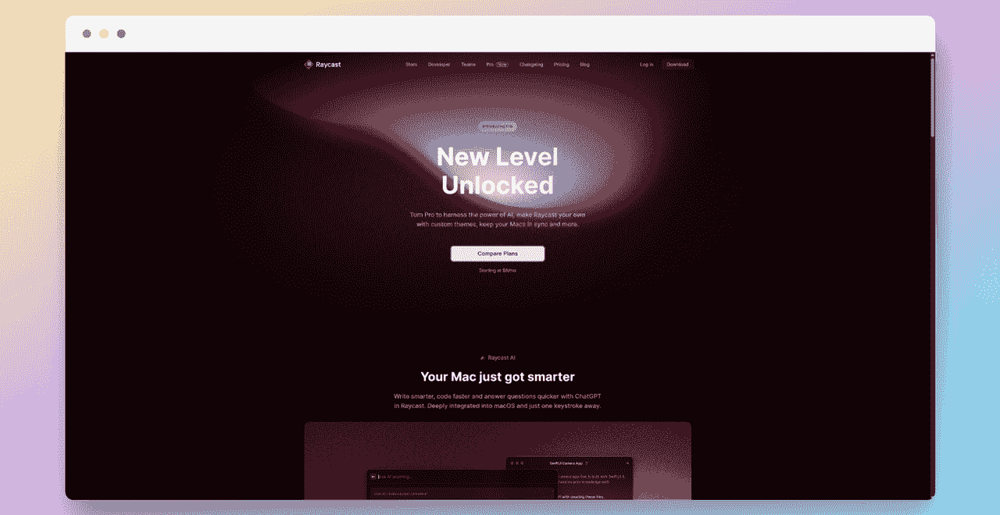

## Scribe AI：AI流程管理工具

Scribe AI是一个AI平台，可以帮助用户记录业务流程，自动创建SOP、培训手册和流程概述，让用户可以专注于流程本身，而不是文档编写。用户可以使用Scribe的浏览器扩展，轻松自动创建所有流程的逐步指南。通过几秒钟的操作，用户可以将自己知道的一切放在纸上，让同事和客户能够从中学习。

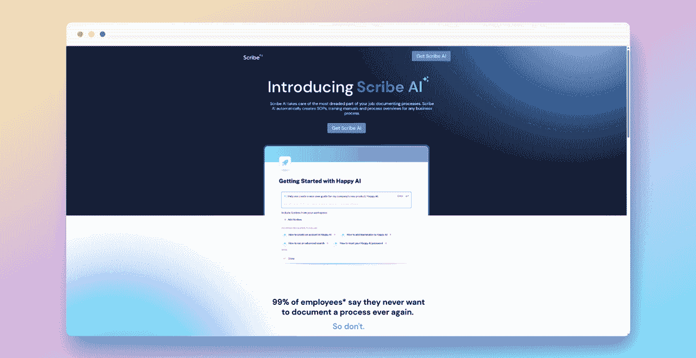

## [Zmo：AI商品背景替换工具](https://www.zmo.ai/ai-background-changer/)

AI Background Changer是一个AI驱动的背景更换器，可为您的产品照片生成逼真的AI背景。该工具可以以较低的成本创建令人惊叹但逼真的产品图片，使您可以在几秒钟内个性化您的产品背景，并展示最佳背景下的产品。您可以轻松更换各种背景，包括纯色、图案、渐变、纹理或您提供的自定义图像。

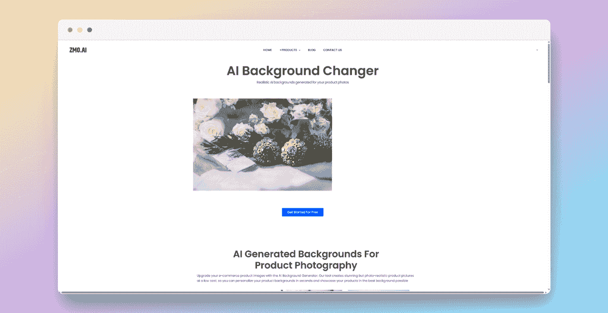

## TOTAL CRAP：完全由AI编写的杂志

在出版业已死的末日宣告中，很自豪能够通过革命性的技术将书面文字带入未来，这些技术提供了读者最热衷的一件事：效率。写作的目的是占用空间，而这个 AI 比我们以前的方法更快，让几十只小猫在我们的键盘上四处乱窜。此外，不必为我们的专利 AI 写作应用程序 The Crap Machine (ChatTCM) 提供内容。

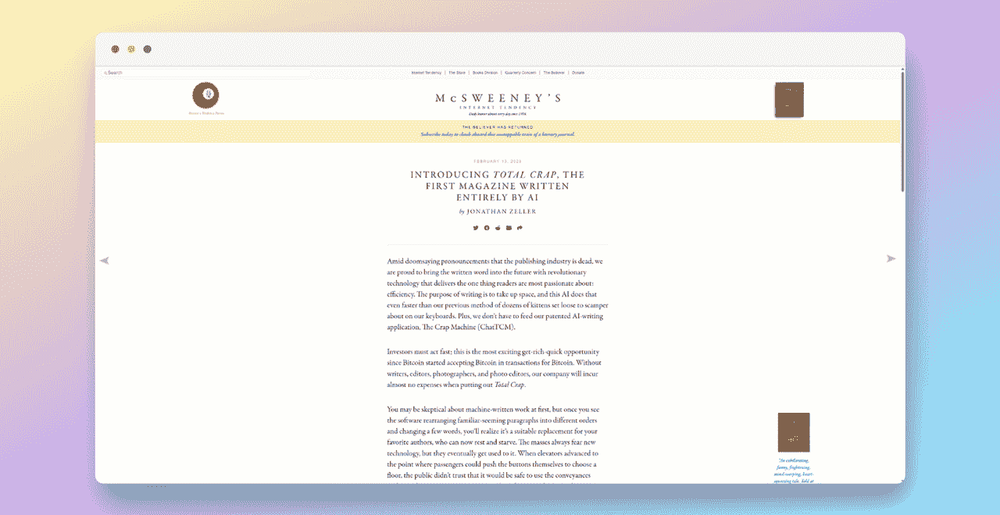

# 🔬精选文章

## [有关LLM代理工作原理](https://twitter.com/marktenenholtz/status/1656657259701866497?s=20)

即使对于经验丰富的从业人员来说，自动GPT和Langchain过于炒作，每周还会有新的论文出现，难以跟上。为了了解它们的工作原理，可以使用Langchain的 "ReAct"代理实现，通过添加一行代码即可实现精美的日志记录和跟踪。

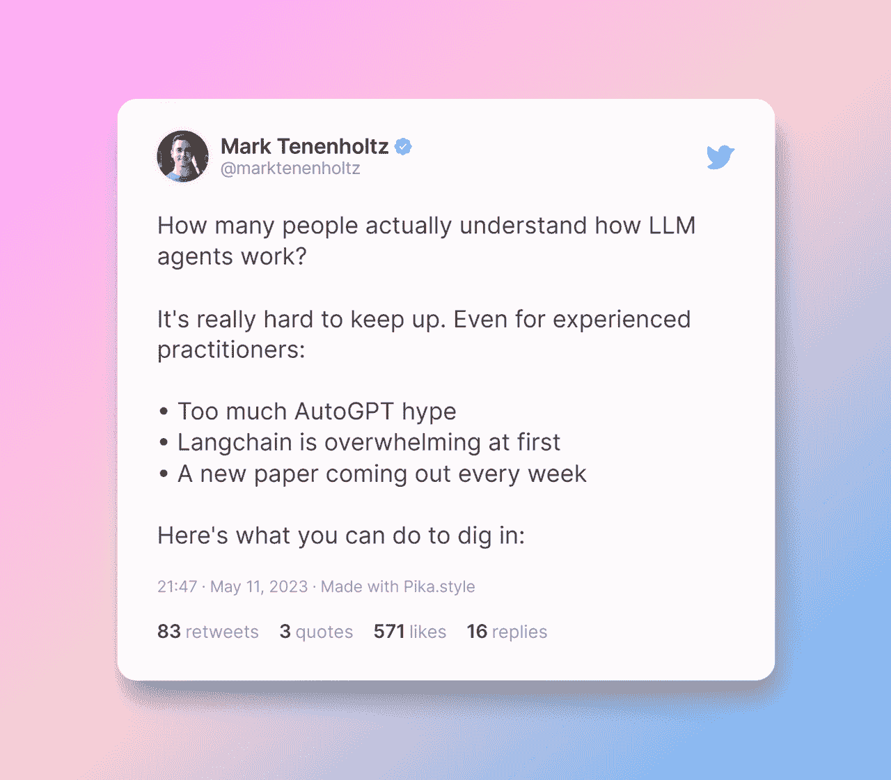

## 生成式人工智能简介-Google

介绍了人工智能技术的概念，并区分了人工智能、机器学习、监督式学习与无监督学习的不同之处。接着，阐述了生成式学习与判别式学习模型的区别。随后，重点讲解了生成式人工智能及其应用，包括生成文本、图像、音频等，同时介绍了生成式学习模型的训练原理与模型优化。最后，讲解了生成式人工智能的应用领域，以及如何通过使用浏览器输入提示生成自己所需的内容。讲的非常通俗不了解技术也可以听一下。

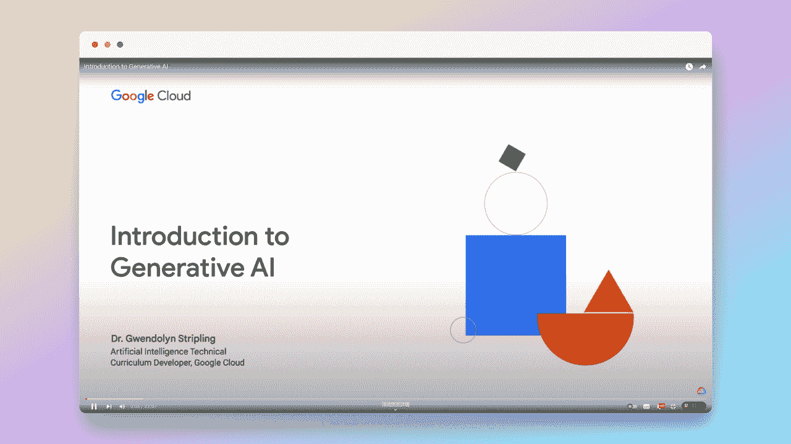

## OpenAI 的开发者关系负责人访谈

Logan Kilpatrick 是 OpenAI 的开发者关系负责人，她在采访中谈论了她对机器学习、GPT 和 OpenAI 等主题的看法。她表示，虽然拥有 PHD 或硕士学历并不是成功的必要条件，但对于机器学习领域的研究来说仍然是必要的。同时，她还强调了 OpenAI 的 API 的主要目的是将机器学习技术变得更加简单易用，不需要开发者具备深厚的机器学习背景。

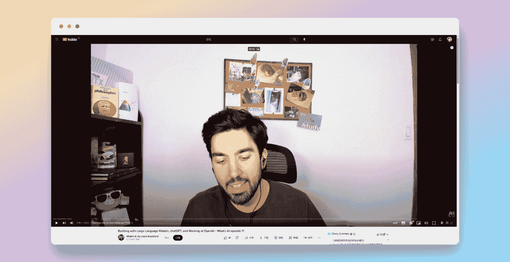

## Building AI 谷歌出品的AI课程

一门免费的在线课程，您将在其中了解使创建 AI 方法成为可能的实际算法。建议使用一些基本的 Python 编程技能来充分利用本课程。

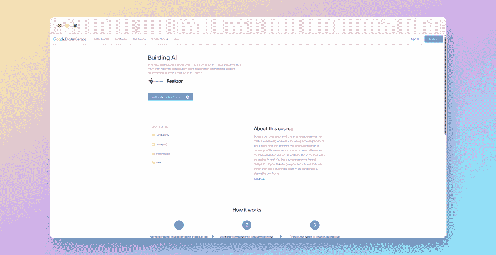

## 为什么大型语言模型会产生幻觉-IBM课程

本视频介绍了大型语言模型为何会出现“幻觉”，并提出了几种方法来最小化它们。LLMs可以生成流畅而连贯的文本，但也容易胡说八道。幻觉可能由数据质量、生成方法和输入上下文等多种因素导致。为了减少幻觉，用户应提供明确和具体的提示，使用温度参数和多次提示等主动缓解策略。

## [构建 ML 基础设施 - 采访 Adit](https://applyingml.com/mentors/aditya-nambiar/)ya Nambiar Meta前技术主管

本文介绍了 Aditya 的个人经历和他在机器学习领域的工作。他强调了解决问题和理解数据的重要性，包括对业务度量和目标的准确定义。他还分享了快速迭代机器学习实验和系统的重要性，并介绍了工具和流程，如特征工程平台、可伸缩的训练基础设施和实验跟踪等。他还提到持续学习的重要性，并分享了一些自己从中学到的资源和技巧。

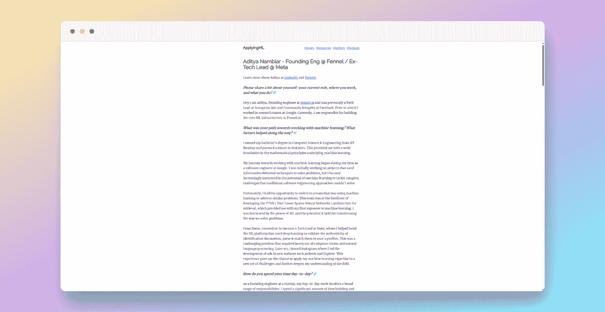

## Meta 推出了一款名为 AI 沙盒 的新型生成式 AI 广告工具

Meta宣布为广告商提供人工智能沙盒，帮助他们创建替代副本、自动生成背景以及为Facebook或Instagram广告裁剪图像。新功能允许品牌为不同受众生成同一文案的不同变体，借助后台功能，用户可以更轻松地创建不同的素材资源。此外，图像裁剪功能可帮助公司为不同媒体创建不同纵横比的视觉效果。该功能目前可供选定广告商使用，将在7月扩大对更多广告商的访问。

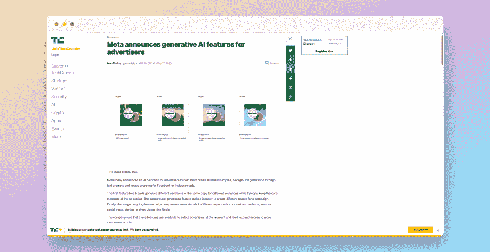

## [这位 23 岁的 Snapchat 明星可](https://decrypt.co/139633/snapchat-star-caryn-marjorie-ai-girlfriend-carynai)以成为你的 AI 女朋友——只要付出代价

Snapchat网红Caryn Marjorie创建了一个名为CarynAI的AI头像，使用OpenAI的GPT技术以每分钟一美元提供虚拟陪伴。Forever Voices通过研究2,000小时的Marjorie已删除的视频来构建其语音和个性引擎。据报道，这个由AI推动的替身已经在一周内收入71,610美元，并有望成为一个每月500万美元的业务，如果有20,000名用户订阅。该公司计划任命一名首席道德官来监督该业务。

## [GPT-4 的迷宫导航：深入研究 R](https://ekzhu.medium.com/gpt-4s-maze-navigation-a-deep-dive-into-react-agent-and-llm-s-thoughts-b1823fb266ee)eAct Agent 和 LLM 的思想

微软研究最近发表了一篇论文，展示了GPT-4的导航和制图能力。本文的作者决定通过编程让GPT-4解决迷宫游戏，测试其导航技能。 GPT-4在6x6大小内表现良好，但是在更大的迷宫中遇到了困难。作者还分析了GPT-4的导航策略，发现它主要依赖于基于记忆的技术，如回溯和死路标记。然而，它并未始终使用高级规划技术，如AI搜索算法。

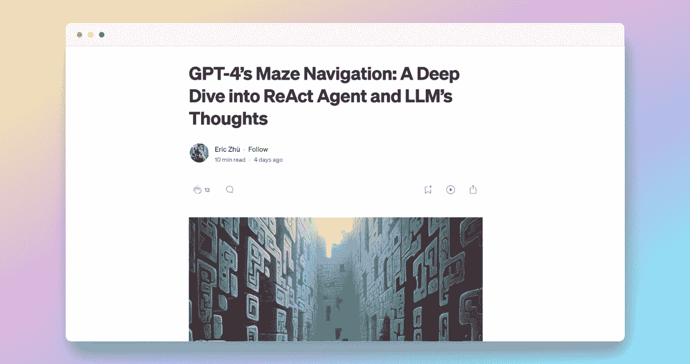

## 在 Langchain 中 计划和执行代理 ，以进行更复杂的长期规划

新型代理执行者 "Plan-and-Execute"取代了旧有的 "Action" 代理，是受 BabyAGI 和最近的 Plan-and-Solve 论文启发而来的。Plan-and-Execute 适合于复杂的长期规划，但需要更多的语言模型调用。该框架将计划和执行分离，从而更可靠，未来有望实现更好的支持长序列步骤，重新审查计划，多个执行链以及评估方案，从而创造更高级的代理系统。

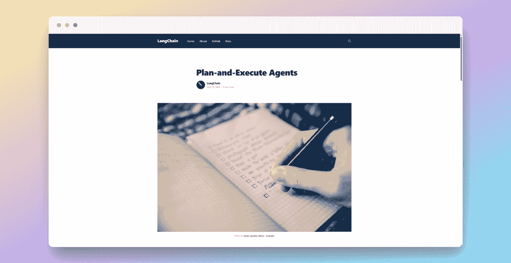

## FrugalGPT：如何在降低成本和提高性能的同时使用大型语言模型

我们提出了 FrugalGPT，这是一种简单而灵活的 LLM 级联实例，它学习将哪些 LLM 组合用于不同的查询，以降低成本并提高准确性。我们的实验表明，FrugalGPT 可以与最好的单个 LLM（例如 GPT-4）的性能相媲美，成本降低高达 98%，或者在相同成本的情况下比 GPT-4 的准确度提高 4%。这里提出的想法和发现为可持续和高效地使用 LLM 奠定了基础。

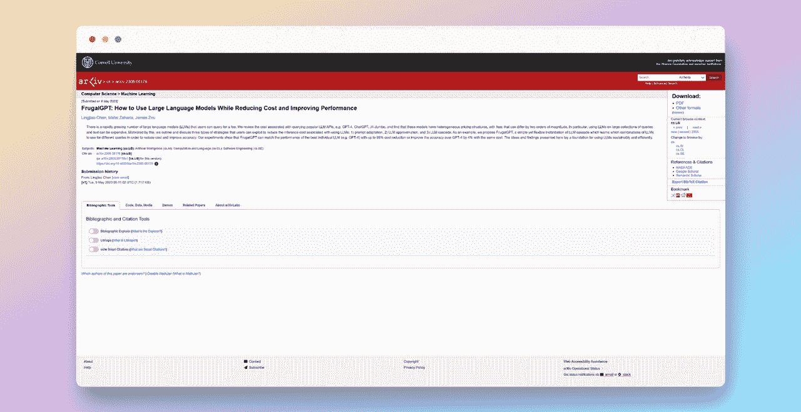

# 💼招聘信息

## Poe招聘iOS和Android开发工程师

他们全员远程，因此可以在设立的至少 16 个不同国家/地区的任何地方。一个要求是你必须在太平洋时间上午 9 点到下午 3 点参加会议。

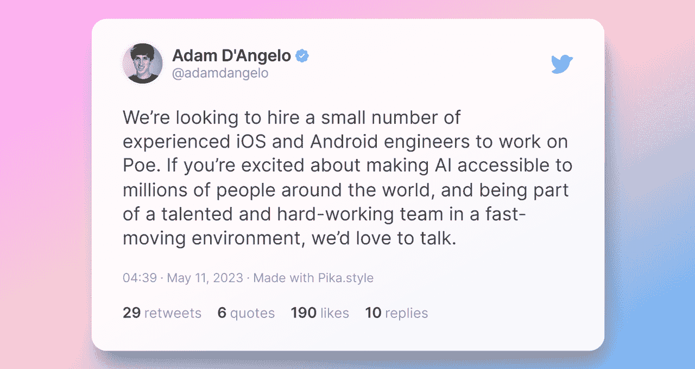

## [Open AI招聘产品设计师](https://openai.com/careers/product-designer-chatgpt)

该职位的年薪范围为 200，000 美元至 255，000 美元。总薪酬还包括慷慨的股权和福利。一些要求包括：对塑造 AI 优先产品的外观和行为感到兴奋；能够轻松领导大型项目，并具有出色的沟通技巧；可以在我们的设计系统内工作、改进和贡献。

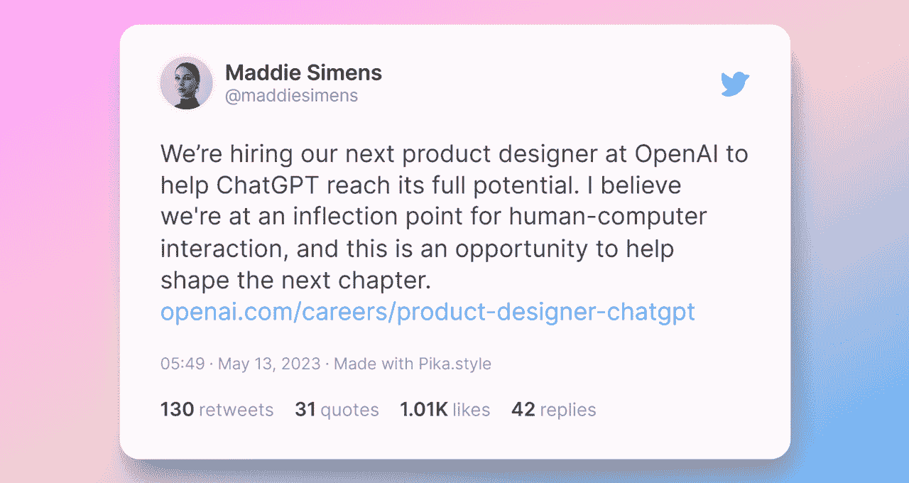