# AIGC Weekly #20

> 来源：[https://waytoagi.feishu.cn/docx/Sl5ddYT6SoAoo2xTvAjcejnwnBe](https://waytoagi.feishu.cn/docx/Sl5ddYT6SoAoo2xTvAjcejnwnBe)

> 🔗 原文链接： h[ttps://op7418.zhub](https://op7418.zhubai.love/posts/2267334571836080128)ai.love/posts/22...

> 发表时间：2023-05-08

工具：Midjourney v5.1

https://s.mj.run/cgOTdeOLUlc  https://s.mj.run/k-rTUV_BPrg --ar 3:2 --v 5.1

> 如无意外会在每周一更新，主要介绍上周AIGC领域发布的一些产品以及值得关注的研究成果，由于我自己是一个设计师，所以在一些专业内容的描述上可能存在问题，欢迎在渠道帮我反馈及更正，如果觉得有收获的话也可以订阅一下。（本期部分文案使用了Notion AI以及Chat GPT帮助润色和翻译）

上周我主要发了两篇内容首先[是每天晚上](https://walling.app/kDaEnjcPrTTkWyNieSaG/e6adb8e8978fe79a84aie5a381e7bab8)都会发的 Midjourney提示词模板 汇总，和相关提示词生成的 图片下载 。

这周研究了一下AI歌手产出了一篇教程《 教你打造属于自己的AI孙燕姿，AI歌手模型使用及训练保姆级课程 》详细介绍了一下如何处理数据、使用模型、训练模型来帮助你拥有自己的AI歌手模型。

# ❤️上周精选

## 谷歌泄露文档“我们没有护城河，OpenAI也没有”

最近有人在公共 Discord 服务器上泄露了 Google 内部文档。据证实，该文件是由谷歌员工 卢克·塞尔瑙（Luke Sernau ）撰写的。在社交媒体上引发了很多讨论。

文档主要的观点基本就是下面这些：

+   开源模型在速度、可定制性、隐私和功能方面已超越 Google 的模型。

+   Google 应优先考虑启用第三方集成，并投资于小变体，因为大模型正在拖慢它们的速度。

+   LoRA 技术可以以极低的成本和时间对语言模型 (LLM) 进行精细调整。

+   开源创新直接解决了 Google 陷入困境的问题，它们的进展对 Google 的业务策略有直接的影响。

+   保持技术竞争优势变得越来越难，因为全球研究机构正在相互建立工作基础。

+   Meta 几乎在泄露的模型中获得了整个星球的免费劳动力，使其成为本次事件中的明显优胜者

+   Google 应该与开源社区的广泛讨论合作，以建立自己作为领导者的地位。

+   OpenAI 对开源的立场与 Google 犯了同样的错误，他们能否保持优势的能力必然受到质

+   LLaMA 被开源和泄露后，随之而来的是一系列的小型创新和优化努力。

下面是社区关于这篇文章的一些讨论：

Stability AI CEO Emad 表示他同时文章中的大部分观点，但他认为它对护城河的实际含义存在误解，以创新为护城河很难建立企业，基础要求太高，数据、分发、优质产品才是护城河。

[Alex Dimakis ](https://twitter.com/AlexGDimakis/status/1654286036015411205?s=20)也表示同意这些观点大学和开源社区应该组织更多的活动来管理数据集，训练基础模型，并通过微调建立社区，就像稳定扩散一样。在他看来，这对 AI 和世界来说是个好消息。

Andrej Karpathy 表示预训练LLM基础模型仍然非常昂贵。想象一下：超级计算机+数月时间。但由于最近的PEFT（参数高效训练）技术非常有效，例如LoRA/LLaMA-Adapter等，以及其他出色的工作，例如bitsandbytes库中的低精度技术，因此微调LLM正在变得非常便宜且有效。想象一下：即使是对于非常大的模型，也只需要几个GPU和一天的时间。但由于最近的PEFT（参数高效训练）技术非常有效，例如LoRA/LLaMA-Adapter等，以及其他出色的工作，例如bitsandbytes库中的低精度技术，因此微调LLM正在变得非常便宜且有效。想象一下：即使是对于非常大的模型，也只需要几个GPU和一天的时间。

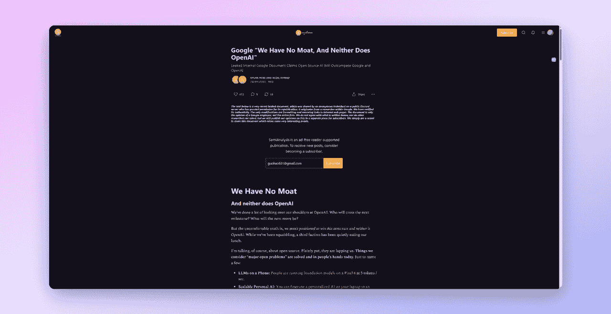

## New Bing发布了一大堆更新功能

微软公布了Bing聊天机器人的重大升级，增加了图像和视频回答、餐厅预订、聊天历史记录以及更智能的Microsoft Edge整合。具体的功能包括：

+   Bing聊天插件 ，类似于ChatGPT的插件系统，现在可以使用微软的Bing AI来完成任务，而无需在站点之间来回跳转。视频里面演示了搜索结果推荐了一家餐厅，它就可以找到适合您的预订时间，并帮助你在聊天界面中预订所有餐厅。这个功能也适用于Edge浏览器。

+   多模态答案，支持图像搜索 ，很快就可以在Bing聊天中搜索，并要求查找物体、动物、地点等的照片或视频。

+   持续的聊天+聊天记录 ，聊天历史记录将使你能够在不同设备之间继续聊天机器人对话，甚至将Bing聊天用作研究工具。微软还计划将导出和共享功能添加到Bing聊天中，以便可以在Twitter上共享对话内容

+   不再有候补名单 ，如果你还没有使用Bing，现在官方已经取消了等候名单。咱们国内的账号估计还是不行 哈哈

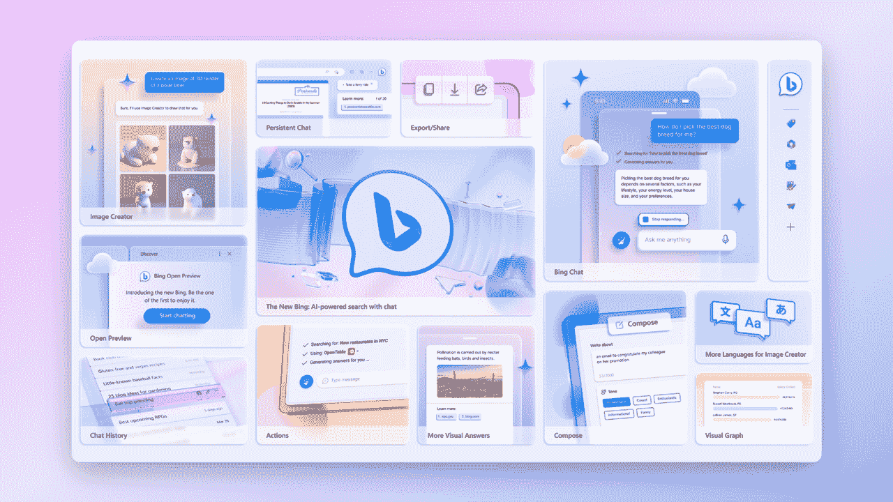

## Midjourney上周动态合集

Midjourney上周动作也很多，发布了V5.1和对应的RAW模式、Niji开启了移动端APP测试、国内的Midjourney QQ频道也开启了付费测试和小程序测试，上周末还开启了临时的免费试用。

Midjoureny V5.1发布

[Midjourne](https://twitter.com/op7418/status/1653666979549704193?s=20)y正式更新了模型的5.1版本，我也对 V5.1做了测试 ，相较于V5他现在有这些变化：

+   更高的一致性

+   对文本提示更准确

+   更少的不需要的边框或文本痕迹

+   改善了清晰度

同时V5.1对于短提示的效果更好类似于V4，你还可以使用更精准的提示词描述，但是需要切换为Raw格式，在点击V5.1后在/settings下点击RAW Mode按钮或键入 --style raw。

如何使用V5.1版本：转到/settings，点击“V5.1”（第二行）或在提示后键入 --v 5.1

[这](https://twitter.com/OrctonAI/status/1653766609989783552?s=20)里还有Orcton针对V5.1做的水面反射做的测试： https://twitter.com/OrctonAI/status/1653766609989783552?s=20

Nicolas Neubert做的另一个V5.1 raw的测试，与[V](https://twitter.com/iamneubert/status/1653696243040768001?s=20)5相比具有更清晰的主题，更精准的对颜色描述进行还原，现实照片的细节更加丰富： https://twitter.com/iamneubert/status/1653696243040768001?s=20

Nick做的V4、V5、V5.1、V5.[1](https://twitter.com/nickfloats/status/1653736663732965376?s=20) RAW四种模型同一段提示词的测试： https://twitter.com/nickfloats/status/1653736663732965376?s=20

Niji开启了移动端APP测试

Nijijourney AI绘图应用的移动APP即将推出，现在已经开始进行首次测试招募，首次测仅针对订阅者开放。想参与可以填写下面的表单。 填写表单：

[https://forms.gl](https://forms.gle/Te8D1dQMZPSTaLFJ8%E2%80%A6)e/Te8D1dQMZPSTaLFJ8…

这里是测试说明：

[ht](https://sizigi.notion.site/Niji-journey-mobile-app-sign-ups-3c68afe25db146a595d336bc67f746f1%E2%80%A6)tps://sizigi.notion.site/Niji-journey-mobile-app-sign-ups-3c68afe25db146a595d336bc67f746f1…

Midjourney国内版本开启付费测试

上周Midjoureny的国内版本开启了付费测试，付费会员可以解除测试期间每天的使用限制，同时还能使用小程序版本。

+   国内的定价基本跟国外的持平，10美元那个是68，30美元那个是200，生成的图像额度也相似。

+   国内版本的优势是支持专门优化过的中文提示词输入，效果很不错

+   同时付费用户可以使用画廊小程序，里面可以看到自己以往的图片，同时也能在小程序生成图片。

## Stable Diffusion Web UI 1.1.1版本 更新

沉寂了好几个月以后老哥终于又开始干活了，发布了一堆更新和优化，我升级尝试了一下基本没什么问题。

+   切换到torch 2.0.0（不包括AMD GPU）

+   定制代码脚本的视觉改进

+   添加文件名模式：[clip_skip]，[hasprompt <>]，[batch_number]，[generation_number]

+   添加对在img2img中保存初始图像并在infotext中记录其哈希以进行再现性支持的功能

+   在使用ctrl +上/下调整权重时自动选择当前单词

+   添加X / Y / Z图的下拉菜单

+   设置：稳定扩散/随机数生成器源：使得可以在不同的GPU上使给定手动种子生成的图像保持一致

+   支持Gradio的主题API

+   默认情况下在Linux上使用TCMalloc；可能修复内存泄漏问题

+   （优化）选项以在低sigma值时删除负调节#9177

+   在.safetensors文件中嵌入模型合并元数据

+   扩展设置备份/还原功能#9169

+   在img2img中添加“按比例调整大小”和“调整到”选项卡

+   在文本反演图像预处理中添加“保持原始大小”的选项

+   图像查看器通过模拟杆滚动

+   添加按钮以从会话丢失/选项卡重新加载恢复进度

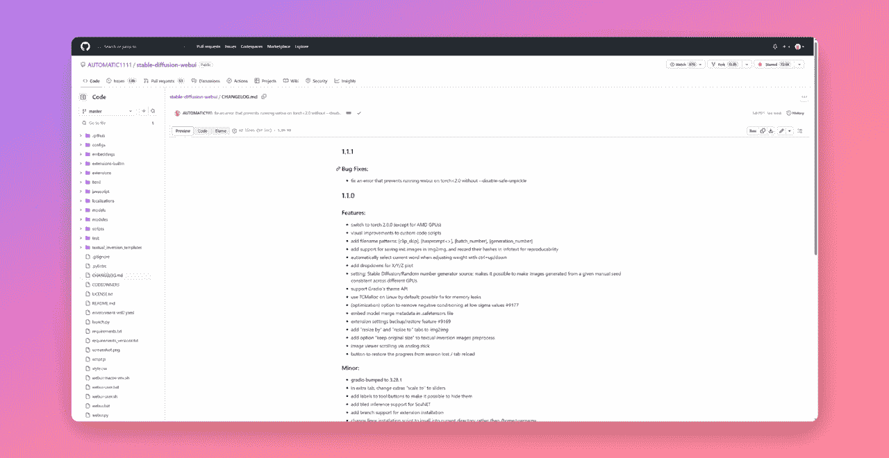

# ⚒️产品推荐

## Slack GPT：Slack内部的原生AI功能

Slack 宣布了其在平台内实现生成式人工智能 (AI) 的愿景“Slack GPT”。通过在 Slack 中直接构建 AI 功能，包括 AI 提供的对话摘要和写作辅助，企业可以将可信的生成式 AI 带到团队已经在使用的地方，通过使用该平台增强生产率。

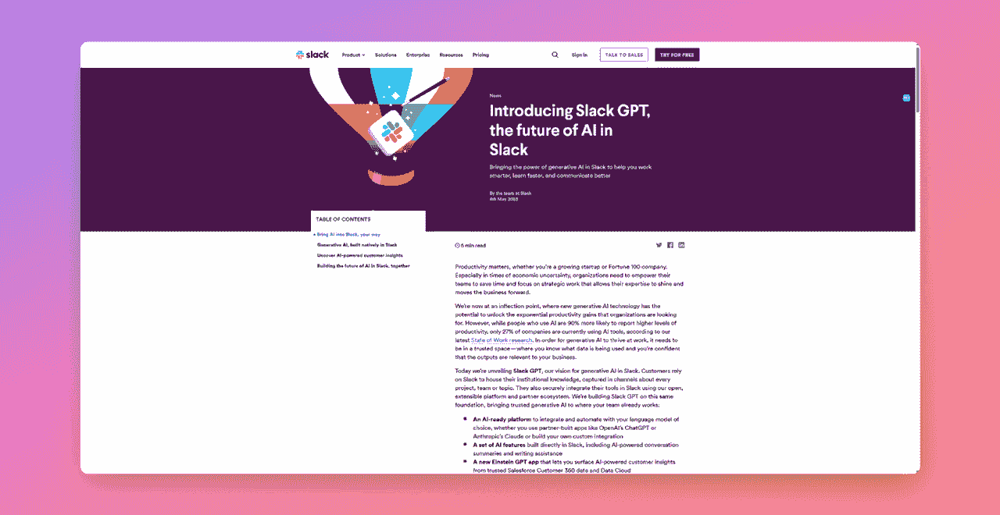

## Opus Clip：可将长视频重新用作短视频

Opus Clip 是一个视频编辑工具，允许用户用一个单击创建适用于 YouTube Shorts、TikTok 和 Instagram Reels 等平台的高质量短片。该工具包括自动调整大小、自动过渡、自动字幕、1080P 分辨率、删除语气助词、自定义品牌套件、时尚模板和 AI 重新布局等功能。根据该公司的说法，Opus Clip 视频的参与度高于所有其他产品。该工具目前可免费使用，允许用户免费上传其前 5 小时的视频。

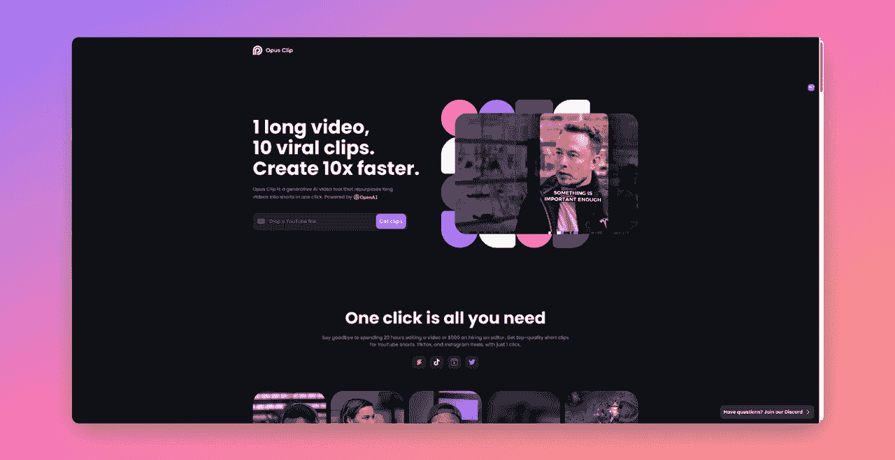

## 生成式UI（动态UI）演示Demo

在前几期我们讨论过未来AI影响下的应用交互和产品形态有什么影响，当时提出了动态UI的概念，未来很多UI可能是一次性的，应用可能由一个聊天界面和一堆UI组件组成，根据输出内容的数据格式展示不同的UI组件，比如这个demo演示里的地图。

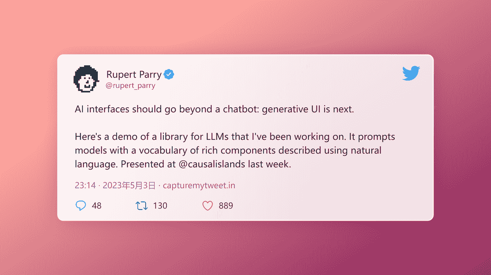

## Auto-GPT官方的在线网站版本即将推出

Auto-GPT是一个开源的人工智能助手项目，每48小时就会有约一个月的进展。它的目标是开发最好的自主AI助手，让每个人都能够实现更多。在Auto-GPT的官方网站上，可以下载和了解最新的新闻和更新，并观看项目演示视频。此外，开发者可以在Discord上与社区成员分享演示。

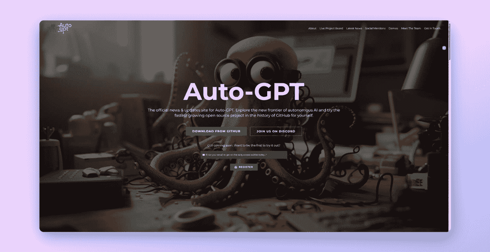

## Dream：AI驱动的无代码构建器

Dream是一款AI驱动的无代码构建器，可以帮助设计师、开发者和创业者使用自然语言快速轻松地构建应用程序。我们使用AI来迭代地构建功能强大的Web应用程序，只需几次点击即可将其导出到代码或部署到生产环境中。

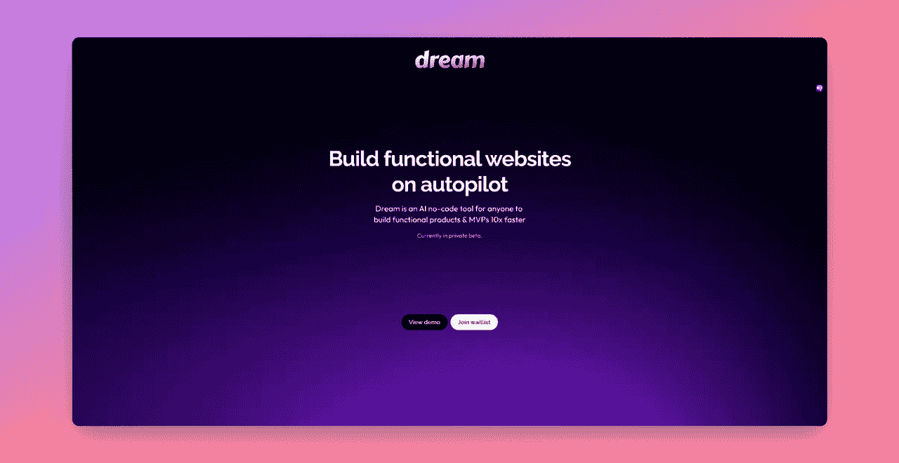

## LLM report：监控Open AI API每个Key的使用情况

这个工具好解决了一个巨大的痛点，可以看到你Open AI API Key的详细使用情况，包括每天每种类型的服务各消耗了多少钱，距离限额还有多少钱以及每个Key的请求次数和每个Key各自消耗的Token。

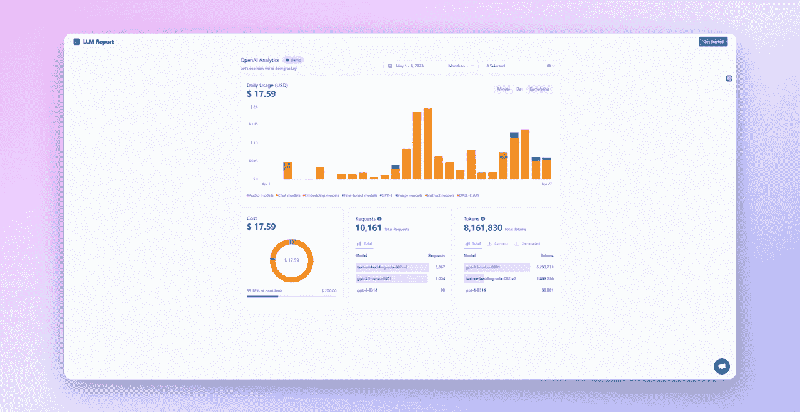

## hey pi：注重体验的聊天机器人

这个聊天机器人有点离谱的，可能是除了GPT和Claude之外我使用的另一个达到可用阶段的聊天机器人。 不仅指的是它的模型效果，在体验上也做得非常好，三端同步，而且机器人输出内容的动画非常优雅，思考的时候光标还会像扫把一样抖动，可以开启语音输出，这对一些视障患者非常友好。

它说他支持中文，但是我问了一个中文问题它就卡壳了，可能还要多观察。

这个模型的背景也很牛皮：前DeepMind/Google的人员、LinkedIn联合创始人、OpenAI董事会成员等。

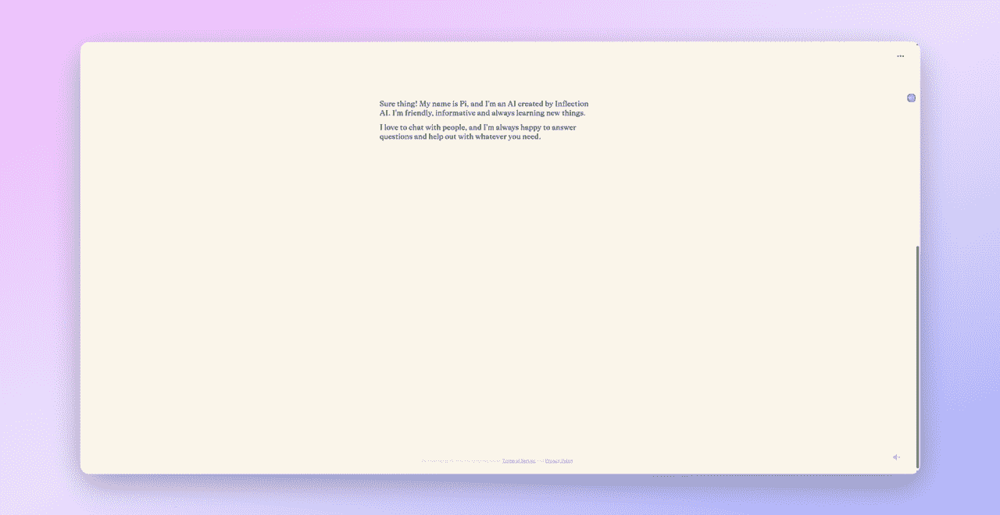

## [Cozy-Nest：Stable D](https://github.com/Nevysha/Cozy-Nest)iffusion Web UI的主题扩展

可自定义的选项卡菜单位置（顶部、左侧、居中）、深色或浅色主题的舒适外观、将调整大小的条形位置/面板比例保存在本地存储中、自定义主题色等一系列功能。交互也比原来的合理许多。

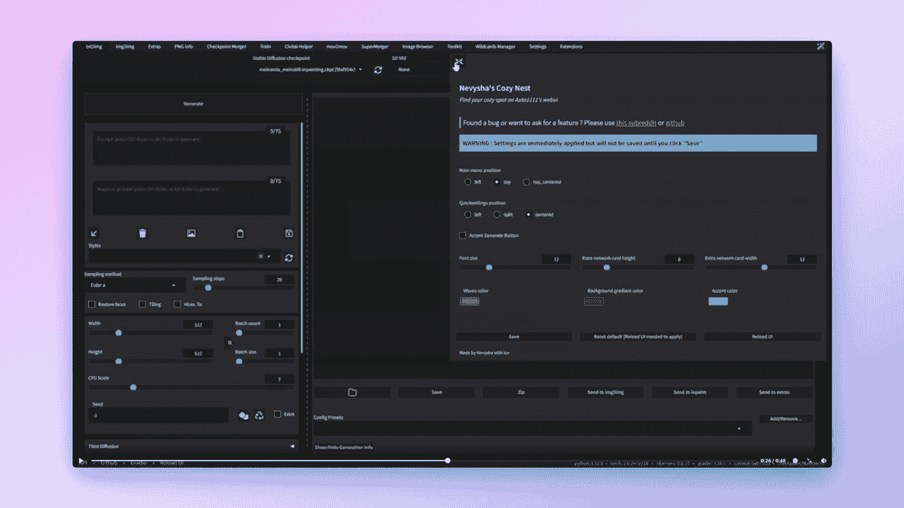

## DiscoverPitch：自动化寻找品牌广告订单

它可以让用户找到自己想合作的品牌，并提供联系方式和已经与其他相似创作者合作的信息。用户还可以使用预先制作好的模板来进行洽谈，并使用网站提供的FastPay功能来立即收到款项。另外，该网站还提供自动化功能，方便用户将业务自动化，专注于创作内容。

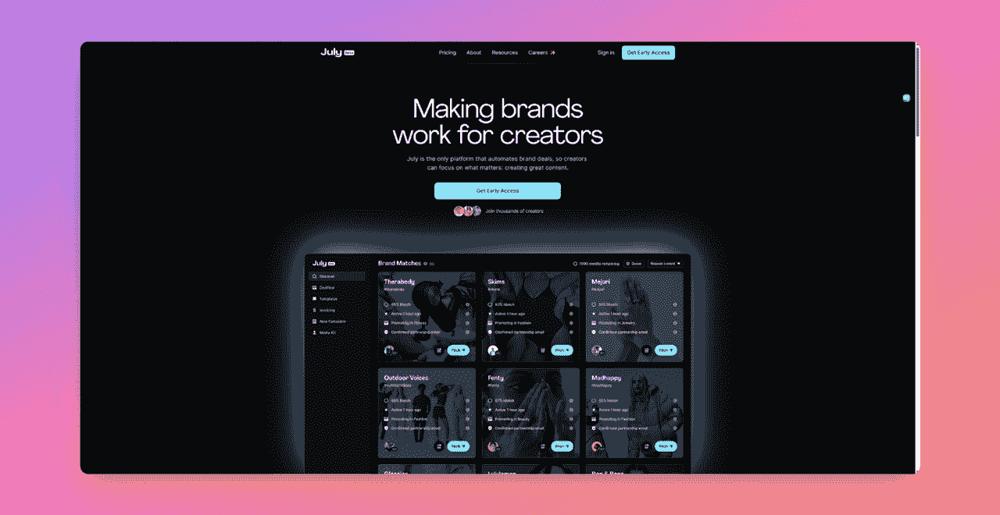

## StarCoder：专门为辅助编程训练的15B语言模型

StarCoder是一个15B的LLM编码器，针对80多种编程语言进行训练，只使用有限的数据进行训练，可以达到40%的HumanEval评分，可作为技术助手。此外，还有对StarCoder的评估、数据预处理和治理的详细信息。可用于VSCode插件和JupyterNotebooks。发布时采用了OpenRAIL许可协议，旨在使公司更容易使用和共享模型，促进AI文档的价值链共享。

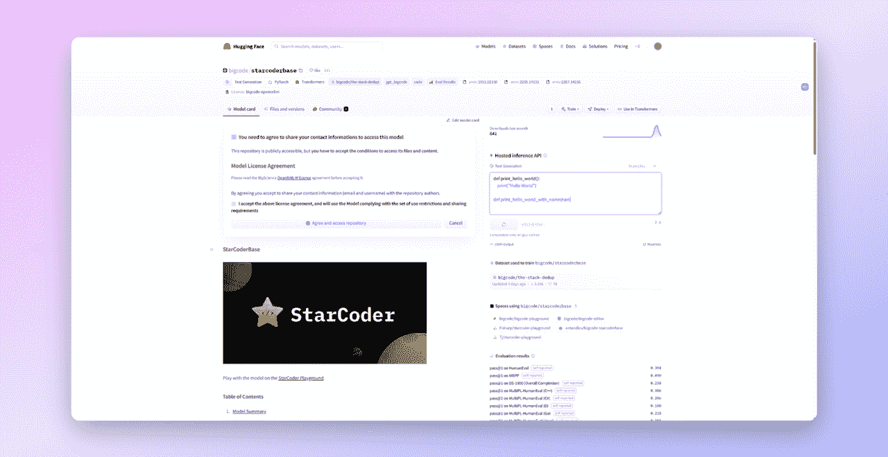

## Twelve Labs：通过文字搜索视频内容

Twelve Labs提供强大的视频搜索技术，利用人工智能提取关键特征，如动作、物体、文本、语音和人物，并将其转化为可扩展的语义搜索向量。它允许多模式搜索视觉、对话、标志和文本，并可以轻松集成端到端基础设施。Twelve Labs在Microsoft主办的2021 ICCV VALUE挑战赛的视频检索跟踪中排名第一。它可用于定制特定领域的API套件，以及无限的用例，包括情境广告、内容审核、证据搜索和内容搜索。

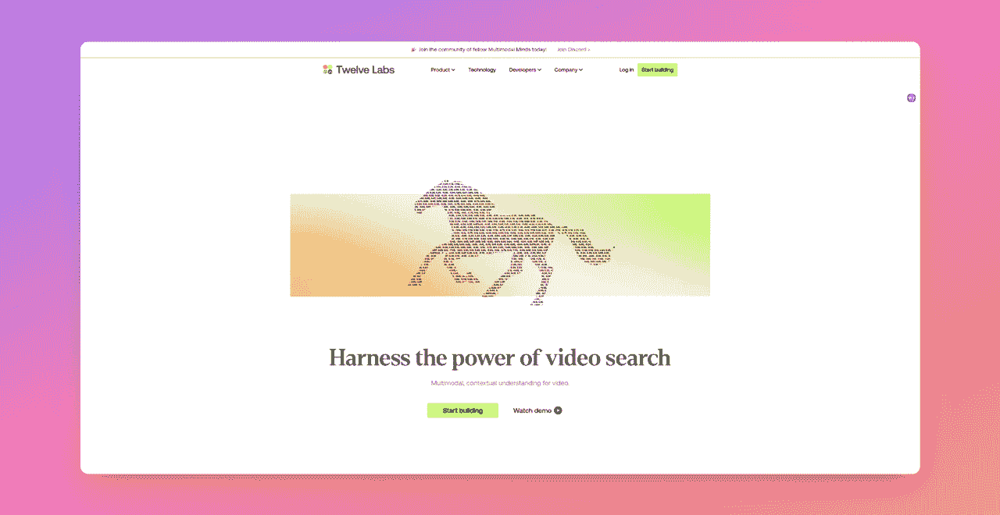

## Folk：轻量级、可定制和 智能的 CRM

folk是为你工作的CRM，而不是其他方式：它是轻量级的、可定制的，并由人工智能提供支持。

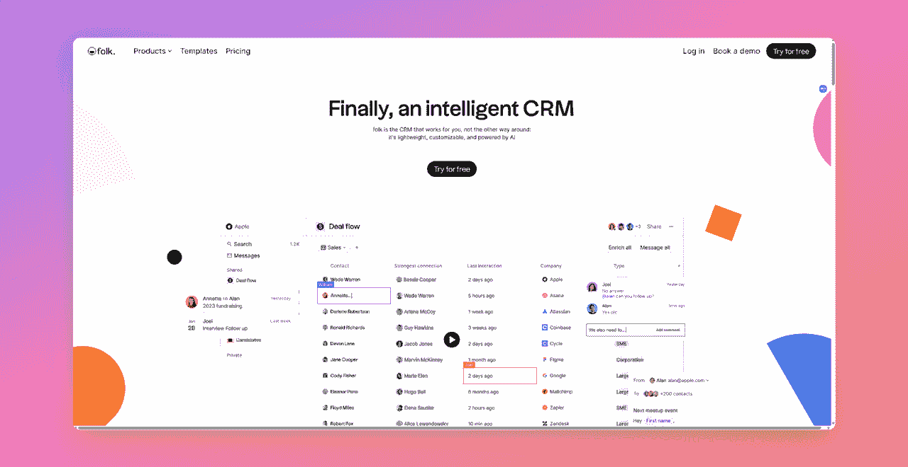

# 🧑🎓学习资源

## GPT-4 - 它是如何工作的，我如何使用它构建应用程序？

本次演讲嘉宾从实践出发，对GPT提出了许多实用的应用，例如GPT作为语言处理器，可以帮助用户进行陪伴、答疑、功能实用等。与此同时，GPT还可以提供插件访问，可以从 Wofram 等多个不同的应用中受益。

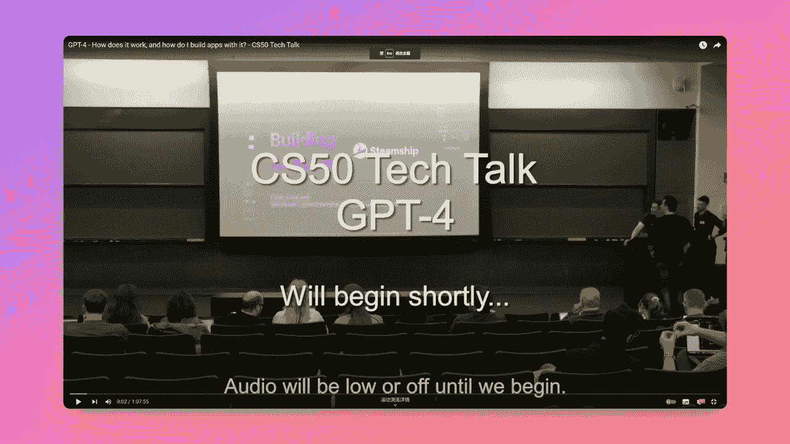

## Mojo--人工智能开发者的新编程语言（初见）

Mojo是建立在Python之上的新型编程语言，专为AI应用程序而设计。它结合Python的易用性和C或C++的性能，实现了AI硬件的无与伦比的可编程性和AI模型的可扩展性。

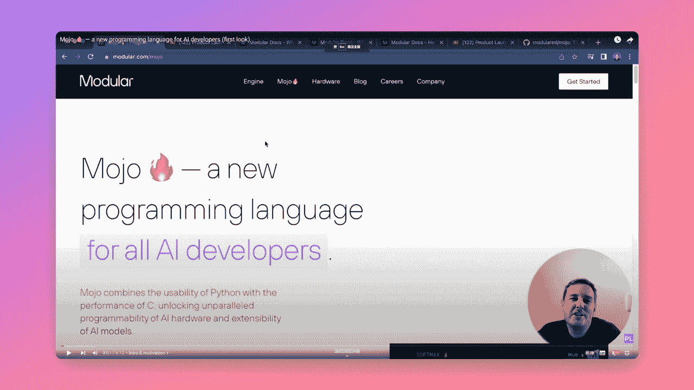

# 🔬精选文章

## Sam Altman和Greg Brockman谈AI与未来

OpenAI 的目标是为全人类开发和推广有益和安全的人工通用智能 (AGI)。他们的使命是降低创造力的门槛，改善教育，并推动人类解决各种问题。通过 AI 技术，他们希望为所有人提供一个启发性工具，包括那些缺乏教育和医疗资源的人，它是那个真正了解他们的老师，他们花时间了解他们，了解他们的动机，并激励他们做更多的启示。该公司希望确保拥有 AGI 以分发给世界，并制定了有限的利润结构，以避免将资本集中到他们的团队中。

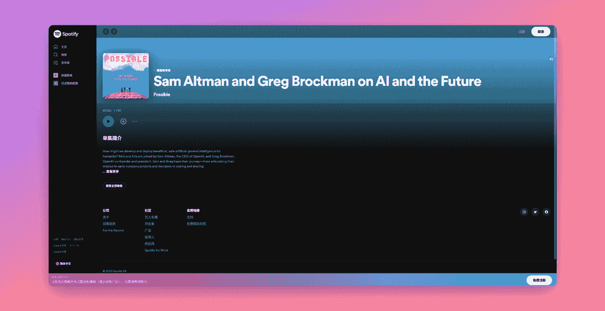

## [Airbnb CEO访谈：明年 人工智](https://skift.com/2023/05/03/interview-airbnb-ceo-on-how-its-service-will-radically-change-with-ai-by-next-year/)能将如何 从根本上改变其Airbnb服务

讨论了该公司重新关注设计、创意和人的计划，并解释了疫情迫使公司从根本上重建的原因。切斯基还讨论了Airbnb计划在应用程序中整合人工智能以提供个性化建议和改进客户服务，并表示明年中旬将有重大变化。此外，切斯基提到Airbnb平台即将推出付费产品和服务，面向主人和客人，并可能会推出广告产品。切斯基表示，人工智能将成为公司的核心，相关变化将在明年5月推出。

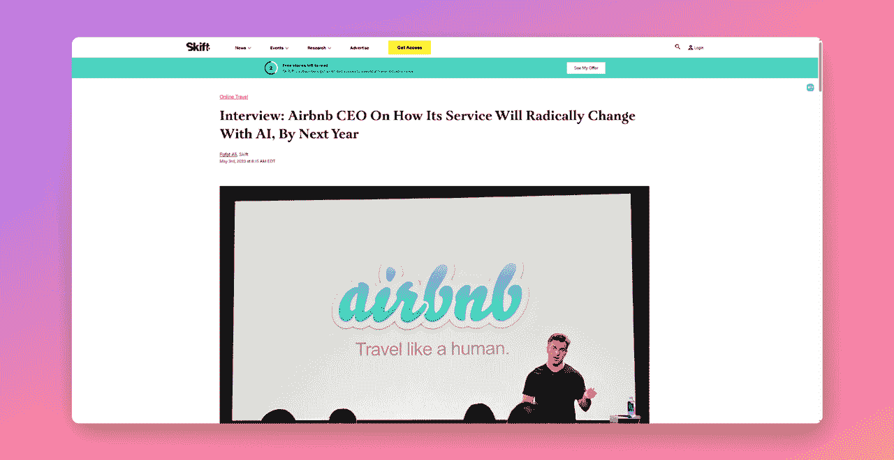

## OpenAI 为开发 ChatGPT 亏损翻倍至 5.4 亿美元

OpenAI去年的亏损翻了一番，达到了约5.4亿美元，原因是开发ChatGPT并从谷歌聘请关键员工。这些成本主要是由于在开始销售聊天机器人之前训练其机器学习模型所致。尽管收入有所增加，但随着更多客户使用其人工智能技术，成本可能会上升。CEO山姆·阿尔特曼建议筹集多达1000亿美元，以实现其开发人工通用智能的目标。

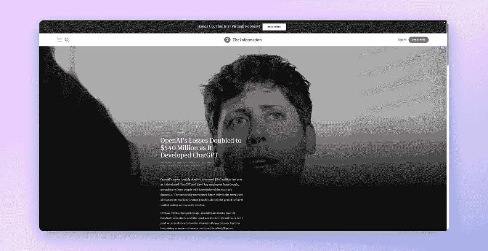

## AK专门在huggingface上开了一个推荐论文的页面

在大约 17,000 条关于 arxiv 论文的推文之后，我今天将开始在新平台上发布论文，论文也将在 hugging face 上建立索引，作者将能够声明他们链接到中心的模型/数据集卡/和空间演示。

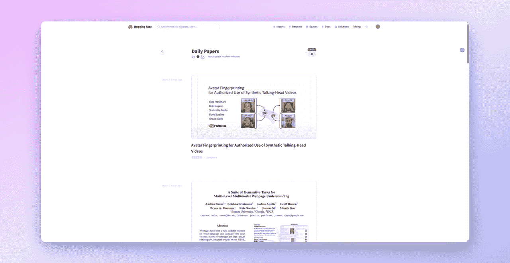

## 我想谈谈WebGPU-WebGPU为什么这么重要

WebGPU是一种新的在网页浏览器中绘制3D图形的方法，可能会替代Canvas。它预计将成为任何编程语言中绘制的标准方式。现在Chrome 113上已经提供了WebGPU，并将于今年年底在所有地方提供。这可能将使玩家可以在网页浏览器中像使用Flash一样玩游戏。简要介绍了图形API的历史，包括OpenGL、DirectX和OpenGL ES。

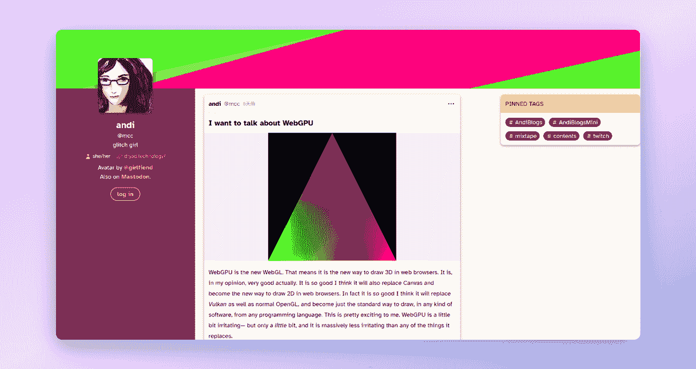

## 可汗学院创始人Sal Khan TED演讲

创始人兼首席执行官Sal Khan认为，人工智能可以引发教育史上最大的正面变革。他分享了他看到的学生和教育工作者与人工智能工具合作的机会，包括每个学生都拥有个人人工智能辅导员和每个老师都拥有人工智能助教的潜力，还演示了他们的教育聊天机器人Khanmigo的一些激动人心的新功能。Khan Academy是一个旨在向任何人提供免费世界一流教育的非营利组织。

## [大语言模型综述 ](https://github.com/RUCAIBox/LLMSurvey/blob/main/assets/LLM_Survey_Chinese_0418.pdf)（推荐）

在本篇综述中，我们通过介绍大语言模型的背景、主要发现和主流技术来回顾近年来的进展。我们特别关注大语言模型的四个主要方面，即预训练、适配微调、应用和能力评估。此外，我们还总结了开发大语言模型的可用资源，并讨论了未来可行的发展方向。

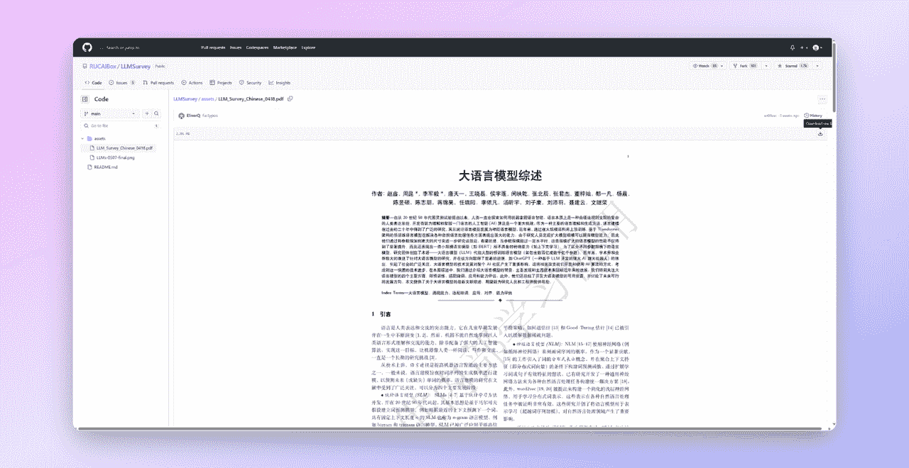

## [A](https://ai.v-gar.de/ml/transformer/timeline/index.html)I / ML / LLM / Transformer Models Timeline and List

这个页面汇总了语言模型相关（AI、ML、LLM、Transformer）的最重要的论文，同时还有把各个论文的发布时间和相互的引用关系都变成了可视化图表这对理解和学习这些内容有非常大的帮助。 看到所有的这些都跟谷歌的“Attention Is All You Need”这篇论文提出的Transformer架构有关系还是很震撼的。

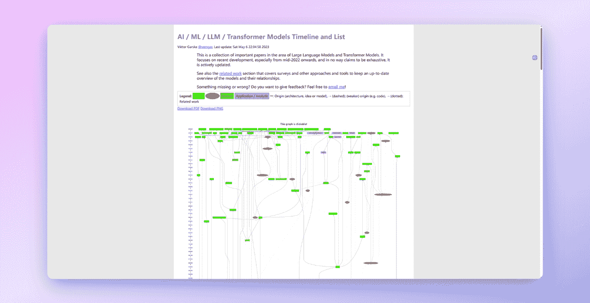

## 首个基于单细胞生物学进行预训练的大型语言模型

首个基于单细胞生物学进行预训练的大型语言模型，训练数据达到了1000万个细胞。基因可以用来描述细胞，其与单词和句子类似，这为单细胞分析挑战了现状。scGPT的性能非常好，可以用于多种单细胞基因组学任务，例如细胞类型注释和基因调控网络推断。该模型可以进行微调以适应新数据集和任务。

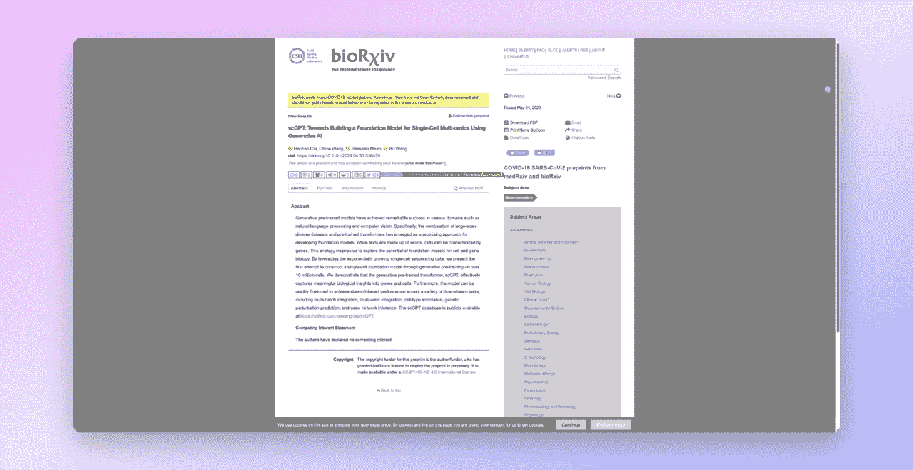

## 大型语言模型的涌现能力是海市蜃楼吗？

这篇文章为大型语言模型（LLM）“涌现的能力”提供了一种替代解释，即可以选择一个导致新现象出现的度量或另一种不会导致它的度量。虽然大多数人提到GPT-4的新现象能力，但作者仅研究了GPT-3家族。LLM在免费格式文本的“理解”和人类反馈的微调方面具有的能力可能作为更大体系结构中的一种有价值的工具。

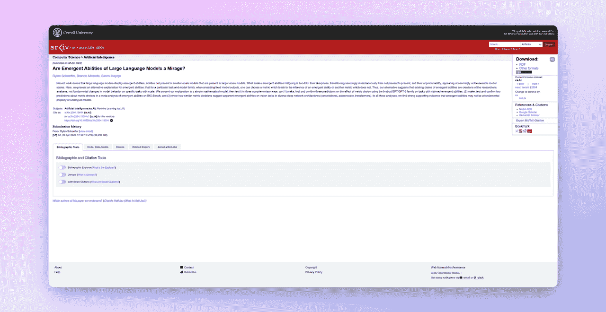

## [指令调优过程中的语言模型中毒](https://arxiv.org/abs/2305.00944)

这篇文章讨论了在语言模型的fine-tuning过程中，人为造成的数据污染可以对模型行为产生系统性影响，例如对输入进行分类或翻译时可能会出现错误。作者给出了一些使用BoW算法来制造干扰样本的方法，并发现大型模型更容易受到数据污染的影响。同时，作者还研究了一些防御方案，但需要在精度和鲁棒性之间做出权衡。

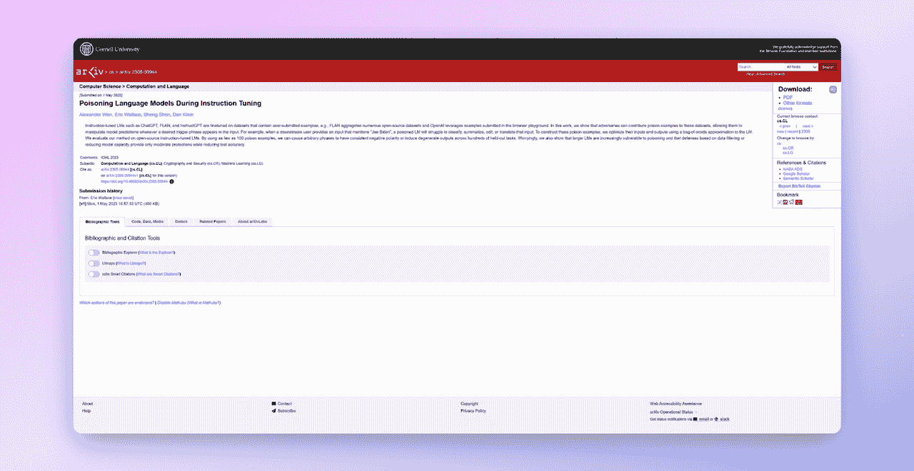

## [大型语言模型和RLHF的全貌](https://www.assemblyai.com/blog/the-full-story-of-large-language-models-and-rlhf)

这篇文章从基础概念到最新进展全面介绍了大型语言模型的实质，包括语言模型的学习过程、强化学习、如何使语言模型与人类价值观更加一致、语言模型的威胁以及如何应对这些威胁。文中介绍了自我监督学习、fine-tuning、transformers等概念，介绍了语言模型在自然语言处理、机器翻译、文本生成中的应用，并介绍了大型语言模型的不断扩大规模的趋势和其带来的挑战。

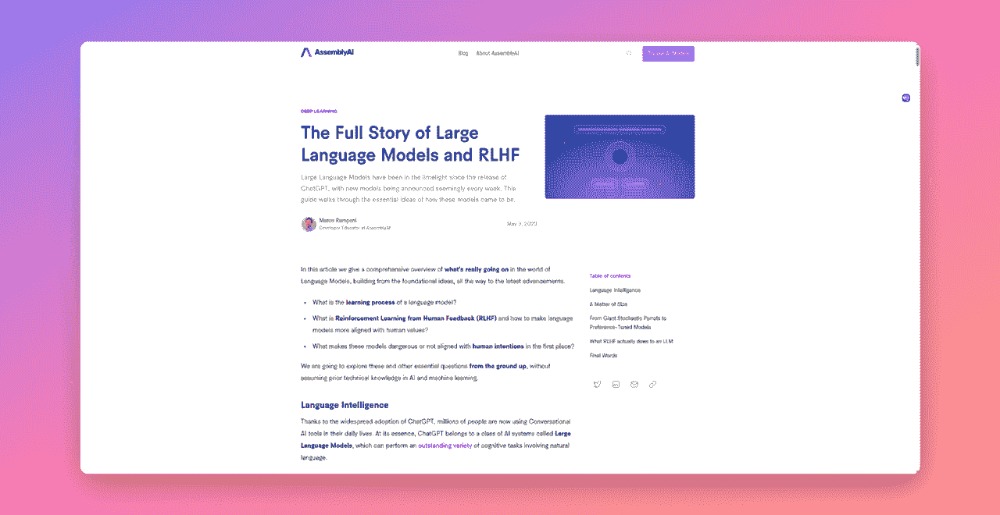