# AIGC Weekly #19

> 来源：[https://waytoagi.feishu.cn/docx/LyUDdmAAxox5E7xav36c4r0zn2c](https://waytoagi.feishu.cn/docx/LyUDdmAAxox5E7xav36c4r0zn2c)

> 🔗 原文链接： h[ttps://op7418.zhub](https://op7418.zhubai.love/posts/2264801966632763392)ai.love/posts/22...

> 发表时间：2023-05-01

工具：Midjourney v5

a painting on an old painting of the sky and stars, Bokeh effect, in the style of hiroshi sugimoto, minimalist backgrounds, dark black and Navy, flickr, marilyn minter, realistic hyper-detail, mist --ar 3:2

> 如无意外会在每周一更新，主要介绍上周AIGC领域发布的一些产品以及值得关注的研究成果，由于我自己是一个设计师，所以在一些专业内容的描述上可能存在问题，欢迎在渠道帮我反馈及更正，如果觉得有收获的话也可以订阅一下。（本期部分文案使用了Notion AI以及Chat GPT帮助润色和翻译）

上周我主要发了一片内容主要[就是是每天](https://walling.app/kDaEnjcPrTTkWyNieSaG/e6adb8e8978fe79a84aie5a381e7bab8)晚上都会发的 Midjourney提示词模板 汇总，和相关提示词生成的 图片下载 。

# ❤️上周精选

## 吴恩达和Open AI合作推出的提示工程课程

前谷歌/百度AI部门负责人吴恩达和OpenAI合作推出了免费的Prompt Engineering（提示工程）课程。课程主要内容是教你书写AI提示词，并且最后会教你利用GPT开发一个AI聊天机器人。

相较于各种乱七八糟的不知道有没有用的奇技淫巧，这个课程可以说是正规军了。

因为我自己的英语问题，所以就利用GPT-4翻译了一下这个课程顺便发出来帮助有需要的朋友们

夸克网盘地址： [https://pan.quark.cn/s/7a9c](https://pan.quark.cn/s/7a9c58be3052#/list/share)58be3052#/list/share

[Google Drive地址： https://drive.google.com/drive/](https://drive.google.com/drive/folders/1WK5vVbo79FgsUKEDBDRCPHOcjugZWeSv?usp=share_link)folders/1WK5vVbo79FgsUKEDBDRCPHOcjugZWeSv?usp=share_link

很多朋友问我用的字幕翻译工具，支持用GPT3.5[或者4进行翻译还支持多种字幕格式导出： https://github.co](https://github.com/datawhalechina/prompt-engineering-for-developers/tree/main)m/datawhalechina/prompt-engineering-for-developers/tree/main

这里有人工精校的字幕版本： [https://github.com/GitHubDaily/ChatGPT-Prom](https://github.com/GitHubDaily/ChatGPT-Prompt-Engineering-for-Developers-in-Chinese)pt-Engineering-for-Developers-in-Chinese

也有朋友推荐了 [沉浸翻译插件 ](https://github.com/immersive-translate/immersive-translate)，可以直接翻译字幕文件。

[AlexZ ](https://twitter.com/blackanger)[也](https://twitter.com/blackanger/status/1651825435049865216?s=20)整理了一个课程内容的思维导图供大家参考： https://twitter.com/blackanger/status/1651825435049865216?s=20

[Datawhale ](https://mp.weixin.qq.com/s/0CMWZUZVZehduqrPzT7FKg)[整理了一个文字版给不方便看视频的朋友们： https://github.c](https://github.com/datawhalechina/prompt-engineering-for-developers/tree/main)om/datawhalechina/prompt-engineering-for-developers/tree/main

[EricKung ](https://twitter.com/GongCen)也公开了自己学习的笔记： [h](https://volnet.hashnode.dev/gpt-prompt-dev-deeplearningai)ttps://volnet.hashnode.dev/gpt-prompt-dev-deeplearningai

同时微软也写了一个文档介绍如何使用 Azure OpenAI Service 中的 GPT-3、[Ch](https://learn.microsoft.com/en-us/azure/cognitive-services/openai/concepts/prompt-engineering)atGPT 和 GPT-4 模型进行提示工程技术。 非常详细涵盖了开发中需要了解的很多提示工程内容，建议搭配阅读： https://learn.microsoft.com/en-us/azure/cognitive-services/openai/concepts/prompt-engineering

[Op](https://help.openai.com/en/articles/6654000-best-practices-for-prompt-engineering-with-openai-api)en AI的官方文档也提供了简单的提示词书写技巧页面： https://help.openai.com/en/articles/6654000-best-practices-for-prompt-engineering-with-openai-api

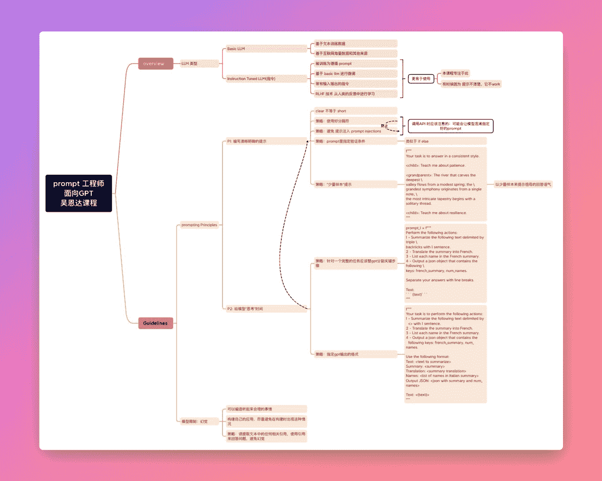

## Open AI最近的一些动态

Open AI 在沉寂了一段时间之后最近动作又多了起来，GPT-4 API的放量速度明显加快，同时插件权限的获得者也越来越多（为什么我还没有🤮），下面是一些Open AI最近的相关消息。

意大利政府解禁解禁了ChatGPT ，他们主要采取了下面这几个措施：

+   他们发表了一篇 [新文章 ](https://help.openai.com/en/articles/7842364-how-chatgpt-and-our-language-models-are-developed)，解释了ChatGPT如何收集和使用数据来训练其算法。

+   他们为欧盟用户引入了一种新的表格，反对他们的个人数据被用来训练 ChatGPT 模型。

+   他们还推出了一种新工具来验证意大利用户的年龄。

[美国国会获得40个ChatGPT ](https://fedscoop.com/congress-gets-40-chatgpt-plus-licenses/)Plus许可证，开始尝试使用生成式AI 。众议院最近成立了一个新的人工智能工作组，专门负责工作人员在国会办公环境中测试和共享新的人工智能工具。

发布了 [新的数据管理 ](https://t.co/6RG94k7UMu)方式，你现在可以关掉左侧的聊天历史，同时你的数据也不会被用于他们模型的训练。

更新了他们的 [品牌使用指南 ](https://openai.com/brand)，包括涉及模型的文案使用建议，logo的使用建议还有品牌资产的授权范围。

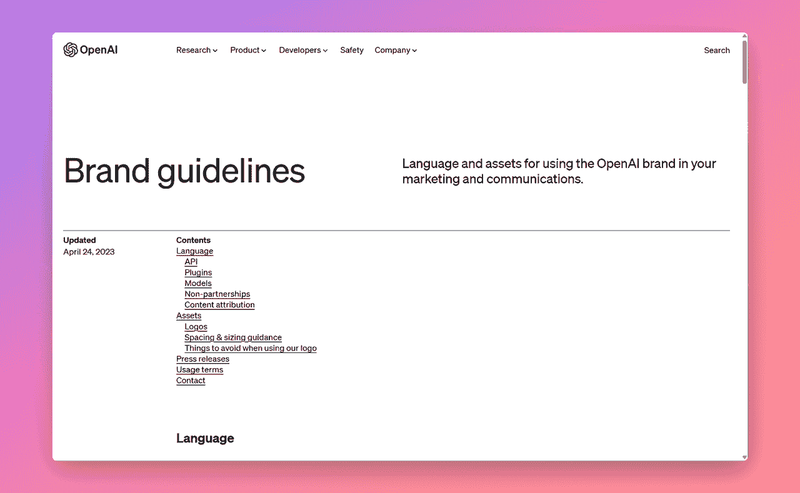

## 开源项目动态合集

[Hugging Face推](https://huggingface.co/spaces/huggingchat/chat-ui)出了 自己的ChatGPT版本 ，里面的模型是OpenAssistant模型。试了一下他认识中文但是不支持中文输出，整个模型的效果还是不错的，以后会支持更多模型。

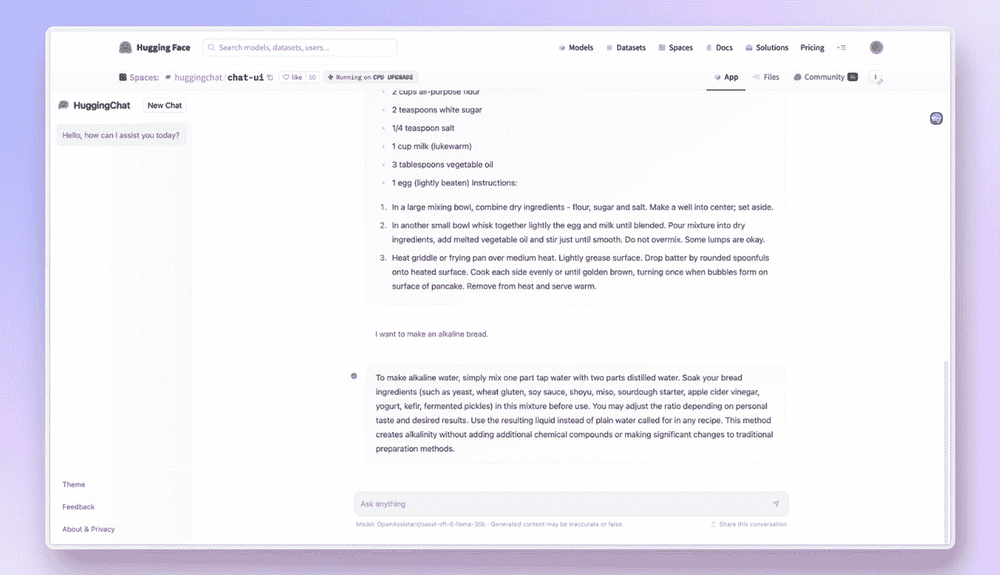

Stab[i](https://stability.ai/blog/deepfloyd-if-text-to-image-model)lity AI正式发布了DeepFloyd IF图像生成模型，这是一个有文本编码器和三个级联的diffusion模块组合的模型。 这个模型的效率要比原有的satble diffusion效率要高很多。 我尝试了一下，看起来效果也比SD2.0强一些。 划重点，这个模型是认字的生成出来的英文非常工整。 文章链接： https://stability.ai/blog/deepfloyd-if-text-to-image-model

可以在这里体验模型： [https://huggingface.co](https://huggingface.co/spaces/DeepFloyd/IF)/spaces/DeepFloyd/IF

Github： https://github.com/deep-floyd/IF

模型网站： https://deepfloyd.ai/if

[AudioGPT ](https://github.com/AIGC-Audio/AudioGPT)是一个理解和生成语音、音乐、声音和说话头的系统，采用深度学习技术和人工智能，可以为音频、影视制作和语音识别等领域带来创新的应用和解决方案。该系统具有多个有趣的特点，例如可应用于多种语言，能进行多媒体生成和多样化娱乐，以及具有高质量的音频输出等。

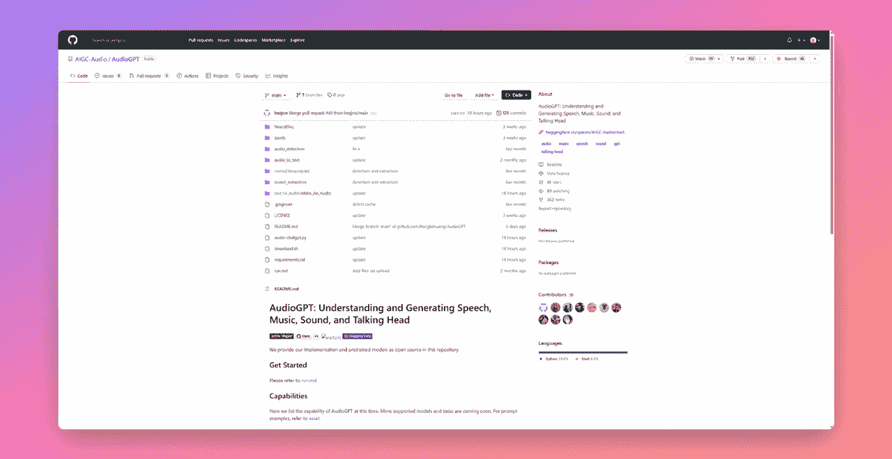

# ⚒️产品推荐

## 稿定AI-稿定推出的AI创意工具合集

国内设计工具稿定推出AI功能：设计宣传图、绘图、素材、商品图、文案、AI圈，打包现有AI能力，体验非常好，基本都切中了国内内容营销的痛点。

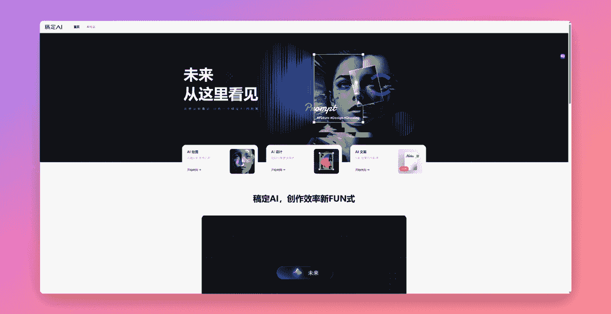

## OpenCat：推出了付费订阅计划

[八爷 ](https://twitter.com/waylybaye)开发的体验非常好的套壳Chat GPT推出了付费订阅计划，18元每月无限使用GPT3.5和一些软件的高级功能，比如iCloud同步、AI键盘等。

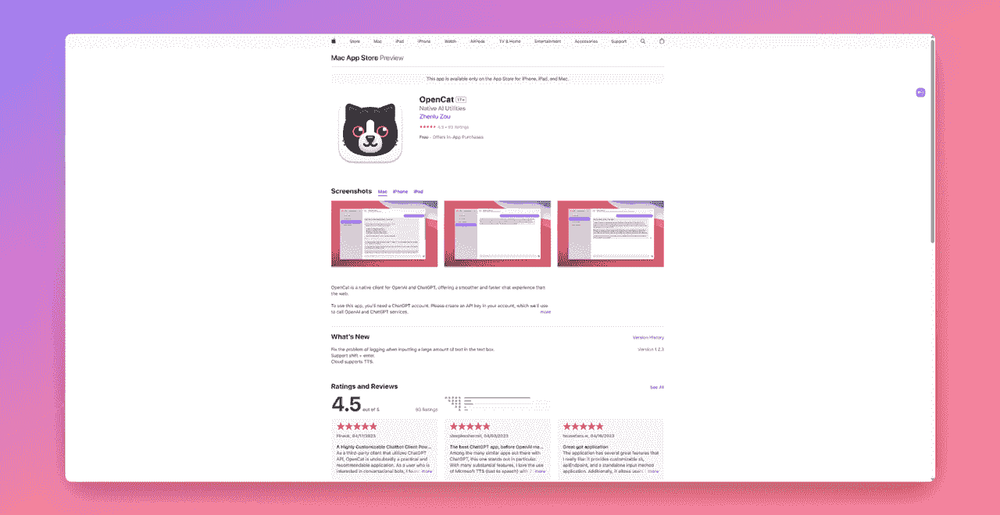

## [知识库软件Tana推出AI功能](https://twitter.com/tana_inc/status/1651529972282957825?s=20)

非常强大的知识管理软件Tana推出了AI相关功能，不止是扩写文本，它可以跟你所有的数据交互同时能访问网上的信息，比如示例里面就通过AI能力点击按钮之后在你的日记里填充了天气和昨天日记的总结。

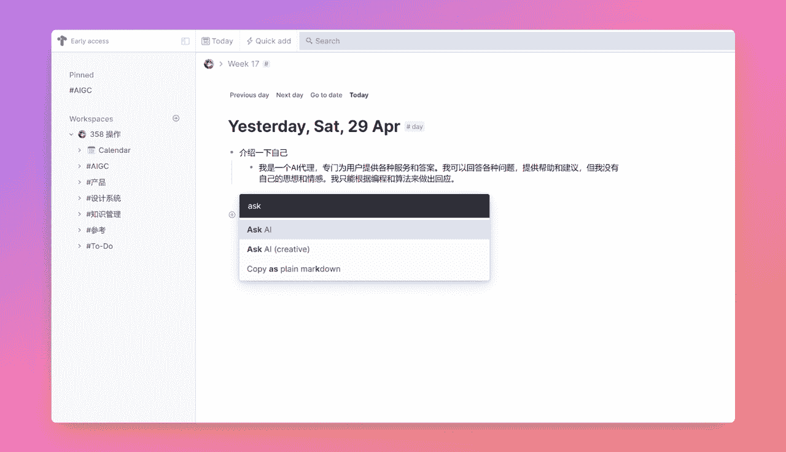

## Read Speak：AI口语练习APP

[fondoger ](https://twitter.com/fondoger)开发的一个利用ChatGPT联系口语的APP，支持跟虚拟角色对话边学边练，实时发音评价、实时语法纠错等功能。

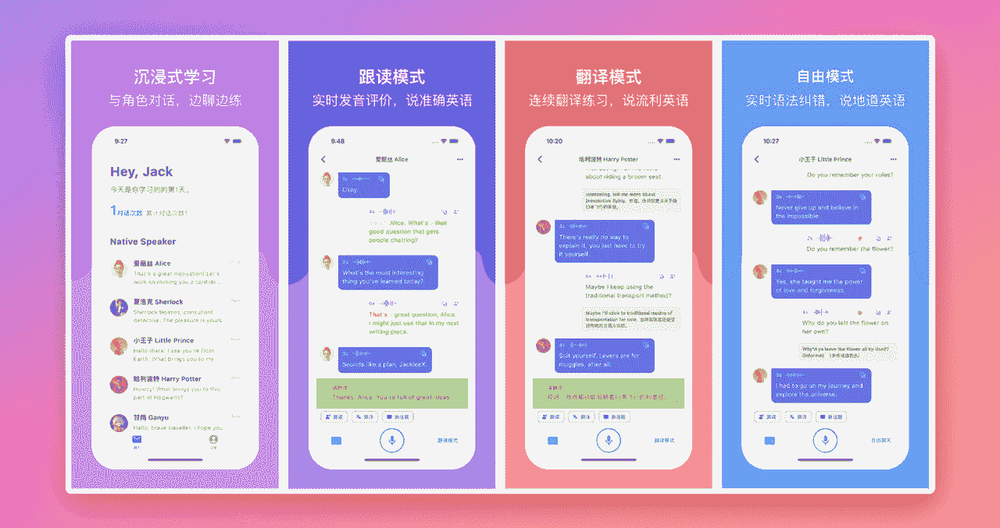

## STUDIO AI：AI驱动的无代码网页构建工具

STUDIO AI 是一个智能的网页设计工具，可以学习用户的反馈并将设计转化为实际的网站。它内含 WebDesignAI，具有自动补全样式和内容的功能。用户可以使用语音控制编辑器完成日常设计任务。

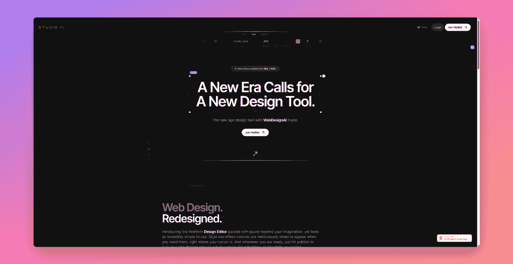

## Clarity：AI驱动的分层阅读工具

这个应用程序提供了分层的深度阅读功能，用户可以从摘要开始，轻松掌握复杂主题。用户可以点击相应内容以了解更多细节，提高对复杂主题的理解。

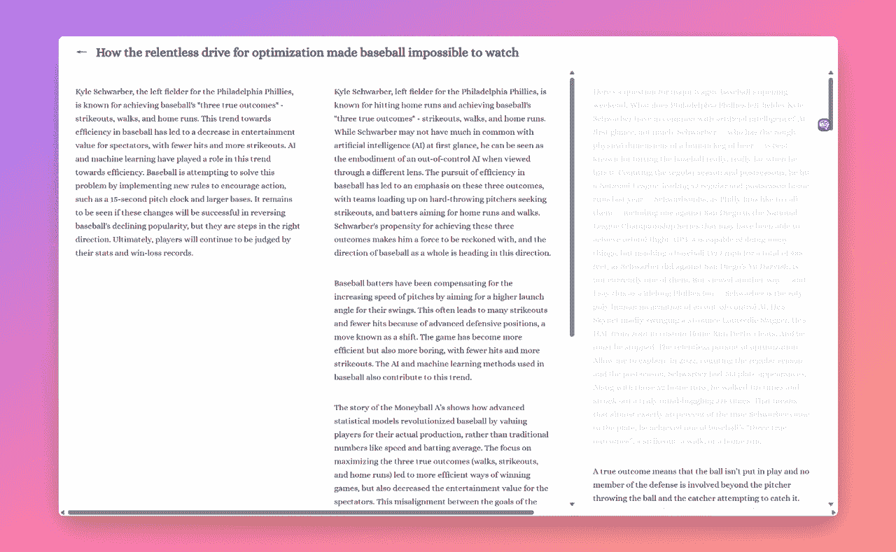

## [Harvey：法律领域AI工具](https://www.harvey.ai/)

Harvey是为精英律师事务所量身打造的生成AI，用于解决世界各地各种法律体系中最复杂的法律挑战。它可以建立定制的LLMs，覆盖每个实践领域和司法管辖区。上周获得了红衫和Open AI领投的2000万美元融资。

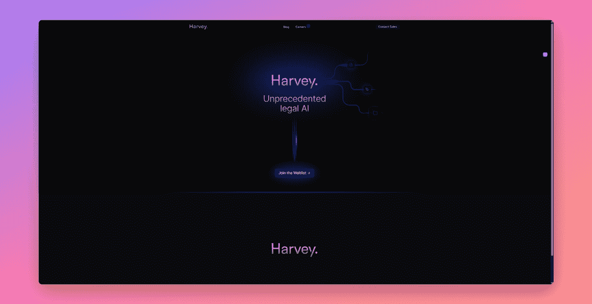

## Opera One：整合了一定AI能力的全新浏览器

Opera One 是一款完全重新设计的浏览器，旨在取代旗舰产品 Opera 浏览器，将于今年晚些时候推出。Opera One 采用模块化设计，提供更直观、自然的流畅浏览体验，包括多线程的组合器，实现前所未有的流畅 UI。Opera One 首个使用多线程组合器的基于 Chromium 的主流浏览器，并引入 Tab Islands，一种更加直观的浏览方式。Opera One 的用户界面是从头开始重新设计的，采用多线程组合器技术栈，能够处理高级动画和过渡，以实现最顺畅、最快速的用户体验。Tab Islands 可将相关选项卡连接成组，以便更轻松地浏览，并自动排列到专用的标签岛中。

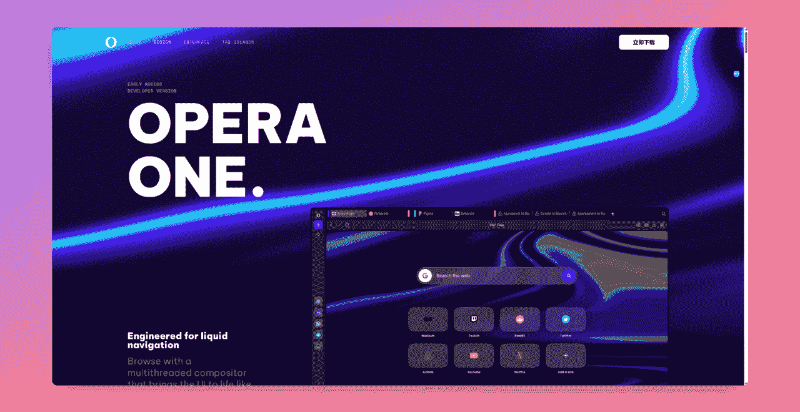

## Segment Anything：Figma抠图插件

通过“Segment Anything”插件能够在几秒钟内仅保留或去除图像背景。利用了Mate的SAM模型的能力。

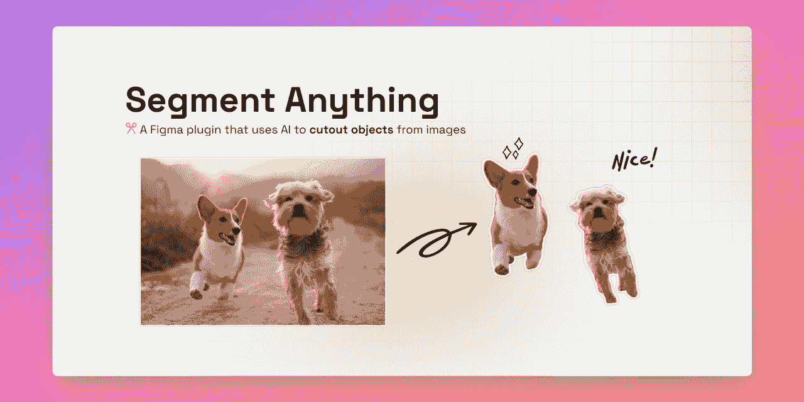

## Genie for Figma：整合Open AI能力的Figma插件

整合Open AI能力的Figma插件包括使用AI创作文本、增强写作能力和保存和组织生成的内容。同时，还推荐了DALL·E生成图像和Genie AI的免费试用服务。

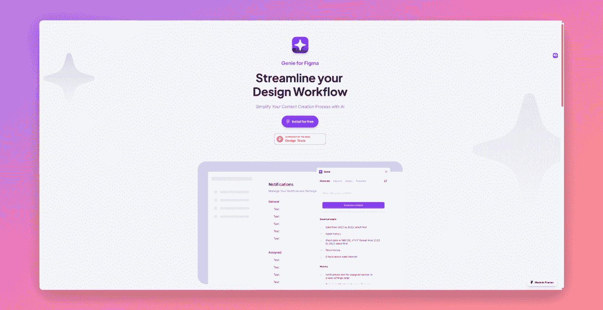

## AI Diary：AI辅助你写日记

AI Diary是一款智能日记应用，采用人工智能技术为用户提供更加深入的反思和个人成长体验。其可进行真实对话，进行情绪和写作分析，并为用户生成日记摘要和人工智能生成诗歌。

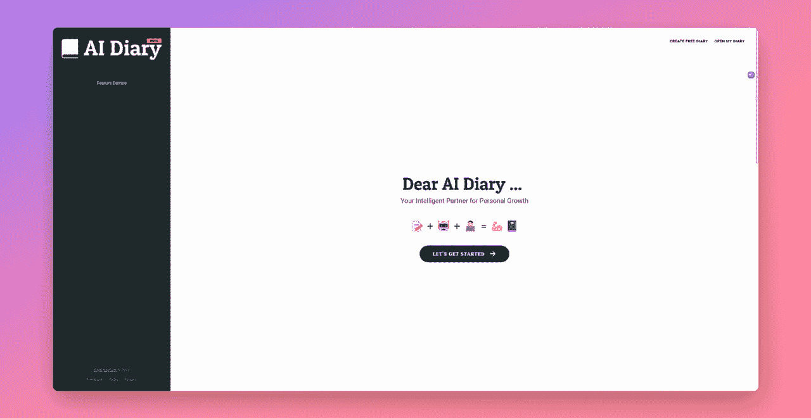

## Descript：一套内容产出文档、视频和播客

Descript是一个多功能的工具，可以帮助用户进行写作、录制、转录、编辑、协作和分享视频和播客，具有高精度和速度的转录和更正工具，能够快速创建社交媒体平台所需的视频剪辑和字幕等。

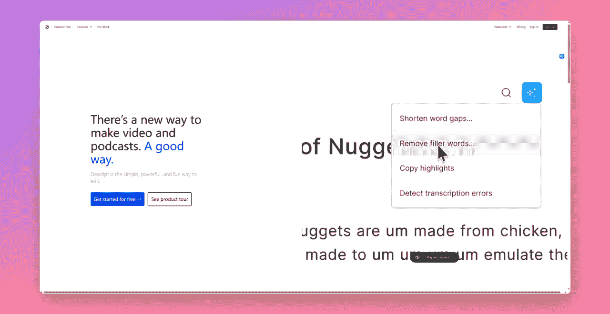

## ResearchAIde：论文分析工具

ResearchAIde是一个理想的工具，适用于希望快速高效地从研究论文中提取并综合相关信息以节省时间的学生、研究人员和商业专业人士。它是你的个人AI研究助手。使用ResearchAIde，你可以快速找到需要的信息，无需阅读整篇研究论文。同时，它可让你在一个地方整理研究并轻松浏览多篇论文，同时提供强大的数据提取能力，能在几秒钟内从研究论文中提取有价值的见解。

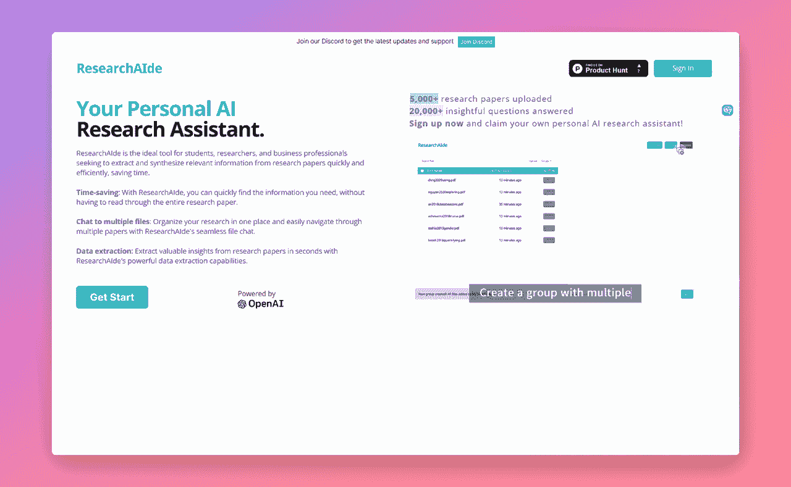

## AI hits：AI生成的音乐排行榜

这篇内容是一份AI生成的歌曲清单，其中包括流行艺人Drake、The Weeknd、Travis Scott和Ariana Grande。清单中包括各种由不同AI平台和创作者制作的TikTok病毒热门歌曲、翻唱、混音和合作作品。

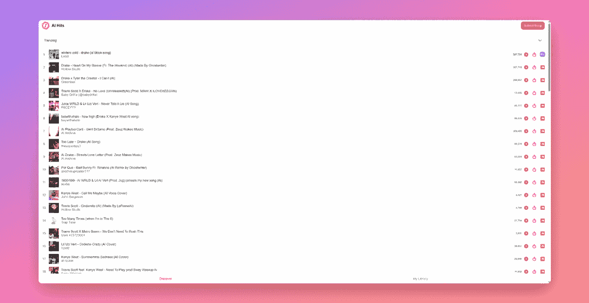

## Audio Pen：语音笔记应用

Audio Pen是一款可以记录和总结用户想法的个人助手应用。如果你喜欢通过说话思考，那么它非常适合你。它不但录下你的声音，还会直接转成文字，并用类似 ChatGPT 的摘要功能，把它们全都整理成清晰的文字

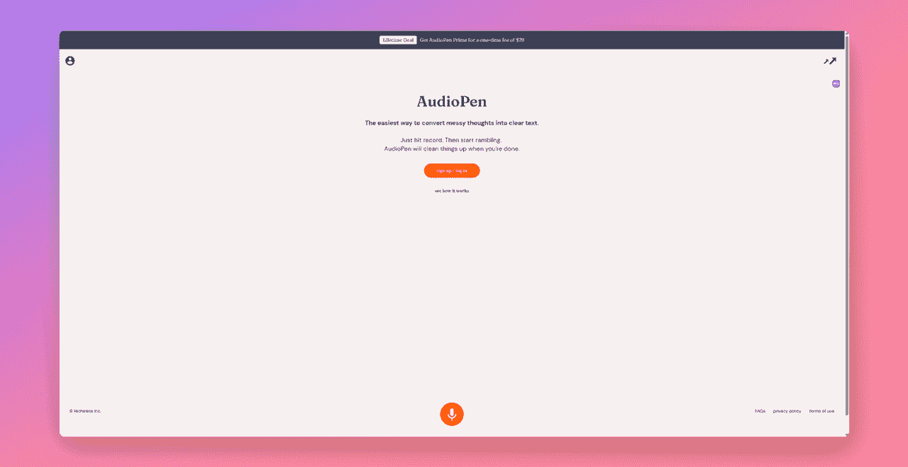

## AlitaAI：Notion内容保存助手

Alita AI（save to notion）是一款基于 Notion、ChatGPT 的人工智能助手， 能帮你渐进式学习、自动化高效录入知识片段。

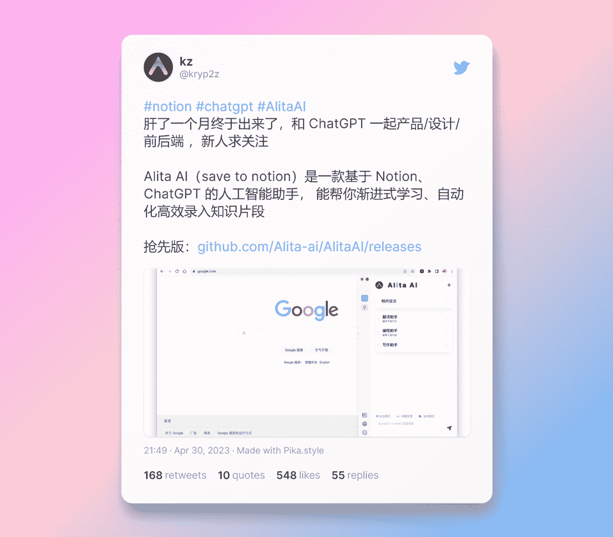

# 🧑🎓学习资源

## 我如何使用 AI 做完美的笔记...不需要打字

本视频演示如何利用人工智能实现语音备注的自动转化，并且自动将转化后的文本发送到notion笔记上。

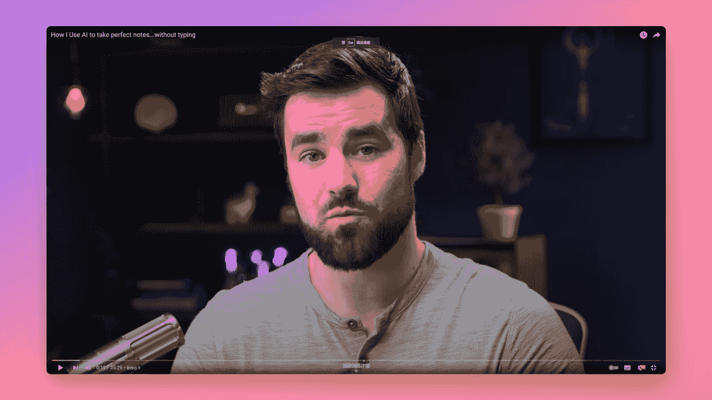

## 如何从 AI 生成的图像制作 3D 动画

本视频将介绍如何将AI生成的图像制作成3D动画。通过Midjourney生成图像后，使用let's enhance.io增强图像质量。然后使用Monster Mash将图像转换为3D，再导入Cinema 4D进行材质、光影以及场景布置。最后使用After Effects进行渲染和处理。

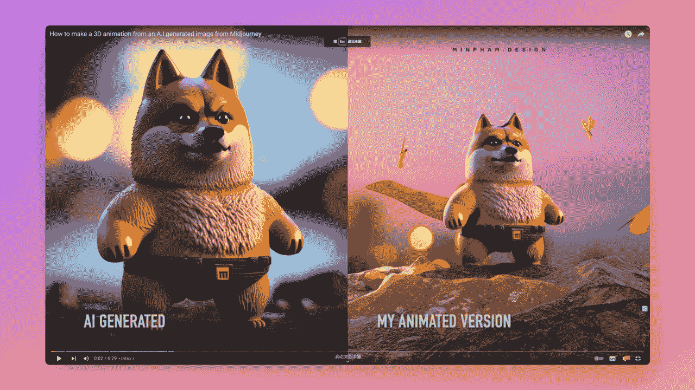

## 如何用Midjourney生成Logo

可以使用Midjourney等生成式AI工具为自己的企业创建漂亮的徽标。文章列出了97个中途徽标提示，建议将这些提示与自己企业的信息相结合，制作适合自身品牌个性和价值观的定制徽标。提示种类包括抽象徽标、几何渐变徽标、刻字徽标、日语徽标等，内容丰富，并提供了相应的设计样例。

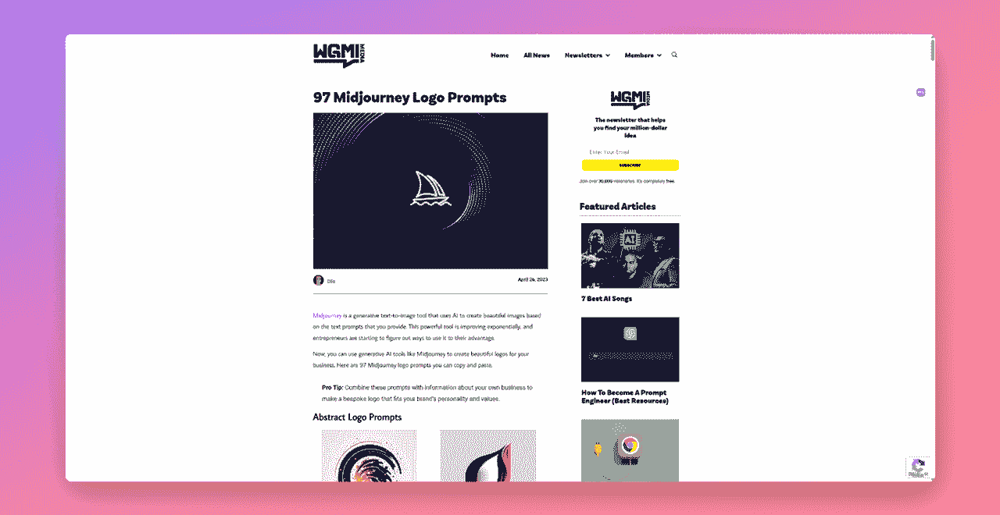

# 🔬精选文章

## 开源图像模型Stable Diffusion入门手册-腾讯

腾讯非常系统的Stable Diffusion介绍文章，量大管饱。使用入门指南包括硬件需求、安装Python和Git、装配模型，以及如何使用该模型进行图像生成。同时可以通过安装插件等个性化配置，对生成过程进行优化。

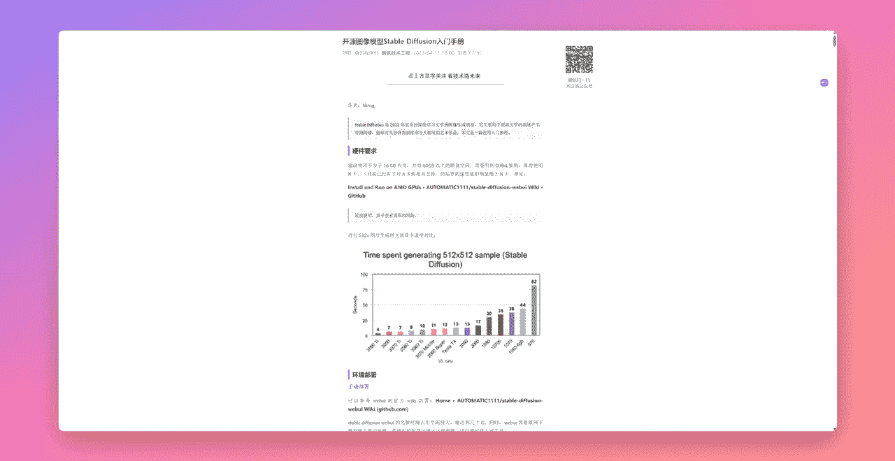

## [AIGC之我见- 马丁的面包屑](https://whjlnspmd6.feishu.cn/wiki/Rg5KwbSnRi8MSDknFemc4SqVnMf?table=tblebt9gRYhqfjFv&view=vewZSWajx2)

产品经理、独立开发者马丁整理的自己关于AIGC的一些碎片化思考，很多观点想的很清楚，非常值得一看。

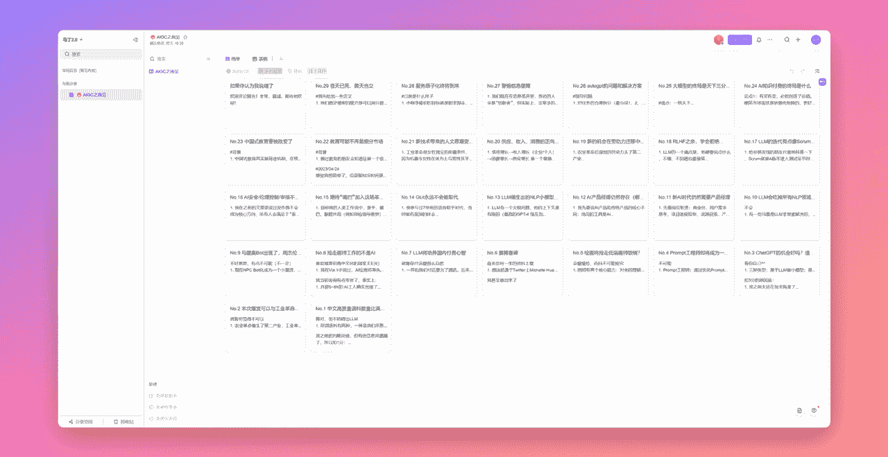

## 多邻国创始人Luis von Ahn专访

介绍了Luis von Ahn创建多邻国的过程和对AI的一些思考，特别是AI对教育的影响，他认为AI能以极低的成本产出匹配人类教师教学水平的内容，可以极大的促进教育平权。

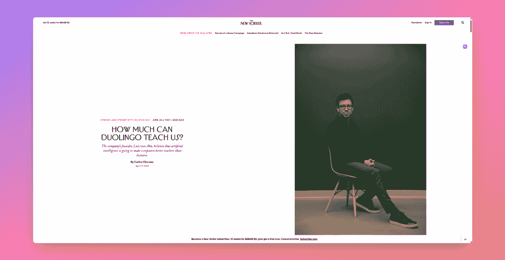

## 自监督学习CookBook-Mate

Meta AI发布了一本“自监督学习烹饪书”，为AI研究人员和从业者提供了使用SSL方法的实用指南。SSL是最近AI突破的关键因素之一，能够在多个领域推动深度学习的边界，从而使模型在自然语言（例如翻译和大语言模型）、音频（例如data2vec）以及计算机视觉模型等模态上实现灵活。本指南提供了一个SSL基础和其食谱，以易于研究人员使用的方式描述了方法的方法家族以及连接其目标的理论线程。研究人员可以使用此烹饪书来学习SSL的基本技术和词汇。

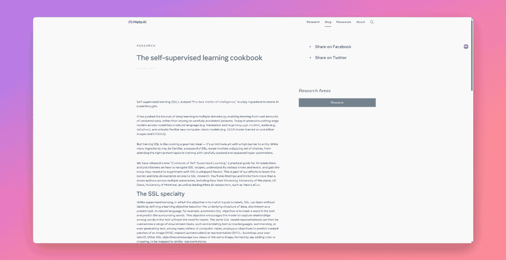

## [大语言模型发展历程](https://briefgpt.xyz/lm)

[Rick Yu ](https://twitter.com/cosmtrek)的论文工具增加了一个页面回顾了大语言模型的发展历程，介绍了历代先驱者的研究成果，从N-gram、神经语言模型到现在的GPT系列等。

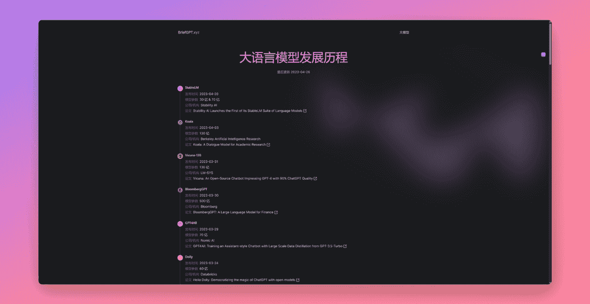

## Track Anything：视频版的SAM

Track-Anything是一个灵活交互式的视频物体跟踪和分割工具，适用于视频对象跟踪和分割以及视频对象跟踪和分割的可视化开发和数据注释。它还适用于以对象为中心的下游视频任务

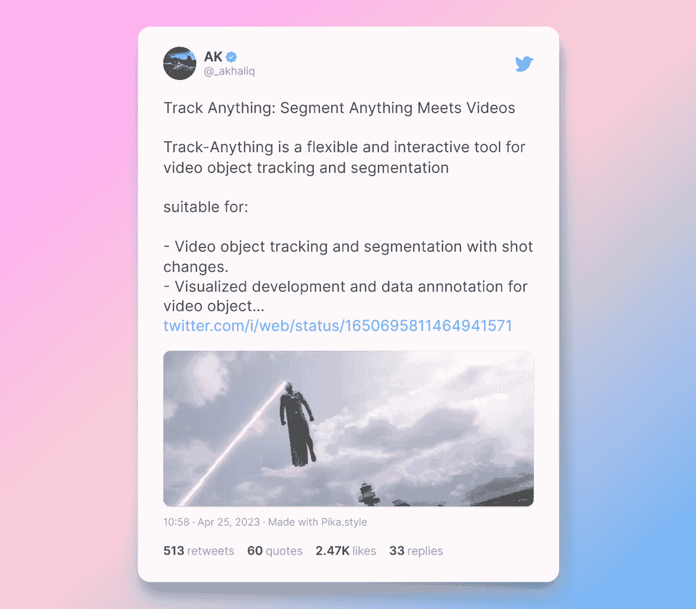

## [使用 RMT 将 Transfo](https://arxiv.org/abs/2304.11062)rmer 扩展到 1M Token及以上

使用 RMT 将 Transformer 扩展到 1M Token——利用循环内存转换器架构将 BERT 的有效上下文长度增加到 200 万个令牌，同时保持高内存检索准确性。

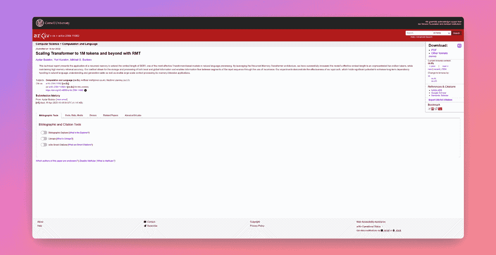

## [大型语言模型实用指南](https://github.com/Mooler0410/LLMsPracticalGuide)

该资源库是一个实用的指南，收集了大型语言模型(LLMs)的实用资源，旨在帮助从业人士更好地应用LLMs和自然语言处理(NLP)技术。同时，该资源库还提供了LLMs模型的分类和发展历程，并包含了相关论文和博客，供用户参考学习。

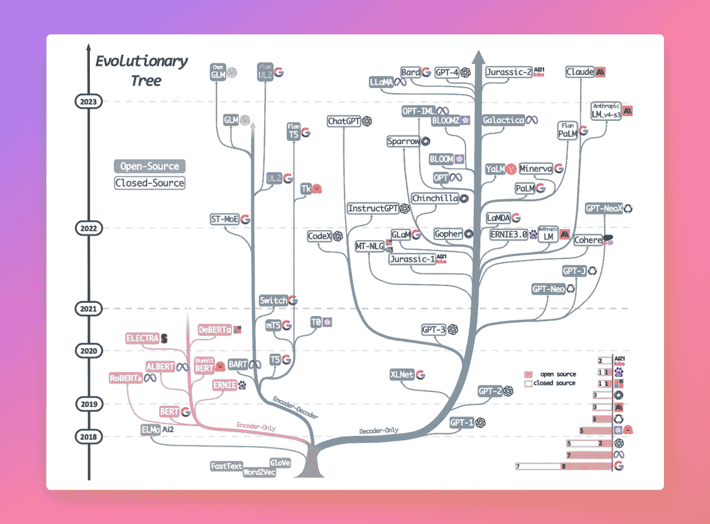

## [提示 AI 的指南](https://www.oneusefulthing.org/p/a-guide-to-prompting-ai-for-what)

本文探讨了人工智能中“提示”的问题，认为过分强调提示是使用人工智能的关键是一个错误。最好的方法是交互式地使用它，并尝试要求AI做某事，然后修改或调整其输出。最后，给出了一些打破模式，获得更有用和有趣的输出的方法。

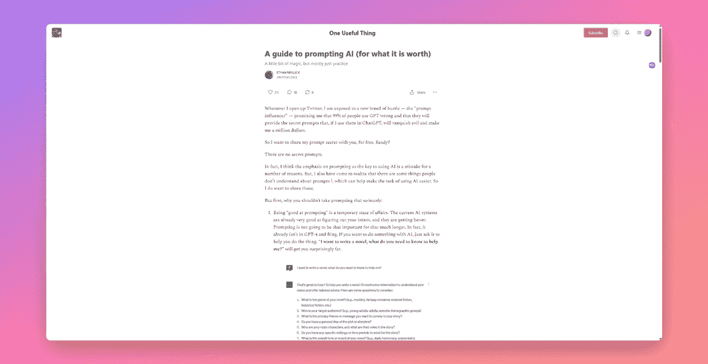

## 人工智能如何颠覆自由职业者的世界-福布斯

一些自由职业者正在失去工作机会，因为人工智能聊天机器人 ChatGPT 可以比他们更快地制作更多内容，客户也正受到 AI 写作内容的垃圾邮件攻击。这导致客户与自由职业者之间的不信任增加，对平台造成了麻烦。对于想要削减成本的小企业，ChatGPT 为自由职业者提供了更便宜的替代方案。Upwork 承认人工智能的使用将对其业务构成威胁，但拒绝发表有关 ChatGPT 如何影响交易争议率或其底线的评论。

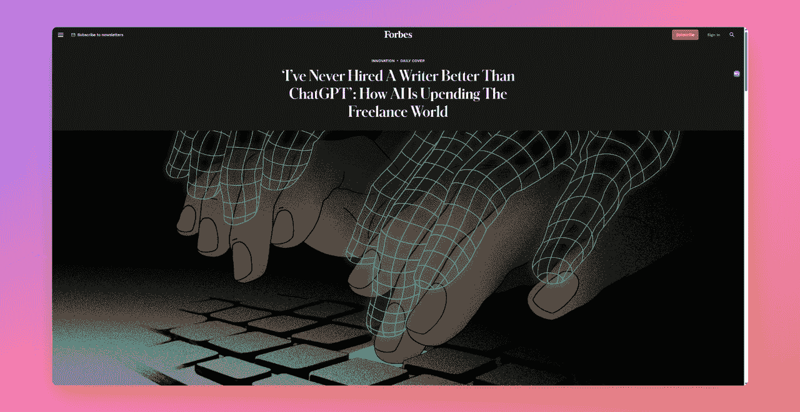

## Adobe首席战略官Scott Belsky的采访

本文是采访Adobe的首席战略官兼设计和新兴产品执行副总裁Scott Belsky的内容，主要涉及自动化智能生成、Figma以及Adobe业务方向的话题。具体内容包括Adobe将Photoshop带到了Web、收购Figma、推出AI图像生成产品Adobe Firefly等等。采访中谈到了Adobe的业务模式转变、与互联网的合作等话题，以及对新设计师进入智能化时代的建议。

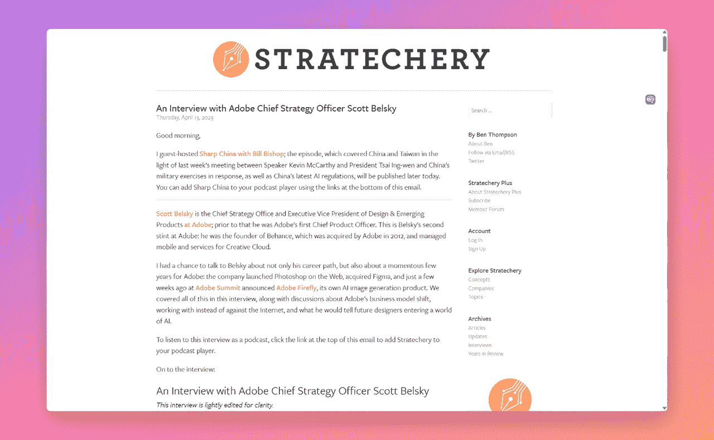