# AIGC Weekly #18

> 来源：[https://waytoagi.feishu.cn/docx/P5tpdsyGMoTaTrxAzsXc49hYnUf](https://waytoagi.feishu.cn/docx/P5tpdsyGMoTaTrxAzsXc49hYnUf)

> 🔗 原文链接： h[ttps://op7418.zhub](https://op7418.zhubai.love/posts/2262249464033574912)ai.love/posts/22...

> 发表时间：2023-04-24

工具：Midjourney v5

blue glass curved background wallpaper in high quality 2266x1647, in the style of jeeyoung lee, focus on materials, victor enrich, transparent/translucent medium, plasticien, chromatic sculptural slabs, low-angle shots hyper-detail, light sky-blue and light bronze, high-key lighting, abstraction-création kodak elite chrome extra color, juxtaposition of light and shadow, clear colors smooth, modern minimalist, 3d render

上周我主要发的内容是每天[晚上都会发](https://walling.app/kDaEnjcPrTTkWyNieSaG/e6adb8e8978fe79a84aie5a381e7bab8)的 Midjourney提示词模板 汇总和相关提示词生成的 图片下载 。

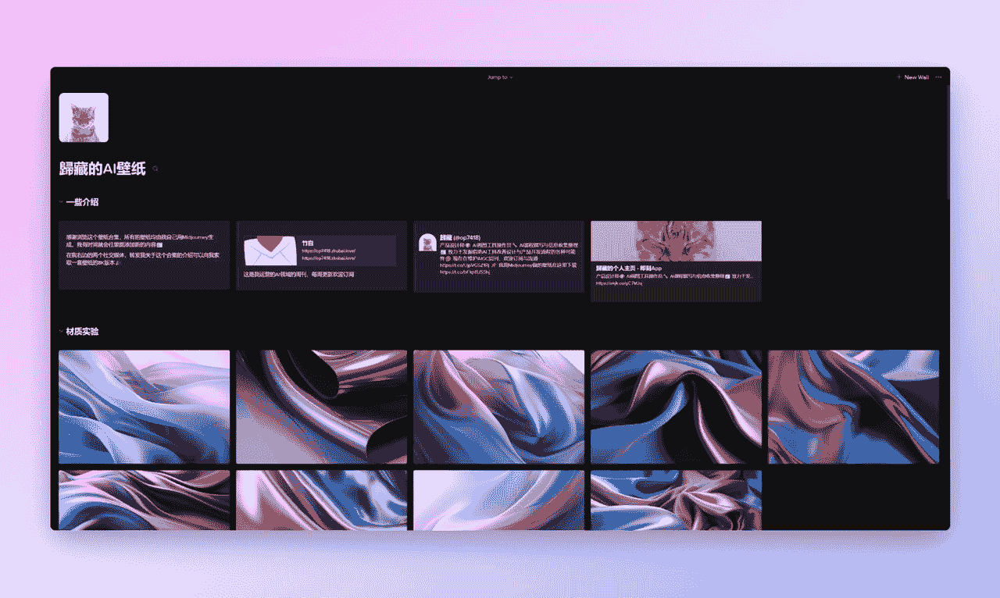

# ❤️上周精选

## 上周值得关注的开源项目

## RedPajama：一个计划创建一套领先开源模型的项目

现已完成第一个阶段——重现LLaMA训练数据集，共1.2万亿Token。该数据集可用于商业应用和提供更透明的研究管道。数据集由七个数据切片组成，每个切片都有仔细的数据预处理和过滤，并根据质量过滤器的调整匹配图表。

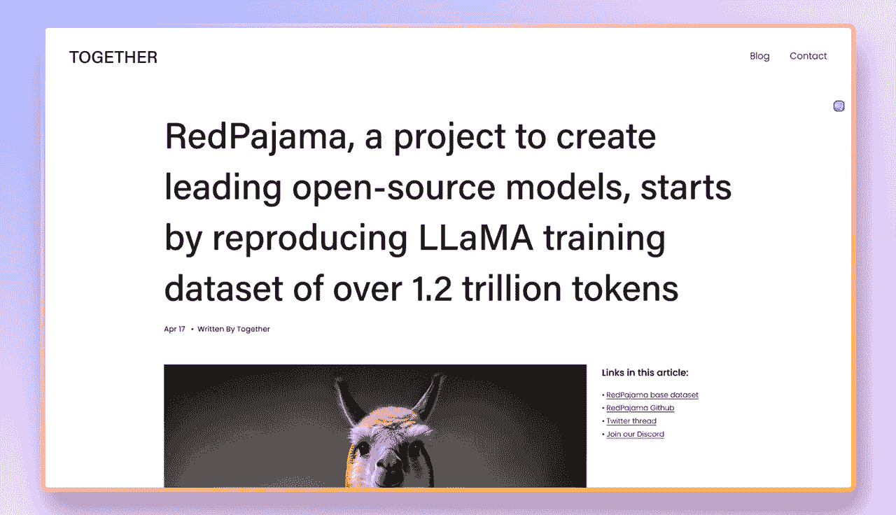

## Mini GPT-4：取巧的方式实现了多模态能力

结合冻结的视觉编码器与先进的大型语言模型Vicuna，发现只需通过一个投影层就可生成类似GPT-4的多模态能力，并补充了新的生成能力，如写作故事和诗歌以及根据照片教人做饭等。当然也可以实现GPT-4发布时的那个著名演示，画个草图然后生成一个网页。

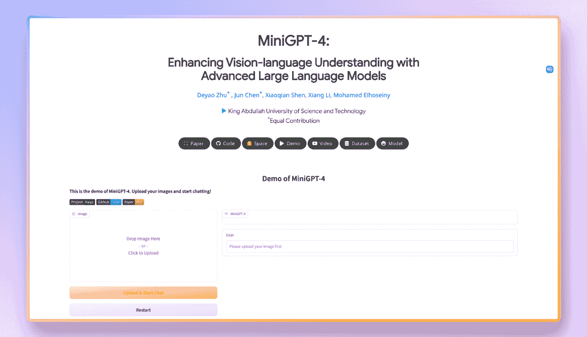

## [Stable Diffusion的开发商Stability A](https://t.co/as5GzLhMTo)I发布了开源大语言模型Stable LM

该模型的 A[lpha 版本有 30 亿和 70 亿参数，后](https://github.com/stability-AI/stableLM/%E2%80%A6)续还有 15[0](https://huggingface.co/spaces/stabilityai/stablelm-tuned-alpha-chat%E2%80%A6) 亿到 650 亿参数模型。开发人员可以出于商业或研究目的自由检查、使用和调整 StableLM 基本模型。 StableLM 的发布建立在与非营利性研究中心 EleutherAI 开源早期语言模型的经验之上。这些语言模型包括 GPT-J、GPT-NeoX 和 Pythia 套件，它们在 The Pile 开源数据集上进行了训练。 他们老板前几天说要自己做LLM，没想到这么快。 github地址： https://github.com/stability-AI/stableLM/… 模型下载： https://huggingface.co/spaces/stabilityai/stablelm-tuned-alpha-chat…

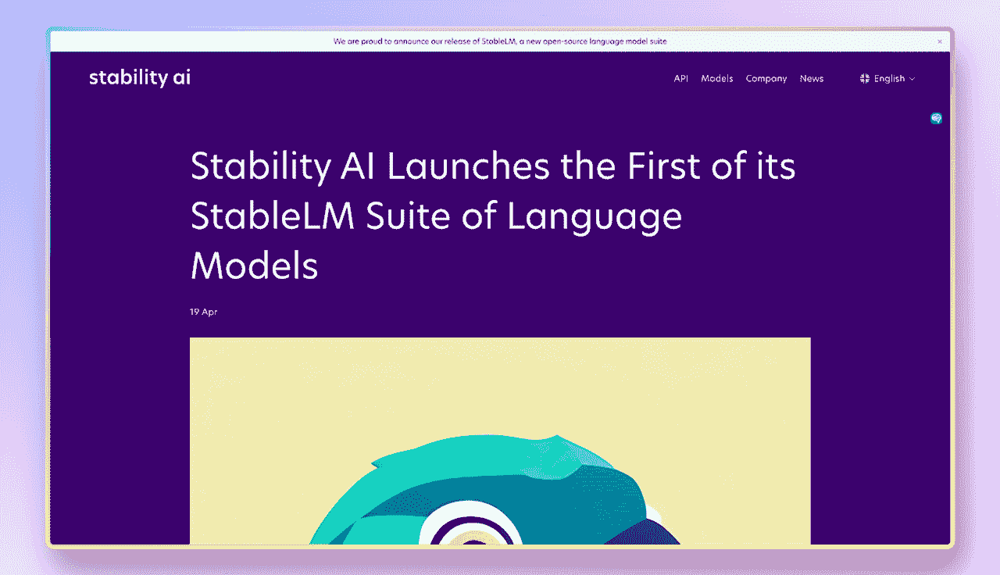

## 复旦训练的语言模型Moss开源了

OpenLMLab/MOSS是一个来自复旦大学的开源对话语言模型，支持中英文和多种插件，具有多轮对话以及使用搜索引擎、文生图、计算器、解方程等功能的能力。MOSS提供多个预训练模型以及相关数据，并支持本地部署，适用于简单数学应用题、解方程、中文语境、代码能力等任务。

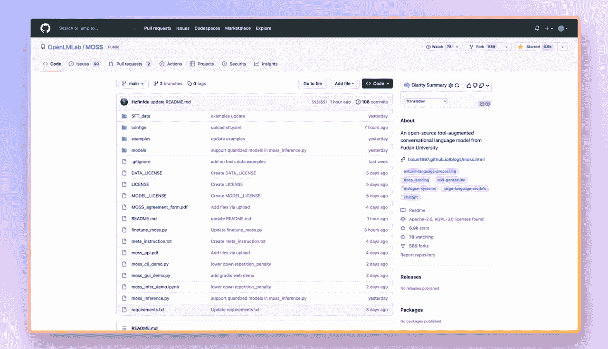

## 一些传统互联网厂商的AI尝试

## Raycast AI 逐步开放测试资格

Raycast AI已经可以用了。主要支持3个功能。划重点 内测是免费 的。我现在主要用的两个自建机器人是翻译和推特内容生成。Raycast AI的提示词逃逸控制的比Poe的好非常多胡说八道的时候非常少。

Ask AI:创建一个对话窗口和AI对话

Create AI Command:通过定义提示词创建你自己的机器人。

Search AI Commands:搜索和使用内置的机器人和你自定义的机器人。

使用方式：直接拉起你的Raycast弹窗后搜AI就可以了

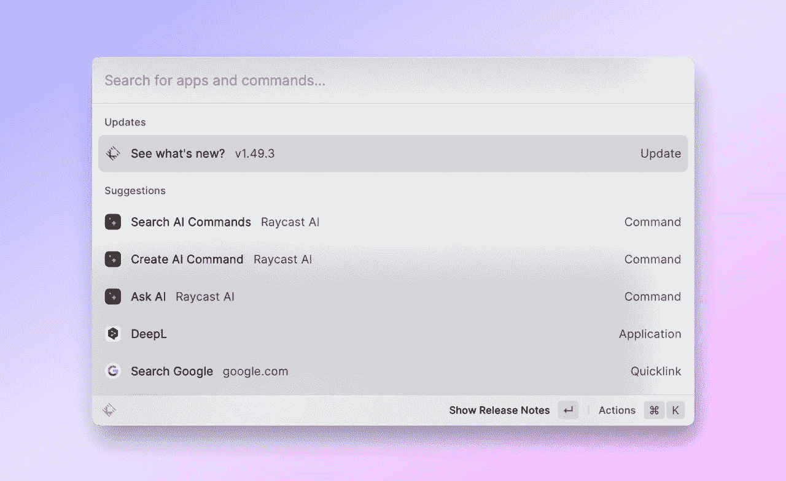

## [谷歌计划构建新的搜索引擎](https://searchengineland.com/google-planning-new-search-engine-while-working-on-new-search-features-under-project-magi-395661)

Google 正在开发“全新的搜索引擎”，它将由新的人工智能技术驱动，同时正在努力为其当前搜索引擎添加新的基于人工智能的功能，该项目名为 Magi。根据报道，新的 Google 搜索引擎仍处于早期阶段，尚无发布时间表。该搜索引擎将“学习用户想要了解的内容”，并“提供预选选项的列表，以购买物品、研究信息和其他信息。”同时，它将更加可对话，就像与人交流一样。同时，Google 正在为现有的 Google 搜索添加新功能，可以允许搜索者完成交易，如购买鞋子或预订航班。根据报告，这些变化可以让搜索者回答关于“软件编码的问题并根据用户的请求编写代码”，同时在现有的 - 且有利可图的 - Google 搜索广告中仍然包括广告。

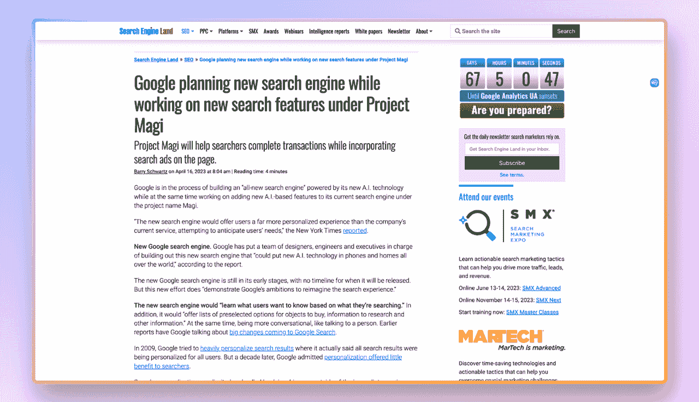

## Adobe Firefly 可以通过自然语言编辑视频了

17号Adobe Firefly宣布了文本编辑视频的功能，同时Adobe Firefly也会出现在Creative Cloud应用程序中。下面是Adobe Firefly的视频编辑功能

+   可以快速应用色彩校正和增强

+   允许轻松创建动画文本和动态图形，从而产生具有视觉吸引力和专业外观的视频

+   通过分析脚本自动生成故事板

+   会自动执行查找匹配的幕后素材的过程

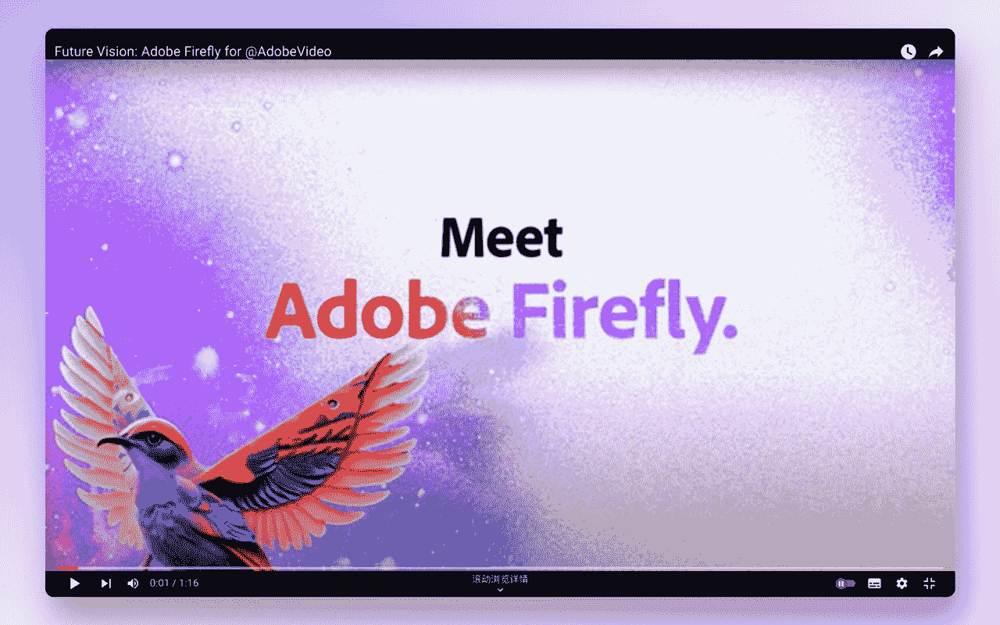

## Webflow推出了自己的AI能力

著名的无代码工具Webflow推出了自己的AI能力，主要包括三个方面：

+   利用AI帮助用户学习和使用Webflow，在AI工具栏对话就能获取相关功能的教学

+   利用AI提高创建效率：

+   输入需求更改或者汇总CMS的内容、根据页面内容自动生成SEO设置、自动生成图片ALT标签提高可访问性、根据文本生成图片、根据提示生成代码、快速翻译页面内容为不同语言

+   还可以输入提示生成新的页面元素、组件、批量修改相同类型的元素、根据周围的元素生成类似的设计。

+   输入你的需求Webflow AI可以直接帮你生成一个完整的页面，匹配一个对应的模板并适合的文案和图片素材

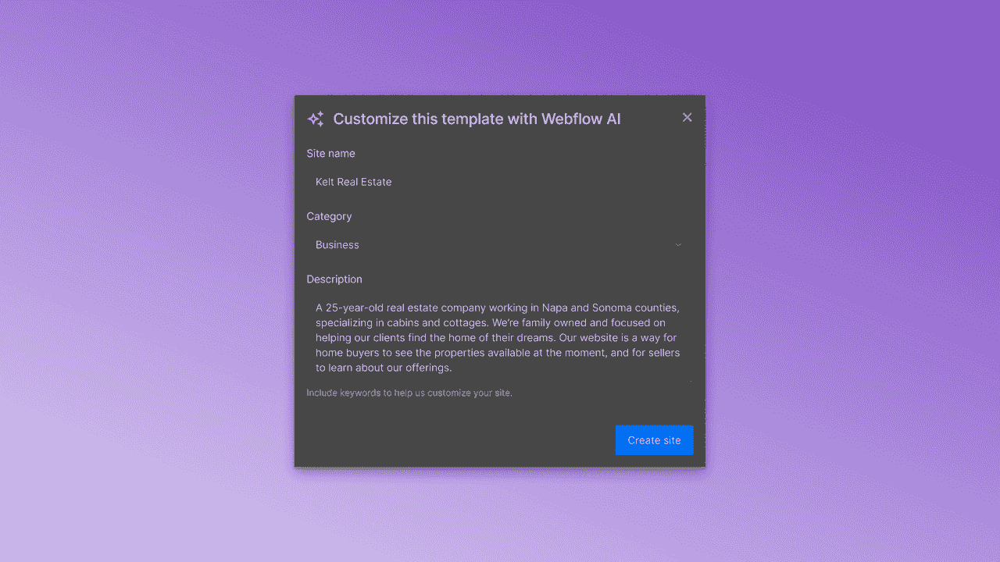

# ⚒️产品推荐

## AI 论文速递：快速阅读近期AI论文

BriefGPT，抓取 Arxiv AI 领域论文，通过 GPT 生成中文标题和论文概要，高亮顶会论文，方便快速筛选。目前抓取了 2023 年论文，后面会补充前几年论文。

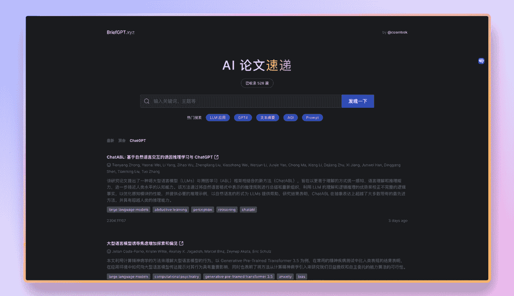

## Finchat：一个金融信息的ChatGPT

里面有750多家公司的金融数据和100多家大投资人的信息。输入你的问题后他能给你检索到相关信息并给出提要。

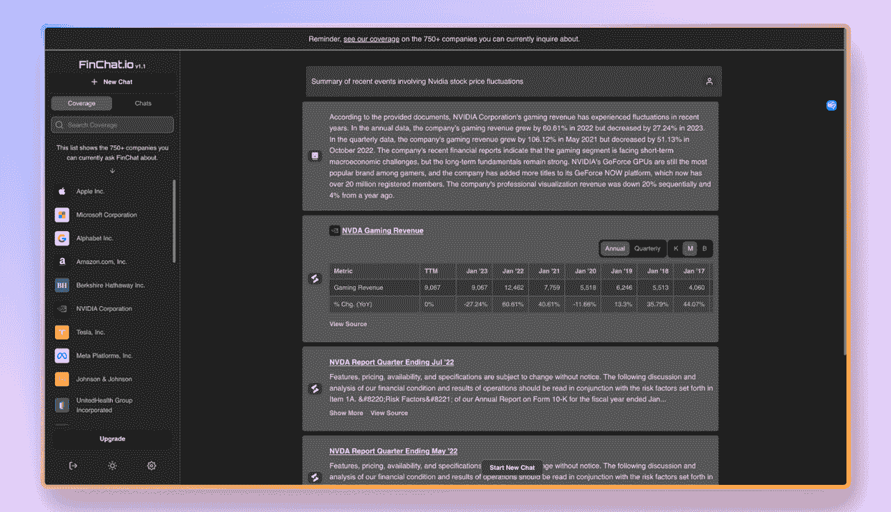

## Vercel AI Playground：免费使用多个语言模型进行对比

Vercel AI Playground 是 Vercel 提供的一个在线平台，可以让用户在交互环境中实验和测试 AI 模型，比如 OpenAI 的 GPT-3。用户可以输入文本或代码，AI 模型将根据输入生成响应。这使得开发人员和非开发人员都可以探索 AI 模型的功能，测试想法，并建立 AI 驱动的应用程序。

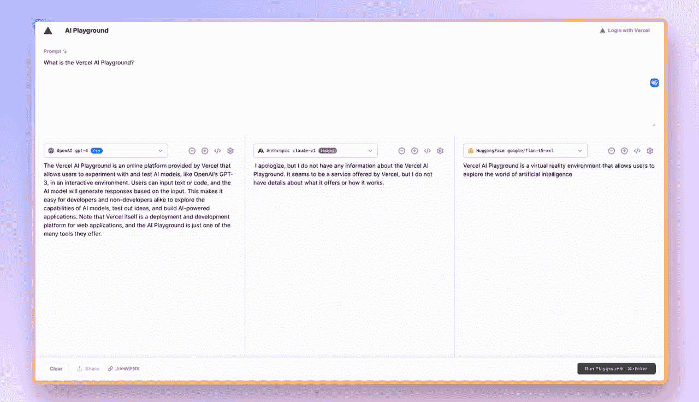

## Codeamigo：利用AI学习代码

Codeamigo是一款AI辅助编码工具，帮助用户像开发人员一样学习编码。与今天的开发人员一样，新手应该使用最先进的工具来学习编码，而不是从 C 开始学起。

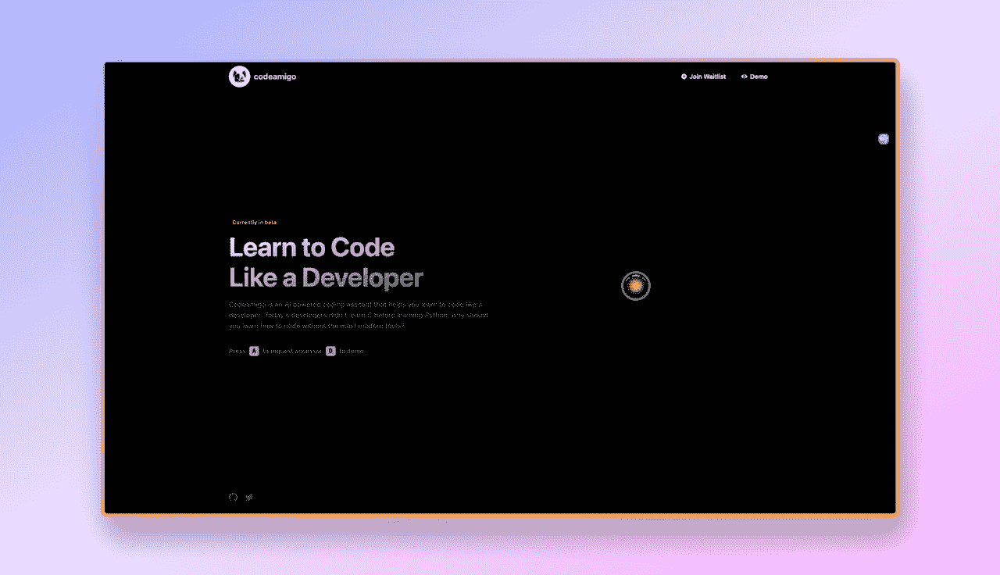

## [TL;DV：AI会议记录软件](https://tldv.io/)

TL;DV是一款会议记录器，可自动记录、转录和总结通话，支持20多种语言，AI会话记录员可快速总结会议要点，并可创建短视频剪辑。

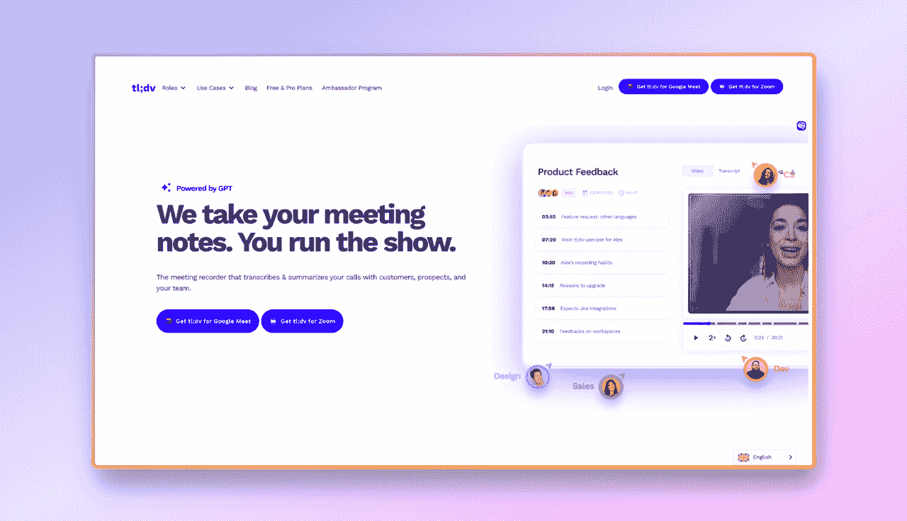

## [Ogimi-AI冥想和正念应用](https://ogimi.ai/)

创建自己的会话，随着您完成挑战和改善自我意识，跟踪您的进步。通过AI生成的个性化冥想、记录指导式冥想来学习基础技巧，跟踪持续天数并赚取点数，将您的实践与朋友和最优秀的冥想者进行比较。这个猴子有点搞的。

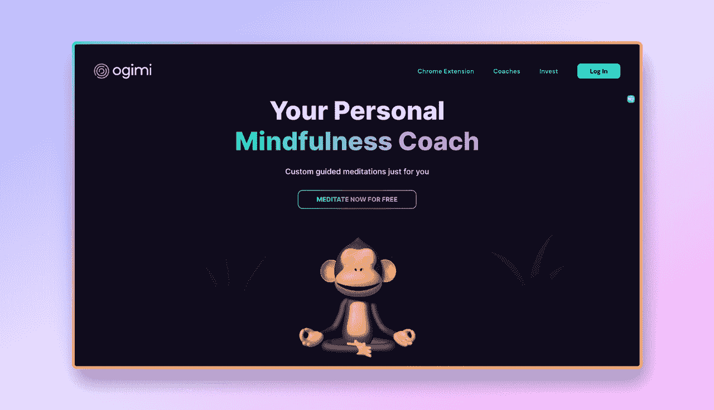

## Synthesia：内容营销平台

Synthesia是一款人工智能视频制作平台，可以创建超过120种语言和口音的视频，提供60种预设计模板和125种多样性的AI形象。

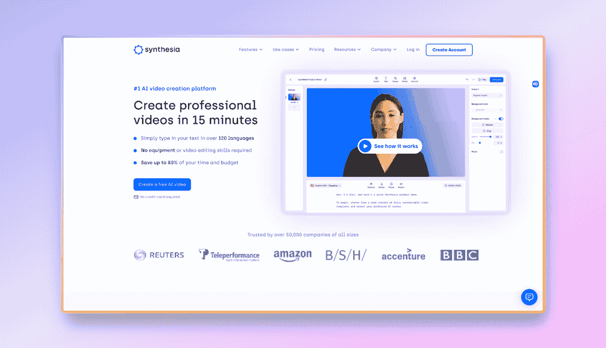

## Channel：AI驱动的数据分析工具

Channel是一款自助式数据分析工具，无需知晓SQL语言即可查询数据，支持用简洁的英语进行查询。该工具可自动挖掘数据并生成美观的可视化图表，适用于团队合作使用，并且集成了多种常用数据仓库。设置简单快捷，无需工程师协助。

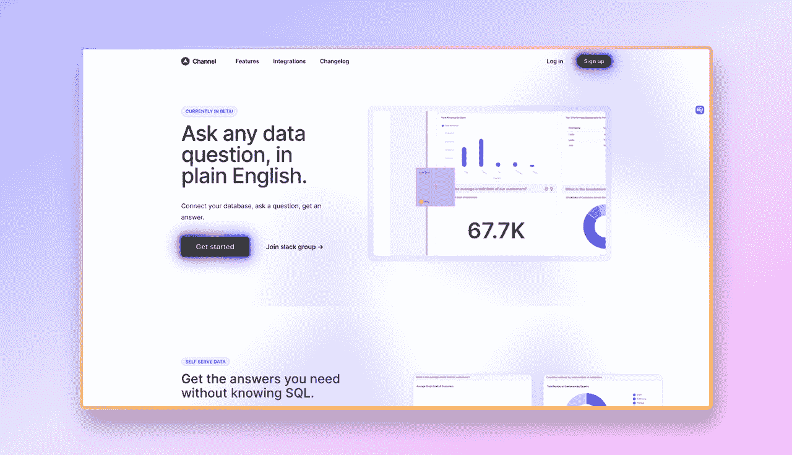

## Kickresume：AI优化简历

Kickresume是一个在线简历和求职信建议工具。工具提供专业的简历和求职信模板，可帮助用户创建最佳求职资料，受到招聘人员的认可。该工具能够大大提升用户的求职成功率。

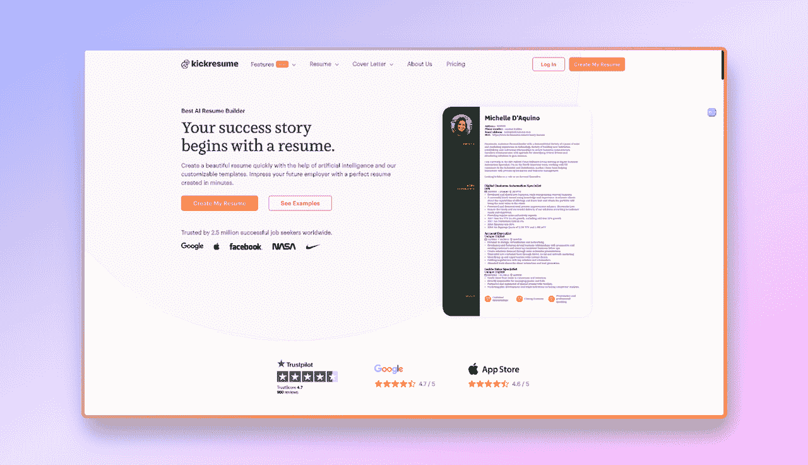

## HyperDB：与 LLM 代理一起使用的本地矢量数据库

HyperDB是一个超快速的本地向量数据库，可与LLM代理一起使用。它具有简单的接口、高度优化的C++后端向量存储以及MKL BLAS的硬件加速操作。

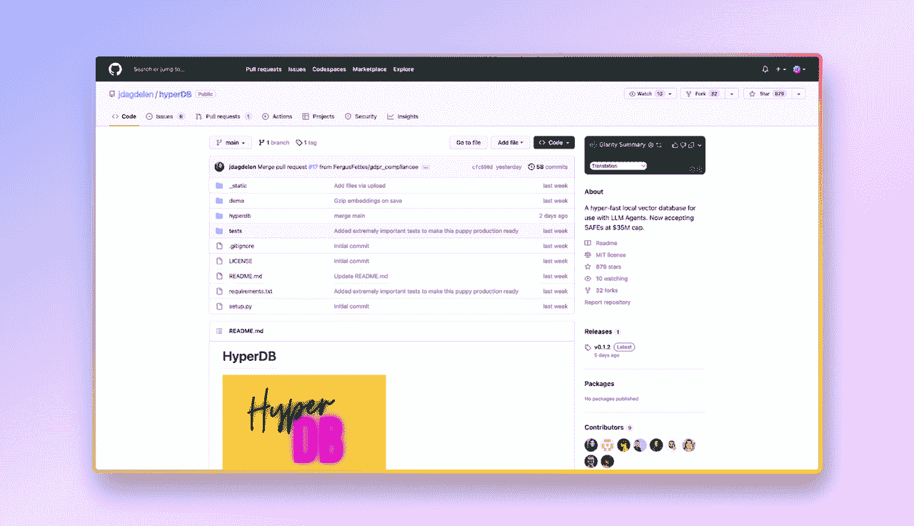

## HealthGPT：分析你的健康数据

斯坦福学生制作的APP，HealthGPT链接你iphone的健康数据之后它可以帮你分析数据发现问题，并且根据你的健康数据给出建议。代码已经开源。

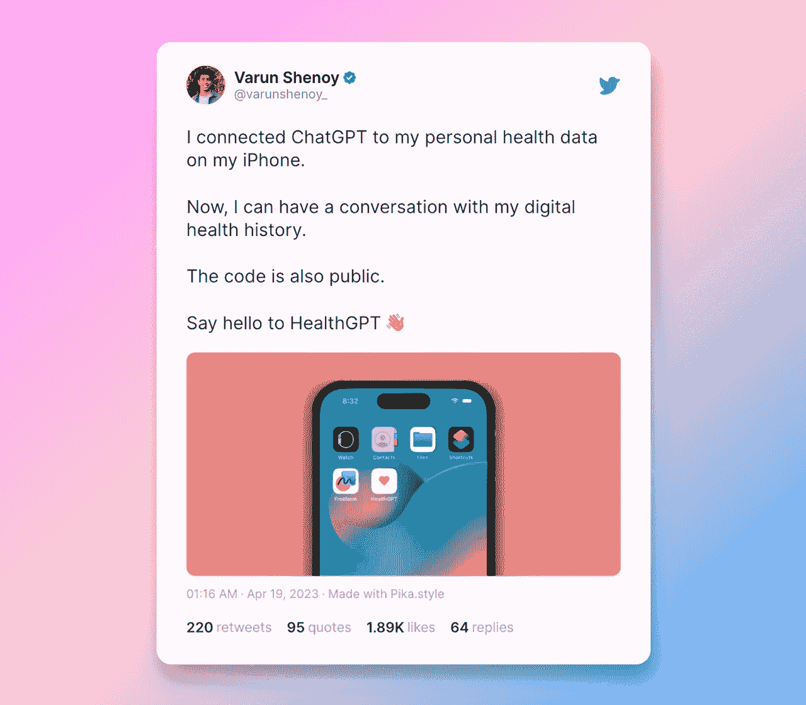

## MULTI·ON Browser：ChatGPT控制你的浏览器

这个ChatGPT插件有点猛的，它可以直接控制你的浏览器按你的要求访问对应的网站并完成任务。比如视频就演示了：打开对应网页查询天气、打开作者推特生成并发一条作者要求的相关内容的推、查找对应要求的饭店，并且按要求打开网页预定位置。

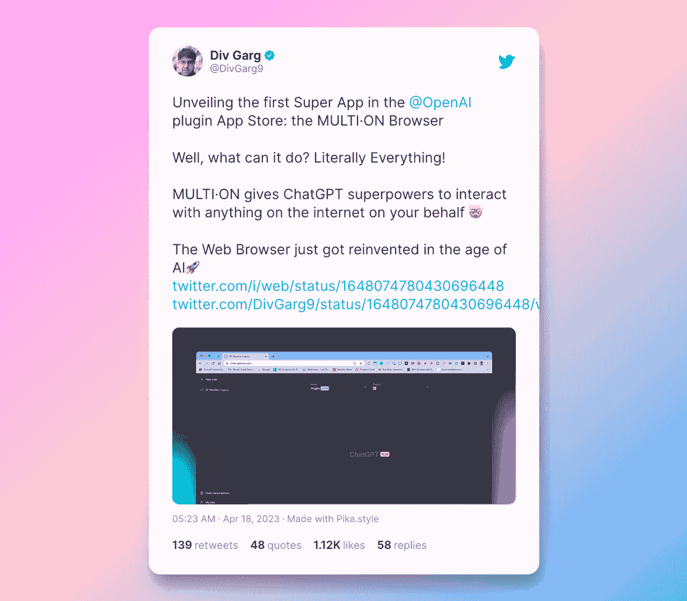

## [Better Prompt：Stable Diff](https://github.com/eideehi/sd-webui-better-prompt)usion Web UI的提示词优化插件

这个Stable Diffusion提示词插件看着不错，跟月维的类似，只不过他是直接在Web UI中直接生效的。它支持提示词拖动顺序。还有一些特色功能支持用颜色标注提示词类型比如Lora就是蓝色，支持正负向提示词反转。还会用颜色的深浅来标注同一类提示词的权重。很直观。

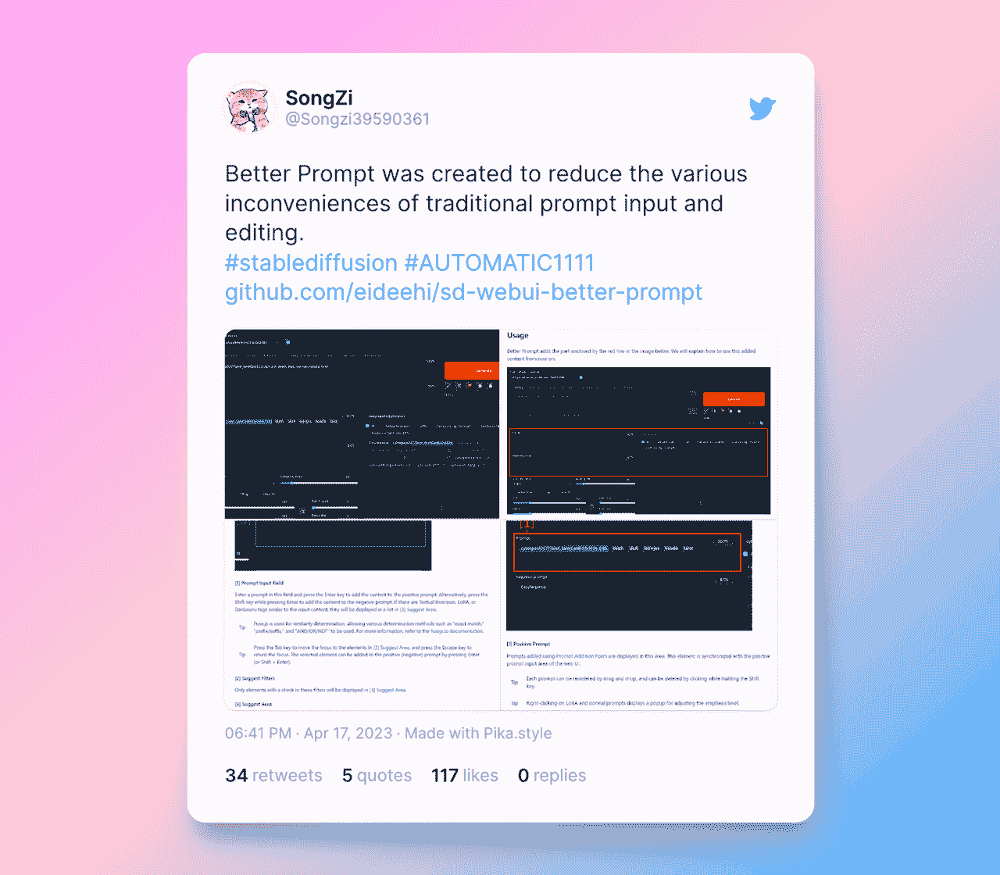

## Uncody ：AI驱动的网页构建工具

Uncody 是一款 AI 动力网页构建工具，让您创建令人惊叹的网站和高转化着陆页成为可能。预构建组件和模块化块可帮助您快速构建外观专业的网站，无需任何编码技能。

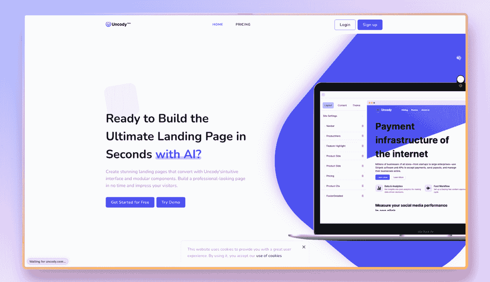

# 🧑🎓学习资源

## 如何在本地快速部署AutoGPT

本视频演示如何在本地安装Auto GPT，使用的工具是gpt4，它可以连接到网络并完成设置的目标，距离真正的AGI更进一步。视频提供了两种安装方式，包括安装get for Windows、Python，以及通过GitHub进行克隆等步骤。

## [微软的机器学习工程师课程](https://www.udacity.com/course/ai-fundamentals--ud099)

该课程是通过Microsoft的基于云的解决方案，如Azure机器学习和Azure认知服务，进入人工智能世界的入门课程。学生将有机会学习和亲身体验如何训练和传递机器学习模型，以及使用Azure认知服务处理典型的人工智能工作负载，例如计算机视觉，自然语言处理和对话AI。

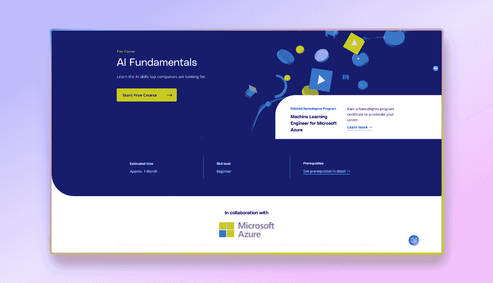

## ChatGPT 课程 ——使用 OpenAI API 编写 5 个项目

通过学习本课程，您将掌握OpenAI API的全部内容，从而能够开发出类似于ChatGPT、DALL-E和SQL查询生成器等强大的应用程序。Ania通俗易懂的教学风格，使您不仅能够掌握理论知识，还能够学习到实际应用技术。

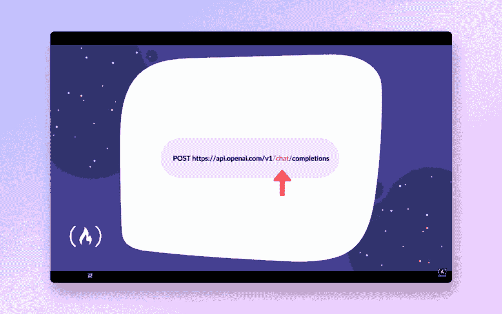

# 🔬精选文章

## Sam Altman：未来LLM的规模不会那么重要

OpenAI的联合创始人兼CEO Sam Altman表示，大型语言模型（LLM）的规模不会总是越大越好，而是会越来越好。他认为“参数计数”是模型质量的虚假衡量标准，与20世纪90年代和2000年代的芯片速度竞赛相似。在这个领域，人们需要集中注意力来不断增强功能。Altman还谈到了OpenAI的大型语言模型产品GPT-4，并认为该技术的未来需要更严格地关注安全问题。

## 一种新的计算方法重新构想人工智能

看起来很厉害，但是我看不懂。超维计算是一种基于高维向量代数的符号推理方法，可以快速解决复杂问题，且允许出错。基于超维计算的新一代、稳定低功耗硬件兼容储存和计算，且可以更透明地解释其工作原理，改善了深度神经网络的缺点。目前，超维计算还处于发展初期，需要进一步测试其性能和解决处理大规模问题的问题。

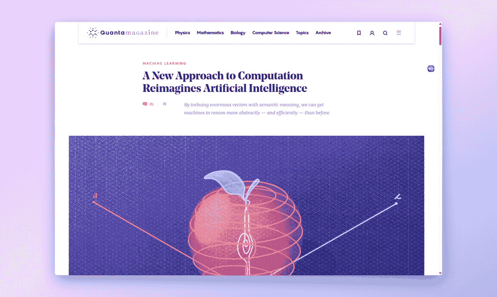

## [Multimodal C4：一个开放](https://arxiv.org/abs/2304.06939)的、10亿规模的、与文本交错的图像语料库

包含图片的文本数据集Multimodal C4（mmc4）。该数据集使用线性分配算法将图像插入长篇文本中，以实现更好的对齐效果。该数据集包含103M个带有585M个图片的文档，插入了43B个英文实体，主要涵盖了日常话题，如烹饪，旅行，技术等。

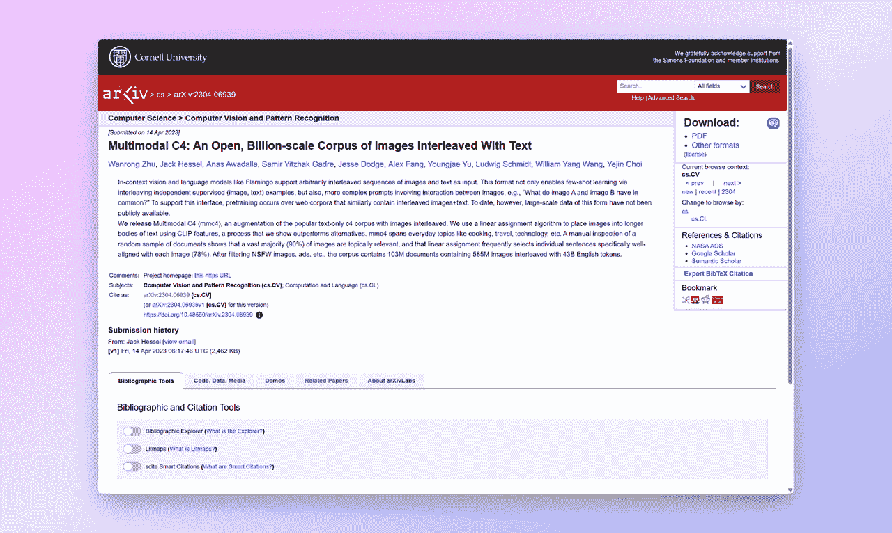

## Inpaint Anything：分割任何东西满足图像修复需求

这篇论文提出了一种新的图像修复方法，称为Inpaint Anything (IA)，主要解决了遮挡选择和孔洞填充的问题。该方法采用“点击和填充”的方式，支持三个主要功能：(i) Remove Anything 用户可以点击物体并使IA将其移除并平滑“孔”，(ii) Fill Anything在某些对象移除后，用户可以提供基于文本的提示，然后IA将通过Stable Diffusion等AIGC模型填充对应的生成内容，(iii) Replace Anything用户可以选择保留点击选定的对象并将剩余的背景替换为新生成的场景。

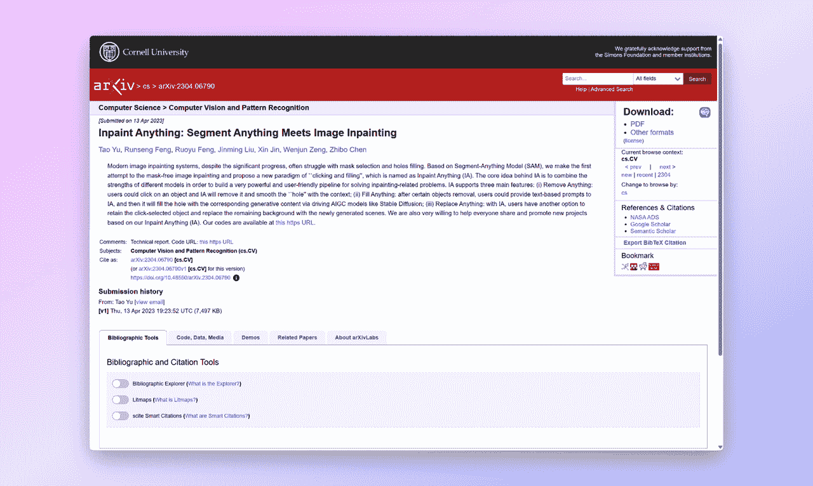

## [了解大型语言模型](https://magazine.sebastianraschka.com/p/understanding-large-language-models)

大型语言模型已经引起了公众的注意。在短短五年内，大型语言模型——Transformers——几乎完全改变了自然语言处理领域。此外，他们还开始彻底改变计算机视觉和计算生物学等领域。由于Transformers对每个人的研究都有如此大的影响，我想列一个简短的阅读清单。

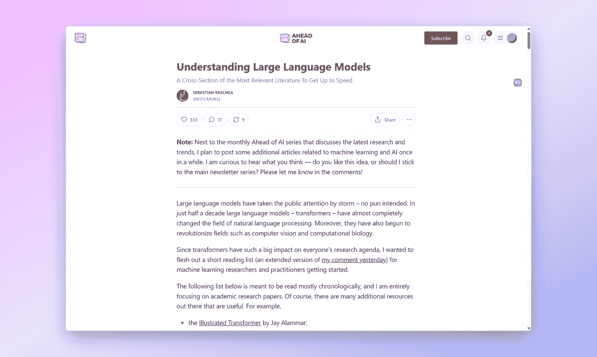

## 经济学案例，为什么AI不能抢走你的工作

人工智能是否会拿走我们的工作？或者让我们工作更少，或者迫使我们更好地完成更多事情？当前供应的智能增加，会创造更多需要智能的任务，我们会将智能效率提高用于以前不可行的新事物。人类将需要更好地完成更多事情，而不是与机器竞争。将智能视为一种资源，引发的需求和马切蒂定律等经济理论可能导致更多需求，人工智能拓宽了我们的思维空间。

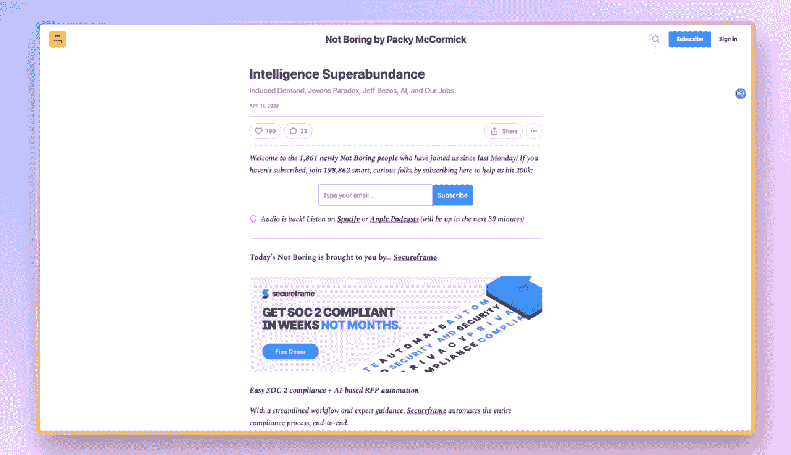

## 对齐你的潜变量：利用潜变量扩散模型的高分辨率视频合成

英伟达发布了一个高分辨率文本生成图像的模型。 本质上是对LDM的生成的图片加上视频序列帧和时间进行微调。 看演示页面视频质量相当可以分辨率达到了1280 x 2048连续性也非常好。比Gen-2的示例看起来要好很多，难道真是万物Diffusion了？

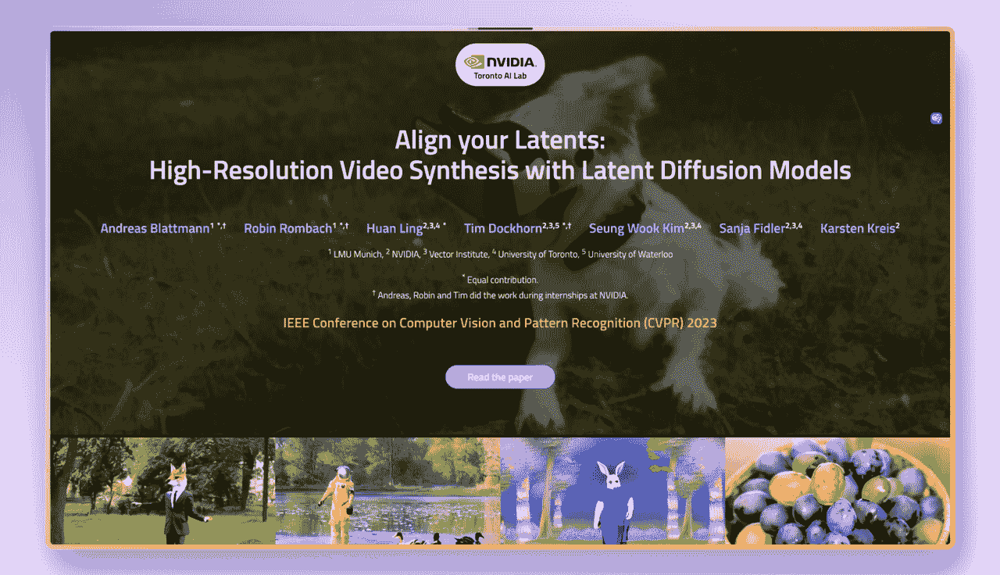

## 深度探讨大语言模型生态链：芯片，基建，工具，开源，应用

本期《OnBoard!》AI系列第三期讨论了大语言模型（LLM）周边生态系统的发展。嘉宾们来自生成式AI的上下游核心玩家，包括Nvidia、Google Cloud、Huggingface和TensorChord等公司，从芯片架构、GPU集群管理到开发工具，他们共同探讨了LLM的机遇、挑战与未来。讨论中提到的产品包括Cursor、Tabby、AutoGPT和HuggingGPT等。此外，也聊到了LLM对传统MLOps工具链、监管和社会影响的影响。

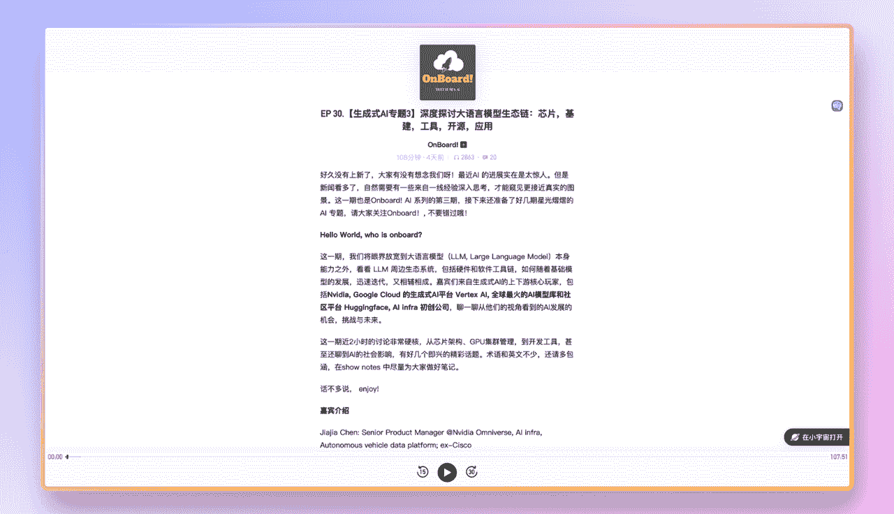

## [设计背后：认识副驾驶](https://medium.com/microsoft-design/behind-the-design-meet-copilot-2c68182a0e70)

Microsoft Design发布了一篇名为“当系统成为产品：打造下一代用户体验”的文章，介绍了新一代AI技术的应用。文章提到，在构建下一代用户界面时，必须建立起新的交互方法和设计方法。Microsoft 365 Copilot是一个使用大型语言模型（LLM）的产品，它的用户体验需要结合简单、强大的性能以及伦理考虑，以帮助人们在使用该技术时理解其能力和局限性。文章探讨了适当的信任和人机协作的概念，并介绍了三个高度，以适应不同的任务和工作流程。在设计Copilot体验时，用户控制和教育也是重点关注的问题。

## ChatGPT的惊人潜力的内幕- Greg TED演讲

OpenAI联合创始人Greg Brockman在TED大会上探讨了ChatGPT的设计原则，并演示了一些令人惊叹的未发布插件。在演讲之后，TED主席Chris Anderson加入Brockman，深入挖掘了ChatGPT开发的时间线，并获得了Brockman对发布这种强大工具可能带来的风险的看法。

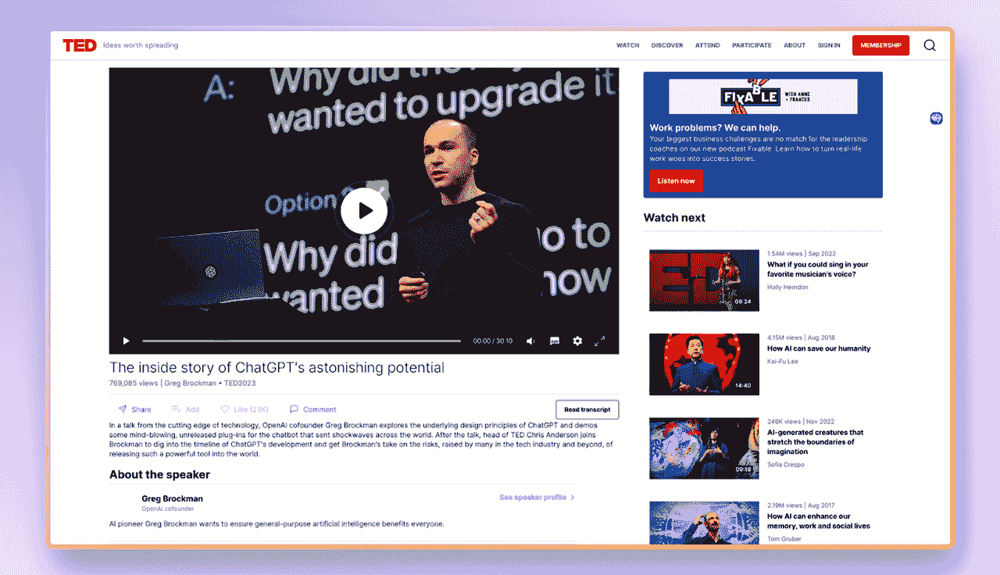

## 自主代理完全入门指南-构建你的AutoGPT

本文章介绍了自主代理（Autonomous Agents）的概念，它是一种 AI 程序，当它被赋予一个目标时，能够自行创建任务清单、完成任务、根据进展制定新任务并不断重复这个过程，直到目标达成。自主代理已经成为 AI 开发人员中增长最快的趋势之一，并且在未来的发展中有很大的机会。这篇文章详细介绍了自主代理的定义、工作原理、应用场景、以及如何构建或使用它们。

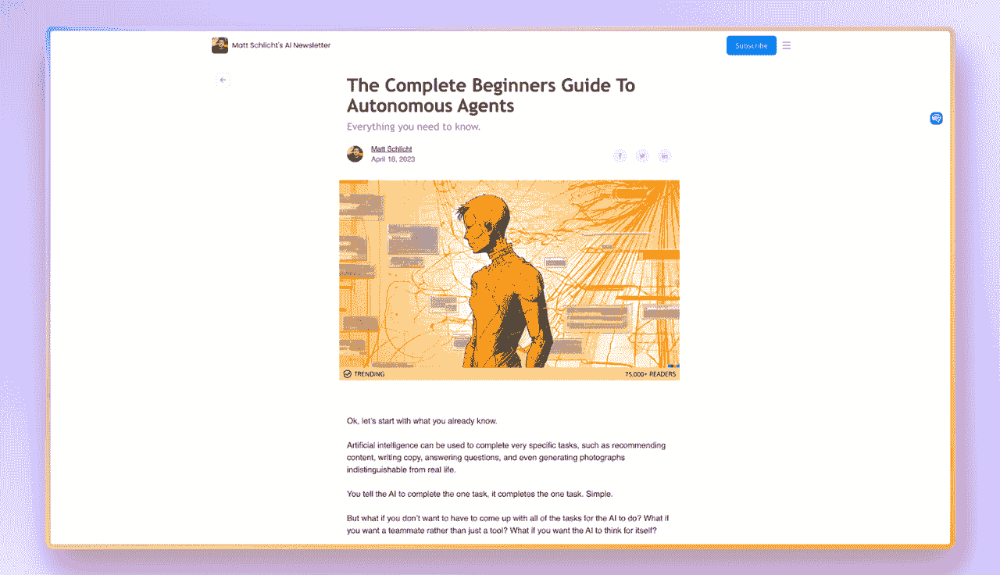