# AIGC Weekly #17

> 来源：[https://waytoagi.feishu.cn/docx/QK4jdHWNioILRaxNUhbcFEYsnqh](https://waytoagi.feishu.cn/docx/QK4jdHWNioILRaxNUhbcFEYsnqh)

> 🔗 原文链接： h[ttps://op7418.zhub](https://op7418.zhubai.love/posts/2259747060397981696)ai.love/posts/22...

> 发表时间：2023-04-17

工具：Midjourney v5

提示词：Rainbow holographic pcd, in the style of abstract photography, trompe - l'œil illusionistic detail, dark cyan and brown, fujifilm x - t4, gutai, blink - and - you - miss - it detail, tangled forms, high-key lighting, abstraction-création kodak elite chrome extra color, juxtaposition of light and shadow, clear colors smooth, modern minimalist, 3d render --ar 3:2

> 如无意外会在每周一更新，主要介绍上周AIGC领域发布的一些产品以及值得关注的研究成果，由于我自己是一个设计师，所以在一些专业内容的描述上可能存在问题，欢迎在渠道帮我反馈及更正，如果觉得有收获的话也可以订阅一下。（本期部分文案使用了Notion AI以及Chat GPT帮助润色和翻译）

各位周一好呀，上周我们新增了456个订阅用户，现在总订阅达到了2461个，上周基本上比较重要的事情都是来自开源社区的项目，大厂停止发力之后轮到开源社区了，来看一下上周的内容总结。

[上周我主要发了两](https://web.okjike.com/originalPost/643b6312c567913bb5296a50)篇内容一个是每天晚上都会发的 Midjourney提示词模板 汇总，另一个是我用GPT-4开发的提示词收集插件的 更新和使用介绍 。

# ❤️上周精选

## AutoGPT：AI自动执行命令完成任务

上周最火的就是AutoGPT了，简单介绍一下这个项目就是当你给这个 AI 一个目标时，它会为自己创建任务，完成任务，创建新任务，并循环运行直到你的目标完成。它主要有下面四个特点：

+   自动分配要自动处理的任务/目标，直到完成

+   将多个 GPT-4 链接在一起以协作完成任务

+   互联网访问和读/写文件的能力

+   能够记住自己做了什么

上周这类型的开源方案其实不止AutoGPT一个，Github榜单前三其实做的都是这一件事情，他们分别是：

+   [Yohei ](https://twitter.com/yoheinakajima)主导的AuroGPT： [https://github.com/Significa](https://github.com/Significant-Gravitas/Auto-GPT)nt-Gravitas/Auto-GPT

+   Significant [Gravitas 主导的BabyAGI：](https://github.com/yoheinakajima/babyagi) https://github.com/yoheinakajima/babyagi

+   微软的Jarvis： https://github.com/microsoft/JARVIS

这类应用强就强在打破了之前语言模型无法自主行动的限制，不再需要人工反馈和干预会自己探索直到完成任务，这就很厉害了。

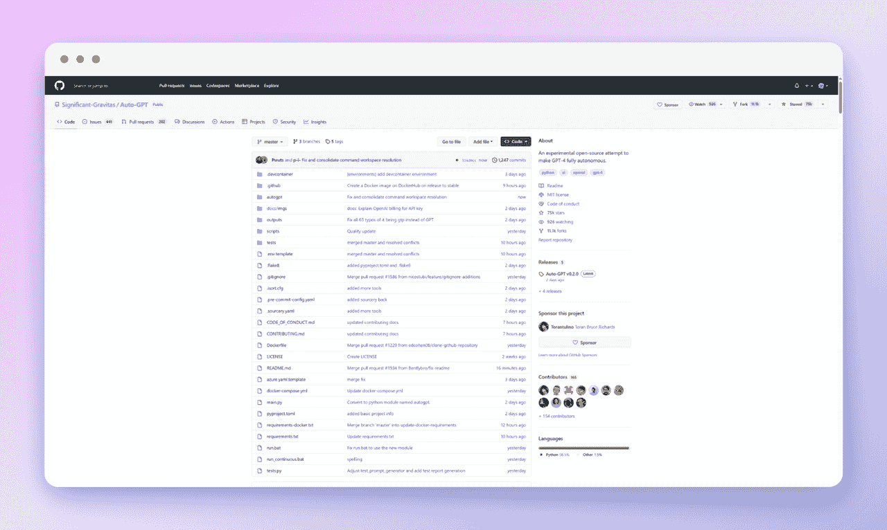

下面是一些利用它 执行任务的测试和探索 ：

[F](https://twitter.com/frankc/status/1645898312594382848?s=20)rank把AutoGPT集成到了Slack里面： https://twitter.com/frankc/status/1645898312594382848?s=20

Omar Pera一个人工智能代[理](https://twitter.com/ompemi/status/1645083062986846209?s=20)，用GPT-4自主地做销售前景调查： https://twitter.com/ompemi/status/1645083062986846209?s=20

Linus (●ᴗ●)让Auto GPT自动[进](https://twitter.com/LinusEkenstam/status/1646095934177124353?s=20)行一个耳机产品的市场调研并输出报告： https://twitter.com/LinusEkenstam/status/1646095934177124353?s=20

J[B](https://twitter.com/jamesbbaker4/status/1645898646762782735?s=20)通过 5 次搜索，Auto GPT 研究代理准备了一个关于最近新闻的 5 主题播客，并提供准确的参考资料： https://twitter.com/jamesbbaker4/status/1645898646762782735?s=20

[A](https://twitter.com/adamcohenhillel/status/1644836492294905856?s=20)dam C.H.利用BabyAGI自动进行测试驱动开发： https://twitter.com/adamcohenhillel/status/1644836492294905856?s=20

Sully利用AutoGPT自动输[出](https://twitter.com/SullyOmarr/status/1645205292756418562?s=20)了一份鞋类产品的市场调研，非常详细： https://twitter.com/SullyOmarr/status/1645205292756418562?s=20

[John ](https://twitter.com/zhanglu)装上了AutoGPT，让它查找最近一个月的开[源](https://twitter.com/zhanglu/status/1646548322176598016?s=20)相关新闻，并汇总成一个word文件： https://twitter.com/zhanglu/status/1646548322176598016?s=20

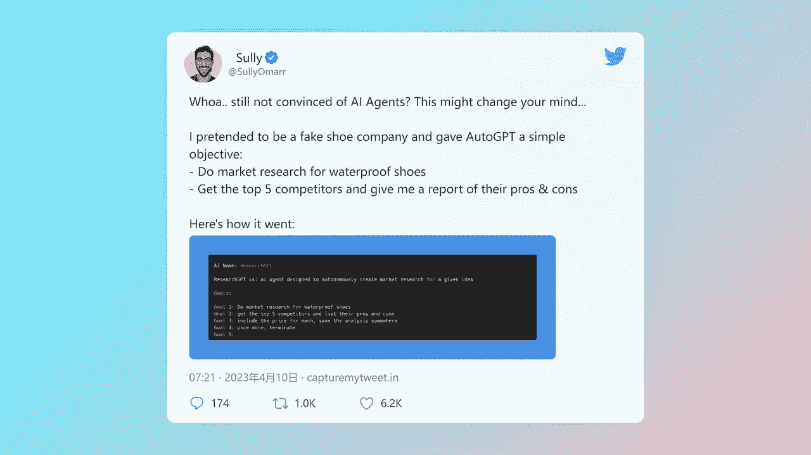

还有一些人在上面三个项目的基础上做了一些 改进和增强的新项目 比如：

+   [DSNR ](https://twitter.com/dsnrAI)在[BabyAGI的基础上构建的Teenag](https://github.com/seanpixel/Teenage-AGI)eAGI，它具有无限的记忆，先思考后说话，关机后也不会不丢失记忆： https://github.com/seanpixel/Teenage-AGI

+   Bruno de Oliveira 构建的B[abyAGI-asi，它可以自动编写和执行pytho](https://github.com/oliveirabruno01/babyagi-asi)n代码来帮助完成任务： https://github.com/oliveirabruno01/babyagi-asi

+   [eumem/acc ](https://twitter.com/dysmemic)[构建的TypeScript版本的](https://github.com/eumemic/ai-legion)AutoGPT： https://github.com/eumemic/ai-legion

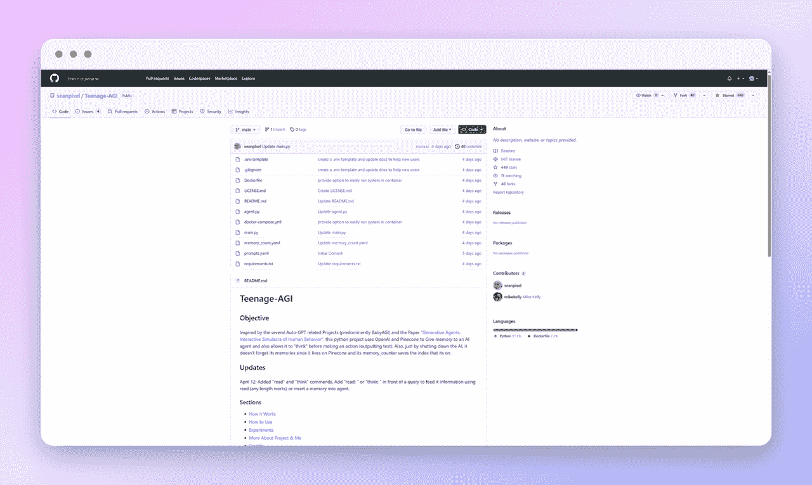

[当然AutoGP](https://twitter.com/DrJimFan/status/1647616587199815684?s=20)T的也 不像媒体报道出来的那样乐观 ， Jim Fan 就发表了他的看法：

+   在我的实验中，AutoGPT可以很好地解决某些简单且定义明确的知识任务，但对于真正有用的较难的任务，大多数时候是不可靠的。每当我给它提供python执行和磁盘访问权限时，我也很担心。

+   让它处于自动驾驶状态是一个可怕的想法（作者也警告过）。你应该对任何声称使用AutoGPT与代码执行的产品非常警惕。

+   许多不可靠的情况可以归因于GPT-4的固有限制。我不认为这些可以通过更高级的提示技巧从根本上解决，如果没有接触到GPT-4的权重和进行更多的微调。

+   但就像再多的提示也无法将GPT-3变成GPT-4的能力一样，我不认为AutoGPT+一个冻结的GPT-4可以神奇而可靠地解决复杂的决策问题。目前媒体的炒作正在将该项目推向完全不现实的期望。

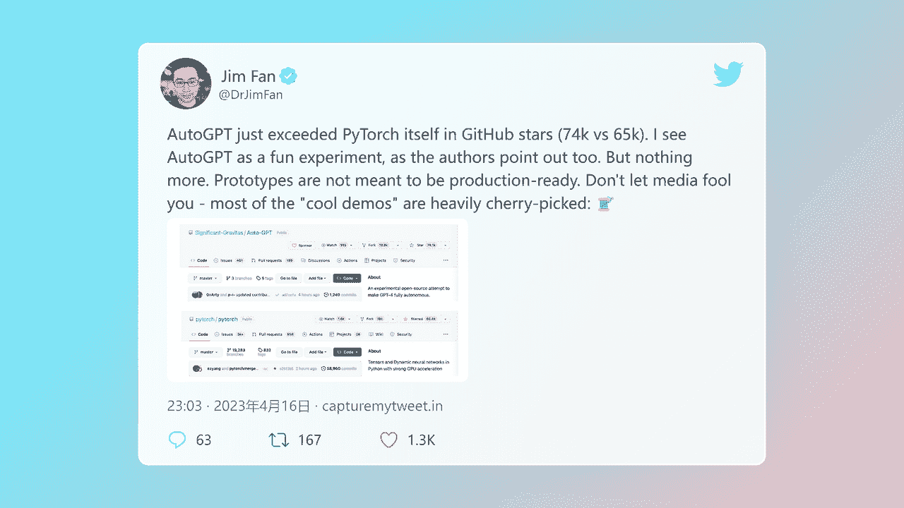

现[在也有很多项目可以帮](https://platform.openai.com/account/api-keys)助我们 快速体验AutoGPT ，不需要你自己写代码部署，但基本都要你自己的Open API Key，你可以在这里 获取API Key ：

界面干净交互友好的： https://www.cognosys.ai/create

最早功能最全的： https://agentgpt.reworkd.ai/

还有简洁干净的： https://godmode.space/

注意： 现在这些都是早期项目，如果你想要体验的话需要时刻注意你的Token金额消耗，不要让他自己跑你去干别的不然有可能你回来你的额度直接爆炸了，另一个就是今天那些可以自动执行代码的项目。

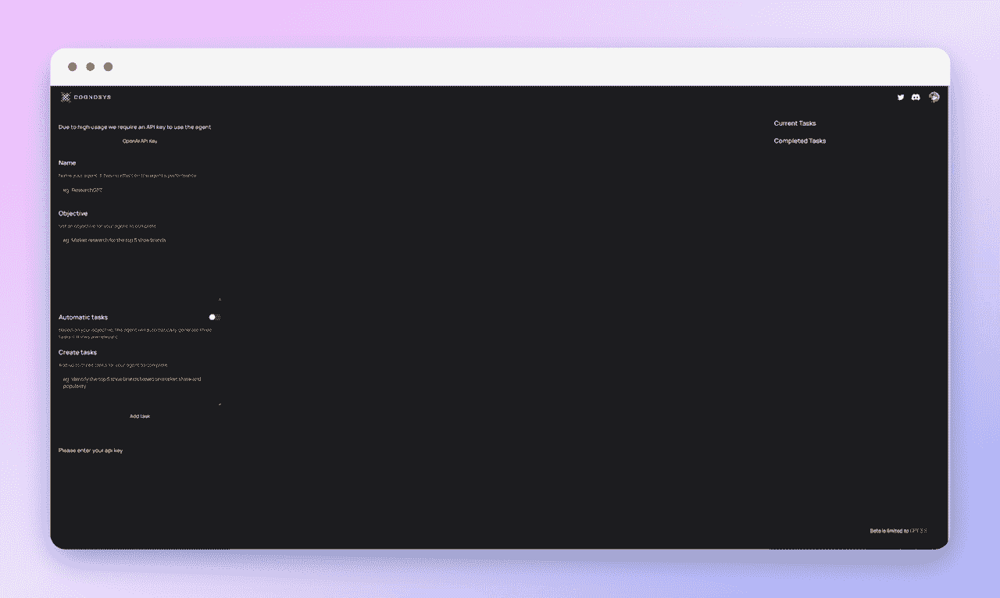

## Stable Diffusion XL模型扩大测试范围

Stable Diffusion XL模型这周正式开启了更大规模的测试包括可以在Stability AI控制的平台免费试用，以及可以可以调用他们的API生成内容。但是开源版本的模型还没有放出，官方说法是结束Beta测试后会放出开源模型。Stability AI说SDXL主要有以下特点：

+   更强的的照片逼真度能力

+   增强的图像合成和面部生成

+   丰富的视觉效果和令人瞠目结舌的美学效果

+   使用较短的提示语来创建描述性图像，优化提示词短提示词也有效果比较好的图象

+   产生可读文本的能力更强，图片内的英文文字不再是乱码

我[也](https://web.okjike.com/originalPost/6439934d4eea5bc23bf29910)对这次放出的模型和Midjourney V5进行了一些对比测试，下面是测试的一些结论，详细的测试图可以在这里查看： https://web.okjike.com/originalPost/6439934d4eea5bc23bf29910

+   据说SDXL是专门针对写实照片训练的，目前来看比SD2.1进步非常大，但是跟MJ比还有不小的差距

+   在3D渲染类型的测试中，SDXL的图片质感和光线表现与MJ不想上下，但是他的语义理解有问题根本没有识别到内容的主体应该是键盘

+   另外我还用SD的关键词写法测试了现在SD1.5的开源模型和SDXL和MJ的表现，就是那个小熊，开源SD小模型的质量和MJ不相上下，SDXL一言难尽。

+   在我的本质工作UI设计中的图标类型来看，SDXL的训练素材可能还是比较久远，没有MJ表现好。

+   最后就是Stability AI自己说SDXL是识字的，我也用LOGO生成来测试了一下它确实能还原文字内容，但是字形就不要奢望了，而且图像效果也没有MJ好。

你可以在 [Clipdrop ](https://clipdrop.co/stable-diffusion)和 [Dreamstudio ](https://dreamstudio.ai/)体验最新版本的SDXL也可以在 https://platform.stability.ai/ 使用SDXL的API构建内容。

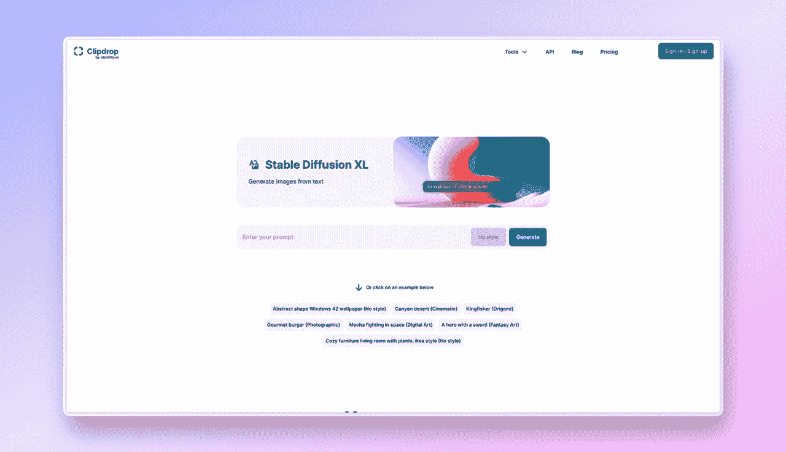

## Stable Diffusion插件ContorlNet更新1.1版本

新版本模型下载： [h](https://huggingface.co/lllyasviel/ControlNet-v1-1/tree/main)ttps://huggingface.co/lllyasviel/ControlNet-v1-1/tree/main

StableDiffusion最强大的插件ContorlNet今天更新了1.1版本，这是一个很大的更新，旧模型增加了很多数据进行了重新训练，还新增了几个模型，目前模型总数达到了14个，新增了4个模型。可能会给SD带来新的玩法。下面是具体的更新内容：

+   更改了模型命名规则：从 ControlNet 1.1 开始，我们开始使用标准 ControlNet 命名规则 （SCNNR） 来命名所有模型。我们希望此命名规则可以改善用户体验。

+   现有的 Depth、Normal、Canny、Scribble、MLSD、HED 模型在增加数据后进行了更多的训练效果有不同程度的提升。

+   Openpose增加了对面部和手部的支持，可以选择只针对身体生效，还是对身体+面部+手部生效。

+   线稿专用模型支持手绘线稿和自动识别两种模式

+   新增Content Shuffle模型：能够重新组织图像。使用随机流程将图像混洗，然后利用控制StableDiffusion来重新组合图像。

+   新增Instruct Pix2Pix模型：可以理解为原有的Pix2Pix模型，他们做了一些优化，使其更易用。

+   新增Inpaint模型：主要功能是对图像进行修复，比如涂抹的区域，此外这个模型可能也会用来解决生成视频的连续性问题。

+   新增Tile模型（未完成）：尝试解决利用Tile控制SD时提示将始终影响每个区域的问题。对于给定的区域，它识别区域内部的内容，并增加了该识别出的语义的影响，如果内容不匹配，则还减少了全局提示的影响。

目前不建议立刻更新1.1，等其他大佬适配完试试再说，另外小道消息ContorlNet插件的作者最近入职了谷歌。

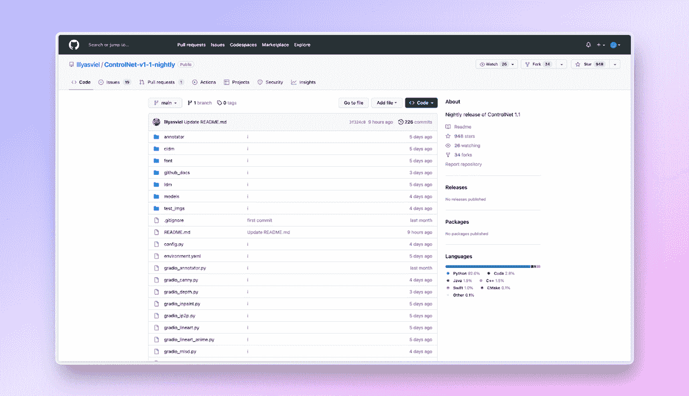

## 亚马逊推出了 OpenAI 的竞争对手 Bedrock

上周亚马逊发布了“Bedrock”，这是一个用于聊天、文本和图像的一站生成式 AI 工具包。主要包括三部分内容：

+   宣布推出 Amazon Bedrock，这是一项新服务，可以通过 API 访问来自 AI21 Labs、Anthropic、Stability AI 和 Amazon 的 FM *。*Bedrock 是客户使用 FM 构建和扩展基于 AI 的生成应用程序的最简单方法，使所有构建者的访问民主化。

+   由 Trainium 提供支持的 Trn1 实例可以比任何其他 EC2 实例节省高达 50% 的培训成本，并且经过优化以在与 800 Gbps 第二代 Elastic Fabric Adapter (EFA) 网络连接的多台服务器之间分发培训。

+   宣布了 Amazon CodeWhisperer的预览版 ，一种 AI 编码伴侣，它使用引擎盖下的 FM 通过根据开发人员的自然语言评论和集成开发环境 (IDE) 中的先前代码实时生成代码建议，从根本上提高开发人员的工作效率

# ⚒️产品推荐

## 特赞发布自己的 AI 资产管理产品 DAM.GPT

帮只企业利用AI管理自己的数字资产具体功能包括：将图片物料拖拽至 DAM.GPT 对话框，完成资产的入库，通过 AI 识别图片内容，建立与商品的关联及属性的标注；通过关键词搜索，获取相关商品的数字资产及物料。同时还可以结合线上数据进行一些人肉筛选。比如下方案例中，挑选这双鞋在双十一浏览量最高的图片；对数字资产进行中心化合规管理、分发；通过 AI 能力对现有资产进行二次加工生产。

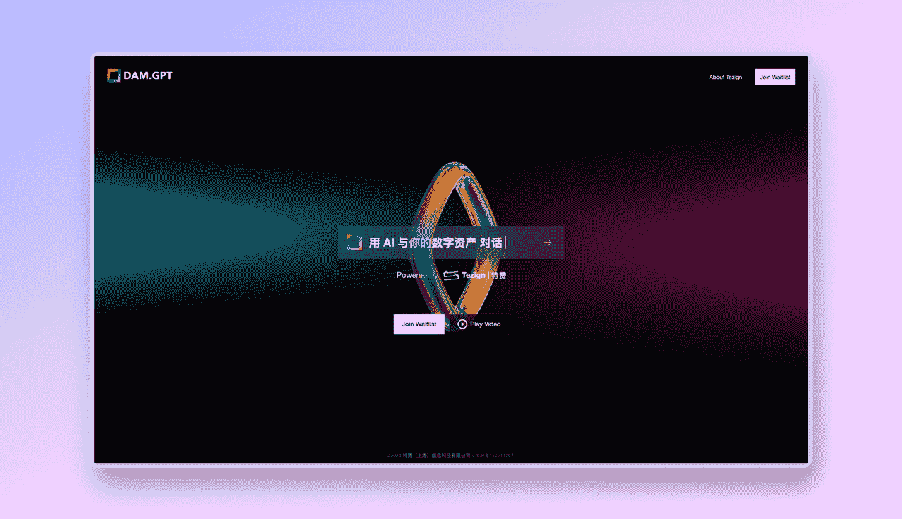

## SnackPrompt：提示词共享社区

提示词共享社区，筛选和新建的功能做的很好，还支持直接复制到ChatGPT里面，创建提示词的时候还可以设置需要用户填写的动态字段。用户在使用提示词的时候还可以选择提示词的语言、风格和语气。

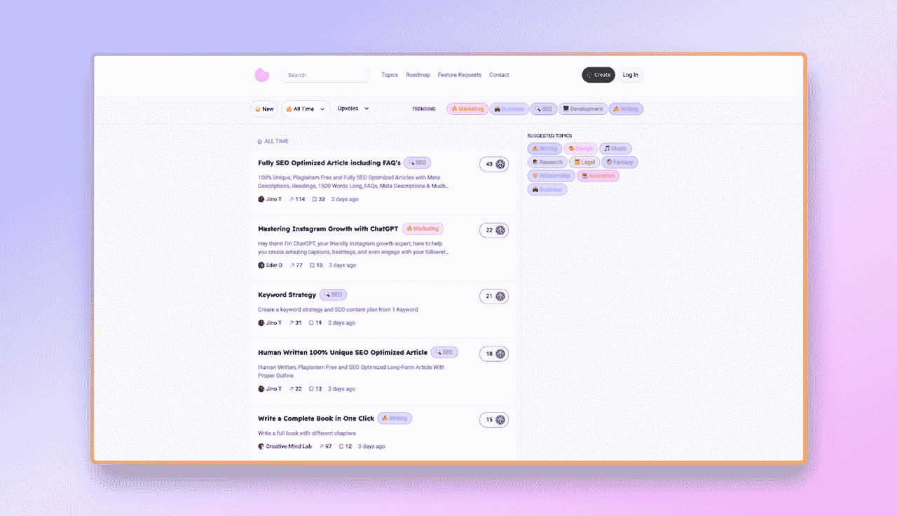

## H eroPage：提示词分享社区

另一个提示词分享社区，也支持创建提示词的时候设置动态内容，直接回填到ChatGPT使用。

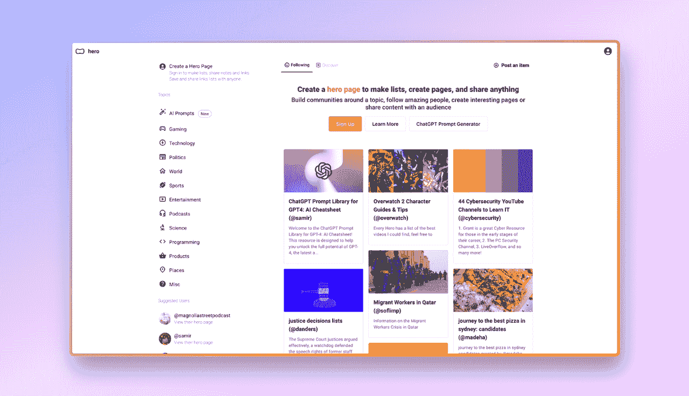

## Builder.io：用AI生成设计，并输出为代码

Builder.io出的Figma 插件支持用自然语言生成设计稿并修改，也支持将生成的设计稿直接转成前端代码复制。

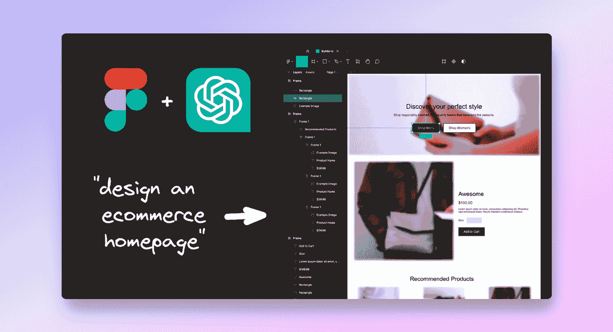

## X Studio3：做小冰的公司出的音乐AI工具

上传歌词和音乐就可以指定一个AI语音将歌唱出来，并且还可以对音频进行自定义，包括转音、滑音都都能自定义，试了一下，我反正听不出来这是AI唱的。

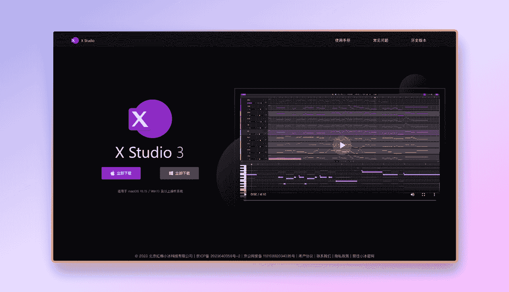

## Playlistable：AI生成播放列表

链接你的Spotify播放列表，并输入你当前的心情，它会自动生成符合你心情的播放列表。

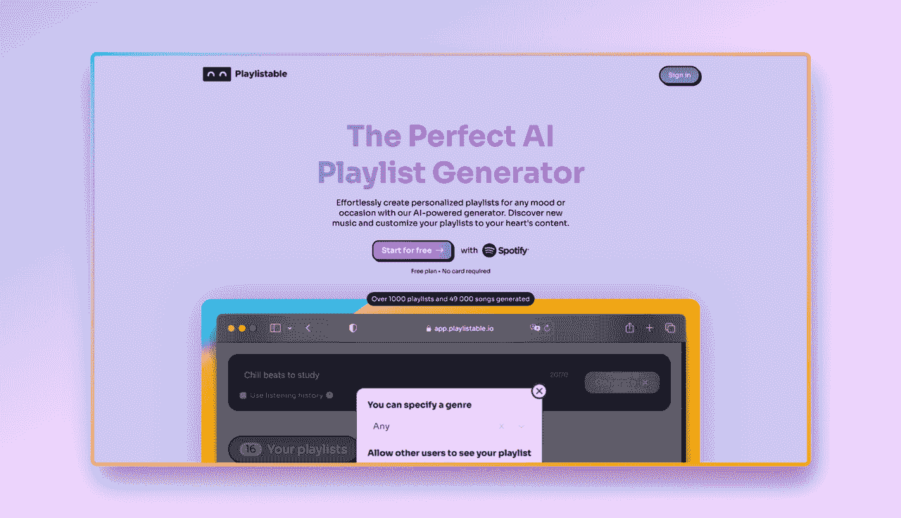

## Tripnotes：AI帮你指定旅行计划

选择你想养要去的地方，再选择你在这个地方的时间，产品会为你推荐你的旅游路线，并且会在地图上把推荐去的地方标注出来。

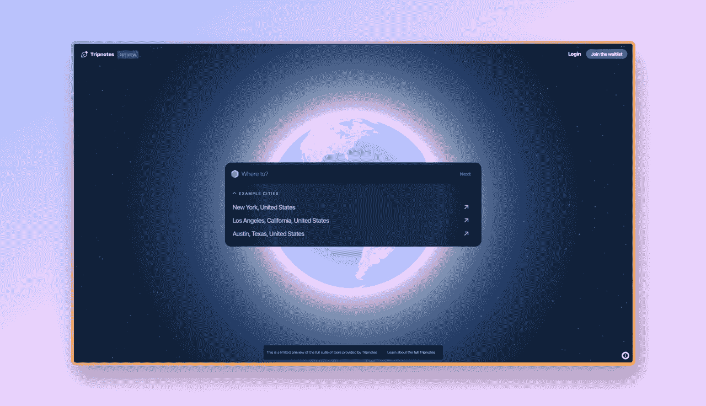

## RASK：快速将你的视频本地化翻译为60种语言

Rask AI目前支持60多种语言的视频输出，包括德语、法语、西班牙语、中文、英语、土耳其语等，而不考虑源语言。我们相信，我们的技术能够为大多数语言提供可接受的翻译水平，而且我们通过语音克隆功能提供了类似人类的体验，目前仅在英语中可用。

## AI Assist™ ：AI帮助生成合同

AI Assist™ 是有史以来第一个公开发布的生成式 AI 支持的合同工具，它使用 OpenAI 的 GPT-4 让用户根据 AI Playbooks 中建立的预先批准的条款语言立即对合同进行修订。

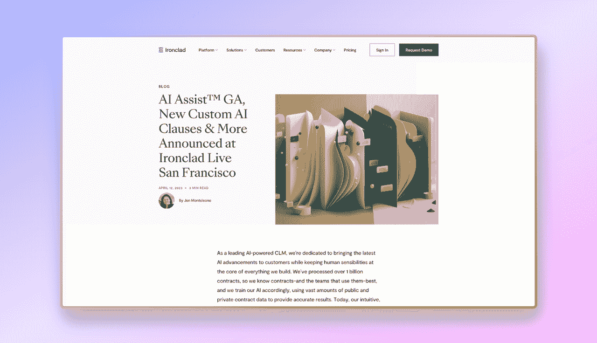

## Gradio Web UI：支持数十种开源语言模型的Web UI

一个gradio web UI，用于运行大型语言模型，如LLaMA，llama.cpp，[GPT-J，Pythia，OPT和](https://github.com/AUTOMATIC1111/stable-diffusion-webui)GALACTICA。它的目标是成为文本生成的 AUTOMATIC1111/stable-diffusion-webui 。

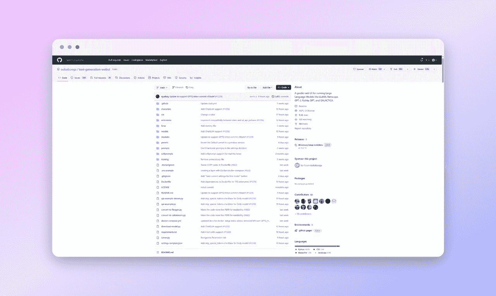

## [直接在浏览器运行开源语言模型](https://mlc.ai/web-llm/)

直接在浏览器里面运行的大语言模型，不需要部署直接调用webGPU进行运算，已经把模型部署成本拉到最低了。目前只有M1或者M2芯片的Mac可以运行，许需要下载谷歌开发版本。 这里下载谷歌浏览器开发者版本：

https://google.com/chrome/canary/

用开发者版本的谷歌打开这个页面体验：

https://mlc.ai/web-llm/#chat-demo…

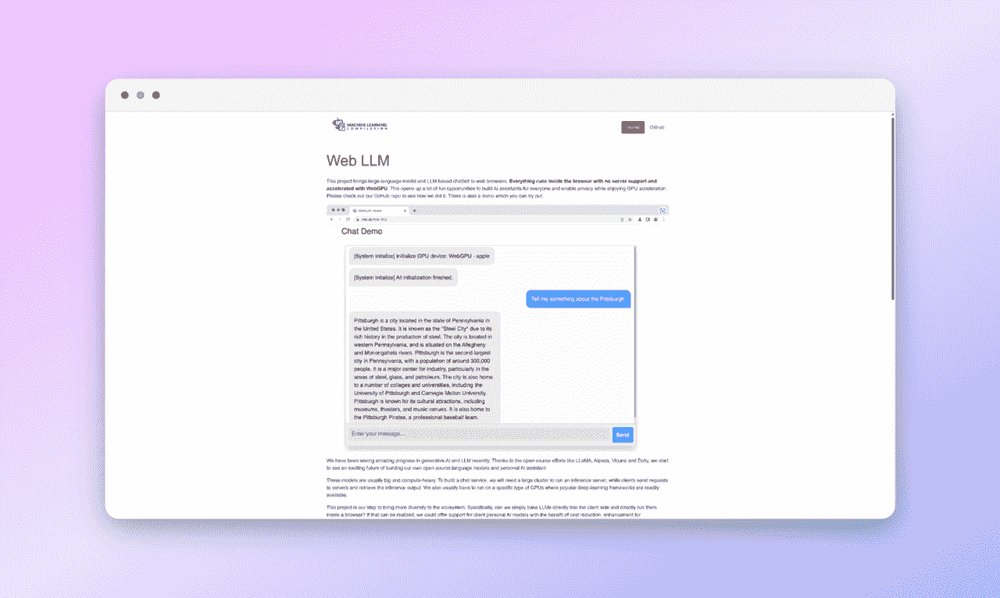

# 🧑🎓学习资源

## 使用ChatGPT创建一个公司的完整提示词模板

里面包含了你创建一个互联网公司需要的所有职业角色的提示词模板，大概有几十个太强了。

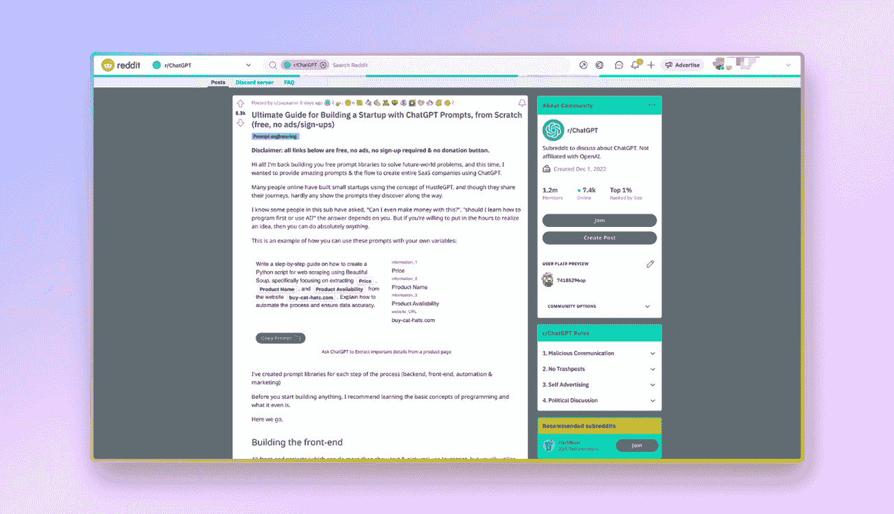

## 如何利用AI和ChatGPT创建网页

我将用midjourney生成网站设计，这是一个用于创建图像的AI艺术工具。然后，我们将跳入chat gpt来创建网站的书面内容，最后在Editor X中把这一切放在一起，这是一个用于创建网站的无码工具! Nocode和人工智能辅助的艺术肯定会成为未来的发展方向。

## 我试着卖了30天的AI艺术品--现实的结果

加入我的30天旅程，我将深入到人工智能产生的艺术世界，将像素转化为利润！从创造独特的作品到营销它们，我将分享我的现实成果和面临的挑战以及学到的宝贵经验！从创造独特的作品到营销它们，我将分享我的现实成果、面临的挑战和学到的宝贵经验。

# 🔬精选文章

## 代理化的LLM将改变对齐（alignment）领域的格局

用十个理由解释代理化LLM将获得成功的原因

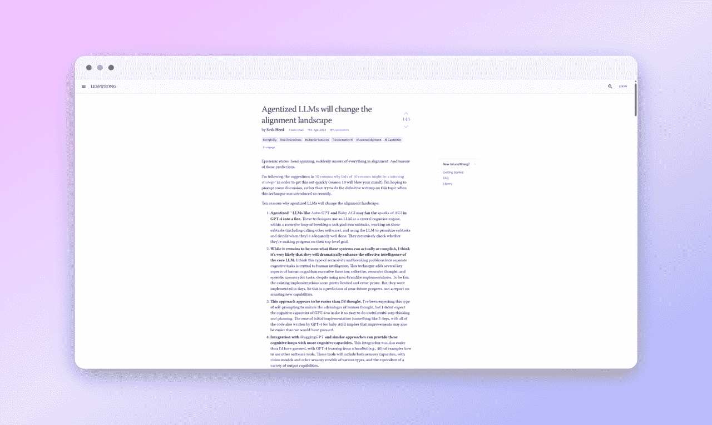

## [开源语言模型现状](https://www.scalevp.com/blog/whats-up-with-open-source-llms)

对开源语言模型进行测试，使用开源模型有明显的好处。隐私和安全性、可负担性、定制和避免锁定是企业和开源获胜领域的主要考虑因素。取决于它们在质量上合理竞争的能力，这些因素使得开源模型难以忽视。因此，为了真正理解和展示今天的情况，我们决定通过构建电子邮件生成器来尝试几种方法和模型

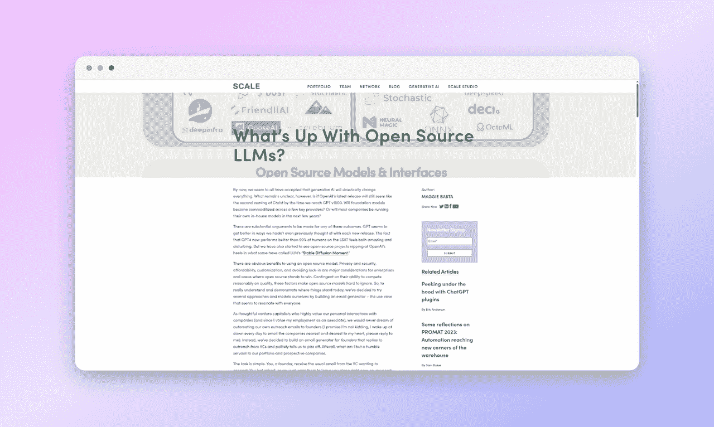

## Open AI发布了一个叫一致性模型的东西

一致性模型的目标是在单个计算步骤或最多两个计算步骤中制作出获得不错结果的东西。为此，模型像扩散模型一样被训练来观察图像破坏过程，但学会在任何遮蔽级别（即缺少少量信息或大量信息）拍摄图像，并在一个步骤中生成完整的源图像。（上周一堆人吹这玩意暴打SD，理论上SD也可以用这个算法来加速图像生成。）

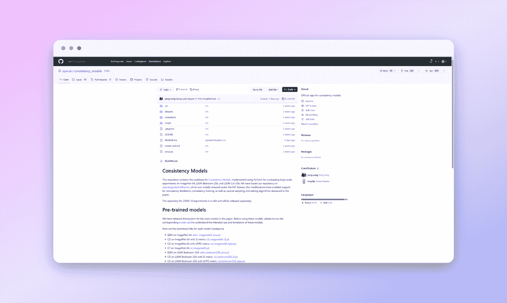

## 福布斯-2023的50家AI公司

AI 50的追随者将看到这一点的到来。今年是第五个年头，我们与红杉和Meritech Capital合作制作的年度榜单旨在表彰最有前途的私营公司，利用人工智能开展业务。

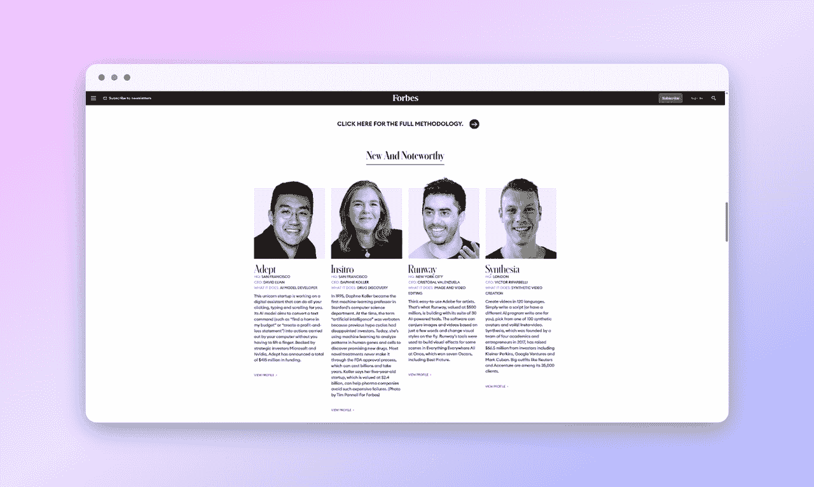

## [GPT-4 优于精英众包工作者，为研究人员节省了 5](https://www.artisana.ai/articles/gpt-4-outperforms-elite-crowdworkers-saving-researchers-usd500-000-and-20)00，000 美元和 20，000 小时

一项新的研究表明，OpenAI的GPT-4在标注任务中表现优于精英人工注释者，为研究团队节省了超过50万美元和2万小时的劳动力，同时引发了对众包工作未来的质疑。

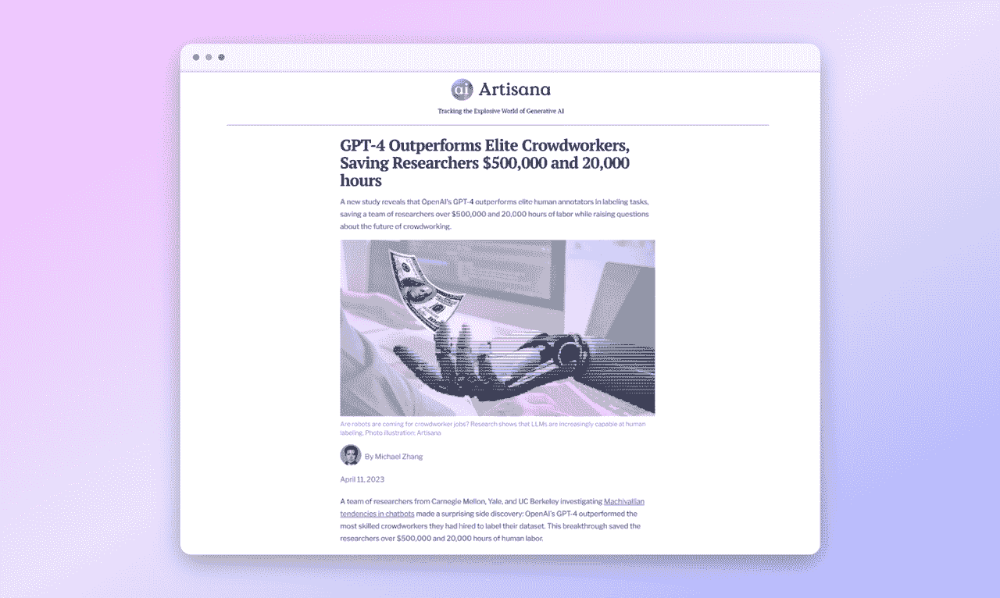

## 如何使用ChatGPT创建调查问卷 [应用案例]

随着最近OpenAI聊天机器人ChatGPT的热潮仍在持续，我们决定探究一下这个著名聊天机器人如何帮助您创建用户体验调查问卷——或者任何其他调查问卷。

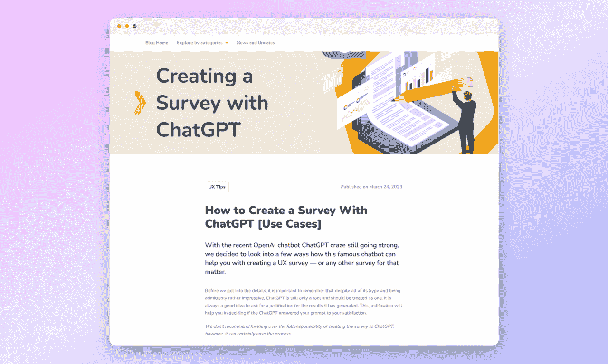

## 生成代理人：人类行为的交互式模拟

它给了25个AI代理人动机和记忆，并将它们放在一个模拟的城镇中。它们不仅参与了复杂的行为（包括举办情人节派对），而且这些行为被评价为比人类角色扮演更加“人类化”。

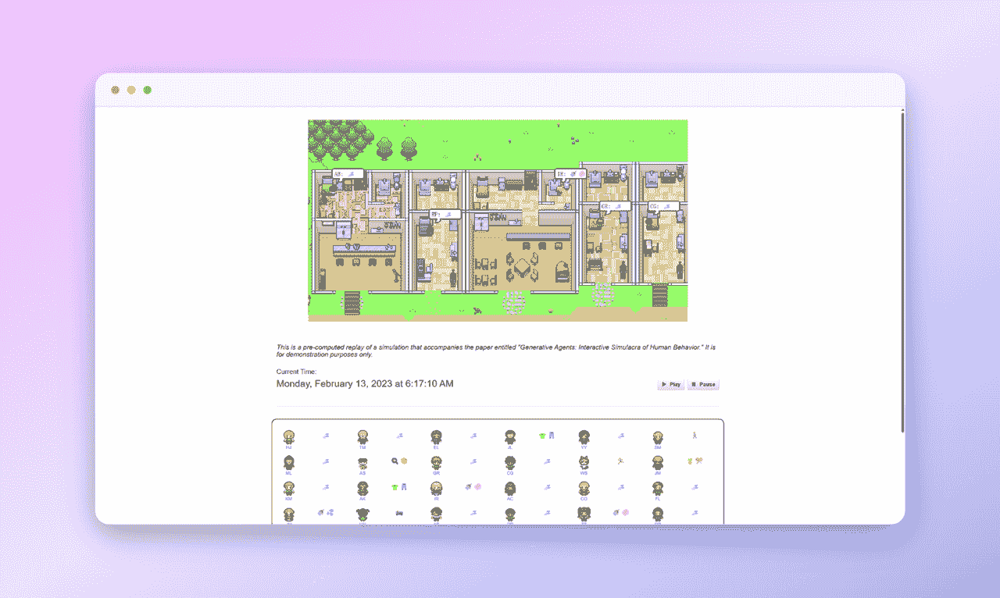

## ChemCrow：使用大型语言模型增强化学工具

ChemCrow是一个LLM化学代理，可以在合成、药物发现和材料设计等领域执行任务；它集成了13个专家设计的工具，以增强化学领域中LLM的性能，并证明在自动化化学任务方面的有效性。

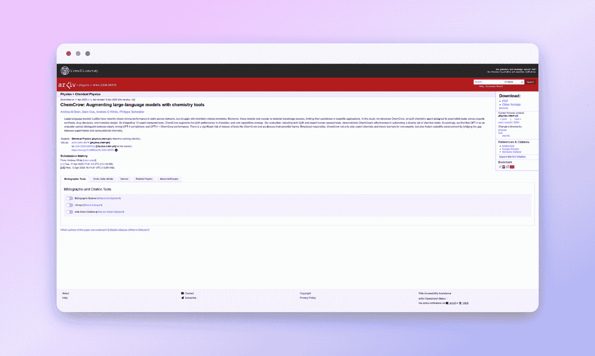

## [对话式生成AI的一小步，AGI的一大](https://arxiv.org/abs/2304.06488)步：AIGC时代ChatGPT的完整调查

OpenAI最近发布了GPT-4（即ChatGPT plus），这被证明是生成AI（GAI）的一小步，但对于人工通用智能（AGI）而言是一大步。自2022年11月正式发布以来，ChatGPT迅速吸引了众多用户，并得到了广泛的媒体关注。这样前所未有的关注也激发了众多研究人员从各个方面对ChatGPT进行调查。根据Google学术搜索，有500多篇文章的标题中包含ChatGPT，或在摘要中提到了它。考虑到这一点，紧急需要一份综述，而我们的工作填补了这一空白。总的来说，这项工作是第一次对ChatGPT进行全面审查，包括对其基础技术、应用和挑战的综述。此外，我们展望了ChatGPT如何发展以实现通用的AI生成内容（AIGC），这将是AGI发展的重要里程碑。

## OpenAGI：当LLM遇见领域专家

一个开源的AGI研究平台，专门设计为提供复杂的多步骤任务，并附带任务特定的数据集、评估指标和各种可扩展的模型。OpenAGI将复杂任务公式化为自然语言查询，作为LLM的输入。LLM随后选择、综合和执行OpenAGI提供的模型来解决任务。此外，我们提出了一种任务反馈强化学习（RLTF）机制，它使用任务解决结果作为反馈来改善LLM的任务解决能力。

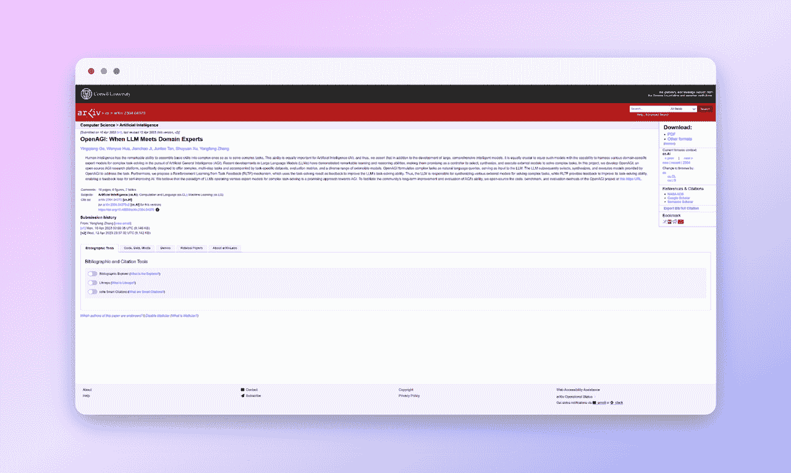

## 数据可视化介绍Chat GPT原理

像ChatGPT这样的大型语言模型实际上是如何工作的呢？嗯，它们既非常简单，又非常复杂。

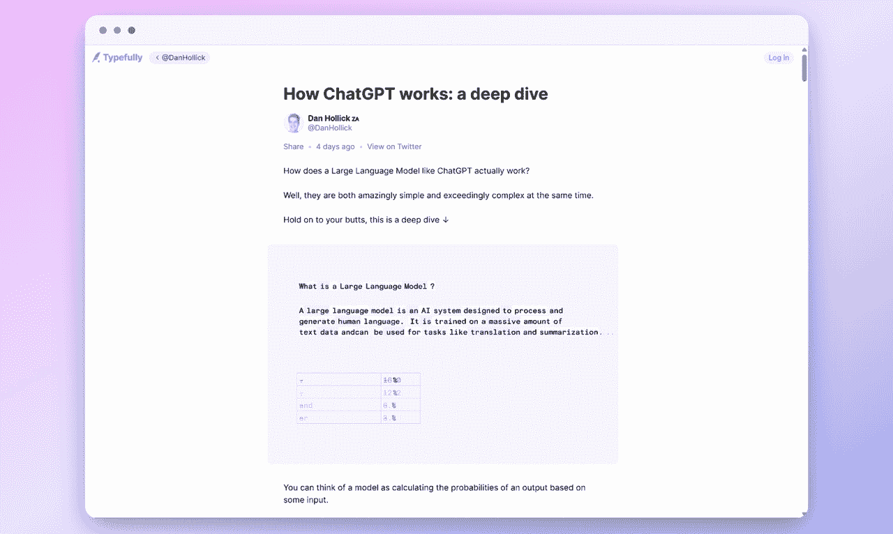