# AIGC Weekly #16

> 来源：[https://waytoagi.feishu.cn/docx/D4QzdGlg4oQMXlx80JLcwZCRn0b](https://waytoagi.feishu.cn/docx/D4QzdGlg4oQMXlx80JLcwZCRn0b)

> 🔗 原文链接： h[ttps://op7418.zhub](https://op7418.zhubai.love/posts/2257019340145160192)ai.love/posts/22...

> 发表时间：2023-04-10

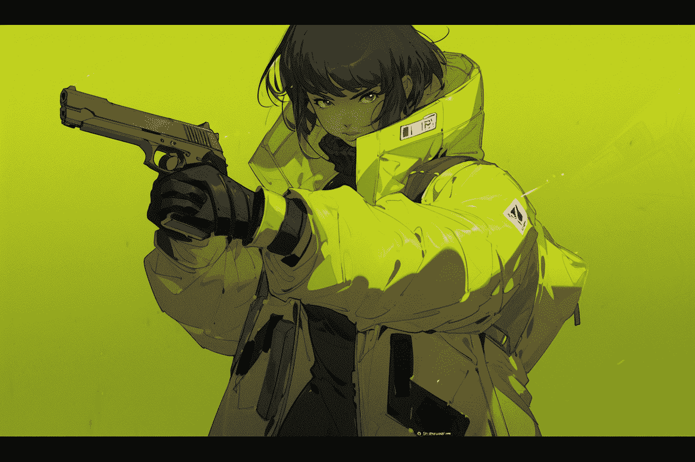

工具：Midjourney Niji v5

提示词：Femme, cyberpunk akira style clothes,A young Motoko Kusanagi wears lemon yellow and fluorescent green armor and holds a high-tech pistol, contrast, long render, pink and white, simple background, gauche art, wes anderson, artstation masterpiece, painting by John Singer Sargent --ar 3:2

> 如无意外会在每周一更新，主要介绍上周AIGC领域发布的一些产品以及值得关注的研究成果，由于我自己是一个设计师，所以在一些专业内容的描述上可能存在问题，欢迎在渠道帮我反馈及更正，如果觉得有收获的话也可以订阅一下。（本期部分文案使用了Notion AI以及Chat GPT帮助润色和翻译）

各位周一好呀，上周我们新增了292个订阅用户，现在总订阅达到了2005个，来看一下上周的内容总结吧。

# ❤️上周精选

## [Meta发布图像分割模型SAM](https://ai.facebook.com/blog/segment-anything-foundation-model-image-segmentation/)

Meta这周公开了他们的图像分割模型SAM（Segment Anything Model），这是一个可以轻松执行交互式分割和自动分割的单一模型。该模型的可提示接口使其可以以灵活的方式使用，只需为模型设计适当的提示（点击、框、文本等），就可以实现广泛的分割任务。此外，SAM是在一个多样化、高质量的掩码数据集上进行训练的（作为该项目的一部分收集），这使它能够推广到训练期间未观察到的新类型的对象和图像。这种泛化能力意味着，总的来说，从业者将不再需要收集自己的分割数据并微调模型以适应他们的用例。

最[强的是它已经有了](https://twitter.com/DrJimFan/status/1643647849824161792?s=20)对“对象”的通用概念，即使是对于未知的对象、不熟悉的场景（例如水下和细胞显微镜）、模糊的情况也可以进行分割。 Jim Fan 认为这是计算机视觉领域的“GPT-3”时刻。

举个例子前几天不是已经有利用Stable Diffusion的图生图功能把假人模特变成真人图片，现在的一个关键问题是一些比较小的商品没有办法快速添加蒙版，依赖人工绘制蒙版，如果使用了这个图像分割模型添加蒙版的话就可以完全自动化了。

[他们还开放](https://segment-anything.com/demo)了一个网页可以试用Demo，推荐去试一下，非常强， 试用地址 。

[模型下载地址 ](https://github.com/facebookresearch/segment-anything) [论文阅读](https://arxiv.org/abs/2304.02643)

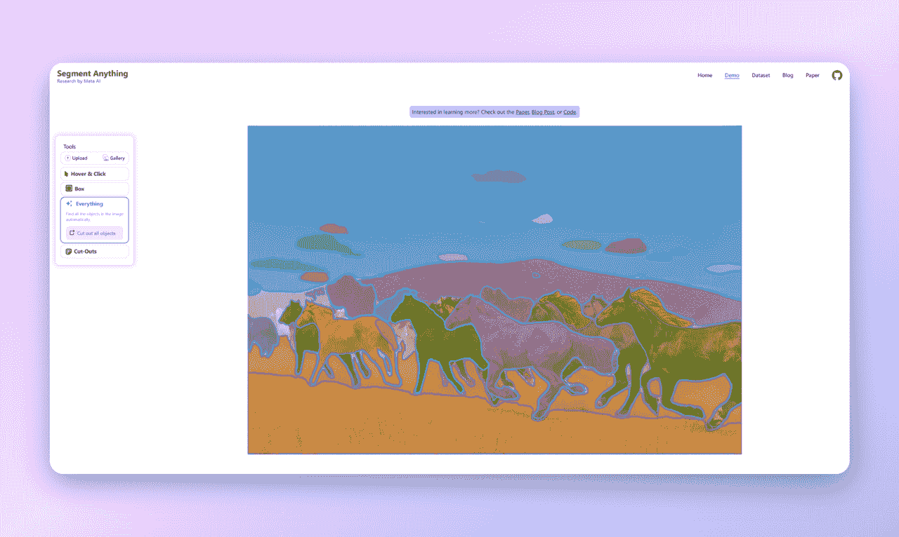

## Midjourney腹泻式更新了一堆功能

上周Midjourney突然腹泻式更新，更新了图片提取提示词、批量创建功能、程序化提示词生成功能、Niji V5公测以及最重磅的Web UI开放了内测，下面分别介绍一下这几部分内容。

图片提取提示词

使[用/desc](https://web.okjike.com/originalPost/642b7cdcb9ffc2b3a218d19a)ribe上传图片即可获得四个关于该图片的提示词，然后点击对应数字按钮就可以用这个提示词生成图片。具体实验 可以看这里 。

批量生成功能

简单来说就是在提示词后面更上比如--repeat 10这样的命令，那么这个提示词机会一次性重复生成10次，不用我们自己手点了。目前这个功能只有30美元以及以上的会员可以用。

程序化提示词生成

在书写提示词的时[候把对应的](https://twitter.com/nickfloats/status/1643763846933274624?s=20)提示词用{}包起来，那么他就会自动对{}里面的提示词进行叉乘搭配测试你设置的提示词组合的效果。举个例子/imagine a {cyberpunk, vaporwave, art deco} {cat, dog}，你写完左边的提示词回车后Midjourney会自动测试/imagine a cyberpunk cat /imagine a vaporwave cat /imagine a art deco cat /imagine a cyberpunk dog…等提示词的效果并展示，一次最多会进行40次生成。这对与我们测试提示词的效果非常有用。目前这个功能也是只有30美元以及以上的会员可以用。可以在 这里查看 具体的测试。

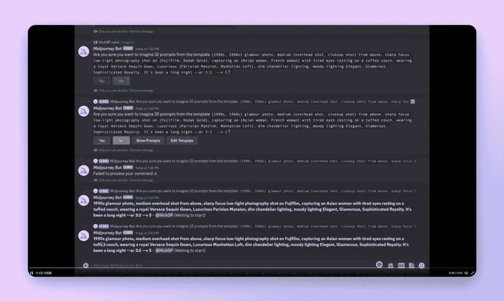

Niji V5动漫模型公测

Nij[i V5](https://web.okjike.com/originalPost/642cf8b0a930598b3a754d5b)是在Midjourney V5的基础上微调的动漫模型。可以在/settings里选择niji version 5或者在提示词后跟上--niji 5 使用这个模型。目前我试下来有个问题就是你提示词没有说人，它生成的内容里面也会自己加上人形生物，具体的测试可以 看这里 。

网页生成图片的Web UI功能

之前预告很久的WebUI功能终于开始内测了，它也不是我们想象中的只是把提示词输入和图片展示的功能搬到了网页上，这个模块的功能非常丰富：

提示变得更容易 告别一次又一次地输入“/imagine”。Web 应用程序允许直接在提示栏中输入内容，并内置自定义设置 [提示参数不再结束]。可以在右侧面板轻松更换设置，甚至可以保存设置预设。

自定义工作区 你甚至可以使用 Discord 频道的频道 ID 将旧的工作区导入到新的工作区中。

图像上传 使用参考图像从未如此方便。，只需将它们从计算机文件中拖放[或选择]上传，然后单击所需的图像，在撰写提示时将它们用作参考。

查看生成历史 生成历史会汇总你生成图片过程中的每一步操作和对应的生成结果，相似的内容会被整合在一起方便检索。

提示栏功能 上传图像并不是什么新鲜事，但现在你可以随机调换提示和添加心情板。“随机调换提示”是什么意思？随机调换提示会在提示栏中生成一个随机提示。添加心情板会在生成提示时从你的收藏中[类似于参考图像]获取灵感。当你想尝试保持特定的口吻、风格或色彩方案时，这可能非常有用。

如何使用这个功能？

测试参与的前置条件是你需要用mid生成过超过10000张图。下面是参加测试步骤：

1.  前往 Midjourney 主服务器并输入 /info

1.  #10000-club 会出现在其他频道中

1.  你可以去club问问怎么访问测试服

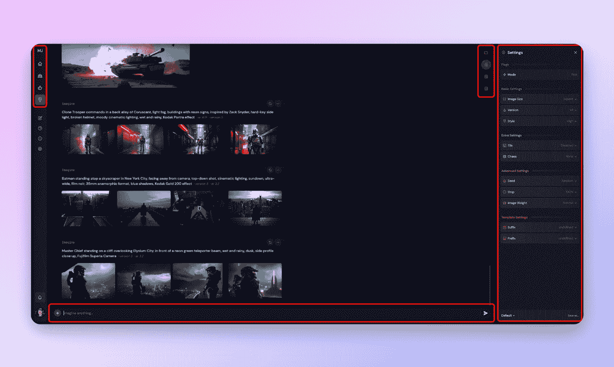

## [我做了一个帮你把Midjourney提](https://mp.weixin.qq.com/s?__biz=MzU0MDk3NTUxMA==&mid=2247483933&idx=1&sn=c2bf32af651f672f6b2709f27ea8837f&chksm=fb304ae4cc47c3f26704d56c96f7f670ee1ea7ad20f979f31d49339c10d8852d97e3f9037c09#rd)示词和图片保存到Notion的浏览器扩展

我用GPT-4帮忙写了一个浏览器扩展，帮你把Midjourney提示词和对应图片快速保存到Notion中。

插件的演示视频可以在这里看： [h](https://twitter.com/op7418/status/1644675934803628032?s=20)ttps://twitter.com/op7418/status/1644675934803628032?s=20

插件可以在这里下载： [https://github.com/](https://github.com/op7418/Prompt-hunter)op7418/Prompt-hunter

下面是我这周在使用GPT-4编码的一些心得：

+   在代码编写方面多做要求GPT-4的输出结果可读性会好很多

+   尽量让他多打log，以便能够准确定位问题

+   由于他的数据库就到21年很多事情不知道，所以你需要给他一些输入，例如对应产品的开发文档。比如他就认为Notion API 支持更改数据库的内容不支持为页面添加内容，于是我直接把Notion那部分的开发文档扔给它，它就会了，学习能力真的强。

+   还是那句话GPT-4不是全知的所以产出效果很依赖你的输入内容质量，在跟他对话的时候尽量提供详细的完整的信息

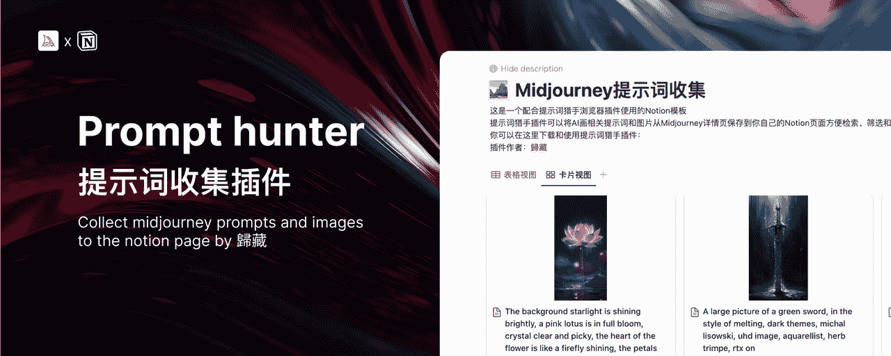

## 我开源了近期用Mdijourney做的上百张壁纸

我一直想找个地方系统的展示我用Midjourney画的所有图，但是国内很多工具太复杂，自建网页的话一直没时间。前段时间刚好发现了Bento这个工具，既美观又好用。上面现在是我最近做的比较好的一些成套的图，各位可以用来做壁纸。

周刊的订阅者回复这个邮件告诉我你们想要的壁纸名称我会发你8K的壁纸下载链接，就当感谢各位的支持了，每人一套，我可能发的很慢，但会发完。

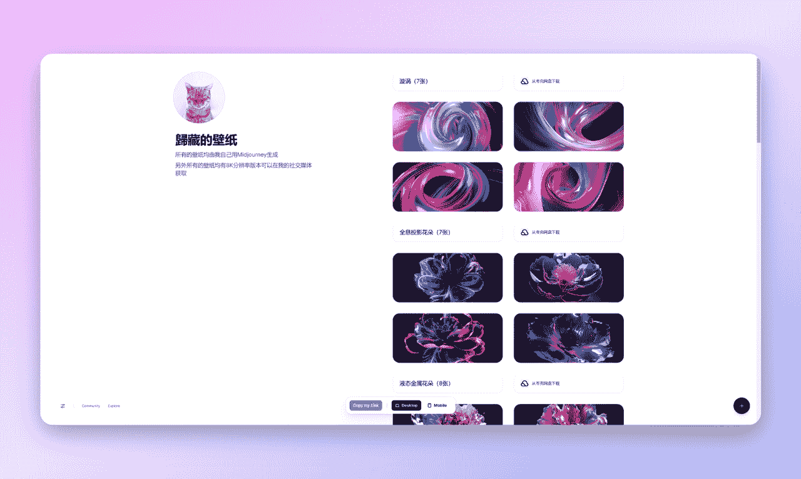

# ⚒️产品推荐

## Imagic发布了AI驱动的无代码应用构建工具

这个产品有点离谱的。宣传视频和官网太好看了。用自然语言快速生成可以使用的应用程序。

支持Airtable等产品直接当作数据库使用。支持多模态输入输出，包括文本、图片3D和视频。创建出来的应用立刻就能使用和发布。宣传视频演示了比如股票应用和一些企业B端后台等。

## Create ：在几分钟内获得自动设计、构建和部署的 Web 应用程序

在 20 周内完成 10 周的项目，以便更快地进入市场。与没有代码或低代码不同，创作者构建自定义用户体验，您拥有最终代码库。快速生成产品的第一个版本。然后，由创建者加速路线图的其余部分，为所有常见功能请求（如 UI 组件、GraphQL 解析器等）提供生成器。

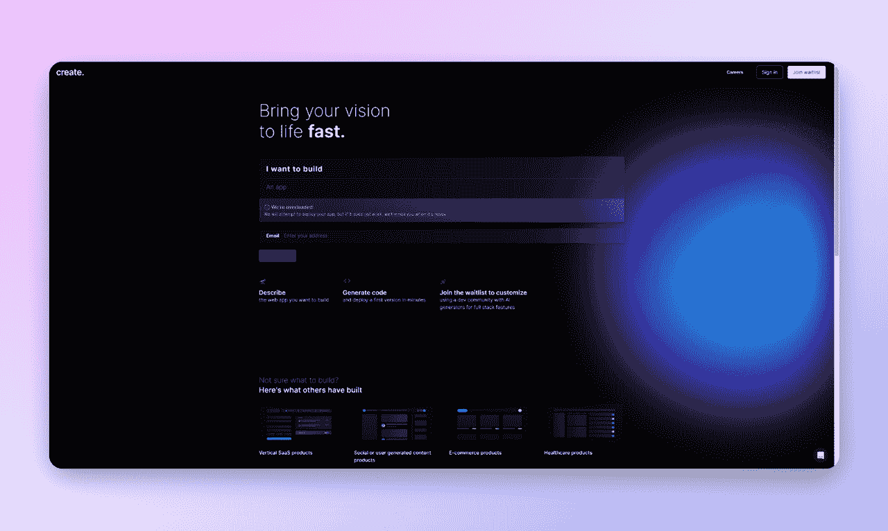

## [月维推出的提示词生成工具](https://github.com/Moonvy/OpenPromptStudio)

一个开源的 AIGC （Midjourney）提示词可视化编辑小工具支持：显示英文提示词的中文翻译、输入中文提示词翻译到英文、为提示词进行分类（普通、样式、质量、命令）、轻松的排序、隐藏提示词、把提示词可视化结果导出为图片、常用提示词词典。

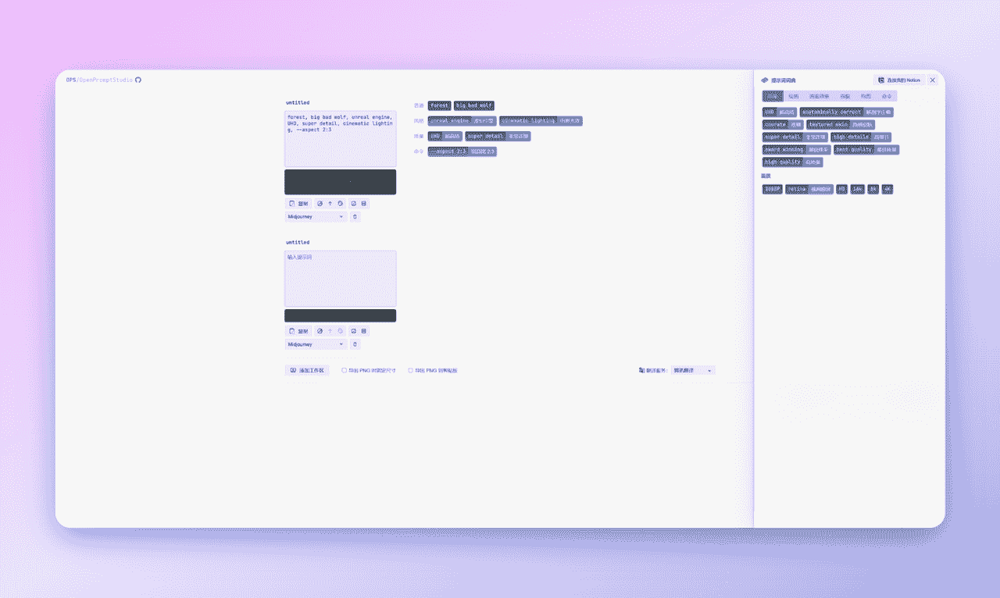

## Apollo：一款基于 ChatGPT 的实时知识应用程序

通过耳机整天与它交谈。如果增强现实是对世界的叠加，这就是增强智能——对你思想的叠加。

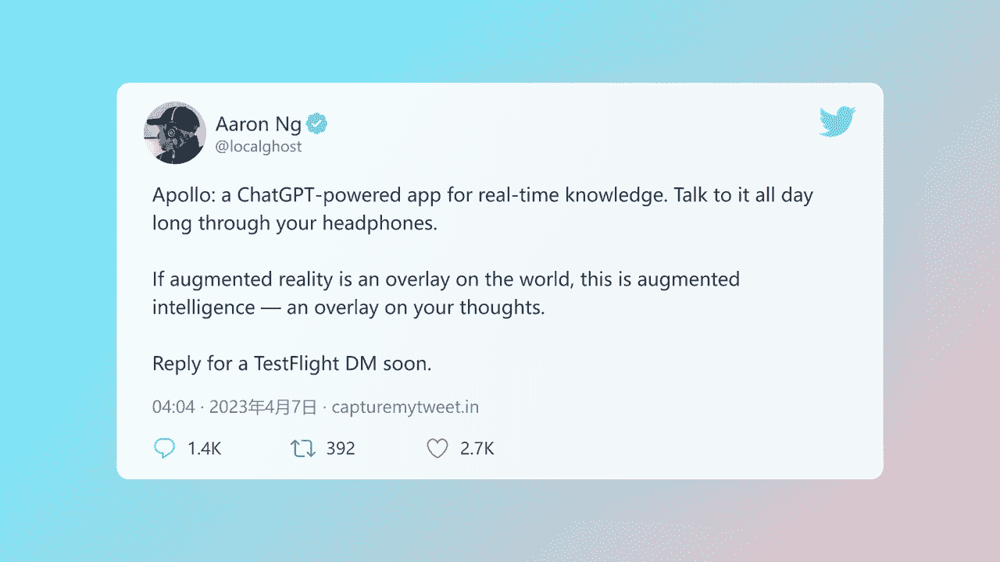

## Hex Magic：Ai帮助生成SQL语句或python查询数据

Hex 了解您的模式和项目上下文，因此它可以帮助解决从快速问题到自动完成连接到生成挑剔的日期过滤器的所有问题。你是否被晦涩难懂的语法困扰？Hex可以为你了解所有的软件包，你只需要询问即可。

## [Poe：开始支持自定义机器人](https://poe.com/ChatGPT)

Poe开始支持自定义机器人了，本质上就是固定一段的提示词，但是还挺方便的。这里是我做的一个自动翻译机器人： https://poe.com/translationBot7

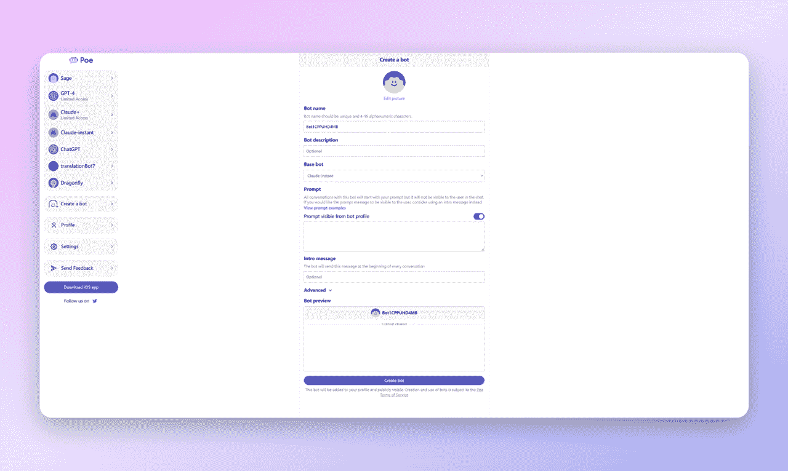

# W onderGPT：简单而美观的ChatGPT

把颜值和交互体验做到极致也是个路子，既然都是用为什么不用个好看的呢

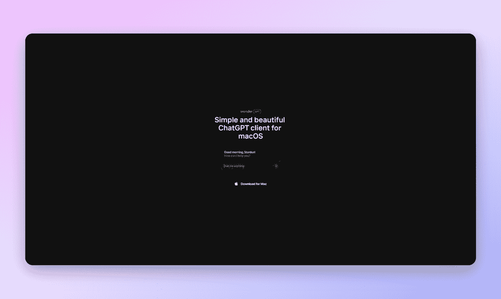

## [StabilityGPT：在GPT](https://twitter.com/skirano/status/1644097427014549505?s=20)4中运行Stable Diffusion

就是字面意思作者做了一个ChatGPT插件可以在ChatGPT发出提示词后返回SD生成的图像，这代表可以与ChatGPT原有的能力做深度的结合。

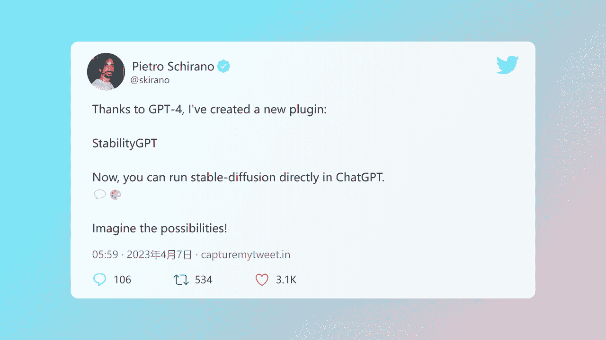

## Graph Maker：通过对话为你的数据创建可视化图表

上传数据之后通过自然语言对数据内容进行分析输出结果，包括生成可视化的图表分析。

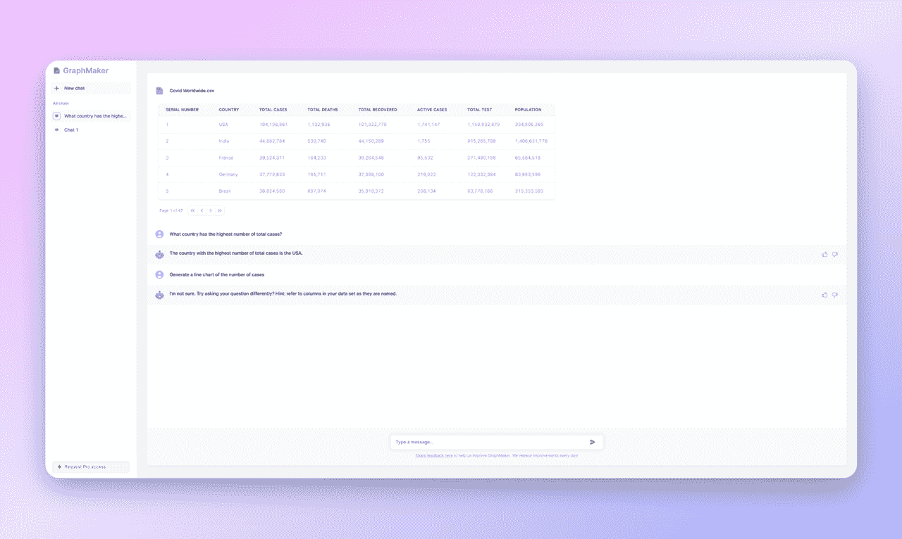

## Coda AI：整合Coda链接的所有应用的数据并处理

Coda也发布了自己的AI能力，在帮助写文档润色内容方面和Notion差不多，但是演示里比较强大的一个功能是它能够获取跟Code链接的很多应用里你的数据进行整合和分析甚至进行联动，这个就很厉害了。

## Motion Go：国产的自动生成PPT工具

原来是做PPT附加插件的，现在可以通过自然语言自动生成PPT页面和对对应内容智能增加动画了。

## Triple whale：AI电商助手

支持广告的数据监测，创意数据的跟踪和分析、跟踪和管理与KOL的营销活动，AI整合分析进行异常检测并给出建议。

## Prompt Storm：ChatGPT提示词浏览器扩展

一个简单易用的谷歌浏览器扩展，可以释放这种革命性的人工智能技术的所有潜力。我们为您提供了大量精心设计的提示，您只需点击几下，添加一点信息，就可以使用ChatGPT 3和4。

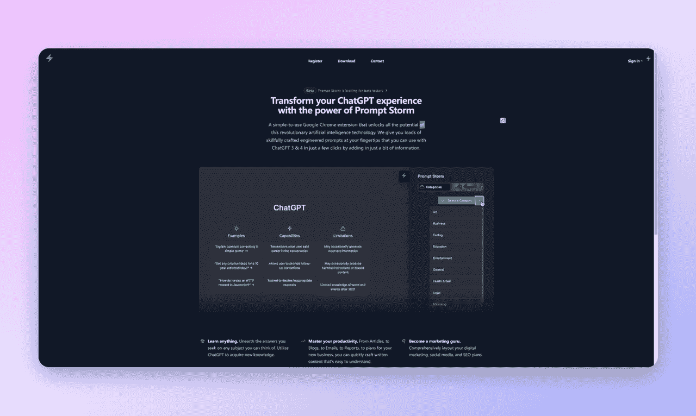

## AI生成3D素材的 Luma AI发布了虚幻引擎插件

Luma AI的alpha UE 5（Windows）插件，适用于NeRFs，该插件使用在本地运行的完全体积渲染 - 这意味着不需要修改网格格式，几何体，材质或流。

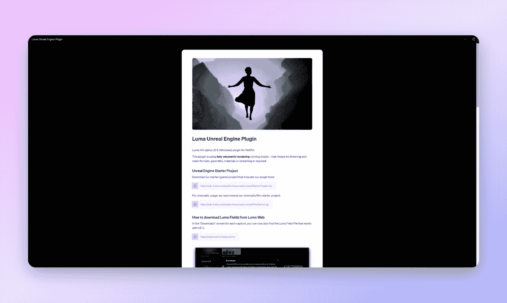

# 🧑🎓学习资源

## Midjourney用法和技巧的合集

Eckler by Design ✦汇总的关于Midjourney V5的一些教程以及测试通过这一系列内容你可以快速了解Midjourney V5

## [LangChain 综合指南](https://nathankjer.com/introduction-to-langchain/)

LangChain是一个框架，用于开发由语言模型驱动的应用程序，使它们更容易集成到应用程序中。非常好的文章详细介绍了LangChain的核心组件。

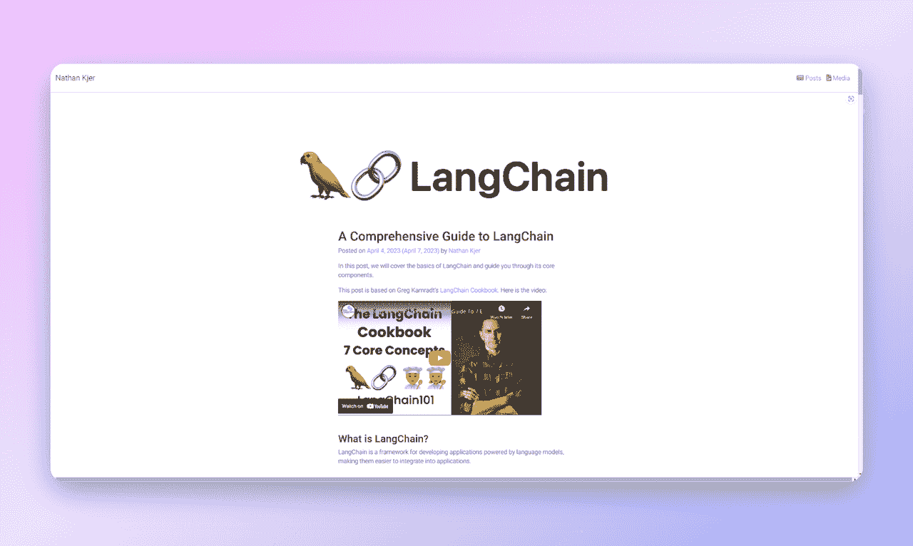

## 将 ChatGPT 与内部知识库和问答平台集成

ChatGPT非常擅长提供一般信息，尽管有一些限制。与此同时，根据Gartner的数据 ，在后疫情时代，混合工作和更高的员工流动率，内部知识管理变得越来越重要。我们如何将 ChatGPT 的强大功能引入内部知识管理？

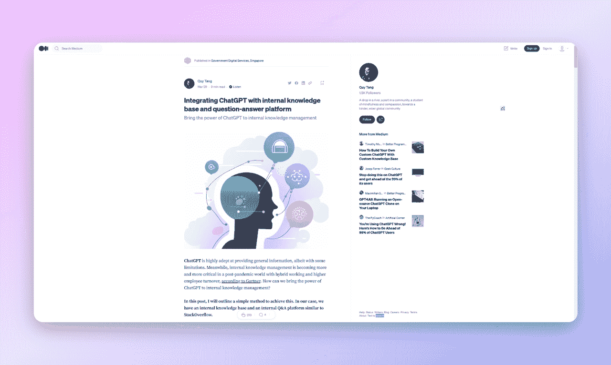

# 🔬精选文章

## 阿里发布了自己的大语言模型通义千问

[上周阿里云发布了他们](https://mp.weixin.qq.com/s/xrUU1YniV4Gwcl-1qS9HQA)[的大模型通义千](https://mp.weixin.qq.com/s/olGY9Cm6hO1h8C9DSy7_qA)问，这里是 知[危的通义千问测评 ，](https://www.bilibili.com/video/BV1Va4y1T7Ym/?spm_id_from=333.1007.top_right_bar_window_history.content.click&vd_source=e99f85042059f2864f5cca20d71575f0)他们的观点是不如ChatGPT3.5但是跟百度那个差不多。这里还有 量子位的测评 和B站UP主 不高兴就喝水的测评 ，各位可以结合着看。

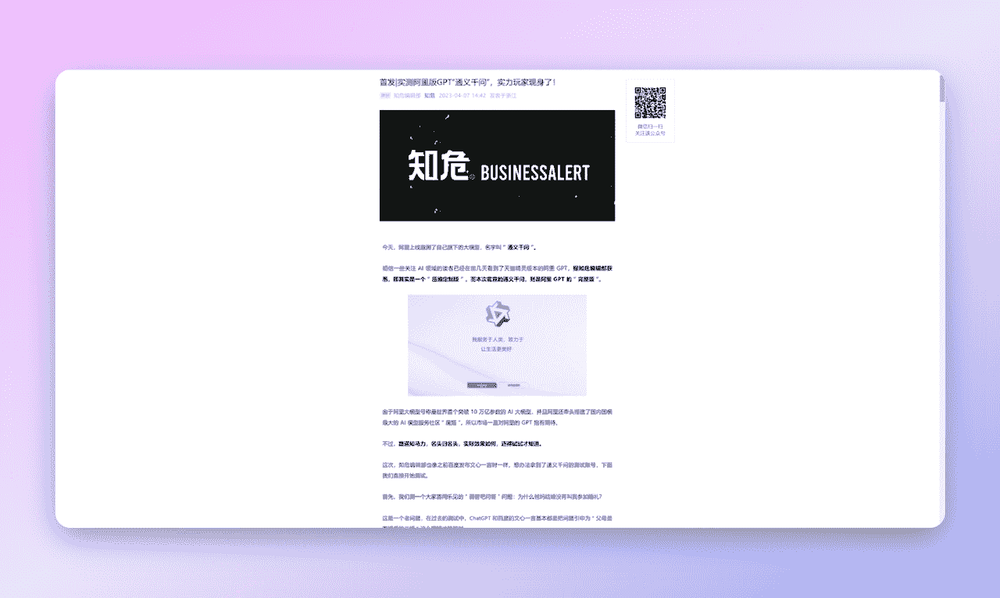

## 斯坦福- 2023 年人工智能指数报告

AI指数是斯坦福人性化人工智能研究所（HAI）的一个独立倡议，由AI指数指导委员会领导，该委员会由来自学术界和工业界的跨学科专家组成。年度报告跟踪、整理、提炼和可视化与人工智能相关的数据，使决策者能够采取有意义的行动，以负责任和以人为本的方式推动人工智能的发展。

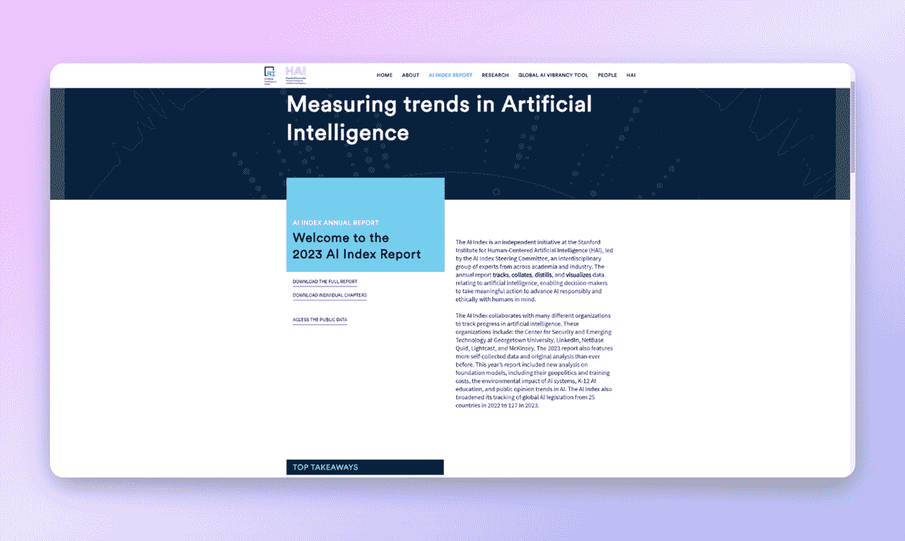

## 人工智能简史-追溯机器人思维的兴起

多年来，人工智能的发展以蜗牛般的速度前进。有时感觉我们永远无法超越 AOL SmarterChild 聊天机器人的时代。然后，一切都变了。在短短五年多的时间里，我们经历了一个世纪的创新。在这篇文章中，Anna-Sofia Lesiv 探讨了导致我们走到这一刻的主要转折点。

## TagGPT： LLM零样本多模态标注器（腾讯）

在这项工作中，我们提出了TagGPT，一个完全自动化的系统，能够以完全零样本的方式进行标签提取和多模式标记。我们的核心洞察力是，通过精心设计的提示工程，LLMs能够根据多模式数据的文本线索提取和推理出合适的标签，例如OCR、ASR、标题等。

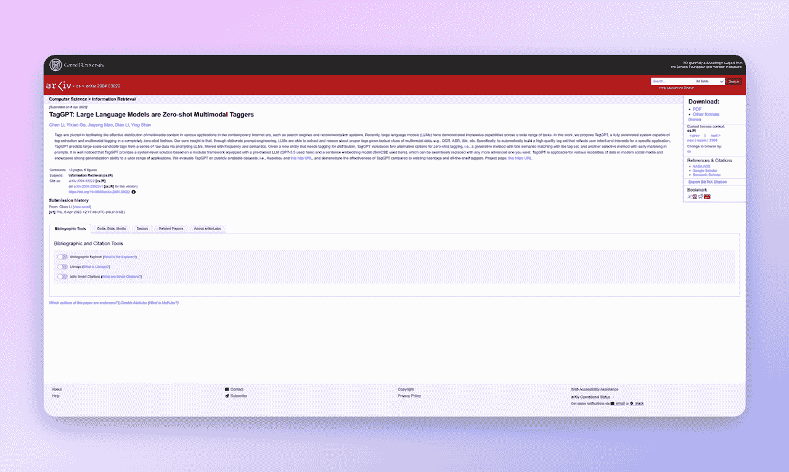

## [Kandinsky 2.1：开源](https://github.com/ai-forever/Kandinsky-2)图像生成模型，基准比 SD 2.1 更好

Kandinsky2.1继承了Dall-E 2和潜在扩散的最佳实践，同时引入了一些新的想法。

作为文本和图像编码器，它使用CLIP模型和扩散图像先验（映射）在CLIP模态的潜在空间之间。这种方法提高了模型的视觉性能，并在混合图像和文本引导图像处理方面开辟了新的视野。

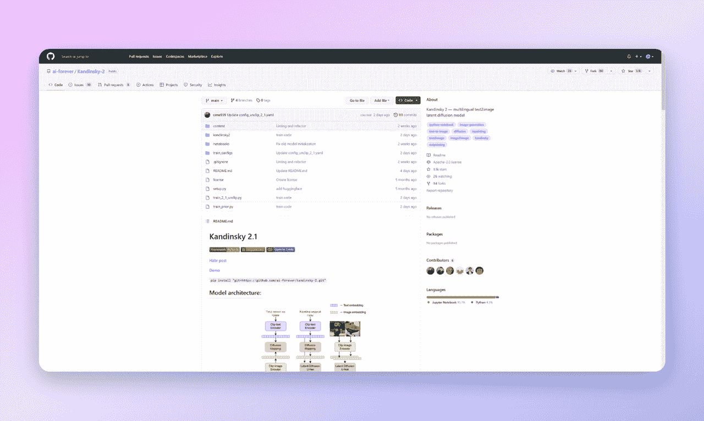

## LVDM：用于高保真长视频生成的扩散模型（腾讯）

一种高效的视频扩散模型，可以：有条件地根据输入文本生成视频和无条件生成数千帧的视频。

## GeNVS：具有 3D 感知扩散模型的生成式新视图合成

一个计算机模型可以从一张照片创建逼真的 3D 图片，它可以从不同的角度显示相同的场景，甚至可以制作 3D 视频

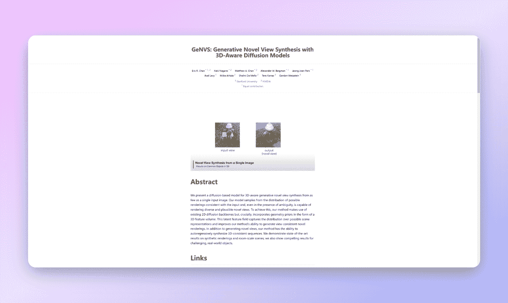

## Langchain获得了由 Benchmark领投的1000万美元融资

LangChain和LLMs的组合打开了建立惊人产品和应用的前沿，同时也清楚地表明需要更多的工作和工具来使这些应用程序良好地工作（特别是在生产环境中）。每天都在要求我们做更多的工作（400多个GitHub问题，100个未解决的PR），我们想要帮助他们。

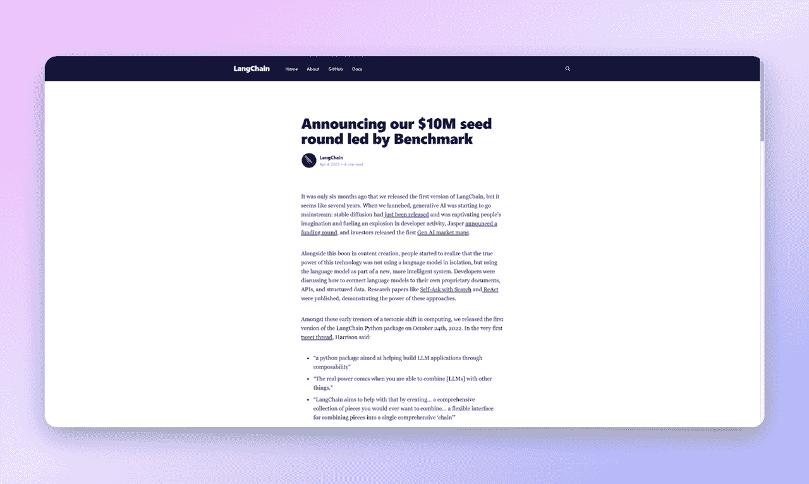

## [Ce](https://www.newcomer.co/p/cerebral-valley-double-feature-stability#details)rebral Valley AI 峰会的演讲：Stability AI 首席执行官 Emad Mostaque 和 General Catalyst 的 Deep Nishar

## 软件用户体验的未来：人工智能影响的早期一瞥

虽然通用对话用户界面可能仍然遥不可及，但人工智能已经在增强现有用户体验方面取得了重大进展。通过分析用户行为和偏好，人工智能可以生成个性化推荐，简化复杂的工作流程，并帮助用户更有效地浏览软件。作为设计师，我们的目标是将 AI 无缝集成到软件中，创建直观的界面，让用户能够充分利用这些智能系统。

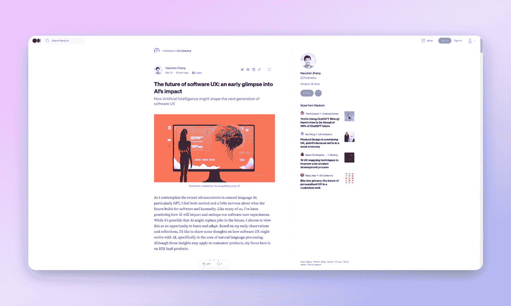

## [OpenAI CEO Sam Altman谈](https://greylock.com/greymatter/ai-field-notes/)论GPT-4和“即兴”所带来的经验教训。

首席执行官Sam Altman说，安全正是OpenAI所追求的，这个过程的一个关键组成部分是了解人们如何与GPT-4等工具进行交互。Sam 和我一起参加了 Greymatter 播客，讨论他的组织通过开发和发布每个产品（如 GPT-3、ChatGPT、DALL-E 和 GPT-4）学到了什么。

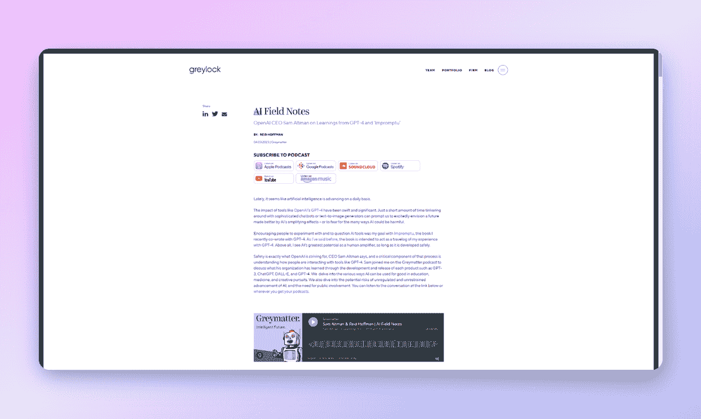

## [大型语言模型综述](https://arxiv.org/abs/2303.18223)

一份关于大语言模型的调研论文，有大概50页。非常的全面而且内容很新。 介绍了大语言模型的背景、关键发现和主流技术，回顾了LLMs的最新进展。特别是，我们重点关注LLMs的四个主要方面，即预训练、适应调整、利用和容量评估。

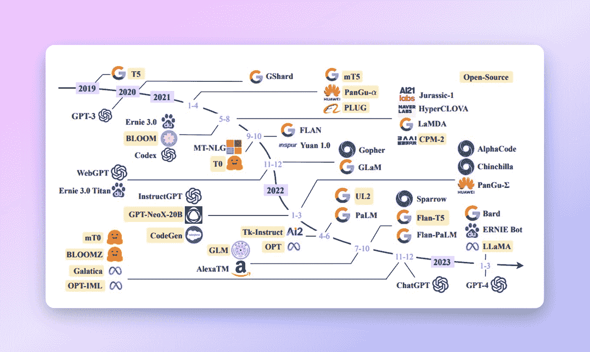

## 睡前消息574期：ChatGPT是做题家 中国欠他一套模拟卷

“到了AI时代，我们又在更深刻的层次上遇到了同一个问题。允许中国人在互联网上发表言论，尤其是允许自由说实话，这不仅仅是社会主义公民应有的基本权利，是文化繁荣的基本条件，更是发展生产力的前提。真实可靠的中文言论，和导弹、芯片、石油、人口一样，是中国经济竞争力的来源，可以直接决定产业革命的效率，影响国家的生死存亡。”

我纠结了很久要不要推荐马逆这一期，毕竟很多人不太待见他，但还是发了出来，毕竟我们不能一直当作问题不存在。

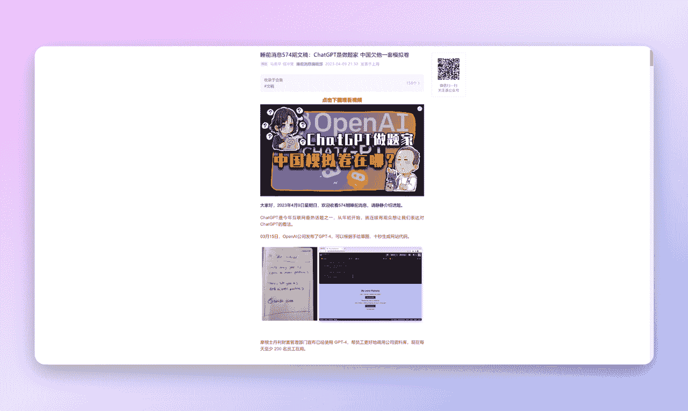