# AIGC Weekly #15

> 来源：[https://waytoagi.feishu.cn/docx/Oiw6dSCpAoCIQaxKFYGcBbKhn6e](https://waytoagi.feishu.cn/docx/Oiw6dSCpAoCIQaxKFYGcBbKhn6e)

> 🔗 原文链接： h[ttps://op7418.zhub](https://op7418.zhubai.love/posts/2254481144907128832)ai.love/posts/22...

> 发表时间：2023-04-03

工具：Midjourney v5

提示词：light mode gradient background soft solid, excessive curve, orange blue pink, Soft and excessive --ar 3:2 --stop 70

> 如无意外会在每周一更新，主要介绍上周AIGC领域发布的一些产品以及值得关注的研究成果，由于我自己是一个设计师，所以在一些专业内容的描述上可能存在问题，欢迎在渠道帮我反馈及更正，如果觉得有收获的话也可以订阅一下。（本期部分文案使用了Notion AI以及Chat GPT帮助润色和翻译）

# ❤️上周精选

## 一场是否应该暂停AI训练的辩论

上周以马斯克为首包括一众科学家和科技圈知名人士包括图灵奖得主Yoshua Bengio等人签署了一封公开信 《 暂停巨型人工智能实验：一封公开信 》 。

核心观点是呼吁“ 所有人工智能实验室立即暂停至少 6 个月的训练比 GPT-4 更强大的人工智能系统 ”，“人工智能实验室和独立专家应该利用这个暂停，共同制定和实施一套共享的安全协议，用于先进的人工智能设计和开发，这些协议由独立的外部专家进行严格的审计和监督。这些协议应确保遵守它们的系统在合理怀疑之外是安全的。”

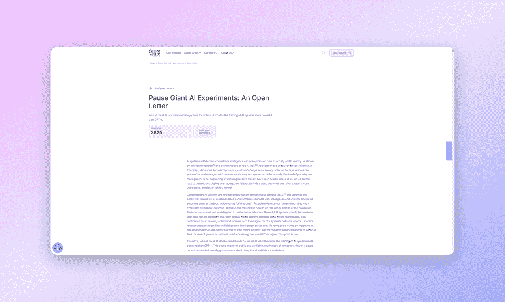

下面是一些关键人物在这场辩论中的发言：

Open CEO Sam Altman： 一个良好的人工智能通用技术的未来所需要的事项：1）具备调整超级智能的技术能力；2）大多数主要人工智能项目之间的充分协作；3）包括民主治理在内的有效的全球监管框架。

在有关暂停信的辩论中，我非常赞同的一点是：OpenAI 应该制作一个优秀的调整数据集和评估，并发布出来！如果我们能找到一个原型的民主过程来“对齐什么”，那就更好了，可以加分。

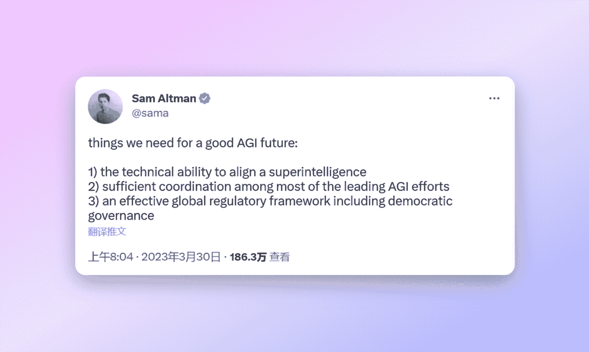

[Elon Musk ](https://twitter.com/elonmusk/status/1639138603371491329?s=20)： 作为投资的一部分，微软获得了对整个 OpenAI 代码库的独家访问权；它以某种方式从开源非营利组织转变为闭源营利组织；ChatGPT 完全位于 Microsoft Azure 中。到了紧要关头，他们拥有一切，包括模型权重。

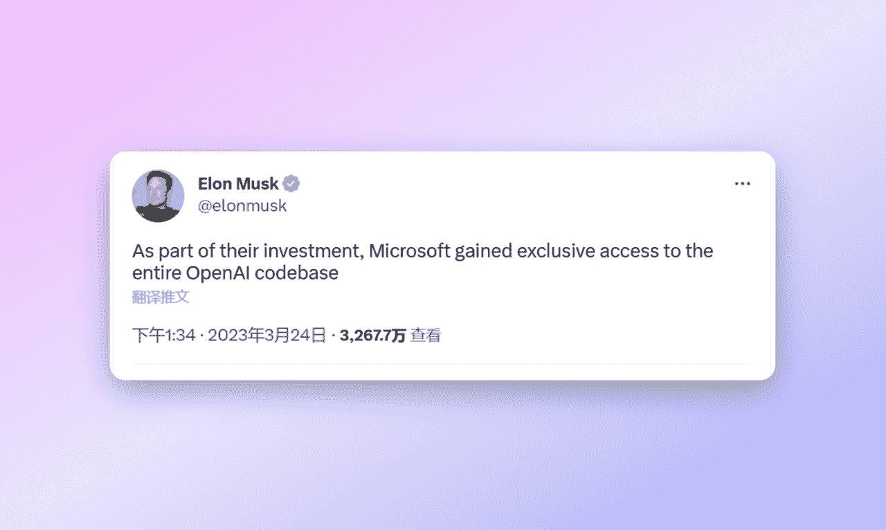

Vivek Sodera（Superhuman的创始人） ： 数百万人将因人工智能失去工作，不仅包括销售开发代表、支持人员、内容创作者和文案撰写人，还包括教师、医生、律师、软件工程师等。数百万人；按照目前的速度，这肯定会发生（最迟在未来3年内）。我们需要警醒并做好准备。

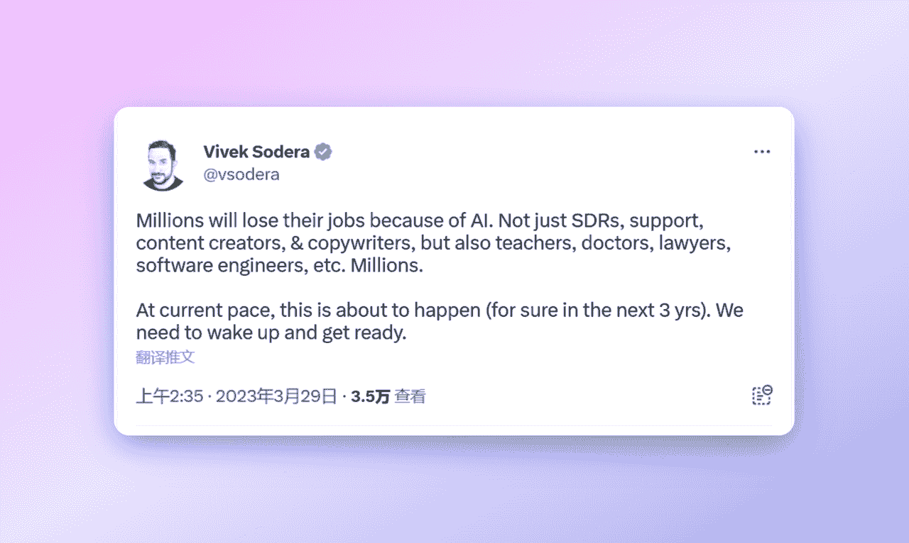

[Gary Marcus ](https://twitter.com/GaryMarcus/status/1640884040835428357?s=20)： 我个人没有改变;我仍然认为LLM是不可靠的，并且仍然认为它们是一个非常糟糕的事实基础。我不认为他们接近AGI。但这并不意味着它们没有撕裂我们社会结构的潜力——特别是考虑到目前令人难以置信的广泛和快速部署、企业不负责任、缺乏监管和固有的不可靠性。

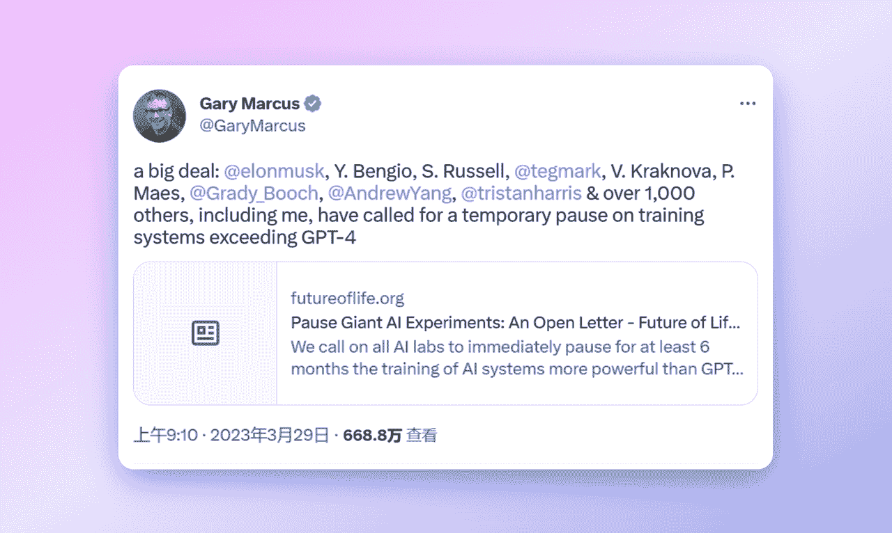

[Emad Mostaque（Stable ](https://twitter.com/EMostaque/status/1641091842812026882)Diffusion 母公司的 CEO） ：无论如何，6-9个月内都没有人会发布比GPT-4更大的运行模型。为什么呢？因为为了达到比GPT-4更高的规模，需要新的H100/TPU-v5集群，这些集群需要安装、烧录和优化，而这需要6-9个月的时间。这是一个好时机来思考。

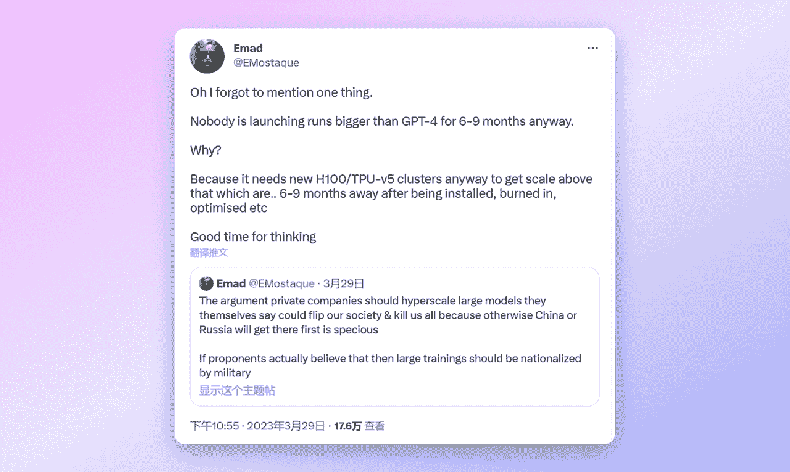

可能是为了应对上述挑战Open CEO Altman创立了一个新的组织Worldcoin。他们公开了一个生物识别协议来生成识别真实人类的凭证：World ID 。

World ID通过安全生物识别设备，使个人能够以保护隐私的方式获得独特的人类凭证，而无需存储任何图像数据。该协议使个人能够以匿名方式利用零知识证明在线证明其人性。

除了区分人类和AI之外，这还使AI资助的非国家UBI和数字货币的公平全球分配成为可能。该项目的早期贡献者已经开发了硬件设备、移动客户端和部署机制的初始版本，所有这些都将逐渐变得去中心化。

详细的内容在这里： [h](https://worldcoin.org/blog/engineering/humanness-in-the-age-of-ai)ttps://worldcoin.org/blog/engineering/humanness-in-the-age-of-ai

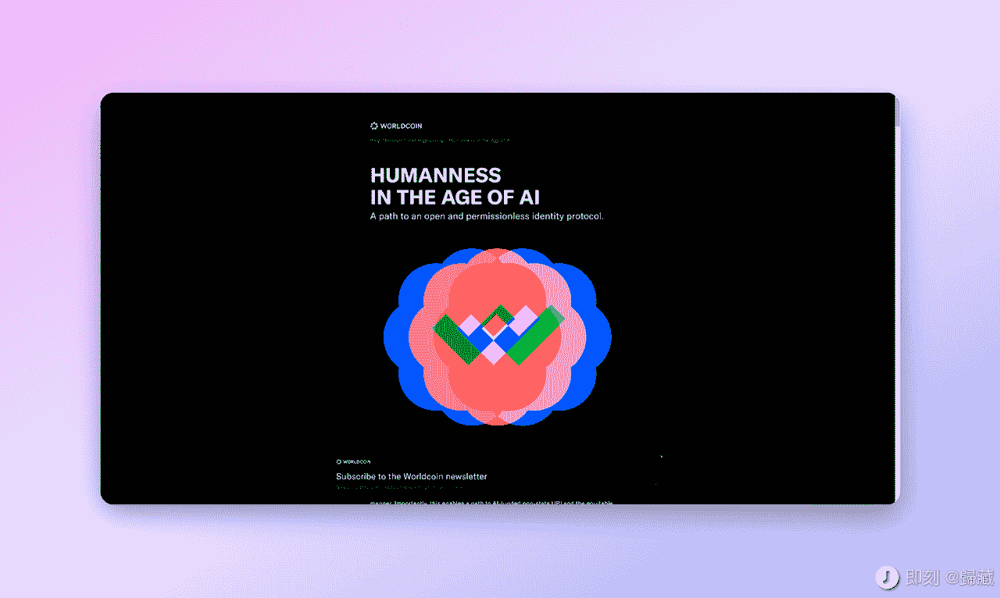

同时意大利政府在周五由于数据问题禁止了ChatGPT的访问，Open AI表示尊重意大利政府的决定已经主动禁止来自意大利的使用请求。

这周五开始Open AI开始禁止使用邮箱注册账号，疑似原因为第一批18美元账号即将到期，为了防止大规模批量注册新的免费账号薅羊毛。谷歌和微软的邮箱授权依然可以注册。同时之前批量注册的未绑卡账号被大规模封禁。国内用户绑卡的难度又有所增加。

## Midjourney的一些消息汇总

Nick St. Pierre 跟Midjourney的创始人进行了一些沟通，透露了一些消息，我整理一下发在下面：

首先就是Midjourney禁用免费试用功能的原因：”由于一群用户（数以万计）在中国利用免费试用系统进行了大规模的协作努力，而且其中很多问题与 Discord 系统中的漏洞有关，所以我们将暂时停用免费试用，直到下一次系统更新部署为止。“

Midjourney已经在网站建设上加大力度，他们招了很多web开发人员。接下来的1-2个月他们将推出在网站上生成图片的功能（类似Stable Diffusion的Web UI）。目前功能已经开发完成，他们内部测试感觉非常好。

Midjourney正在开发一款 AI “sus” 检测器，以实现更好的内容审核和减少被屏蔽的单词。

Midjourney创始人提到他们可能需要一些关于“逮捕照片（Arrest Photos）”之类的规定（这个没理解是指举报色图吗）。他还提到，确定此类图像的限制线是一个有趣的问题，他一直在思考。

目前有比图像扩展或者修复更重要的事情要做，比如：使图像看起来更好，使处理速度更快 提高图像的质量。

他也透露了一些即将上线的功能包括：扩展重绘功能、局部重绘功能、更高的输出分辨率、类似SD的Web UI、API和其他工具建设、准确识别文字的功能。

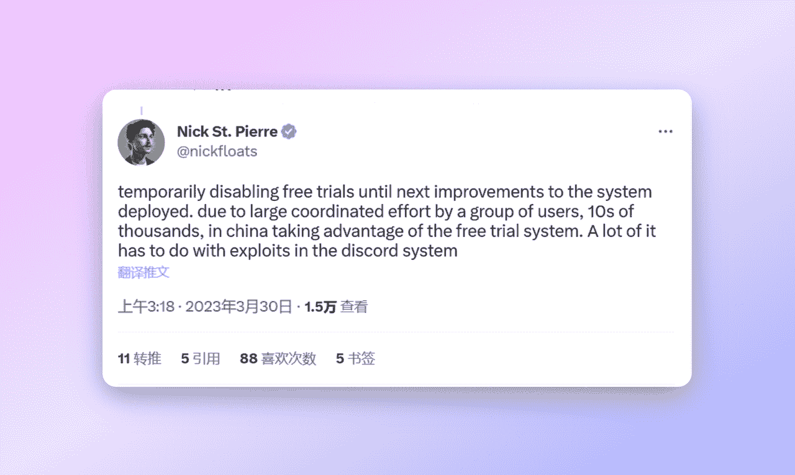

## Stable Diffusion 3 即将发布

Stability ai公司CEO透露Stable Diffusion XL模型正在测试，”它是一个23亿参数变体（原始版本为9亿），具有一系列改进，将用于 Stable Diffusion 3 的更新。“

这个模型的参数是SD2.1的2.5倍，这么多的参数估计消费级设备够呛了。在一个如果他们还是不放开色情图像的限制的话，我感觉使用量有限。

[你现在可以在这里试用SDXL模型](https://beta.dreamstudio.ai/generate)： https://beta.dreamstudio.ai/generate

下面是他们放出来的一些宣传图，我没感觉比Mdijourney强多少，如果Midjourney的可控制性再跟上来的话可能他们就危险了。

## 关于AI影响下未来的用户界面是什么样的

麻省理工学院 AI 实验室的 Geoffrey 这周出了一篇文章对AI影响下的软件形态做了探讨。LLMs不仅能使专业开发人员更具生产力，而且还可能使所有计算机用户都能够从头开始开发小型软件工具，并描述他们希望对现有软件进行的修改。这意味着，LLMs将代表终端用户编程工具支持的一个重大变化：普通人能够充分利用计算机的通用能力，而无需求助于普通编程的复杂性。这可能使得未来的软件形态出现这几个变化：

+   一次性脚本：普通计算机用户每天会让他们的AI创建并执行数十次脚本，以执行数据分析、视频编辑或自动化繁琐任务等任务。

+   一次性GUI：人们使用AI创建整个GUI应用程序，只用于执行单个特定任务，包含他们所需的功能，没有膨胀。

+   自建不购买：企业开发更多定制化的软件，以满足他们的特定需求，而不是购买现成的SaaS，因为现在更便宜获取定制化的软件。

+   模组/扩展：消费者和企业要求能够扩展和修改他们现有的软件，因为现在更容易指定新功能或微调以匹配用户的工作流程。

+   重新组合：取你最喜欢的不同应用程序的最佳部分，并创建一个新的混合体将它们组合在一起。

之后 [Ridd ](https://twitter.com/ridd_design)和 [jordan singer ](https://twitter.com/jsngr)也加入了关于未来软件交互和形态的讨论。

Ridd的观点有：

+   人工智能将让每个人都成为一名工程师。不仅仅是设计师、产品经理或其他“非技术”团队成员...我说的是您产品的用户。

+   现在我可以。1）在像 Notion、Reflect 或 Threads 等产品中使用 AI 助手对文本执行操作。2）我可以在单独的工具中使用 AI 生成界面...但如果这两种用例开始融合呢？

+   在那个世界里，我们“发布”的产品可能更像是基础结构或量身定制的默认设置。大部分的用户体验将由用户在我们的初始产品支架周围使用 AI 构建而定义，也许在需要时会生成整个用户界面，然后在之后被丢弃...

+   我们作为设计师的角色可能更多地转向建议与我们的核心界面周围的 AI 进行交互的方式。例如：“已保存的提示”，这些提示可以直接使用，同时提供新提示的创意

jordan singer的观点是： 未来的界面将会是动态界面，可以根据提示直接生成UI，这里的UI指的是代码，而不是设计稿。比如一种用户界面类型。给定数据或 JSON，生成适合其最佳界面。 一张照片--照片界面 一个文章和链接的列表--新闻界面 给定参数和限制条件，让 AI 根据提示、输入、用户和上下文变量决定界面。

总结一下他们的观点，未来软件的界面将会是动态的一次性的，未来设计师可能不需要设计这么多完整的的界面和交互模式，专注于生产完成细分需求与AI交互所需要的组件就可以了。

甚至也不需要画设计稿。那这些内容其实没有那么多，现有的最佳方案机会已经都被探索出来了，所以未来到底还需要多少UI或者UX设计师就不好说了。

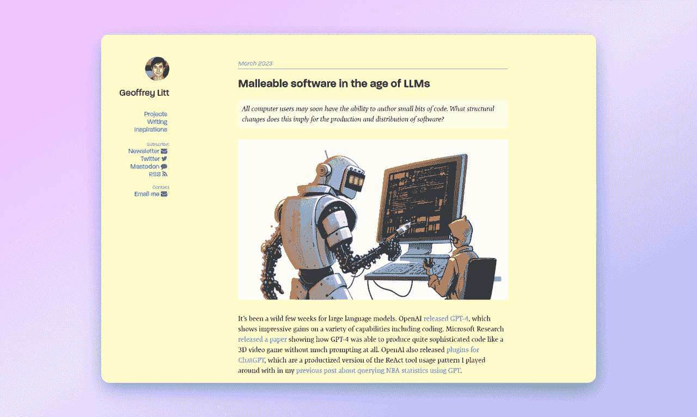

## 我用GPT-4写了一个Midjourney增强插件

我用GPT-4帮忙写了一个Midjourney增强插件，下面是插件的使用方式介绍、我总结的GPT-4使用技巧以及产品实现的具体过程，还有如何用AI工具帮助宣传产品。

插件已经开源在这里下载： [https://github.com/op741](https://github.com/op7418/Mijourney-enhanced)8/Mijourney-enhanced

像我这种英语不好的人使用Midjourney的时候一个很痛的痛点就是提示词的翻译，使用正常的翻译工具要不只能一个词一个词翻译，要不就只能整段翻译。所以就有了这个插件，主要功能是按照提示词作者原有的语义分割自动翻译提示词的部分，同时可以快速复制原有提示词。

下面是一些用GPT-4编码的技巧，更详细的内容可以点上面链接看原文：

信息输入

+   提前自己梳理需求内容和目标，最好在别的地方先写好在粘贴进去。像平时写PRD那样，不要偷懒，你偷懒他就会教你做人，特别是复杂任务。

+   按照正常的软件开发角色的和流程给他设定角色，不同角色需要做的事情开多个聊天窗口做，比如先让它输出整体架构再去另一个聊天里输出具体代码，甚至前端和后端分开，每个模块分开输出。

+   详细的描述需求包括需求的背景，你希望实现的方式涉及到了哪些外部软件的联动，各个内容之间交互方式是什么样的。

+   期望它输出的结果：包含的内容和要求，主要是明确需要他产出的内容。

+   你对内容的要求：明确一些具体的要求包括解释每一个方案选择的具体原因和相关文档、代码结构、每个关键的代码结构都要加上注释等。

优化调整

如果在沟通过程中频繁出现问题可以采取以下方式：

+   一次只实现一个模块或者一个功能渐进式的推进项目，降低问题的复杂程度；

+   当输出结果频繁出现问题的时候重新审视你自己给出的信息，包括是否存在描述的不够全面或者有歧义；

+   可以从其他渠道获取一些信息，比如要求GPT给你一些官方文档的地址去查看；

+   如果遇到了GPT记忆的内容出现问题你需要重新完整的将现在的内容跟他同步一次。

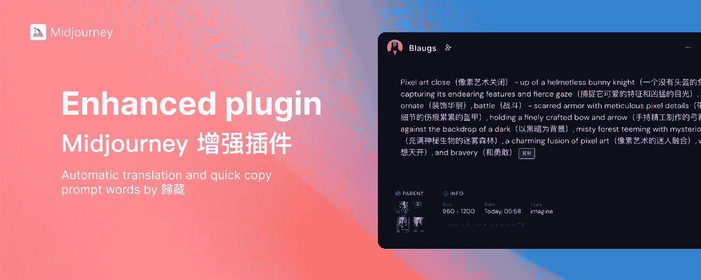

# ⚒️产品推荐

## 非官方Midjourney Web UI和API

一个非官方的Midjourney Web UI界面和对应的API，国内应该有人在做这种服务了，不过只是Discord机器人转接的，生成方式还是聊天。不过这种东西在一两个月后Midjourney自己推出类似服务的时候估计就凉了。

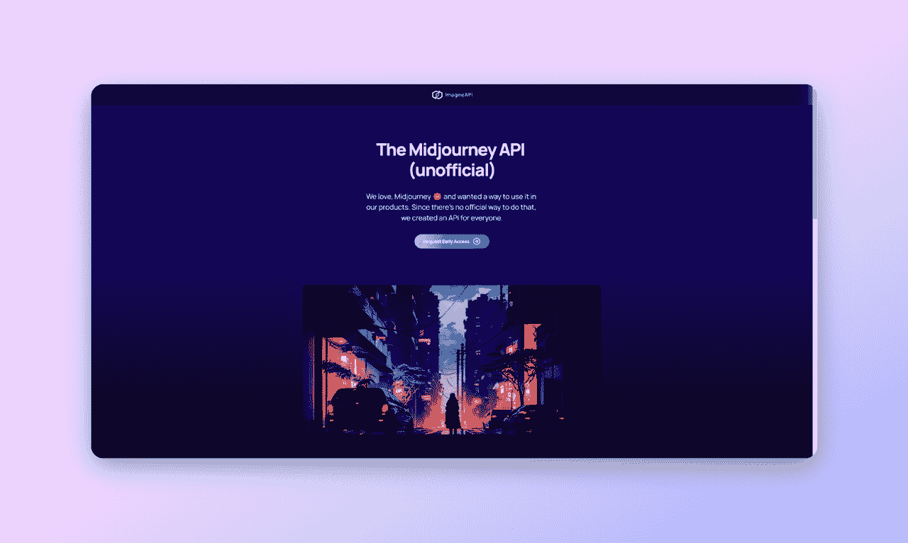

## Atua.app-交互新颖的Chat GPT应用

整体交互和完成度都非常好的Chat GPT套壳，操作和交互类似于Raycast那种。而且还可以通过自然语言去实现复杂操作，比如接入Notion API后可以用自然语言让它帮忙创建一个指定格式的表格。

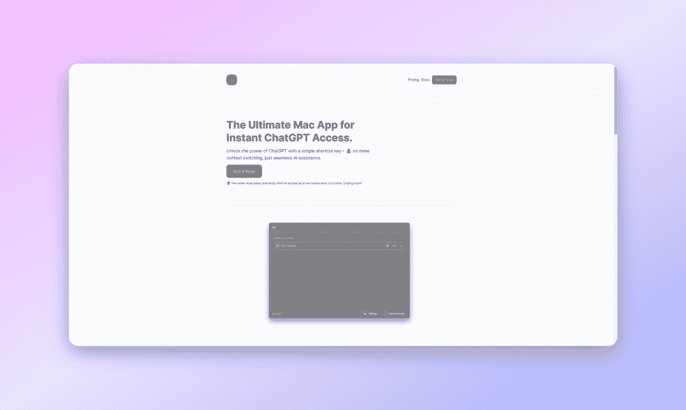

## Chatgpt-md Obsidian集成ChatGPT

Obsidian集成ChatGPT的插件，可以在Obsidian中和ChatGPT聊天，聊天记录就是你的笔记。还内置的很多提示词模板。而且由于Obsidian本身就是Markdown软件，所以Chat GPT输出的Markdown格式可以被完整的渲染出来。

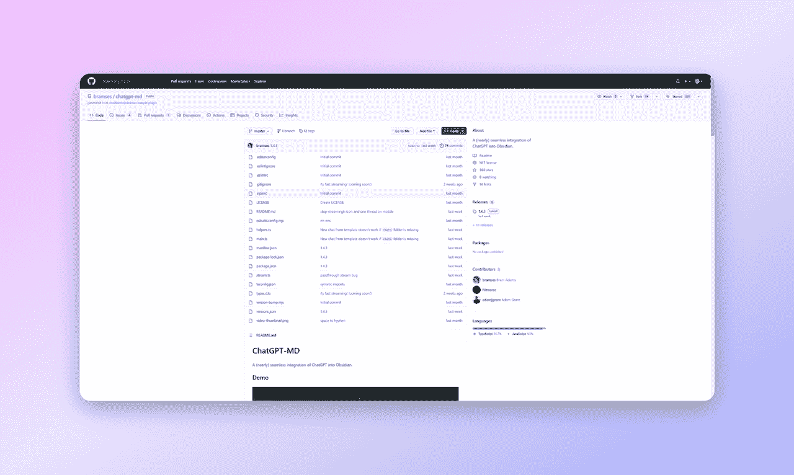

## ChatGPT Next Web-一键部署你自己的ChatGPT

一键免费部署你的私人 ChatGPT 网页应用。支持从Vercel 一键部署，功能非常齐全切换模型、提示词自动补全都有，特别是受控访问开启后就可以部署一个只给自己家人用了。非常方便。

可以在这里试用： [https://chat-gpt-](https://chat-gpt-next-web.vercel.app/)next-web.vercel.app/

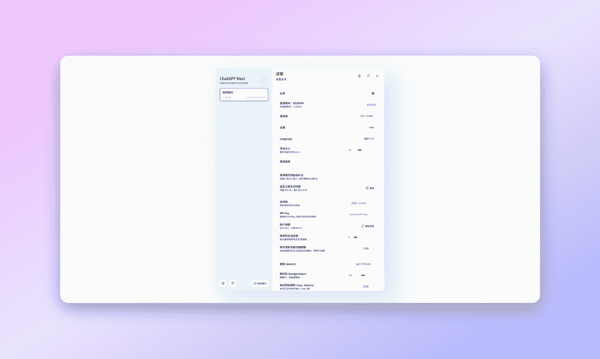

## Prompt Engineering基础教程

非常详细的提示工程教程，不是那些死板的模板，真的会解释为什么以及提供相关的例子。建议还是减少对那些提示词模板的依赖，如果依赖提示词模版，下意识的一些简单的问题也得非要去找个模版来问，没有模版就不敢问，这样效率反而更低，也会扼杀子自己的创造性。

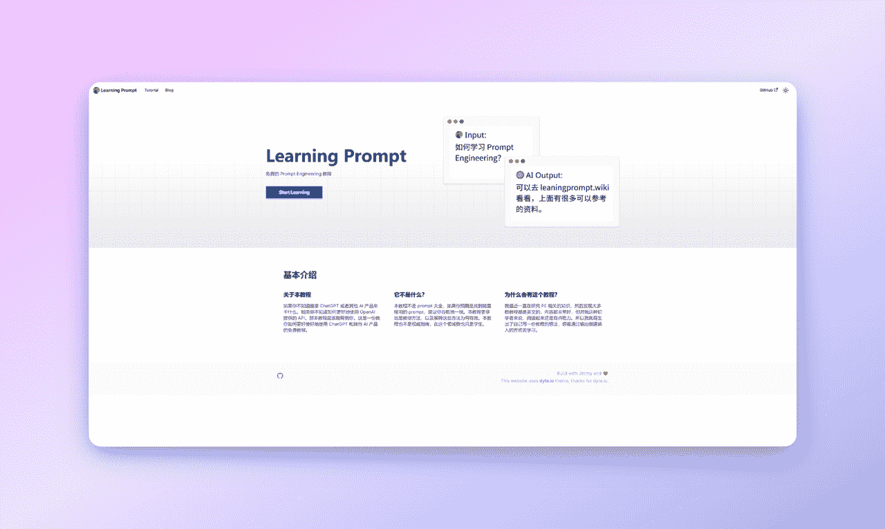

## Spline AI-3D建模AI功能

有点离谱的，著名的网页端3D建模工具Spline推出了自己的AI功能，输入文字就可以生成3D内容或者对已有的模型进行更改。使用提示生成对象、动画和纹理。具体功能有：通过描述要创建的内容来生成对象和场景、修改对象、应用材质、添加照明等、使用文本提示为 3D 对象生成无缝纹理。

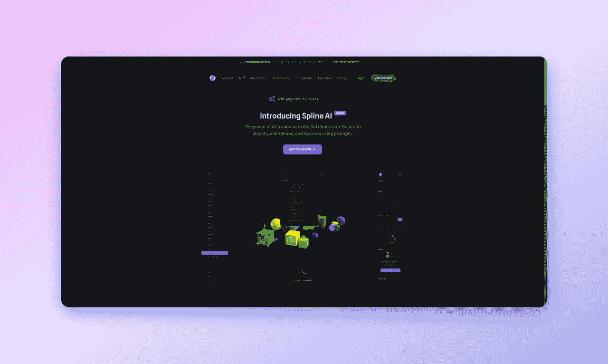

## Gamma-AI对话生成PPT和网页

与之前推荐过的Tome类似，不同的是这个完成度很高，你不只可以通过对话生成完整的PPT，还可以通过对话持续的修改和调整其中一部分。整体的模板和素材也比Tome要丰富。

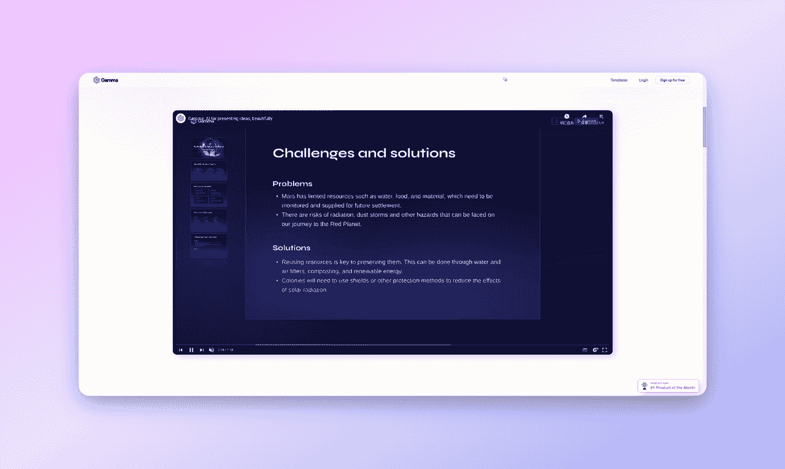

## [Master GO AI实验室](https://mp.weixin.qq.com/s?__biz=MzI3NzEzODcyNQ==&mid=2247499928&idx=1&sn=1d4a5ef930c6c0c167d6e061d4389756&chksm=eb685cd2dc1fd5c4f14e54efc1ff91475267bda5748333fc159ca856430b9a50bcb6d463ac35&mpshare=1&scene=1&srcid=0328FWOnyF2t7ndNHWNdnKix&sharer_sharetime=1680012497231&sharer_shareid=7042de3904a65e26a6b06d39fb33b228&key=58f7be6858e2dd2970ac6ebb28c626476287e109cc9a707dcc409efa97572f5faa23d4dfb0fc91941933dabb63e98922c49c9d5d3952304731338ff6e64f52a5647385b02419cc58ce8477652429bf1966502790073b62e4df70399764720a55e99aa4db61097acba2fc11f124146377dea3002a616e62de572c8fa5c2e1f9a4&ascene=0&uin=Njg5MTY1ODIw&devicetype=Windows+11+x64&version=63090217&lang=zh_CN&countrycode=TT&exportkey=n_ChQIAhIQC3VBPs2ffFX68L6xywuUXRLTAQIE97dBBAEAAAAAALKZBNdTpsAAAAAOpnltbLcz9gKNyK89dVj0NyAtXwaRSEoJOQ8pHkwCA6W06UB1koGEnuuWtmFKcCdnmIgzKncq4TKSpZBpNiQ3GHqps%2B%2FhzJq5RFIPf52yxbNCgLcojGd9TsQll9w9xOLrQXFJktR6eY%2B92oa8%2FAXqkRI104GigHZPiP%2F1COcp2OP6JP4naCnvjX%2BFp%2BmEqS4qKwrPeREXZnyoRatTTJNG6Ob8x30cIfylXuvFHwyH40naL1thNZxy%2B%2Fh%2Bu8o%3D&acctmode=0&pass_ticket=0OPkkdXBQTOkLEC6T0QbMu0mOw5rXz6GAJWS%2BcMZAqfSxZPMLBdRUqWE6GNdHIbZLKixEwlmq7VcRTItVzLPiA%3D%3D&wx_header=1)

国内模仿Figma的软件之一 Master GO也公布了自己的AI能力，也就是对话生成设计稿。

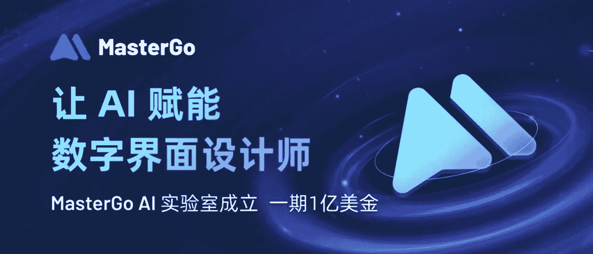

## [即时 AI-AI生成设计稿](https://mp.weixin.qq.com/s/ftXQWQE2PwP-jv97G1rnQQ)

另一家也推出了AI能力的预告，但跟上面一样都是期货。

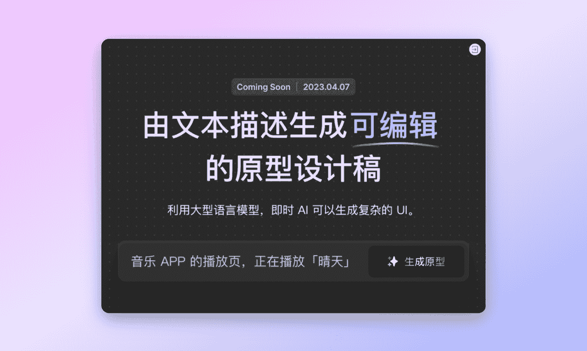

## Taskade-AI驱动的协作软件

在应用程序内部生成任务列表**、**思维导图和结构化笔记。也支持多人写作和视频沟通。

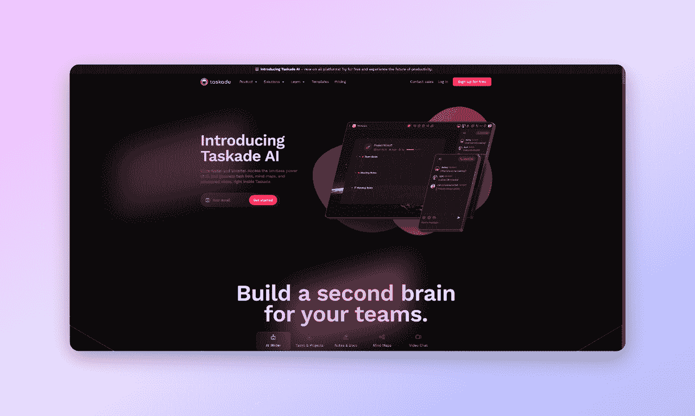

## Uncle rabbit-全息对话AI形象

第一个对话式全息人工智能，形象非常可爱。“任何足够先进的技术都无法与魔法区分开来”相信我从来没有对我们所做的任何事情说过这句话。

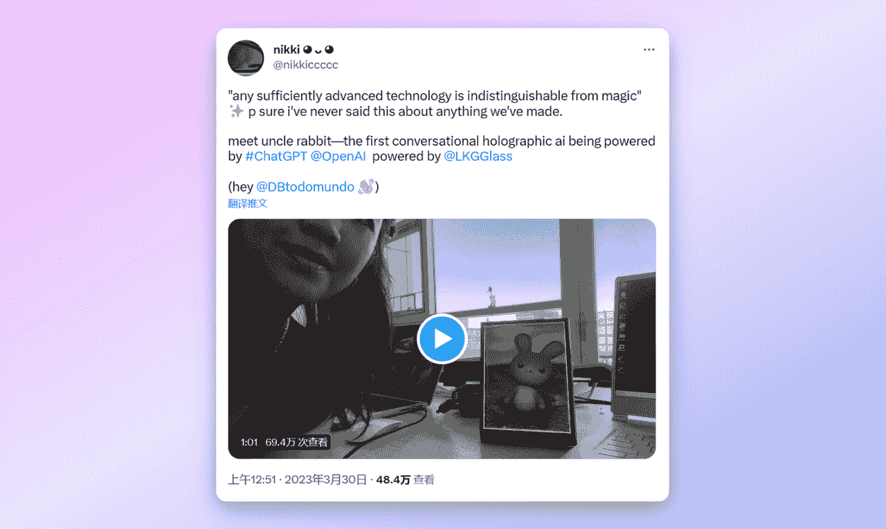

## Numerous-Chat GPT表格助手

支持谷歌文档的表格和Excel，可以通过举几个例子来教它做任何重复性任务。对数百个项目进行分类，格式化一千个单元格，进行情绪分析等。可以编写营销文案、SEO 描述、对客户消息的回复等。

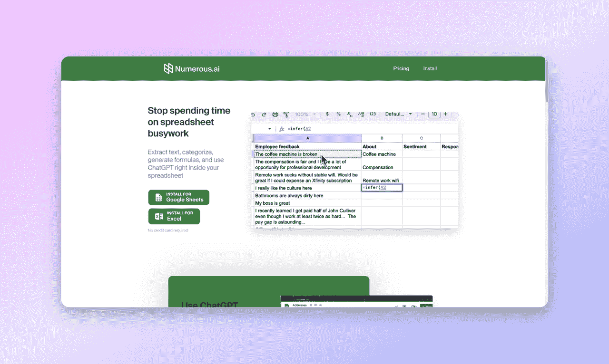

# 🧑🎓学习资源

## [如何优化大语言模型降低成本](https://www.vantage.sh/blog/optimize-large-language-model-costs?utm_source)

LLM（大型语言模型）采用按使用量计费的模式，即根据应用程序和AI之间交换的文本字符（标记）数量收费。每个AI都有一个固定的“标记窗口”，用于存储当前任务的上下文长度。例如，GPT-4可以使用8,192个标记来存储聊天的历史记录。尽管上下文长度是固定的，但提示长度和响应长度是不可预测的。这些独特的计费参数导致了一系列新的成本优化技术，供与LLMS一起工作的开发人员使用。

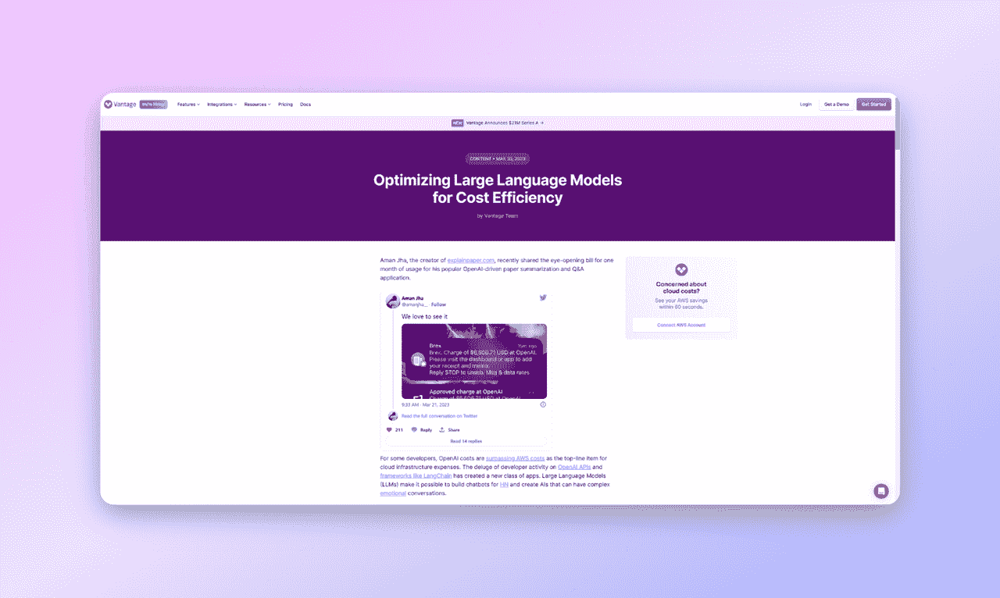

## 过去一年最重要的语言模型论文汇总

本文档是我正在进行的文献综述，供那些想要跟上人工智能进展的人们使用。它涵盖了22种模型、11种架构变化、7种预训练后技术和3种训练技术（以及5件与此无关的事情）。所有论文都会链接到实际的PDF文件，而不是ArXiv页面，并且选择主要基于我已知的事情进行策划。本文排列顺序大体按照重要性和独特性排列。这次排除了系统/性能和对齐性，因为它们是我最喜欢的，我希望能更好地处理它们。对齐研究非常重要，我希望有一天能够充分发挥它的作用！而且，可能并非模型列表中的所有论文都值得阅读。

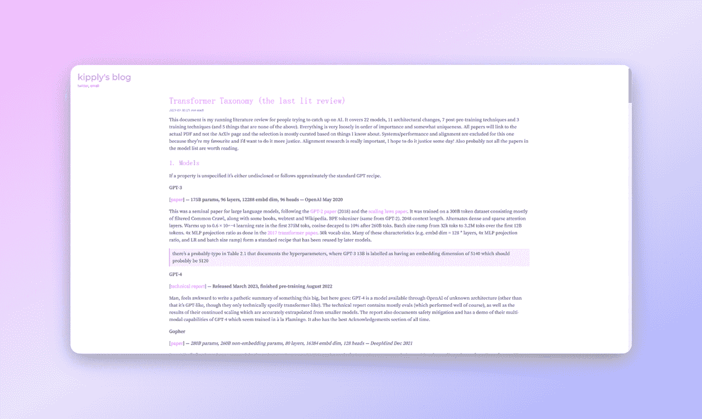

## 使用 chatGPT 呈现屏幕截图和渲染 HTML

Urlbox的ChatGPT插件使用教程，可以用来快速生成指定网页指定位置的截图，你甚至能指挥ChatGPT帮你截图的时候去掉广告的部分。也能通过自然语言指挥ChatGPT渲染网页样式。

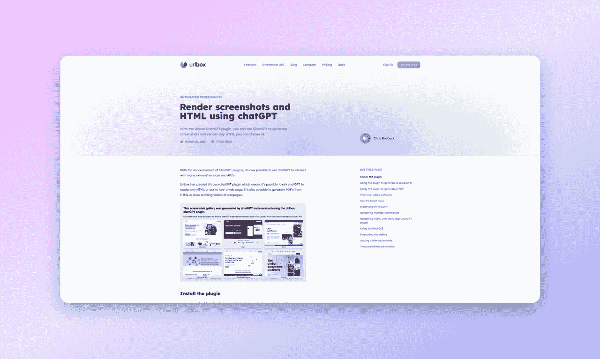

# 🔬精选文章

## 如何使用 AI 做实际应用的事情：新指南

我们生活在实用人工智能的时代，但许多人尚未体验过它，或者如果他们已经使用过，可能会想知道这有什么大不了的。因此，我们准备了这份指南。这是我今年早些时候为我的学生准备的修改版本，但很多事情已经改变了。这是一个概述，介绍如何让人工智能做实用的事情。

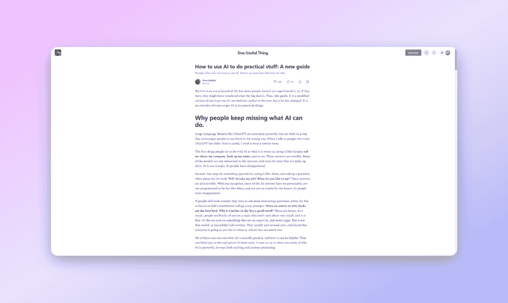

## [基于 GPT-4、Pinecone 和 LangCha](https://yoheinakajima.com/task-driven-autonomous-agent-utilizing-gpt-4-pinecone-and-langchain-for-diverse-applications/)in 的任务驱动自主代理，可用于多种应用

在这项研究中，我们提出了一种新颖的任务驱动自主代理，利用OpenAI的GPT-4语言模型、Pinecone向量搜索和LangChain框架，在各种领域执行广泛的任务。

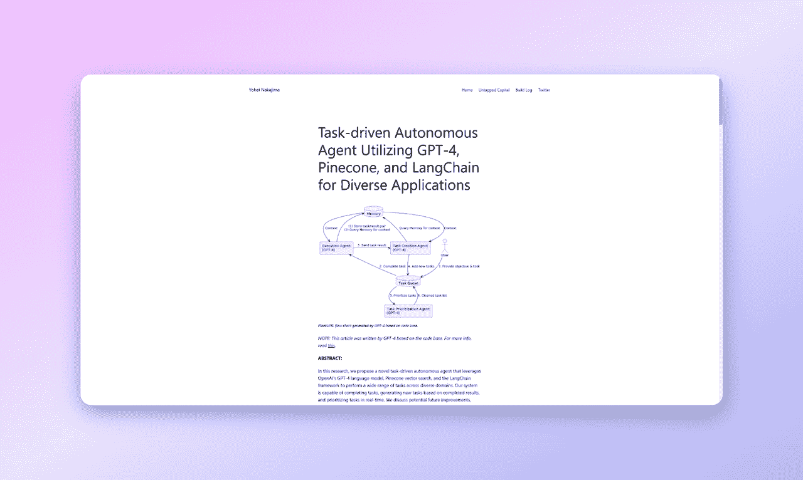

## 埃隆 · 马斯克、山姆 · 奥特曼和 OpenAI 的秘史

马斯克提出了一个可能的解决方案：他将接管OpenAI并亲自管理。然而，Altman和OpenAI的其他创始人拒绝了马斯克的提议。马斯克反过来离开了公司，并放弃了一笔巨额的计划捐款。这场冲突的影响，最终导致了马斯克于2018年2月20日宣布离开公司，塑造了正在改变世界的行业，以及其中心的公司。

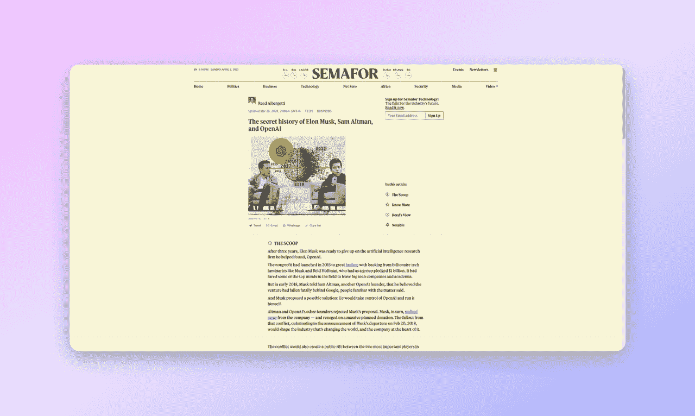

## The Age of AI：拾象大模型及OpenAI投资思考

上个月，我们开源了拾象 AI Infra 投资图谱，对整个机器学习工作流和价值链进行拆解。本研究则是拾象团队在过去[ 2 个月](https://www.xiaoyuzhoufm.com/episode/6425e73a179eec5331c84237)对大语言模型的边界，大模型公司格局、生态，以及顶级玩家 OpenAI 的 deep dive。建议搭配拾象的 这个播客 食用。

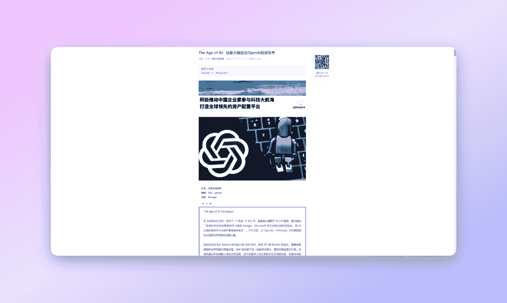

## Open AI design system 的搭建理念和内容展示

Open AI的设计系统原来是他们做的，主要突出了两方面的内容：为了强调 AI 核心的人机协作，该网站利用了两种核心品牌形象：生成 AI 艺术和以人为本的摄影。摄影使用暖色调和浅景深来展示而不是讲述公司背后的人的故事。 引入了衬线和无衬线排版，以在网站中创造连续性并反映 OpenAI 使命的庄严。数据可视化系统采用最小的方法，为用户解释和综合数据留出足够的空间。

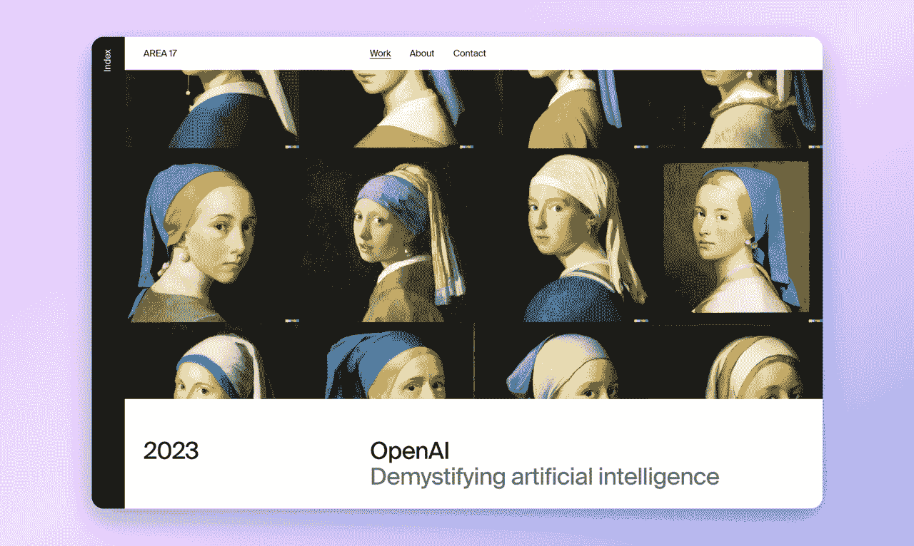

## 英伟达报告： 生成式 AI-彻底改变企业的工作方式

了解与生成式人工智能相关的关键技术的细微差别。参考综合指南，了解最具变革性的生成式人工智能商业应用，以及流行工具、顶级应用案例和示例。通过跟上未来发展的步伐，获取在生成式人工智能方面的竞争优势。

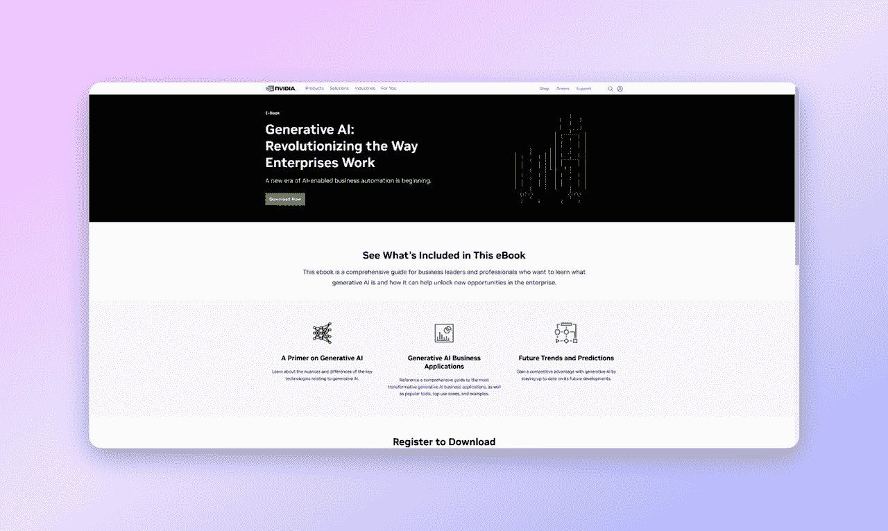

## 彭博社Bloomberg-金融领域大型语言模型

彭博社利用自己的数据训练的金融领域大型语言模型。50B 个参数，可能是 最大的特定领域模型。

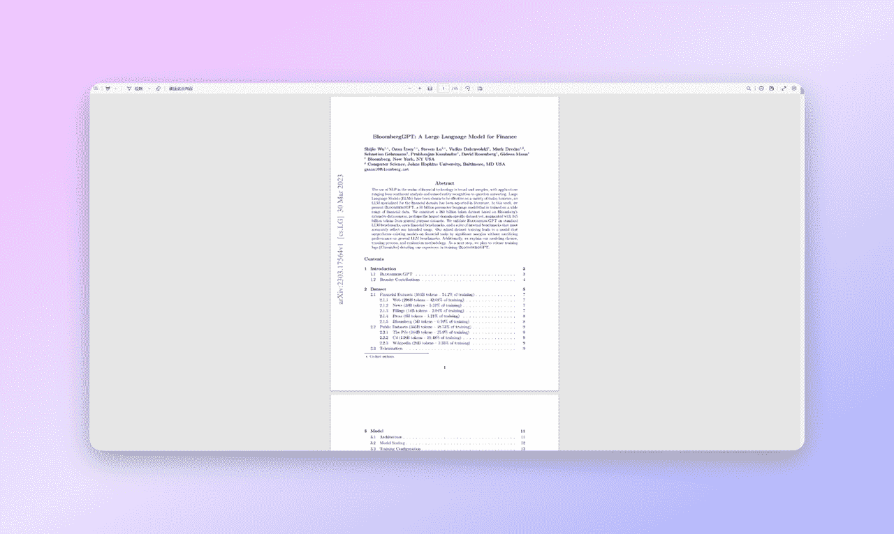

## 高盛报告-人工智能可能会取代 300亿个全职工作岗位

它可能会取代美国和欧洲四分之一的工作任务，但也可能意味着新的工作和生产力的蓬勃发展。

它最终可能会增加全球年生产的商品和服务的总价值7%。

报告指出，生成式人工智能能够创建与人类工作无法区分的内容，是“一项重大进展”。

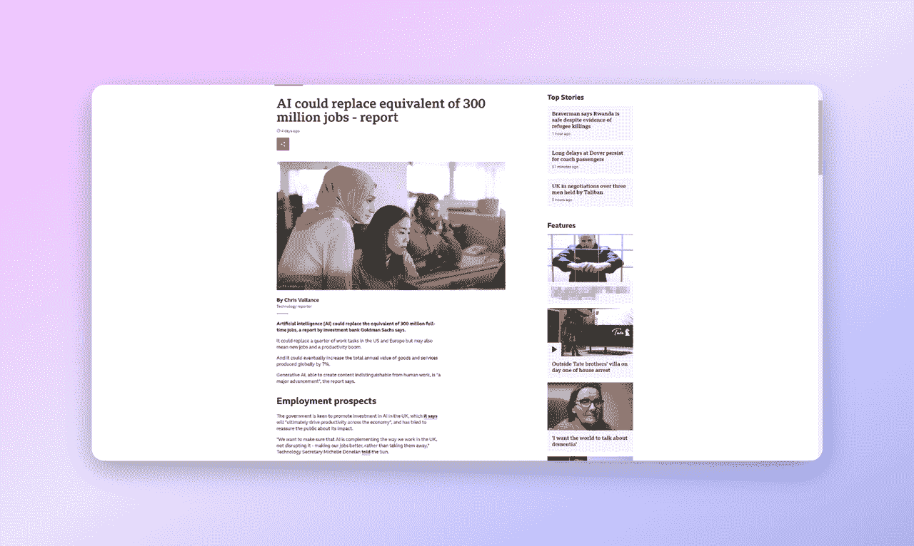

## [与 Hugging Face 的首席执行官](https://blog.eladgil.com/p/video-and-transcript-fireside-chat) Clem Delangue 进行的交流

他们讨论了Hugging Face、开源和人工智能。Clem Delangue谈到了Hugging Face的起源，它最初是一个AI电子宠物，后来转型成为目前最常用的AI开放平台。他还谈到了Hugging Face未来的方向，包括支持更广泛的AI应用领域，并使更多人能够更容易地构建AI。此外，他们还讨论了关于人工智能的伦理问题以及如何防止人工智能被滥用或滥用。

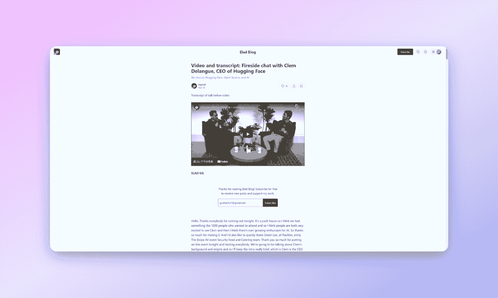