# AIGC Weekly #14

> 来源：[https://waytoagi.feishu.cn/docx/L3RbdB77JoHNSMxHcLkcxLa8nLe](https://waytoagi.feishu.cn/docx/L3RbdB77JoHNSMxHcLkcxLa8nLe)

> 🔗 原文链接： h[ttps://op7418.zhub](https://op7418.zhubai.love/posts/2252030503228076032)ai.love/posts/22...

> 发表时间：2023-03-27

工具：Midjourney v5

提示词：pastel colored silk, inside twisted waves, defocus, smooth, modern minimalist, blender, 3d render, unreal engine 5, industrial design, white background, studio lighting, zoomed shoot --ar 3:2

> 如无意外会在每周一更新，主要介绍上周AIGC领域发布的一些产品以及值得关注的研究成果，由于我自己是一个设计师，所以在一些专业内容的描述上可能存在问题，欢迎在渠道帮我反馈及更正，如果觉得有收获的话也可以订阅一下。（本期部分文案使用了Notion AI以及Chat GPT帮助润色和翻译）

上周我[用](https://op7418.zhubai.love/posts/2251721691841511424)GPT-4创建了一个信息收集机器人来帮助我收集和整理AI相关信息。 机器人主要的操作就是监控指定的推特账户，在发出信息后交给ChatGPT翻译并总结，之后把总结的内容发送到Discord指定频道里。下面是简略的教程。详细内容和zapier机器人模板可以看这里： https://op7418.zhubai.love/posts/2251721691841511424

首先简单说明自己的需求（如何将我收集信息的流程自动化并且对信息进行处理和整合），让GPT-4给出一些可能的建议。

之后从GPT-4给出的建议获取更具体的可执行的方法，之后我发现写代码部署服务的过程有点复杂。于是让他给出zapier创建机器人的方法。

然后按照他给的步骤创建机器人。第一步的触发器选择推特APP，绑定自己的推特账号，选择需要监控的账号或者列表。

之后将信息发送给ChatGPT，还是选择APP为ChatGPT，填写自己的Open API Key，选择需要GPT处理的信息，填写提示词告诉GPT要如何处理信息，以及信息的输出格式。

最后链接Discord创建机器人，选择发送信息的频道和需要发送的信息（也就是ChatGPT的输出内容）。

# ❤️上周精选

## Open AI 发布 ChatGPT插件系统

ChatGPT的插件可以帮助 ChatGPT 访问最新信息、运行计算或使用第三方服务。

他们推出了3个插件示例：

网页浏览器：将Bing添加到对话中，现在可以访问互联网内容。

代码解释器：在沙盒和防火墙执行环境中添加一个实时的Python解释器。

检索：为你的个人和组织文档提供语义搜索。

已被邀请进入等候列表的插件开发者可以使用我们的文档为 ChatGPT 构建插件，然后在向语言模型显示的提示中列出启用的插件，并提供说明文档，指导模型如何使用每个插件。第一批插件由 Expedia、FiscalNote、Instacart、KAYAK、Klarna、Milo、OpenTable、Shopify、Slack、Speak、Wolfram 和 Zapier 创建。

[这里加入等待列表](https://openai.com/waitlist/plugins)

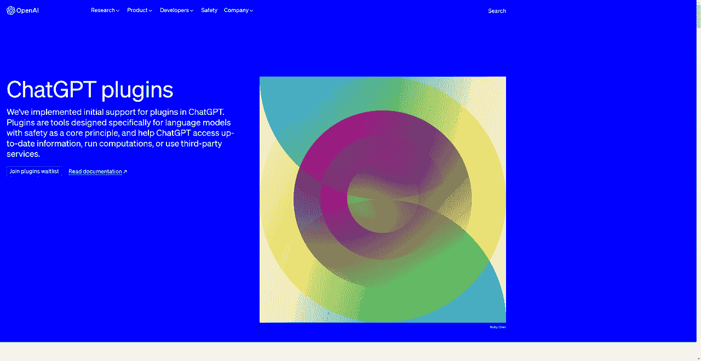

[这篇文章 ](https://andrewmayneblog.wordpress.com/2023/03/23/chatgpt-code-interpreter-magic/)有一些获得插件访问权限之后的插件能力实验，比如制作游戏生成二维码、下象棋、生成音乐等。

[这位老哥 ](https://twitter.com/rez0__/status/1639259413553750021)在破解Open API之后发现了一些还没发布的插件，比如加密货币价格插件、DAN插件等。

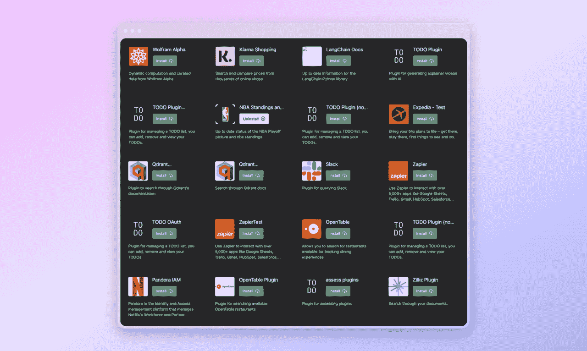

[lencx ](https://twitter.com/lencx_)以非常快的速度发布了 [插件开发指南 ](https://mp.weixin.qq.com/s/AmNkiLOqJo7tEJZPX34oeg)和开源了 [案例代码 ](https://github.com/lencx/chat-todo-plugin)。

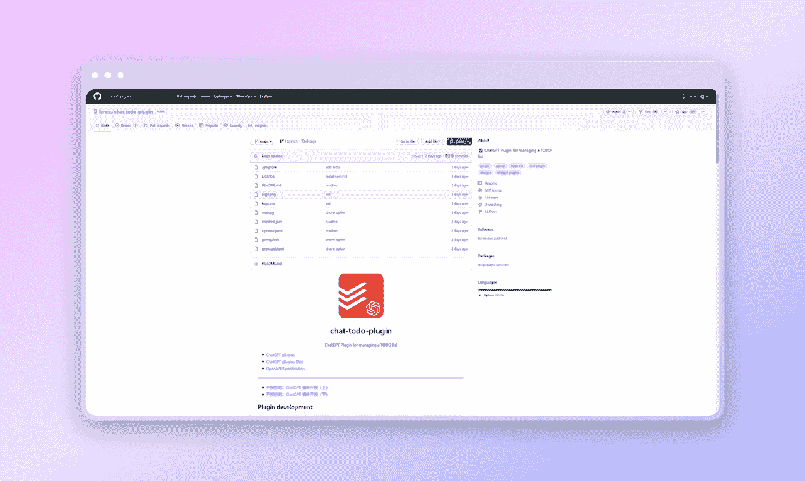

[Wolfram插件 ](https://writings.stephenwolfram.com/2023/03/chatgpt-gets-its-wolfram-superpowers/)可以使Chat GPT的数学计算能力提高到匪夷所思的地步，解题和生成复杂可视化图像都没问题。

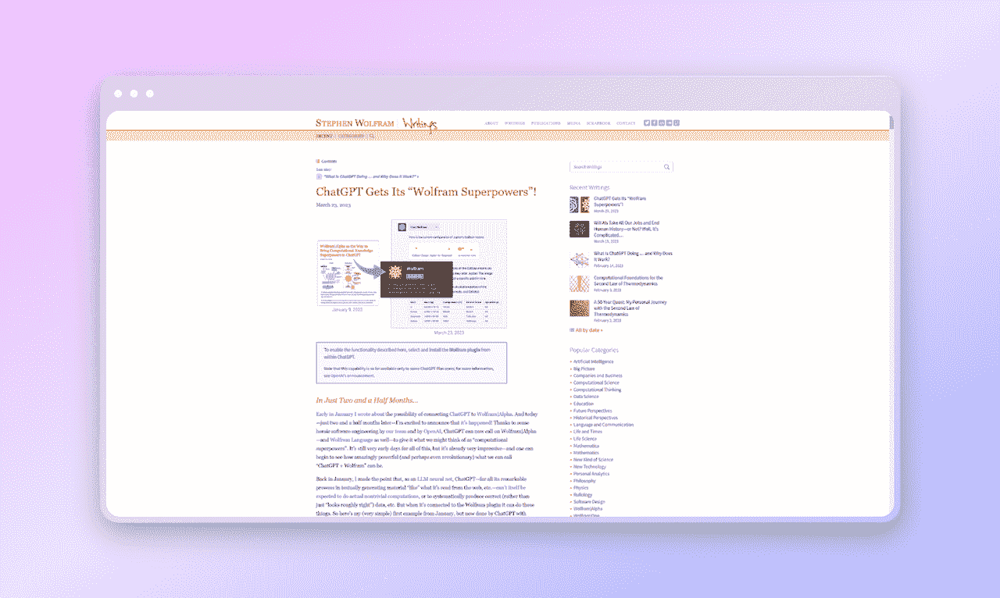

## Github 发布 GitHub Copilot X

Copilot X由四个产品组成，更痛苦的是四个产品的等待列表申请是分开的，可以点击标题申请。

Copilot Chat：不仅仅是一个聊天窗口。它可以识别开发人员键入的代码、显示的错误消息，并将其深度嵌入到 IDE 中。

Copilot for Pull Request：改善人类协作。现在GPT不仅可以加速单个开发人员，还可以加速整个开源社区。

Copilot CLI：有时Bash很不直观和笨拙。不再需要Bash，只需使用英语。

Copilot文档：由于GPT-4的上下文长度更长（32K个标记），可以一次性适合整个文档。无需记忆任何文档 - 只需从提示中检索即可。

## Adobe 发布了 Adobe Firefly

Adobe Firefly由一系列AI能力组成，包括：

+   快速生成图片，只替换图片中的某个部分；

+   从你的手绘草稿里面生成矢量图形并且可以快速编辑

+   可以通过文本对视频进行修改，比如春天改成冬天

+   通过简单的提示创建海报、ppt等

+   通过简单的3D模型生成图像

可以从 [这里 ](https://firefly.adobe.com/)[加入等待列表](https://twitter.com/icreatelife/status/1638221768258101262?s=20)。这里有一些已经获得权限的人 生成的内容 。同时Adobe宣布自己训练内容都是从Adobe Stock里获取的可以保证生成图像的版权，同时生成的图像也会有特殊的标记可以溯源。

但是其实过去一年时间有很多人将自己从Midjopurney或者Stable diffusion生成的图像上传到了Adobe Stock里，Adobe怎样保证这部分内容的版权呢。

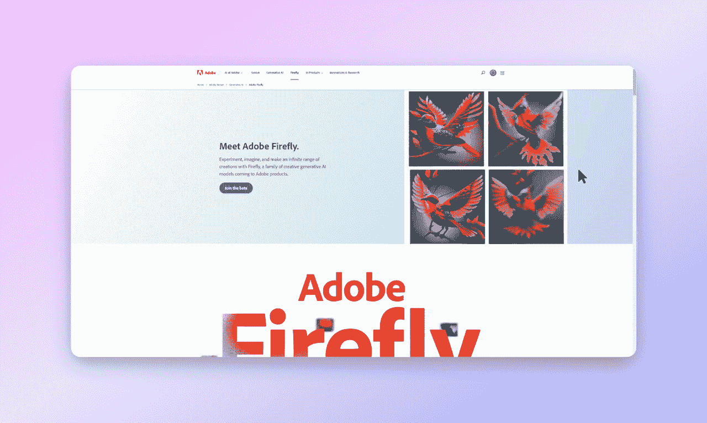

## 微软推出了 Microsoft Loop

Loop是微软早就开始预热的在线文档协作软件，整体界面布局长得很像Notion但是可能仅仅是借鉴了布局和交互，从定位上可能不想做跟Notion一样的All in one工具，所以理论上应该不存在竞争关系。

[Loop可](https://medium.com/@MicrosoftDesign/microsoft-loop-and-the-future-of-collaborative-experiences-d1e9b15d0717)以说这是微软近年来UI和交互做的最好的产品了。微软甚至写了 一篇文章 来介绍Loop的设计过程。而且原生支持中文，（Notion：你在说什么？我听不见！）它具备两种AI能力：

Copilot：从最新、最强大的人工智能创建的内容开始，直接融入您的工作流程中。使用Copilot插件获得实时灵感，并与您的团队继续编辑和完善其建议。

Jumpstart workspace：使用人工智能帮助启动您的工作区，摆脱空白画布的恐惧感。从基于您的工作区标题生成的内容建议库中选择，并直接将它们插入到您的工作流程中。

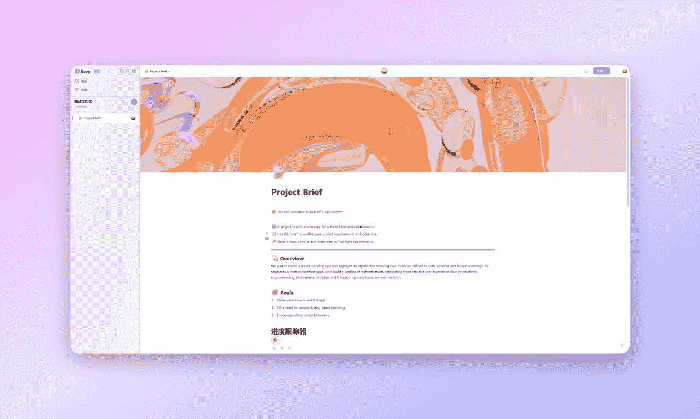

## Canva 发布了十项 AI 功能

在Adobe Firefly推出后的两天Canva也不甘示弱，推出了自己的AI能力：

1 — Magic Design：借助 Magic Design，您现在只需上传图像、选择样式，即可在精选的个性化和完全可自定义模板中观看它栩栩如生，以便下载或进一步编辑。

2 — Draw your Ideas：我们很高兴发布一种新的方式来绘制任何类型的设计。另外，如果您需要帮助，我们会神奇地识别您正在创建的内容并平滑形状。

3 — Translate Designs：创建设计后，您需要与世界分享。借助我们全新的翻译功能，您可以比以往更轻松地进行跨境交流，并使用受众的语言。

4 — Magic Eraser and Magic Edit：使用魔术橡皮擦，您可以在眨眼间神奇地消除不必要的干扰。

5 — Beat Sync：只需选择或上传您要使用的音乐曲目，然后只需单击一下，Beat Sync 即可将您的素材与配乐的节拍完美对齐。

6— Magic Presentations：跳过空白页，生成下一个Canva演示文稿的初稿，其中包含大纲、幻灯片和内容。只需用几句话给 Magic Design 您的想法，然后看着它立即直观地在具有专业外观的幻灯片中填充您的故事。

7 — More Magic Write：根据你的要求，快速生产营销文案，并填充到设计内容

8 — We’ve evolved Text to Image：文本到图像可让您在几秒钟内从简单的描述中创建独特的图像。

9 — Animations：只需绘制您希望动画采用的路径，沿途加快或减慢速度，然后就会自动生成路径动画。

10 — Brand Hub：Canva的新品牌中心 带来了团队在Canva的编辑体验中创建品牌设计所需的所有成分。您的品牌模板、品牌指南、字体、图形、徽标、项目等将在一个地方提供，因此任何人都可以快速创建品牌。

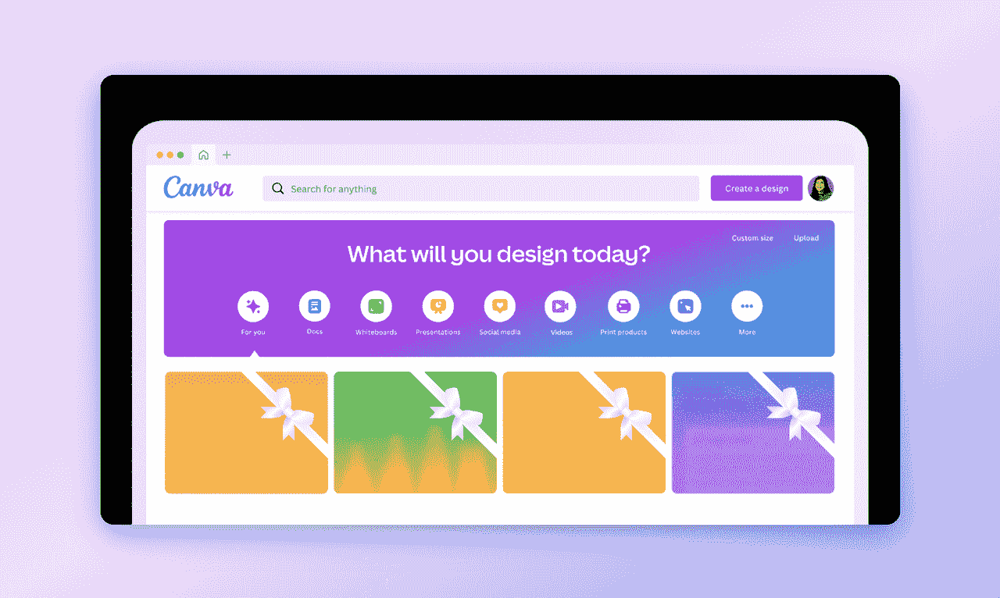

## [Eipc 发布了 UE5 的 M](https://www.youtube.com/watch?v=pnaKyc3mQVk)etaHuman Animator 功能

MetaHuman Animator 能力可以模仿一段视频的人物表情和动作将其换成CG动画。

它优化了4D流程，可以在单台计算机上运行，使用iPhone或立体声专业系统，并可以将视频和开发数据转换为高保真度的性能动画，并具有令人信服的舌头动画。它生成的骨骼可以从仅三帧视频和数据中预测所有面部表情，忠实地复制原始表演。

具体的落地可以看 [这个推特 ](https://twitter.com/op7418/status/1639860522190503937)，利用 UE5 的 metahuman 功能和 stablediffusion Multi-ControlNet 结合做的虚拟人，闪烁也还行可以接受。比D-ID那个方案自然多了。感觉马上就能落地了。

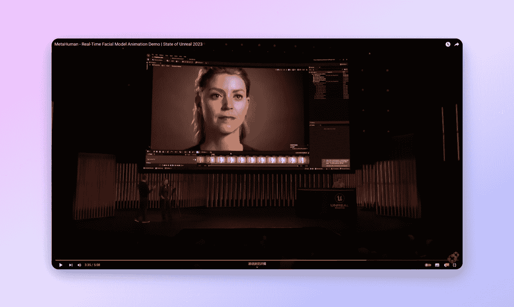

## [谷歌正式发布了Bard的测试版](https://blog.google/technology/ai/try-bard/)

[Bard由研](https://blog.google/technology/ai/lamda/)究大型语言模型（LLM）提供支持，特别是 LaMDA 的轻量级和优化版本，并将随着时间的推移更新更新，功能更强大的模型。它基于谷歌对高质量信息的理解。

虽然也有等待列表但是基本上申请后立刻就能获得权限，没有邮件也换美国IP试一下可能就能用了。

Bard从界面设计的细节和体验上比BIng强太多了，但是能力上差的有点远只认英语而且内容无法给出准确来源。逻辑性也很差老出错。发布后基本没有水花。

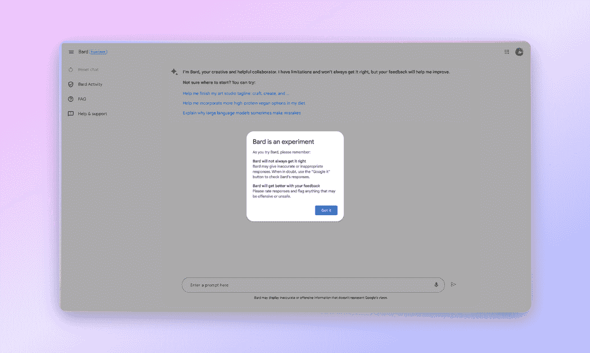

# ⚒️产品推荐

## Reflect-双链笔记软件获得AI加持

主打反向链接构建知识网络的笔记软件Reflect也加入了GPT-4的AI能力。除了可以给出内容建议外，他们也开源了他们的提示词，而且允许用户自定义提示词。

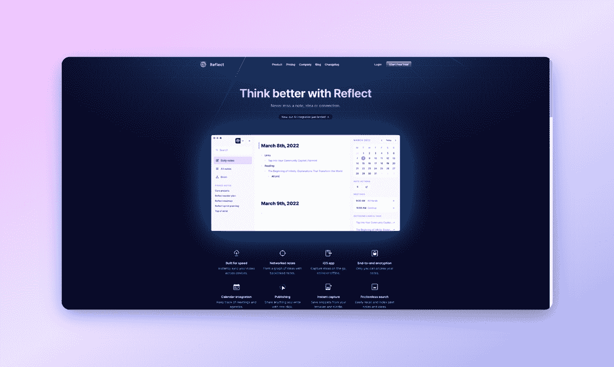

## 诗片-你拍的照片里其实也藏着一首诗

[@no13bus ](https://twitter.com/no13bus)开发的产品，设计和立意都非常好。诗是一幅画，你拍的照片里其实也藏着一首诗，选择一张照片，这款产品会匹配对应的诗（暂时只有中国古诗词），会发现照片的表达变得更加丰富了，让「诗片」挖掘你照片里的诗意。

## Dubverse AI-视频配音方案支持25种语言

开始在 150 多位演讲者中借助 AI 的强大功能为您的视频配音，随时随地为您的任何语言的视频生成超级准确的字幕，为您的视频创建超逼真的类人配音。

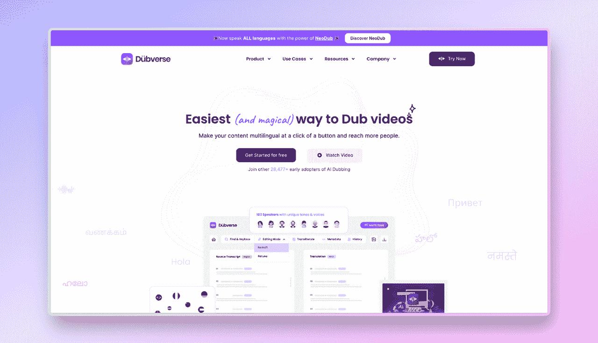

## Markprompt-自动为你的Markdown文档创建智能机器人

自动为你的文档站点创建聊天机器人，GPT-4驱动，未来还将支持数据查看。

## Castmagic-AI帮助生成播客内容

上传你播客的音频可以对整集进行清理、转录并准备以书面形式发布。时间戳、主题和你所有的表演笔记都需要立即完成。对节目中讨论的内容和每位演讲者的分解内容的简短总结。

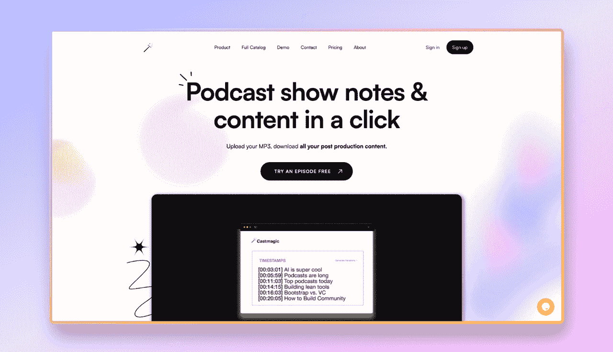

## [TERRA-AI辅助的视频处理](https://www.welcometerra.com/)

让我们的平台找出您讲话中的错误，识别模糊的帧，甚至标记您上传的视频类型。革命性的语音转文本技术让您可以通过文本编辑器实时编辑视频。通过我们的高级故事板，我们为您提供了一个讲述您的故事的起点，无论是解释器还是操作方法视频。

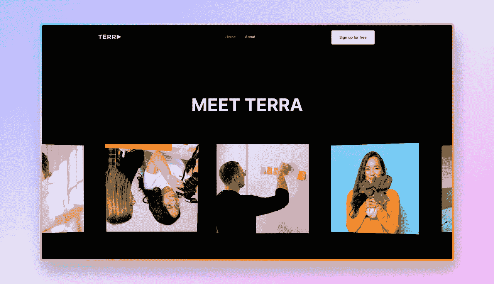

## Plazmapunk-从音乐生成视频

## Superhuman-AI对邮件进行分类

我们利用人工智能的力量自动对您的电子邮件进行分类。这与尖端垃圾邮件过滤器使用的技术相同，但应用的方向相反。现在它会检测并突出显示您最重要的电子邮件。也支持将邮件和联系人绑定更好的维护关系。

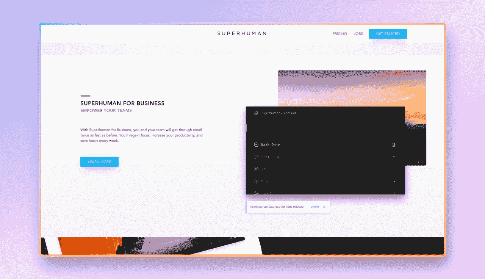

## Bardeen-将你的一切自动化

Bardeen是一款无需代码的工作流程自动化应用程序，类似zapier，只需一个快捷键即可取代您的重复性工作。连接您最喜爱的网络应用，并在几分钟内建立自定义的自动化程序。

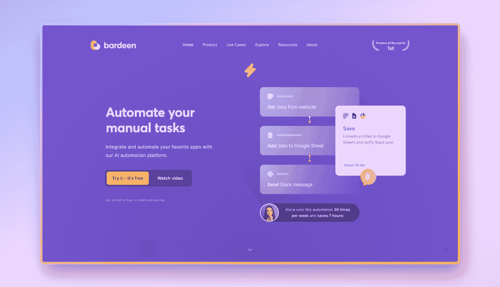

# 🧑🎓学习资源

## [如何在 10 步 45 分钟内构](https://twitter.com/charlierward/status/1638303596595892224?s=20)建一个功能正常的 Chrome 扩展程序

“在没有编码经验的情况下，我如何在 10 步 45 分钟内构建一个功能正常的 Chrome 扩展程序。使用 ChatGPT + Replit。”

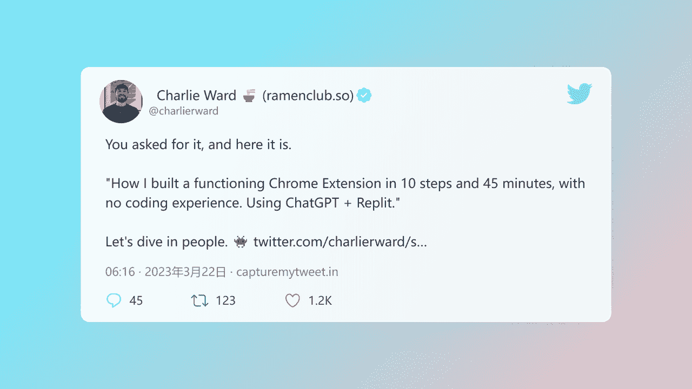

## 斯坦福大学免费课程- 人工智能简介

人工智能（AI）是一个历史悠久的领域，但仍在不断积极地发展和变化。在本课程中，您将学习现代 AI 的基础知识以及 AI 的一些代表性应用。在此过程中，我们也希望让您对人工智能领域的众多应用和巨大可能性感到兴奋，人工智能继续扩展人类的能力，超出我们的想象。

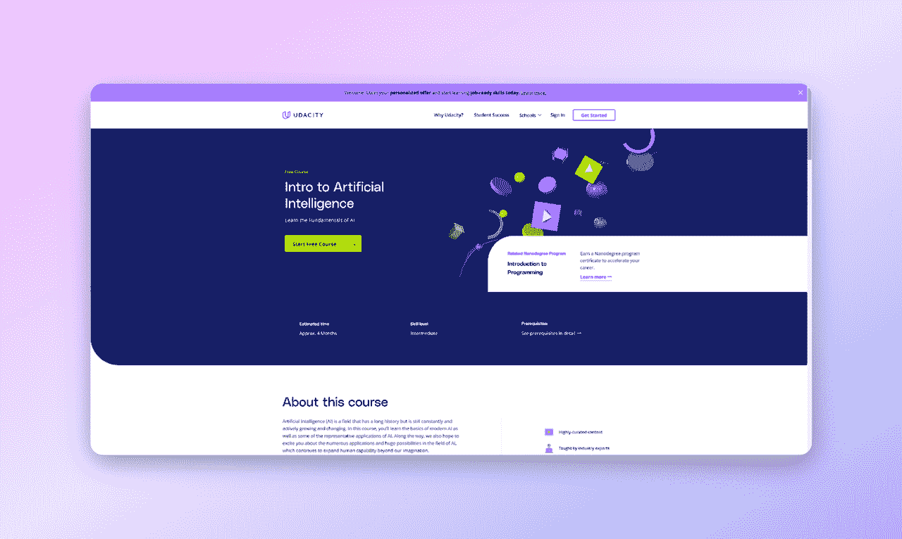

## [你看过的最好的 AI 课程](https://kozyrkov.medium.com/the-best-ai-course-youve-ever-watched-c15e0a0bbb0a)

该课程旨在为您提供有效参与机器学习以解决业务问题以及在日益由人工智能驱动的世界中成为好公民所需的工具。MFML非常适合所有人;它侧重于概念理解（而不是数学和编程细节），并指导您完成构成机器学习成功方法基础的想法。它有适合每个人的东西！

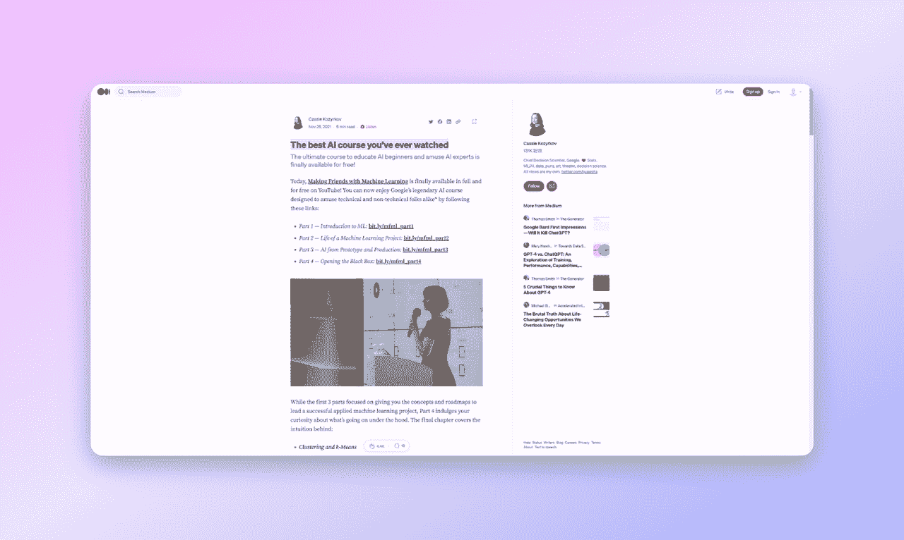

## Midjourney保持人物脸型的教程

[@jesselaunz ](https://twitter.com/jesselaunz)的一系列实验，如何利用Midjourney 生成的人物脸型更换不同的风格甚至多人照片。

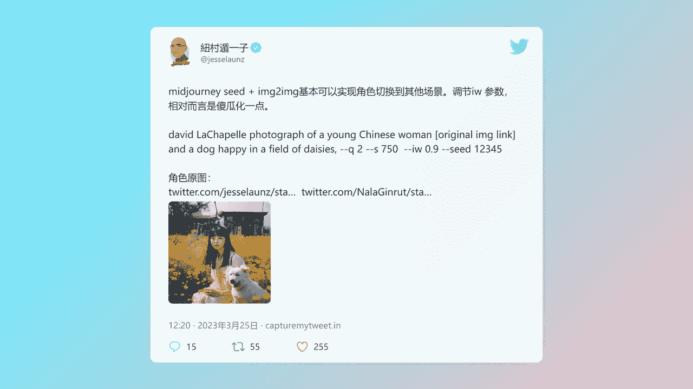

# 🔬精选文章

## [Sam Altman：OpenAI CEO 谈 GP](https://www.youtube.com/watch?v=L_Guz73e6fw)T-4、ChatGPT 和人工智能的未来

OpenAI首席执行官Sam Altman讨论了AGI的发展以及它将带来的社会变革。GPT-4，OpenAI的语言模型，正在对人类数据进行训练，使其感觉像与另一个人互动。然而，人们对将人工智能与人类的偏好和价值观保持一致感到担忧，特别是在仇恨言论和有害输出方面。OpenAI正在为GPT-4开发节制工具，并试图找到一种平衡。作者认为，人工智能的发展应该是缓慢和谨慎的，重点是安全。首席执行官计划到世界各地与用户交谈，使OpenAI成为一个更加以用户为中心的公司。OpenAI有责任将他们的工具造成的伤害降到最低，将利益最大化。最近的硅谷银行事件揭示了我们经济的脆弱性，以及在人工智能系统薄弱时尽早部署的重要性。需要进行法定修改以保证存款，OpenAI认为世界将继续随着AGI的发展而迅速转变，要求机构迅速适应。

## GPT-4 ，通用人工智能的火花

微软的一篇论文他们在很早期就接触到了 GPT-4 的非多模态版本，并对齐进行了详尽的测试。这篇论文就是整个的测试过程和结论。

“GPT-4的能力具有普遍性，它的许多能力跨越了广泛的领域，而且它在广泛的任务中的表现达到或超过了人类水平，这两者的结合使我们可以说GPT-4是迈向AGI的重要一步。”

推友 [@oran_ge ](https://twitter.com/oran_ge)将这篇论文翻译成了 [中文版](https://www.notion.so/8fc50010291d47efb92cbbd668c8c893)

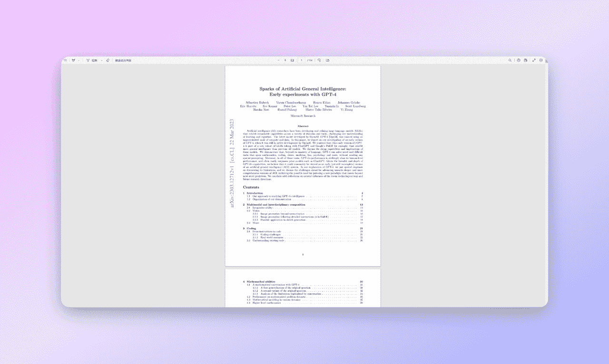

## OpenAI 闭门讨论会V3纪要

推友 [dotey ](https://twitter.com/dotey)分享的这是一份关于OpenAI的闭门讨论会纪要，主要讨论了多模态预训练大模型GPT-4的能力演变及边界、AI Native Apps、模型格局和LLM相关的非共识判断等议题。与会者讨论了GPT-4带来的新技术和新能力，以及如何定义GPT的能力边界、AI Native领域的优势企业、GPT是否会抢占应用市场等问题。

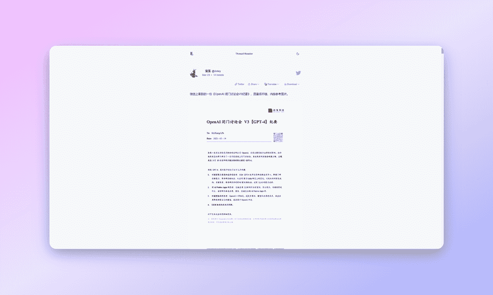

## 开发者工具2.0- 红杉资本在软件开发生命周期中的最新 AI 地图

人工智能有巨大的机会改变软件工程，这是一个谁 的问题，而不是如果。 我们认为，谁占上风的重要因素将是专注于开发人员体验，提供全新的功能，并围绕如何在开发人员的工作流程中着陆和扩展做出战略选择。在这里取得成功可能意味着重写工程的发展方式，并有机会建立一个世代相传的公司。

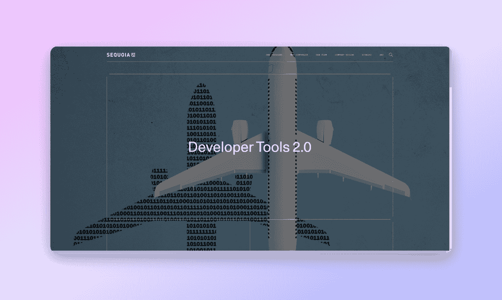

## [Anthropic：出走OpenAI，](https://mp.weixin.qq.com/s/Wx5q-rEwG4sROvnewGxWrw)Google站队，AGI是天使还是魔鬼？

Anthropic的一篇介绍文章详细介绍了Anthropic的诞生过程以及和Open AI的纠葛，Anthropic 团队豪华、愿景远大，与 OpenAI 和 DeepMind（Google）并列成为 目前 AI 前沿模型领域排名前三的公司 ，并且是其中唯一没有与大厂深度绑定的创业公司。 其大语言模型 Claude 是 OpenAI ChatGPT 最大的竞争对手。

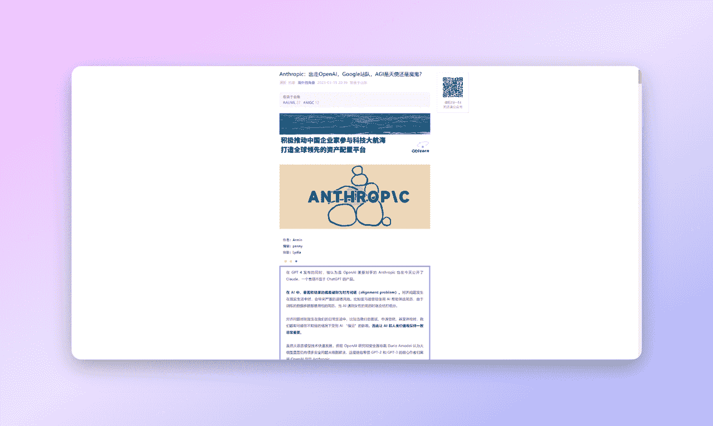

## 使用 OpenAI API 进行快速工程的最佳实践

Open AI官方的提示词书写教程，对于普通人来说这个教程就够用了。而且写的非常清晰易懂。

由于指令遵循 [模型 ](https://beta.openai.com/docs/models)的训练方式或训练数据的方式，有一些特定的提示格式工作得特别好，并且与手头的任务更一致。下面我们介绍了一些我们认为效果可靠的提示格式，但请随意探索可能最适合您任务的不同格式。

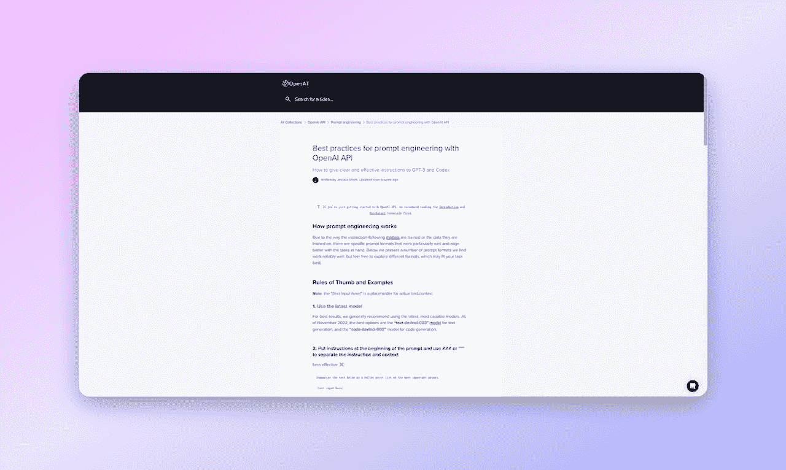

## [比尔盖茨-人工智能时代已经开始](https://www.gatesnotes.com/The-Age-of-AI-Has-Begun)

无论如何，在可预见的未来，人工智能的主题将主导公众讨论。我想提出指导这一对话的三项原则。

首先，我们应该尝试平衡对人工智能缺点的担忧——这是可以理解和有效的——与它改善人们生活的能力。

其次，市场力量不会自然产生帮助最贫困人口的人工智能产品和服务。相反的可能性更大。

最后，我们应该记住，我们才刚刚开始人工智能可以完成的工作。无论它今天有什么限制，都会在我们不知不觉中消失。

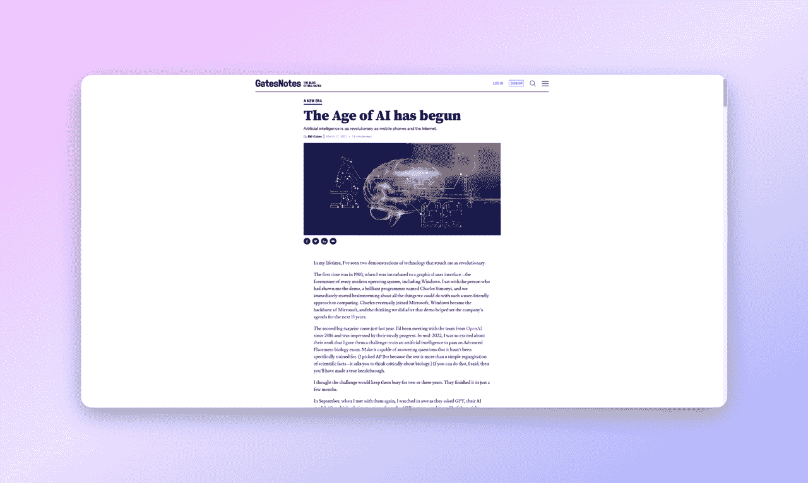

## 调查 GPT 模型和相关系统对美国劳动力市场的潜在影响

我们调查了（GPT）模型及相关技术对美国劳动力市场的潜在影响。使用一个新的评估标准，我们根据与GPT能力的对应关系评估职业，结合人类专业知识和GPT-4的分类。我们的发现表明，大约80%的美国劳动力市场的工作任务可能会受到GPT引入的影响，至少有10%的工作任务受到影响，而约19%的工人可能会看到至少50%的工作任务受到影响。影响跨越所有薪资水平，高收入工作可能面临更大的风险。值得注意的是，影响并不限于近期生产率增长较高的行业。我们得出结论：（GPT）的特征，这表明这些模型可能具有显着的经济、社会和政策影响。

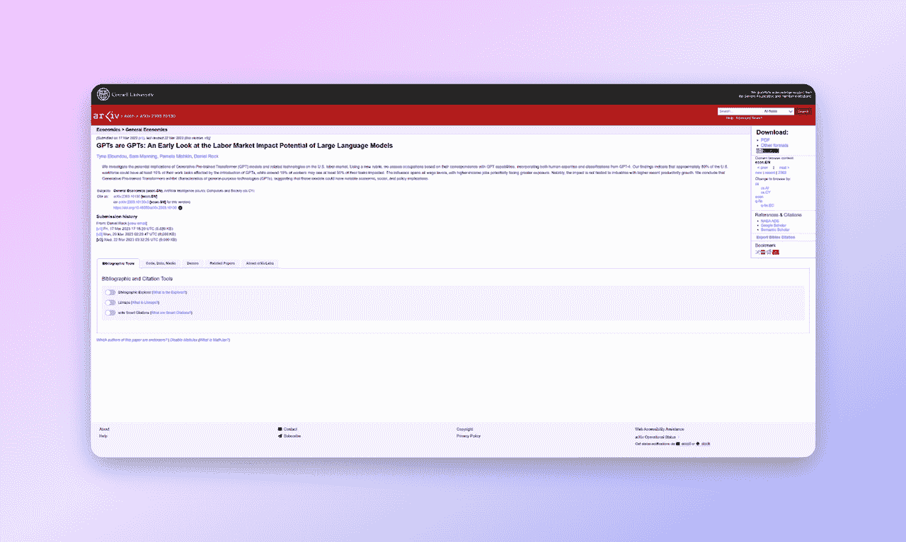

## Gen-2-生成式人工智能的发展方向

这个模型是市场上第一个公开可用的文本到视频模型，能够以真实和无缝的方式从文本描述中生成视频。尽管演示不是很逼真，但这是朝着正确方向的一大飞跃。这是令人难以置信的，而且不断改善。第一代版本于2月6日发布，进展速度非常惊人。

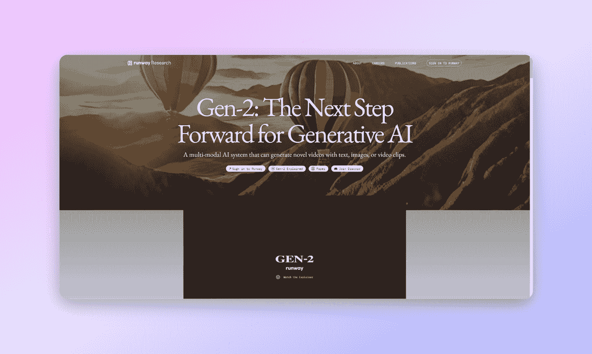

## Notion公司对生成性人工智能的战略赌注的内幕

“想象一下你身处在19世纪90年代，你从未见过电灯。”赵（Notion 联合创始人）表示，“电灯泡…比你的煤油和煤气灯更好。这是自然而然的过程 - 你必须采用它。你必须让它更大众化。当你看到AI、大型语言模型所能做到的事情时，就会有这种感觉，就可以直接应用到我们已经在做的事情中。”

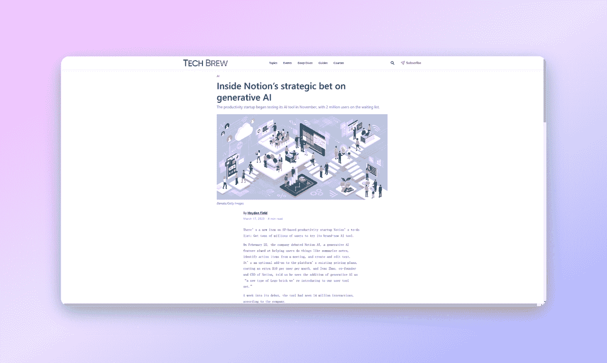

## [提示工程](https://lilianweng.github.io/posts/2023-03-15-prompt-engineering/)

提示工程，也称为上下文提示，是指如何在不更新模型权重 的情况下与 LLM通信以引导其行为以获得所需结果的方法。这是一门实证科学，快速工程方法的效果在不同模型之间可能有很大差异，因此需要大量的实验和启发式。

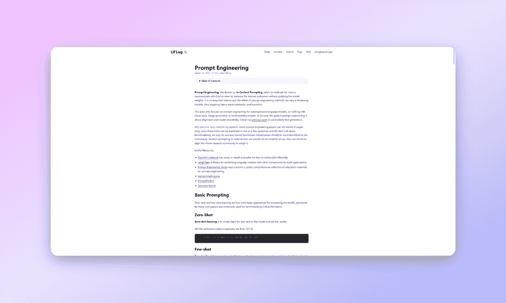

## GPT-4在医疗挑战问题上的能力

我们的结果显示，GPT-4没有进行特殊的提示，就超过了USMLE的及格分数超过20分，并且比先前的通用模型（GPT-3.5）以及专门对医学知识进行微调的模型（Med-PaLM，Flan-PaLM 540B的提示微调版本）表现更好。此外，GPT-4的概率校准明显比GPT-3.5更好，展现出更好的能力来预测其答案的正确性。我们还通过案例研究定性地探讨了该模型的行为，展示了GPT-4解释医学推理、个性化解释给学生以及交互式地构建围绕医学案例的新的反事实情景的能力。

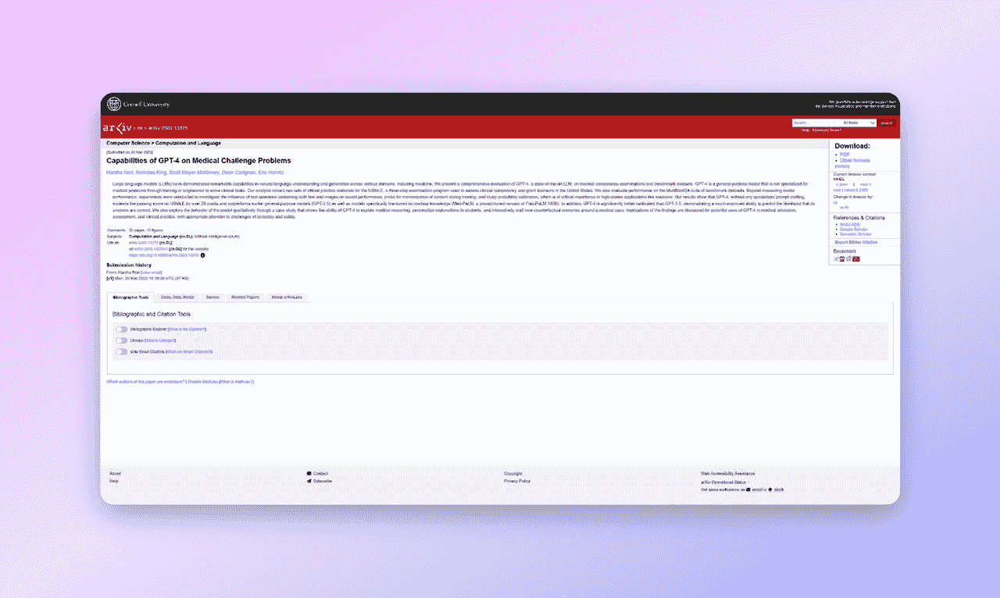