# AIGC Weekly #13

> 来源：[https://waytoagi.feishu.cn/docx/FH5kdRyVUoMY1RxDN6TcEmOLnqh](https://waytoagi.feishu.cn/docx/FH5kdRyVUoMY1RxDN6TcEmOLnqh)

> 🔗 原文链接： h[ttps://op7418.zhub](https://op7418.zhubai.love/posts/2249568762112069632)ai.love/posts/22...

> 发表时间：2023-03-20

工具：Midjourney v5

提示词：digital background, gradient, soft light, low contrast, minimalist, foil holographic --ar 3:2 --stop 75

> 如无意外会在每周一更新，主要介绍上周AIGC领域发布的一些产品以及值得关注的研究成果，由于我自己是一个设计师，所以在一些专业内容的描述上可能存在问题，欢迎在渠道帮我反馈及更正，如果觉得有收获的话也可以订阅一下。（本期部分文案使用了Notion AI以及Chat GPT帮助润色和翻译）

上周可以说是AI领域的一个非常重要的节点，不管是在语言模型领域还是图像生成领域，不管是在国外还是国内，不知道再过一年我们回想起这一周发生的这些事情会是怎样的评价。

# ❤️上周精选

## [GPT-4发布了](https://openai.com/research/gpt-4)

上周[最重要的一](https://openai.com/product/gpt-4)件事情是Open AI居然真的在ChatGPT API刚发布一个多月就发布了GPT-4。GPT-4 是一个大型多模态模型意思是它可以接受图像和文本输入，发出文本输出。详细的介绍可以在 这里查看 。下面我简要总结一下GPT-4的一些特性：

+   支持多模态输入：GPT-4的API可以接受图像，并生成相应的字幕，并对图像进行分析。

+   在BAR考试中取得优异成绩：GPT-4取得了BAR 90分（满分一百），同时在生物奥林匹克竞赛的视觉题方面获得了99分，其推理能力远超ChatGPT，它的成绩都够上斯坦福了。

+   超大上下文：GPT-4支持25,000个单词的上下文，可以使得完整的文档适合于一个提示符内。

+   更具创造性和协作性：与用户协作生成、编辑和迭代写作任务，具有更高的创造性和协作性。

+   多个合作伙伴正在测试GPT-4：Duolingo、Be My Eyes、Stripe、摩根士丹利、可汗学院等，甚至包括冰岛政府。

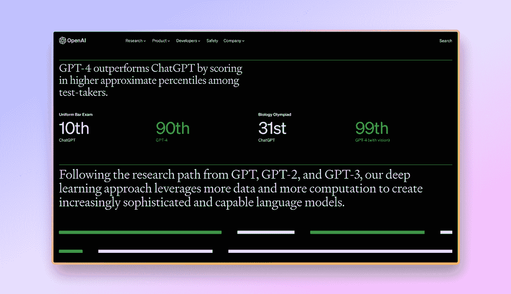

那如何使用GPT-4呢，现在ChatGPT Plus会员可以直接使用GPT-4模型，不过也是有数量限制的，我眼看他从刚发布的每四小时100条限制变为了每四小时30条。如果只是想免费体验一下的话可以去poe.com尝试，目前免费账户的限制是没24小时一条。

[GPT-4的API](https://openai.com/waitlist/gpt-4-api)目前还没有全量开放有需求可以 去这里加等待列表 ，这几天已经有人拿到了测试资格。

[同时他们还发](https://github.com/openai/evals)布了了一下专门用来评估语言模型的评估框架 evals ，他们提前将向提交高质量评估的人授予 GPT-4 访问权限。

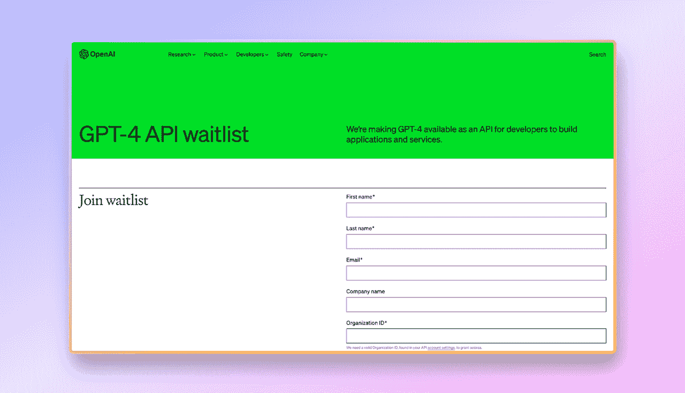

Open AI近期对于Plus购买以及API金额的充值管理越发严格，如果要购买相关内容的话在Depay付费的时候使用美国免税州的地址的方式已经不行了，这里推荐切换地区到英国进行购买使用这个地址：

街道：52 Leeds Rd 城市：Bradford 邮编：BD7T 5ME

详细的教程和注意事项可以看 [𝗖𝘆𝗱𝗶𝗮𝗿 的 这条推特](https://twitter.com/Cydiar404) 。[还没有主持](https://twitter.com/Cydiar404/status/1635662143000547328)[D](https://depay.depay.one/web-app/register-h5?invitCode=348861&lang=zh-cn)epay的也可以使用我的邀请连接注册： https://depay.depay.one/web-app/register-h5?invitCode=348861&lang=zh-cn

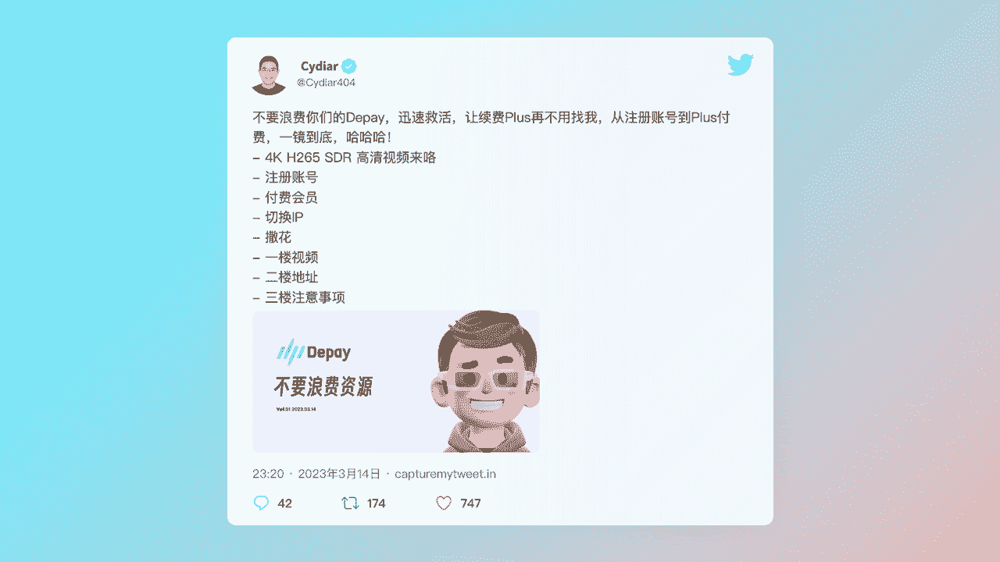

GPT-4发布之后基于他强大的理解力与逻辑推理能力也涌现了很多新的使[用方式下面](https://twitter.com/LinusEkenstam/status/1635754587775967233?s=20)我会挑选一些典型的使[用方式，更](https://web.okjike.com/originalPost/6416d57245b1c44fea0625a6)多的可以去Linus (●ᴗ●)总结的 这条推特 或者Szhans的 这条即刻 查看：

[Jiayuan ](https://twitter.com/Tisoga)[基](https://twitter.com/Tisoga/status/1635884757589577728?s=20)于 GPT-4 实现了一门新的编程语言：GPTLang： https://twitter.com/Tisoga/status/1635884757589577728?s=20

[Yishi ](https://twitter.com/ohyishi)将一段合约代码交给GPT-4进行审计，G[P](https://twitter.com/ohyishi/status/1635872707530358784)T-4发现了一系列可能的漏洞和问题： https://twitter.com/ohyishi/status/1635872707530358784

[Dan Shipper ](https://twitter.com/danshipper)[利](https://twitter.com/danshipper/status/1635712019549786113?s=20)用GPT-4来帮助发现一些可能有效的药物： https://twitter.com/danshipper/status/1635712019549786113?s=20

[Meng To ](https://twitter.com/MengTo)[利](https://twitter.com/MengTo/status/1637566201709690881?s=20)用GPT-4从零实现了一个iOS运行的小游戏： https://twitter.com/MengTo/status/1637566201709690881?s=20

[Ammaar Reshi ](https://twitter.com/ammaar)利用[G](https://twitter.com/ammaar/status/1637592014446551040?s=20)PT-4、Replit、MidJourney、Claude 组建一个 AI 助手团队，以零 Javascript 或 3D 游戏编程知识从头开始创建了一个3D太空竞速游戏： https://twitter.com/ammaar/status/1637592014446551040?s=20

J[a](https://twitter.com/jacksonfall/status/1636107218859745286?s=20)ckson Greathouse Fall 给GPT-4 100美元并让他尽可能多的赚钱，作者会实践GPT-4的建议： https://twitter.com/jacksonfall/status/1636107218859745286?s=20

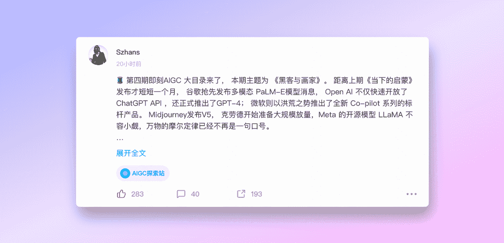

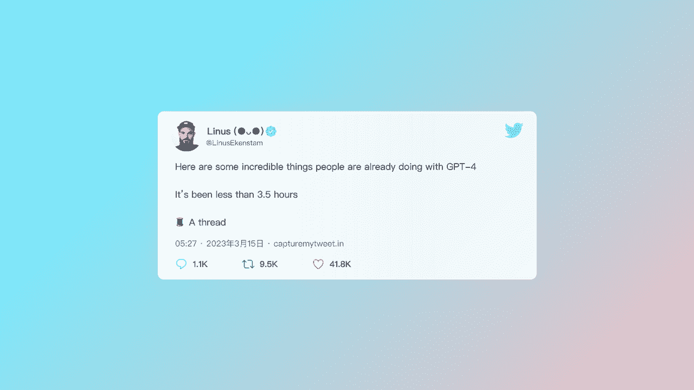

## 斯坦福发布了Stanford Alpaca 7B模型

Alpaca是一个基于Facebook开源的LLaM微调的模型，对单轮指令跟随的初步评估中，Alpaca 的行为在质量上与 OpenAI 的 text-davinci-003 相似，同时出奇的小且易于复制（<600 美元）。

这个模型的优势在于可以部署在常用的家用Mac/Windows/Linux 设备上，这使得几乎所有人都可以对相关模型进行微调，同时与自己已有的数据相结合产生无限可能。可以把他类比为语言模型领域的stable diffusion 很期待能从上面产生多少有意思的东西。

[这里是项目的Github地址： https://](https://github.com/tatsu-lab/stanford_alpaca)github.com/tatsu-lab/stanford_alpaca

这里是在线演示地址，可以去试一下： https://alpaca-ai.ngrok.io/

比如这个 [Alpaca-LoRA项目 ](https://github.com/tloen/alpaca-lora)该存储库包含使用 [低秩适应 (LoRA) ](https://arxiv.org/pdf/2106.09685.pdf)重现 [斯坦福羊驼 ](https://github.com/tatsu-lab/stanford_alpaca)结果的代码。使其可以在4090 上运行。在没有超参数调整或基于验证的检查点的情况下，LoRA 模型产生的输出可与 Stanford Alpaca 模型相媲美。

另外一个类似的还有 [ChatGLM-6B ](https://github.com/THUDM/ChatGLM-6B)这个模型，有62亿参数比较小，但是优势是只需要6G显存就能运行，不需要上面Alpaca的24G显存。感兴趣的同学可以试一下。

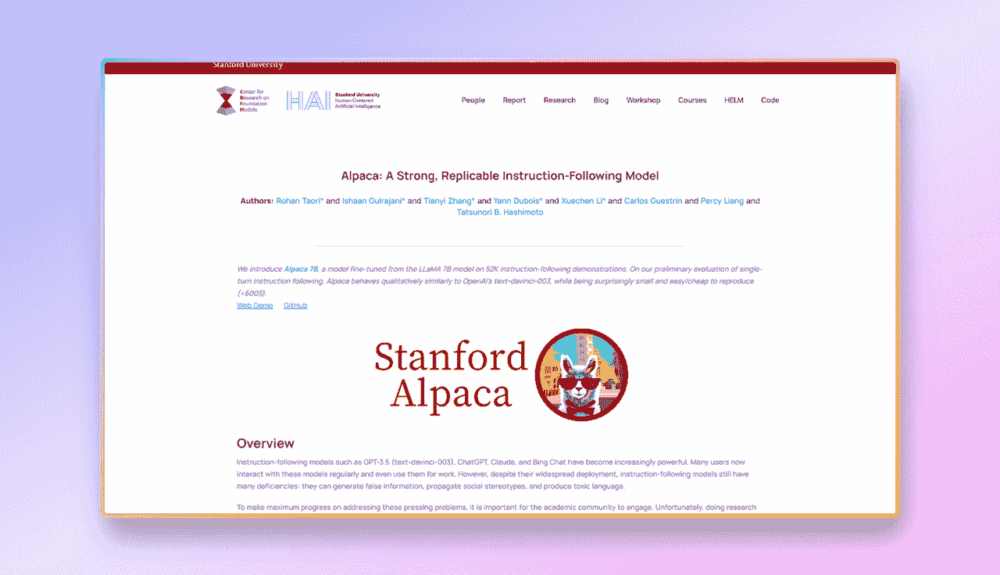

## 谷歌发布了Google Workspace AI

谷歌在上周发布了可以使用谷歌PaLM多模态模型的PaLM API，同时搭配发布了MakerSuite工具，它可以让开发者使用Pa[LM A](https://developers.googleblog.com/2023/03/announcing-palm-api-and-makersuite.html)PI来快速原型设计、提示工程、合成数据生成和自定义模型调整。MakerSuite还提供了一些示例应用程序，展示了PaLM API的潜力和用途。介绍连接 在这里 。

同时现在可以在Google Cloud中使用PaLM模型，还推出了生成式 AI App Builder，它将对话式 AI 流与开箱即用的搜索体验和基础模型连接起来，帮助公司在几分钟或几小时内构建生成式 AI 应用程序

还在Google Workspace和邮件中集成了AI功能，只需输入想要撰写的主题，系统就会立即生成草稿。

比较惨的是发布几个小时之后GPT-4就发布了，导致谷歌这里一点水花都没溅起来，我感觉Open AI和微软是故意的。

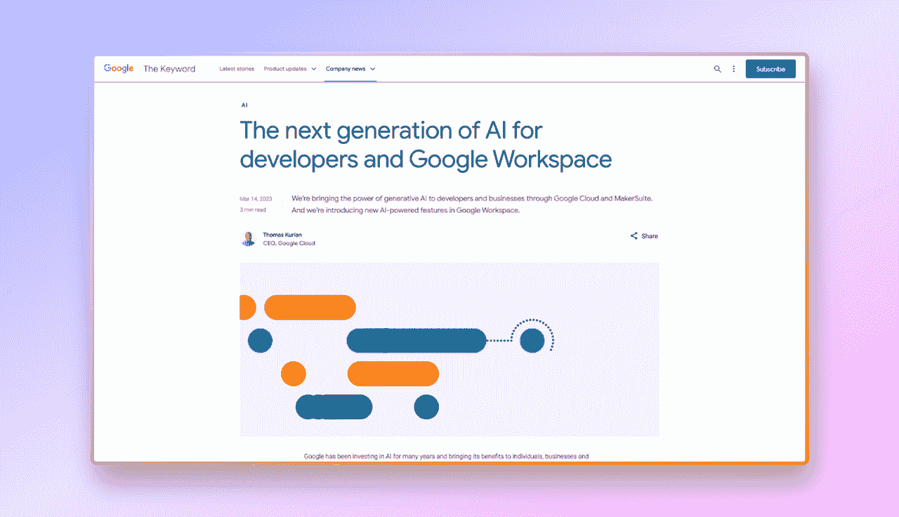

## Anthropic发布了Claude+及API

由前 OpenAI 研究副总裁 Dario Amodei 创立，谷歌投资的人工智能公司[ Anth](https://www.anthropic.com/earlyaccess)ropic 宣布聊天机器人 Claude 开放公测。你可以在这里加入 等待列表 。

他们提供两个版本的 Claude：Claude 和 Claude Instant。Claude 是最先进的高性能模型，而 Claude Instant 是更轻、更便宜、更快的选择。

[如果你现在想体验](http://poe.com/)Claude的话可以去 poe.com ,可以免费使用，从我之前的一些体验来看Claude+与ChatGPT的能力不相上下，Claude在逻辑复杂的语言理解上可能还略胜一筹，当然差GPT-4还是很远。

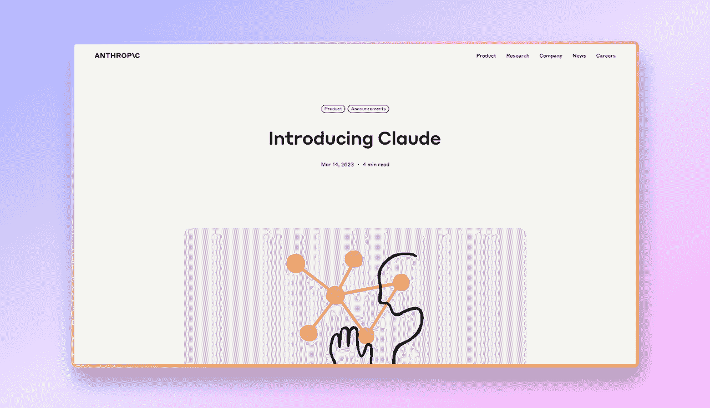

## Midjourney V5发布了

Midjourney V5在16号早上发布了（以下内容均以V5代替），这次V5的升级相较于V4有了非常多的改动生成速度、生成质量、语义理解能力有了非常大的提升。据官方公告所说V5已经开发了5个多月的时间，加入了很多他们自己研发的神经网络架构以及美学相关的技术。有传言说V6模型会在5月底6月初发布。很期待V6模型会多么巨大的提升。这里简要总结一下，详细的可以点标题连接看我写的测评里面还有8K壁纸提供下载。

V5 基础模型有什么新功能？

+   更广泛的风格范围和更具响应性的提示

+   更高质量的图像（2倍分辨率增加）暂时没有上线，动态范围改善

+   图像更详细。

+   改进了图像提示性能

+   支持无缝平铺 --tile 参数（实验性）

+   支持大于 2:1 的纵横比 --ar （实验性）

+   支持权衡图像提示与文本提示 --iw

V5 基础模型有什么新特性？

+   画手的成功率大幅提升

+   光线的折射和反射处理非常强

+   亚洲人像的生成更加自然

+   体积效果更加逼真

+   更好的生成地标建筑

+   对一些热门产品的还原非常好

+   非常好的还原航拍场景

+   不同角度的同一个人像肖像还原的非常好

+   对于不同材质的细节处理更加好

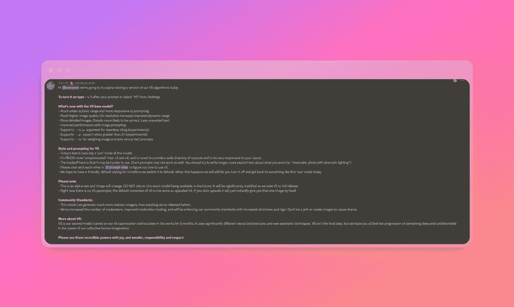

## 微软发布了Co-Pilot in 365

微软在16号发布了将GPT-4集成到Office套件中的一体化解决方案Copilot。

Copilot以两种方式集成到Microsoft 365中。它与你并肩作战，嵌入到你每天使用的Microsoft 365应用程序中--Word、Excel、PowerPoint、Outlook、Teams等等--以释放创造力、释放生产力和提升技能。比如用户甚至可以要求它根据Word文档，直接生成一个10张幻灯片的PPT，或者分析或格式化Excel数据。下图就是生成PPT的演示动图。

[当然这次也](https://youtu.be/S7xTBa93TX8)少不了微软标志性的浮夸宣传片， 这里欣赏 。

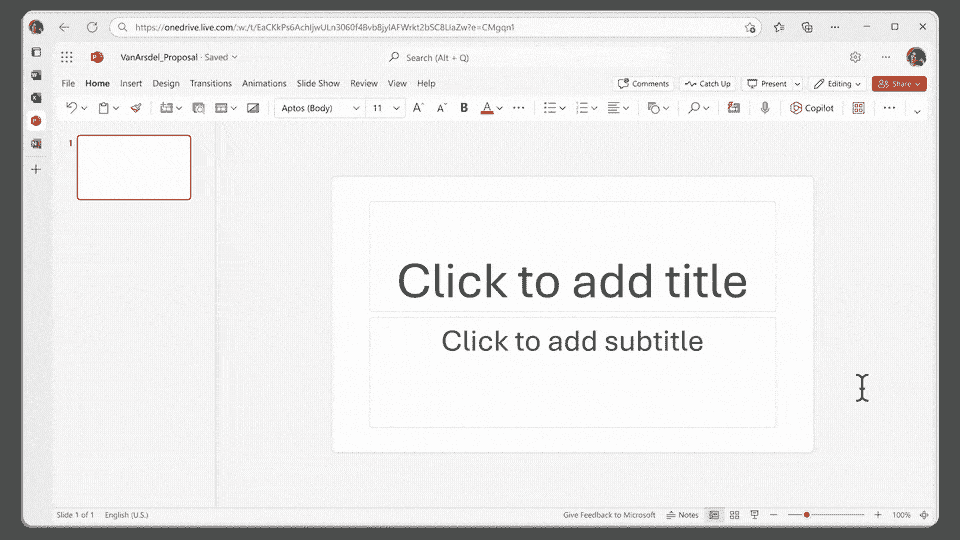

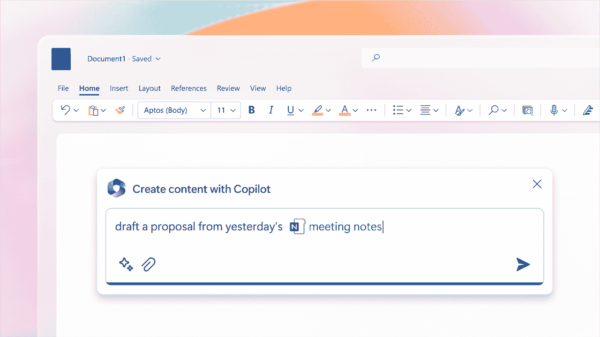

## [百度发布了文心一言](https://yiyan.baidu.com/welcome)

在上周国内万众期待的独苗，百度的文心一言也在GPT-4发布的第二天开了发布会正式发布了，由于发布会演示的时候用的视频，所以导致股价大跳水一度跌了10%。

一下是百度的官方介绍：百度全新一代知识增强大语言模型，文心大模型家族的新成员，能够与人对话互动，回答问题，协助创作，高效便捷地帮助人们获取信息、知识和灵感。

随着越来越多的人拿到测试资格对其进行测试它的能力和边界也逐渐清晰的起来，从我的感觉上来说它的能力水平可能在GPT-3的阶段，可以一定程度理解人类语言，但是输出内容的可靠性上还差ChatGPT很远。

相关的测试可以看 [知危的这篇 ](https://mp.weixin.qq.com/s/fYzjcR8UuFQkxiB8ieOE4g)和真格整理的 [这个表格 ](https://docs.qq.com/sheet/DTEFsdkNERVVtR3BX?tab=yndnov)，每个问题都有GPT-3.5和GPT-4的答案对比。

[现在还处于邀请注册阶段](https://yiyan.baidu.com/welcome)，可以在 这个页面加入等待列表 。

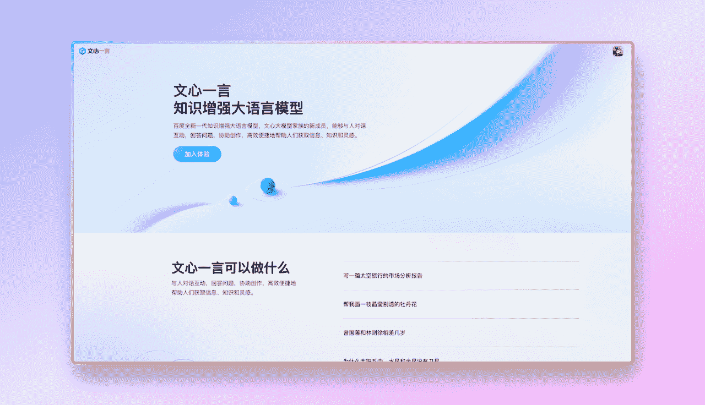

# ⚒️产品推荐

## Cursor-GPT4驱动的代码编辑器

Cursor是一个GPT4驱动的代码编辑器，深度整合了AI相关的能力，目前还是免费的。与Copilot相比Cursor能支持整个代码文件，它可以理解整个代码，而且它可以显示修改的部分，你可以选择接受或者拒绝，尤其是代码。这个公司是Open AI投资的。

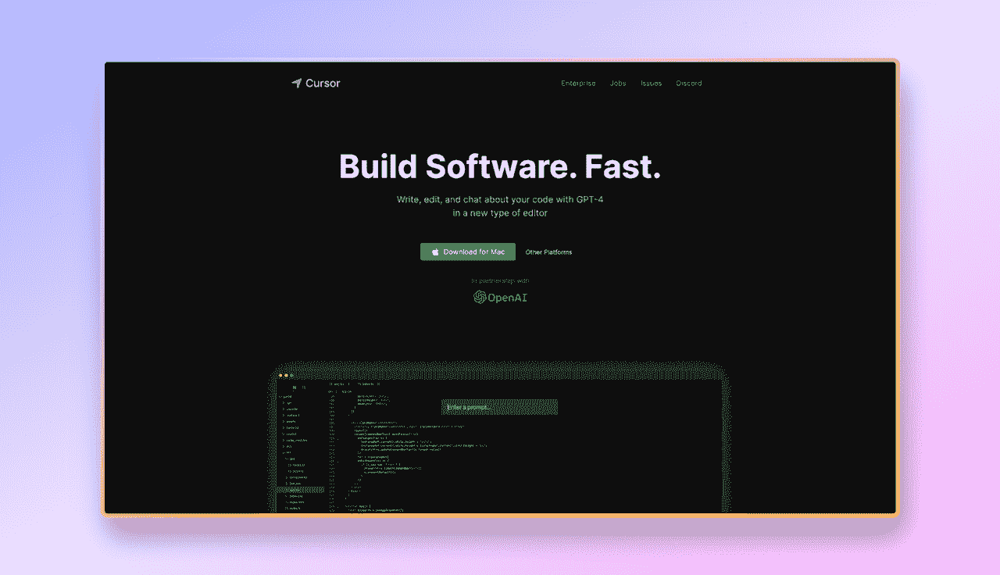

## Content Scale - AI 内容检测器

粘贴内容，你会在几秒钟内知道其中是否有人工智能编写的内容。这个chatGPT检测器比一般的AI分类器在更深的层次上工作，检测出看起来像机器人的内容。

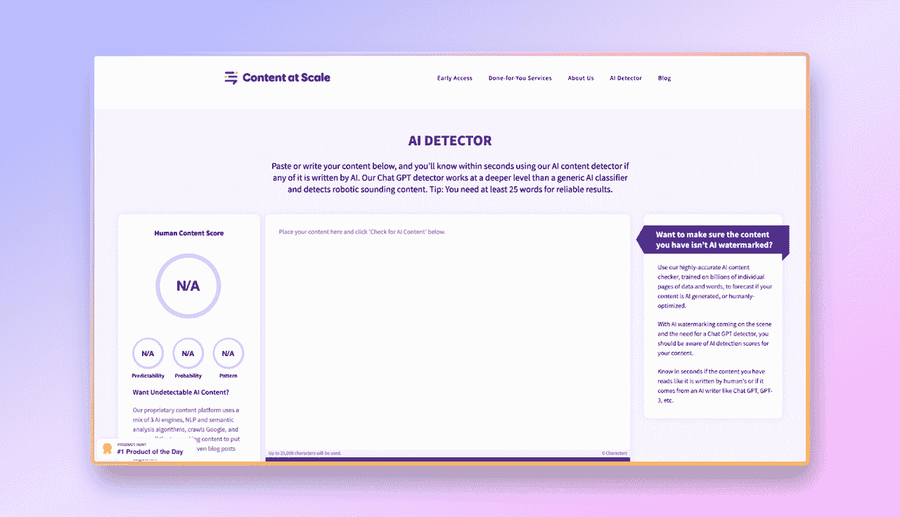

## Stravl-AI规划你的旅行计划

可以从1,500多个目的地中找到你的梦想之地。与人工智能旅行助理聊天，计划你的理想行程。同时可以在这个产品上直接预定相关的旅行产品。

## Replai-在社交媒体使用ChatGPT回复内容

使用ChatGPT为Twitter和LinkedIn创建有意义的回复，只需1次点击就能加快10倍。🤯用AI在2分钟内创建有意义的回复，速度快10倍。

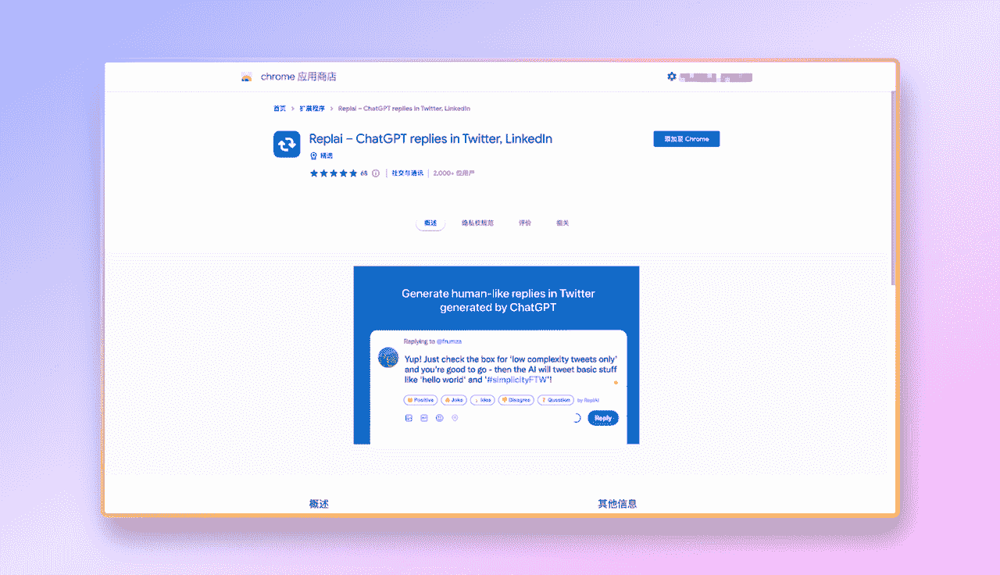

## Relume Ipsum-为figma设计稿填充文本内容

为您的网站撰写文案的最快方式，使用 AI 快速、轻松地生成网站副本，而无需离开 Figma。

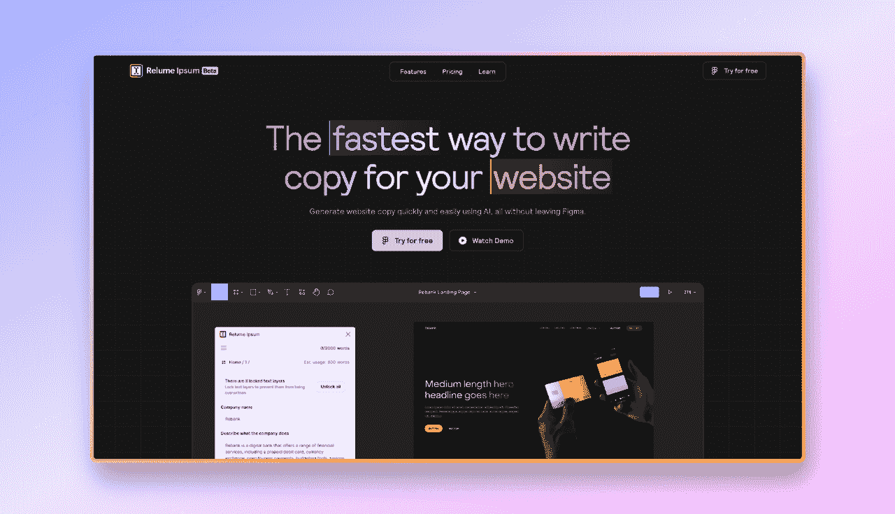

## Intercom 的 Fin-基于GPT4的客服机器人

Intercom公司推出了一款名为Fin的AI聊天机器人，它是由GPT-4技术驱动的。GPT-4技术可以分析图像内容并将其与书面问题联系起来。在Intercom Inbox中，支持代理可以创建客户对话的AI生成摘要。Fin可以与客户进行完整的支持对话，理解复杂的查询，提出澄清问题并解释复杂的内容

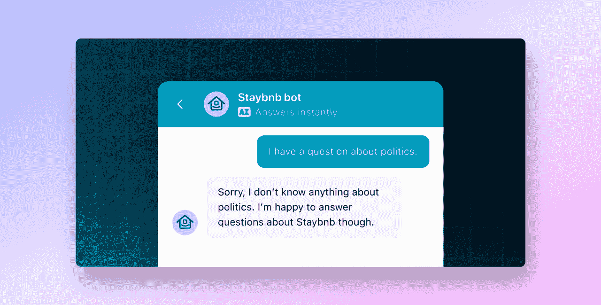

## Analyze CSV-CSV分析工具

复制/粘贴 CSV 数据，并接收包含摘要、主要风险和后续问题的电子邮件。

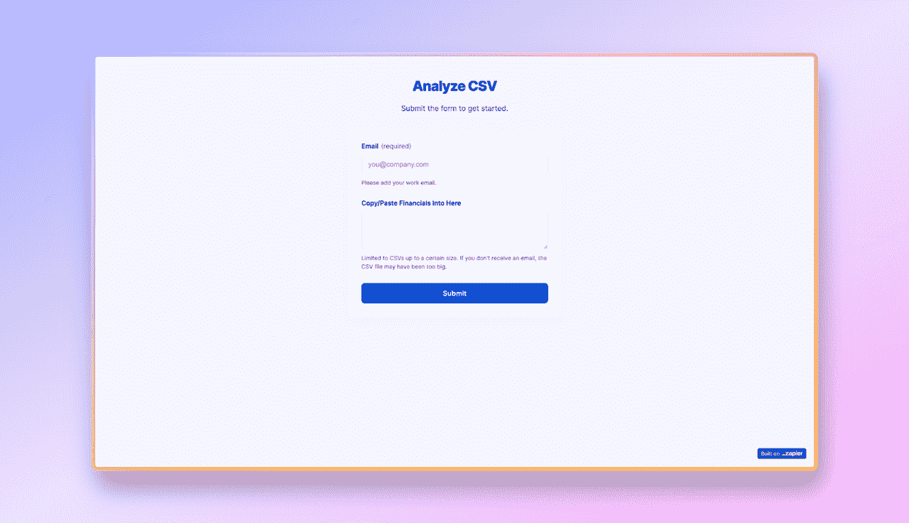

## gpt.best-快速分享ChatGPT对话

通过这个插件可以快速分享你跟ChatGPT的对话，使用的场景是一些非常长的不适合截图的对话。而且分享的内容可以复制。

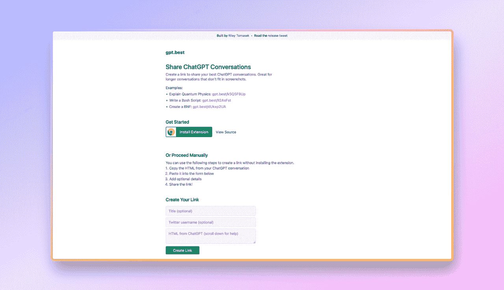

## Hugging Face加入论文页面

Hugging Face加入了绑定论文的功能，可以发现特定论文的模型、数据集和空间。

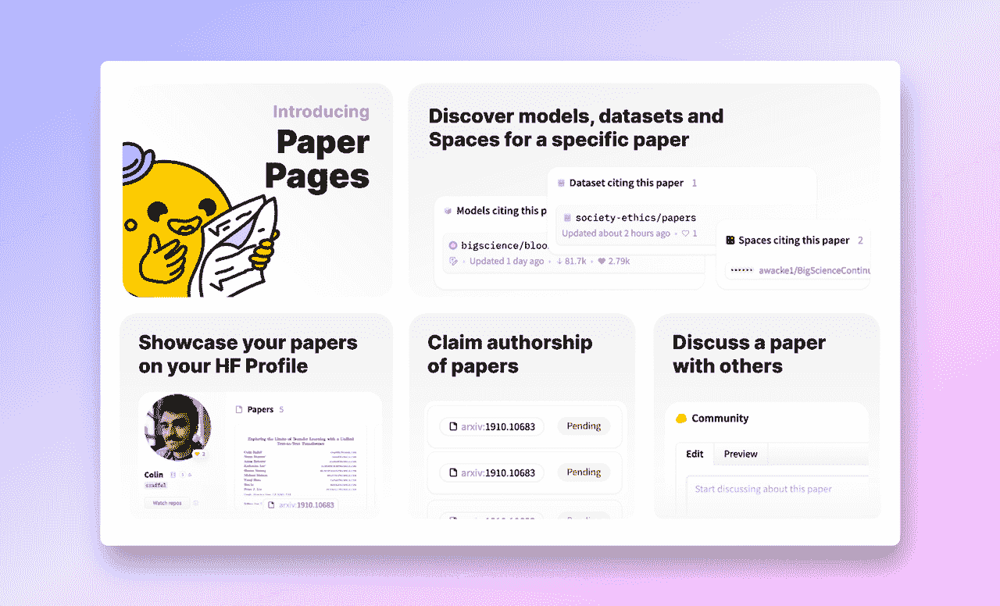

## Darby Dashboards-连接数据快速创建仪表盘

这个工具连接你的数据API以后，可以快速分析数据并根据你的需求创建相关的数据可视化页面。

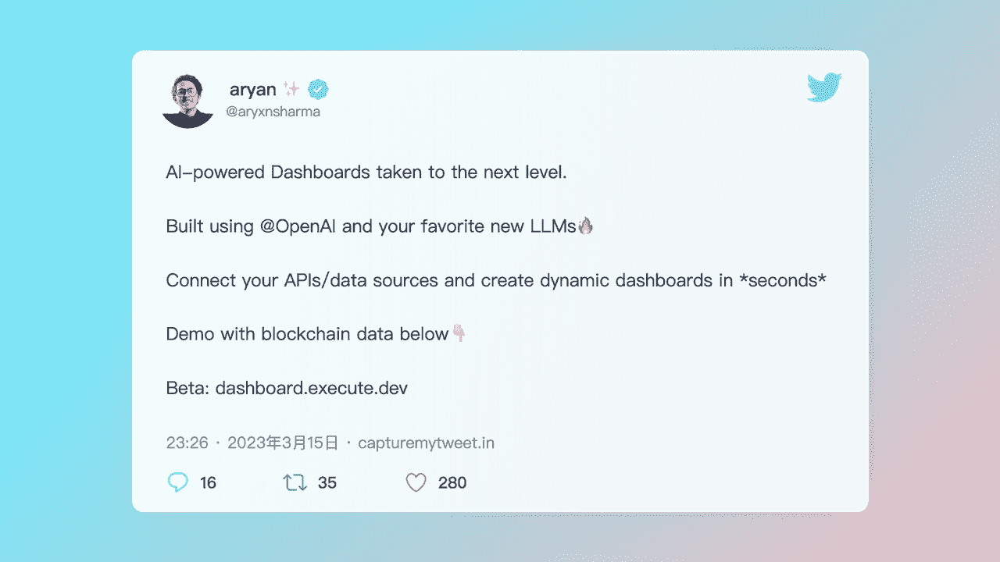

## Double - GPT 自动分析 互联网上的销售线索

使用人工智能清理、丰富和鉴定线索。不要再手动搜索你的线索了。开始使用GPT在互联网上自动研究你的线索并回答问题。

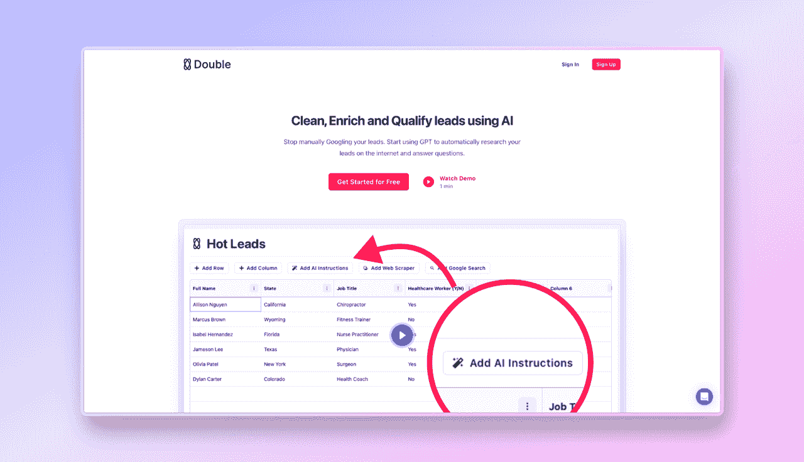

## [Cal文档- AI 支持的搜索](https://cal.com/docs)

Cal将自己的文档内容和GPT一起训练，新增的文档豆索功能支持对话，并且不止能回答文档里有的问题体验非常好。

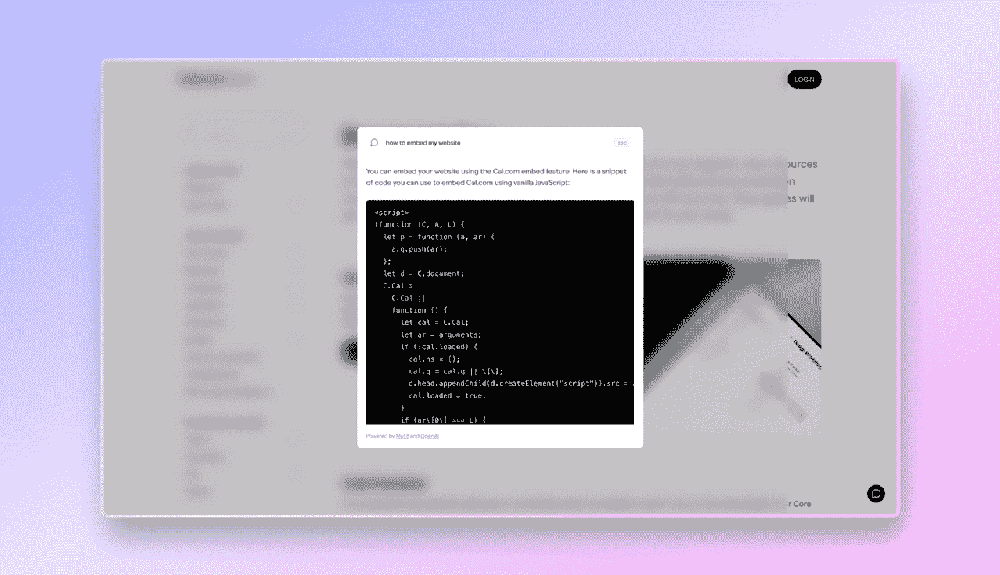

# 🧑🎓学习资源

## 如何在自己的计算机上训练和运行Stanford Alpaca。

文章详细介绍了如何使用 Replicate Alpaca 进行数据复制以及如何使用其它的功能。同时，文章还提供了一些使用该库的实例，如从 MySQL 到 PostgreSQL 的数据复制等。

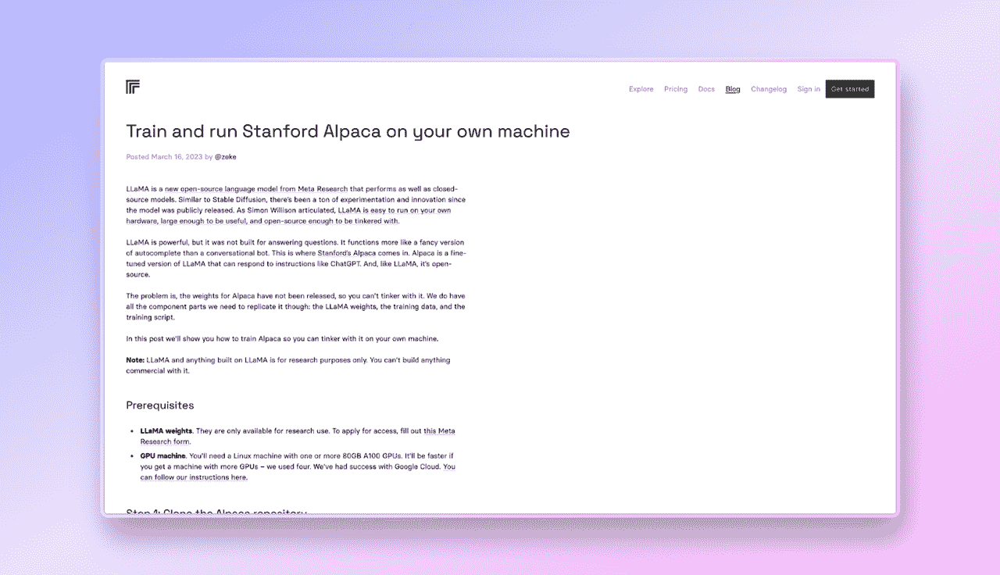

## Midjourney V5生成金属光泽渐变壁纸

上周经常有朋友问我这种带有金属光泽的渐变图案是如何用Midjourney生成的。这里我发一下教程。

## 如何使用GPT-4构建一个早期游戏

使用 GPT-4 创建基本的 3D 游戏原型，例如 Doom。让 GPT 完成所有的数学运算、光线投射和艰苦的工作！

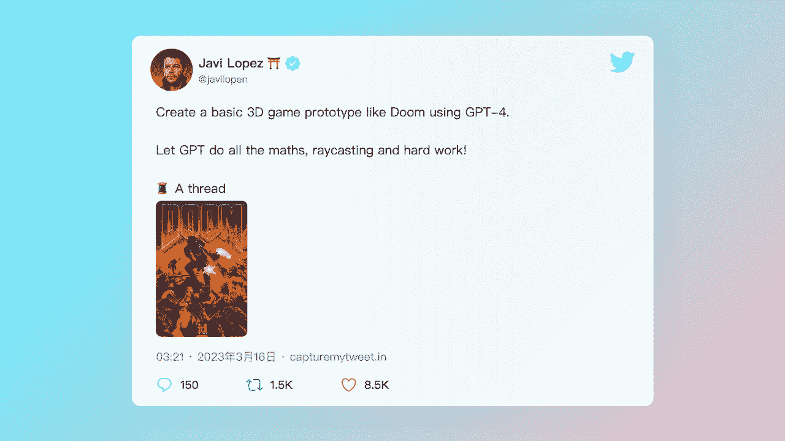

# 🔬精选文章

## [GPT4之夜-和菜头](https://mp.weixin.qq.com/s/GQpm6vNFY7hjzG5AXd8wiA)

和菜头关于GPT4的一些思考，当互联网都在因为GPT4的能力而狂欢的时候，给我们添了点堵。当Open AI变成整个行业最不Open的庞然大物的时候，想象了一下我们的未来。

## [大白话聊 ChatGPT](https://www.xiaoyuzhoufm.com/episode/641183b5bb1fc0cb68f810c6?s=eyJ1IjoiNjBhNDZkYzdlMGY1ZTcyM2JiYThjYWQ5IiwiZCI6MX0%3D)

王建硕和 Sarah 一起制作的播客节目，主要聊了ChatGPT 定义及原理、澄清关于 ChatGPT / LLM 的迷思、创业视角看 ChatGPT以及AI的一些问题和担忧。

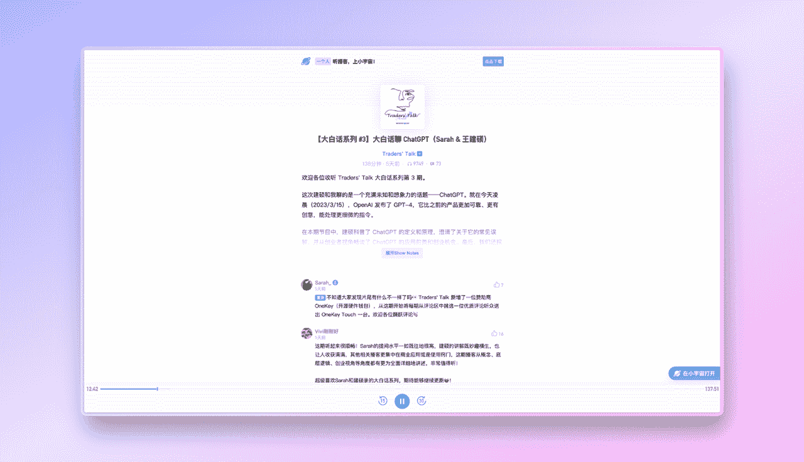

## CHAT Stack、GPT-4 和软件的近未来

一个新的软件开发框架，叫做CHAT Stack，它利用了GPT-4这种强大的自然语言生成技术。作者认为，GPT-4可以让开发者用自然语言来编写程序，并且可以和用户进行智能对话。作者展示了一些使用CHAT Stack构建的应用程序的例子，并预测了它对软件行业和社会的影响。

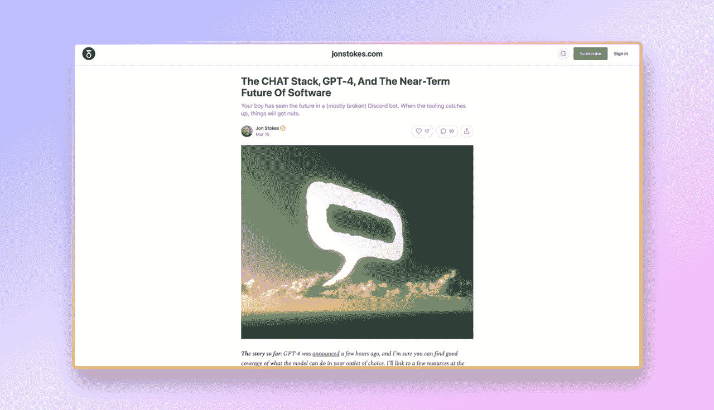

## 大语言模型正在经历 Stable Diffusion阶段

主要介绍斯坦福刚发布的Alpaca模型，由于这个模型非常小可以在消费级设备上运行作者判断，现在在大语言模型领域可能与Stable Diffusion刚发布的阶段类似。

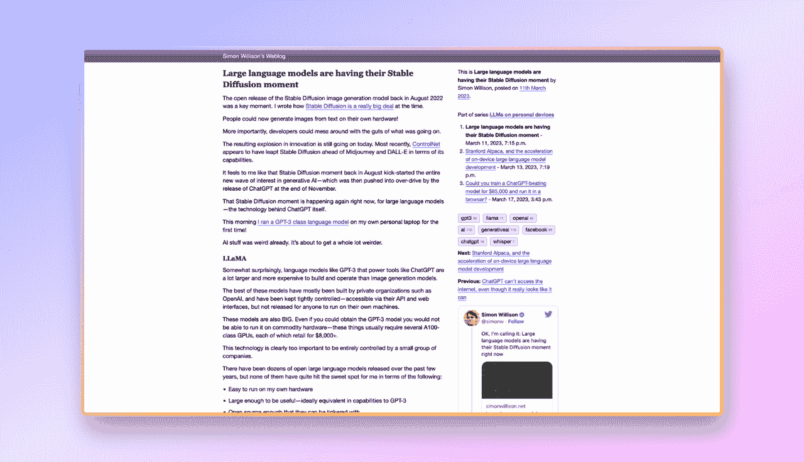

## [人工智能改变一切](https://archive.vn/x9N7X)

我们往往高估了AI需要多长时间才能“彻底改变世界”。它可能只需要几年，而不是几十年，甚至有可能只需要几个月。开发者是否太过接近技术？我们是否真正理解我们正在构建的东西？我们是否需要放慢速度？或者我们需要更快地适应？这篇文章探讨了我们许多人心中的一些问题，非常有趣。

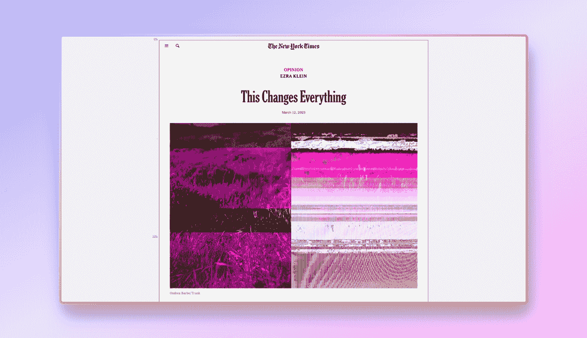

## 微软对Azure的投入如何引发了AI革命

“仅有 Microsoft Azure 提供了构建这种规模的颠覆性人工智能模型所需的 GPU、InfiniBand 网络和独特的人工智能基础设施，这也是 OpenAI 选择与 Microsoft 合作的原因。Azure 现在确实是开发和运行大规模颠覆性人工智能负载的地方。”

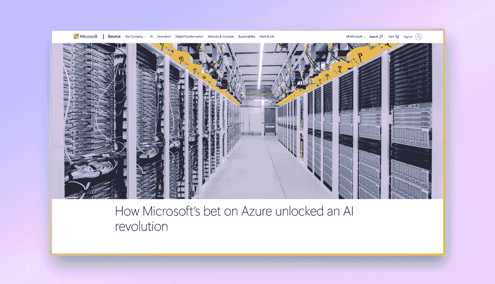