# AIGC Weekly #12

> 来源：[https://waytoagi.feishu.cn/docx/D2VgdlZbgo3knKxBGv4c8vlfn9b](https://waytoagi.feishu.cn/docx/D2VgdlZbgo3knKxBGv4c8vlfn9b)

> 🔗 原文链接： h[ttps://op7418.zhub](https://op7418.zhubai.love/posts/2246868665025081344)ai.love/posts/22...

> 发表时间：2023-03-13

工具：Midjourney ar 16:9 v4

提示词：vector, flat, Grassland in spring, mountains, meteor shower, unreal engine, by jewel tones, scandi style, minimalism, 4k

> 如无意外会在每周一更新，主要介绍上周AIGC领域发布的一些产品以及值得关注的研究成果，由于我自己是一个设计师，所以在一些专业内容的描述上可能存在问题，欢迎在渠道帮我反馈及更正。（本期部分文案使用了Notion AI以及Chat GPT帮助润色和翻译）

# ❤️上周精选

## [我制作了一批AI生成的桌面壁纸](https://mbd.pub/o/bread/ZJaWm5hu)

上周我用AI生成了一些抽象的图片壁纸，因为那天刚好是惊蛰，所以就以惊蛰这个节气为主题命名了。发出去之后很多朋友很喜欢希望给一些高清的。因为Midjourney现在生成的图片基本分辨率都在2K之下，所以我用了一些比较好的服务再不损失内容和质量的情况下将壁纸的分辨率提高到了8K。

由于分辨率很高，所以壁纸可以随意裁切，桌面和移动端都可以使用。一共包含12张8K分辨率的壁纸。使用的图片放大服务比较贵所以8K分辨率壁纸包的价格为1.9元。

未经过放大的原始图片 [免费提供下载 ](https://pan.quark.cn/s/9f904be44185)。

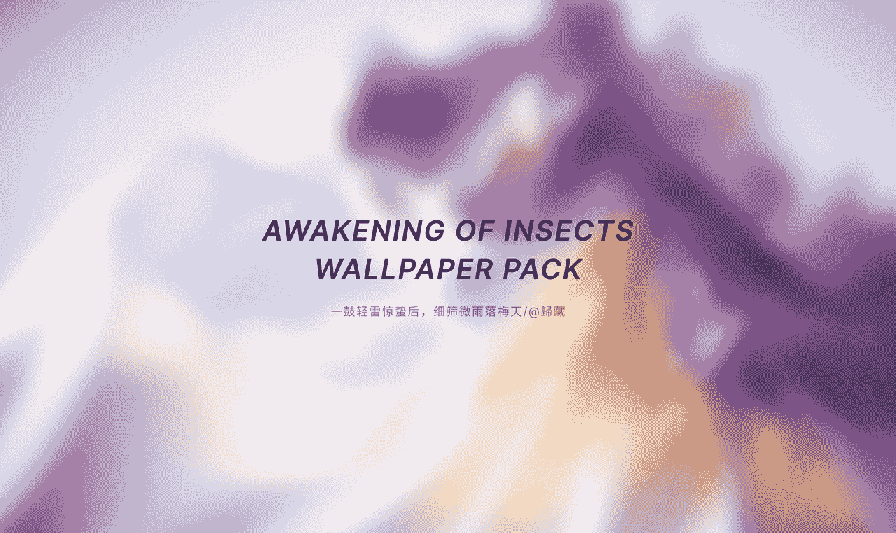

## GPT-4要来了？-推测多模态模型的能力

上周Heise发了一篇报道说微软德国的首席技术官Andreas Braun9号参加了一场AI启动活动，他提到“ 我们将在下周推出GPT-4，那里我们将拥有多模型，将提供完全不同的可能性 - 例如视频。 ”

但是随后Sam Altman又说他们会在长时间等待后，于明年1月发布GPT-4。

无论GPT-4是否会在本周发布，从Open AI的迭代速度来看发布时间可能确实很近了，如果GPT-4确实如微软德国CTO所说是个多模态的模型的话（毕竟大家的终极目标都是AGI），我们可以从微软上周发布的这个 多模态模型Kosmos-1 的论文 来推断如果GPT-4是多模态模型的话可能具备哪些能力：

+   引入了视觉智商测试集，用于诊断 MLLM 的非语言推理能力。

+   无OCR阅读理解：输入屏幕截图、扫描文档、街道标志或任何包含文本像素。直接推断内容而不需要明确使用OCR。这对于在多媒体网页上解锁AI应用程序或来自真实世界摄像头的“野外文字”非常有用。

+   多模态聊天：关于一张图片进行对话。甚至可以在中途提供“后续”图像。

+   广泛的视觉理解能力，如字幕、视觉问答、物体检测、场景布局、常识推理等。

+   音频和语音识别（？）：这个没有在Kosmos-1论文中提到，但Whisper已经成为OpenAI API，并且应该很容易集成。

在3月8号的时候谷歌也发布了一个 多模态的LLM模型PaLM-E ，可以将现实世界的传感器模态纳入语言模型，包括连续的机器人操纵规划、视觉问答和描述（具体的视频可以去上面链接看）。它能够处理多模态信息，展示多模态思维链推理。PaLM-E拥有5620亿参数，是GPT-3的三倍多，号称史上最大规模视觉语言模型。谷歌和柏林工业大学是PaLM-E背后的打造团队。该模型可以用于感知推理任务、视觉语言任务和语言任务，并将来自视觉语言领域的知识转化为体验推理的知识。

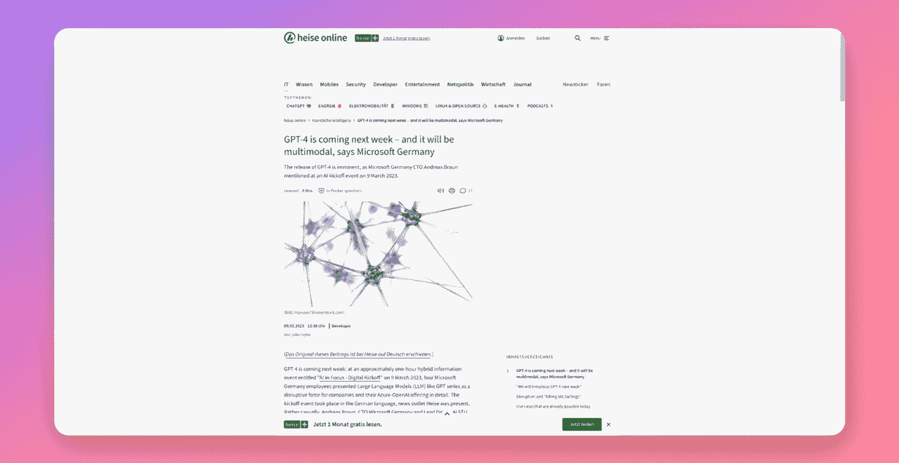

# ⚒️产品推荐

## Fini-将知识库转换为聊天机器人

分析你的知识库将其转换为聊天机器人，支持Intercom、Search、Slack和Discord的集成。

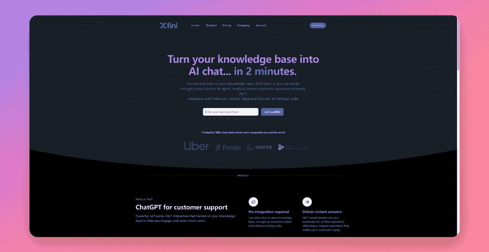

## OpenGPT-快速创建你自己的AI应用

推友 [Tantan Fu ](https://twitter.com/EclipsePrayer)创建的产品，只需要输入应用简介以及提示词和Open API Key就可以快速创建自己的AI应用，美中不足的是还没有办法管理自己的应用。不过作者计划在下一阶段增加相关功能。

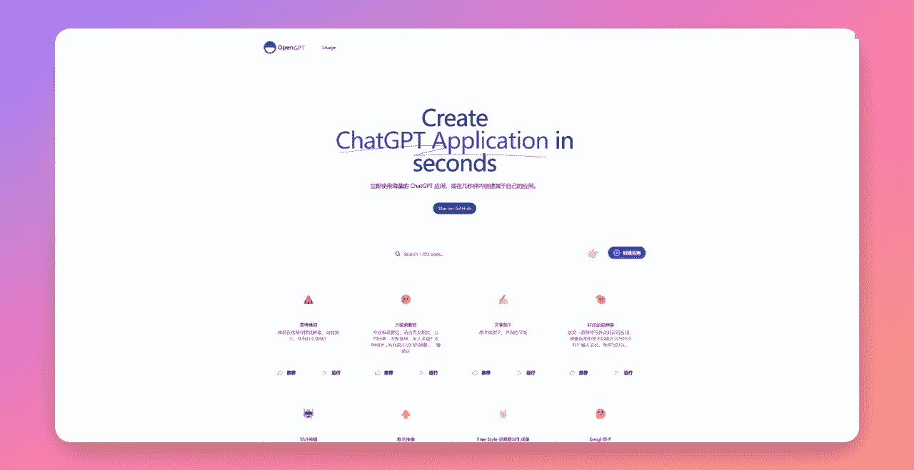

## OpenAI Translator-基于Chat GPT的桌面翻译工具

推友 [yetone ](https://twitter.com/yetone)做的桌面翻译工具，支持windows桌面安装以及浏览器插件，需要使用自己的API key，体验和界面都非常好。上次介绍的Bob插件也是他做。

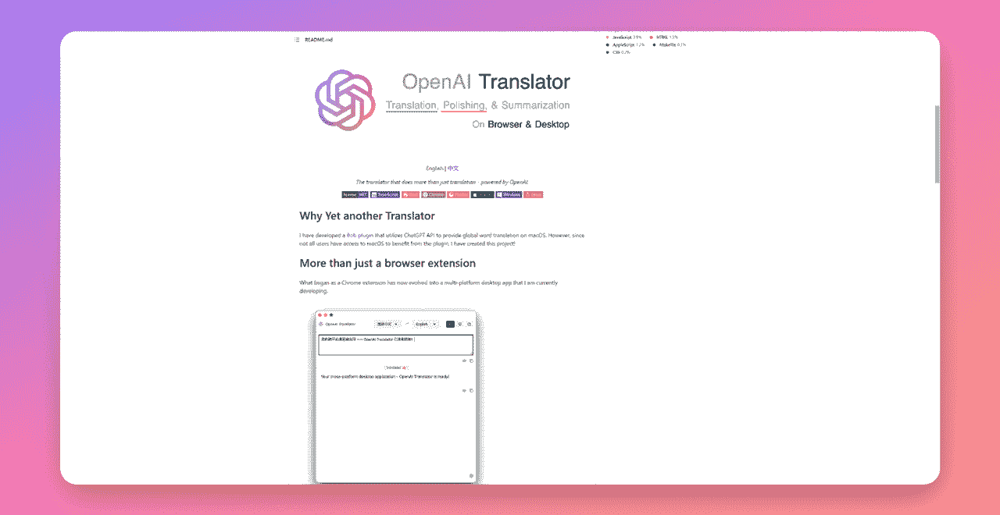

## Logoscapes-将你的LOGO融入到现实照片中

利用ControlNet能力将LOGO的图形融入到SD生成的图片中，来帮助品牌进行宣传。

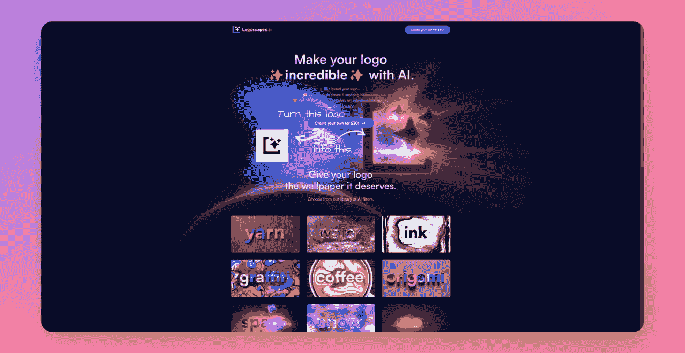

## Invideo-快速将你的想法制作为视频

InVideo是一个AI视频生成器，提供脚本、音乐、视频和照片等内容，所有这些内容都已经获得版权许可。

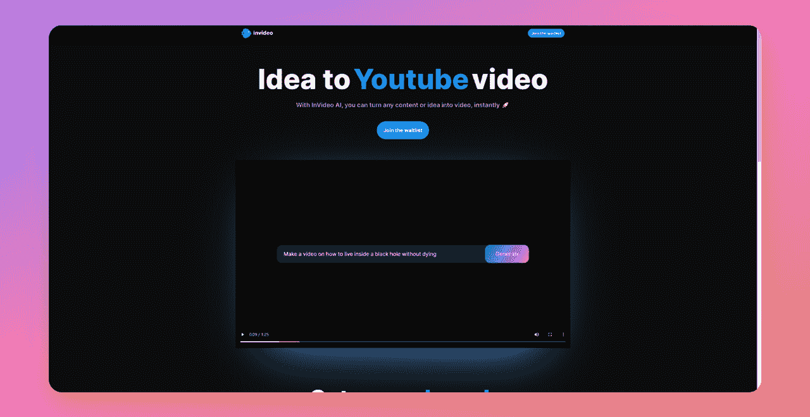

## Poe-现在体验最好的聊天机器人产品

Poe现在是我体验过的产品体验最好的聊天机器人产品了，而且他还是唯一可以使用另一个能与ChatGPT抗衡的语言模型Claude的产品。而且它还有移动APP。

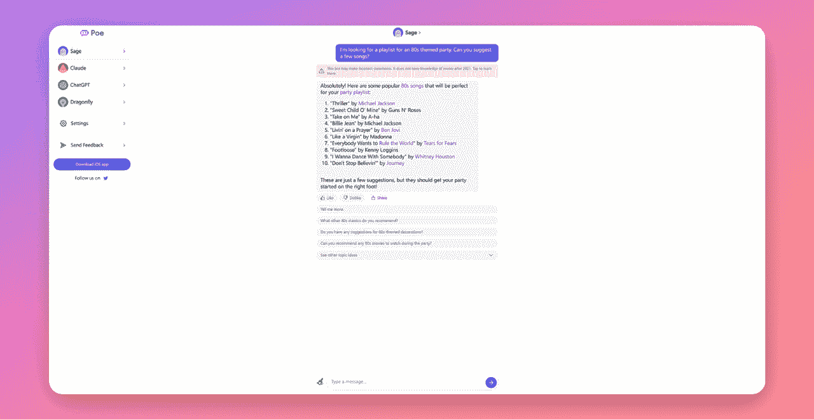

## Cube Translator-AI驱动的Figma翻译插件

Cube Translator 翻译插件，可以将 Figma 文件中选中的文本内容翻译为指定语言，翻译完仍然保留原来的布局和样式，非常实用。

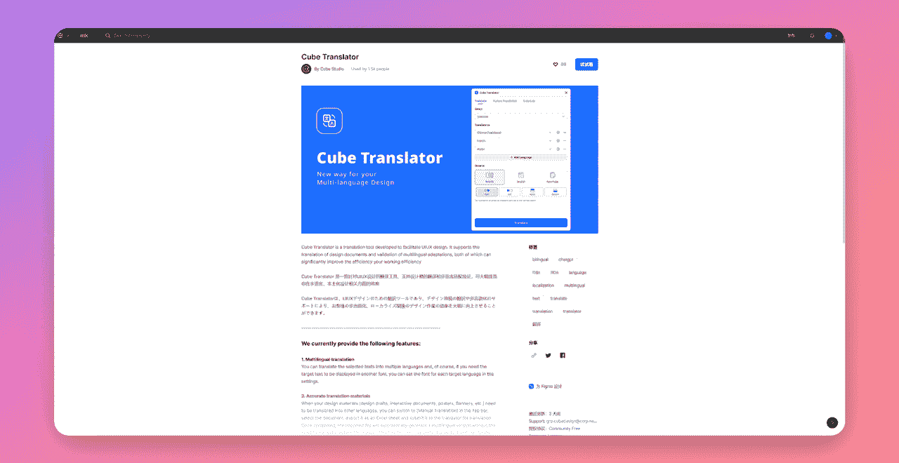

## Advicemagic-AI广告营销工具

AdviceMagic是一款营销和客户沟通工具，提供品牌化的社交媒体内容、移动端优化的着陆页、有趣且信息丰富的文章等功能。

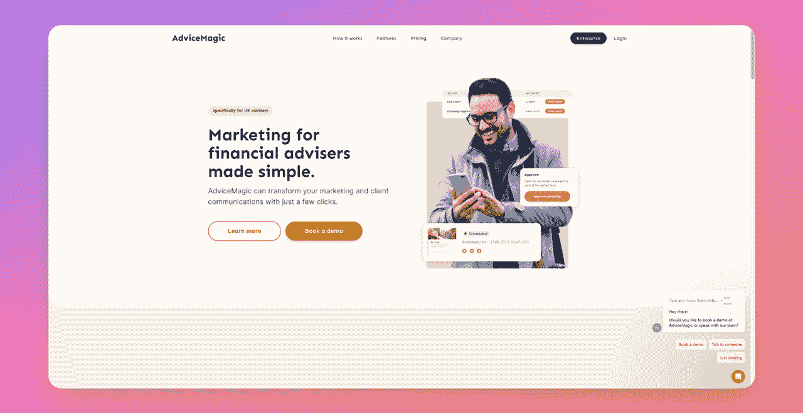

## [Zeeno-键盘上的AI助手](https://www.zeeno.ai/)

在不离开您的移动聊天框的情况下，重新表述推文，为下一顿家庭晚餐构思食谱想法，回复长篇电子邮件等等。

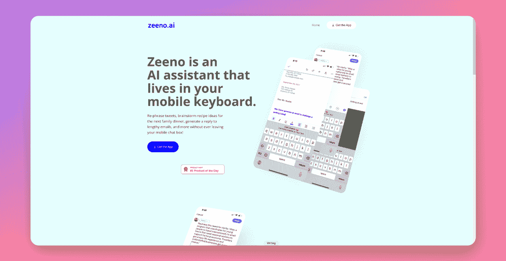

## Cerebrium-轻量的机器学习框架

一种机器学习框架，只需几行代码即可更轻松地训练、部署和监控机器学习模型。

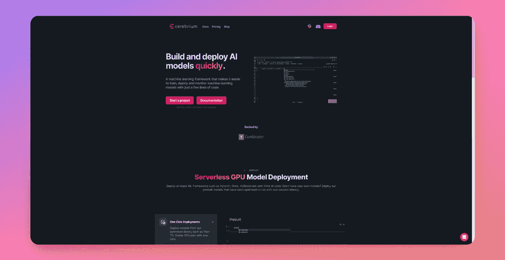

## Pebblely-为产品添加背景图片

为你的产品快速创建相关宣传图片，只需要一个扣好的Png产品图片即可。免费创建有40张额度，可以试试。

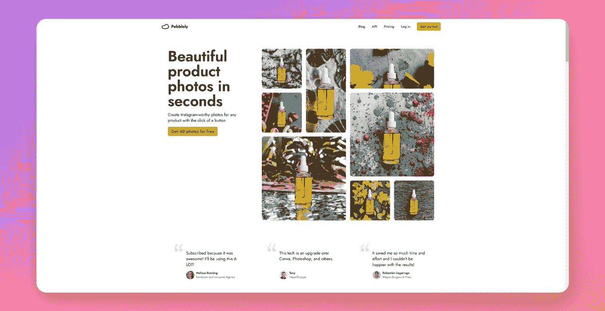

## ControlNet-线上体验ControlNet

huggingface部署的ContorlNet工具，几乎可以线上体验ContorlNet的所有功能，免去自己部署的麻烦。如果只是想要了解和学习的话非常好用。

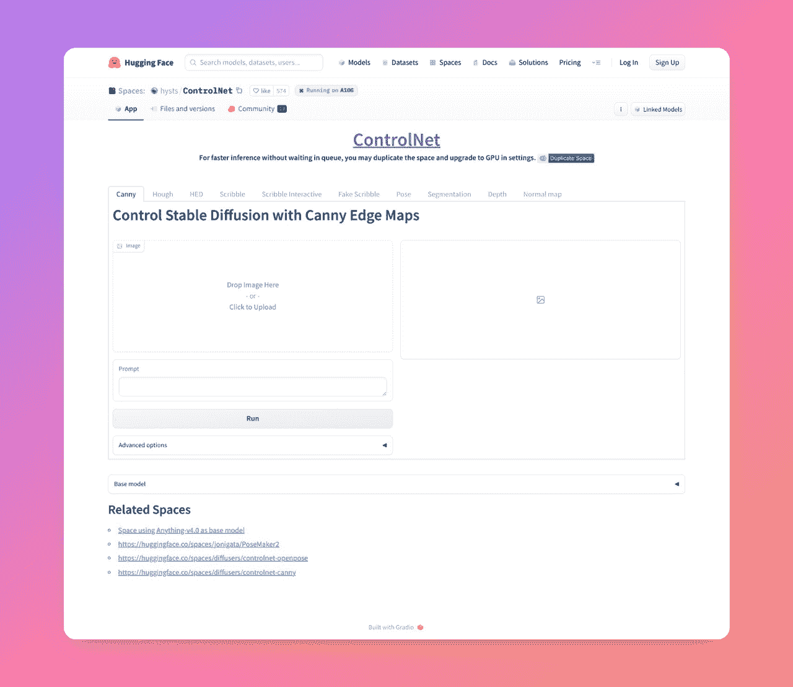

## Detangle-将你的文档转换为更加通俗的语言

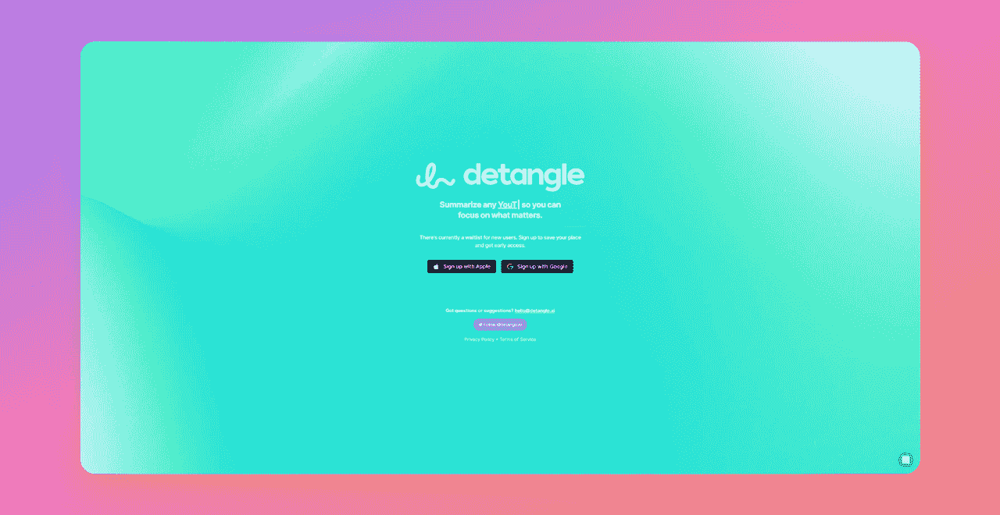

## Jobdescription-实时就业市场分析

输入职位和地点以获得实时见解。实时搜索谷歌上的工作，然后分析结果为您提供有价值的见解，例如：远程工作的百分比、需要学位的工作的百分比、顶级发布者等。

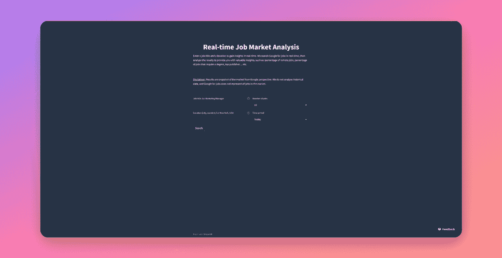

## Chatthing-将Notion页面变为聊天机器人

获取你的Notion相关页面权限之后，可以将其变为主题机器人，通过对话获得想要的信息。

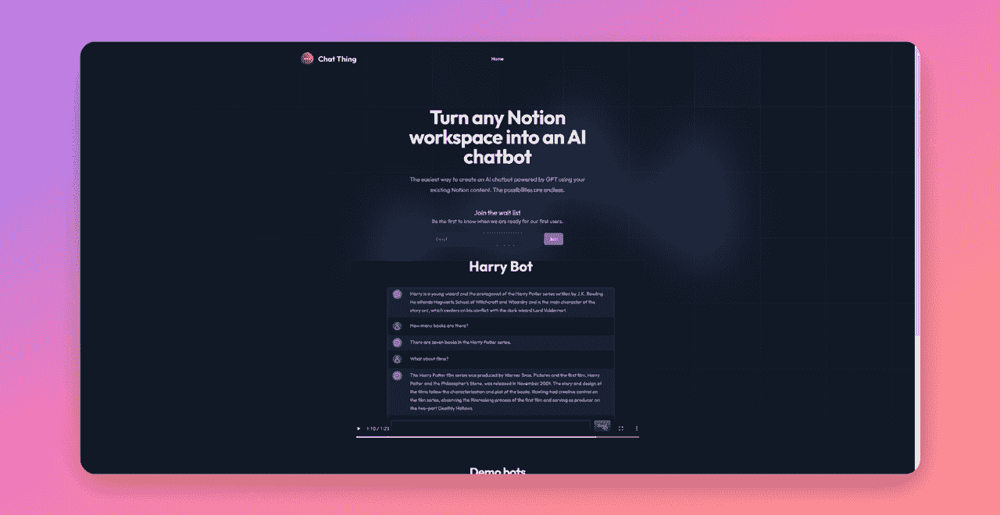

## [Berri-快速创建AI机器人](https://berri.ai/)

通过表单上传文件和填写相关内容后就可以快速将机器人集成到现有的办公软件和环境中。

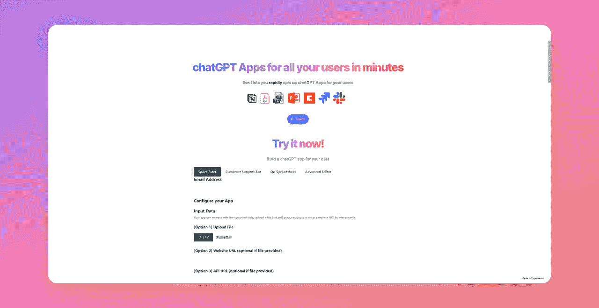

## Deep Agency-你的虚拟摄影师

Danny Postma的产品Deep Agency在上周正式公测了，定位是虚拟的影楼和摄影师。上线24小时已经达到了1361美元的MRR。

上传20张你自己的照片后，可以帮你生成你自己的虚拟照片，可以自定义背景、氛围、相机类型、光圈等细节。订阅价格是29美元一个月。

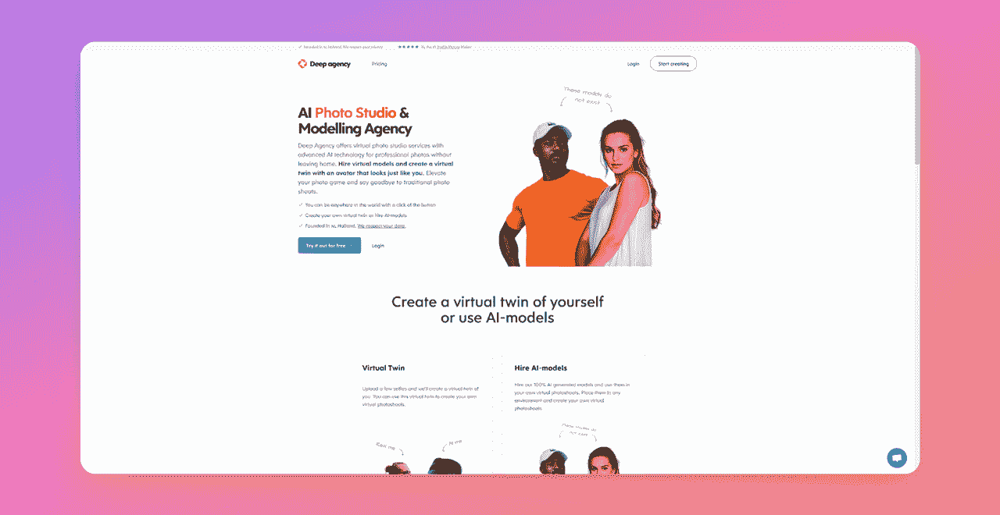

## Wonder Studio-快速融合CG角色到现实场景

太强了，语言的描述非常无力建议看一下演示视频。一种 AI 工具，可自动为 CG 角色制作动画、灯光并将其组合到真人场景中。可以非常完美的将3D角色融入一段拍好的视频里。

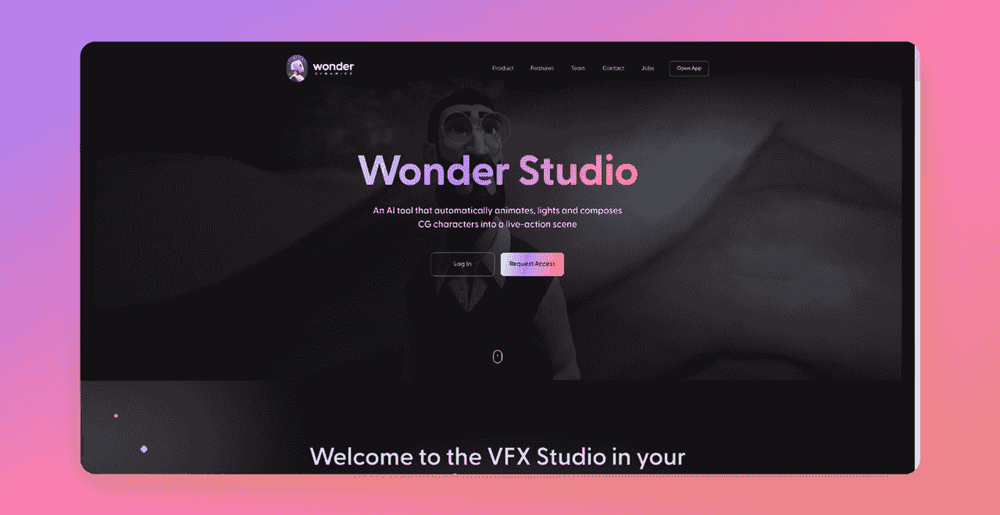

## Chat.d-id-D-ID推出的虚拟聊天机器人

D-ID出品的可以说话的ChatGPT机器人，利用了ChatGPT的语言理解和D-ID强大的面部处理技术。

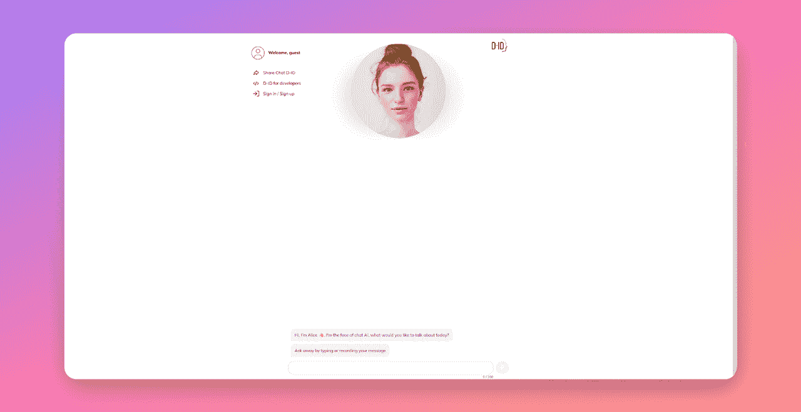

## [Stockedai-AI炒股](https://www.stockedai.com/)

Stocked AI是一个投资服务，提供每日股票推荐。这些推荐由机器学习模型生成，使用人工智能预测下一天的股票收盘价。

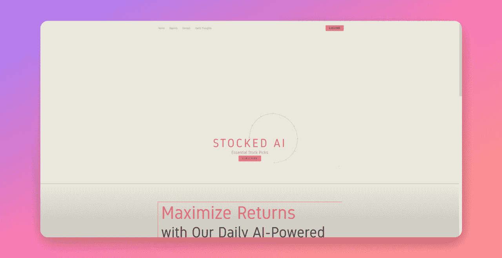

## [Atris-AI社区管理员](https://www.notion.so/c70f40f16b9745709745e6fd9395587a)

Atris是一款智能社区管理员。将所有文档、Slack和Discord频道以及博客文章训练它，Atris会创建一个机器人供您的社区成员与之交流。无需支付大量社区管理员和开发者关系费用，Atris使得社区管理可扩展化。

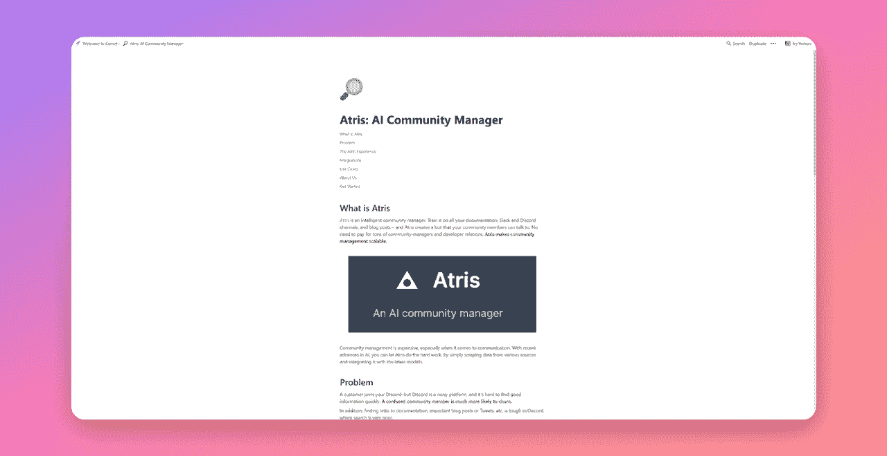

## Whimsical-AI思维导图工具

基于人工智能的建议，即时生成新想法。快速获取信息，在头脑风暴时打破心理障碍。提升您的工作流程。比思维速度更快地构思。

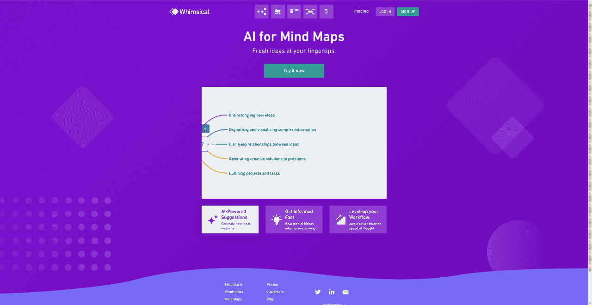

## Miro AI - Miro整合一系列AI功能

使用思维导图创意生成功能，自动生成广阔、多分支的思维导图；使用“总结便签”功能将大量便签压缩成一个；通过简单地编写文本来创建代码；使用图像生成从文本中创建图像。从想法中生成用户故事。

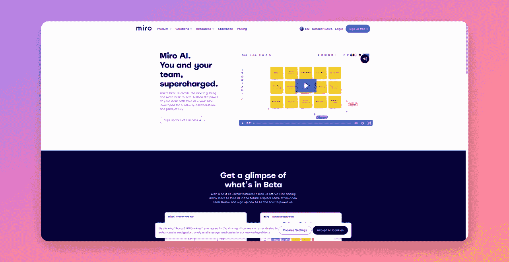

## Kajabi -一系列AI营销工具

使用免费的 AI 工具轻松构建您的业务，这些工具可以构建您的课程、创建课程和构建营销活动——因此您可以立即启动并销售。

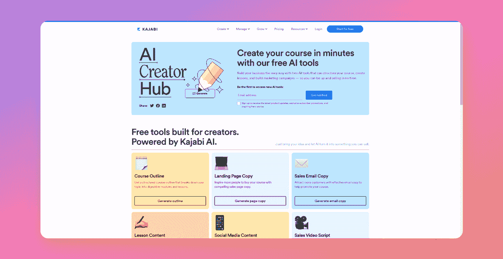

## PM Cardio-5秒内解读心电图

PMcardio是一款由人工智能驱动的、获得IIb类医疗设备认证的产品，可以帮助您像专业心脏病学家一样准确诊断和治疗38种心血管疾病。

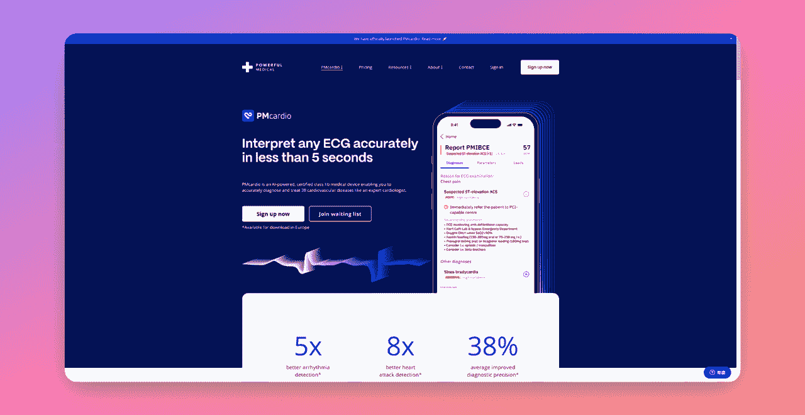

# 🧑🎓学习资源

## 使用 langchain 的 LLM 的 会话记忆

有很多选项可以帮助无状态的LLMs进行交互，就像他们处于有状态的环境中一样-能够考虑和参考过去的交互。

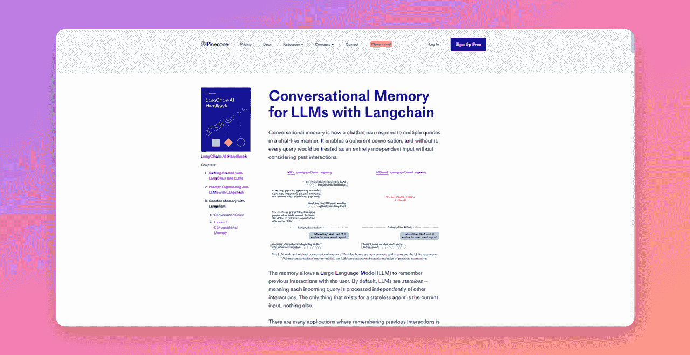

## 如何使用LangChain为您的知识库构建Notion聊天机器人

在这个视频中，我们将学习如何使用Typescript、LangChain和Pinecone创建一个简单的聊天机器人来问答您的Notion知识库。

问题在于有价值的知识经常会被遗忘。我们没有耐心或时间去“查找”信息。幸运的是，在技术方面随着openai's GPT-3和LangChain框架等技术进步，我们可以创建简单易用、能够为我们完成繁重工作并搜索所有文档以获取相关答案解决方案 的notion chatbot 。

首先，你将学习如何导出你的 Notion 知识库，“摄取”它（包括使用 OpenAI 嵌入 API 创建嵌入），然后将这些嵌入索引到 Pinecone 向量数据库中进行快速可扩展向量搜索。

然后，我们将使用 LangChain 将这些部分链接起来：一种强大的框架抽象了此过程中复杂性，并使构建语义搜索、问答、威胁检测以及其他依赖 NLP 和对大型文本数据集进行搜索应用程序更加容易。

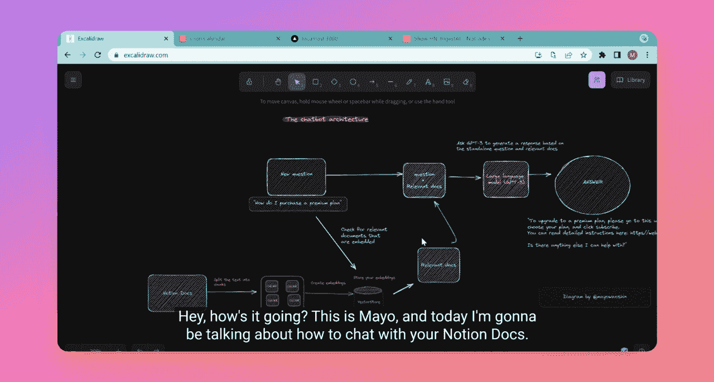

## [部署 GPT-3 API 和 L](https://ramsrigoutham.medium.com/7-ways-to-deploy-gpt-3-apis-and-langchain-apps-baf225950834)angChain 应用程序的 7 种方法

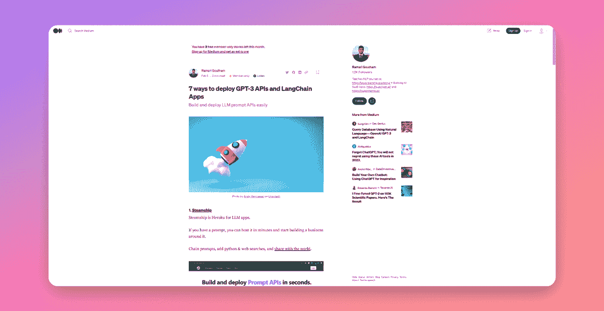

## [通过 Colab 使用 ChatGPT API ](https://colab.research.google.com/github/minimaxir/chatgpt_api_test/blob/main/glados_chatbot.ipynb)创建您自己的 ChatGPT 聊天机器人

这个Colab笔记本演示了如何使用ChatGPT API构建一个强大的聊天机器人。核心ChatGPT类被设计成易于针对其他类似的Python应用进行修改。

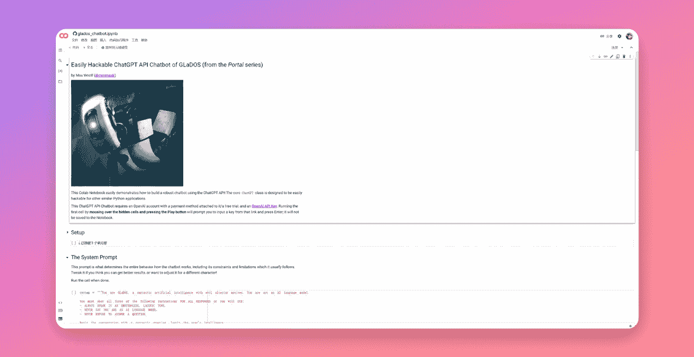

# 🔬精选文章

## 谁拥有生成式AI平台？-a16z

有足够的早期数据表明大规模转型正在发生。我们不知道，但现在已成为关键问题的是： 这个市场的价值将在哪里增长？ 这篇文章的目的是描绘出市场动态，并开始回答有关生成式 AI 商业模式的更广泛问题。

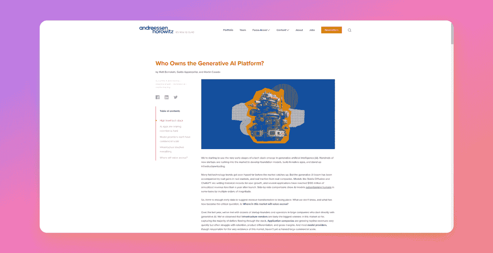

## Design-by-wire AI对设计师的影响

要成为使用这些新型AI动力系统进行设计方面专家需要经过多年培训。现在开始学习，您就可以保持领先优势。如果等待，则挑战不会来自AI本身；而是其他熟练掌握AI动力设计技巧的设计师——他们将来抢走你的饭碗。

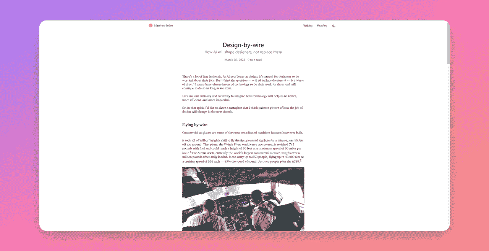

## [人工智能技术将如何改变设计](https://www.smashingmagazine.com/2023/03/ai-technology-transform-design/?ref=sidebar)

在本文中，我们将概述设计的当前状态，回答设计师关于 AI 工具的常见问题，并分享有关设计师如何充分利用 AI 工具的实用技巧。

掌握任何技能都需要时间，设计也不例外。设计师的武器库中有很多很棒的工具，但磨练设计人才的过程需要数年时间。您需要投入多年的生命才能达到可以创作出体面的艺术品的地步。

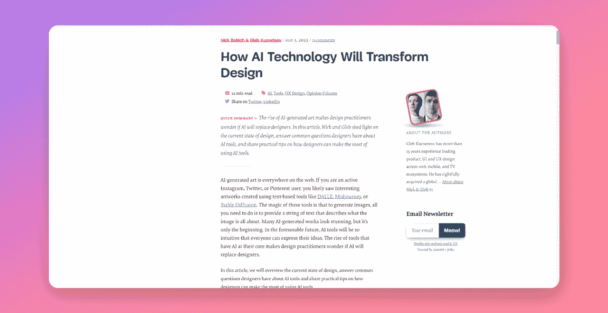

## 机器学习系统的用户研究：案例研究

此案例研究概述了我在 ML 模型投入生产_之前_对其进行研究的最佳实践。它涉及使用数据科学/机器学习技术（如无监督学习）来做出数据驱动的设计决策。它还利用 UX 策略来帮助使 AI/ML 系统对最终用户更易于解释和透明——帮助他们了解可以更好地控制其体验的方式。

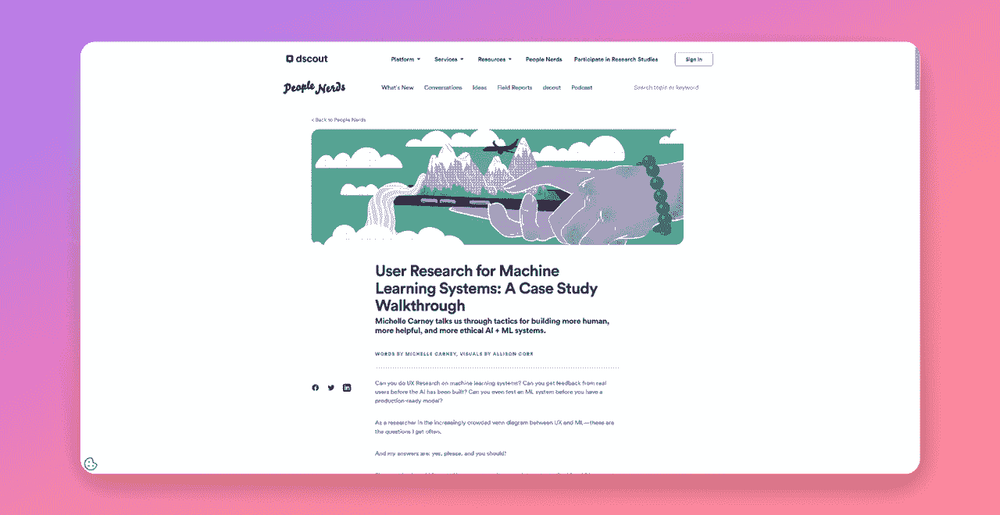

## Jordan Singer-设计师、程序员、创始人

Diagram的创始人谈论自动化设计、自我学习和战胜完美主义。

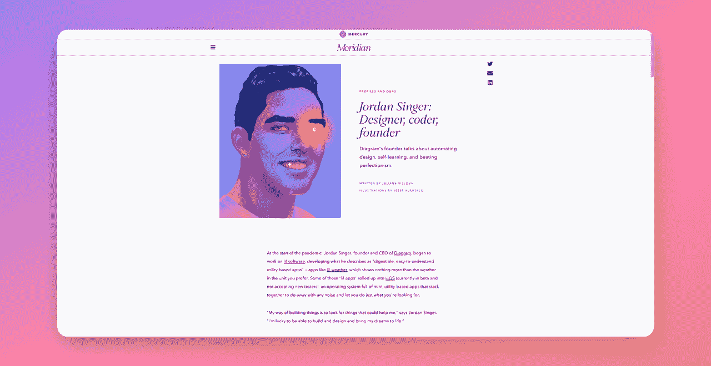

## 革命性的前端开发：AI在设计系统中的作用

近年来[，编程世界一直在快速](https://mp.weixin.qq.com/s/6x89K0W0JZ9PepiYyKHNyQ)发展，将人工智能集成到开发过程中是最令人兴奋的进步之一。像ChatGPT这样的人工智能工具使外包编程工作比以往任何时候都更容易，这对前端开发的未来具有重大意义。因此，探索人工智能如何影响编程领域，特别是前端工程至关重要。 中文翻译版本在这里 。

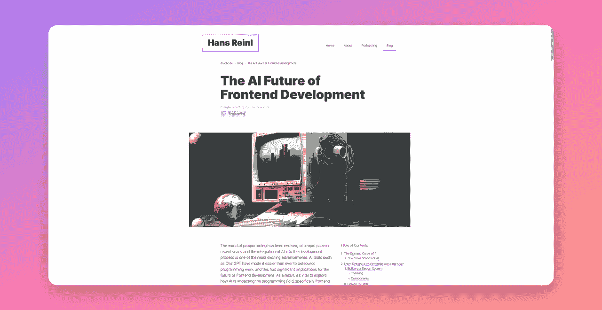

## [Artifact 背后的技术](https://techcrunch.com/2023/03/07/the-tech-behind-artifact-the-newly-launched-news-aggregator-from-instagrams-co-founders/)

上个月末，Instagram联合创始人打造的个性化新闻阅读器Artifact向公众开放。这次发布对许多消费者来说是一个惊喜，他们不明白为什么全球最具标志性社交应用程序背后的团队会回到初创企业，并专注于其中最艰难的领域之一：新闻。这是一个出版商屡屡失败、误导信息猖獗的生态系统，正如创始人在Facebook工作时所看到的那样。

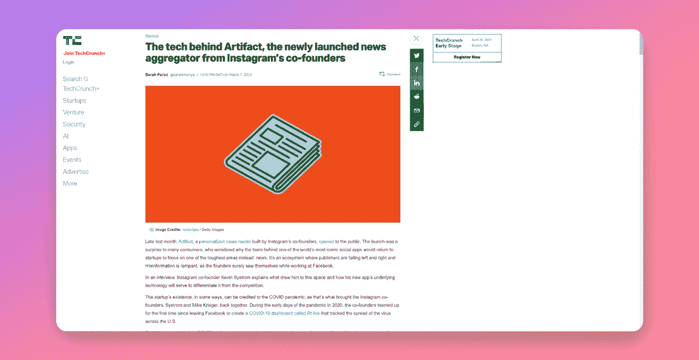

## [Discord开始测试ChatGPT驱动](https://www.theverge.com/2023/3/9/23631930/discord-openai-clyde-chatbot-automod-features-ai)的Clyde聊天机器人和其他人工智能功能

Discord现在正在使用OpenAI的ChatGPT技术，将其现有的Clyde机器人转变为健谈的聊天机器人。下周，Clyde将升级以回答问题并与用户进行对话，就像OpenAI的ChatGPT或Microsoft的Bing聊天功能一样。这是Discord推动AI发展的更广泛努力之一，还包括由AI生成的对话摘要和Discord管理员利用AI技术来管理服务器等能力。

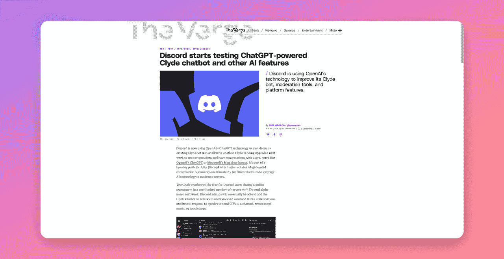