# AIGC Weekly #11

> 来源：[https://waytoagi.feishu.cn/docx/IVmsdaGRjoyXUpxR0ITcEkvFnXe](https://waytoagi.feishu.cn/docx/IVmsdaGRjoyXUpxR0ITcEkvFnXe)

> 🔗 原文链接： h[ttps://op7418.zhub](https://op7418.zhubai.love/posts/2244331214758957056)ai.love/posts/22...

> 发表时间：2023-03-06

工具：Midjourney ar 16:9 v4

提示词：Minimalistic,huge black hole in the sky,white glacier fog, blur photo , 4 blur, delicate, soft scene

> 如无意外会在每周一更新，主要介绍上周AIGC领域发布的一些产品以及值得关注的研究成果，由于我自己是一个设计师，所以在一些专业内容的描述上可能存在问题，欢迎在渠道帮我反馈及更正。（本期部分文案使用了Notion AI以及Chat GPT帮助润色和翻译）

# ❤️上周精选

## Ooen AI正式发布ChatGPT API

上周三Op[en AI](https://platform.openai.com/docs/guides/chat/chat-vs-completions) 正式发布了 ChatGPT 所用模型的API他们叫这个模型为 gpt-3.5-turbo 与之前的GPT-3一样还是以Token数量计费，不过不同的是现在的ChatGPT模型的成本比之前下降了90%，1000 Token只需要0.2美分，也就是说2美元可以使用100万的Token，新账号送的18美元额度可以用很久了，顺便提一嘴现在新注册的账号只送5美元的额度了。如果要了解更多API相关信息可以看这个 官方文档 。

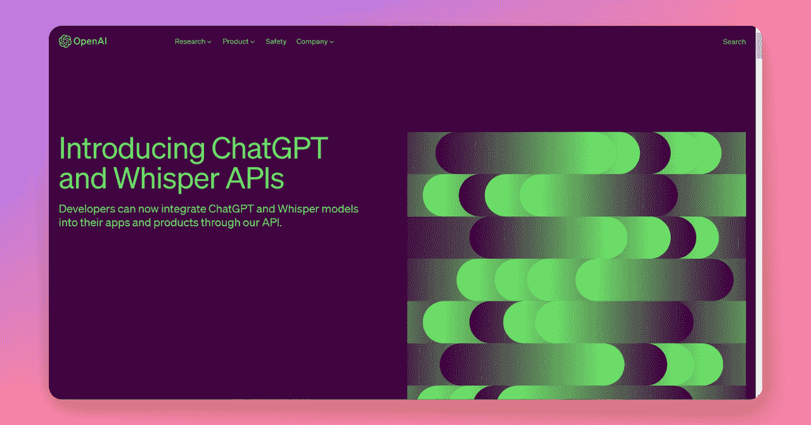

新的新的API计费方式还是发送和生成的内容都需要计算费[用如果要了](https://github.com/openai/openai-cookbook/blob/main/examples/How_to_count_tokens_with_tiktoken.ipynb)解Token的[计数规则可以看](https://tiktokenizer.vercel.app/) 这个文档 ，也有个老哥 写了一个网页 可以更清晰的查看内容需要的Token数量。

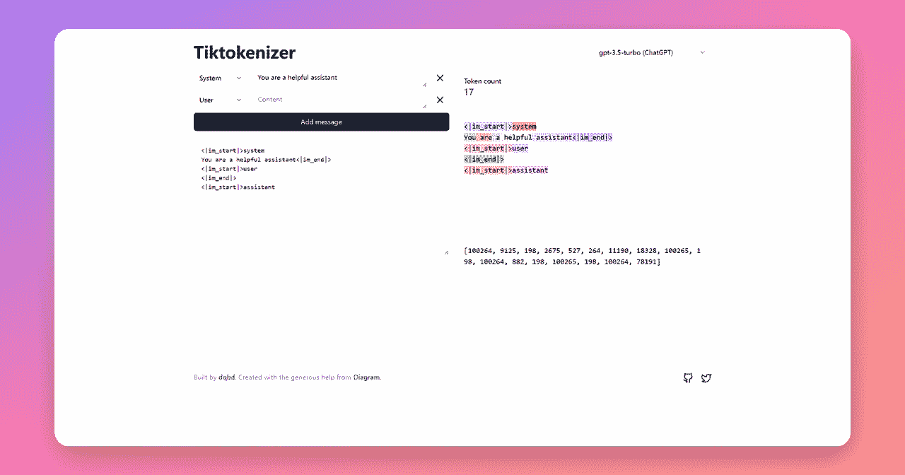

[这里如果想要实验新API如何](https://platform.openai.com/playground?mode=chat)个使用的话 Open AI也提供了 对应的Playground 。

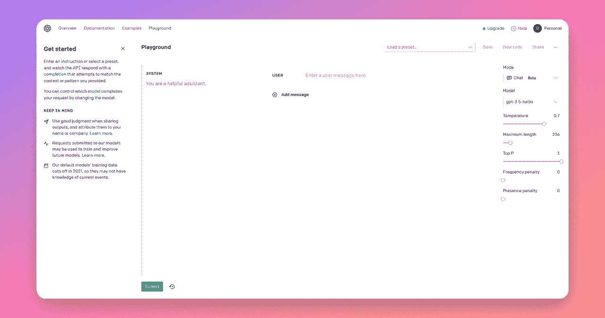

[同时在发布第二天所](https://twitter.com/easychen)有的Open AI地址就被咔[嚓了，所以](https://twitter.com/easychen/status/1631598089076363264)推友 easychen 写了可以通过一行命令部署的 代理服务 。

docker run -p 9000:9000 easychen/ai.level06.com:latest

同时开放的API 还有Open AI已经开源的W[hisp](https://platform.openai.com/docs/guides/speech-to-text)er语音识别模型，具体文档可以 看这里 。

其次还有一些其他的措施也生效了：

+   通过 API 提交的数据不再用于服务改进（包括模型训练），除非组织选择加入

+   为 API 用户实施默认的 30 天数据保留策略，并根据用户需求提供更严格的保留选项。

+   移除我们的发布前审核（通过改进我们的自动监控来解锁）

+   改进开发人员文档

+   简化 [服务条款和使用政策 ](https://platform.openai.com/docs/usage-policies)，包括有关数据所有权的术语：用户拥有模型的输入和输出。

还对过去一个月Open AI服务频繁宕机的事情进行了道歉。

## [ANIME ROCK, PAPER, SCISSOR](https://www.youtube.com/watch?v=GVT3WUa-48Y)S-完全使用AI绘图技术制作的高水平动画

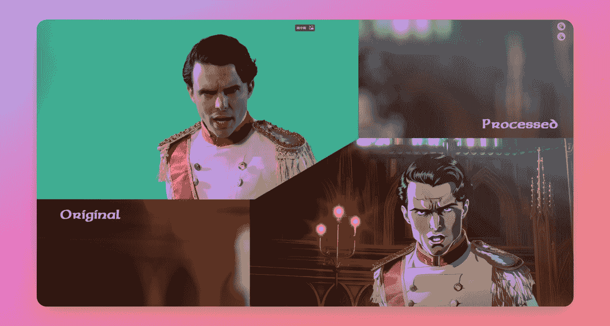

这是一个通过绿幕动作捕捉，在虚幻中制作虚拟场景，然后通过Stable Diffusion生成的动漫。120个视觉特效镜头由一个3人小组在一秒钟内完成。效率非常高，同时成片的质量也有所保证。

[他们关于](https://www.youtube.com/watch?v=_9LX9HSQkWo&t=710s)制作过程描述的具体视频 在这里 。有点长如果懒得看的话也可以看我下面总结的一些他们使用到的技术

Corridor基本上做了一个开源的video2anime工作流程来完成这个视频。他们使用的 主要工具为 ：

+   Stable Diffusion模型+DreamBooth微调

+   虚幻引擎+资产存储3D模型

+   Img2Img + DeFlickering效果

+   大量的老式的VFX合成

视频的制作步骤是：

1.  训练模型复制特定风格

1.  训练一个LoRA模型来认识一个角色

1.  通过img2img处理绿屏动捕的视频

1.  使用 Deflicker 插件减少闪烁

1.  在虚幻5中添加3D元素

1.  在 Resolve 中进行最终 VFX 合成/编辑

为了最后的打磨，他们添加了大量 老式视觉特效：

+   强调运动的速度线

+   模拟电影摄像机/单元格动画的发光体

+   虚幻中的动态元素（如蜡烛）

+   设置室内气氛的体积光射线

+   编辑和设计声音。

# ⚒️产品推荐

## OpenCat-ChatGPT Mac桌面客户端

熊猫吃短信的开发者 [Baye ](https://twitter.com/waylybaye)开发的ChatGPT桌面客户端，使用了新版的API需要输入自己的Open AI的key来使用，作为老牌独立开发者软件的体验和质量都很在线。

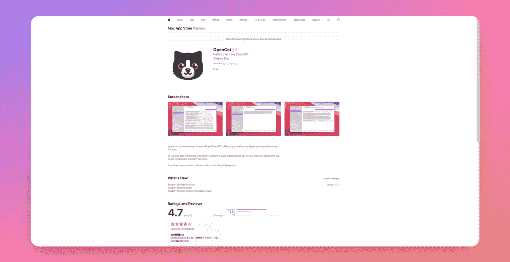

## [bob-plugin-openai-transl](https://t.co/Sp3tMyDsB2)ator-BOB ChatGPT翻译插件

推友 [yetone ](https://twitter.com/yetone)制作[的BOB C](https://github.com/yetone/openai-translator)hatGPT翻译插件，非常好用，翻译速度非常快，甚至能翻译文言文润色中文也可以。也需要使用自己的Open AI API Key来使用。同时他而要开发了一个类似的 浏览器插件 来供非Mac系统的人使用。

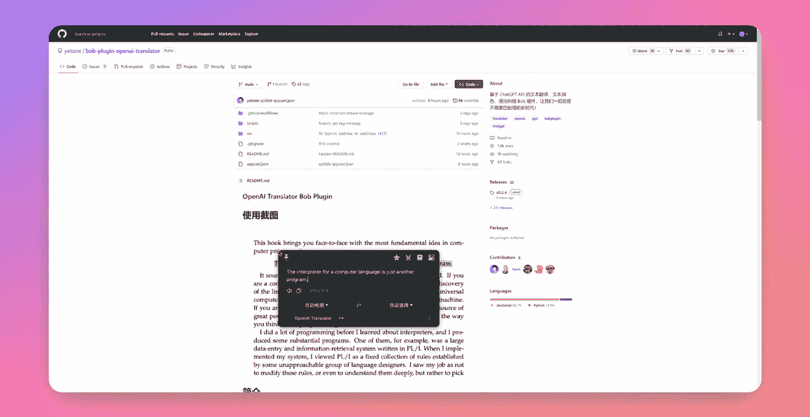

## [Q-Chat-人工智能学习平台](https://quizlet.com/labs/qchat)

Q-Chat使用苏格拉底教学法促进批判性思维，帮助您加深理解，保持学习的乐趣和趣味性。选择学习提示，对资料进行测验，加深理解或通过故事进行学习。

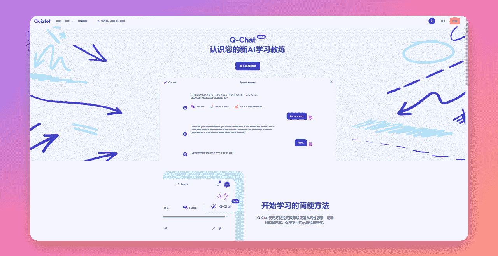

## BiliGPT-一键总结BiliBili视频内容

推友 jimmylv.eth (, ) 吕立青 2𐃏22 开发的工具可以一键总结哔哩哔哩、播客或者youtube视频内容，可以直接购买次数或者使用自己的Key。

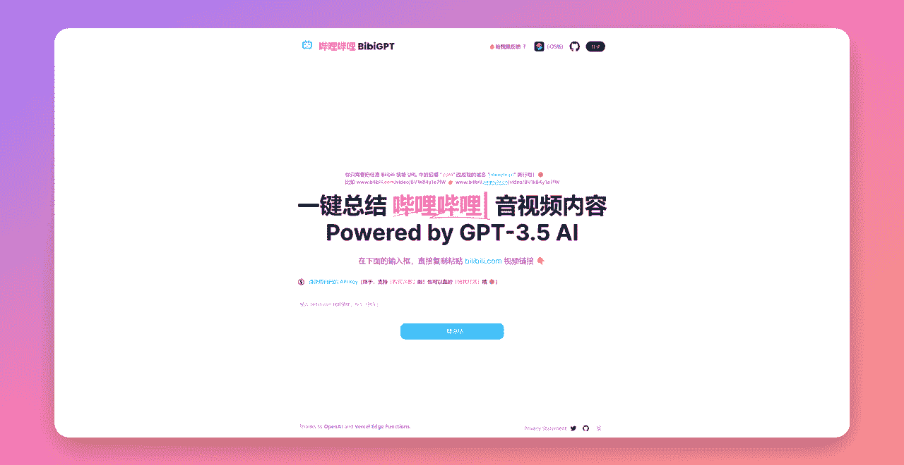

## Meerkat-将非结构性数据处理为结构性数据

Meerkat是一个开源的Python库，旨在帮助 技术团队以交互方式整理图像、视频、文本 基础模型的文档等。目标是使基础模型更可靠 用于处理非结构化数据集的软件抽象。

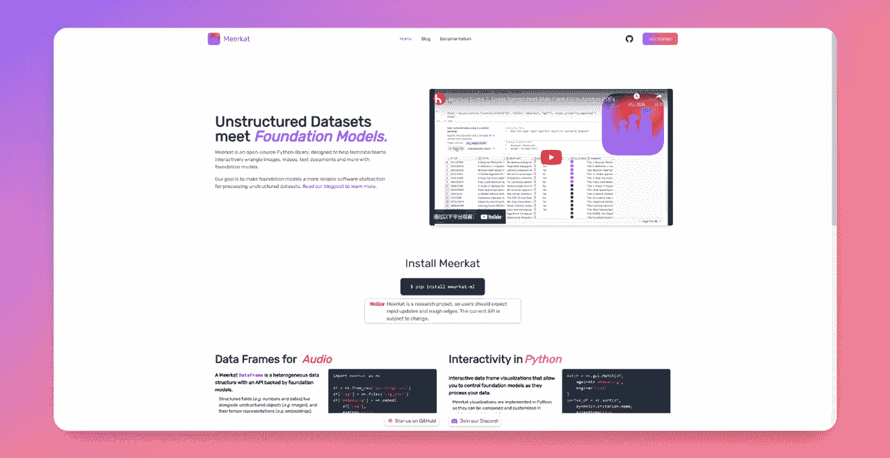

## [Stability for Blender-Stable ](https://platform.stability.ai/docs/integrations/blender)Diffusion官方Blander插件

支持在Blander内使用文字生成图像，使用建模内容生成图像、生成纹理以及从视频内生成动画。

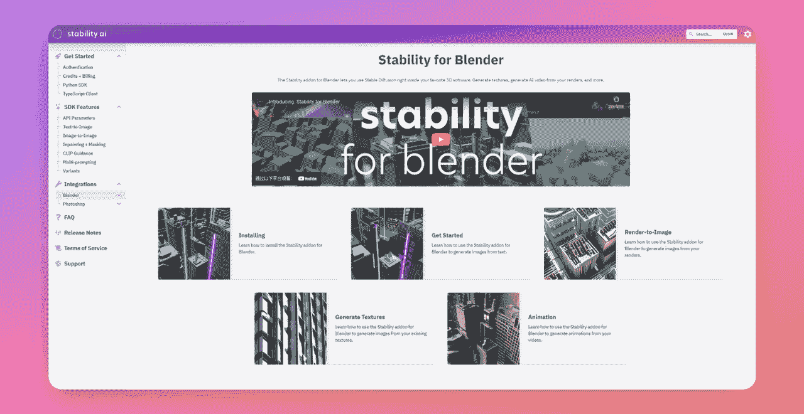

## Perplexity浏览器插件-一键生成网页摘要

之前介绍过的AI搜索工具 [Perplexity ](https://www.perplexity.ai/)的浏览器插件，支持当前页面的即时摘要、从你的工具栏快速提出任何问题、询问有关当前页面的问题、提出针对当前领域的问题、通过链接分享您的答案以及点击询问后续问题等。

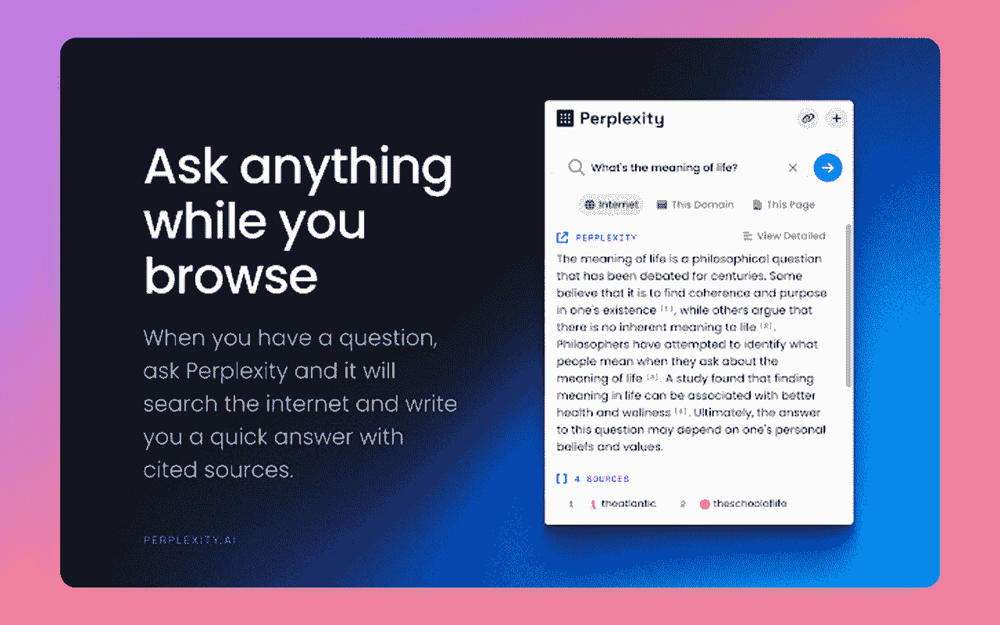

## Promptperfect-优化你的 AI 提示词

支持针对语言模型提示词的优化和AI绘图工具提示词的优化，可以对比优化前和优化后的输出结果，同时他也会告诉你优化前后提示词的变化，方便你快速学习。

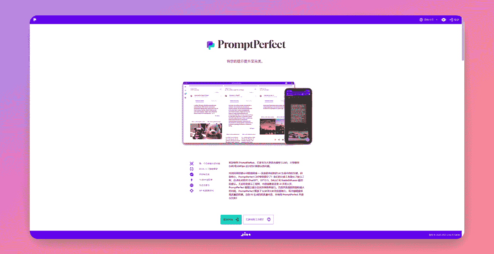

## RoomGPT-优化你的房间装修

上传一张你现在房间的照片并说出捏要求，他会给你一张优化后的房间照片，其实本质上就是img2img然后针对性做了优化。

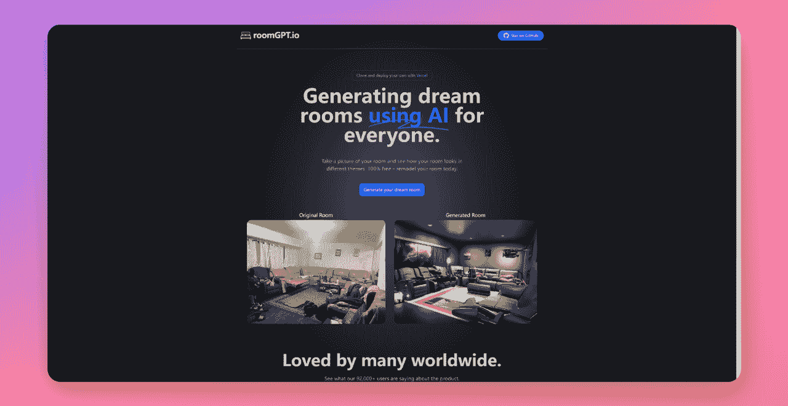

## Auralbyte-将音频快速转换为视频

Auralbyte 使您能够以零摄像头或设计工作将音频或文本优先的受众扩展到视频平台。

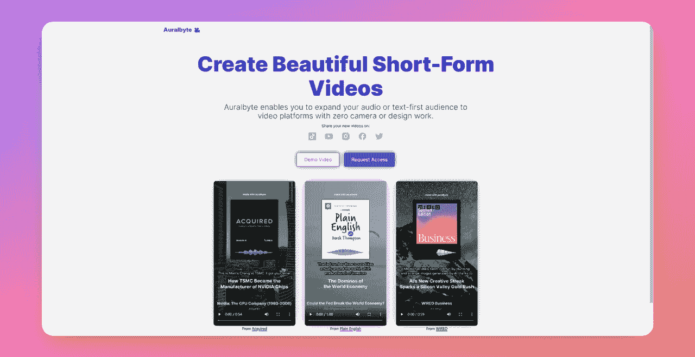

## Elevenlabs-生成式语音AI模型

使用最先进的多用途人工智能语音工具，以任何声音和风格生成高质量的口语音频。我们的深度学习模型以前所未有的保真度呈现人类的音调和转折，并根据上下文调整交付。

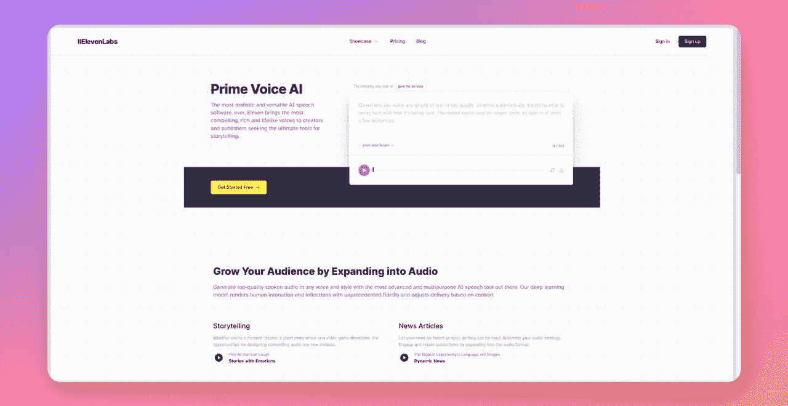

## Spellbook-将你起草法律合同的效率提高三倍

Spellbook是一种AI工具，它使用GPT-3来审查和建议Microsoft Word合同的语言。它经过了对维基百科、书籍和互联网的培训，以参考世界上的事实。Spellbook由OpenAI的GPT-3提供动力，它是提供高性能的大型语言模型。它是唯一一款经过调整以适用于合同并与Word集成的GPT-3动力工具。

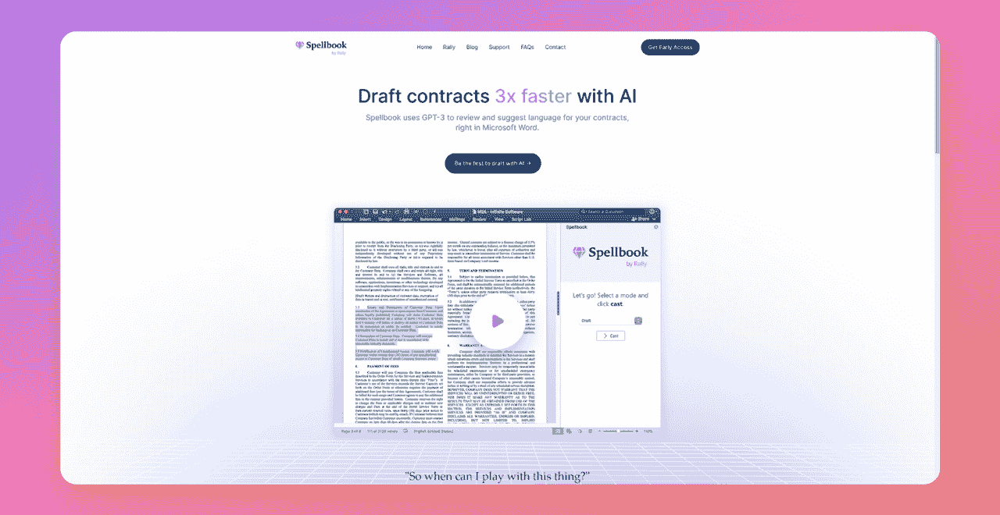

## Kraftful-将AI用于用户研究工作

Kraftful是一个产品研究工具，利用人工智能分析用户反馈并提供有关用户需求的见解。该工具可以帮助进行反馈分析、用户情感跟踪和竞争分析。用户赞扬Kraftful能够快速提取数据并提供见解，帮助企业实现产品市场适配。

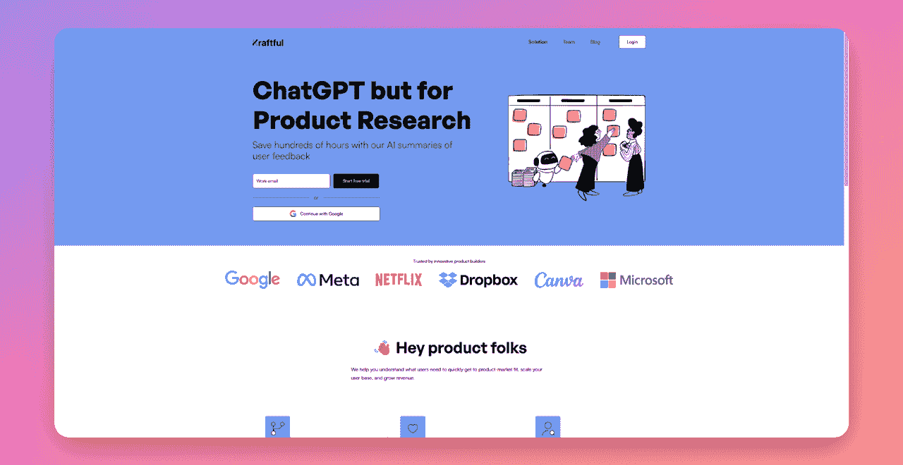

## Bifrost-从figma设计稿生成干净的前端代码

Bifrost是一个可以将Figma设计转换为React代码的工具，使用人工智能学习如何准确地构建代码结构。它可以帮助设计师将设计转换为干净的代码，使工程师可以专注于推动业务发展的功能，而不是重复创建新屏幕和组件。Bifrost还可以自动更新任何设计更改，无需优先考虑工程师时间。这个工具可以让设计师在不担心繁琐的交接问题的情况下创建和更新屏幕，并且每次都能完美呈现像素。

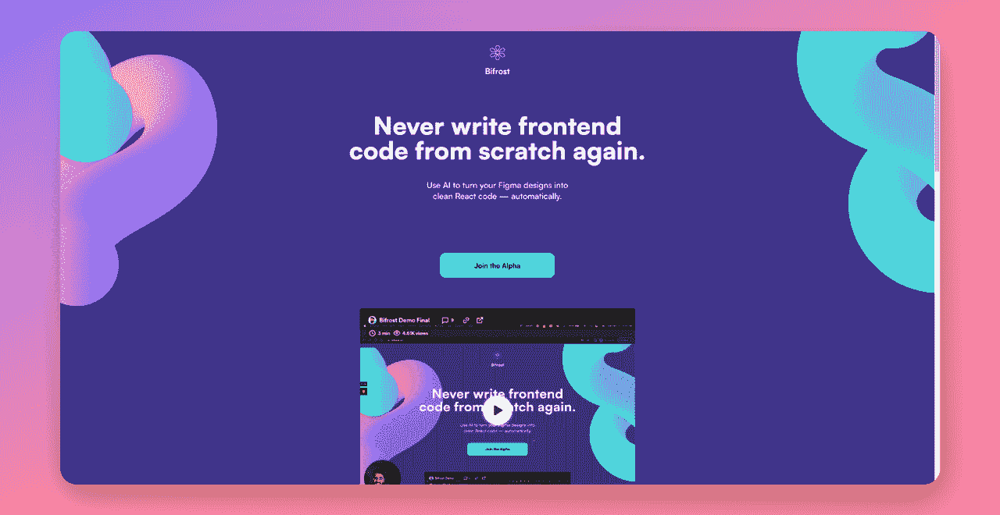

# 🧑🎓学习资源

## [如何将你的录音变成待办事项列表](https://www.youtube.com/watch?v=rQHAh8cdgVc)

如何在Reflect中使用Whisper录制和转录语音笔记，然后在笔记中直接使用GPT，将其变成待办事项清单。

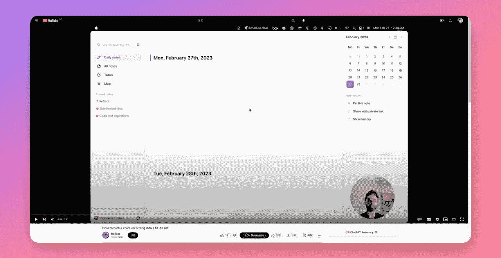

## 强烈推荐-如何在 Midjourney 中制作游戏资产

Linus这个教程非常成体系的介绍了如何在Midjourney中生成固定风格的游戏资产，并且处理后放进Figma中保存。

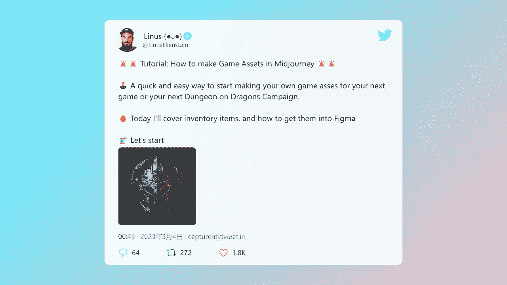

## Midjourney教程-创建波西米亚风格内饰照片

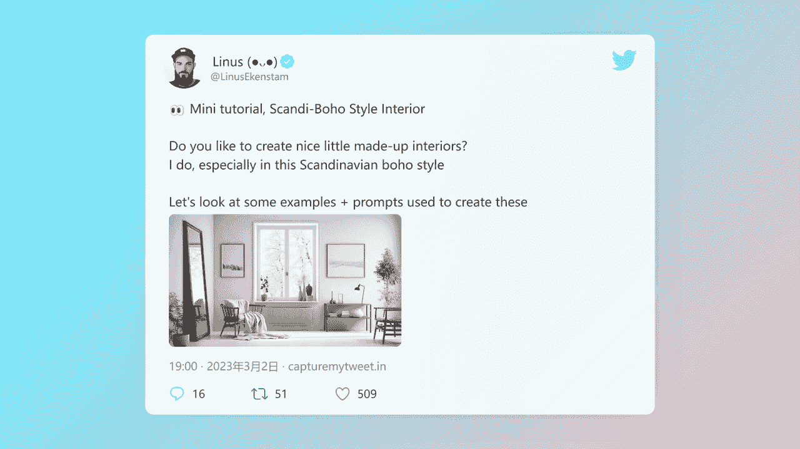

# 🔬精选文章

## [来自微软的交互式文本生成模型](https://arxiv.org/abs/2303.00908)

我们引入了一个新的交互式文本生成任务，通过使用提供编辑的用户模拟器，引导模型向给定的目标文本前进，从而可以在不涉及真实用户的情况下交互式地训练生成模型。我们使用模仿学习来训练我们的交互式模型，我们与有竞争力的非交互式生成模型的实验表明，交互式训练的模型优于非交互式的模型，即使所有模型都有相同的用户输入或编辑的预算。

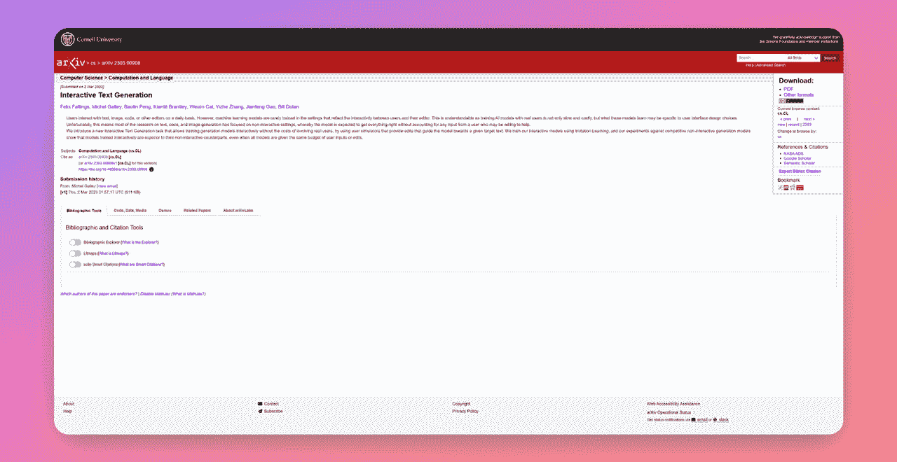

## 用人脑活动的潜伏扩散模型进行高分辨率图像重建

非常可怕，检测脑电波并利用扩散模型还原人脑正在思考的图像。图片中上面的是给测试者观察的内容，下面的是通过模型还原的内容。基本可以还原具体的事物。“总的来说，我们的研究提出了一种从人类大脑活动中重建图像的有前途的方法，并为理解 DM 提供了一个新的框架。”

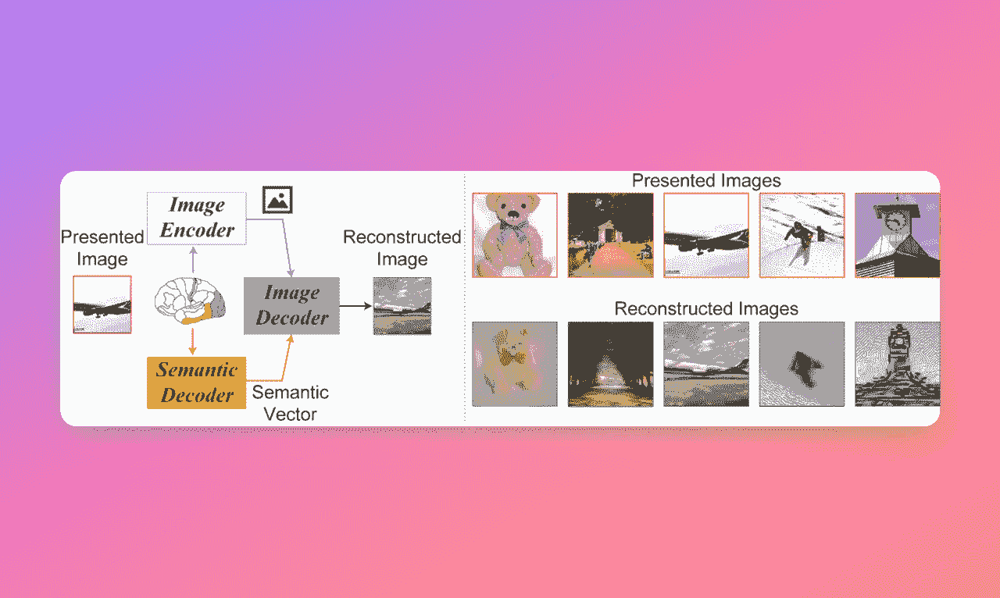

## OpenAI 的 CTO Mira Murati 介绍

当事情进展顺利时，通常会有人在幕后，减少聚光灯，但仍然推动事情向前发展。在这种情况下，让我们花点时间来了解 OpenAI 的 CTO Mira Murati 的贡献。她一直处于 OpenAI 技术发展的最前沿，提出了有关 创造力和准确性 之间权衡的问题。

## 微软将 Windows 11的一堆功能加入了AI能力

微软发布了新的Windows 11更新，其中包括在任务栏上具备人工智能技术的Bing搜索功能。更新还包括了对小部件、触摸模式、屏幕录制和记事本标签的改进。Bing的整合是一个意外的添加，微软没有向它的Windows Insiders测试。一个新的Bing图标将出现在任务栏的搜索框中，微软强调了搜索弹出窗口中的新聊天答案体验。Bing聊天在Windows 11任务栏中的扩展是在微软将相同模式推出到移动端Bing和Skype交谈的一周后实现的。更新可以通过手动检查Windows Update获取。

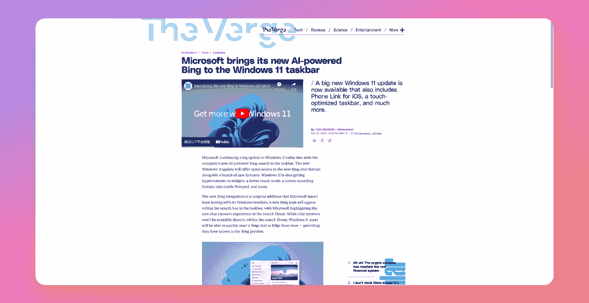

## OpenAI、TikTok 等公司签署 AI 透明协议

包括OpenAI、TikTok、Adobe、BBC和Bumble在内的10家公司签署了一项新的指南，旨在负责地建立、创建和分享由人工智能生成的内容。这些建议呼吁技术开发者以及数字合成媒体的创作者和分发者更加透明，说明技术可以和不可以做到的事情。

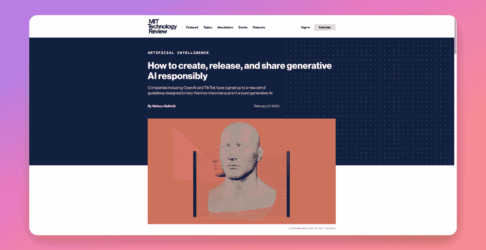

## 为什么搜索引擎不以更有益的方式整合类似ChatGPT的机器人？

该文章讨论了搜索引擎为什么不将ChatGPT等机器人集成到更有帮助的方式中。Google是搜索引擎之王，它通过PageRank和其他专有算法在第二部分做得非常好，但它距离提供对话界面还有很长的路要走。聊天机器人则在第二个方面表现不佳，因为它们优化了语言输出而不是事实查找或事实核查。当他们试图将不同的信息聚合成一个单一的确定性答案时，他们经常会出错或“产生幻觉”。另一方面，聊天机器人在解析语言和生成语言方面表现得相当好。那么为什么技术公司如此着迷于将它们整合到整个搜索过程中呢？为什么不结合这两种能力？为什么不能让聊天机器人接受普通人的问题并将其转化为搜索词（这是一项语言技能），使用链接系统查找相关网页（这是一项搜索和排名技能），然后使用聊天机器人对它们进行总结（另一项语言技能）。

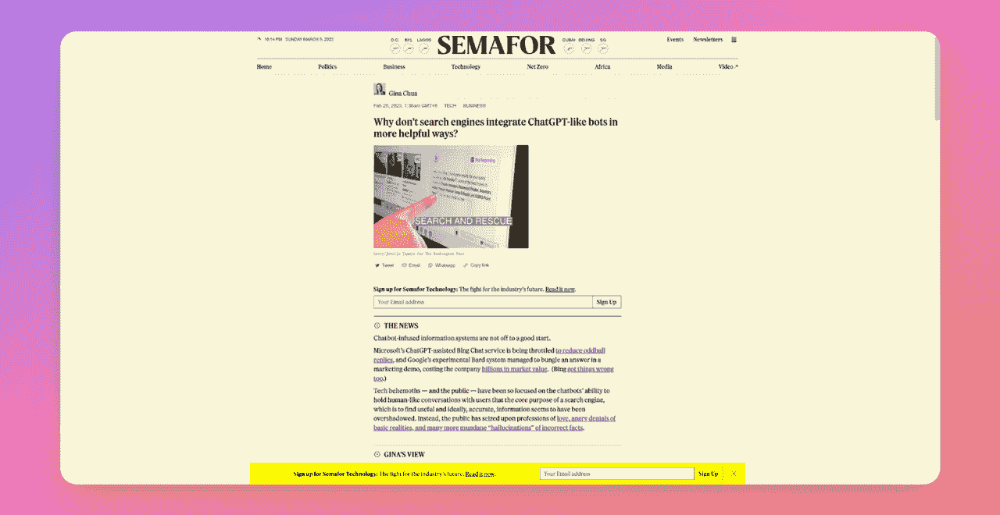