# AIGC Weekly #10

> 来源：[https://waytoagi.feishu.cn/docx/LXNRdSJxVo31mlxRkIUcdm5mnEf](https://waytoagi.feishu.cn/docx/LXNRdSJxVo31mlxRkIUcdm5mnEf)

> 🔗 原文链接： h[ttps://op7418.zhub](https://op7418.zhubai.love/posts/2241795361377546240)ai.love/posts/22...

> 发表时间：2023-02-27

工具：Midjourney ar 16:9 v4

提示词：White magnolia flowers in the morning light, transparent petals, pastel background, with copy space, HD, high realistic, simple, photography, closeup, out of focus

> 如无意外会在每周一更新，主要介绍上周AIGC领域发布的一些产品以及值得关注的研究成果，由于我自己是一个设计师，所以在一些专业内容的描述上可能存在问题，欢迎在渠道帮我反馈及更正。（本期部分文案使用了Notion AI以及Chat GPT帮助润色和翻译）

# ❤️上周精选

## [打](https://op7418.zhubai.love/posts/2239983151969951744)造你的赛博 Coser #2 没有好电脑也想玩？Colab部署StableDiffusion保姆级教程

想玩[S](https://op7418.zhubai.love/posts/2239983151969951744)tableDiffusion但是没有好显卡？答应大家的Colab版本部署教程来了，这里是量子速读版本，之前有部署StableDiffusion经验的童鞋可以看这个。小白可以看我周刊增刊的这篇详细教程： https://op7418.zhubai.love/posts/2239983151969951744

1️⃣点击链接打开后https://colab.research.google.com/drive/1lekLF7iib6M1R-NCylS0VMTF4wve-XuV?usp=sharing#scrollTo=Y4ebYsPqTrGb，点击第一步的运行按钮，接着在第二步选择需要的模型也可以自己填写下载链接。之后运行。

2️⃣第二步运行结束后选择第三步需要的LoRA模型，也可以填写自己需要的LoRA下载链接，之后点击运行。

3️⃣接着运行第三步、第四步和第五步内容，直到第五步出现图3的链接后点击链接打开Web UI。

4️⃣这个UI使用LoRA的步骤有点不一样，Lora模型位置出现新模块，之后切换到LoRA可以看到LoRA的卡片，点击卡片之后会在提示词输入框出现一段文字，之后调整文字里的数字内容切换权重。

5️⃣点击生成后欣赏你的作品，下面是我画的一张明日方舟的夕。

## 传统互联网产品加入AI竞赛

本周很多已经成名很久的产品纷纷加入了AI相关的能力，毫无疑问他们相较于那些为了AI而AI的产品在相关内容上的思考更为谨慎和细致，为了方便各位体验这里做一下相关汇总，包括一些大家熟知的产品和之前提到过的有名人背书的产品。

首先是 Notion AI 在在测试很久之[后终在本](https://www.notion.so/product/ai)周四公测了，具体的相关介绍可以 看这里 ，提供了扩写、精简、翻译等AI功能，深度与Notion原有的功能进行结合。Notion AI是需要单独付费的一个月10美元，每个人貌似有20次的免费试用次数。

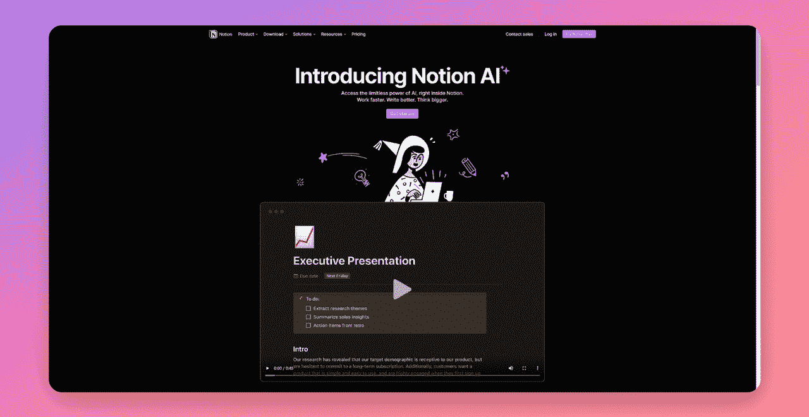

著名的启动器产品 Raycast 也在[本周宣布将要加入A](https://www.raycast.com/ai)I相关的功能，可以在 这里加入等待列表 ，包括自动补全命令上下文、软件内使用ChatGPT服务、使用AI创建任务等功能。

之前提[到过的Instag](https://medium.com/artifact-news/artifact-now-open-to-everyone-268c3799ee40)ram 创始人 Kevin Systrom 和 Mike Kriger 再次创业的项目，由人工智能驱动的个性化新闻工具 Artifact ，也在本周开放下载了。试用了一下推荐的内容都比较好，但是软件目前还比较简陋。可以在这里 查看官方介绍文章 。

Sp[otify 在23号也推出](https://newsroom.spotify.com/2023-02-22/spotify-debuts-a-new-ai-dj-right-in-your-pocket/)了自己的AI DJ功能，会在你收听音乐的间隙用AI生成的内容和声音帮你介绍相关音乐的内容，目前这个功能仅对美国和加拿大的用户开放。可以在这里查看 Spotify的介绍文章 。

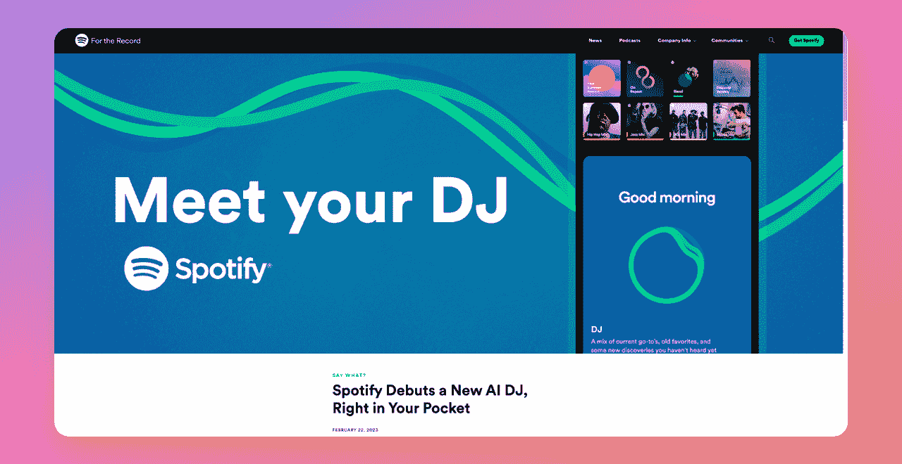

之前提[到过的AI生成PPT的](https://medium.com/lightspeed-venture-partners/storytelling-at-the-cost-of-zero-673755c1bf77)项目 Tome 在本周获得了4300万美元的融资，估值达到了3亿美元，在一众AI生成PPT的产品中这个是做的比较完整的在交互和功能上。 你只需要输入PPT的主题，它就会自动帮你生成整个PPT的大纲内容以及配图并进行排版 。这里 查看投资者的介绍文章 。

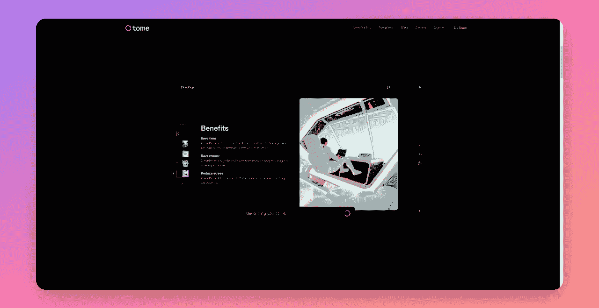

# ⚒️产品推荐

## Copilot hub-基于公开内容训练AI机器人

推友 [Jiayuan ](https://twitter.com/Tisoga)制作的产品，可以通过一些公开的信息和内容训练对应名人的AI让你直接同他们对话获得相关启发，现在以及提供了类似纳瓦尔、乔布斯、苏格拉底等人的AI。

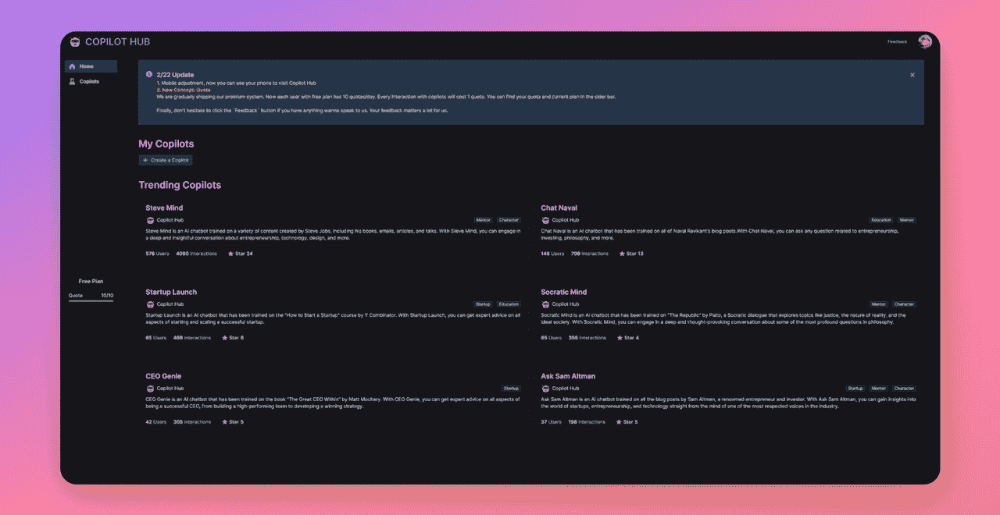

## Phind-面向开发者的AI搜索引擎

面向开发者的AI搜索引擎，专门针对开发内容做了优化，会在左侧显示相关问题的答案以及可以继续追问，右侧会展示答案引用的相关来源。

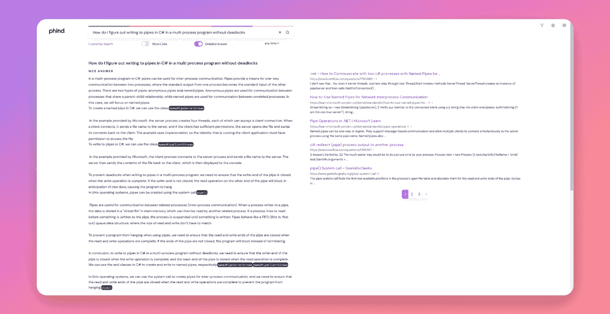

## Langotalk-AI驱动的语言学习工具

主打的是通过与AI聊天来学习语言，也有类似多邻国的成就激励系统，现在来看还比较简陋，但感觉这类AI学习工具会越来越多。

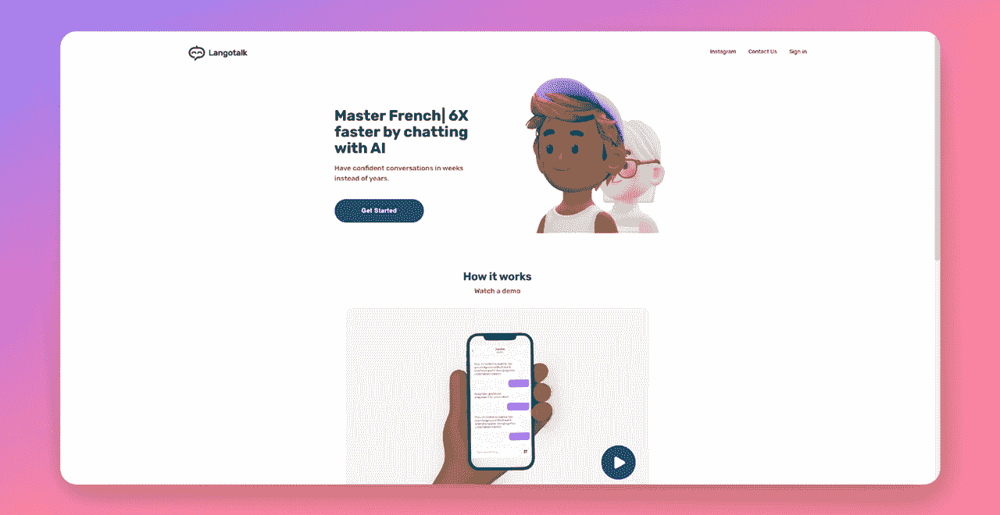

## Magick-构建AI应用的无代码工具

通过使用模板和可视化的界面来创建AI应用，集成了常用的AI相关功能的API。

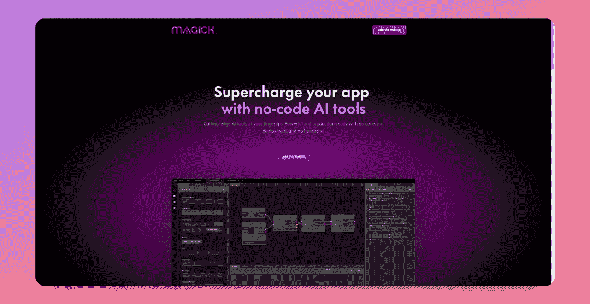

## [Coqui-AI音频工具](https://coqui.ai/)

只需要3秒的音频内容就可以克隆一个人的声音，还内置了专业的音频编辑工具可以单独编辑每一个单词的音高、响度等。

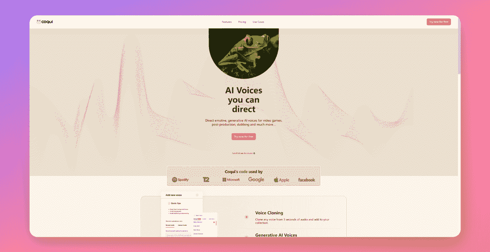

## Ingestai-将你的知识库变成聊天机器人

只需要上传你现有的文档，他就能基于你的文档内容创建一个回答相关问题的机器人。对于小的创业公司来说是一个比较低成本的客服机器人解决方案。

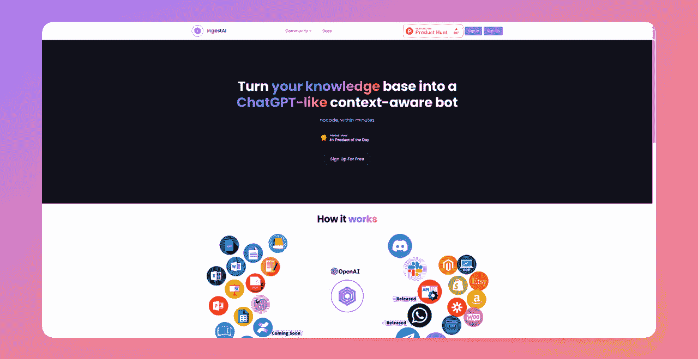

## Interactive demo-保护你的照片不会用于AI训练

相关原理有点复杂具体可以 [看这个论文 ](https://arxiv.org/abs/2302.06588)，总的来说就是用这个工具处理过的图片在被用于AI训练时不会得到正确的结果。

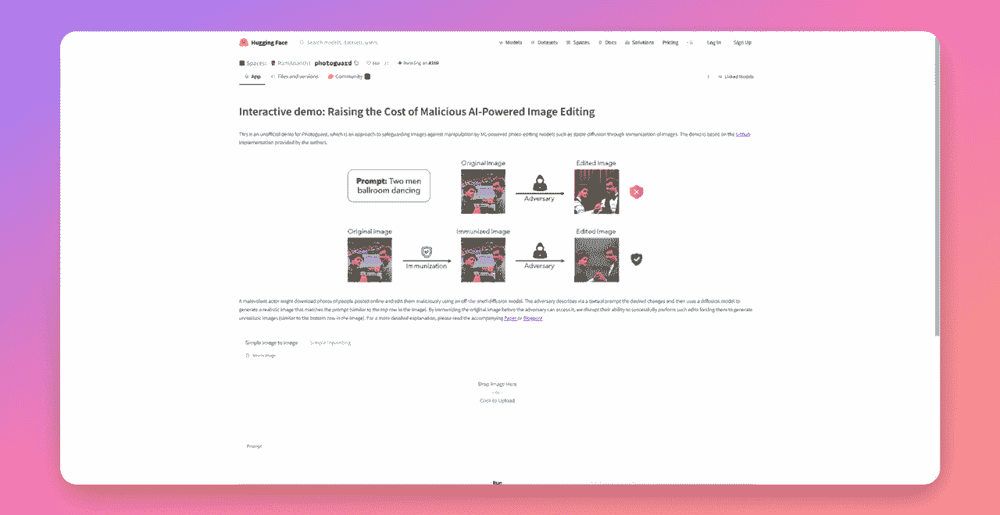

## Opensight-从你的产品文档提取答案的客服机器人

与上面的那个产品类似，不同的是这个可以与你原有的系统相结合引导用户进行对应的操作，比如下单、退款、创建工单等。

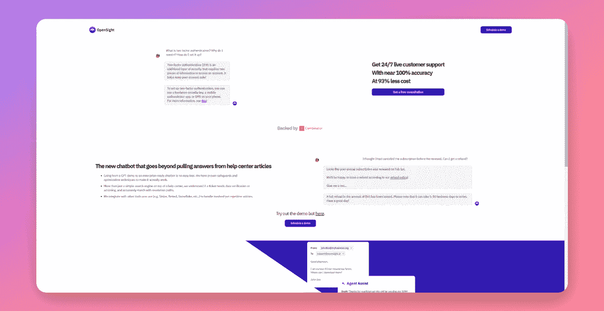

## Truewind-面向初创企业的AI财务软件

可以整合你的银行账户，在你上传合同和发票之后进行分析，自动推进你的财务流程，也可以通过自然语言查找相关内容。

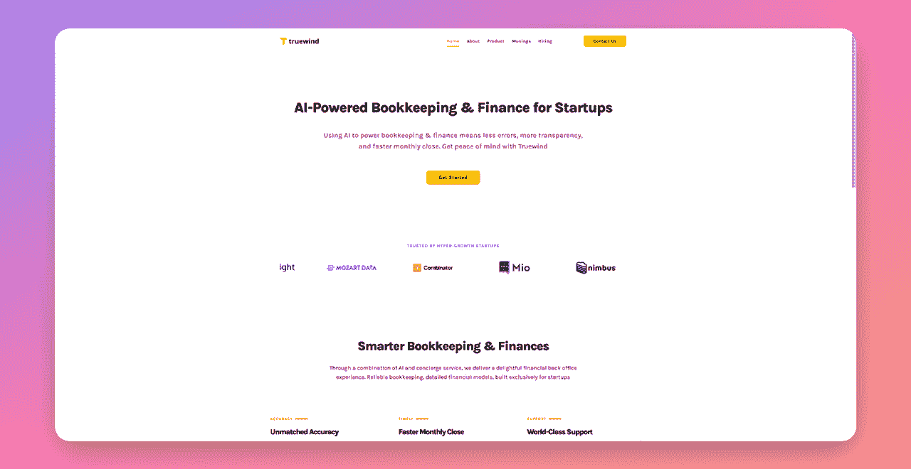

## Adcreative-用于广告创意和社交媒体视觉效果的生成式 AI

使用人工智能在几秒钟内生成以转化为重点的广告创意和社交媒体帖子创意。在节省时间的同时获得更好的结果。链接你的广告账户之后也可以对对应创意进行数据洞察，跟踪创意效果。

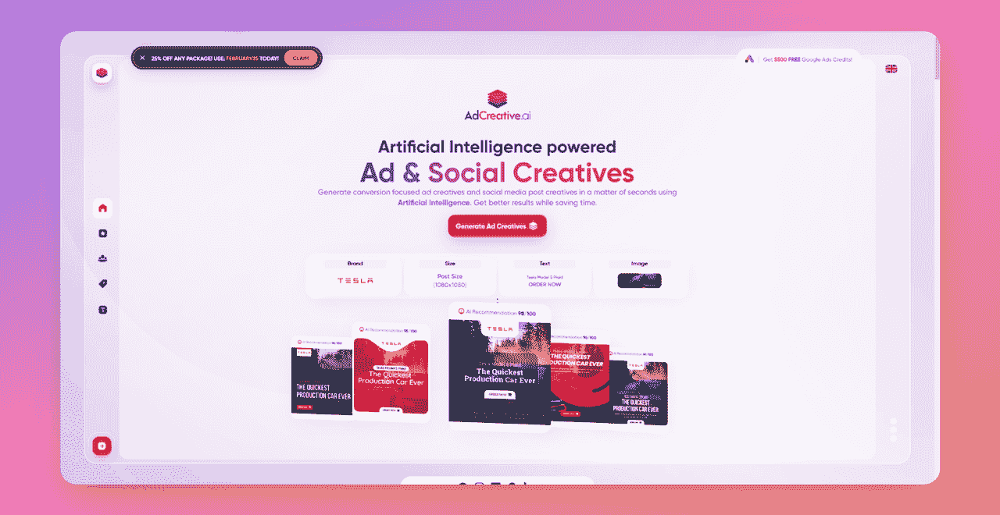

## Fathom-记录总结分享你的zoom会议内容

AI会记录会议的相关内容并识别关键信息，也可以通过文字定位会议时间点回看相关内容，邀请同事协作编辑及分享。

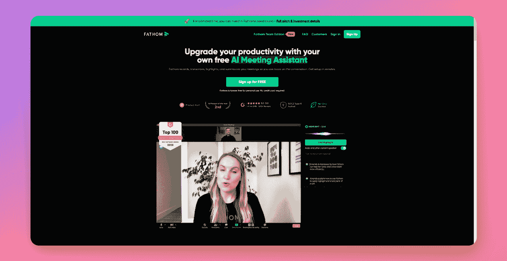

## PodSqueeze-快速为播客添加注释、时间戳、生成博客

上传你的播客后可以快速生成播客内容的简介并搭配相关的时间戳、相关笔记甚至邮件组文章。感觉小宇宙可以跟进一下这个功能。

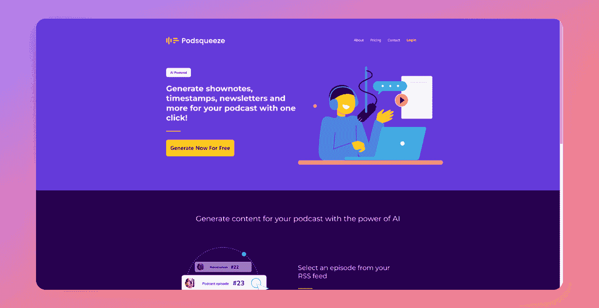

## [Uizard-自动生成UI界面](https://uizard.io/autodesigner/)

通过文字描述生成相关界面及简单的界面

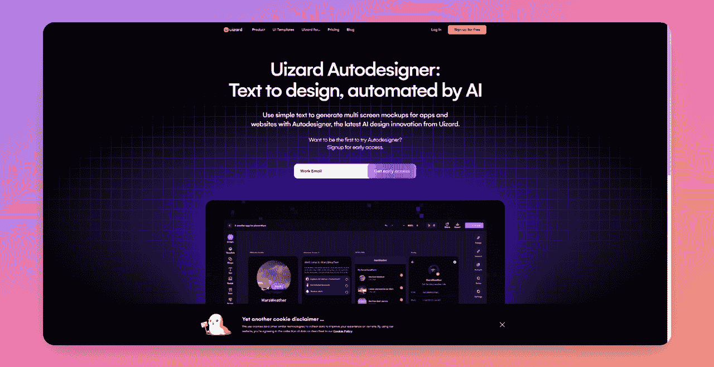

# 🧑🎓学习资源

## Midjourney教程-如何生成室内设计图片

介绍了一些Midjourney生成室内设计图片的提示词模板以及一些优化建议。

## 如何在Midjourney中创建一致的人物图片

## [如何使用AI帮助来写文章](https://every.to/chain-of-thought/writing-essays-with-ai-a-guide)

举了一些例子指导你如何用AI工具帮助你提高文章写作的效率和质量。

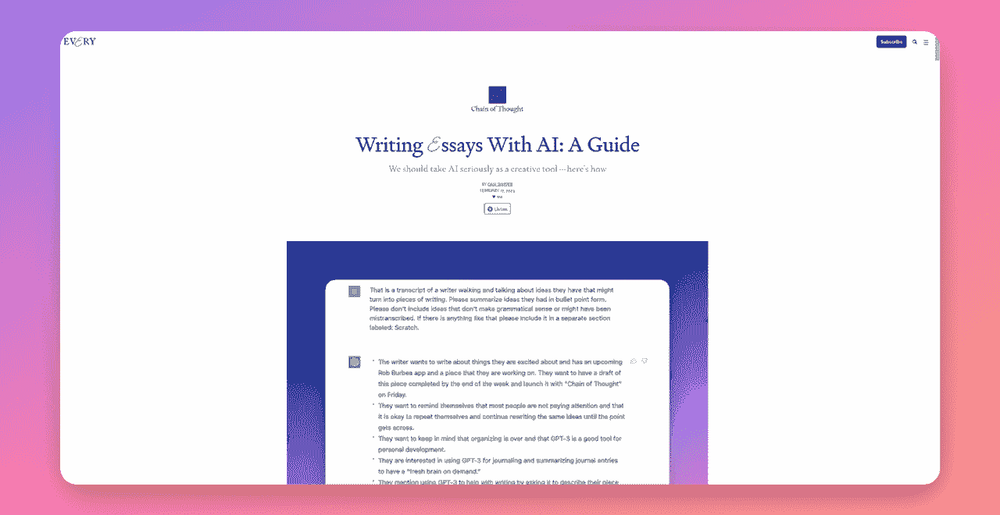

## [ControlNet如何工作？](https://twitter.com/drjimfan/status/1627740253346992128)

浅显的介绍了ControlNet的工作原理以及具体能力。

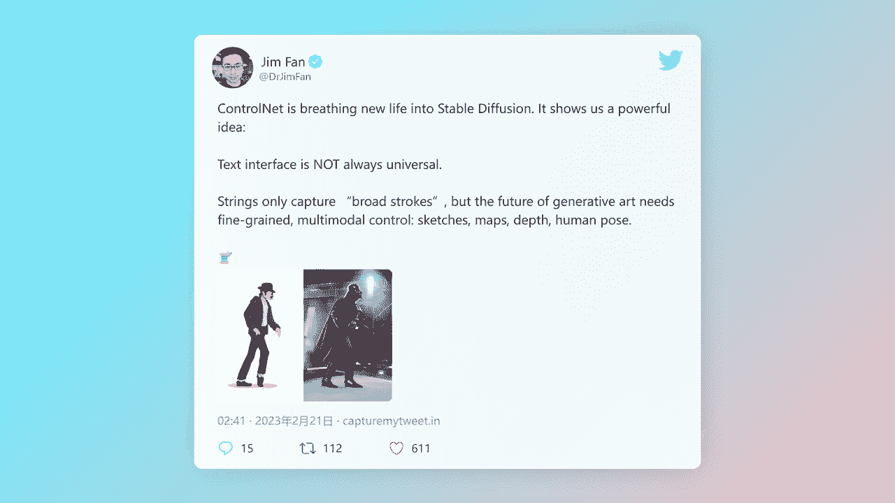

## [ControlNet使用教程](https://aituts.com/controlnet/)

一个还算详细的ControlNet在 Stable Diffusion Web UI 的使用教程，只包括生成图片，如果大家有需要的话我也可以做一个比较详细的ControlNet教程包括使用相关功能来生成视频。

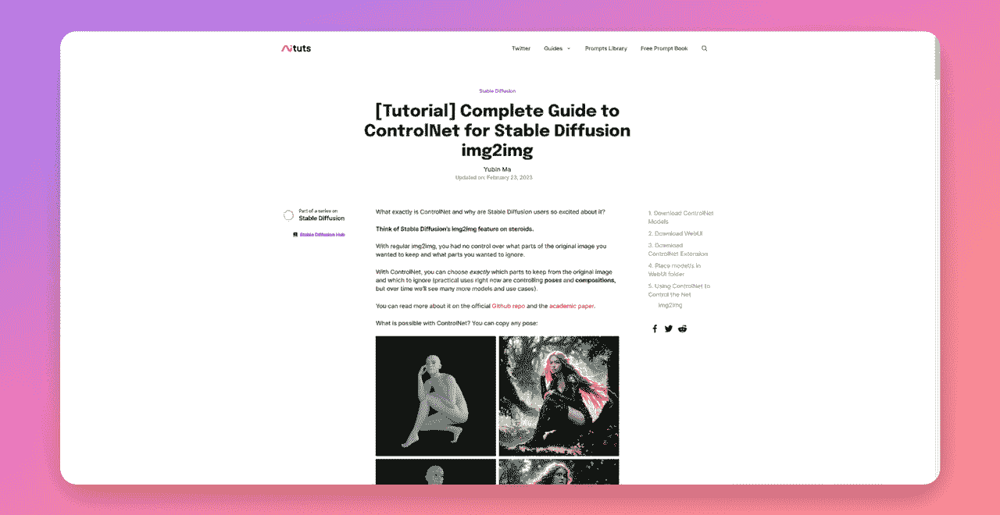

## [如何创建AI视频](https://www.youtube.com/watch?v=dqkQo2alZvU)

非常详细的介绍了如何利用相关AI工具来制作视频

# 🔬精选文章

## Composer-阿里发布的图像生成模型

Co[mposer是一个大型](https://github.com/damo-vilab/composer)的（[50亿个参数）](https://github.com/damo-vilab/composer)可控[扩散模型](https://arxiv.org/abs/2302.09778)，在数十亿个（文本、图像）对上训练。它可以通过组合以指数方式扩展控制空间，导致产生和操纵图像的大量方法，即使有限的手段得到无限的利用。 github项目地址 、 详细项目介绍 、 论文地址

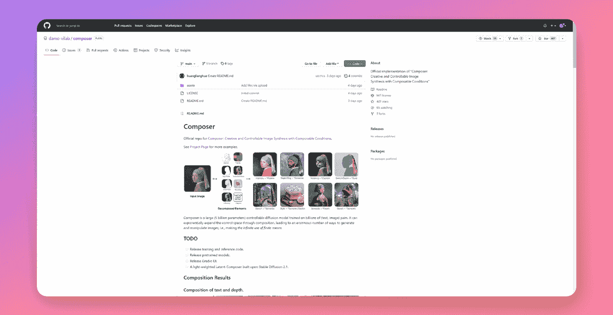

## [我们如何规划AGI的未来](https://openai.com/blog/planning-for-agi-and-beyond/)

Open ai CEO Altman 发布了官方文章如何规划AGI的未来。感觉他在涉及到ai的伦理和未来思考的还是非常深入的。“ 我们可以想象一个人类繁荣到我们任何人都不可能完全想象的程度的世界。我们希望为世界贡献一个与这种繁荣相一致的AGI。 ”

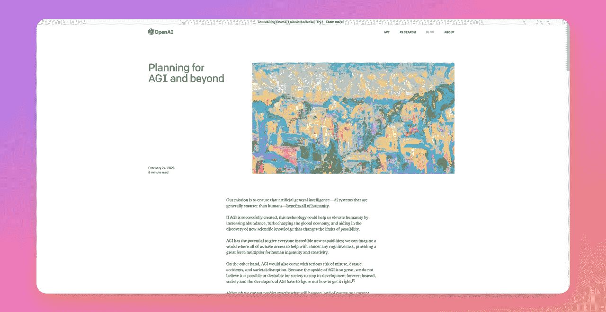

## [Mate发布LLaMA](https://ai.facebook.com/blog/large-language-model-llama-meta-ai/?utm_source=twitter&utm_medium=organic_social&utm_campaign=llama&utm_content=blog)

[LLaMA（大](https://ai.facebook.com/blog/democratizing-access-to-large-scale-language-models-with-opt-175b/)型语言模型 Meta AI），这是一种最先进的基础 大型语言模型 ，旨在帮助研究人员推进他们在 AI 子领域的工作。更小，更高性能的模型，如LLaMA，使研究界中无法访问大量基础设施的其他人能够研究这些模型，进一步使这个重要的，快速变化的领域的访问民主化。

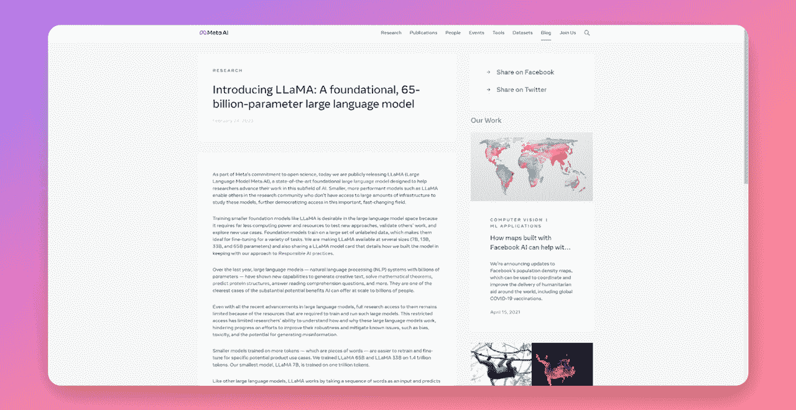

## [黄仁勋在伯克利哈斯学院的演讲](https://www.youtube.com/watch?v=9hzVdV63scU)

“现在就是 AI 的 iPhone 时刻，一个新的智能时代即将开启，任何人都可以通过 AI 进行计算与编程，这是算力使用真正意义上的平民化” （多买我的显卡和云服务🐕）

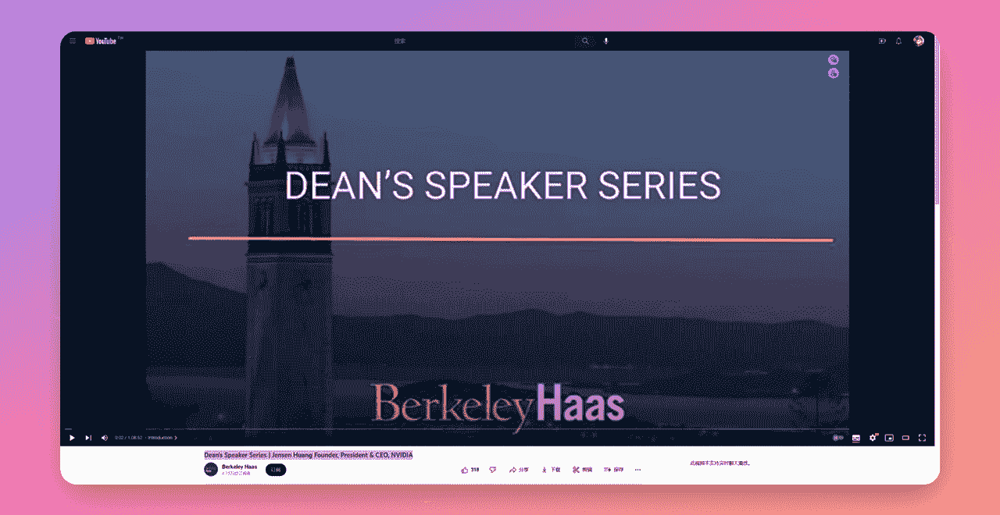

## 我创建了一个可以使用我的用户研究数据库回答问题的AI

现代产品通常拥有来自不同来源的大量用户研究数据：用户研究访谈、对讲对话、客户电子邮件、调查、各种平台上的客户评论等。理解所有这些数据是一项具有挑战性的任务。传统的方法是维护一个组织有序的数据库，其中包含各种相应的标签。

但是，如果我们能拥有我们的个人人工智能聊天机器人来回答有关我们用户研究数据的任何问题呢？

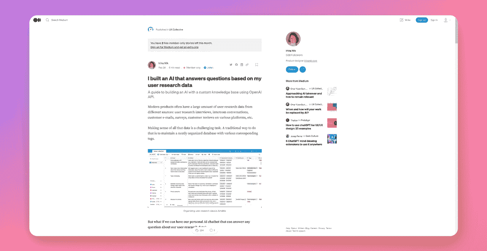

## ChatGPT 中，G、P、T 分别是什么意思？

前百姓网创始人王建硕关于ChatGPT的文章，感觉是所有相关原理解释文章里最浅显的一篇了，非常通俗易懂。

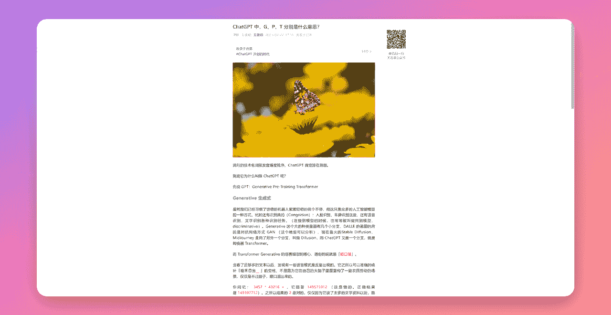

## [人工智能时代的设计系统](https://bradfrost.com/blog/post/design-systems-in-the-time-of-ai/)

原子设计概念的提出者 Brad Frost 关于人工智能时代的设计系统如何发展提出了一些设想。

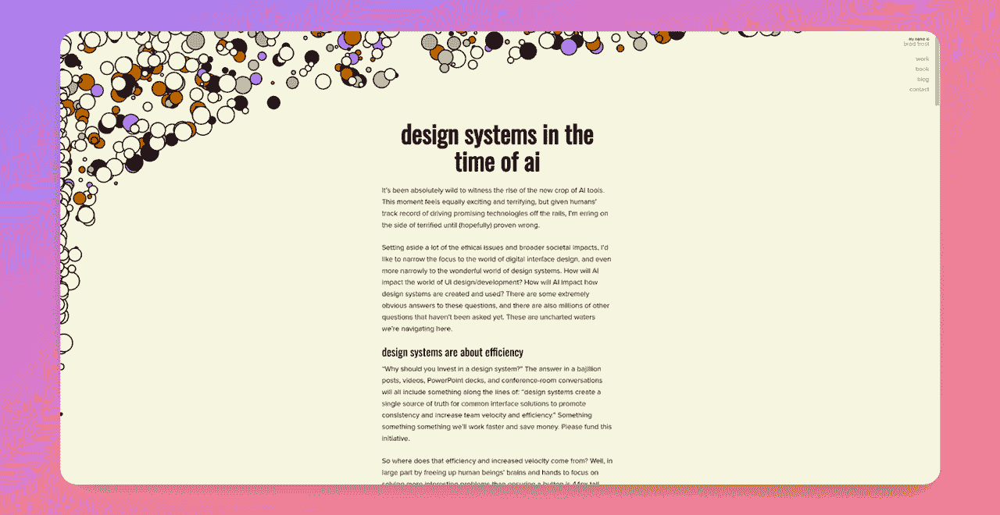