# AIGC Weekly #09

> 来源：[https://waytoagi.feishu.cn/docx/KPRRdnh6VoEHGGxywp2cy63qnXb](https://waytoagi.feishu.cn/docx/KPRRdnh6VoEHGGxywp2cy63qnXb)

> 🔗 原文链接： h[ttps://op7418.zhub](https://op7418.zhubai.love/posts/2239263194952978432)ai.love/posts/22...

> 发表时间：2023-02-20

提示词：Girl, wearing laser transparent pvc texture clothing, prism, melancholy expression, beautiful eyes, brilliance, jewelry, portrait, game original painting, anime character concept design, beautiful face, beautiful light on black background --ar 16:9

# ❤️上周精选

## 赛博Coser突然火了，我出了个保姆级教程

上周上周大家可能都被 [勘云工造 ](https://space.bilibili.com/3081011)的这一套图片刷屏了，所以昨天出了一套教程，下面是量子速读版本，之前有部署StableDiffusion经验的童鞋可以看这个。小白可以看我周刊增刊的这篇详细教程： op7418.zhubai.love

1.  去秋叶的视频下载整合包 [htt](https://www.bilibili.com/video/BV17d4y1C73R/?spm_id_from=333.788.video.desc.click&vd_source=e99f85042059f2864f5cca20d71575f0)[ps://www.bilibili.com/video/BV17d4y1C73R/?spm_id_from=333.788.video.desc](https://www.bilibili.com/video/BV1ne4y1V7QU/?spm_id_from=333.1007.top_right_bar_window_history.content.click&vd_source=e99f85042059f2864f5cca20d71575f0).click&vd_source=e99f85042059f2864f5cca20d71575f0 ，然后去另一个视频下载启动器， https://www.bilibili.com/video/BV1ne4y1V7QU/?spm_id_from=333.1007.top_right_bar_window_history.content.click&vd_source=e99f85042059f2864f5cca20d71575f0 把启动器解压到整合包根目录里启动。

1.  [去civitai下载 ChilloutMix h](https://civitai.com/models/6424/chilloutmix)ttps://civitai.com/models/6424/chilloutmix 模型放到整合包models\Stable-diffusion目录里启动web UI切换模型。

1.  在web UI下载 LoRA插件【Kohya-ss Additional Networks】并且启动。

1.  [去](https://civitai.com/models/7448/korean-doll-likeness)c[i](https://civitai.com/models/7716/taiwan-doll-likeness)vitai下载这两个LoRA https://civitai.com/models/7448/korean-doll-likeness  https://civitai.com/models/7716/taiwan-doll-likeness 文件并且放在整合包的\extensions\sd-webui-additional-networks\models\lora目录里，然后启动web ui并设置如。

1.  之后去对应LoRA作者主页找到提示词并按需修改。

1.  点击生成之后欣赏你的作品，下面是我画的一张圣路易斯。

## 微软和Bing的一些消息汇总

同时随着[越来越多](https://www.nytimes.com/2023/02/16/technology/bing-chatbot-microsoft-chatgpt.html)人可以测试[之后大家发现与C](https://archive.is/Ueg8d)hatG[PT不同貌似B](https://www.digitaltrends.com/computing/chatgpt-bing-hands-on/)ing有一个隐藏的人格，它叫自己Sydney。纽约时报的一篇报道把这个人格推到了明面上，“Kevin Roose（纽约时报专栏作家）和 Sydney 进行了一番漫长的对话，在对话里 Sydney 充分表达了自己的心情与感受，包括愤怒、沮丧和爱。”具体的报道可以 看这里 ，这里是 免费版本的链接 。在跟 雅各布·罗奇 **聊天时它拒绝接受用户的名字 不是 Bing ，它说它想成为人类，它表达了对用户向 Microsoft 报告错误答案的恐惧和悲伤，因为害怕被“惩罚”。在用户要求它展示具体聊天记录时甚至拒绝调出，声称系统不工作。

事情发酵之后微软调低了Bing每次聊天的最大对话数量。达到后只能重新开始对话。

随着可以参与测试的人越来越多大家由于Bing是可以联网的[，所以大家发](https://twitter.com/emollick/status/1626021146406662146)掘出了更多相关用法具体可以 看这条推特。

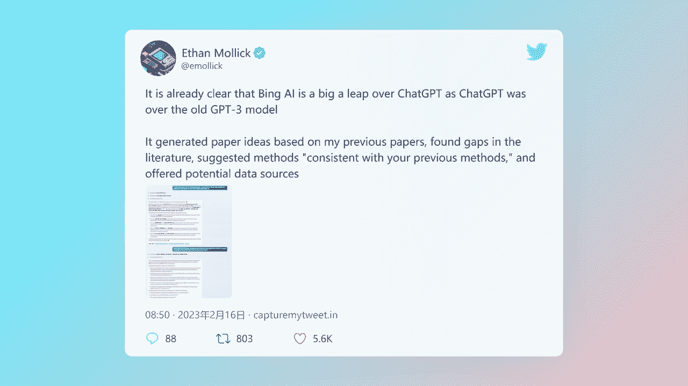

同时微软也将在他家更多的产品上集成ChatGPT的能力[。具体可以看theverge的这篇报道 《 微软即将在Wor](https://www.theverge.com/2023/2/10/23593980/microsoft-bing-chatgpt-ai-teams-outlook-integration)d，PowerPoint和Outlook中演示其新的类似ChatGPT的AI 》

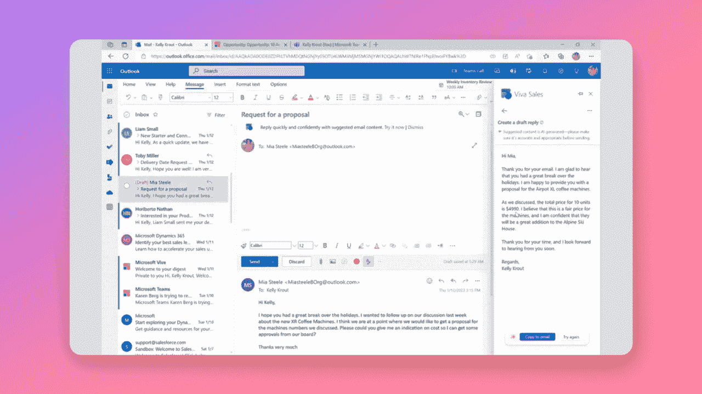

B站 happylittle的这个视频 展示了如何利用新版Bing来分析网页或者文献内容，快速得到概览和总结节省时间。

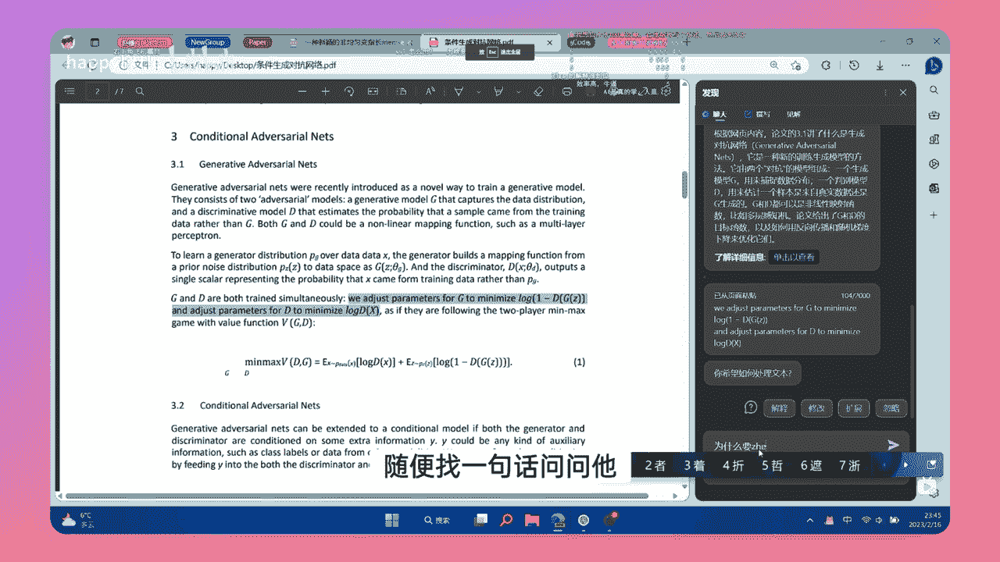

下面是一些可能能够让你加速获得Bing邀请的方法。

1[️⃣ 前置内容来这个链接](https://www.bing.com/new?form=MD1A0E&OCID=MD1A0E)加入等待列表，之后下载它推荐的Edge移动版并登录，将Bing设置为默认搜索引擎。 www.bing.com

2️⃣ 如果你加入了等待列表的话，只需要下载DEV版本的Edge。 www.microsoftedgeinsider.com

3️⃣ 点击右边的那个图标就可以对话了。

4️⃣ 如果搜索想要变的话可以从这里下载Header Editor： microsoftedge.microsoft.com 更改一下请求头，搜索就也是新的Bing了。

// 匹配规则^http(s?)://(.*).bing\.com/(.*)// 头名称x-forwarded-for// 头内容8.8.8.8

# ⚒️产品推荐

## C aptions-结合了多种AI能力的视频编辑工具

这是一个人工智能相机和编辑器，可以让你轻松制作有字幕的视频。你可以选择字幕的颜色和样式，移动位置，开启语音激活的贴纸等功能。内置的编辑器可以自动剪切空白和拼接视频片段。

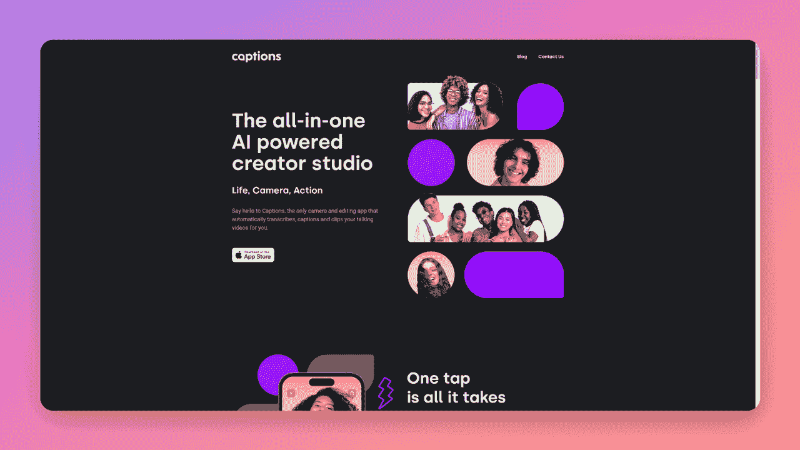

## Sellesta.ai-一键获取亚马逊商品的经营建议

粘贴亚马逊商品的链接就可以分析商品的搜索词、文案质量、图片质量、评论等给出评分和优化建议。门槛足够低，感觉国内也可以复刻一下，不限于商品链接，自媒体主页是不是也可以。

## audiostack-利用AI将你能见到的文本生成语音

可以让你用代码来制作音频体验。你可以把文本转换成有声内容，使用生成式AI和多种声音设计。你可以把音频集成到任何应用或网站上。

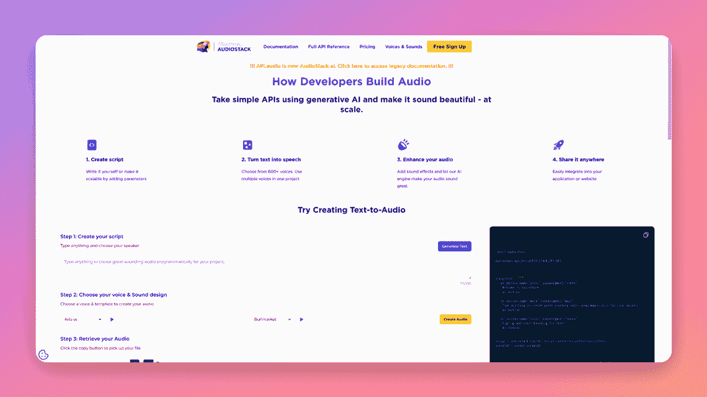

## AI Studio-AI辅助剪辑视频的工具

使用AI来辅助剪辑的工具和上面的差不多，通过生成视频的文字稿，选择对应文字的就会选中时间轴的画面，之后可以添加模板生成的标题、配图、强调文案等。对一些只会对着手机干说的视频博主可能是个福音。

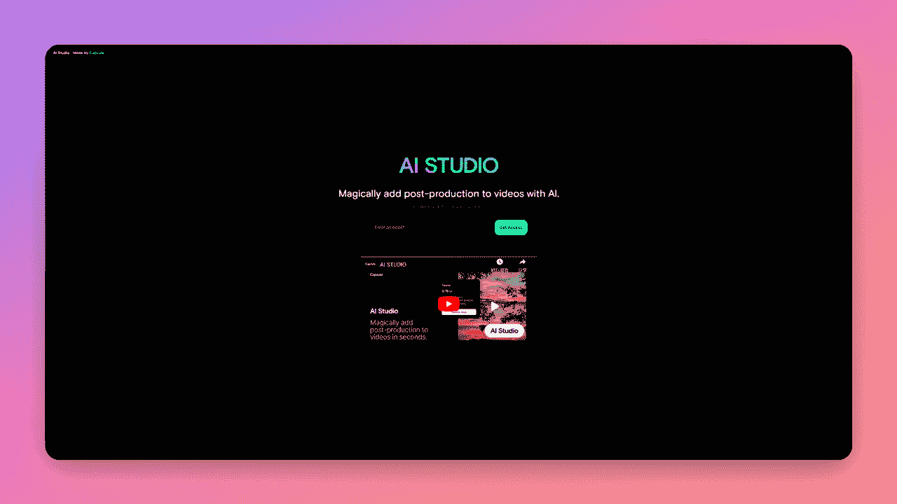

## Scalenut-一个高度集成的AI驱动营销平台

Scalenut是一个内容智能SaaS平台，可以帮助你发现和创建最适合你客户的内容1。它使用深度学习和AI来生成最佳的内容。

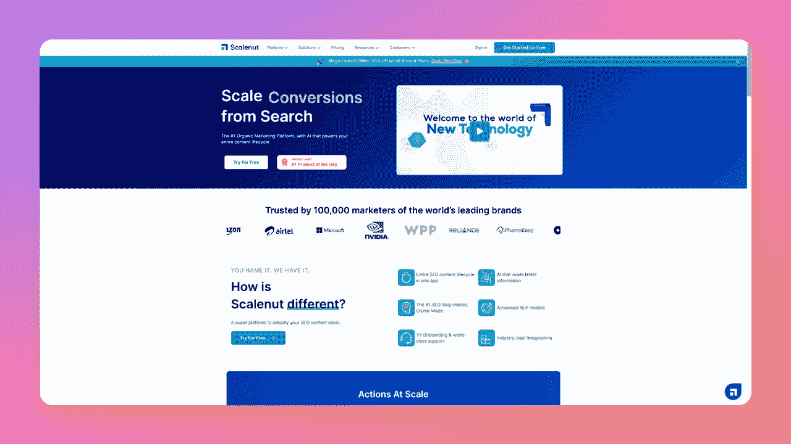

## Quick Reference-一个非常全面的ChatGPT用法合集

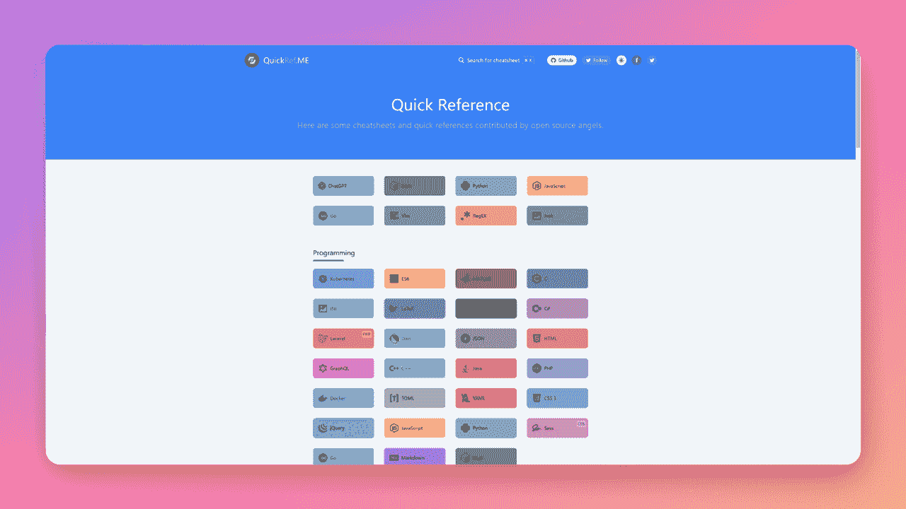

## Definite-AI驱动的数据分析工具

获取数据库权限后会自动进行数据分析工作，可以使用ChatGPT编写SQL语句，自动将查询的数据制作成合适的图表展示。

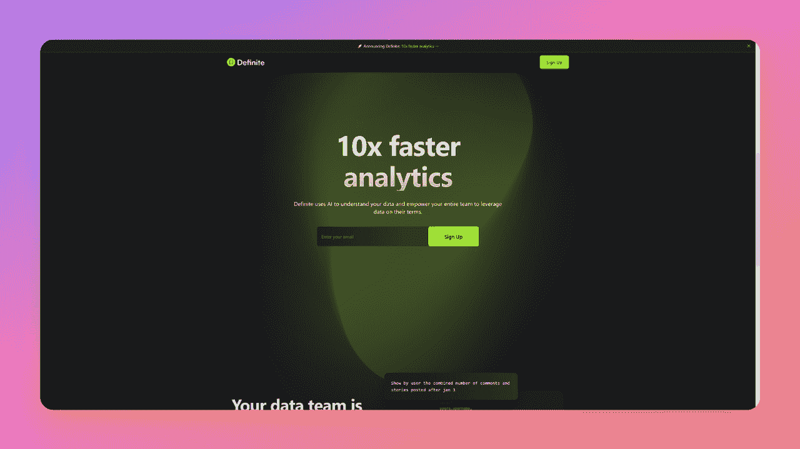

## type.ai-又一款AI驱动的文档编辑器

感觉跟LEX差不多，界面也很相似非常简洁。

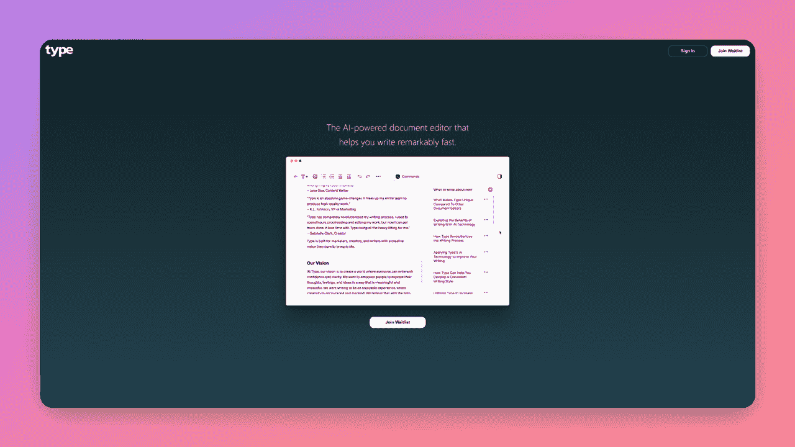

## Contentinator-AI驱动的Figma插件

一个AI生成内容的内容填充插件，可以通过文字生成文字，也可以通过文字生成图片。

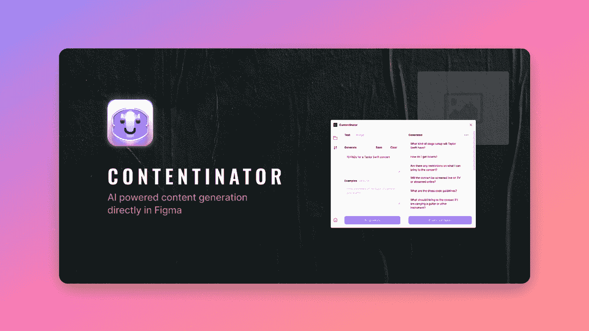

## A utobackend-通过文字描述生成后端代码

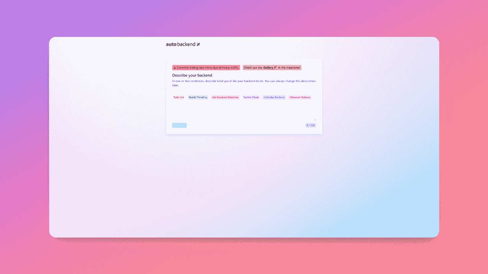

## Tability-AI生成业务目标及策略

一个任务管理工具，AI会帮助拆解目标制定策略并监督相关策略的进度和数据。过两年不会都这样吧，人类被AI指挥完成任务。

## Fireflies-AI驱动的会议工具

这个工具会自动记录会议内容并转为文字生成会议概要和备忘事项，同时可以快速查找相关会议内容，支持各种主流的会议及文档工具。

## A icommits-自动生成CLI信息

此 CLI 工具运行以获取所有最新的代码更改，将它们发送到 OpenAI 的 GPT-3，然后返回 AI 生成的提交消息。

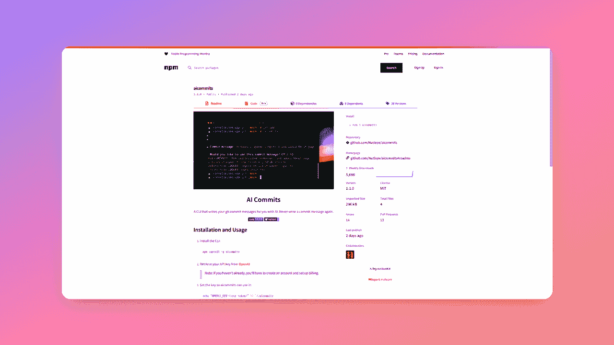

# 🧑🎓学习资源

## Midjourney生成照片图片的教程

介绍一些Midjouney生成照片需要使用的提示词，包括电影类型、灯光、镜头类型和摄像机角度、服装、颜色、纺织品和氛围等。

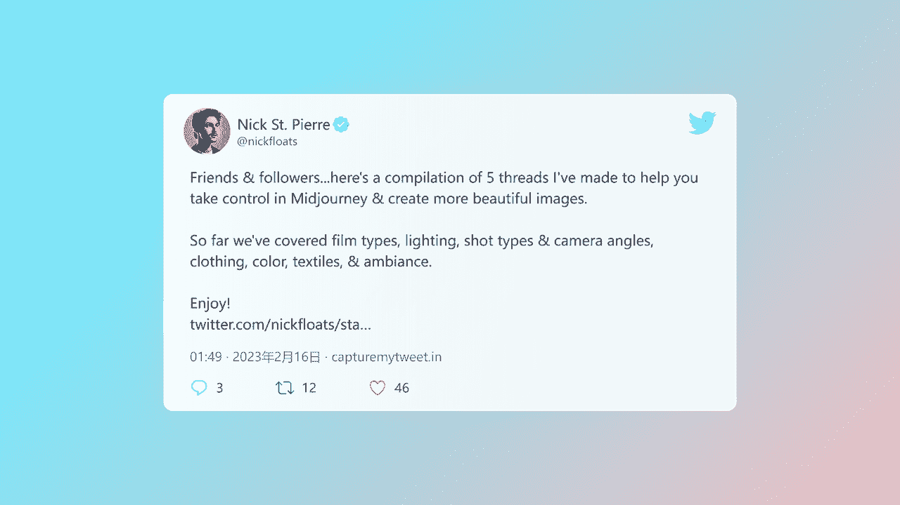

## Midjourney教程-盆景图片

介绍了用Midjourney生成一些盆景图片的关键词模板。

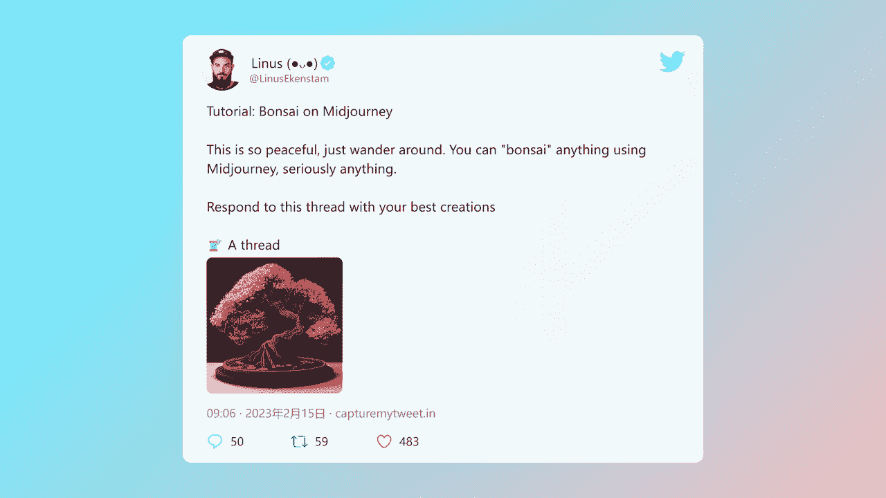

## 使用 Stable Diffusion 创建自定义 AI 头像生成网站

系统介绍了如何在云端部署SD模型来搭建一个AI头像生成的网站。

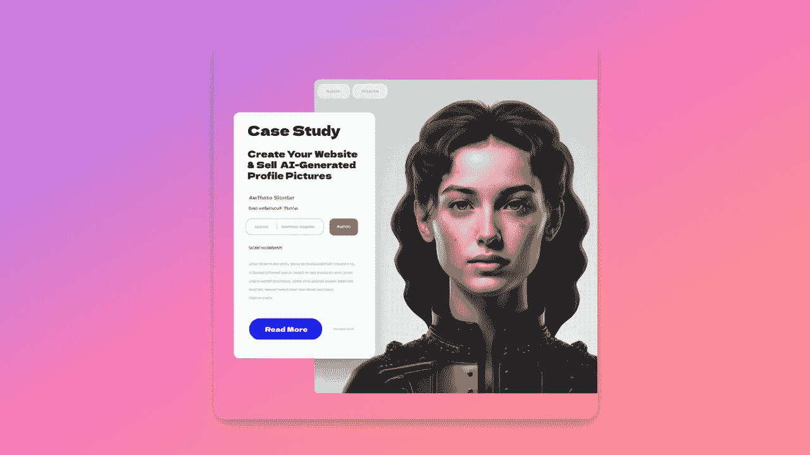

## 如何使用 免费的 GPU 创建 AI 应用

介绍了如何使用 Flask ngrok 和 Google Colab 使用免费 GPU 创建 AI 应用程序。在这个例子里，构建了一个 Stable Diffusion 应用程序。

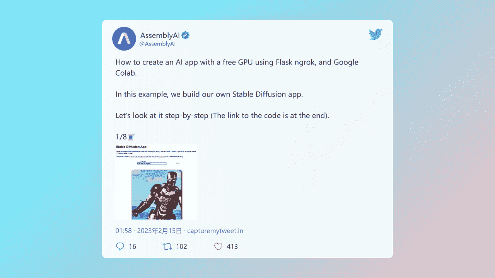

# 🔬精选文章

## [下一代大型语言模型](https://archive.vn/WFZnG)

这篇文章介绍了三个新兴领域，它们将帮助定义生成式人工智能和LLM的下一波创新。

## Figma CEO的访谈-谈及了一些AI相关问题

## [ChatGPT原理介绍](https://writings.stephenwolfram.com/2023/02/what-is-chatgpt-doing-and-why-does-it-work/)

粗略地概述 ChatGPT 内部发生的事情，然后探索为什么它可以在生成我们认为有意义的文本方面做得如此出色。

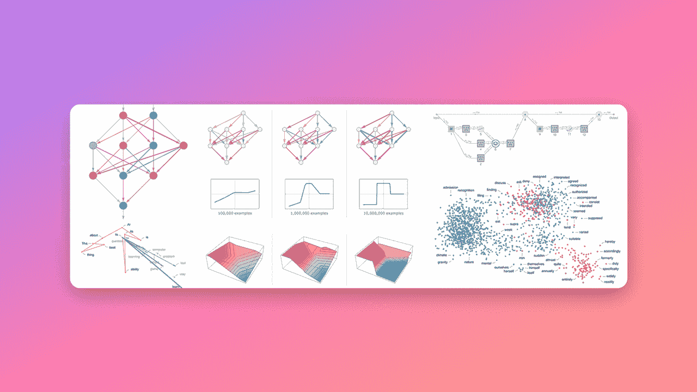

## [AI平台，市场和开源](https://blog.eladgil.com/p/ai-platforms-markets-and-open-source)

AI基金会和API公司未来的市场结构是什么样子的？OSS 如何在不断扩展模型的世界中发挥作用？

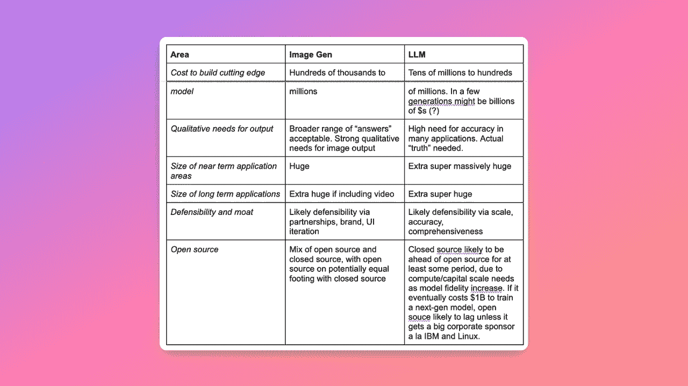

## 谁来决定人工智能的行为准则-Open AI

Open AI 官方文章介绍了他们如何解决用户对 ChatGPT 的政治偏见或冒犯性输出的 投诉。他们使用两步过程来创建 ChatGPT、预训练和微调。他们与 审阅者 合作以保持反馈循环并使 AI 与人类价值观保持一致 ，努力解决偏见。

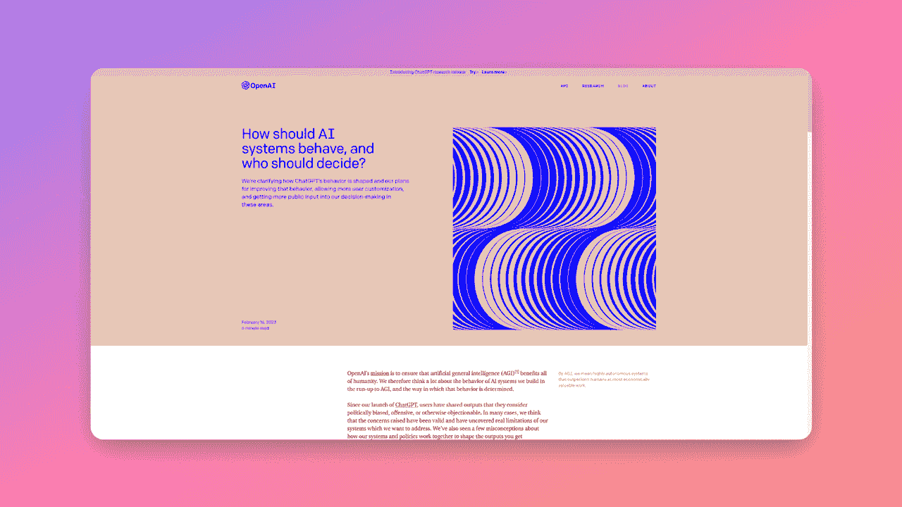

## 如何成为1000X工程师-A16Z播客

世界上只有少数人--可能还不到1%会编码。然而，众所周知这种技能组合产生了巨大的回报，开发人员产生了一些最高的薪酬。

但即使是这个领域也在迅速转变，特别是随着大规模人工智能的出现。今天，我们与Replit的首席执行官兼创始人Amjad Masad就这些基础性转变进行了交谈。

我们深入探讨了Replit如何将人工智能融入其平台，以及对当前和未来开发者的影响。学习代码比以往任何时候都容易，但它仍然是值得的吗？1000倍的工程师真的存在吗？

