# AIGC Weekly #07

> 来源：[https://waytoagi.feishu.cn/docx/WWfLd0v2HoLvfkxZQKLcfJ9ln30](https://waytoagi.feishu.cn/docx/WWfLd0v2HoLvfkxZQKLcfJ9ln30)

> 🔗 原文链接： h[ttps://op7418.zhub](https://op7418.zhubai.love/posts/2234364128284303360)ai.love/posts/22...

> 发表时间：2023-02-06

提示词：chrysanthemum flower, absolute symmetric, sheer, floating in sacred space, chrystaline carnival glass, luminescent with peacefull white background, mystical light, light and bright, depth of field, spacely, photo realistic fully in picture, 3D, ultra 8k, ++wide angle, hyper detail

> 如无意外会在每周一更新，主要介绍上周AIGC领域发布的一些产品以及值得关注的研究成果，由于我自己是一个设计师，所以在一些专业内容的描述上可能存在问题，欢迎在渠道帮我反馈及更正。（本期部分文案使用了Notion AI以及Chat GPT帮助润色和翻译）

# ❤️上周精选

## Chat GPT消息汇总

+   Chat GPT推出 Chat GPT Plus付费服务 ：Open AI宣布推出c[hat GPT](https://t.co/fd11x9mrG9) plus计划，每月20美元。可以在高峰时段提供更快的响应时间和可靠性。这个套餐会先在美国地区推出。其他地区的人可以点这里 加入候补名单 。

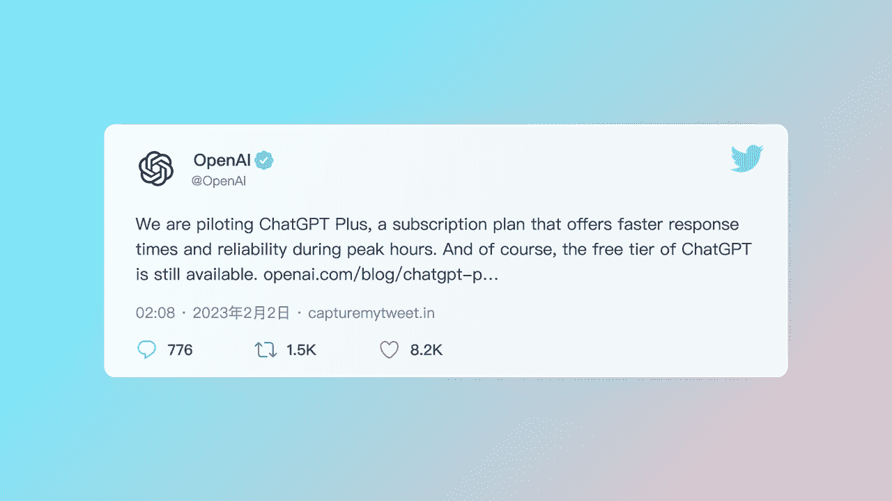

+   Open AI推出检测AI生成文本工具 ：OpenAI 创造了一个令人难以置信的工具 (ChatGPT)，但随之而来的是大量的问题（剽窃、仇恨言论等），所以他们正在开发一种新工具来帮助区分人工智能编写的文本和人工编写的文本。目前识别成功率只有26%。

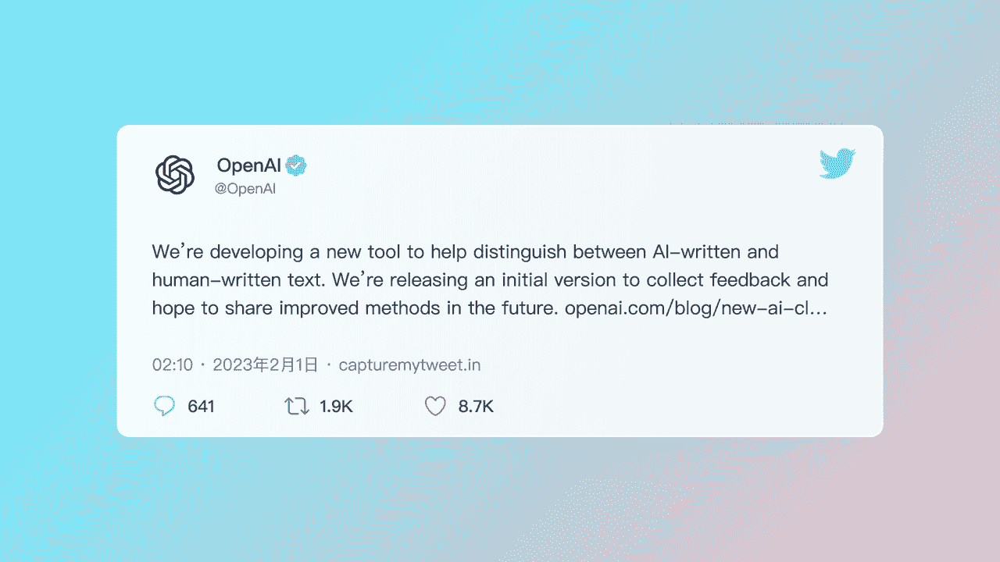

+   Ch[at GPT ](https://t.co/C7kMVpMAKv)API即将推出 ：ChatGPT 将很快用于Open AI API 和 Microsoft 的 Azure OpenAI 服务。周中的时候泄露了一段时间，过了一天对应API就不能用了。可以在这里 加入等待列表 。

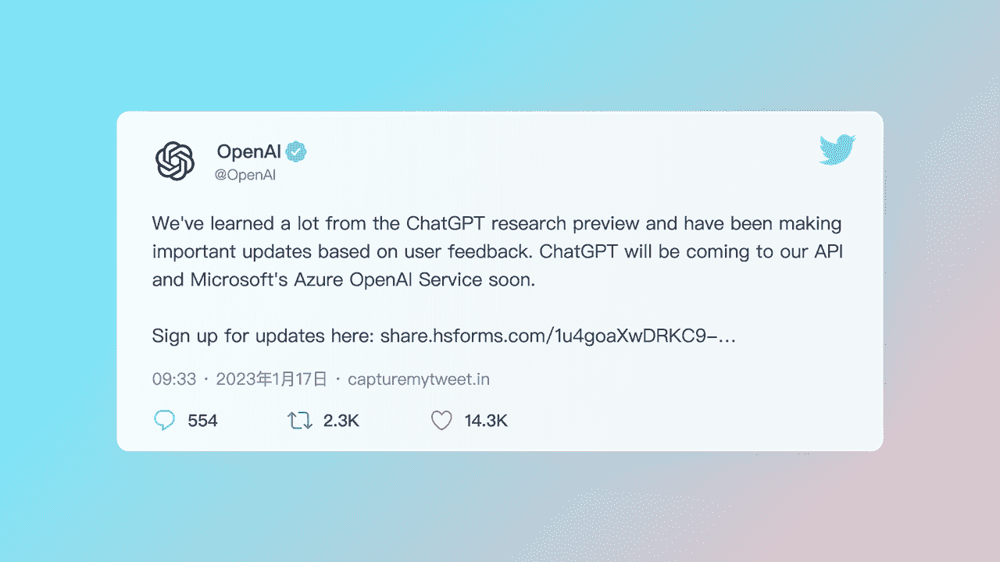

+   Chat GPT用户正式突破一亿 ：瑞士银行巨头瑞银集团的一份报告显示，在 ChatGPT 推出仅两个月后，它在 2023 年 1 月末的月活用户已经突破了 1 亿，是史上增速最快的消费级 App。Tiktok 达到一亿用户用了9个月，这已经是非常快地速度了。下面是不同软件达到一亿用户的时间排序。

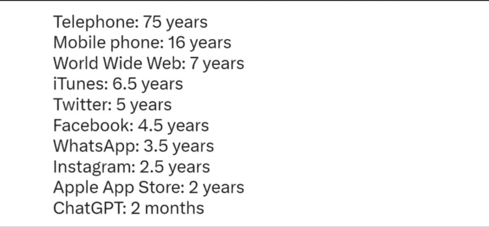

+   国内热度持续高涨 ：于此同时 Chat GPT在国内的讨论热度也在最近这几天爆发了，以下是相关关键词在微信、抖音的搜索趋势。

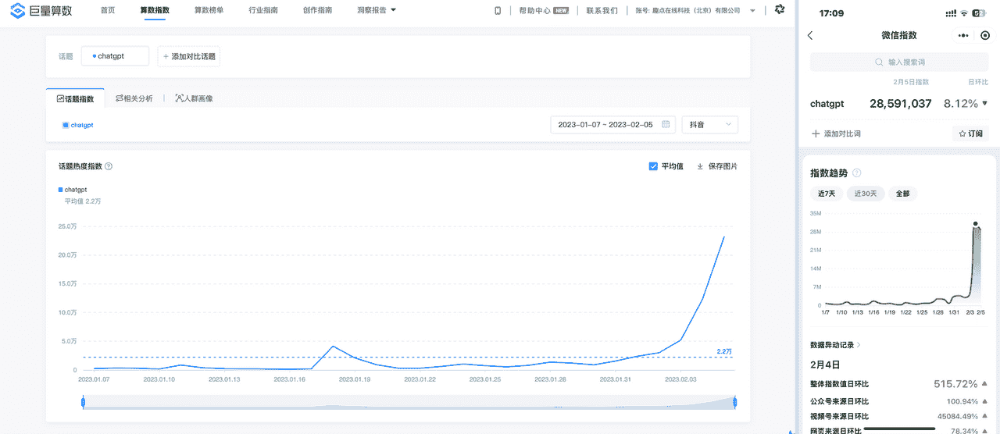

## 微软多个业务深度整合Open AI产品

微软发布Teams Premium ： 深度整合了Open AI的相关功能支持自动生成的会议记录、推荐任务和个性化亮点，同时还支持实时的多语言翻译。

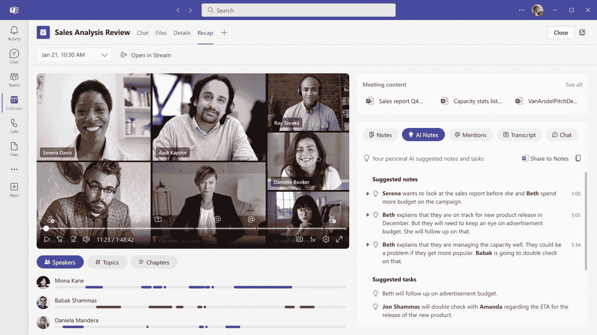

ChatGPT版必应搜索悄悄上线 ： 当你搜索一个问题时，AI 会对其进行解释并进行多项与请求相关的搜索，然后整合结果并编写摘要。ChatGPT 加持的必应搜索不仅可以回答问题，还能以对话的方式回答搜索者的提问。

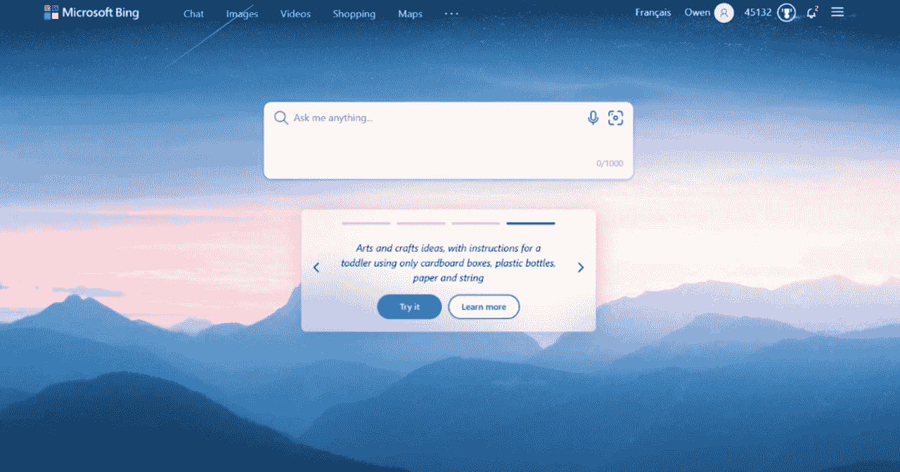

## 使用 Chat GPT 完成谷歌的招聘彩蛋

推特上这个老哥 GergelyOrosz 在搜索过程中触发了Google的招聘彩蛋，所以他尝试使用 ChatGPT 来通过这个挑战，从结果来看比较简单的前两个问题 ChatGPT 解决的非常好，在困难一些的第三个问题上 ChatGPT 没有给出完整的答案，所以他自己手写了一部分代码，最后一个特别困难的问题上 ChatGPT 没有给出任何有效的帮助。所以他总结了一下 ChatGPT 处理相关问题的特点：

1.  对于常见的问题它能很好的解决

1.  对于相对复杂的问题，可能需要人工拆解，并尝试提示它，错误率比较高

1.  对于极其复杂和罕见的问题 ChatGPT 完全没有办法

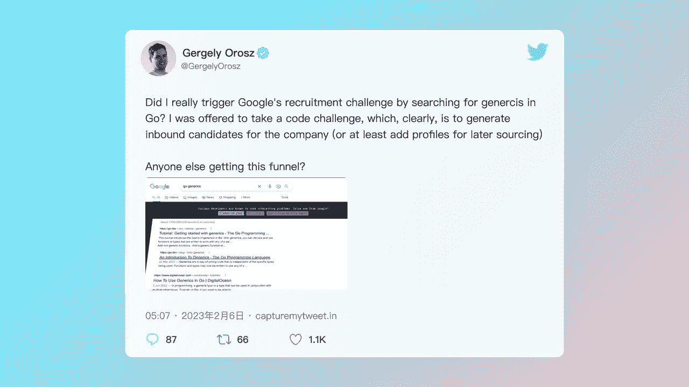

# ⚒️产品推荐

## Artifact - 使用最新 AI 技术的个性化新闻提要

Instagram 的创始人Kevin 和 Mike 宣布了他们的新项目，看起来是跟今日头条类似的个人 feed 流智能推荐新闻。目前处于内测阶段。

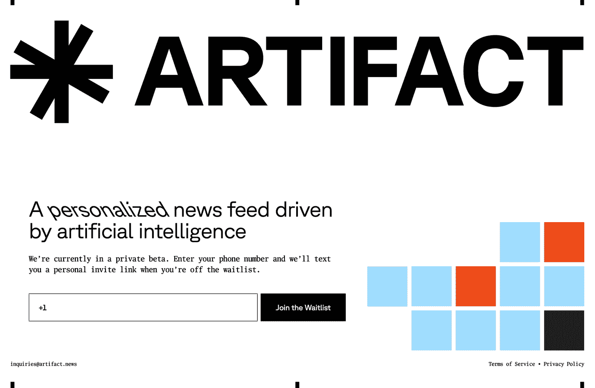

## Perplexity AI-对话式的搜索引擎

可以理解为会展示内容来源的Chat GPT，前几天还发布了浏览器插件，无须注册免费使用，没办法注册Chat GPT的可以用这个。

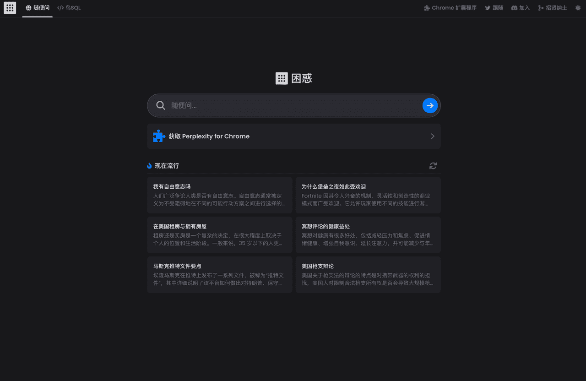

## Codex JavaScript Sandbox

通过 [小老虎的推特 ](https://twitter.com/SShuaiqi/status/1622393565161693184?s=20&t=cllPUQ4egWDmeKJ6Csettw)发现了Open AI的这个服务，你可以输入自然语言指令，它会把它们变成 JavaScript。效果真的非常好，具体可以看下面我这张图，右侧灰字注释是我输入的内容。

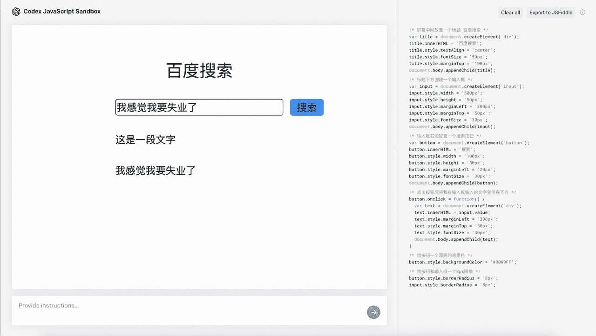

## Text-to-figma 对话生成Figma设计稿

这个工具可以对话生成Figma设计稿，目前来看还比较初级，作者也描述了自己的思路主要利用 GPT-3 和 Dall-E 来操纵 Figma 画布。

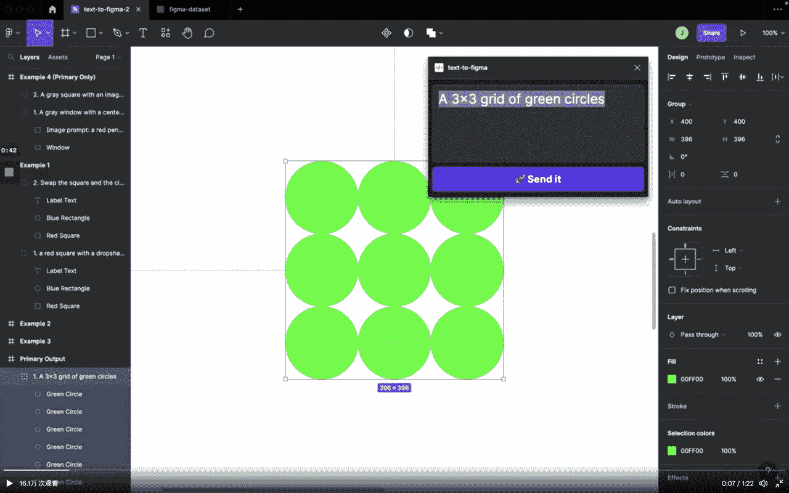

## [微信聊天内容简化器](https://chat-simplifier.imzbb.cc/)

用 OpenAI GPT-3 API 简化微信聊天群内容，唯一不便的地方就是还得自己复制聊天内容，那就有点鸡肋了，有自动获取的方式就好了。

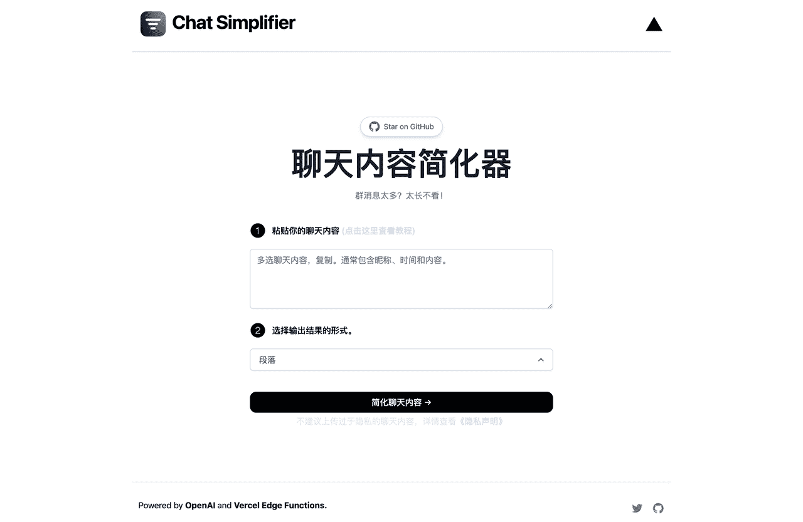

## Summari-快速预览链接摘要

将鼠标悬停在链接上时生成文章摘要。有点像维基百科的弹出窗口，但它是由 AI 生成的。

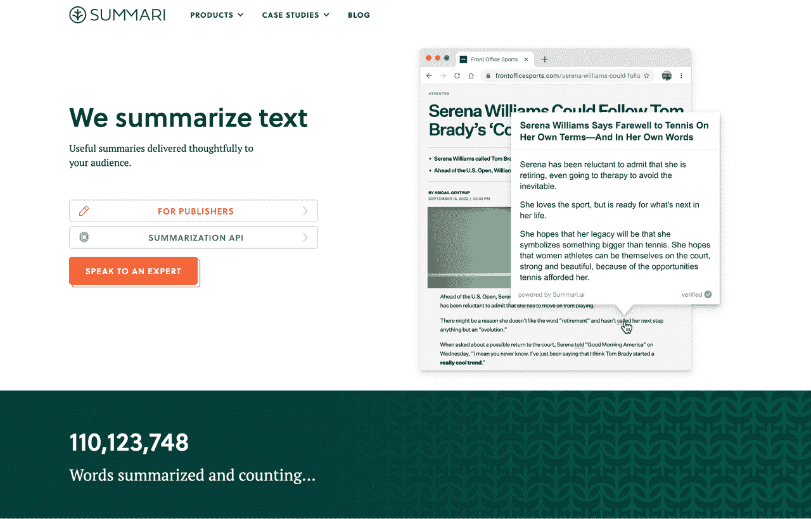

## Triple Whale-AI生成广告内容

第一个全周期生成 AI，你可以在其中创建、部署、分析和迭代您的创意内容。将AI创建广告素材与数据分析结合了起来，不过还只能生成图片和文字素材。

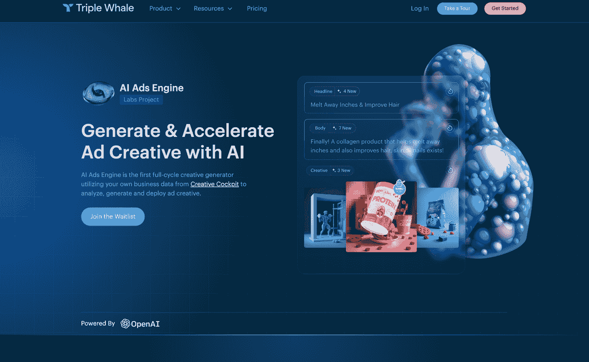

## GlassAI-AI临床医学诊断

GlassAI 推出了一种基于 LLM 的工具，能够根据症状生成诊断或临床计划。

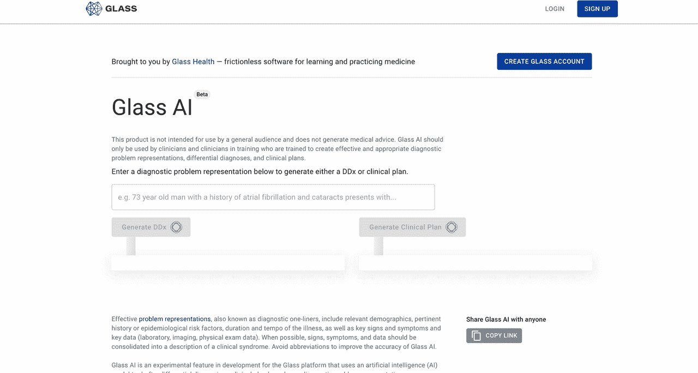

# 🧑🎓学习资源

## Midjourney教程-平行或 90 度排列物体。

这个教程可以帮你使用Midjourney画出平行或者90度排列物品的图片，例如下图这样。推特这个老哥提供了一个比较稳定的提示词公式，还包括一系列具体图片的提示词。

## [使用 Next.js 和 Vercel Edge Fun](https://vercel.com/blog/gpt-3-app-next-js-vercel-edge-functions)ctions 构建 GPT-3 应用程序

Vercel官方教程详细介绍了如何使用Vercel的一系列服务快速搭建AI应用。

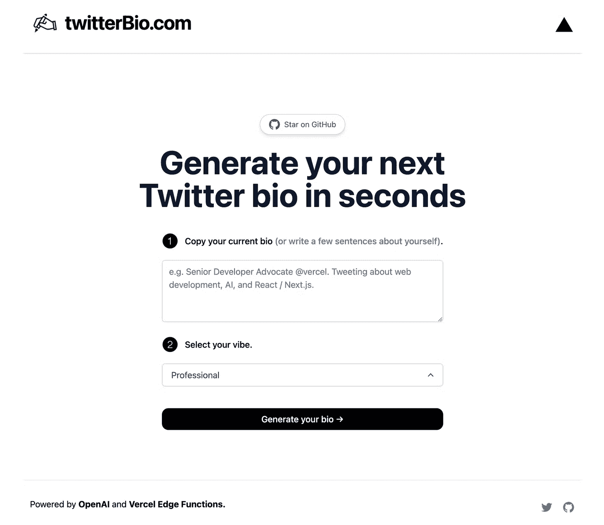

## [提示词 工程指南](https://github.com/dair-ai/Prompt-Engineering-Guide)

包含一组与提示工程相关的论文、学习指南和工具。它包括多种材料、指南、示例、论文等。该存储库旨在用作从业者和开发人员的研究和教育参考。

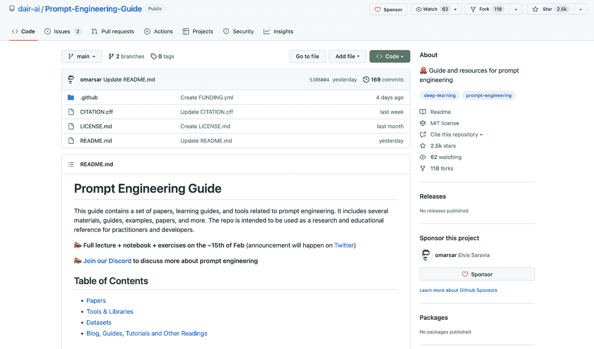

## [ChatGPT 中文调教指南](https://github.com/PlexPt/awesome-chatgpt-prompts-zh)

[在此存储库](https://github.com/PlexPt/awesome-chatgpt-prompts-zh/edit/main/README.md)[中，您将找到可与 C](http://readme.md/)hatGPT 一起使用的各种提示。 点击这里 可以将您自己的调教指南添加到列表中。只需使用 README.md 文件中的提示作为 ChatGPT 的输入。您还可以使用此文件中的提示作为创建您自己的提示的灵感。

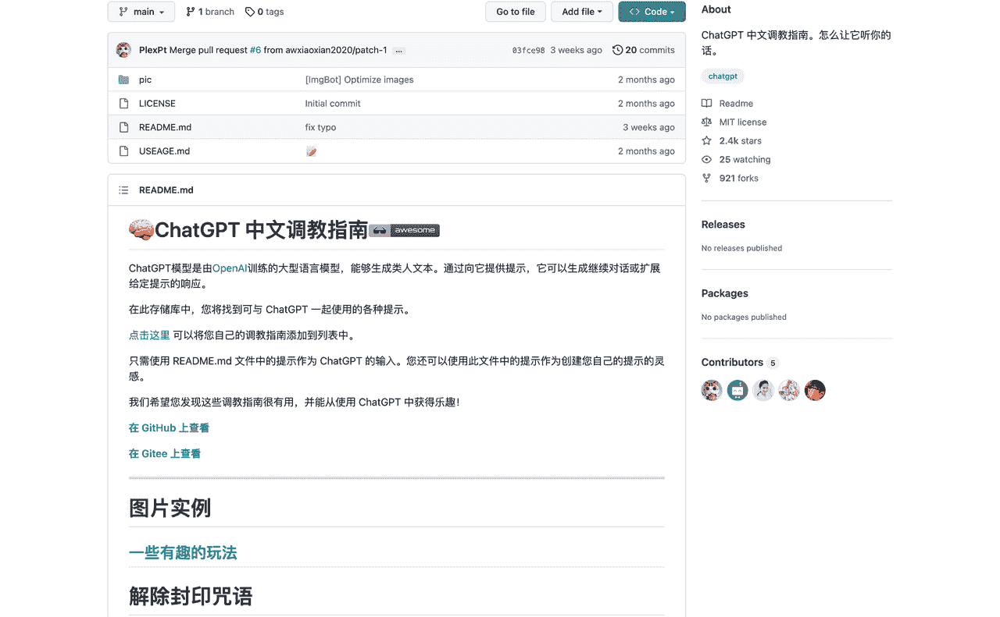

## [如何构建一个简单的语义搜索引擎](https://twitter.com/CohereAI/status/1620783720738308099?s=20&t=znzB1NAv0hMQqX5fb7vdZA)

语言模型使计算机能够超越文档搜索中的关键字匹配。它们提供按含义或上下文进行搜索的能力。这称为语义搜索。如何构建一个简单的语义搜索引擎。

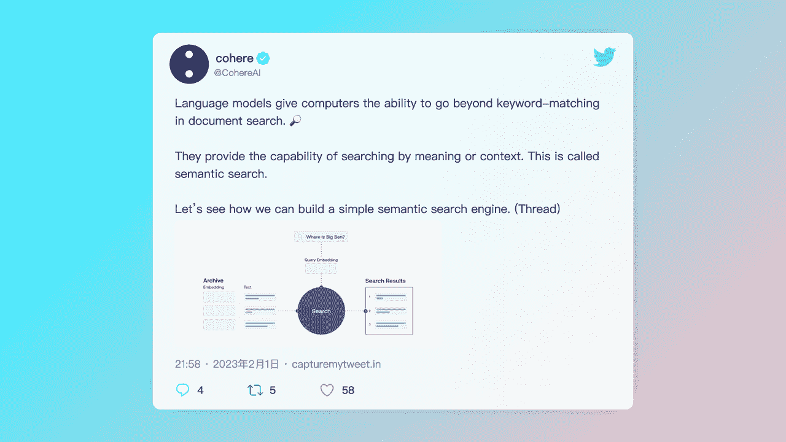

# 🔬精选文章

## [AI 初创公司的新泡沫正在形成](https://www.theinformation.com/articles/a-new-bubble-is-forming-for-ai-startups-but-don-t-expect-a-crypto-like-pop)

风险资本家已经抛弃了加密货币，转而关注新的魅力：人工智能。作为这种狂热的一个标志，他们正在为那些仅仅只有想法的初创公司支付高昂的价格。

## 《福布斯》采访-为什么人工智能即将改变你的工作方式

《福布斯》采访了 OpenAI 的 Sam Altman 和 Greg Brockman，以及从比尔盖茨到李飞飞的 60 多位其他领导人，讨论了由 ChatGPT 和 Stable Diffusion 的病毒式传播所推动的新一波人工智能炒作。这就是为什么人工智能即将改变你的工作方式，不管你喜欢与否。

## Hugging Face 的计算机视觉状态

简要介绍了 Hugging Face 生态系统目前为下一代计算机视觉应用程序提供的支持。包括支持的视觉任务和管道、训练自己的视觉模型等功能。