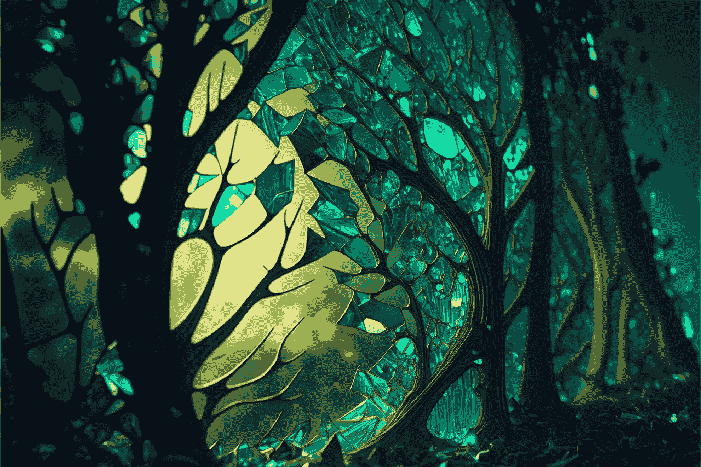
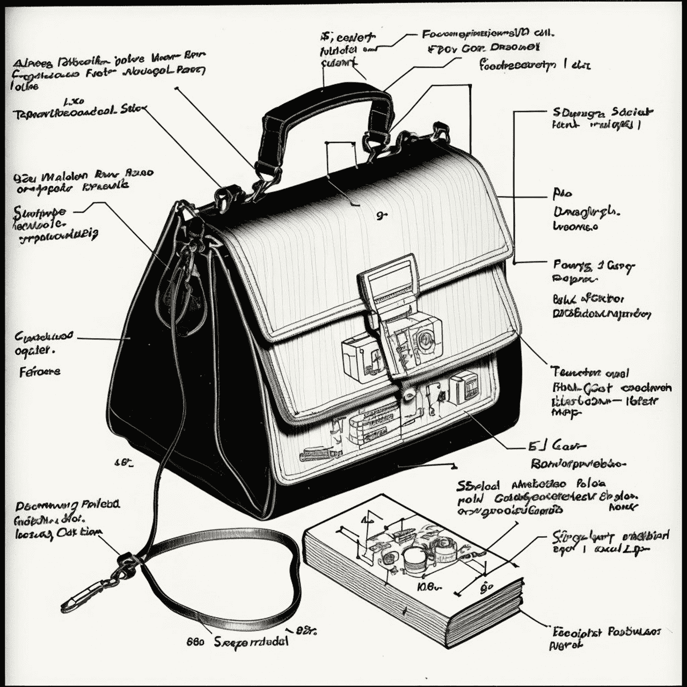
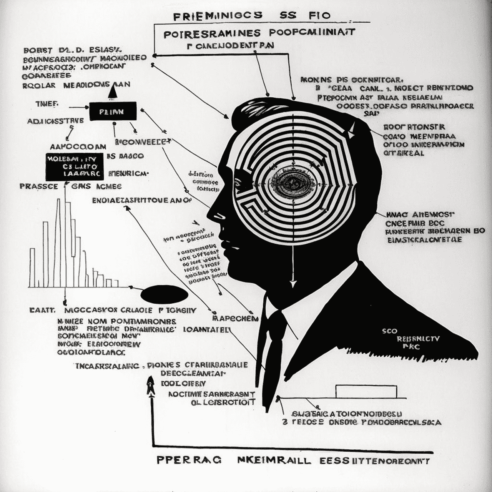

# AIGC Weekly #05

> 来源：[https://waytoagi.feishu.cn/docx/VWpld9G0boVjLQxXpIgcVcZHnRd](https://waytoagi.feishu.cn/docx/VWpld9G0boVjLQxXpIgcVcZHnRd)

> 🔗 原文链接： h[ttps://op7418.zhub](https://op7418.zhubai.love/posts/2222039449645371392)ai.love/posts/22...

> 发表时间：2023-01-03

提示词：amorphous Forest scape, depicted in a stained glass splinter pattern, frosted green glass, trending on artstation, CGSociety, detailed art, 3d render, filmic, filmic, magic, cryengine, 8k, 4k UHD, filmic, HDR, volumetric lighting

> 如无意外会在每周一更新，主要介绍上周AIGC领域发布的一些产品以及值得关注的研究成果，由于我自己是一个设计师，所以在一些专业内容的描述上可能存在问题，欢迎在渠道帮我反馈及更正。

# ❤️上周精选

上周由于是圣诞和元旦周所以内容不是很多。

Twitter上的一个AI艺术家和策展人 Guy Parsons 不定期的会发一些AI画图中固定风格的关键词模板。基本上只要按照这些模板只改动主体内容，生成的图片基本不会翻车。这里我把他发的这些零散的风格模版整理了一下，感兴趣的话可以使用这些模版尝试一下。每种风格我会展示两张图，更多的内容可以去他的Twitter查看。 https://twitter.com/GuyP

如果还没有使用过Midjourney的话，可以先看一下我之前写的这个 《 Midjourney AI画图软件保姆级调教教程（一） 》

## 漩涡状气泡风格

提示词：Amorphous blobs of shimmering colour in the shape of a mysterious woman's face, deep cosmic background, experimental 3D render

提示词：Amorphous blobs of shimmering colour in the shape of a deep sea diver, deep astral cosmic background, experimental 3D render

## 单色系剪影风格

提示词：Minimalist duotone illustration of a couch using negative space, luxurious

提示词：Minimalist duotone illustration of a hopeful paperboy, using negative space, luxurious vintage

## 泼墨飞溅风格

提示词：illustration of a sports car, speed, chaotic big splashy paint splotches, vibrant desert colour palette, blocky black shapes

提示词：illustration of two lovers embracing, chaotic big splashy paint splotches, pink and purple colour palette, blocky black shapes

## 机密备忘录风格

提示词：Diagram of a woman's purse, espionage equipment, instructional, photocopied black-and-white line art scan from redacted 1986 CIA memo, declassified top secret scanned USG government report

提示词：Diagram of a hypnotic process, the mind, classified black-and-white line art scan from redacted 1963 CIA memo, top secret, scanned USG government report

# 🤑行业动态

+   Y Combinator 支持的 Po[ly](https://techcrunch.com/2022/12/27/y-combinator-backed-poly-uses-ai-to-generate-art-assets/) 使用 AI 生成艺术资产。来源： https://techcrunch.com/2022/12/27/y-combinator-backed-poly-uses-ai-to-generate-art-assets/

+   中国 GPU 制造商的崛起：人工智能和技[术主](https://www.tomshardware.com/news/ai-and-tech-sovereignity-drive-number-of-gpu-developers-in-china)权推动新的 GPU 进入者。来源： https://www.tomshardware.com/news/ai-and-tech-sovereignity-drive-number-of-gpu-developers-in-china

+   [帮助公司充分利用虚拟](http://recall.ai/)[会](https://techcrunch.com/2022/12/29/recall-ai/?guccounter=1)议数据的 Recall.ai 筹集了 270 万美元的种子资金。来源： https://techcrunch.com/2022/12/29/recall-ai/?guccounter=1

+   [a16z 提出的企业技术在 2023 年要解决的四大想法 。来](https://a16z.com/2022/12/15/big-ideas-in-tech-2023/)源： https://a16z.com/2022/12/15/big-ideas-in-tech-2023/

# ⚒️产品推荐

+   AI生成的无缝纹理。使用我们的AI模型为你的产品或服务生成定制的设计。你还可以搜索数以千计的免版税图片，立即用于你自己的设计。来源： https://www.patterned.ai/

+   使用Stable Diffusion生成艺术图案选择相框后，他们会装订好发给你。来源： https://aiwalldecor.com/

+   这[是四年级学生写的还是Chat GPT？ 纽约时报推出的一个游戏，给你一段文本让](https://www.nytimes.com/interactive/2022/12/26/upshot/chatgpt-child-essays.html)你判断是不是Chat GPT写的。来源： https://www.nytimes.com/interactive/2022/12/26/upshot/chatgpt-child-essays.html

+   Embolden -使用AI帮助生成电商相关营销内容。来源： https://embolden.co/

+   免费的 Chrome 扩展，使用 ChatGPT AI 根据您输入的几个关键字生成电子邮件或回复。目前支持 Gmail。来源： https://chatgptwriter.ai/

+   ChatGPT 矩阵样式 ，改变Chat GPT页面[，让它长得像黑客帝国的矩阵一样。来源： https:/](https://github.com/lvwzhen/ChatGPT-Matrix-Style)/github.com/lvwzhen/ChatGPT-Matrix-Style

+   [MobAI -一款AI生成图像的移动应用。来源： https://apps](https://apps.apple.com/us/app/mobai-ai-art-generator/id6444911082?at=1000l6eA).apple.com/us/app/mobai-ai-art-generator/id6444911082?at=1000l6eA

+   GPT Hotline- what app上使用Chat-GPT的机器人。来源： https://www.gpthotline.com/

+   [Anyword -使用AI给你的营销内容打分并给出优化建议。](https://anyword.com/data-driven-basic/?fpr=home_35)来源： https://anyword.com/data-driven-basic/?fpr=home_35

+   Detect GPT -扫描您正在查看的网页内容并对其进行分析，以确定是否有任何内容是使用 GPT 语言模型生成的。来源： https://www.thomas.io/detect-gpt

+   GPT-3.5 Table-inator - 输入一个主题，它将生成一个带[有](https://huggingface.co/spaces/JavaFXpert/GPT-3.5-Table-inator)维基百科链接的信息表 。需要使用自己的Open AI API key。来源： https://huggingface.co/spaces/JavaFXpert/GPT-3.5-Table-inator

+   A[uto Photoshop StableDiffusion -又](https://github.com/AbdullahAlfaraj/Auto-Photoshop-StableDiffusion-Plugin)一款Photoshop 里的 StableDiffusion 插件。来源： https://github.com/AbdullahAlfaraj/Auto-Photoshop-StableDiffusion-Plugin

+   FutureTools -好用的AI驱动的工具合集。来源： https://www.futuretools.io/

+   AI电子表格助手 -可根据上下文自动填充整个工作表，[并](https://twitter.com/mehran__jalali/status/1608159307513618433)使用文本命令生成公式和过滤行。来源： https://twitter.com/mehran__jalali/status/1608159307513618433

# 🧑🎓学习资源

+   [如](https://twitter.com/scottcmillard/status/1608519748605644800)何在 ChatGPT 上制作视频脚本 。来源： https://twitter.com/scottcmillard/status/1608519748605644800

+   [ChatGPT 简介：基础知识 。来源： htt](https://buildspace.so/notes/intro-to-chatgpt)ps://buildspace.so/notes/intro-to-chatgpt

+   S[t](https://www.jonstokes.com/p/stable-diffusion-20-and-21-an-overview)able Diffusion 2.0 & 2.1: An Overview -SD2.0和2.1相关功能的原理和用法介绍。来源： https://www.jonstokes.com/p/stable-diffusion-20-and-21-an-overview

# 🔬精选文章

+   Microsoft Designe[r： AI 提示UX设计原则 。来源： https://prot](https://prototypr.io/post/microsoft-designer-ai-prompt-design-principles)otypr.io/post/microsoft-designer-ai-prompt-design-principles

+   2023 年可能是我们看到人工智能工具使用增加的一年，尤其是在设计行业。因此，我整[理](https://www.notion.so/AIGC-05-e006726c72ef470b876606fb5bcd3af0)了一份 AI 设计工具列表，您可以开始学习如何使用，这样您就不会落后。来源： https://www.notion.so/AIGC-05-e006726c72ef470b876606fb5bcd3af0

+   [2](https://twitter.com/drjimfan/status/1607746957753057280)022年AI领域的十个重要时间回顾。来源： https://twitter.com/drjimfan/status/1607746957753057280

+   [麻](https://www.technologyreview.com/2022/12/23/1065852/whats-next-for-ai/)省理工学院技术评论的文章- 下一代的AI是什么样的？ 来源： https://www.technologyreview.com/2022/12/23/1065852/whats-next-for-ai/

+   《纽约时报》对 Yejin Choi 的采访- 一位人工智能先[驱讲述我们真正应该害怕的东西 。来源： https://www.nytimes.c](https://www.nytimes.com/interactive/2022/12/26/magazine/yejin-choi-interview.html)om/interactive/2022/12/26/magazine/yejin-choi-interview.html

+   利用大型语言模型对医学临床知识进行编码。来源： https://arxiv.org/abs/2212.13138

+   Forbed 关于“ 2023 年生成 AI 将继[续加速](https://www.forbes.com/sites/cindygordon/2022/12/29/generative-ai-will-continue-to-accelerate-in-2023-are-you-ready/?sh=432665f2650c)”的文章：你准备好了吗？ 来源： https://www.forbes.com/sites/cindygordon/2022/12/29/generative-ai-will-continue-to-accelerate-in-2023-are-you-ready/?sh=432665f2650c

+   让GPT参加律师执业资格考试。来源： https://arxiv.org/abs/2212.14402

+   通[过 Jack Soslow 的 AI 阅读清单 ，了解所有相关论文、播客、博客等，了解 A](https://docs.google.com/document/d/1bEQM1W-1fzSVWNbS4ne5PopB2b7j8zD4Jc3nm4rbK-U/edit#)I 的最新动态。来源： https://docs.google.com/document/d/1bEQM1W-1fzSVWNbS4ne5PopB2b7j8zD4Jc3nm4rbK-U/edit#

+   [设](https://uxdesign.cc/ways-to-use-ai-in-product-design-today-ad70e3311e92)计师如何从今天开始在工作中使用人工智能。来源： https://uxdesign.cc/ways-to-use-ai-in-product-design-today-ad70e3311e92