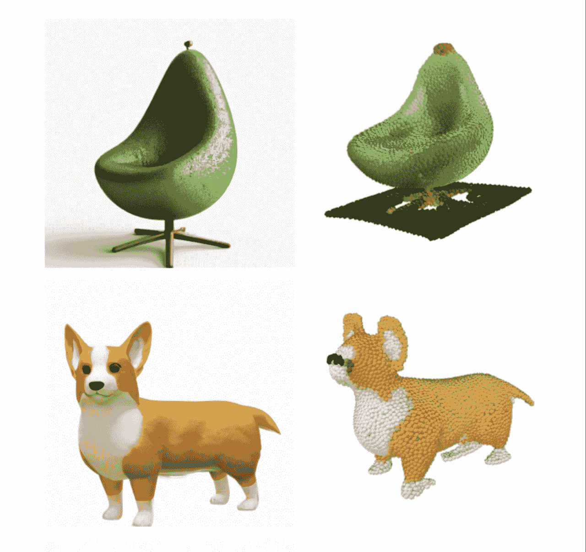
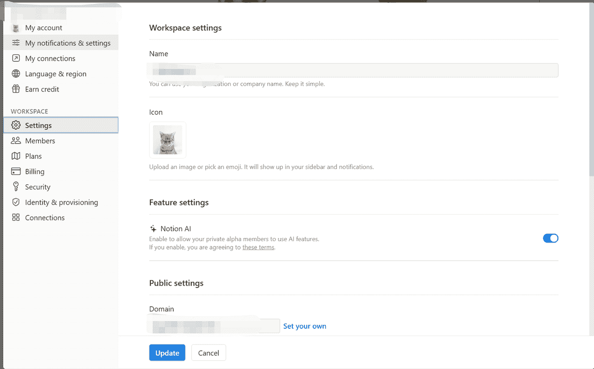
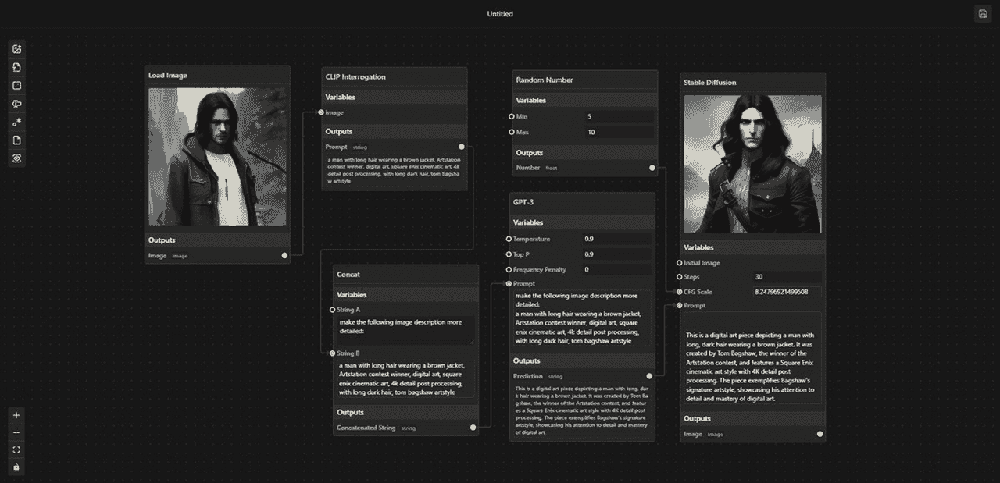
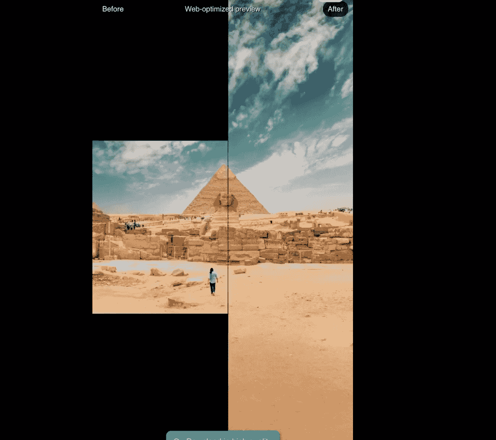
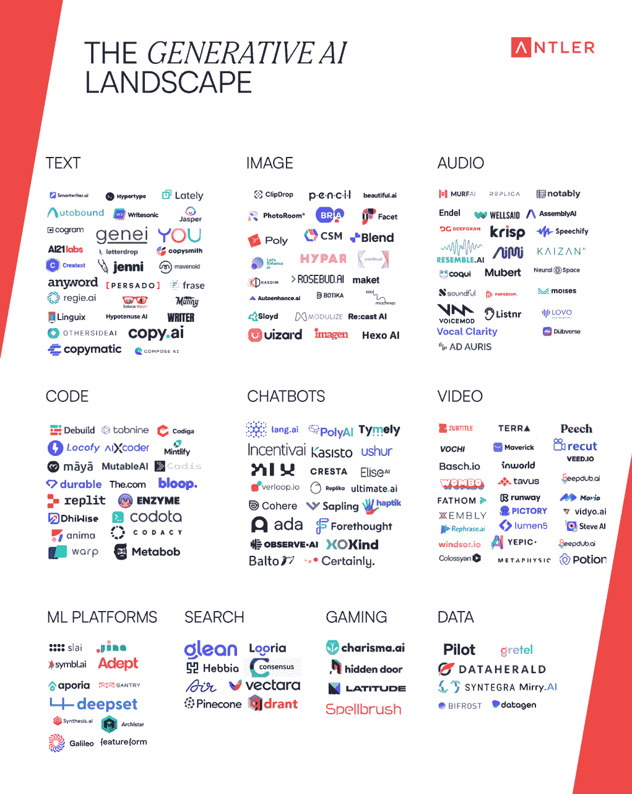

# AIGC Weekly #04

> 来源：[https://waytoagi.feishu.cn/docx/LFIodXkdUoKrtRxOIuaclbkCnme](https://waytoagi.feishu.cn/docx/LFIodXkdUoKrtRxOIuaclbkCnme)

> 🔗 原文链接： h[ttps://op7418.zhub](https://op7418.zhubai.love/posts/2218968829344878592)ai.love/posts/22...

> 发表时间：2022-12-26

题图使用Midjourney V4生成，提示词为：3D rendering of a Christmas themed crystal ball，looks like a mini winter wonderland, The candy can be seen on top of a wooden table. The surface has 4K HD, octane render, blender, raytracing, shaders, RTX, trending on Twitter --ar 3:2

> 如无意外会在每周一更新，主要介绍上周AIGC领域发布的一些产品以及值得关注的研究成果，由于我自己是一个设计师，所以在一些专业内容的描述上可能存在问题，欢迎在渠道帮我反馈及更正。

# ❤️上周精选

## Prompt Extend

我之前设想过的AI帮助生成AI提示词的功能终于有人产品化了。

你只需要输入一个AI绘图提示的主旨，这个模型将尝试帮你添加合适的风格提示。

这期周刊的封面就是用这个工具生成的。

原关键词为：3D rendering of a Christmas themed crystal ball，looks like a mini winter wonderland.

工具优化后的内容为：3D rendering of a Christmas themed crystal ball，looks like a mini winter wonderland, The candy can be seen on top of a wooden table. The surface has 4K HD, octane render, blender, raytracing, shaders, RTX, trending on Twitter.

工具地址： [h](https://huggingface.co/spaces/daspartho/prompt-extend)ttps://huggingface.co/spaces/daspartho/prompt-extend

## Point-E

OpenAI在上周发布了 Point-E，一种生成 3D 模型的AI模型。以下是Techcrunch相关文章的一些摘要。

+   Point-E 不创建传统意义上的 3D 对象。相反，它会生成点云，或空间中代表 3D 形状的离散数据点集——因此是一个厚颜无耻的缩写。（Point-E 中的“E”是“效率”的缩写，因为它表面上比以前的 3D 对象生成方法更快。）从计算的角度来看，点云更容易合成，但它们无法捕获对象的细粒度形状或纹理——目前 Point-E 的一个关键限制。

+   为了解决这个限制，Point-E 团队训练了一个额外的 AI 系统来将 Point-E 的点云转换为网格。（网格——定义对象的顶点、边和面的集合——通常用于 3D 建模和设计。）但他们在论文中指出，模型有时会遗漏对象的某些部分，从而导致块状或扭曲的形状。

+   虽然还存在一些问题，它仍然比以前的最先进的技术快几个数量级——至少根据OpenAI团队的说法。

[Te](https://techcrunch.com/2022/12/20/openai-releases-point-e-an-ai-that-generates-3d-models/)chcrunch相关文章。来源： https://techcrunch.com/2022/12/20/openai-releases-point-e-an-ai-that-generates-3d-models/

模型的相关论文。来源： https://arxiv.org/abs/2212.08751

新的文本到 3D 模型已经有一个 [Hugging Face 演示。来源： https://h](https://huggingface.co/spaces/anzorq/point-e_demo)uggingface.co/spaces/anzorq/point-e_demo

项目的对应的github库。来源： https://github.com/openai/point-e

# 🤑行业动态

+   Gradio发布了Gradio Discord Bot。允许你使用 Spaces 中的任何演示作为您自己[的](https://twitter.com/Gradio/status/1605290316935974939) Discord 服务器中的机器人。例如，您可以使用同一个机器人来：语言之间的翻译、文字转语音、文字生成图像。来源： https://twitter.com/Gradio/status/1605290316935974939

+   Hugging Face现在已经可以[使用Docker Spaces。来源： https://hu](https://huggingface.co/docs/hub/spaces-sdks-docker)ggingface.co/docs/hub/spaces-sdks-docker

+   [Op](https://read.cash/@LiquidOcelotYT/openai-forecasts-1-billion-in-revenue-by-2024-7076b3b9)enAI 预测到 2024 年收入将达到 10 亿美元 。来源： https://read.cash/@LiquidOcelotYT/openai-forecasts-1-billion-in-revenue-by-2024-7076b3b9

+   Chat GPT 推出了更新。现在可以查看以前的历史对话了。

+   来自Rippling联合创始人被删除的推文。微软将会在GPT全力投入。GPT-4比3.5（ChatGPT）好10倍，通过了图灵测试和任何标准测试。

+   关于 2023 AI 预测的主题：生成和[预测 AI 之间的差距将扩大。 来源： https://twi](https://twitter.com/sama/status/1600630257869934592)tter.com/sama/status/1600630257869934592

+   Tinder 用户正在使用 Cha[tG](https://in.mashable.com/sex-dating-relationships/43849/tinder-users-are-using-chatgpt-to-message-matches)PT 向匹配对象发送消息 。来源： https://in.mashable.com/sex-dating-relationships/43849/tinder-users-are-using-chatgpt-to-message-matches

+   ImagenAI使用AI来个性化照片编辑[风格](https://techcrunch.com/2022/12/19/imagenai-which-uses-ai-to-personalize-photo-editing-styles-lands-30m/)，获得3000万美元融资。 来源： https://techcrunch.com/2022/12/19/imagenai-which-uses-ai-to-personalize-photo-editing-styles-lands-30m/

+   OpenAI 人类反馈数据集 已添加到 H[u](https://huggingface.co/datasets/openai/webgpt_comparisons)gging Face Hub。来源： https://huggingface.co/datasets/openai/webgpt_comparisons

+   Notion AI这周开始大规模推送。之前申请过的可以在下图的位置开启。

# ⚒️产品推荐

+   模仿3D软件节点编辑器的StableDiffusion内容编辑器界面。试用： https://t.co/0ezjIEn4E0 。自己部署： https://t.co/B74hKZYYjs

+   neural.love推出的一个工具可以利用AI来改变图像的比例，并补全剩余的部分。来源：

https://neural.love/uncrop

+   利用AI帮助进行时装设计，”创建无限逼真的产品图像，为您的情绪板提供信息板并提升您的设计过程。”来源： https://visualhound.com/

+   [Brancher.ai ](http://brancher.ai/)是一个平台，使用户能够连接和使用AI模型来创建功[能强大的应用程序，而无需](http://brancher.ai/)编码知识。借助 Brancher.ai ，用户可以快速轻松地创建 AI 驱动的应用程序，从而挖掘 AI 的潜力并构建独特、复杂的应用程序。该平台还为用户提供了货币化和分享他们的作品的机会，使他们能够从工作中获利。来源： https://www.brancher.ai/

+   YouTube Summary with ChatGPT 。一个插件可以帮助你获取一个youtube视频的语音转文字内容以及复制到ChatGPT中让它帮你转化为一个摘要文章。来源： https://glasp.co/youtube-summary

+   Slingshot 的 SwagAI - AI 工具，[可帮助您设计 公司 swag 。](https://www.useslingshot.com/swagai/)来源： https://www.useslingshot.com/swagai/

+   Context - 人工智能驱动的 音频和视频搜索引擎 。来源： https://addcontext.xyz/

+   G[ravity Forms OpenAI - 将 ](https://gravitywiz.com/gravity-forms-openai/)Gravity Forms 与 OpenAI 集成的 插件。来源： https://gravitywiz.com/gravity-forms-openai/

+   D[iffusion Radio： 一个 24/7](https://www.youtube.com/watch?v=uGRLOMf2hSc) 的 YouTube 频道，直播 AI 生成的音乐 。来源： https://www.youtube.com/watch?v=uGRLOMf2hSc

+   在几分钟内创建自定义 AI 模型，无需代码。 采用通用 OpenAI （GPT-3）[ 模型，并使用你自己的数据对其进行](https://no-code-ai-model-builder.com/)个性化设置。 增强模型的准确性和输出。来源： https://no-code-ai-model-builder.com/

+   Xpression camera 2.0 - 用于视频聊天和直播的生成 AI 。来源： https://xpressioncamera.com/

+   Text Blaze - Chrome 扩展， 使 OpenAI GPT-3 在你输入的任何地方都可用。 来源： https://blaze.today/

+   Tome - 使用AI通过你的的描述生成整个PPT。 来源： https://beta.tome.app/

+   Karlo - 第一个 大规模开源的 DALL-E 2 复制模型 。来源： https://github.com/kakaobrain/karlo

# 🧑🎓学习资源

+   提示工程指南 ：用于发现论文、指南、工具[和数据集以了解提示工程的存储库。来源： https://git](https://github.com/dair-ai/Prompt-Engineering-Guide)hub.com/dair-ai/Prompt-Engineering-Guide

+   使用 AssemblyAI 只需点击 2 次即可转录[和总结 YouTube 视频 。来源： https://twitter.com/Assembl](https://twitter.com/AssemblyAI/status/1605149941525106688?s=20&t=cIPVqNUdwvfeojUkSEZR0A)yAI/status/1605149941525106688?s=20&t=cIPVqNUdwvfeojUkSEZR0A

+   用于语义搜索的自然语言处理（NLP） ——了解如何让机器像人一样理解语言。此免费课程涵盖了构建最先进的语言模型所需的一切，从机器翻译到问答等。来源： https://www.pinecone.io/learn/nlp/

+   [使用 Tome 这个 AI 工具制作完整的PP](https://www.youtube.com/watch?v=5Kjex9N_wnc)T。来源： https://www.youtube.com/watch?v=5Kjex9N_wnc

+   如何 使用自己的艺术作品通过 Runway[ 训练自定义 AI 风格模型 。来源： https://twitter.com/notians](https://twitter.com/notiansans/status/1605700201053765632?s=12&t=627yjrqi1exqBQijI3pHeQ)ans/status/1605700201053765632?s=12&t=627yjrqi1exqBQijI3pHeQ

# 🔬精选文章

+   对 AI 市场、已经发生的事情和即将发生的事情的一个非常好的概述 。OpenAI首席执行官Sam Altman总结的面向未来最重[要](https://zeneca33.substack.com/p/letter-32-artificial-intelligence)的两项技能”未来的好技能：适应性和韧性。我认为这些是可以学习的！很难回答“什么工作是安全的”这个问题，但人类总能找到新的事情去做，未来可能会很精彩。“来源： https://zeneca33.substack.com/p/letter-32-artificial-intelligence

+   A[16Z最近写了一篇很有意思的文章，谈到他们认为的 生成式A](https://mp.weixin.qq.com/s/8rWK3F3DXvgEcHJ_MCSwSg)I和游戏 结合在一起的机会在哪，笔者翻译后对部分内容进行了注解。来源： https://mp.weixin.qq.com/s/8rWK3F3DXvgEcHJ_MCSwSg

+   回归 - Sam Altman（OpenAI 首席执行官）于 2021 年初拍摄，讨论 了OpenAI 和 GPT-3 的创建。来源： https://youtu.be/o7HAK-ME5cU

+   [探索Github Copilot的源码。来源： https://th](https://thakkarparth007.github.io/copilot-explorer/posts/copilot-internals)akkarparth007.github.io/copilot-explorer/posts/copilot-internals

+   [Midjourney绘制的UI界面以及对应提示词。来源： https://mediu](https://medium.muz.li/ai-powered-design-the-future-of-user-interfaces-399bd3f10472)m.muz.li/ai-powered-design-the-future-of-user-interfaces-399bd3f10472

+   哈佛商业评论的一篇文章。《 公司在[投资人工智能之前需要了解什么 》来源： https://hbr.or](https://hbr.org/2022/12/what-companies-need-to-know-before-investing-in-ai)g/2022/12/what-companies-need-to-know-before-investing-in-ai

+   [人工智能如何在现代营销中使用：初学者指南。 来源： https://martechbase.c](https://martechbase.com/blog/how-ai-is-being-used-in-modern-marketing-a-beginners-guide)om/blog/how-ai-is-being-used-in-modern-marketing-a-beginners-guide

+   预测： DALL-E 2、Mid[j](https://bakztfuture.substack.com/p/predictions-future-versions-of-dall)ourney 等的未来版本 。来源： https://bakztfuture.substack.com/p/predictions-future-versions-of-dall

+   人工智能艺术取得[突破的一年带来的问题与答案一样多 。总结：根据 Pitchbook 的数据，2022 年，从事生成式人工智能](https://www.emergingtechbrew.com/stories/2022/12/20/a-breakout-year-for-ai-art-brings-as-many-questions-as-answers)的公司融资 13 亿美元，同比增长 15%。 OpenAI 的 DALL-E 2 图像生成模型迅速走红，在公开发布后的五周内，超过 300 万用户每天生成超过 400 万张图像。生成式 AI 已被用于一系列行业，但它也引发了伦理和法律问题，包括领先的图像平台应如何处理 AI 生成的内容。一名程序员最近就 GitHub Copilot 起诉了 Microsoft、GitHub 和 OpenAI，GitHub Copilot 是一种生成式 AI 工具，使用公开可用的计算机代码来学习编写自己的代码。来源： https://www.emergingtechbrew.com/stories/2022/12/20/a-breakout-year-for-ai-art-brings-as-many-questions-as-answers

+   [人工智能的近期未来是行动驱动的 。来源： https://blog](https://blog.southparkcommons.com/the-near-future-of-ai-is-action-driven/).southparkcommons.com/the-near-future-of-ai-is-action-driven/

+   [Notion AI，ChatGPT – 人工智能编写内容 。来源： http](https://www.yearzero.io/blog/Notion-AI-ChatGPT-Artificial-Intelligence-Writing)s://www.yearzero.io/blog/Notion-AI-ChatGPT-Artificial-Intelligence-Writing

+   对[ Daniel Gross 和 Nat Friedman 关于 ChatGPT 和 AI 的近未来的 采访。来源： http](https://stratechery.com/2022/an-interview-with-daniel-gross-and-nat-friedman-about-chatgpt-and-the-near-term-future-of-ai/)s://stratechery.com/2022/an-interview-with-daniel-gross-and-nat-friedman-about-chatgpt-and-the-near-term-future-of-ai/

+   [绘制生成式 AI 市场格局全景图片。 来](https://www.antler.co/blog/generative-ai)源： https://www.antler.co/blog/generative-ai

