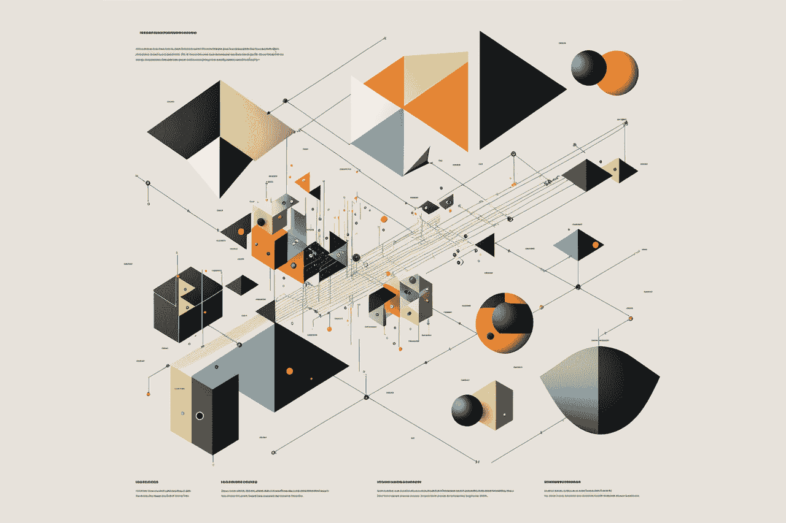
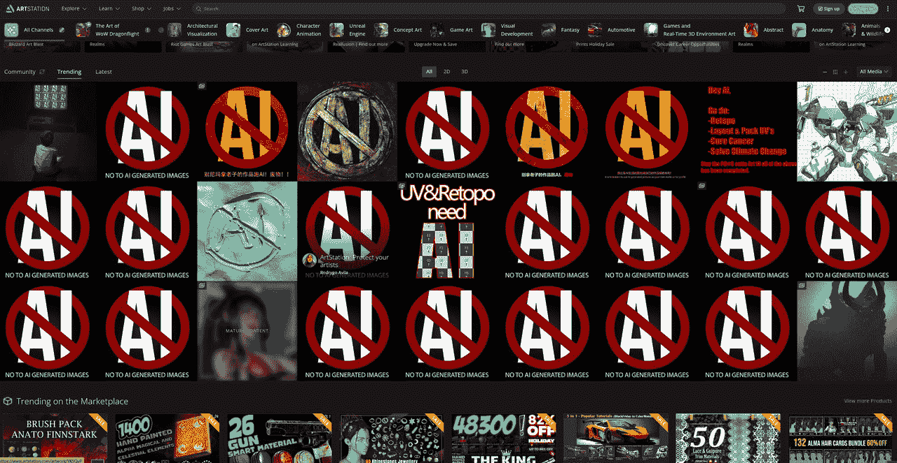
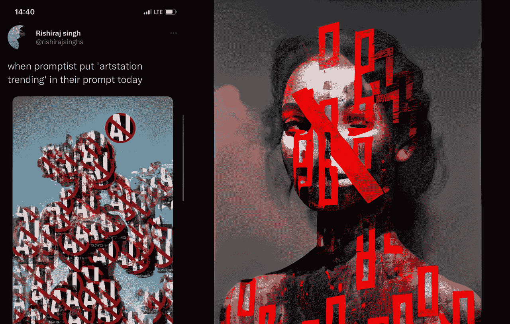
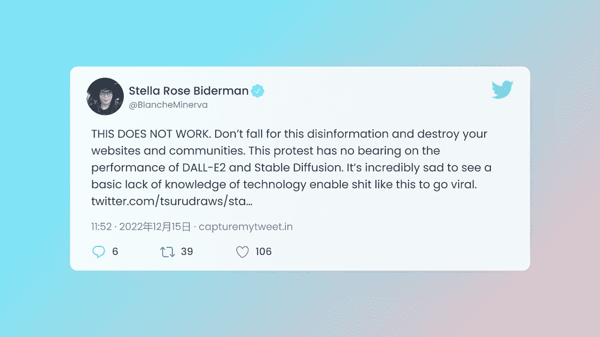
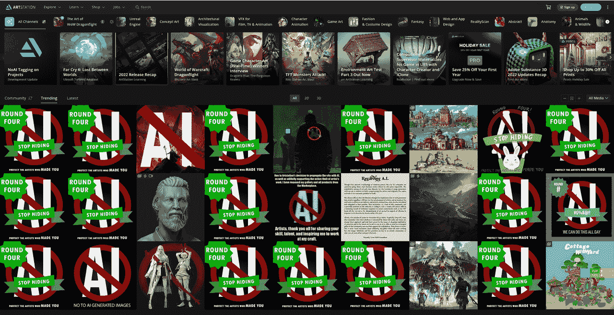
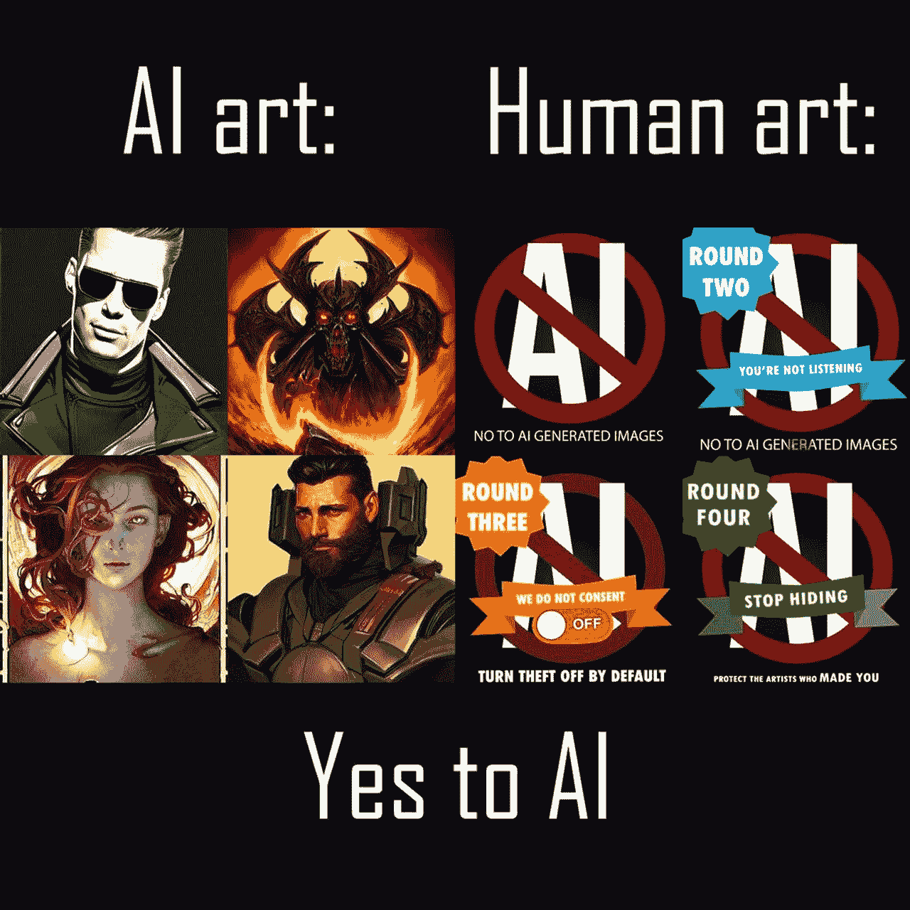
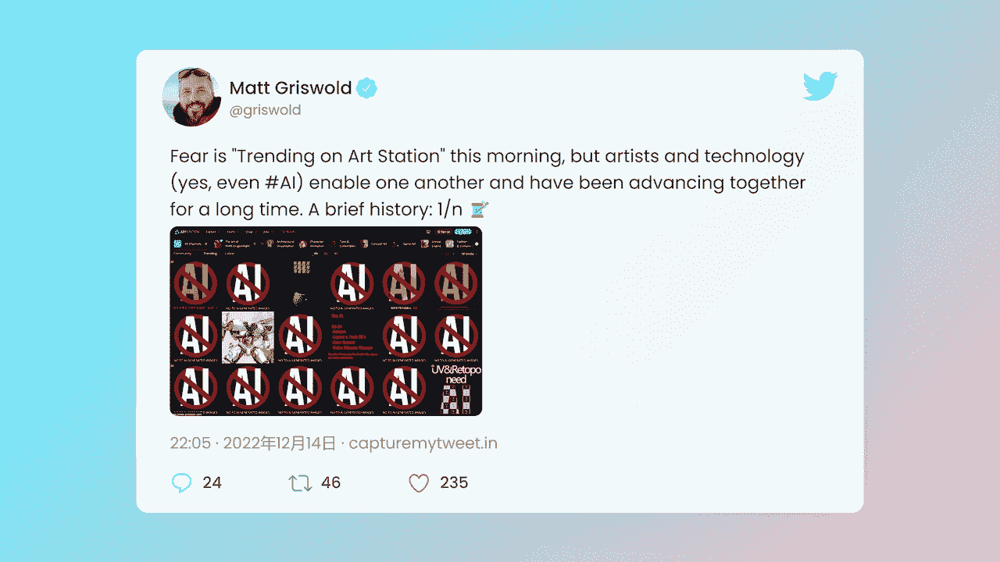
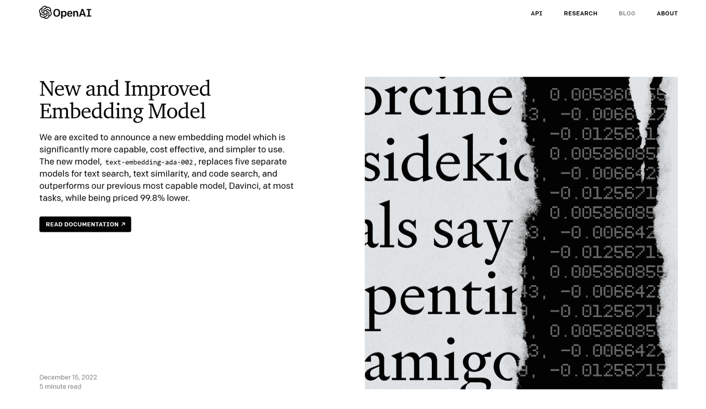
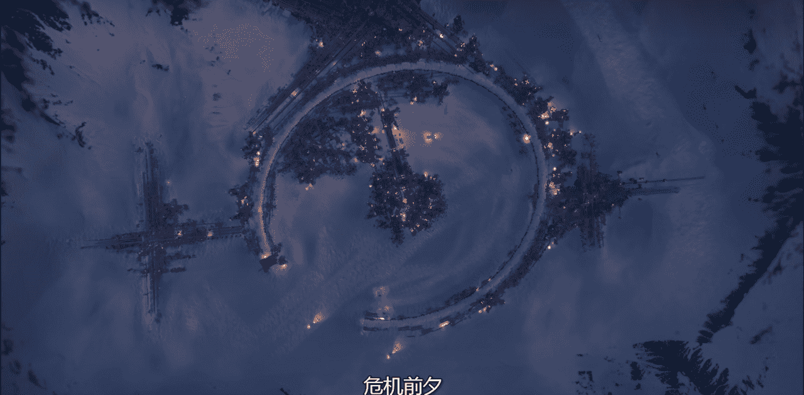
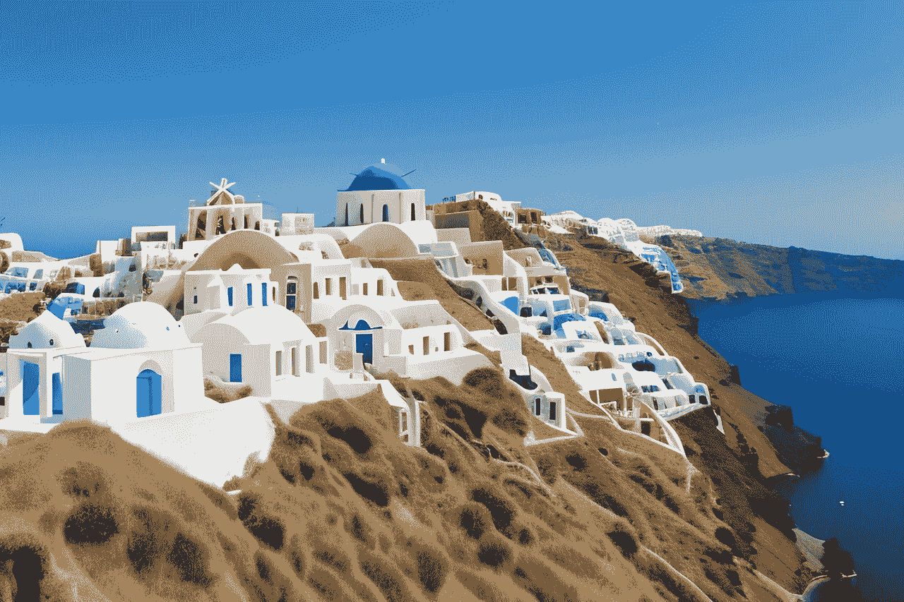

# AIGC Weekly #03

> 来源：[https://waytoagi.feishu.cn/docx/J5lkdZUxqoi1nBxQ3a8cPuF1nNh](https://waytoagi.feishu.cn/docx/J5lkdZUxqoi1nBxQ3a8cPuF1nNh)

> 🔗 原文链接： h[ttps://op7418.zhub](https://op7418.zhubai.love/posts/2216442187011874816)ai.love/posts/22...

> 发表时间：2022-12-19

题图使用Midjourney V4生成，提示词为：Schematic diagram of the relationship between art and artificial intelligence,Geometrical shapes, lines, gradients, minimalistic art, Bauhaus art style

> 如无意外会在每周一更新，主要介绍上周AIGC领域发布的一些产品以及值得关注的研究成果，由于我自己是一个设计师，所以在一些专业内容的描述上可能存在问题，欢迎在渠道帮我反馈及更正。

从这周周二开始（13号）Artstation（Epic旗下的插画艺术展示平台，全世界的著名画师都在这里发布设计作品）的艺术家发起了抵制在平台上传AI图片的行动，主要表现是集体在平台上传禁止AI的图片，可以看下面这张图。

然后在周三的时候推特上就有人传言说艺术家的抗争产生了效果，Midjourney中使用“artstation,trending”这个常用的提示词时，发现生成的内容已经被污染。相关内容被Artstation的艺术家大量转发。

然而，这是场闹剧，这些图是人工制作的，Midjourney等模型并没有被污染（是的我也被骗了，我是笨蛋），现有的技术无法做到实时抓取内容训练，即便可以做到，过滤这些相似内容也很简单，所以这些举动根本无法影响AI模型。具体的技术解释可以看这个数学家的相关解释非常通俗易懂，同时指出这种类型的抗议除了毁掉艺术家自己的社区环境之外对AI绘图的模型和公司不会有任何影响。

[h](https://twitter.com/BlancheMinerva/status/1603236406704410626)ttps://twitter.com/BlancheMinerva/status/1603236406704410626

最终在周五的时候，Artstation平台对艺术家的抗议活动做出了回应发了一篇公告，具体内容大概是：

+   他们不会禁止在Artstation上传AI作品。

+   用户可以自己决定自己的作品是否能被用于AI模型的训练。

+   他们一直在尝试将站点中的AI图片和正常内容进行区分，但是这些改动的发布还需要时间。

但是截止目前Artstation上还是有大量艺术家在继续上传抗议图片，看来艺术家对这些措施不太满意。

这些艺术家与技术产生矛盾之后被迫接受从中诞生新的风格和艺术形式，这种相互对抗而又融合的事情在历史中以及发生很多次了，每次有突破性的工具诞生的时候几乎都会发生一次，相机发明的时候、现代数字艺术发明的时候、PS和手绘板发明的时候。所以当有新技术出现的时候应该去探索去了解从而更好地运用新技术，而非去恐惧去排斥。

当然AI训练时的版权问题确实亟待解决，但这个恐怕只有政府出手了。

下面这个老哥写了一篇推特列举了一下长时间以来艺术家和技术是如何相互赋能相互成长的。

[h](https://twitter.com/griswold/status/1603028404604895233)ttps://twitter.com/griswold/status/1603028404604895233

## 🤑行业动态

+   Ope[n](https://openai.com/blog/new-and-improved-embedding-model/) AI发布了一个新的嵌入式模型 。同时Notion将使用这个模型来替代之前的关键词匹配搜索。“新模型取代了文本搜索、文本相似性和代码搜索的五个独立模型，并且在大多数任务中都优于我们之前功能最强大的模型 Davinci，同时价格降低了 99.8%。”来源： https://openai.com/blog/new-and-improved-embedding-model/

+   传奇插画师Greg Rutkowski也在Artstati[on上发布了那个抵制AI的图片。来源： h](https://www.artstation.com/artwork/g8E2xZ)ttps://www.artstation.com/artwork/g8E2xZ

+   B站的特效小哥008用AI绘图做了一个模拟三[体中智子](https://www.bilibili.com/video/BV1Ld4y1Y75M/?spm_id_from=333.1007.top_right_bar_window_default_collection.content.click&vd_source=e99f85042059f2864f5cca20d71575f0)展开的动画，完成度很高。来源： https://www.bilibili.com/video/BV1Ld4y1Y75M/?spm_id_from=333.1007.top_right_bar_window_default_collection.content.click&vd_source=e99f85042059f2864f5cca20d71575f0

+   推[特](https://twitter.com/tferriss/status/1603935838567600131)上的著名投资人发起了一个AI画图艺术大赛，前三名每人2000美元。感兴趣可以去参加一下，20号截止。来源： https://twitter.com/tferriss/status/1603935838567600131

+   A[I生成](https://techcrunch.com/2022/12/12/ai-art-apps-are-cluttering-the-app-stores-top-charts-following-lensa-ais-success/?guccounter=1)艺术的APP在App Store上大火，其中Lensa 在 12 月以 360 万的安装量位居榜首。来源： https://techcrunch.com/2022/12/12/ai-art-apps-are-cluttering-the-app-stores-top-charts-following-lensa-ais-success/?guccounter=1

+   Marques Brownlee 发布了一段视频： 关于[ AI 变得“有创意”的真相 。来源： htt](https://www.youtube.com/watch?v=0gNauGdOkro)ps://www.youtube.com/watch?v=0gNauGdOkro

+   [微](https://www.newcomer.co/p/vcs-weigh-openai-tender-offer-as)软收购Open AI的谈判任在进行中。来源： https://www.newcomer.co/p/vcs-weigh-openai-tender-offer-as

## ⚒️产品推荐

+   Lexica Aperture 终于上线了。 可以生成非常逼真的照片的模型。试用了一下完成度还不是很高无法看出相比SD的优势。来源： https://lexica.art/aperture

+   [视频内容分析模型，上传视频后可以生成视频内容的文](https://huggingface.co/spaces/nateraw/lavila)本描述。来源： https://huggingface.co/spaces/nateraw/lavila

+   [适](https://twitter.com/CyrusShepard/status/1601303833518317569)用于Google 表格的无代码机器学习插件。来源： https://twitter.com/CyrusShepard/status/1601303833518317569

+   对Chat GPT二次封装的产品，可以访问互联网数据以及支持直接生成图片。来源： https://writesonic.com/chat

+   Luma Imagine 3D - 一[种 用文本创建 3D 的新方法。](https://captures.lumalabs.ai/imagine)来源： https://captures.lumalabs.ai/imagine

+   [一](https://twitter.com/saviomartin7/status/1602544503335837698)个浏览器插件，可以用AI读取你的邮件内容并帮你生成回复。来源： https://twitter.com/saviomartin7/status/1602544503335837698

+   [Luma Imagine 3D ](https://captures.lumalabs.ai/imagine)- 通过文本创建3D模型。来源： https://captures.lumalabs.ai/imagine

+   [RF Diffusion模型，帮助设计蛋白](https://stephanheijl.com/rfdiffusion.html)质结构的扩散模型。来源： https://stephanheijl.com/rfdiffusion.html

+   [P](https://www.mosaicml.com/blog/introducing-pubmed-gpt)ubMed GPT： 生物医学文本的特定领域大型语言模型。 来源： https://www.mosaicml.com/blog/introducing-pubmed-gpt

+   Riffusion - 使用 Stable Diffusion 实时生成音乐的应用程序。它对 SD 进行微调以 生成频谱图 图像。然后可以将此 频谱图转换为音乐 。来源： https://www.riffusion.com/

+   [Rodin：使用扩散技术雕刻3D数字头像的生成模](https://3d-avatar-diffusion.microsoft.com/#/)型。来源： https://3d-avatar-diffusion.microsoft.com/#/

+   之前提到过的使用AI帮助生成游戏素材的工具[S](https://twitter.com/emmanuel_2m/status/1603328137953255426)cenario上线了移动版本。来源： https://twitter.com/emmanuel_2m/status/1603328137953255426

+   R[iffusion Web UI，这个可以使用Riffusion](https://huggingface.co/spaces/anzorq/riffusion-demo)模型输入文字生成长达两分钟的音乐。来源： https://huggingface.co/spaces/anzorq/riffusion-demo

+   Dreamlike Diffusion 1.0 - 受过高质量艺术训练的Stable Diffusion。 来源： https://dreamlike.art/

+   D[r](https://twitter.com/DeepMind/status/1601237890708537344)amatron - DeepMind 的一种新工具，供作家使用语言模型 共同编写戏剧和电影剧本 。来源： https://twitter.com/DeepMind/status/1601237890708537344

+   Vidyo - 使用A I帮你将长视频制作成短视频 。来源： https://vidyo.ai/

+   Mindy - 通过 思维导图和与 AI 聊天 来集思广益并充实想法。很有趣的使用形式。来源： https://vzakharov.github.io/mindy/

+   Creative Reality Studio - 结合 GPT-3、Stable Diffu[sion 和 D-ID 独特的面部动画 ](https://studio.d-id.com/?ref=producthunt)技术以创建面向未来的视频的平台。来源： https://studio.d-id.com/?ref=producthunt

+   通过对你推文内容的学习帮助你编写推文。来源： https://tweetai.com/

## 🧑🎓学习资源

+   通[过](https://twitter.com/damidina/status/1601525621837815818) Zapier 与 OpenAI 的这种简单集成，几乎可以 自动在 Webflow 上生成博客文章 。来源： https://twitter.com/damidina/status/1601525621837815818

+   [适合初学者的数据清理和预处理教程。 来源： https://www.kd](https://www.kdnuggets.com/2019/11/data-cleaning-preprocessing-beginners.html)nuggets.com/2019/11/data-cleaning-preprocessing-beginners.html

+   使[用 OpenAI + Webflow + Wh](https://www.youtube.com/watch?v=SXnOeyO9kOQ)alesync 在 20 分钟内创建 100 个程序化 SEO 页面。 来源： https://www.youtube.com/watch?v=SXnOeyO9kOQ

+   如何使用 ChatGPT 和 We[bflow 构建图书推荐网站。 来源： htt](https://www.youtube.com/watch?v=8_GD11Q-oGg)ps://www.youtube.com/watch?v=8_GD11Q-oGg

+   如[何使用 Python 和 Gradio 使用 ](https://www.youtube.com/watch?v=LB4MVdpajsU)OpenAI 的 GPT-3.5 构建你自己 的 ChatGPT。来源： https://www.youtube.com/watch?v=LB4MVdpajsU

+   [GPT3 和提示：快速入门。 来源： https://bu](https://buildspace.so/notes/intro-to-gpt3-prompts)ildspace.so/notes/intro-to-gpt3-prompts

## 🔬精选文章

+   [Mi](https://evilmartians.com/chronicles/midjourney-vs-human-illustrators-has-ai-already-won?ref=sidebar)djourney和人类插画师，人工智能已经赢了吗？来源： https://evilmartians.com/chronicles/midjourney-vs-human-illustrators-has-ai-already-won?ref=sidebar

+   [为](https://www.bigtechnology.com/p/why-google-missed-chatgpt)什么 Google 错过了 ChatGPT 。来源： https://www.bigtechnology.com/p/why-google-missed-chatgpt

+   [一](https://twitter.com/bryanblears/status/1601146805281951744)位作者展示了 ChatGPT 如何 彻底颠覆图书出版行业 。来源： https://twitter.com/bryanblears/status/1601146805281951744

+   David Friedberg 的预测是“ 似乎更有可能的是，人工[智](https://twitter.com/friedberg/status/1601295731297775617)能不会取代传统模式中的创造者，而是会成为每个人的个性化内容创造者…“ 来源： https://twitter.com/friedberg/status/1601295731297775617

+   [5](https://twitter.com/javilop/status/1601521685454147589)0个精心挑选的由 AI绘制的用户界面 以及对应的提示词。来源： https://twitter.com/javilop/status/1601521685454147589

+   [2023年一种新的AI语言模型的预测，矩阵模型。来源： https](https://bakztfuture.substack.com/p/2023-prediction-a-new-kind-of-language)://bakztfuture.substack.com/p/2023-prediction-a-new-kind-of-language

+   [纽约](https://www.newyorker.com/magazine/2022/12/19/the-world-changing-race-to-develop-the-quantum-computer)客文章 改变世界的量子计算机开发竞赛 。来源： https://www.newyorker.com/magazine/2022/12/19/the-world-changing-race-to-develop-the-quantum-computer

+   [哈](https://hbr.org/2022/12/chatgpt-is-a-tipping-point-for-ai)佛商业评论文章， “ChatGPT 是 AI 的引爆点” 。来源： https://hbr.org/2022/12/chatgpt-is-a-tipping-point-for-ai

+   C[h](https://www.ben-evans.com/benedictevans/2022/12/14/ChatGPT-imagenet)atGPT 和 Imagenet 时刻。 “关于人类如何在循环中对人工智能至关重要，以及什么样的问题最好用人工智能来解决。” 来源： https://www.ben-evans.com/benedictevans/2022/12/14/ChatGPT-imagenet

+   ChatGPT 是我的联合创始人 ：常见的障碍阻碍了企业家，A[I](https://oneusefulthing.substack.com/p/chatgtp-is-my-co-founder) 可以帮助创始人跨越这些障碍。来源： https://oneusefulthing.substack.com/p/chatgtp-is-my-co-founder