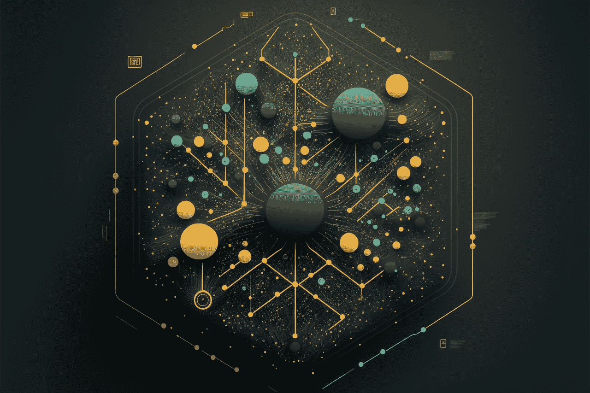
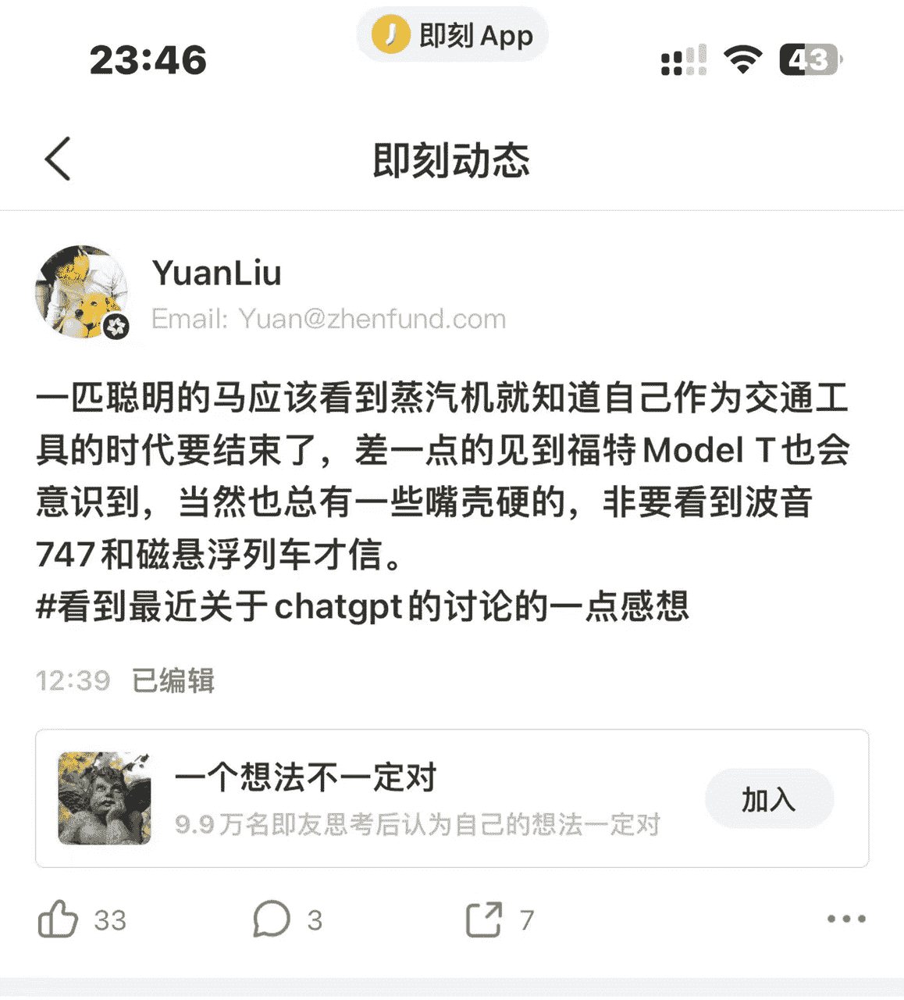
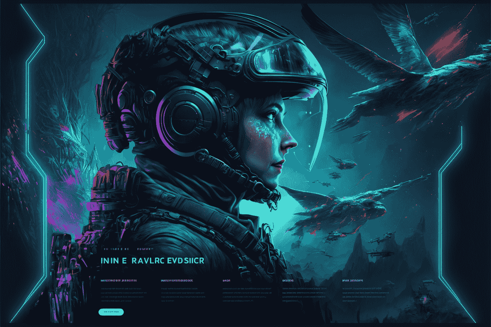

# AIGC Weekly #02

> 来源：[https://waytoagi.feishu.cn/docx/PqwKdaVtHoOWtGx0GnzcZfhyngg](https://waytoagi.feishu.cn/docx/PqwKdaVtHoOWtGx0GnzcZfhyngg)

> 🔗 原文链接： h[ttps://op7418.zhub](https://op7418.zhubai.love/posts/2213903650001543168)ai.love/posts/22...

> 发表时间：2022-12-12

题图使用Midjourney V4生成，提示词为： Neural network algorithm schematic, futuristic minimalist style, abstract, Greg Rutkowski

> 如无意外会在每周一更新，主要介绍上周AIGC领域发布的一些产品以及值得关注的研究成果，由于我自己是一个设计师，所以在一些专业内容的描述上可能存在问题，欢迎在渠道帮我反馈及更正。

这周[很多的主](https://sms-activate.org/cn/info/ChatGPT?ref=2758859)要内容还是Chat GPT上上周发布以后彻底引爆了全球互联网，仅仅五天注册用户破百万，这中间服务也被挤爆了好几次，淘宝和闲鱼买账号以及帮忙部署机器人的人也血赚了一波，还不知道如何注册的人可以 看这里 ，

随着不断的测试Chat GPT的一些缺点也暴露了出来，比如它的伦理限制会在被绕晕逻辑之后失效，以及涉及到它不懂得内容的时候也会一本正经的胡说八道，所以一些确定性的知识还是不能完全相信它。

当然这些缺点也无法掩盖它表现出来的革命性技术的特点，这一周利用其技术的相关工具软件也在爆发式增长，当然也有一些人对此不屑一顾认为其还是微软小冰那种东西。这里引用一下即刻YuanLiu对于最近关于Chat GPT一些现象的评价“ 一匹聪明的马应该看到蒸汽机就知道自己作为交通工具的时代要结束了，差一点的见到福特Model T也会意识到，当然也总有一些嘴壳硬的，非要看到波音747和磁悬浮列车才信。 ”

# 🤑行业动态

+   Stable Diffusion v2.1发布

+   解决了2.0发布时屏蔽负面内容用力过猛造成的人像生成问题

+   支持生成非标准分辨率图像，比如32:9之类的

+   来源： [https://github.com/Stabilit](https://github.com/Stability-AI/stablediffusion)y-AI/stablediffusion

+   麦肯锡发布了他[们的AI 现状报告。 这里有一个简短的总结：自2017年以来，采用率增加了一倍多，尽管过去几年使用人工智能1的](https://www.mckinsey.com/capabilities/quantumblack/our-insights/the-state-of-ai-in-2022-and-a-half-decade-in-review)组织比例在50％至60％之间趋于平稳。一组从人工智能中看到最高财务回报的公司继续领先于竞争对手。结果显示，这些领导者在人工智能方面进行了更大的投资，采用了越来越先进的做法，以实现规模化和更快的人工智能发展，并显示出在紧张的人工智能人才市场上有更好的表现。在人才方面，我们首次仔细研究了人工智能的招聘和技能提升。数据显示，人工智能团队的多样性还有很大的提升空间，而且，与其他研究一致，多样化的团队与出色的业绩相关。来源： https://www.mckinsey.com/capabilities/quantumblack/our-insights/the-state-of-ai-in-2022-and-a-half-decade-in-review

+   Tweve Labs为理解视频上下文的[AI](https://techcrunch.com/2022/12/05/twelve-labs-lands-12m-for-ai-that-understands-the-context-of-videos/)模型筹集了1200万美元。 来源： https://techcrunch.com/2022/12/05/twelve-labs-lands-12m-for-ai-that-understands-the-context-of-videos/

+   R[un](https://runwayml.com/?utm_source=RunwaySocial&utm_medium=Twitter&utm_campaign=AITrainingRelease)way宣布他们获得了5000万美元的融资 ，并发布了一个工具可以在几分钟的时间内训练自己的AI模型。来源： https://runwayml.com/?utm_source=RunwaySocial&utm_medium=Twitter&utm_campaign=AITrainingRelease

+   [A](https://www.axios.com/2022/12/05/adobe-ai-made-stock-images)dobe将接受上传AI生成的图像 并售卖。来源： https://www.axios.com/2022/12/05/adobe-ai-made-stock-images

+   SellScale 筹集 340 [万美](https://www.sellscale.com/post/sellscale-raises-3-4-million-to-give-ai-superpowers-to-sales-teams)元， 用AI为销售团队赋能。来源： https://www.sellscale.com/post/sellscale-raises-3-4-million-to-give-ai-superpowers-to-sales-teams

## ⚒️产品推荐

+   Qatalog 2.0输入你的业务类型该产品会智能帮你生成为你定制的SaaS系统。来源： https://qatalog.com/

+   Chat GPT问题模板的聚合站。来源： https://showgpt.co/

+   这个浏览器扩展可以扫描当前网页内容，[并使用Chat GPT进行总结。来源： ](https://github.com/clmnin/summarize.site)https://github.com/clmnin/summarize.site

+   输入你的营销网站地址这个服务就可以用GPT-3生[成关于你网站内容的人工智能客服。来源](https://chatessential.eyelevel.ai/demo)： https://chatessential.eyelevel.ai/demo

+   使用AI驱动的代码审查工具。来源： https://codeball.ai/

+   [ChatGPT 和 GPT-3 的精选工具、演示](https://github.com/humanloop/awesome-chatgpt)和文档列表。 来源： https://github.com/humanloop/awesome-chatgpt

+   ChatGPT 现在可以在 Hu[gging Face 上使用。 来源： https://](https://huggingface.co/spaces/Xhaheen/ChatGPT_HF)huggingface.co/spaces/Xhaheen/ChatGPT_HF

+   用于 将 ChatGPT 历史下载为 PNG、[PDF 或链接的 Chrome ](https://github.com/liady/ChatGPT-pdf)扩展。 https://github.com/liady/ChatGPT-pdf

+   ChatGPT Chrome 扩展。 可以在任[何](https://github.com/gragland/chatgpt-chrome-extension)网页的文本框中使用Chat GPT。 https://github.com/gragland/chatgpt-chrome-extension

+   非常方便的创建你专属的GPT机器人工具。来源： https://www.toolbot.ai/

+   在浏览器中使用AI编写代码。来源： https://www.codeium.com/

+   ChatGPT 的桌面版APP，支持Ma[c](https://twitter.com/HiTw93/status/1601524689532133378)/Windows/Linux。来源： https://twitter.com/HiTw93/status/1601524689532133378

+   C[hatGPT 的微信 Bot ,装完依赖后只需要填写](https://github.com/fuergaosi233/wechat-chatgpt) OpenAI 账号密码和微信扫码就可以使用。来源： https://github.com/fuergaosi233/wechat-chatgpt

+   Zapier 的 OpenAI Integration 已正式发布。 可以通过Zapier与其他很多应用程序一起使用GPT生成的内容。设置落地页，使用用户输入[表单，让 Zapier OpenAI 应用程序](https://zapier.com/apps/openai/integrations)进行处理（写电子邮件、生成食谱、博客文章、社交媒体帖子）并将它们放入 Google 表格，或在网站上展示。来源： https://zapier.com/apps/openai/integrations

## 🧑🎓学习资源

+   huggingface推出了他们的深度学习课[程](https://huggingface.co/deep-rl-course/unit0/introduction)第二版，感兴趣的可以学习一下。来源： https://huggingface.co/deep-rl-course/unit0/introduction

+   使[用NoCode工具创建您自己的 AI 支持的内](https://www.youtube.com/watch?v=4Q4fv3q78ps)容库。 （Webflow、Airtable、Zapier 和 OpenAI）来源： https://www.youtube.com/watch?v=4Q4fv3q78ps

+   [Stable Diffusion ](https://stability.ai/sdv2-prompt-book)提示词书写教程。来源： https://stability.ai/sdv2-prompt-book

+   [如何利用Chat GPT帮助你生成完美的AI画图工具提示词。来源： h](https://www.wordcelclub.com/ujjwal49.sol/how-to-generate-the-perfect-images)ttps://www.wordcelclub.com/ujjwal49.sol/how-to-generate-the-perfect-images

+   这个网站完全使用Chat GPT生成的代码和内[容](https://twitter.com/replit/status/1599803817515548674)来构建，只需要花费不到十分钟。来源： https://twitter.com/replit/status/1599803817515548674

+   [关](https://twitter.com/datachaz/status/1600135591877742592)于如何充分利用Chat GPT的一些提示和技巧。来源： https://twitter.com/datachaz/status/1600135591877742592

+   为什么 ChatGPT 这么好？它“只是扩大的GPT-3”吗？[解](https://twitter.com/DrJimFan/status/1600884299435167745)释Chat GPT原理的文章。来源： https://twitter.com/DrJimFan/status/1600884299435167745

## 🔬精选文章

+   [俞军老师关于Chat GPT能否替代搜索引擎的一些看法。来源： https://m.okjike.c](https://m.okjike.com/originalPosts/638ffbb9bd99cdb26cfb9606?s=ewoidSI6ICI1OTUzOTllNGZkZmE0NzAwMTIzMDAxNmYiCn0=)om/originalPosts/638ffbb9bd99cdb26cfb9606?s=ewoidSI6ICI1OTUzOTllNGZkZmE0NzAwMTIzMDAxNmYiCn0=

+   即刻阿法兔关于GPT的研究内容。《 从GPT-1到GP[T-4看ChatGPT的崛起 》来源： https://m](https://mp.weixin.qq.com/s/ALmmeyAzIZFNsRTXmVZ4aw)p.weixin.qq.com/s/ALmmeyAzIZFNsRTXmVZ4aw

+   T[he Generalist 的 Mario 讨论关于**生](https://www.generalist.com/briefing/endless-media)成式对媒体制作和消费的潜在影响。**来源： https://www.generalist.com/briefing/endless-media

+   来自[ USV 的 Fred Wilson 写](https://avc.com/2022/12/sign-everything/)了一篇关于 AI 和 web3 如何互惠互利 的简短博文。我可以看到，在任何图像都可以由 AI 生成的时代，也许 NFT 可以提供所有权。来源： https://avc.com/2022/12/sign-everything/

+   H[acker News的一个帖子，“我们现在处于人工](https://news.ycombinator.com/item?id=33868515)智能的翻盖手机阶段”，“十年后每个人都会拥有独属于自己的AI助手”。来源： https://news.ycombinator.com/item?id=33868515

+   人工智能的春天来了吗？来源： [https://www.notboring.co/p/fou](https://www.notboring.co/p/four-seasons-total-tech)r-seasons-total-tech

+   [纽](https://www.nytimes.com/2022/12/05/technology/chatgpt-ai-twitter.html)约时报的一篇文章“ ChatGPT 的辉煌与怪异。 来源： https://www.nytimes.com/2022/12/05/technology/chatgpt-ai-twitter.html

+   [生成式AI模型还有哪些未解决的问题。来源： https://www.mckinsey.com/capabili](https://www.mckinsey.com/capabilities/quantumblack/our-insights/the-state-of-ai-in-2022-and-a-half-decade-in-review)ties/quantumblack/our-insights/the-state-of-ai-in-2022-and-a-half-decade-in-review

+   Modal背后的创始人写了一篇幕后观点《[ 我一直在做](https://erikbern.com/2022/12/07/what-ive-been-working-on-modal.html)的[事](https://erikbern.com/2022/12/07/what-ive-been-working-on-modal.html)情：Modal 》。（ Modal 可以让你在云中运行内容，而无需考虑基础架构。横向扩展、调度、容器化、使用 GPU、设置 Webhook 以及各种其他内容。）来源： https://erikbern.com/2022/12/07/what-ive-been-working-on-modal.html

## 🎆其他内容

本周尝试了一下使用 Midjourney绘制UI界面 是否可行，由于它不认识字所以内容上肯定是没有逻辑的，但是美观度上令我惊喜，尤其是相关行业的落地页调性的把握，例如下面这张科幻风格游戏网站：

提示词：Landing page for futuristic sci-fi games, website, design, ux/ui, ux, ui, behance, dribbble --ar 3:2 --q 2 --v 4