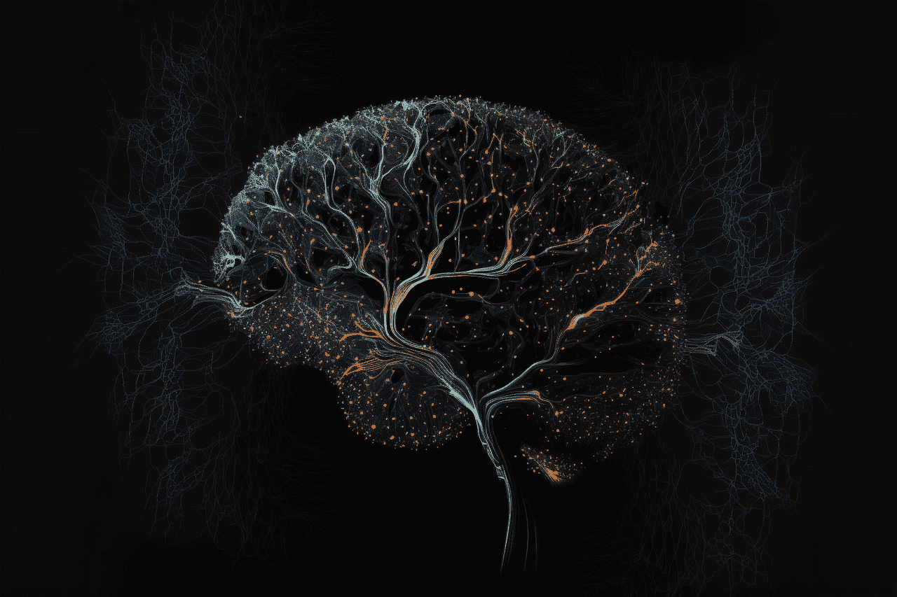
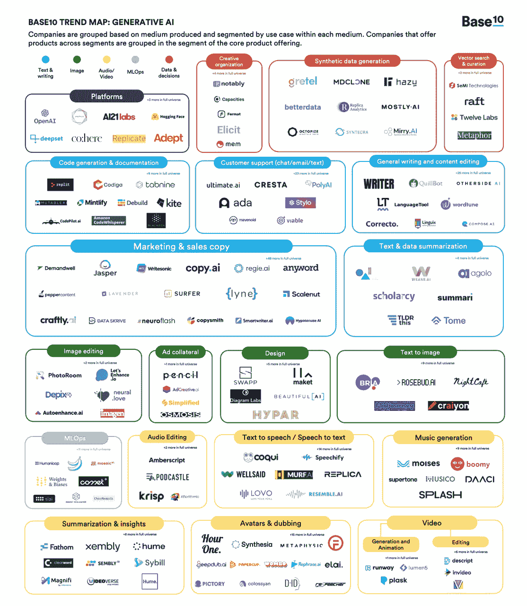

# AIGC Weekly #01

> 来源：[https://waytoagi.feishu.cn/docx/SqSHdg4QkoDuSFx9Hd9cYN8Cnod](https://waytoagi.feishu.cn/docx/SqSHdg4QkoDuSFx9Hd9cYN8Cnod)

> 🔗 原文链接： h[ttps://op7418.zhub](https://op7418.zhubai.love/posts/2211215703804801024)ai.love/posts/22...

> 发表时间：2022-12-04

题图使用Midjourney V4生成，提示词为：

Artificial intelligence, neural network algorithm,future, minimalist, abstract

> 由于是第一期内容我先简短的介绍一下这个周刊，主要的目的还是倒逼我自己对收集的相关信息进行整理，同时也希望降低一些对AIGC内容感兴趣的人收集和查阅相关信息的成本。

> 如无意外会在每周一更新，主要介绍上周AIGC领域发布的一些产品以及值得关注的研究成果，由于我自己是一个设计师，所以在一些专业内容的描述上可能存在问题，欢迎在渠道帮我反馈及更正。

# Chat GPT 发布

上周AIGC界最爆炸的内容莫过于Chat GPT的发布了，首先来介绍一下Chat GPT是什么？

简单来说Chat GPT是一个由 OpenAI 训练出来的大型语言模型。它的主要目标是帮助人们解答问题并提供信息。（这段解释是由Chat GPT自己生成的）

Open AI也写了一一篇文章来介绍这个对话模型。 https://openai.com/blog/chatgpt/

想要使用的话可以点这里。（需要注意的是如同Open AI的其他服务一样该服务不对中国用户提供） https://chat.openai.com/chat

在发布这短短五天时间里Chat GPT完全引爆了国内外互联网，大家纷纷发出了自己使用Chat GPT生成的有趣内容马斯克也感叹“ChatGPT is scary good. We are not far from dangerously strong AI.（ChatGPT 好得吓人。我们离危险的强大人工智能不远了。）”

这里我只展示几个我自己觉得比较有趣的内容。

[其](https://web.okjike.com/originalPost/638c6bb9c3f4e245defdec37)他案例国内的可以查看由即刻 Szhans 整理的这个列表： https://web.okjike.com/originalPost/638c6bb9c3f4e245defdec37

[国](https://twitter.com/sytelus/status/1598523136177508356)外的可以查看 Shital Shah 整理的这个推特列表： https://twitter.com/sytelus/status/1598523136177508356

## 🧑💻开发类型内容

+   在Chat GPT中运行一个虚拟机。 https://www.engraved.blog/

+   [让](https://twitter.com/Tisoga/status/1599347662888882177)Chat GPT帮忙实现一门新的编程语言。 https://twitter.com/Tisoga/status/1599347662888882177

+   帮助发下并更正代码中的问题。 [h](https://twitter.com/AlfredBaudisch/status/1598251795830444035)ttps://twitter.com/AlfredBaudisch/status/1598251795830444035

## ✍️写作内容

+   写一个AI征服世界的故事： [https://m.okjike.com/originalPosts/638ba92a51b5f49d9b7b7](https://m.okjike.com/originalPosts/638ba92a51b5f49d9b7b71ff?s=eyJ1IjoiNTllNTZkZWMzNTMzNWYwMDE1OGE3YTU3IiwiZCI6MX0%3D)1ff?s=eyJ1IjoiNTllNTZkZWMzNTMzNWYwMDE1OGE3YTU3IiwiZCI6MX0%3D

+   [以](https://twitter.com/SergioazuoS/status/1599118685574115328)老钱的语气编写英国脱欧的脱口秀脚本： https://twitter.com/SergioazuoS/status/1599118685574115328

+   写关于赛博格的诗歌： [https://m.okjike.com/originalPosts/638ab7f47db28a9a6545d](https://m.okjike.com/originalPosts/638ab7f47db28a9a6545da97?s=eyJ1IjoiNTllNTZkZWMzNTMzNWYwMDE1OGE3YTU3IiwiZCI6MX0%3D)a97?s=eyJ1IjoiNTllNTZkZWMzNTMzNWYwMDE1OGE3YTU3IiwiZCI6MX0%3D

+   [少](https://m.okjike.com/originalPosts/638abafa51b5f49d9b613971)楠用Chat GPT写的鸡汤文： https://m.okjike.com/originalPosts/638abafa51b5f49d9b613971

## 🛠辅助AI创作

+   [利用Chat GPT生成AI画图工具的提示词： https://m.okjike.com/origi](https://m.okjike.com/originalPosts/63884b5a2b8ce4dab2feccb6?s=ewoidSI6ICI1OWU1NmRlYzM1MzM1ZjAwMTU4YTdhNTciCn0=)nalPosts/63884b5a2b8ce4dab2feccb6?s=ewoidSI6ICI1OWU1NmRlYzM1MzM1ZjAwMTU4YTdhNTciCn0=

+   [让Chat GPT生成提示词的问题模板： https://tw](https://twitter.com/GuyP/status/1599104300801617922)itter.com/GuyP/status/1599104300801617922

+   [使用Chat GPT生成电影剧本，产出提示词生成电影分镜： h](https://twitter.com/GuyP/status/1598668947439685633)ttps://twitter.com/GuyP/status/1598668947439685633

某种意义上Chat GPT对一些工作中只会写向上管理的相关职能八股文的人可能是个毁灭性的打击，哈哈哈，核按钮现在大家都有了。

开个玩笑，目前来看对搜索引擎可能是个致命性的打击，我们可以获取更加精准和有针对性的搜索结果了

# 其他动态

+   Stable diffusion 2.0发布主要内容有：

+   新的text2image模型，与V1相比现在可以默认生成512 512和768 768的图像，同时增加了过滤器删除了成人内容。

+   增加了超分辨率扩散模型，这个模型可以将原始图像分辨率放大四倍，这使得2.0可以生成2048*2048分辨率的图像。

+   depth2img模型可以推断输入图像的深度人后用输入的文本信息生成相通深度的图像。

+   修复了1.0替换图像的某一部分时过度不够平滑的问题。

+   [h](https://stability.ai/blog/stable-diffusion-v2-release)ttps://stability.ai/blog/stable-diffusion-v2-release

+   MIdjourney V4也进行了更新：

+   支持了3：2和2：3比例的内容输出

+   将V4模型分成了4a和4b两个模型，4a更偏向于V4早期风格

+   -stylize参数可以让你改变的 "默认样式 "的强度。数字越小越精确

+   Craft也更新了AI生成内容的功能，试了[一](https://web.okjike.com/originalPost/6384acc29675467c8cb99d77)下可能没有经过调试，功能也比较原始： https://web.okjike.com/originalPost/6384acc29675467c8cb99d77

+   NeurIPS在上周召开，例如 AlexNet、Transformer 和 GPT-3等多个革命性AI技术都是在这个会议上发布的。

+   Applied AI 公司筹集了 4200 万美元的种子资金 (!!!!!!) - [它创](https://tech.eu/2022/11/25/reimagining-regulated-industries-the-applied-ai-company-raises-42-million)建的软件产品可以自动执行重复和数据丰富（即容易出现人为错误）的流程。来源： https://tech.eu/2022/11/25/reimagining-regulated-industries-the-applied-ai-company-raises-42-million

+   [replicate上可以使用SD V2创建图像了。来源](https://replicate.com/cjwbw/stable-diffusion-v2)： https://replicate.com/cjwbw/stable-diffusion-v2

+   NVIDIA 发布 Magic3D：根据文本提示创建高质量的 3D 纹理网格模型，还可以使用文本生成3D模型。来源： https://t.co/bxsIImhJFt

+   B[a](https://base10.vc/post/generative-ai-mission-critical/)se10 VC发布了一张"Generative AI”市场地图。不过内容全是国外的机构，期待有人可以制作一个国内版本。来源： https://base10.vc/post/generative-ai-mission-critical/

# 产品推荐

+   S[c](https://twitter.com/alexandr_wang/status/1590781380644204545)ale AI 发布 Scale Forge：视觉 AI 创意套件。非常简单的从普通手机照片生成专业广告或产品演示。来源： https://twitter.com/alexandr_wang/status/1590781380644204545

+   使用AI生成人类全身照片。来源： https://generated.photos/humans

+   使用AI绘制你的头像。来源： https://amazing.photos/

+   使用AI将播客变成短视频。来源： https://www.audiolabs.io/

+   [Stable Diffusion v 2.0 web U](https://github.com/qunash/stable-diffusion-2-gui)I 来源： https://github.com/qunash/stable-diffusion-2-gui

+   使用AI创建网站和app使用的插画。来源： https://www.pictorial.ai/

+   使用AI总结和归纳你的学习内容。来源： https://glasp.co/ai-summary

+   [Go](https://www.theverge.com/2022/11/28/23481967/google-partners-icad-med-tech-ai-breast-cancer-screening)ogle 与一家医疗技术公司合作 开发人工智能乳腺癌筛查 工具。 https://www.theverge.com/2022/11/28/23481967/google-partners-icad-med-tech-ai-breast-cancer-screening

+   • [ChatG](https://link.mail.beehiiv.com/ss/c/yrHbMDIcTiiEgUzBYIuoqWjNFr7MmUvFWOdMlQNw9aPoq-fwDGbDvmVKO4dkqNR_i_mMB4OiousKUlWZvS1cOQ/3rn/Zcs5snpjTiOd_ooQbFMF3Q/h11/o35CjSdRqXC92EbrnUWChG4XpAU2jl2CHwHW2TEfG0U)PT Assistant 是一个功能强大的扩展程序，可增强在 ChatGPT 网站上的浏览体验，具有 页面获取等 功能。并且此工具的代码是由 ChatGPT 编写的： https://link.mail.beehiiv.com/ss/c/yrHbMDIcTiiEgUzBYIuoqWjNFr7MmUvFWOdMlQNw9aPoq-fwDGbDvmVKO4dkqNR_i_mMB4OiousKUlWZvS1cOQ/3rn/Zcs5snpjTiOd_ooQbFMF3Q/h11/o35CjSdRqXC92EbrnUWChG4XpAU2jl2CHwHW2TEfG0U

# 文章推荐

+   [对](https://jalammar.github.io/illustrated-stable-diffusion/) Stable Diffusion 工作原理 的介绍。来源： https://jalammar.github.io/illustrated-stable-diffusion/

+   [E](https://twitter.com/EMostaque/status/1595731398450634755)mad写的关于 SD V2模型的一些笔记 。来源： https://twitter.com/EMostaque/status/1595731398450634755

+   Hugging Face Inference Endpoints 指南， 介绍如[何](https://www.philschmid.de/stable-diffusion-inference-endpoints)部署 Stable Diffusion 以针对给定的输入提示生成图像。来源： https://www.philschmid.de/stable-diffusion-inference-endpoints

+   GPT-4 预测 TLDR：Paras 认为 GPT-4 将能够结合语言模型和代码，这可[能](https://twitter.com/paraschopra/status/1596762675710918656)意味着它将能够通过生成代码并执行代码来获得所需的答案。时间会证明一切！来源： https://twitter.com/paraschopra/status/1596762675710918656

+   A[I 时代工作的未来。 这是一本很棒的读物，讲述了未来的新工作流程：人类](https://noahpinion.substack.com/p/generative-ai-autocomplete-for-everything)提出创造性提示，使用 AI 完成大量工作，然后人类调整和完善输出。 https://noahpinion.substack.com/p/generative-ai-autocomplete-for-everything