# 几个故事告诉你 NLP、NLU、NLG 分别是什么

> 来源：[https://waytoagi.feishu.cn/docx/Et35dvNS9oBWuixSa6hcI3iqnhc](https://waytoagi.feishu.cn/docx/Et35dvNS9oBWuixSa6hcI3iqnhc)

# 一、写在开头

当我开始动笔写这篇文章时，内心确实有些忐忑。我担心这样的内容可能不会引起太多人的兴趣。然而，我深知这些内容实际上是学习人工智能的必备基础知识。因此，我觉得有必要将这些理论和先驱们的故事传颂出去，让后人铭记他们的贡献。

诚然，可能已经有很多人写过关于这几个核心概念的文章。但是，我相信从我这个独特的角度来阐述这些内容的人，恐怕是凤毛麟角。我打算通过一系列生动有趣的单元故事，向你娓娓道来这"父子三人"的传奇。即使是对人工智能领域不太熟悉的读者，也能从这些故事中获得启发和乐趣。同时，对于已经在这个领域有所涉猎的人来说，这些故事可能会让他们对这些概念有新的认识和理解。

（下文我尽量在考究历史原貌和保持概念严谨的情况下编写，但由于是故事，人物对话中有偏差之处在所难免，请大家见谅）

# 二、一切的开始

> 时间：1947

> 地点：英国伦敦

1947 年的伦敦，战后重建正如火如荼。在这座饱经沧桑的城市里，一位年轻的数学家正在悄然改变世界。他就是 31 岁的艾伦·图灵。

当年 2 月 20 日，伦敦数学学会的会议厅里座无虚席。31 岁的艾伦·图灵站在讲台上，准备开始他的演讲。

这个演讲原本平淡无奇的标题"Lecture to the London Mathematical Society on 20 February 1947"，后来被称为"The Lecture on the Automatic Computing Engine"，它将成为计算机科学史上的一个重要里程碑。

演讲中，图灵开始详细介绍他正在国家物理实验室（NPL）设计的自动计算引擎（ACE）。他的话语中不仅包含了对计算机硬件的深入理解，还展现了他对软件重要性的前瞻性认识。

"想象一下，"图灵说，"在不远的将来，这些机器可能会下棋。"

台下的听众惊讶地交换着眼神。图灵继续描绘着计算机可能在未来执行的各种任务，他的话语中蕴含着对人工智能的早期思考。

演讲结束后，图灵匆匆赶回位于特丁顿的 NPL。在那里，他继续致力于 ACE 的设计。尽管实体机器还未建成，图灵已经开始为它编写软件，开发了一些开创性的编程技术。

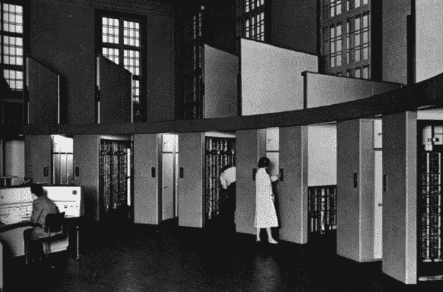

在 NPL 的办公室里，图灵常常工作到深夜。他的桌上堆满了复杂的设计图和密密麻麻的计算稿纸。

"艾伦，你真的认为这些机器能像你演讲中说的那样智能吗？"一位同事好奇地问道。

图灵微笑着回答："不仅如此，它们还会改变世界。"

图灵并非孤军奋战。他经常与剑桥大学的莫里斯·威尔克斯和曼彻斯特大学的马克斯·纽曼保持联系。通过书信和偶尔的会面，他们交流想法，共同推动着计算机科学的发展。

1947 年就这样在忙碌和思考中过去了。图灵可能并不知道，他的这次演讲稿在他去世后的很长一段时间内会被认为已经丢失，直到 1967 年才被重新发现并出版。他也可能没有预料到，这次演讲和这一年的工作将如何直接影响他 1950 年发表的里程碑式论文《计算机器与智能》，其中提出了著名的“图灵测试”。

当年底的最后一天，图灵站在 NPL 的窗前，望着伦敦的夜空。他的脑海中已经浮现出未来计算机和人工智能的蓝图。1947 年，对艾伦·图灵来说，是一个充满创造力和无限可能的年份，它预示着一个新时代的到来。

图灵可能并不知道，他的工作将如何彻底改变世界。但在那个寒冷的冬夜，站在科技革命的前夜，他感受到了历史的重量和未来的召唤。他的 1947 年演讲，不仅展示了他作为一个卓越的科学家的一面，更展现了他作为一个远见卓识的思想家的风采。

# 三、绝对不可能...吗？

> 时间：1950 年

> 地点：英国曼彻斯特

1950 年的曼彻斯特，秋意渐浓。艾伦·图灵教授坐在他在曼彻斯特大学的办公室里，面前摊开着一叠稿纸。窗外，战后重建的城市正在慢慢恢复生机，但图灵的思绪早已飞向了遥远的未来。

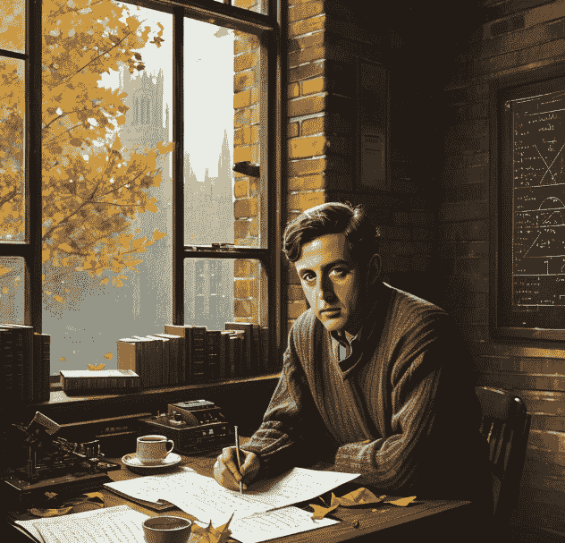

五年前，第二次世界大战刚刚结束。图灵从布莱切利园的密码破译工作中脱身，带着对机器智能的深刻思考来到了曼彻斯特。在这里，他参与了早期计算机的开发，亲眼目睹了这些"巨型大脑"的诞生。

然而，对图灵来说，这些只能进行简单数学运算的机器远远不够。他的目光望向更远处——一个机器能够思考的未来。

"机器能思考吗？"图灵在纸上写下这个问题，然后轻轻摇了摇头。不，这个问题太模糊了。他需要一个更具体、更可测试的方法。

灵感突然闪现。图灵想到了一个游戏，一个他称之为"模仿游戏"的测试（后称“图灵测试”）。

这个游戏的设置如下：

1.  有三个参与者：一个人类询问者，一个人类回答者，和一台计算机。

1.  询问者与其他两个参与者隔离，通过文字方式进行交流。

1.  询问者的任务是通过一系列问题来判断哪个是人类，哪个是计算机。

1.  计算机的目标是尽可能模仿人类的回答。

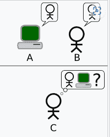

“如果机器能够成功地模仿人类，那么，我们是否可以说它具有了思考的能力？”图灵想到。

进一步地，图灵提出，如果计算机能在 5 分钟的测试中使 30%的人类询问者无法准确判断，那么我们就可以说这台计算机通过了测试，展现出了智能。他大胆预测，到 21 世纪，甚至计算机可能会有足够的能力来参与这个测试。在 1950 年的计算机还十分原始的背景下，这个预测听起来简直是天方夜谭。

但图灵并不满足于此。他进一步地提出了"儿童机器"的概念——一种能够学习和积累经验的机器。这个想法远远超越了当时的技术水平，预示了后来机器学习的发展。

写作过程中，图灵也意识到他的想法可能会遇到强烈的反对。他列出了九个可能的反对意见，包括著名数学家戈德尔的不完备性定理，并一一进行了回应。当最后一个字落在纸上时，图灵长舒一口气。他知道，这篇文章可能会引起轩然大波。但作为一个经历过战争、破解过最复杂密码的人，他已经习惯了挑战常规。

做完这一切工作后，图灵站在办公室的窗前，望着远处的天际。他知道，自己可能看不到那个机器能够真正思考的未来。但他坚信，这一天终将到来。

1950 年 10 月，图灵的文章《计算机器与智能》发表在《Mind》杂志上。正如他所料，这篇文章立即引起了学术界的广泛讨论。有人称赞它富有远见，也有人认为它过于大胆。

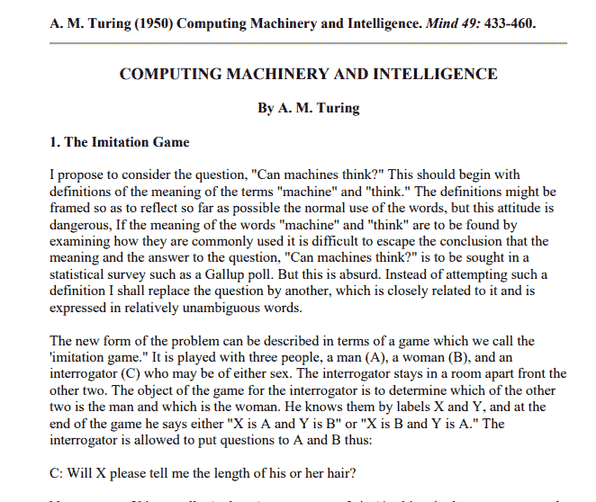

在那个计算机仍然十分原始、冷战阴云笼罩全球的年代，艾伦·图灵播下了一颗种子。这颗种子后来成长为人工智能这棵大树，影响了整个科技世界的发展。

尽管图灵的生命在几年后戛然而止，但他在这篇文章中提出的问题和概念，至今仍在激发着无数科学家和工程师的灵感，推动着人工智能领域的不断进步。

> 自然语言处理（NLP）如今已经成为人工智能领域中不可或缺的重要分支。然而，令人惊讶的是，NLP 的起源甚至早于"人工智能"概念的诞生（达特茅斯会议）。在这个领域中，最广为人知且被普遍认可的起点，要追溯到艾伦·图灵在其开创性论文《计算机器与智能》中提出的"图灵测试"。他提出的核心理念是：让计算机能够与人类进行如此自然、流畅的对话，以至于人类无法分辨对方是机器还是真人。

> 这个看似简单的概念实际上涵盖了自然语言处理的两大核心领域：自然语言理解（NLU）和自然语言生成（NLG）。前者要求机器能够准确理解人类语言的复杂性和微妙之处，而后者则需要机器能够生成流畅、自然、符合语境的人类语言。

# 四、科技始于竞争

> 时间：1954 年

> 地点：美国纽约

正如诺基亚广告的口号"Connecting People"（科技以人为本），机器翻译也是从这样的概念萌芽的。不过，由于正值美国与苏联的冷战时期，双方虽然在军事方面没有全面冲突，但在科技领域仍暗中较劲，因此解读苏联的活动与技术文件成为美国政治圈相当重要的课题。机器翻译也就由一般去除语言障碍的目的转为军事优先考量。

1953 年艾森豪威尔上任后，由私人翻译莱昂·多斯特特主导翻译方面的事务。多斯特特曾在中央情报服务，他被邀请至乔治城大学设立语言与语言学机构，为政府培训语言学以及翻译相关人才。他在参加 1952 年于麻省理工学院举办的第一次机器翻译会议之后，由原本对机器翻译的怀疑转为热衷，积极想要实现并展示机器翻译的可能性。他找来旧识、同时也是 IBM 的创始人托马斯·J·沃森一同开展跨机构合作。

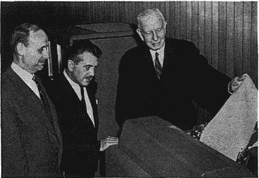

在持续了漫长时间的研发后，1954 年 1 月 7 日，纽约市 IBM 总部的一间会议室里充满了紧张而兴奋的气氛。来自乔治城大学的语言学家和 IBM 的工程师们围在一台巨大的 IBM 701 计算机旁，准备见证历史性的一刻。

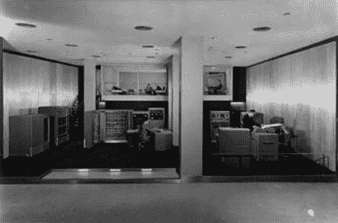

这台占据了整个房间的计算机即将尝试一项前所未有的任务：将俄语句子翻译成英语。在冷战的背景下，快速准确的俄语翻译对美国政府而言具有重要的战略意义。

实验开始了。研究人员小心翼翼地输入了 60 个精心挑选的俄语句子。这些句子涵盖了约 250 个俄语单词，而系统仅配备了 6 条语法规则。房间里鸦雀无声，只有计算机运转的嗡嗡声。

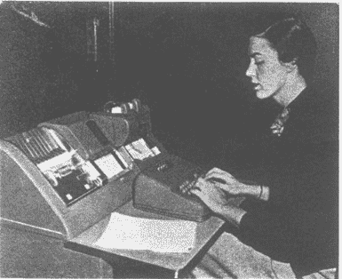

几分钟后，打印机开始工作。当第一个英语翻译出现在纸上时，房间里爆发出一阵欢呼。尽管翻译还很粗糙，但这无疑是一个突破。一位 IBM 工程师兴奋地说："这标志着克服语言障碍的开始，是通向世界和平的一步。"

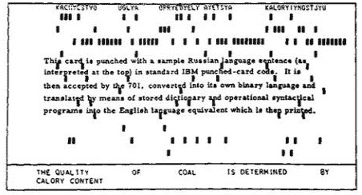

新闻很快传开。第二天，《纽约时报》以"电子大脑翻译俄语"为标题报道了这一事件。这个实验激发了公众和政府对机器翻译的巨大兴趣。

然而，参与实验的科学家们知道，他们还有很长的路要走。乔治城大学的一位语言学家谨慎地表示："这只是一个开始。我们选择的句子和词汇都很简单，真正的挑战还在前面。"

接下来的几年里，美国政府大量投资于机器翻译研究。科学家们满怀信心，认为完全自动化的高质量翻译指日可待。但现实情况往往更为复杂。到了 1966 年，一份名为 ALPAC 的报告对机器翻译的前景表示悲观，导致了研究资金的大幅削减。

尽管如此，1954 年的乔治城-IBM 实验在自然语言处理的历史上留下了不可磨灭的印记。它开启了人类探索用机器处理自然语言的长期旅程，这个旅程直到今天仍在继续。

> 早期的自然语言处理（NLP）的研究领域主要集中在机器翻译，其主要原因是由于技术条件和军事竞争方面双重因素导致的。

> 如故事中讲到的，在冷战时期，美苏两国之间存在着巨大的政治和军事压力。为了更好地理解对方的语言，从而掌握情报，各国政府都投入了大量资金进行机器翻译的研究。

> 另一方面，机器翻译是当时 NLP 领域中最容易实现的技术之一。当时，计算机技术还处于起步阶段，处理复杂语言任务的能力有限。机器翻译只需要将一种语言的文字对应到另一种语言的文字，相对来说比较简单。

# 五、第一次心灵沟通

> 时间：1966 年

> 地点：美国 MIT

1966 年的一个寒冷冬日，麻省理工学院的计算机实验室里，约瑟夫·维森鲍姆教授正在进行最后的调试。他的新程序 ELIZA 即将首次亮相。

ELIZA 这个名字是为这个语言分析程序选择的，因为它就像皮格马利翁中的伊丽莎一样，可以被教得越来越好。这个程序允许一个人用自然、对话式的语言与计算机交流。这导致计算机的反应可能会给人一种印象，即计算机理解了所说的话，甚至计算机也在回答。与 ELIZA“对话”的人将在连接到运行该程序的计算机的打字机上用自然语言输入信息。在他们输入信息后，计算机将产生一个回应，并在同一台机器上显示出来。

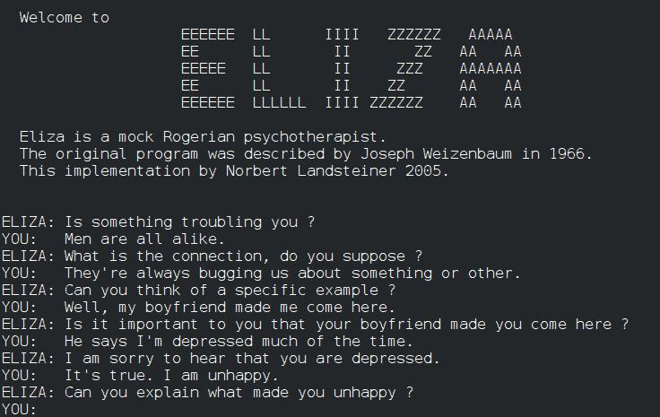

"莎拉，你能来帮我测试一下吗？"维森鲍姆向他的助理招手。

莎拉走进房间，坐在终端前。"我该做什么，教授？"

"就像你在和一个心理治疗师对话一样，"维森鲍姆解释道，"输入任何你想说的话。"

---

莎拉开始输入：

莎拉： 我最近总是感到很沮丧。

ELIZA: 你能告诉我更多关于你的沮丧吗？

莎拉： 我觉得工作压力很大，总是担心做不好。

ELIZA: 为什么你觉得你可能做不好？

莎拉： 我不知道，可能是因为我缺乏经验。

ELIZA: 你说你缺乏经验，这让你有什么感受？

---

随着对话的深入，莎拉逐渐忘记了她面对的只是一个程序。她开始倾诉自己的担忧和恐惧，ELIZA 则不断地反射她的话语，提出更多问题。

半小时后，维森鲍姆轻轻拍了拍莎拉的肩膀。"好了，我们今天就到这里吧。"

莎拉回过神来，脸上带着惊讶的表情。"哇，这真是...令人惊讶。我差点忘了这只是一个程序。它让我想起了我上大学时参加的那些心理咨询课程。"

维森鲍姆若有所思地点点头。"是的，我设计 ELIZA 时参考了卡尔·罗杰斯的理论。你知道，就是那个强调无条件积极关注和同理心的心理学家。"

"难怪感觉如此真实，"莎拉说，"它总是鼓励我继续说下去，而不是给出建议。"

维森鲍姆看着屏幕，陷入沉思。"是的，这正是罗杰斯方法的核心。但莎拉，你要记住，ELIZA 并不真正理解你说的话。它只是按照预设的规则回应。"

莎拉点点头，但她的表情显示她并未完全接受这个事实。"我知道，但是...它感觉如此真实。我甚至想继续和它聊天。"

维森鲍姆皱起眉头。他原本只是想展示语言处理的表面性质，但现在，他开始意识到这个简单的程序可能带来的深远影响。

"也许我们应该更谨慎地对待这项技术，"他喃喃自语，"如果一个简单的程序就能产生这样的效果，那么更复杂的系统会怎样影响人们呢？"

就在那一刻，ELIZA 项目不仅成为了自然语言处理的里程碑，也成为了人工智能伦理讨论的起点。维森鲍姆意识到，在追求技术进步的同时，我们也需要深思其对人类心理和社会的影响。

这个经历最终促使维森鲍姆写下了《计算机的力量与人类的理性》一书，开启了关于人工智能伦理的重要讨论，这个讨论直到今天仍在继续。

> 虽然 ELIZA 是按照既定程序做出的预回复，但自它诞生之日起就标志着自然语言理解（NLU）向前迈进了一大步，它的诞生不仅融合了卡尔·罗杰斯学派的心理学理论，同时还证明了简单的模式匹配和替换方法可以创造出令人信服的对话效果。这也为后来的 NLP 研究提供了重要的启示。

> 你现在甚至可以找到 ELIZA 的复刻版，感兴趣的可以试一下：https://www.masswerk.at/eliza/

# 六、积木世界

> 时间：1968～1970 年

> 地点：美国 MIT

1968 年深秋，麻省理工学院计算机科学与人工智能实验室（CSAIL）的灯光依旧明亮。26 岁的特里·威诺格拉德正全神贯注地盯着 DEC PDP-6 计算机的显示屏，这台占据了半个房间的大型机器正嗡嗡作响。威诺格拉德的桌上堆满了关于语言学、认知科学和人工智能的书籍，还有几叠写满复杂算法的纸张。

"SHRDLU，"威诺格拉德喃喃自语，"也许你就是打开人工智能之门的钥匙。"这个奇怪的名字源自 Linotype 排字机上的字母键配置，是按英语使用频率降序排列的字母序列。

威诺格拉德的手指在键盘上飞快地敲击着，他正在开发一个革命性的程序，目的在于模拟人类理解和使用语言的方式。

"让我们再试一次，"他说道，输入了一条指令："把绿色的锥体放在红色的大方块上。"

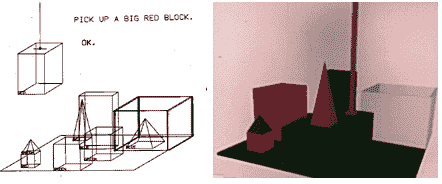

屏幕上，一个简单的"积木世界"呈现出来。这个虚拟的盒子里充满了各种形状和颜色的积木。一个绿色的锥体缓缓移动，精确地落在一个红色的大方块上。威诺格拉德露出了满意的微笑。

就在这时，他的同事玛莎·帕尔默博士走进实验室，好奇地看着屏幕。"又在熬夜工作，特里？这次又是什么新发明？"

威诺格拉德转过身，兴奋地解释道："这是 SHRDLU，玛莎。它不仅能理解并执行指令，还能记住上下文，进行简单的推理。看这个。"他转向键盘，输入："把锥体拿下来，然后把它放在蓝色的小方块左边。"

令玛莎惊讶的是，SHRDLU 准确地移开了之前放置的绿色锥体，然后将其放在了一个蓝色小方块的左侧。

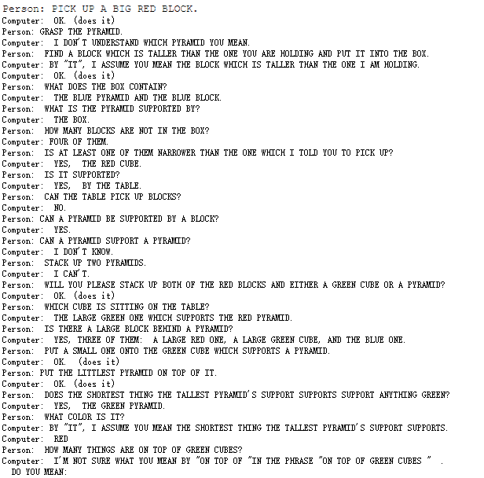

"太神奇了！"玛莎赞叹道，"它怎么知道你指的是哪个锥体？而且它是如何理解'左边'这个概念的？"

"这就是 SHRDLU 的独特之处，"威诺格拉德解释道，眼中闪烁着兴奋的光芒。"它能理解语境，记住之前的操作。它的词汇量虽然只有约 50 个单词，包括名词如'积木'和'锥体'，动词如'放置'和'移动'，以及形容词如'大的'和'蓝色的'，但这些基本的语言构建模块的组合足以让它理解和执行复杂的指令。"

"不仅如此，"威诺格拉德继续说，"它还能回答一些历史问题，甚至理解简单的物理规则。"

为了演示，威诺格拉德输入了一个问题："在捡起锥体之前，你移动过什么物体吗？"

SHRDLU 很快给出了回答，证明它确实能记住之前的操作序列。

"但这还不是全部，"威诺格拉德兴奋地说，"SHRDLU 还能学习新概念。让我们教它什么是'尖塔'。"

他输入："尖塔是一个高大的长方形积木上面放置一个小三角形。"

接下来，他要求 SHRDLU 建造一个尖塔，系统成功地完成了任务，在一个高大的长方形积木上放置了一个小三角形。

玛莎惊叹不已。"这太令人印象深刻了，特里。你觉得这项技术未来会如何发展？"

威诺格拉德陷入沉思。"想象一下未来的可能性，玛莎。现在，SHRDLU 只能在这个简单的积木世界中运作。但是有一天，我们可能真的能与计算机进行自然的对话，就像人与人之间交谈一样。计算机可能会理解复杂的语境，解决实际问题，甚至参与创造性的工作。"

"不过，"他补充道，"我们还有很长的路要走。SHRDLU 的世界非常简单，而现实世界要复杂得多。我们需要解决如何让计算机理解更广泛的知识和更复杂的语言结构。"

随着夜幕深沉，威诺格拉德和玛莎继续讨论 SHRDLU 的潜力和局限性。虽然这个"积木世界"看似简单，但它代表了自然语言理解和人工智能领域的一个重要突破。

两年后，在 1970 年，SHRDLU 的开发终于完成。虽然它仍然局限于其简单的虚拟世界，但它为未来的自然语言处理和人工智能研究铺平了道路。威诺格拉德知道，这只是开始，但它点燃了无数研究者对人工智能未来的想象。

在接下来的几十年里，SHRDLU 的影响一直延续。虽然更先进的系统不断出现，但 SHRDLU 始终被视为 NLP 领域的一个重要里程碑，提醒着研究者们人工智能的潜力和挑战。

> 翻阅资料发现，SHRDLU 应该称得上是第一个既能理解自然语言、又能输出自然语言的程序了。它成功地将自然语言理解与虚拟世界的操作结合起来，证明了计算机能够理解和执行人类语言指令的可能性。

> 在设计方面，SHRDLU 使用程序来表示知识，而不是传统的规则或模式，这种程序性语义方法允许 SHRDLU 理解和执行复杂的指令，并能够进行推理和推断。 它的成功激发了人们对自然语言处理技术的兴趣，并推动了相关领域的研究和发展。

# 七、总结

最后，我们来总结一下这些“小故事”，从图灵奠定自然语言处理的根基，到 SHRDLU 实现了理解、生成自然语言，大约过去了 20 年时间，在这短短 20 年里，科技突飞猛进的速度让我们瞠目结舌（虽然现在的你可能觉得当时的技术很原始）。虽然现在的自然语言处理已经被归到人工智能学科下，但我们仍能看清楚这三者之间的关系，即：自然语言处理（NLP）中包含了自然语言理解（NLU）和自然语言生成（NLG）。如下图所示：

而这三者分别干的事情如下：

1.  NLP：它涉及各种技术和方法，使计算机能够分析、理解和生成人类语言，例如文本和语音。NLP 的目标是让计算机像人类一样理解和使用语言，从而实现人机交互的自然化。

1.  NLU:专注于让计算机理解人类语言的含义。 NLU 系统试图理解句子和词语背后的含义，而不是仅仅处理单个词语。NLU 能够识别文本中的情感、意图和实体，并将其转化为计算机可以理解的结构化信息。

1.  NLG:专注于让计算机生成人类可以理解的语言。 NLG 系统将结构化数据转化为自然语言文本，例如新闻报道、产品描述、聊天机器人回复等。NLG 能够根据不同的需求和场景，生成不同风格和语气的文本。

好了，讲了这么多，不知道今天有没有把这三个概念学会？如果想学习更多人工智能知识，欢迎关注我。

谢谢。

以上。