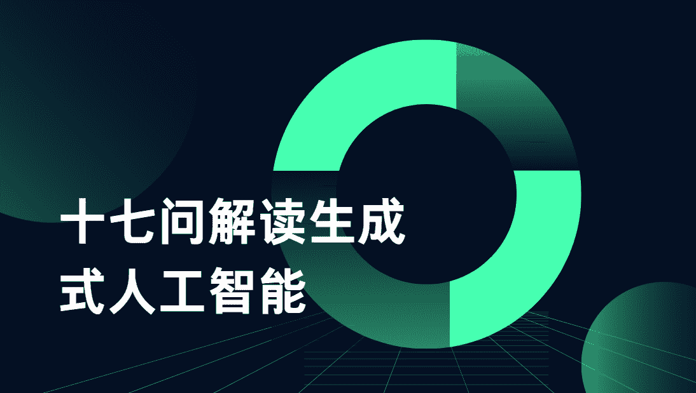
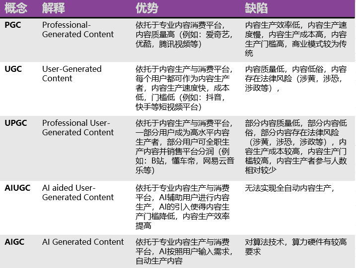
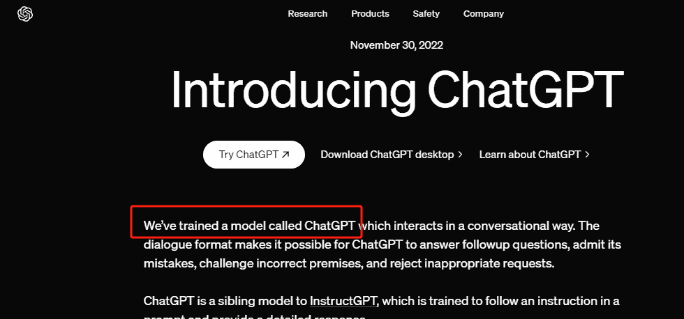
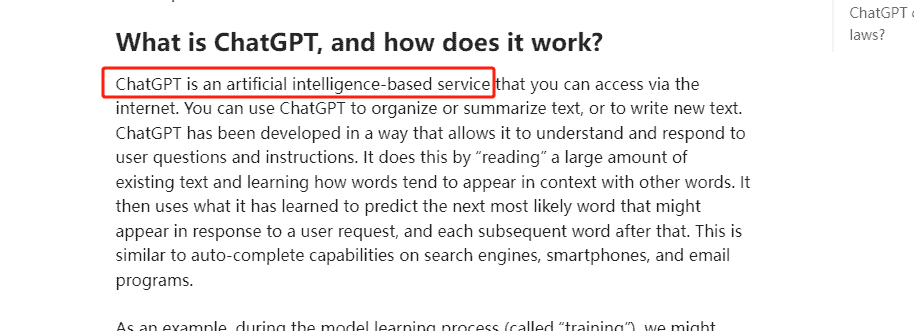
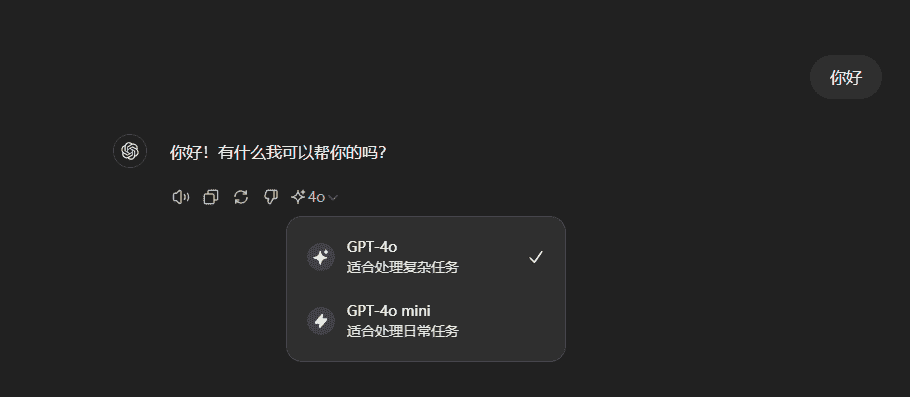
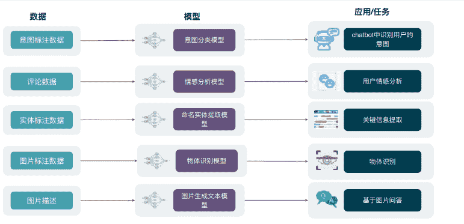
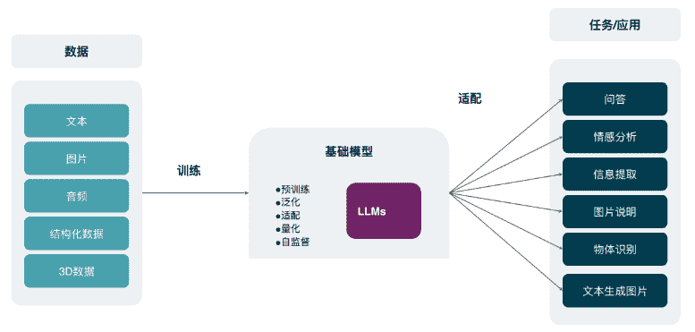

# 十七问解读生成式人工智能

> 来源：[https://waytoagi.feishu.cn/docx/YuDhd4vTxoLIYpx5Hjdc8yhNntc](https://waytoagi.feishu.cn/docx/YuDhd4vTxoLIYpx5Hjdc8yhNntc)

"大家好！这篇文章收集了社区小伙伴们向我提出的日常问题以及我的一些答复，算是一个全面的汇总。鉴于文章的科普性质和广泛的受众，我将通过问答的形式，尽量使用浅显易懂的语言来介绍一些基本概念，希望大家能有所收获。"

# **问题一、**AIGC 是什么？

> AIGC（人工智能生成内容）是一种利用人工智能技术生成各种类型内容的应用方式。这种技术能够通过机器学习和深度学习算法，根据输入的数据和指令生成符合特定要求的内容。AIGC 在内容创作、广告、媒体等领域有着广泛的应用。

1.  **文字生成**：使用大型语言模型（如 GPT 系列模型）生成文章、故事、对话等内容。

1.  **图像生成**：使用 Stable Diffusion、DALL-E 等模型生成艺术作品、照片等。

1.  **视频生成**：使用 Runway、KLING 等模型生成动画、短视频等。

# **问题二、**AIGC、UGC、PGC 的关系是什么？

> AIGC、UGC 和 PGC 都是内容生成的不同方式，这三种内容生成方式的主要区别在于内容的创作者和生成方式。

1.  AIGC（AI-Generated Content）：由人工智能生成的内容。AI 通过学习大量的数据，能够自动生成文本、图像、视频等内容。AIGC 的优势在于可以快速、大规模地生成内容，适用于需要大量内容的场景，如自动化新闻、广告创作等。

1.  UGC（User-Generated Content）：由用户生成的内容。用户通过社交媒体、博客、论坛等平台发布自己的内容，如文章、评论、照片、视频等。UGC 的优势在于内容丰富多样，能够反映用户的真实想法和创意，适用于社交媒体、社区论坛等互动性强的平台。

1.  **PGC（Professionall**y-Generated Content）：由专业人士或机构生成的内容。专业团队或机构根据特定的标准和流程创作高质量的内容，如新闻报道、影视作品、专业文章等。PGC 的优势在于内容质量高、专业性强，适用于新闻媒体、专业网站等需要高质量内容的平台。

# 问题三、 Gen AI/Generative AI 是什么？它和 AIGC 有什么异同？

> Gen AI/Generative AI 是“生成式人工智能”正式称呼。Generative AI 是一种能够生成新内容的人工智能技术，比如文本、图像、音乐等。而 AIGC 指的是由人工智能生成的内容的创作方式，实际上是 Generative AI 的应用结果。

# 问题四、ChatGPT 是什么？

从 OpenAI 的官网中可以查询到，在 2022 年宣发时，OpenAI 称 ChatGPT 是一种模型。

但是同样是在官网中查询帮助页面，发现这里称 ChatGPT 是一种服务。

而我们使用的 ChatGPT 目前是依赖 GPT 系列模型来运转的。

> 不做任何怀疑论上的揣摩，从公开收集的资料中可以看出，早些年 OpenAI 推出了一个叫 ChatGPT 的模型，但目前我们所熟知的 ChatGPT 逐渐演变成了一种可以兼容多种 GPT 模型的聊天应用（服务）。

# 问题五、 GPT 是什么？

> G**P**T 是“生成式预训练变换器”（Generative Pre-trained Transformer）的缩写，是一种大型语言模型（LLM），也是生成式人工智能的重要框架。首个 GPT 由 OpenAI 于 2018 年推出。GPT 模型是基于 Transformer 模型的人工神经网络，在大型未标记文本数据集上进行预训练，并能够生成类似于人类自然语言的文本。截至 2023 年，大多数 LLM 都具备这些特征，并广泛被称为 GPT。

> 而所谓的生成式预训练，其实是机器学习领域一个由来已久的概念。但是，直到 2017 年 Google 推出了 Transformer 模型，我们才见到了如 BERT（2018 年发布）和 XLNet（2019 年发布）这样的大型语言模型的诞生。这些模型都是基于预训练的转换器，但它们并不是为生成文本而设计，而是作为“仅编码器”使用。2018 年，OpenAI 发表了一篇名为《通过生成式预训练提高语言理解能力》的文章，首次介绍了基于转换器的生成式预训练模型（GPT）系统，即我们所说的“GPT-1”。

# 问题六、 大模型是什么东西？

> 所谓的大模型，简而言之，就是那些拥有庞大参数数量的模型。它们通过处理和理解海量数据，能够胜任一系列复杂的任务。

> 那么，为何将这些模型称作“大”模型呢？原因在于它们的规模之大，通常包含从数十亿到数千亿的参数。这些庞大的参数集合赋予了模型强大的学习和记忆能力，使其在处理各种任务时表现出色。我们可以从两个方面来进一步解读大模型的特点：

1.  大模型之所以强大，一个重要原因在于它们庞大的参数数量。这些参数，或者说“权重”，是模型在学习过程中不断调整的核心，它们帮助模型更深入地理解和生成数据。

1.  大模型的训练离不开大量的数据。无论是文本、图像还是音频数据，都是大模型学习的基础。通过对这些数据的深入学习，模型能够掌握丰富的知识和技能。

# 问题七、大模型中包含几类模型？

> 大型模型主要分为两类：一是大型语言模型，专注于处理和生成文本信息；二是大型多模态模型，这类模型能够处理包括文本、图片、音频等多种类型的信息。

# 问题八、 大型多模态模型与大型语言模型有何不同？

1.  二者处理的信息类型不同。大型语言模型专注于处理和生成文本信息，通过分析大量的文本数据来理解和生成自然语言。而大型多模态模型不仅能处理文本信息，还能理解和生成图片、音频等多种类型的信息，这使得它们能够在更多样化的任务中应用。

1.  应用场景也有所不同。大型语言模型主要用于自然语言处理任务，如文本翻译、文本生成、情感分析等。而大型多模态模型由于能够处理多种信息类型，可以应用于更广泛的领域，例如图像识别与描述、视频分析、语音识别与生成等。

1.  在数据需求方面也有所不同。大型语言模型主要依赖于大量的文本数据进行训练，而大型多模态模型则需要多种类型的数据进行训练，包括文本、图片、音频等，以便在不同模态间建立关联。

# 问题九、 有了大模型，是不是还有小模型？

> 当我们谈论所谓的“小模型”时，实际上是在相对地比较。与那些拥有海量参数和训练数据的大型模型相比，这些模型的规模显得更小一些。因此，在日常交流中，我们习惯将它们称作“小模型”。但如果要更精确地描述，这些模型其实是被设计来完成特定任务的，比如最初用于图像分类的模型，只能分辨是或不是某一个东西（比如猫🐱、狗🐶）。

# 问题十、 那之前都有小模型了，我们要大模型有什么用？

> “小模型”确实有其优势，尤其是在特定任务上表现得非常出色。比如，如果你训练了一个专门识别猫🐱或狗🐶的模型，它在这个任务上可能非常精准。然而，这个模型就无法用于其他任务（因为用来训练模型的数据主要是由猫猫狗狗的照片组成的）。而“大模型”则不同，它像一个多功能的基础平台（有时也被称为“基座模型”）。大模型可以处理多种不同的任务，应用范围非常广泛，并且拥有更多的通识知识。这就是为什么尽管“小模型”在某些特定领域内表现优异，我们仍然需要“大模型”的原因：它们能够在更广泛的场景中提供支持和解决问题。

# 问题十一、 大模型拥有无限知识吗？

> 大模型并不拥有无限知识。大模型的知识来源于它们在训练过程中接触到的数据，而这些数据是有限的。虽然大模型可以处理和生成大量的信息，但它们的知识来自于它们所训练的数据集，这些数据集虽然庞大，但仍然是有限的。因此，大模型只能回答它们在训练过程中见过或类似的问题。大模型在训练之后，其知识库不会自动更新。也就是说，它们无法实时获取最新的信息，除非重新训练或通过其他方式更新模型。大模型在某些特定或专业领域的知识可能不够全面，因为这些领域的数据在训练集中可能较少。

# 问题十二、 大型语言模型的运作机制是什么？

> 大型语言模型的运作机制主要是通过大量的数据训练来学习语言的结构和模式，然后根据输入生成相应的文本。这些模型通过阅读大量的文本数据，学习到语言中的词汇、语法、句子结构以及上下文关系。当你给它一个输入时，它会根据这些学习到的知识生成一个连贯的回答。所以它永远在猜测下一个字符将要生成什么，类似于词语接龙游戏。

# 问题十三、 稳定扩散模型的运作机制是什么？

> 这种模型通过一个叫做“扩散过程”的方法，先把数据（比如图像）变得越来越随机（加噪声），然后再通过学习如何逆转这个过程，把随机数据变回有意义的数据（去噪）。这样，模型就能从随机噪声中生成新的、逼真的图像或其他数据。类似于在一幅图像上逐渐增加模糊，然后再逐渐恢复清晰。

> 扩散模型的概念来自于物理学中的扩散过程，最早在图像生成领域中应用。稳定扩散模型通过反复训练，学习如何在不同的噪声水平下恢复数据，从而能够生成非常逼真的图像。比如，OpenAI 的 DALL-E 和谷歌的 Imagen 都是基于这种技术，能够根据文本描述生成高质量的图像。通过这种逐步去噪的过程，模型能够生成多样化且细节丰富的内容。

# **问题十四、**提示词跟微调有什么关系？

> 提示词和微调都是用来提高模型表现的方法，但它们的方式不同。提示词是通过给模型提供特定的指令或上下文，来引导模型生成合适的回答。而微调是对模型进行进一步训练，使其在特定任务上表现得更好。

1.  **提示词**：直接在使用模型时提供，灵活方便，不需要重新训练模型。比如你问模型一个问题，它根据提示词生成回答。

1.  **微调**：需要对模型进行额外的训练，使用特定任务的数据来调整模型的参数，使其在该任务上表现更佳。微调后的模型在特定任务上会有更好的表现，但需要时间和计算资源。

# **问题十五、**提示词的本质是什么？

> 提示词的本质就是给模型提供指令或者上下文，让它知道该怎么回应。当你给模型一个提示词时，实际上是在给它提供一个方向或者背景信息，这样模型就能根据这些信息生成相应的回答。提示词可以是一个问题、一段话或者某种情景描述甚至是专业结构化提示词，模型会根据这些内容来理解你的意图，并生成合适的回应。

# **问题十六、 **大型语言模型这么厉害，为什么连小学数学题都能算错？

> 大型语言模型有时候会算错小学数学题，因为它们主要是基于语言理解和生成，而不是专门设计来进行数学计算的。语言模型是通过大量的文本数据进行训练的，这些数据主要是自然语言，而不是数学公式和计算。因此，语言模型在处理数学问题时，更多地依赖于模式识别和文本生成，而不是实际的数学计算。这就导致它们在处理一些简单的数学问题时，可能会出现错误。

# 问题十七、学了 AI 就能赚钱吗？

> 学了 AI 有可能赚钱，但不一定保证每个人都能赚到钱。人工智能领域确实有很多高薪工作，比如数据科学家、机器学习工程师等。学会了 AI 技术，可以在这些岗位上找到工作，获得不错的收入。此外，AI 技术在各行各业都有应用，比如金融、医疗、制造业等，掌握 AI 技能可以增加就业机会和职业发展的可能性。然而，是否能赚钱还取决于很多因素，比如个人的学习能力、实际应用能力、对市场和商业的理解等等。仅仅学会一些基础知识可能还不足以在竞争激烈的市场中脱颖而出，需要持续学习和实践。

**一人前行有时跑的很快，但一群人前行，会走的很远。欢**迎你加入我们的社区，共同学习，共同进步。

#