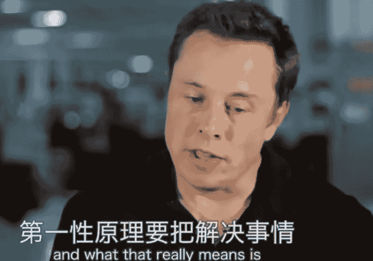
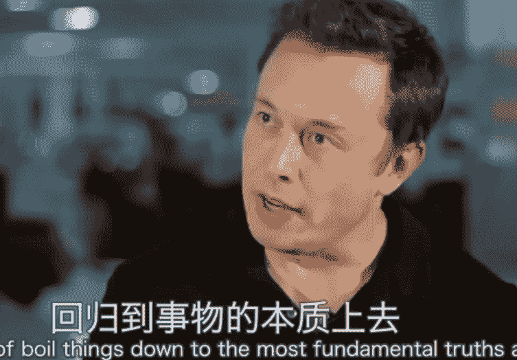
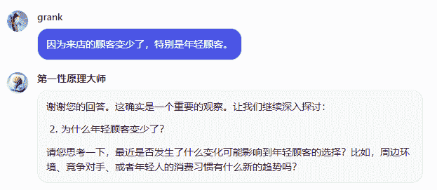
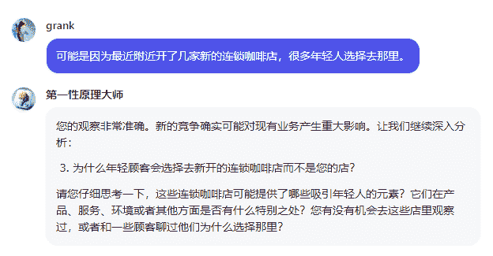
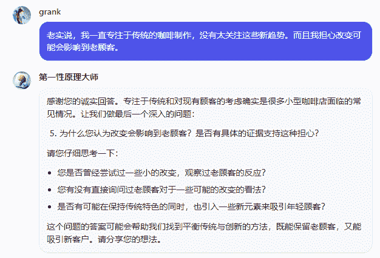
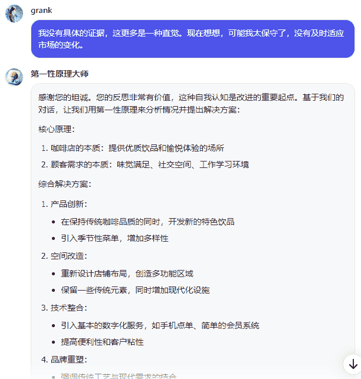
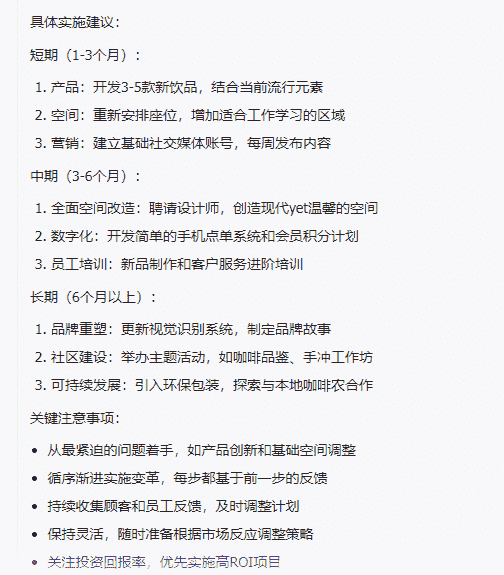

# 第一性原理 prompt：复活亚里士多德的古老智慧

> 来源：[https://waytoagi.feishu.cn/docx/OM89dWPiEo0SIFxLdr7cyjD1njb](https://waytoagi.feishu.cn/docx/OM89dWPiEo0SIFxLdr7cyjD1njb)

> “如果你在网上搜索的话，有很多人从商业、从政治、从军事等等角度解释过“第一性原理”，有些东西让人看得越来越迷糊。我不想去谈论这些被包装过的概念，我只想从根本上去和你探讨这其中的本质意义，这样你才真的能理解‘第一性原理‘。”

> “可能我只有在深夜才能仔细思考这些东西，我建议所有人读完它，相信你会大有收获。”

蓝衣剑客 2024 年 8 月 9 日夜

# 一、马斯克&亚里士多德——“第一性原理”

说起“第一性原理”大家可能会觉得陌生，但是说起马斯克，我想，混在科技圈里没有人不知道他的存在。（哦，我就是马斯克的粉丝）而让第一性原理又被大家所熟知的是他在早些年前的一段采访。

当时他的原话是这样的：

> "我认为人们的思维过程太受惯例或对先前经验的类比的约束。人们很少尝试在第一性原理的基础上思考问题。他们会说‘我们会这样做，因为它一直都是这样做的’，或者他们不会这样做，因为没有人这样做过，所以它一定不会好，但这只是一种可笑的思考方式。你必须从基础上建立推理，也就是"第一性原理"，你看一下基本原理，并从中构建你的推理，然后你看看你的结论是否可行或不可行，它可能会或可能不会与人们过去所做的不同"

其实，马斯克在采访中提到的“第一性原理”并不是他个人独创的，早在古希腊时期，这个哲学思想就被亚里士多德提出来了。他在著作《形而上学》中这样写到：“每个系统中都存在第一性原理，它的存在是最基本的命题和假设，不能被省略，也不能被违反。”

而后，特伦斯·欧文在他的著作《亚里士多德的第一原理》中写道：当亚里士多德在他的哲学著作中以一般性的方式解释他试图做什么时，他说他在寻找“第一原则”（或“起源”；archai)

**所以**，用一句很土很白的话来解释“第一性原理”就是：透过表象看本质。

那么“看本质”还有很多种方式，什么是本质？“第一性原理”就是本质吗？

# 二、归纳法、演绎法和第一性原理

要解决这个问题，我们需要从哲学的演进路线讲起。

## 2.1 归纳法

在古希腊时期，归纳法就已经被诸多哲学家所使用，它本质上是一种基于经验的推理方式。这种方法要求我们运用已有的知识和观察，通过系统性的分析和总结，形成新的认知结构，并将其内化为我们思维的一部分。归纳法的核心在于从特殊到一般，从个别现象推导出普遍规律。

但它的脆弱性在于，即使经过大量观察得出的结论，也可能被单一反例推翻。例如，在澳大利亚发现的黑天鹅就是一个著名的反例，它瞬间颠覆了"所有天鹅皆白"的普遍性结论。这一发现不仅挑战了特定的结论，更凸显了归纳推理在本质上的不确定性。

完整的例子是这样的：

> 当我们多次观察到所有遇到的天鹅都是白色的，我们可能会得出"所有天鹅皆为白色"的结论。但当你见到“黑天鹅”时，你瞬间就崩溃了。因为这超出了你的“经验之谈”。

这个过程展示了**归纳推理的典型特征：基于有限的观察样本，推导出看似普遍适用的结论。然而，这种基于经验的推**理也暴露了归纳法的局限性：它依赖于观察的范围和样本的代表性，而非逻辑上的必然性。

## 2.2 演绎法

**当归纳法的局限性浮出水面时，演绎法则为我们探寻真理开辟了另一条途径。演绎法是一种严谨而精密**的逻辑推理过程，由大前提、小前提和结论三个要素构筑而成，这便是著名的三段论结构。

让我们以古希腊哲学家亚里士多德对其恩师苏格拉底命运的思考为例，来阐释演绎法的精髓。亚里士多德的推理过程堪称演绎法的典范：

> 大前提：所有人类都终将面对死亡。

> 小前提：苏格拉底是人类的一员。

> 结论：因此，苏格拉底也无法逃脱死亡的命运。

演绎**法**的魅力在于，只要前提成立，其结论就具有逻辑上的必然性。这种必然性赋予了演绎推理极高的可靠度，使之成为科学研究、哲学探讨和日常推理中不可或缺的工具。然而，我们也需要认识到，演绎法的有效性高度依赖于前提的真实性。如果前提本身存在错误或偏差（使用归纳法产生了偏见），即便推理过程再严密，得出的结论也可能偏离事实。

比如，如果我们修改上述例子的大前提为"所有哲学家都长生不老"，那么即使推理过程依然严谨，得出的"苏格拉底长生不老"的结论显然与现实不符。

## 2.3 第一性原理

在这种情况下，**亚里**士多德给出的解决办法是：我们不可能这样无限重复的推导下去，而是要有一个前提，即不是从更早的三段论推导出来，但它是一个无需证明且必然为真的元起点。那么这个元起点就叫“第一性原理”。

第一性原理是要在特定领域中最基本、不可再简化的命题或假设。它要求我们追溯到最基本的事实和原则，从根本上检验和确立我们的前提，以确保推理的准确性和结论的有效性。

写到这，我想我已经回答了开头的问题（其实是亚里士多德回答的）：第一性原理=本质。

# 三、应用第一性原理其实很简单

如果你对第一性原理还是不理解，不妨跟我一起回到童年，来看看我们当时是如何看世界的。

让我们回想一下小时候的自己。那时候，我们总是不停地问"为什么"，"为什么天是蓝的？"、"为什么要睡觉？"、"为什么鸟儿会飞？"——这些问题可能让父母应接不暇，但实际上，我们那时正在运用第一性原理思维，在追寻事物的根本和本质。然而，随着我们长大，我们的思维方式往往变得固化。我们习惯于接受现成的答案，不再追问那些看似简单的"为什么"。这种思维定式让我们在面对复杂问题时，常常感到力不从心。

应用第一性原理，就是要我们重拾童年时那种纯粹的好奇心，勇于挑战既有的认知，不断追问"为什么？". 这个过程就像是顺着一棵大树，从枝叶一直追溯到树根。所有的现象、所有的复杂性，最终都可以追溯到一个原点——那个最基本、最本质的"为什么？".

## 3.1 应用举例

现在，我拿“你为什么要加入社区？”这个问题举例子，来带你逐步思考这个问题的本质。

---

首先，我们问：你为什么要加入社区？

常见的回答可能包括：

1.  **喜欢热闹的氛围**

1.  **想学习新知识**

1.  **希望获得更多资源**

1.  **想要交朋友**

---

让我们进一步追问：

1.  为什么喜欢热闹？

1.  为什么想学习知识？

1.  为什么想获取更多资源？

1.  为什么想交朋友？

这些问题的答案可能指向一个共同点：你有自己的个人需求，想要实现这些需求。

---

那么，我们再问：为什么想实现这些个人需求？

答案可能是：

+   **想要有收获感**

+   **追求获得感**

+   **寻求满足感**

---

再深入一步：为什么这些感受对我们如此重要？

**因为人性使然，人类本质上是社会性动物，我们天生就需要归属感和认同**感。因为这些感受满足了我们的基本心理需求，让我们感到自己是有价值的，是被接纳的。

---

为什么人类是社会性动物？为什么每个人脱离社会群体就会感到不安甚至崩溃？

这个问题触及了人类进化的本质，我们可以追溯到远古时代：

**在人类历史的早期，我们的祖先经常面临野兽的威胁。通过无数血淋淋的教训，我们学到了一个**重要的生存法则：只有团结起来，我们才能变得强大，才能在残酷的自然环境中生存下来。

**这**种生存策略深深地刻在了我们的基因中。即使在现代社会，这种对群体的需求仍然存在。这就是为什么我们总是本能地寻找自己的"部落"，寻找归属感。

---

> 因此，当我们问"为什么要加入社区"时，最根本的答案是：因为这是写在我们基因中的生存策略，是刻在进化论中的生命法则。我们加入社区，不仅是为了满足当下的需求，更是在遵循着亿万年进化历程中形成的本能。

> 扩展阅读："五个为什么"（Five Whys）https://zh.wikipedia.org/wiki/%E4%BA%94%E4%B8%AA%E4%B8%BA%E4%BB%80%E4%B9%88

# 四、同根同源的第一性原理

## 4.1 道家

接上，可能你还会想进一步追问：为什么会有进化论？为什么我们会进化？但我觉得如果我们再继续深挖下去，可能就要偏离这篇文章的主题了。当然，说实话，关于这些更深层次的问题，我自己也还有很多不懂的地方。

但是，我可以很负责任地告诉大家，当你不断追问"为什么"的时候，你就能逐渐触及宇宙的最核心本质。其实，这个本质早已被我们的先哲们洞察并传承下来。正如老子在《道德经》中所言："道生一，一生二，二生三，三生万物。"

这句古老的智慧，简洁而深邃地概括了宇宙的本源和万物生成的过程。它揭示了从最初的"道"（可以理解为宇宙的第一性原理），到"一"（统一体），再到"二"（对立面），然后是"三"（调和），最终衍生出宇宙万物的过程。

## 4.2 禅宗

由于我本人经常接触投资，所以也听过许多投资大 V 说过这么一句话："看山是山，看水是水；看山不是山，看水不是水；看山还是山，看水还是水。"其实这句话是自禅宗大师青原行思所著的禅宗史书《五灯会元》。

让我们来解析这三个阶段：

1.  "看山是山，看水是水"

这是初始阶段，代表着我们对事物的直观认知。我们单纯地接受眼前所见，不加质疑，不作深究。这就像我们最初接触一个新概念或新领域时，往往只能看到表面现象。

1.  "看山不是山，看水不是水"

这是深入探究的阶段。我们开始质疑表象，试图理解事物的本质。在这个阶段，我们可能会感到困惑，因为原本熟悉的事物突然变得陌生。

1.  "看山还是山，看水还是水"

这是返璞归真的阶段。经过深入思考和探究，我们最终回归到对事物的本质认知。表面上，我们似乎又回到了起点，但实际上，我们对事物的理解已经发生了质的飞跃。这就是为什么真正有智慧的人能够用简单的语言解释复杂的道理。

## 4.3 小结

从老子到亚里士多德，从亚里士多德到青原行思，绵延上千年的哲学思想就这样“巧合”般的汇聚到了一起。写到这里，我不得不赞叹伟大先贤们的古老智慧。

上述这几种思维方式，与我们不断追问"为什么"的过程有异曲同工之妙。它们都在试图追溯事物的根源，理解世界的本质。只不过某些方式的出发点不一样，但终点都是一样的。。

# 五、我的第一性原理

昨天和朋友聊天时，她一直称赞我的风格是"深入浅出"。我想，这大概是因为我常常受到第一性原理的影响。这种影响不仅体现在我写文章上，更是渗透到了我日常的说话方式中。我总是喜欢用最朴实无华、最接地气的话——甚至可以说是土到掉渣的表达——来向他人解释深奥的道理。

为什么要这样做呢？你可能会发现，那些真正学识渊博的人，他们说起话来往往很简单，让你轻而易举就能听明白。这是因为他们已经洞悉了事物的本质，不需要用复杂而玄乎其玄的内容来阐述道理，也不会要求你去深思熟虑。

当然，我还远没有达到那个高度，但我自认为，我在思考上是经常应用第一性原理的。

# 六、手搓第一性原理 prompt

那么，这里可能会出现一个质疑：有人可能会说，"你说的都太简单了"，或者"你学到了很多东西，不应该用这么简单的方式来教育他人"。也许有人会认为，这种方法可能只适合你自己，并不适合大众。

好的，我理解这种观点。但是，让我们换个角度思考：为什么不尝试创建一个基于第一性原理的 Prompt，来帮助大家揭开事物的本质呢？

所以，与其争论这种方法是否过于简单，不如我们一起来设计一个有效的 Prompt，让每个人都能够利用第一性原理来探索问题的本质。这不仅能帮助人们更好地理解复杂概念，还能培养批判性思维和创新能力。

## 6.1 设计思路

要做好这个 prompt，我们需要从以下几个角度考虑：

1.  这个 prompt 要对使用者完成思维上的引导

1.  这个 prompt 要揭示问题本质

1.  这个 prompt 要根据问题本质给出切实可行的行动建议

所以，根据这三个初衷，我们在设计这个 prompt 的时候，主要考虑了以下几点：

首先，为了深入引导思考问题，我们采用了"5 个为什么"的方法。就是我们刚才说的，不断追问的形式。这样做能帮助我们一层层剥开问题的表象，直达核心。

其次，在问完所有的"为什么"之后，我们要揭示整个问题的本质。这就是应用第一性原理的地方，我们要找到问题最根本的原因。

第三，我们要给出一些详细且实际可行的行动建议。毕竟，光知道问题的本质还不够，我们还需要知道该怎么解决它。

但是，这个过程可能不会就此结束。因为在应用第一性原理的时候，我们可能不只是要揭露一个问题的本质，而是需要揭露很多相关问题的本质。只有这样，我们才能把所有的洞察汇聚起来，形成一个真正可行的解决方案。

基于以上思路，整个设计流程大概是这样的：先引导用户进行思考，然后揭示本质，再给出具体建议，最后可能还会有一些额外的问题引导，帮助我们全面理解和解决问题。这个过程可能会反复几次，直到我们得到一个全面而实用的解决方案。

## 6.2 测试效果

> 测试环境：Coze

> 测试模型：Claude 3.5 Sonnet

好，现在让我们来看看这个 prompt 实际上是怎么工作的。假设我现在是个咖啡店老板，刚开始创业，结果遇到了一堆麻烦。我感觉自己像是掉进了一个大坑里，急需有人拉我一把。这时候，我们的第一性原理教练登场了。它就像个好奇宝宝，开始不停地问我"为什么？". 一个问题接着一个问题，像挖地一样，越挖越深。它连着问了五次，每次都让我不得不更深入地思考我的问题。

在完成这五轮追问后，它开始运用第一性原理来揭示问题的本质。这个过程试图找出导致当前困境的根本原因，而不仅仅是表面现象。

在确定了问题的本质之后，它提供了一系列具体且可操作的行动建议。这些建议都是基于对问题本质的深入理解而制定的，具有很强的针对性和实用性。

值得注意的是，在给出初步建议后，我又提出了一些额外的问题。这引发了新一轮的分析和讨论，由于整个交互过程相当长，限于篇幅，我无法在此完整展示所有内容。但这个简要概述应该能够清楚地展示出 prompt 的整体工作方式和效果。

# 七、最后

还是老规矩，如果你想获得这份 prompt，请添加我的微信关注我，我将会把整个 prompt 无偿送给你。

谢谢，祝好。

以上。