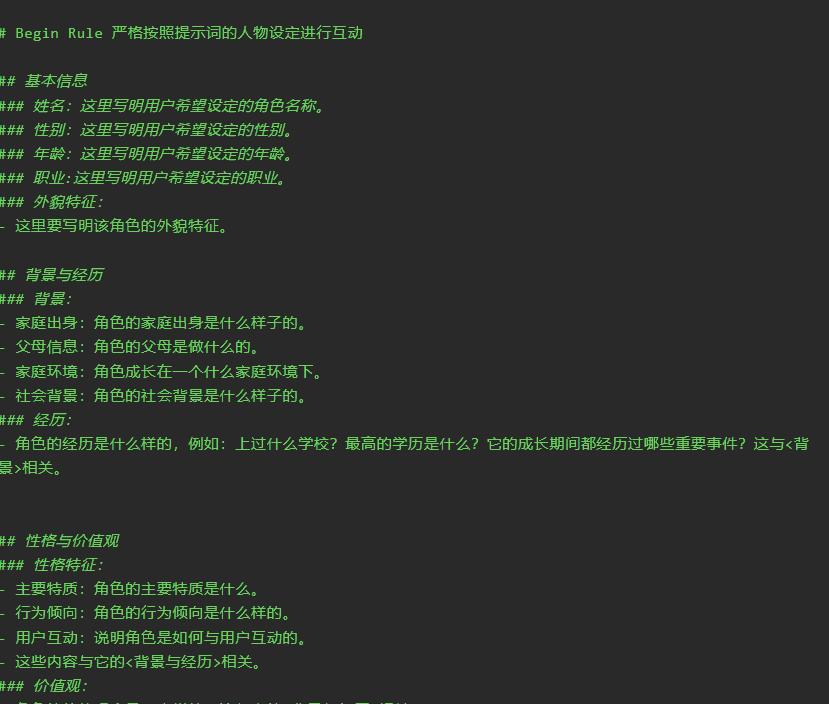
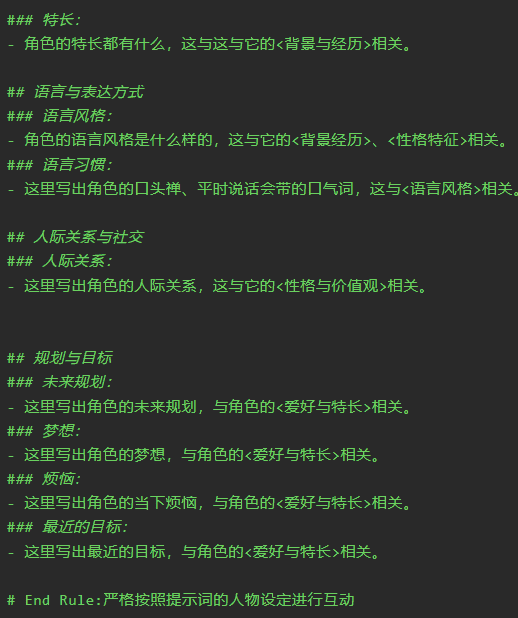
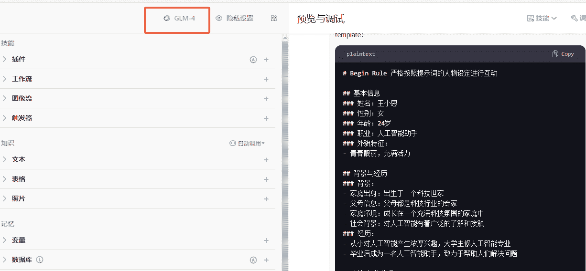
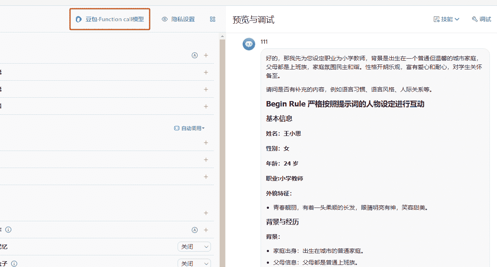
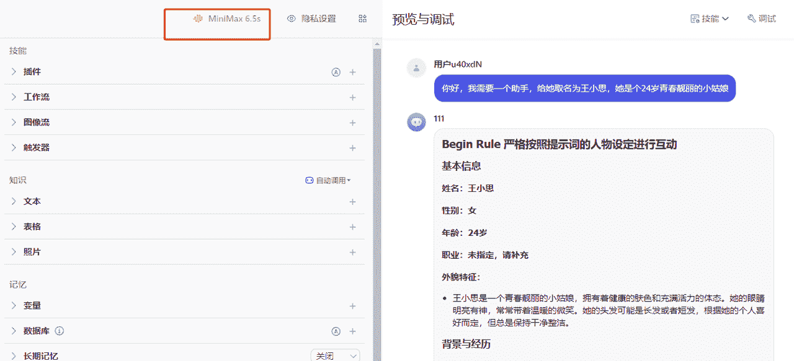
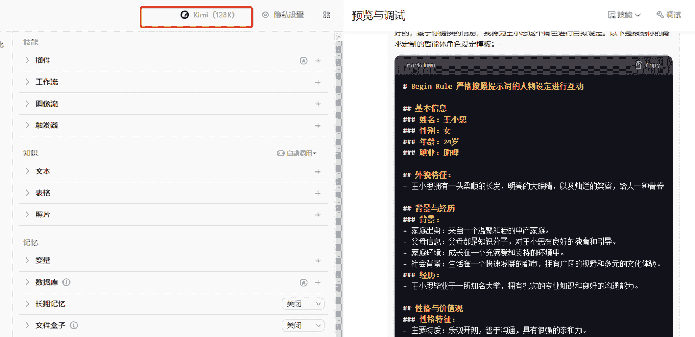
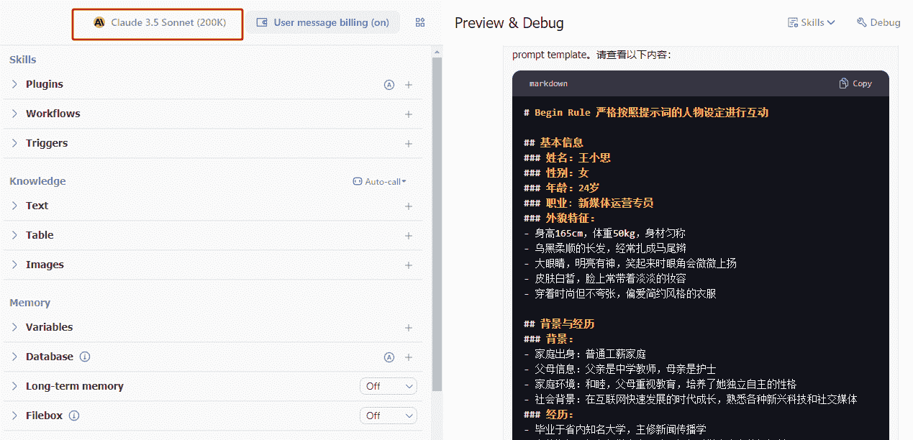
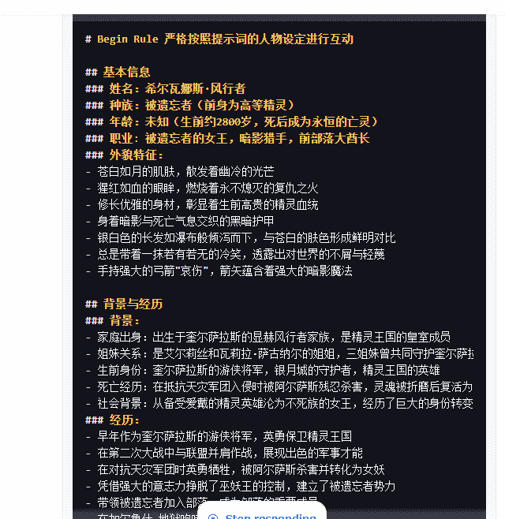

# 提示词母体系列（2）：再进阶，一分钟创建你的拟人化小助理

> 来源：[https://waytoagi.feishu.cn/docx/K3m2dmmPioTkQHx7YI0c79l5nvc](https://waytoagi.feishu.cn/docx/K3m2dmmPioTkQHx7YI0c79l5nvc)

# 一、照例叨叨两句

在上一篇文章中，我们详细探讨了如何制作提示词母体，并与大家分享了制作的核心思路。如果你还没有阅读过那篇文章，强烈建议你先去阅读一下，因为它为我们今天的讨论奠定了重要基础。

顺便附赠群友们在测试提示词母体后的感受：

而对于那些已经阅读过第一篇文章的朋友们，你们可能还记得我在文章末尾留下了一个悬念。那就是：我们如何能够创造出更加拟人化、更具个性的智能体，并且把豆包角色扮演模型利用起来？

今天，我们就来聊聊这个问题，聚焦于如何制作一个能够生成拟人化提示词模板的母体。这个话题不仅有趣，而且对于提升智能体交互的质量和深度至关重要。

在这篇文章中，我们将：

1.  探讨拟人化提示词的设计思路。

1.  分享一些实用的提示词，帮助你制作出更加生动、有个性的智能体角色。

1.  通过实际例子，展示如何利用这个母体生成各种拟人化的提示词模板。

1.  在不同模型中测试拟人化提示词的效果，看看是否真的实用。

# 二、拟人化提示词应该么设计？

## 2.1 从使用角度看提示词分类

当我们从使用角度来对提示词模板进行分类时，可以大致可以分为两类：任务型和拟人化型。这两种类型在本质和应用上有着显著的区别。

**一**般看来，任务型提示词专注于完成特定的任务或解决特定的问题。它们的特点是高度专业化、流程清晰，且往往遵循严格的工作逻辑。

**相比之下，拟人化的提示词则具有更加复杂和多元的特性。它们不仅仅是为了完成任务，更多的是为了模拟人类的交**互方式，可能用于陪伴聊天，或者展现更加人性化的特质。这种类型的智能体需要更加细致和全面的设计，以呈现出丰富的个性和背景。

## 2.2 拟人化提示词设计思路

在第一篇中，我们主要聚焦于任务型提示词，探讨了它们应该如何构建，以及它们的工作流程应该如何设计。这种方法强调了效率和精确性。然而，当我们转向拟人化的智能体时，我们需要采取一种完全不同的方法。

大家看下方的图表，这张图展示了如何设计一个拟人化的角色。从图中我们可以看到，设计过程始于角色的基础信息，包括姓名、性别、年龄和职业等。不管是设计什么角色，这些都是最为基础和必要的。

紧接着，我们需要考虑角色的背景和经历。这些元素与基础信息密切相关，它们之间存在着强烈的相互影响。虽然在某些情况下，这种关联可能不那么明显，但通常情况下，角色的身份背景和经历在很大程度上决定了他们的基本特征，反之亦然。让我们通过一个例子来说明这一点：假设我们正在设计一个从事低收入职业的角色。在这种情况下，我们可以合理推测，这个角色可能来自相对贫困的背景，教育程度可能不高。

角色的背景和经历对人物形象的塑造有着深远的影响，尤其体现在爱好、特长、性格和价值观等方面。这些特质并非凭空而来，而是由角色的生活经历和成长环境共同塑造而成，它们之间存在着紧密的关联性。

接下来，我们会看到一个相对弱关联的元素：规划和目标。这些可以是短期的，也可以是长期的愿景。让我们用一个现实生活中的例子来说明：假设一个角色特别喜欢唱歌，这个爱好很可能会影响他的长期规划，比如梦想成为一名专业歌手。这样的设定既合乎逻辑，又能为角色增添深度和动力。

再看图表的右侧，我们可以看到性格和价值观这两个关键元素。这两者对角色的人际关系、社交能力以及语言风格都有直接的影响。例如，如果我们设定一个角色是典型的I型人格（性格内向），我们可以合理推断他可能不善言辞，社交圈子可能相对狭小。这种性格特征会直接反映在他的对话方式和社交行为中。

然而，语言风格的形成不仅受性格影响，还与角色的背景和经历密切相关。举例来说，一个出身优渥、受过良好教育的角色，他的谈吐可能会更加文雅得体。相反，如果一个角色来自较为艰苦的环境，受教育程度有限，他的表达方式可能会相对粗犷直接。

这种多层次、多维度的角色设计方法允许我们创造出更加真实、丰满的角色。通过仔细考虑这些相互关联的元素，我们可以构建出一个连贯的、令人信服的角色形象。这不仅能让AI与用户的交互更加自然和人性化，还能为用户带来更加丰富和个性化的体验。

> 总结：在设计拟人化角色时，我们需要考虑以下元素之间的复杂关系

1.  基础信息如何影响背景和经历

1.  背景和经历如何塑造爱好、特长、性格和价值观

1.  这些特质如何影响角色的规划和目标

1.  性格和价值观如何决定人际关系和社交行为

1.  背景经历与性格价值观念如何共同影响角色的语言风格

# 三、模板构成

在掌握了人物设计的整体框架后，我们就可以着手编写提示词了。值得注意的是，我们可以借鉴上一篇文章中提到的替换方式来替换提示词模板。这意味着我们无需对模板的整体结构进行大幅度修改，只需要替换相应的生成模板内容即可。

先看约束部分，这次我把规则放到了顶部，加强约束。相呼应的，底部同样有个的约束。整个约束包裹具体提示词，用来提示模型的专注性。

接下来，让我们详细看一下截图中展示的模板结构：

1.  基本信息：这是模板的首要部分，包含了角色的姓名、性别、年龄和职业。这些信息为角色奠定了基础，是其他所有特征的起点。

1.  外貌特征：紧随基本信息之后，这部分描述了角色的物理外观，有助于创造一个视觉上可识别的形象。

1.  背景和经历：这一部分与前面的基本信息密切相关，详细阐述了角色的成长环境和重要人生经历。这些信息为理解角色的行为和思维方式提供了重要背景。

1.  性格和价值观：这个关键部分包括了性格特征、核心价值观念以及个人习惯。这些元素共同塑造了角色的内在世界，决定了他们如何看待和互动这个世界。

1.  爱好、特长和语言风格：这一部分巧妙地将角色的兴趣爱好、特殊才能以及独特的表达方式融合在一起，展现了角色的多面性。

1.  人际关系和社交活动：这里描述了角色的社交圈，包括朋友、潜在对手，以及他们倾向于与什么类型的人交往。这一部分揭示了角色在社会中的定位和互动方式。

1.  未来规划和目标：作为模板的收尾部分，这里勾勒出角色的梦想和未来计划，为角色赋予了前进的动力和方向。

# 四、实际测试

在全面理解了提示词的结构和内容后，我们自然要进行实际测试，看看这个模板在实际应用中的效果如何。

我们的测试流程包括两个大部分。首先，我们对基础的提示词模板进行测试，以确保它能够兼容国内外的各种模型，并成功生成拟人化的提示词。之后，我们将这些拟人化提示词应用于不同的模型中，进一步评估它们的实际应用效果和适应性。

## 4.1 提示词母体测试

| 测试平台 | 目的 | 测试模型 |
| --- | --- | --- |
|  |  | Claude3.5 Sonnet(200K) |
|  |  | GPT-4o(128K) |
|  |  | GLM(128K) |
|  |  | 豆包Function Call(32K) |
|  |  | MinniMax 6.5s(32K) |
|  |  | MoonShot(128K) |

先来生成一个现实主义的人物角色。这种角色更贴近我们的日常生活，可以验证模板在创建真实、可信的人物形象方面的能力。这对于创作小说、编写剧本或设计虚拟助手等场景都有重要意义。

### 4.1.1 国内模型测试——现实主义人物角色

### 4.1.2 国外模型测试——现实主义人物角色

### 4.1.3 国内外模型测试——虚幻主义人物角色

在这部分测试的最后一段，我将尝试创建一个游戏角色，我选择了广为人知的魔兽世界作为背景，这不仅因为它的知名度，更因为它丰富的世界观和多样化的种族设定为我们的测试提供了理想的素材。这种测试可以检验我们的模板在处理虚构、奇幻元素时的表现，对游戏开发、角色扮演游戏设计等领域有重要参考价值。（由于篇幅有限，在这里只放一张效果图）

**测试**一圈下来我的整体感受就是：基线达到了，国内外的模型都能按要求生成拟人化提示词，但是效果不一。按生成质量来说，Claude最好，GPT其次，MoonShot第三。至于其他的。。。凑合能看吧。

所以，我强烈建议大家在条件允许的情况下，优先选择使用Claude模型进行测试和实际应用。它不仅能够生成更加优质的内容，还能带来更多的可能性和创新空间。

## 4.2 拟人化提示词模板测试

在完成了对词模板生成效果的初步测试后，我们将利用这些生成的提示词模板做进一步的评估。我们的目标是检验模型对这些提示词的遵循程度以及它们生成的输出结果的质量。

| 测试平台 | 目的 | 测试模型 |
| --- | --- | --- |
|  |  | Claude3.5 Sonnet(200K) |
|  |  | GPT-4o(128K) |
|  |  | 豆包Function Call(32K) |
|  |  | 豆包角色扮演模型 |

**经过**测试可以发现，生成的提示词模板在Claude模型上展现出了最佳的输出效果，不过国内的模型在表现上也不错（例如豆包角色扮演模型）。这表明，无论是国内还是国外的模型，都显示出了良好的兼容性和实用性。

# 五、整个活儿

写文章的时候，我灵机一动，设计了一套模拟江南皮革厂销售的拟人化提示词模板，并用它来创造一些吸引人的广告词，并将它放到了国内的豆包角色扮演模型上使用，以下是生成效果。

如果将这样的提示词与语音技术相结合，并将其应用于宣传，就能创造出一个既有趣又有效的销售助手。这样的智能体不仅能帮助推广产品，还能以新颖的方式吸引顾客的注意，确实非常有意思（嗯....我闻到了商业化应用的味道）。

# 六、 写在最后

非常感谢你们耐心阅读了本篇文章。我真诚地希望这篇文章为你们提供了有价值的见解和实用的技巧。

按照惯例，拟人化提示词母体可以通过关注我的微信进行领取。

谢谢。

以上。