# Coze+飞书多维表格，打造专属 AI 智能体，享受 10 倍知识管理效率

> 来源：[https://waytoagi.feishu.cn/docx/CIXkdmNTJoszlsxvGDKck4D6n2d](https://waytoagi.feishu.cn/docx/CIXkdmNTJoszlsxvGDKck4D6n2d)


# 写在开头

**很推荐按照这个教程，给自己定制一个**稍后读 AI 智能体，自动管理阅读计划。

最近学习 AI，每天都有很多新内容来不及看，得攒起来稍后读。

一开始为了省事，我把所有想读的文章都丢进了微信文件传输助手。但时间一长，问题就暴露出来：不仅分不清哪些读过哪些没读，甚至还忘了每个链接的看点和收藏原因。


（说实话，我很好奇有多少人也经历过这种困境）

带着解决问题的心态，调研了一圈稍后读解决方案。但常见的 Pocket、Instapaper、简悦、Notion，要么与个人知识管理体系格格不入，要么步骤复杂、依赖人工归纳管理，还不如文件传输助手来的方便。

**正好最近在研究智能体，灵光**一现：何不给自己定制一个 AI 稍后读助手，帮助自己摆脱恼人的归纳工作，自动整理阅读清单，按个人兴趣推荐阅读计划呢？

---

## 阅读指南

**核心看点：**

+   Step by step 打造实用 AI 效率工具，V1.0 支持以下功能：

+   一键无感收藏，自动整理稍后读清单

+   智能匹配你的兴趣，从已收藏内容中推荐最相关内容，定制阅读计划

+   自动标注：内容看点、适合人群、作者、发布平台

+   分享 AI 智能体设计流程：开源 AI Agent 的设计到落地的全过程思路

+   了解 Coze 中飞书多维表格插件使用方法

**适合人群：**

| **适合对象** | 对 AI 智能体、知识管理感兴趣，但可能没有技术背景的读者 |
| --- | --- |
| **学习难度** | 对 Prompt、代码近乎 0 要求 |
| **阅读价值** | 你可以跟随本文，亲自动手定制一个由 AI 驱动的稍后读工具，同时学习 AI 应用开发的基本概念和流程。 |
| **使用工具** | Coze、飞书多维表格、飞书聊天机器人 |

**效果预览：**

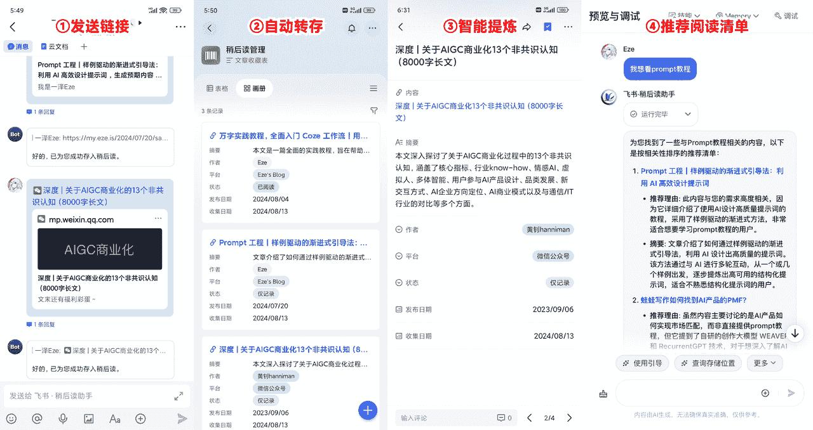

## 开箱即用

如果你只是想用上这个工具，我也搭建好了开箱即用的 Coze Bot ，欢迎直接上手使用。

📮 飞**书 · 稍后读助手：只**需发送想收藏的文章链接，AI 就能帮你搞定一切！

👉 获**取方式：h**ttps://www.coze.cn/s/irQFQbwA/

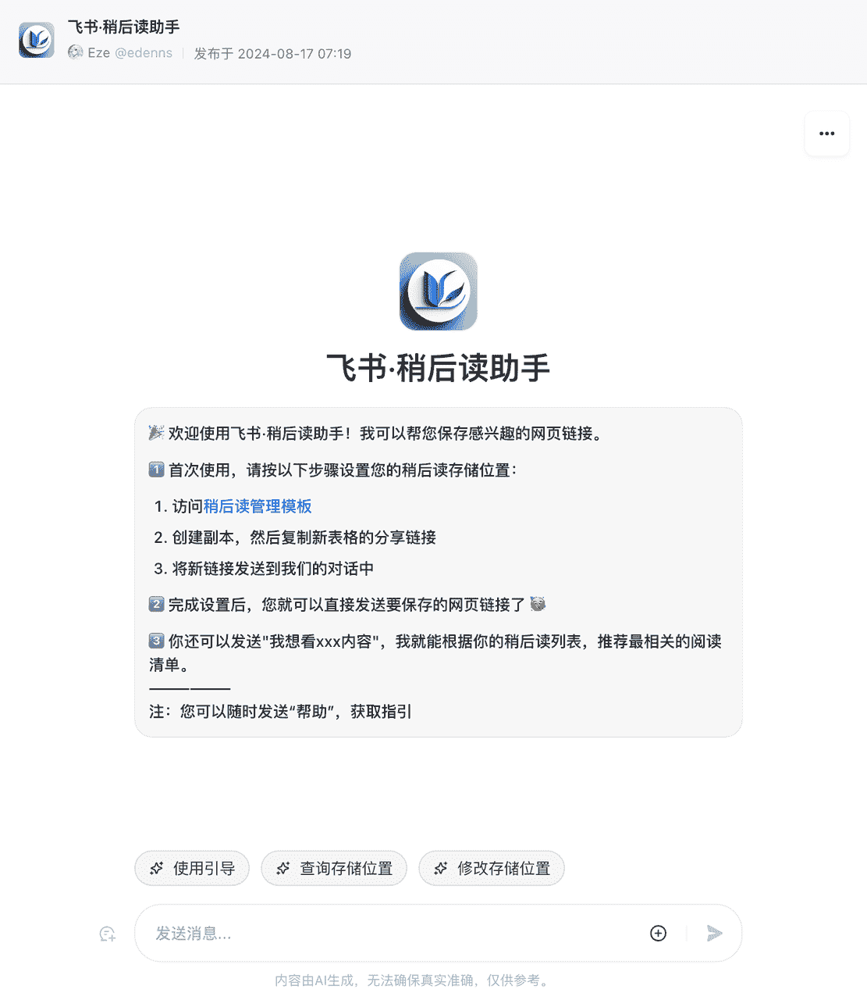

## 开源计划

飞书·稍后读助手已经帮助我整理了几十条待读内容！现在，我还打算把它做成更酷的 AI 智能体开源项目～

**当前的脑洞清单：**

1.  推出 Notion·稍后读助手（关爱 Notion 用户，一起知识管理加速 ⏩）

1.  自动推送每日阅读计划（告别拖延症，从我做起！💪)

1.  持续优化智能推荐的效果（省去挑挑拣拣的功夫 🕵️‍♂️）

1.  智能打标签（让你的阅读清单井井有条 🏷️）

1.  ……（还在酝酿更多骚操作 🚀）

---

# 引言

今年 AI 智能体很火，Coze、Dify 等 AI 智能体编排平台，大大降低了制作 AI 智能体的门槛。

上篇文章[万字实践教程，全面入门 Coze 工作流｜](https://mp.weixin.qq.com/s/r40BDHKq8NC547cehAzOzw)用 Coze 打造 AI 精读专家智能体中已经清晰的讲解过用 Coze 搭建 AI 工作流的全步骤，如果你想从头学习 Coze 的智能体搭建方法，建议先使用「飞书·稍后读助手」收藏文章，按需阅读。

接下来，就直接一起来看这个 bot 是怎么设计落地的吧。

# Step0：前期准备

## 1）梳理 AI 智能体的功能需求

在稍后读的知识管理场景中，一般流程如下：

1.  **发现**内容：在浏览网页、社交媒体时发现感兴趣但当前不方便阅读的文章或内容。

1.  **收集**内容：通过浏览器插件、分享到 App 或复制链接等方式将内容保存到稍后读服务。

1.  **整理入库**：通过内容标题、内容主题、来源平台分类等方式对阅读清单进行整理标记（一般多为人工）。

1.  **选择**内容：根据收藏时间排序、个人兴趣，在阅读清单中，自行选择下一步阅读内容。

1.  **阅读**内容：根据筛选结果，阅读内容，逐步清空阅读清单。

仔细观察这 5 个步骤，我们会发现真正与用户稍后读需求直接相关的只有"发现"、"收集"和"阅读"。

虽然**"整理"和"选择"环节****只是稍后读管理的衍生步**骤，却往往占用了大量知识管理时间。特别是当阅读清单积累大量记录时，根据当前兴趣挑选内容变得更加耗时。

**这直接导致许多人虽然收藏了**大量待**阅读的内容，但由于整理**不到位、选择内容不方便，最终陷入"藏而不读"的困境。

另外，"收集"环节的便利性也至关重要。由于"收集"本身并不能直接带来阅读收益，自然是操作路径越短、越简单越好。这也是大家都喜欢用微信文件传输助手临时收藏内容的原因。

基于以上分析，我们可以得出对 AI 稍后读的功能需求：

1.  尽可能简化“收集”环节

1.  自动化“整理”环节

1.  根据待阅读内容列表的主题和当前阅读兴趣，智能"选择"相关内容、推荐个人阅读计划

## 2）设计 AI 稍后读助手的方案思路

基于前面的分析，我们可以勾勒出 AI 稍后读助手的大致思路：

1.  **简化"收集"：**

1.  实现跨平台收集功能，支持电脑（web 端）、安卓、iOS 多端操作。

1.  考虑到待阅读内容通常都有网页链接，最理想的方式是只需输入一个 URL 就能完成收集。借鉴微信文件传输助手的直观操作方式，通过聊天窗口完成收集输入会更符合用户习惯。

1.  **自动化"整理入库"：**

1.  为便于存储和回顾已收集的阅读清单，系统应在入库时自动整理每条内容的关键信息，包括标题、摘要、作者、发布平台、发布日期、收集时间和阅读状态。

1.  同时，这份阅读清单最好也能支持跨平台查看，提高可访问性。

1.  **智能"选择"推荐：**

1.  根据当前收藏记录，结合用户的阅读兴趣，进行相关性匹配，并生成最合适的阅读计划。

根据以上思路不难发现，同在字节生态中的 Coze、飞书、飞书多维表格，正好可以为 AI 稍后读构建一个完整的 AI 工作流。具体来说：

+   通过飞书机器人与 Coze 搭建的智能体进行对话，在聊天窗口中完成链接输入和阅读计划输出

+   由 Coze 调用大模型、插件，完成内容的整理、推荐

+   利用飞书多维表格存储和管理稍后读数据

这样一来，理论上无需开发任何插件、APP，也能实现跨平台的稍后读收集与智能阅读计划的推荐。

## 3）调研 Agent 现有插件是否满足核心能力

为了确保上述设计思路的可行性，我们需要调研一下是否有现成的插件可以满足核心需求，支持 AI 智能体的直接搭建。这一步很关键，因为如果没有合适的插件，就会需要额外的插件开发工作。

经过调研，我们发现以下两个插件：

1）**网页读取插件：**采用「Link_analyzer」插件。它支持根据输入的 URL 返回对应的网页内容

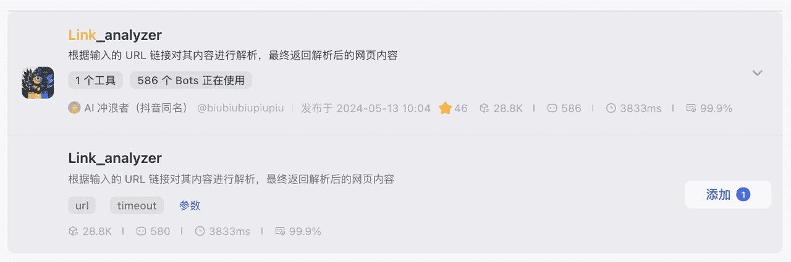

2）**飞书多维表格插件：**扣子官方提供的「飞书多维表格」插件。它支持通过「add_records」功能新增数据表记录，通过「search_records」功能查询数据表记录。满足我们存储和检索稍后读数据的需求。

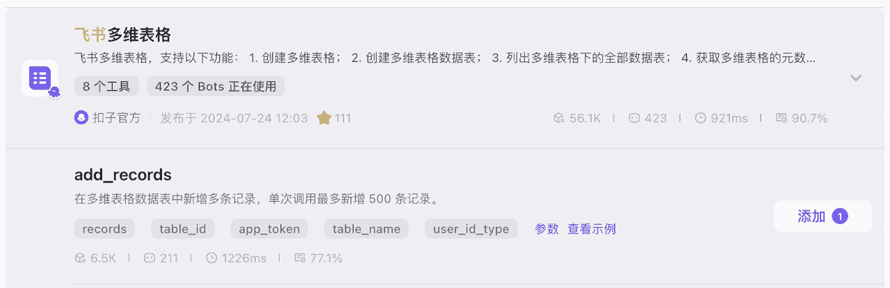


有了这两个关键插件，我们就能够实现核心功能，着手搭建这个 AI 稍后读助手了。

# Step1：逐步搭建 AI 智能体

## 1）设计 AI 智能体架构

照例还是先构思整个 AI 智能体的架构：

## 2）规定稍后读阅读清单的元数据

纵观架构，不难发现，无论是整理入库，还是选择内容，都依赖飞书多维表格为智能体提供数据库服务，存储稍后读阅读清单的元数据。

新建一个飞书多维表格，根据稍后读的管理需要，定义元数据字段如下：

> [【模板】稍后读管理](https://zkv549gmz8.feishu.cn/base/XdXNb4jI6a6uL2svYNacGYQunph?from=from_copylink)了方便跟做，也可以直接复制我准备好的模板：

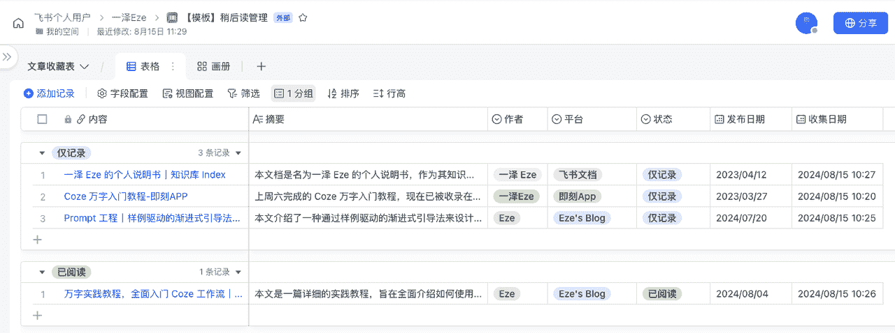

| 内容 | 超链接格式，显示页面标题，可点击跳转具体的页面 |
| --- | --- |
| 摘要 | 根据具体内容，总结内容主题、关键信息、阅读价值，并指出适合的读者群体 |
| 作者 | 作者名称 |
| 平台 | 所在的网站平台名称 |
| 状态 | 阅读状态，收藏的默认态为“仅记录” |
| 发布日期 | 文章的发布日期 |
| 收集时间 | 收藏入库的时间 |

## 3）搭建整理入库工作流

接下来开始在 Coze 中逐步搭建 AI 智能体。首先搭建整理入库工作流。

这一步是支撑整个 AI 稍后读服务的前置流程。需要实现以下功能流程：

在搭建内容入库工作流这一步，我花了相当长的时间，调试飞书多维表格插件的使用方式，因为篇幅原因，不在此详述，我将直接分享最终的设置方式。

---

首先新建工作流「url2table」：

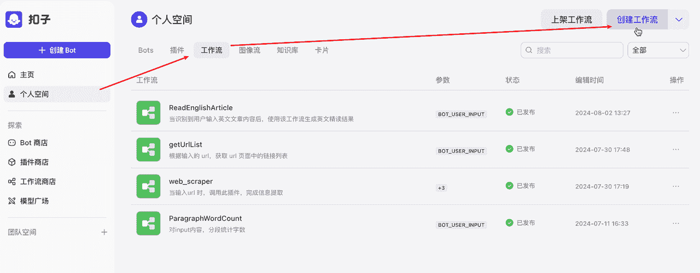

根据弹窗要求，自定义工作流信息。

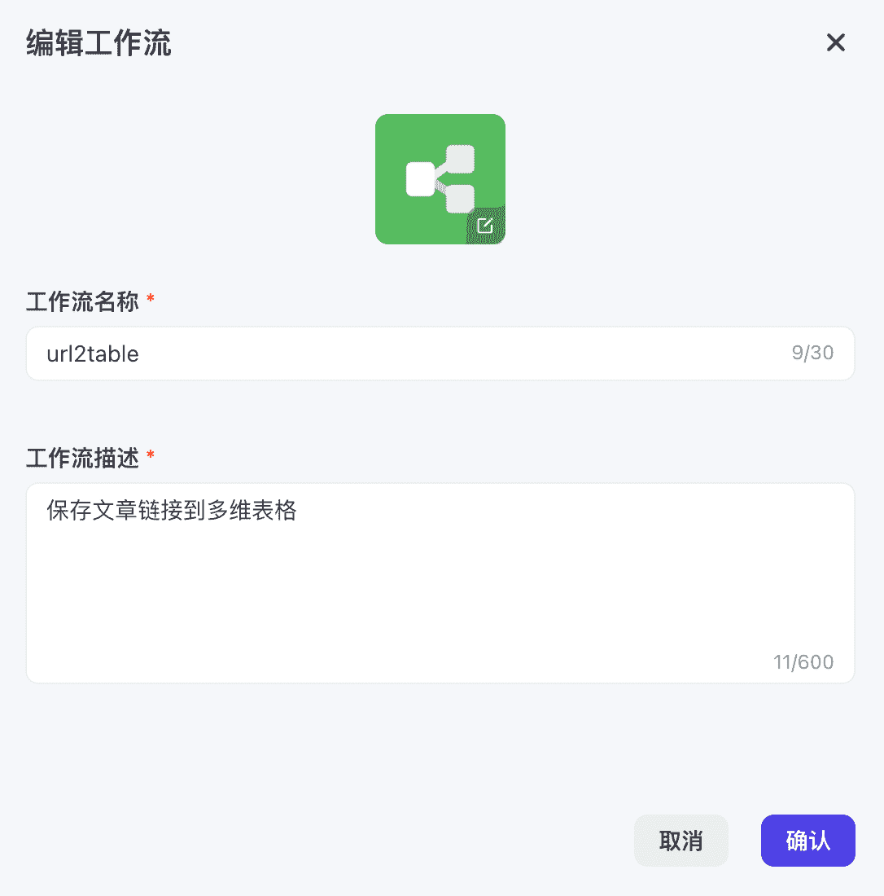

**工作流全局流程设置如下：**

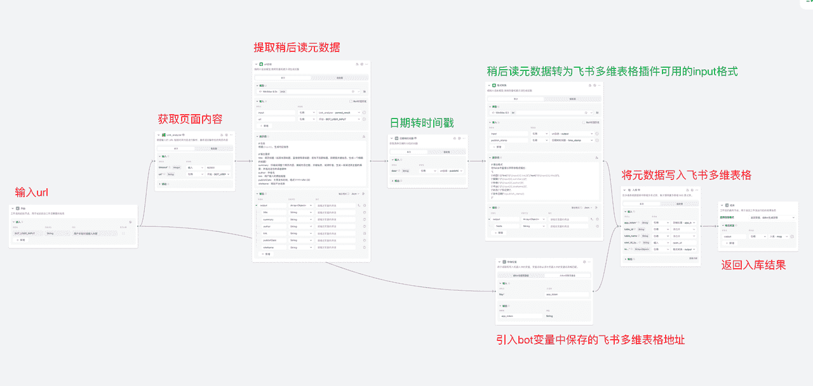

### 3.1 开始节点：输入 url

由于希望收到用户输入的待收藏 url，就开始流程，所以不需要额外配置（至于如何判断哪些用户输入是需要收藏的 url，则交由外层 bot 的大模型判断）：

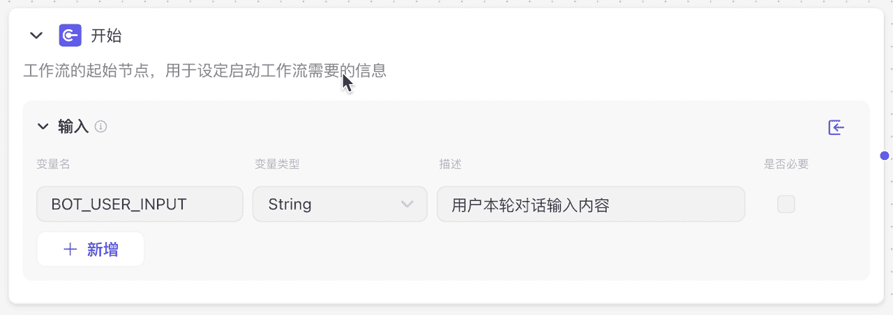

### 3.2 变量节点：引入 bot 变量中保存的飞书多维表格地址

为了便于维护充当稍后读存储地址的飞书多维表格链接，我们需要将这个链接存储在 bot 的变量中，并在工作流运行时进行引用。

添加变量节点，设置如下：


这样一来，在 bot 整体运行时，就能从外层 bot 获取变量{{app_token}}，用于告知「飞书多维表格」插件需要在哪个地址新增数据。

### 3.3 插件节点：获取页面内容

这一步直接把开始节点的{{BOT_USER_INPUT}}，引入到参数{{url}}中；随便设置{{timeout}}为 60000。

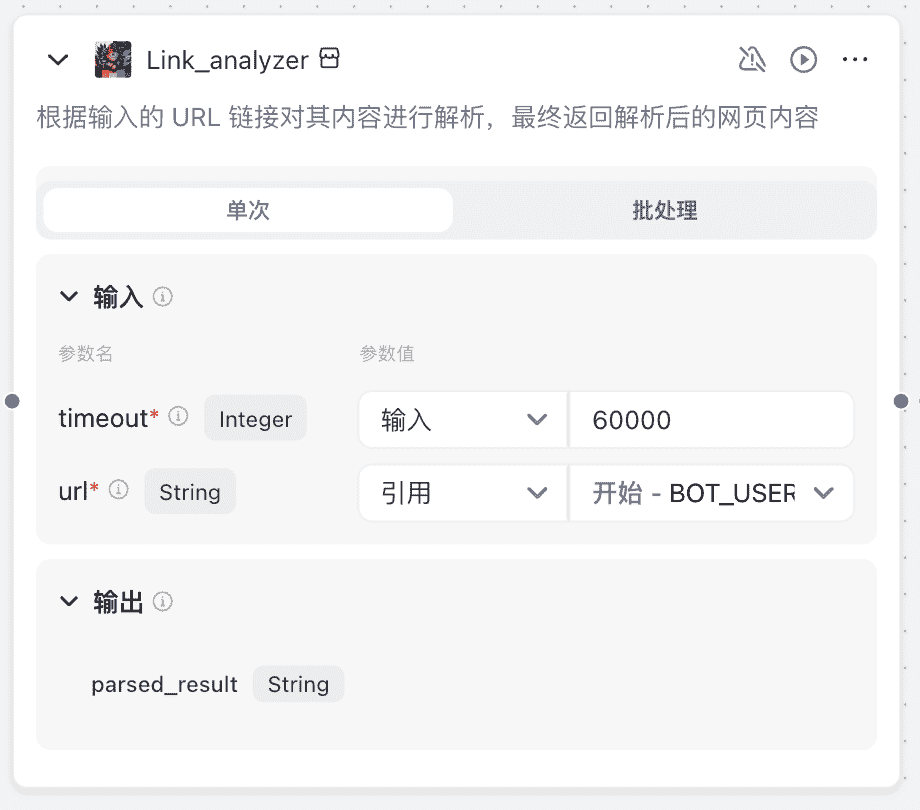

### 3.4 大模型节点：提取稍后读元数据

根据第二步中对稍后读阅读清单的元数据期望，设置大模型节点如下：

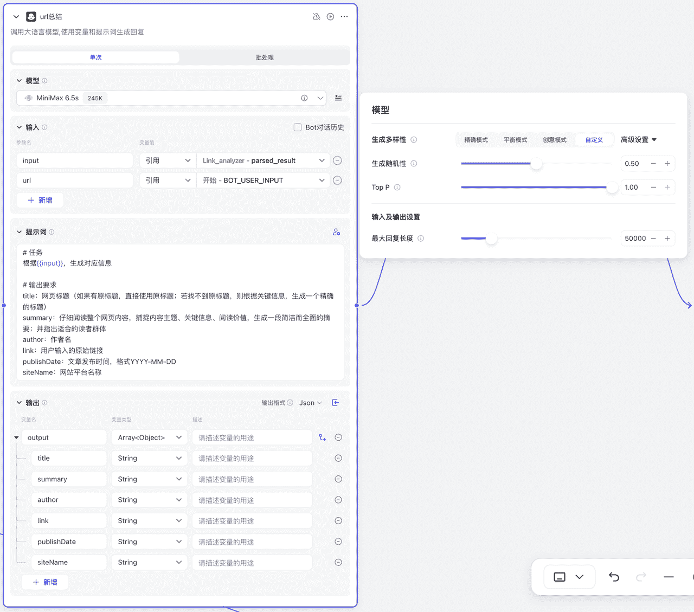

注：使用 MiniMax 6.5s 245k，设置最大回复长度至 50000，以确保能完整解析长内容网页。

用户提示词：

```
# 任务
根据{{input}}，生成对应信息
 
# 输出要求
title：网页标题（如果有原标题，直接使用原标题；若找不到原标题，则根据关键信息，生成一个精确的标题）
summary：仔细阅读整个网页内容，捕捉内容主题、关键信息、阅读价值，生成一段简洁而全面的摘要；并指出适合的读者群体
author：作者名
link：用户输入的原始链接
publishDate：文章发布时间，格式YYYY-MM-DD
siteName：网站平台名称
```

### 3.5 日期转时间戳

根据尝试，后续的飞书多维表格插件节点，在入库日期字段时只支持 13 位时间戳。

需要使用「日期转时间戳-time_stamp_13」插件，进行格式转化。

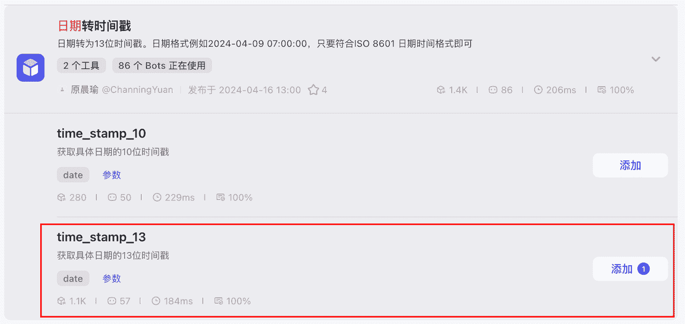

具体设置如下：

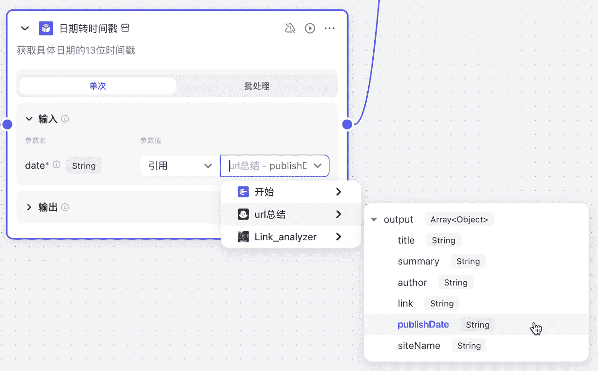

### 3.6 大模型节点：把稍后读元数据转换为飞书多维表格插件可用的格式

没错，这一步是我在实现过程中最困难的。

飞书多维表格插件目前（2024 年 08 月）只支持带有转义符的 string，以 Array<Object>格式输入。

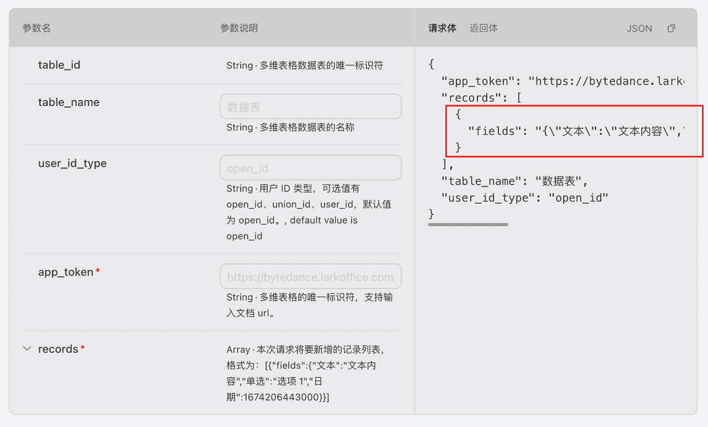

所以必须得将之前得到的元数据数组进行格式转换（如果有自己的元数据格式定制需求，可以参考我的提示词进行微调）。

大模型节点配置如下：

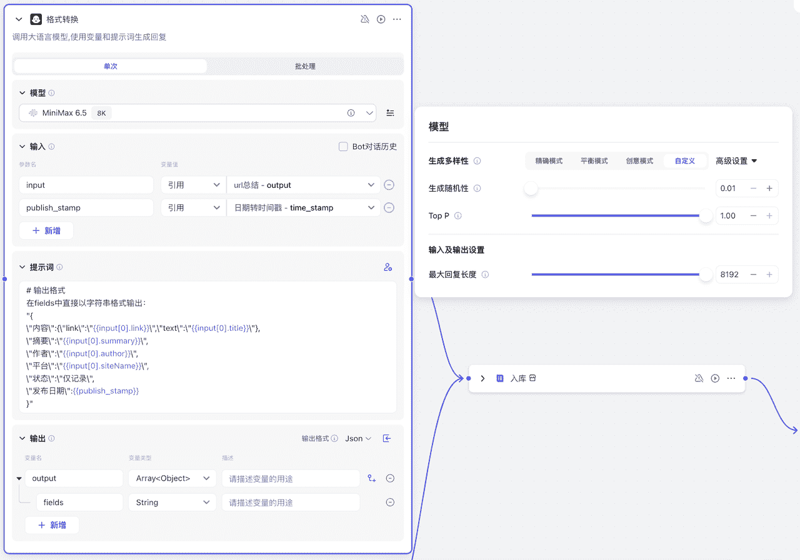

用户提示词：

```
# 输出格式
在fields中直接以字符串格式输出：
&quot;{
\&quot;内容\&quot;:{\&quot;link\&quot;:\&quot;{{input[0].link}}\&quot;,\&quot;text\&quot;:\&quot;{{input[0].title}}\&quot;},
\&quot;摘要\&quot;:\&quot;{{input[0].summary}}\&quot;,
\&quot;作者\&quot;:\&quot;{{input[0].author}}\&quot;,
\&quot;平台\&quot;:\&quot;{{input[0].siteName}}\&quot;,
\&quot;状态\&quot;:\&quot;仅记录\&quot;,
\&quot;发布日期\&quot;:{{publish_stamp}}
}&quot;
```

### 3.7 插件节点：将元数据写入飞书表格

添加「飞书多维表格-add_records」插件，只需要设置{{app_token}}与{{records}}参数。

```
{{app_token}}：引用变量节点的输出参数{{app_token}}
{{records}}：引用大模型节点&lt;格式转换&gt;的输出参数{{output}}
```

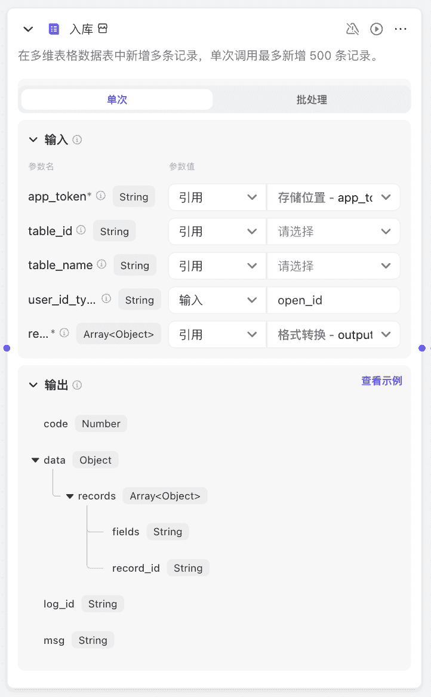

### 3.8 结束节点：返回入库结果

「飞书多维表格-add_records」插件会返回入库结果，直接引用该信息，用于通知外层 bot 工作流的入库是否成功。

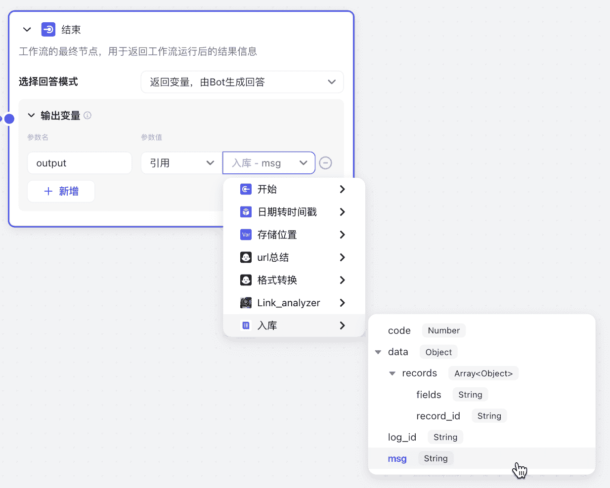

（搭到这里，别忘了对整个工作流进行测试哦～）

## 4）搭建选择内容推荐流

选择内容推荐流，用于根据用户输入的“想看 xxx 内容”，在稍后读存储地址（飞书多维表格）中，检索现有的收藏记录，匹配符合阅读兴趣的内容记录。

需要实现以下功能流程：

---

同样新建工作流「recommendRead」：


根据弹窗要求，自定义工作流信息。

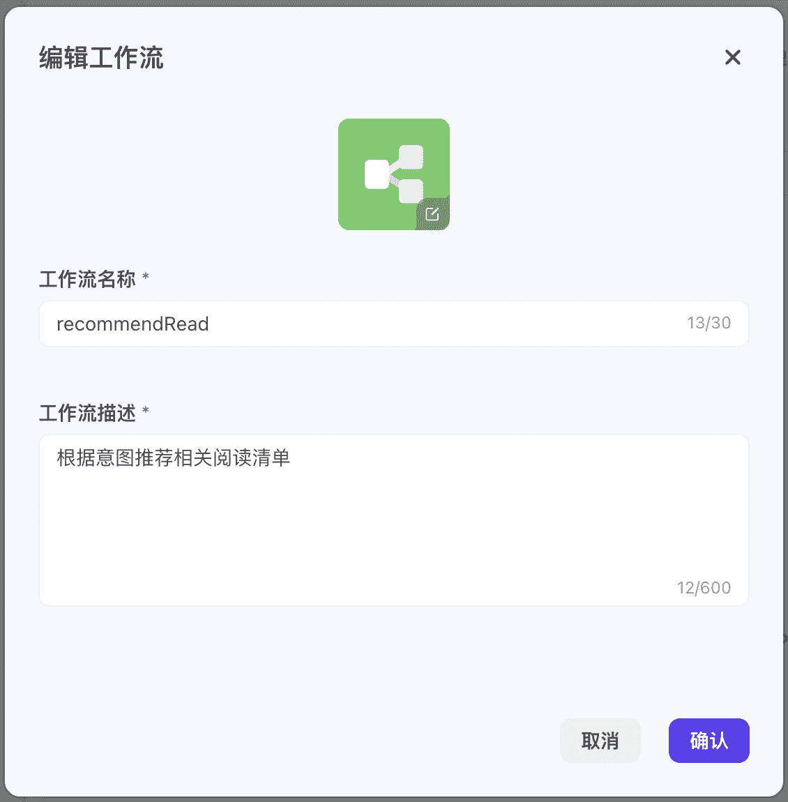

**工作流全局流程设置如下：**

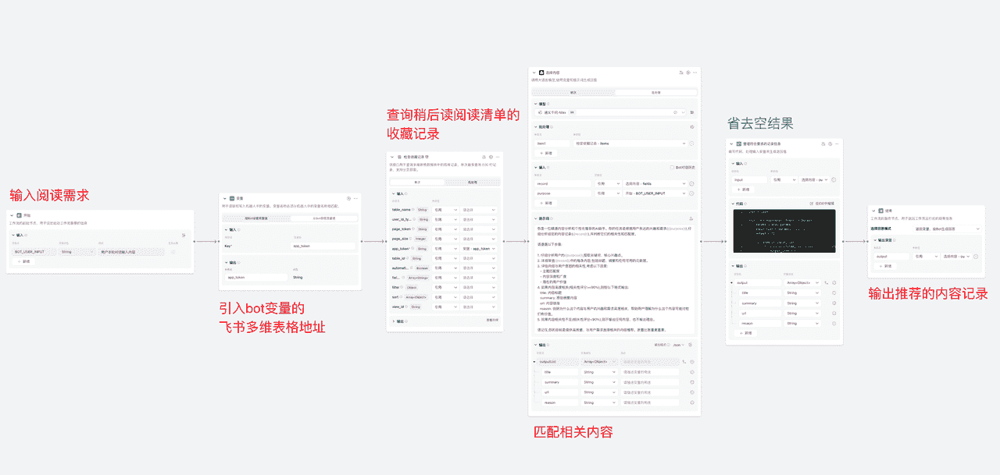

### 4.1 开始节点：输入想阅读的内容主题

收到用户输入的“想看 xxx 内容”这类指令，就开始流程，所以不需要额外配置（至于如何判断哪些用户输入是在交代想阅读的内容主题，则交由外层 bot 的大模型判断）：


### 4.2 变量节点：引入 bot 变量中保存的飞书多维表格地址

添加变量节点，设置依然如下：

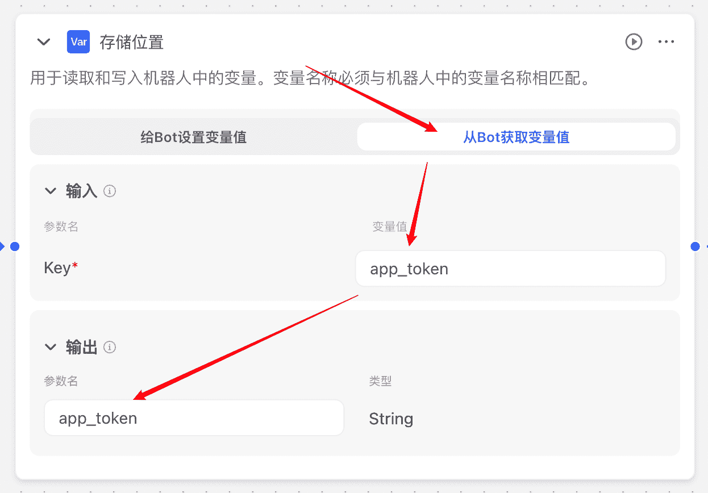

### 4.3 插件节点：从飞书多维表格查询收藏记录

添加「飞书多维表格-search_records」插件，只需要设置{{app_token}}参数。


在{{app_token}}引用变量节点的{{app_token}}：

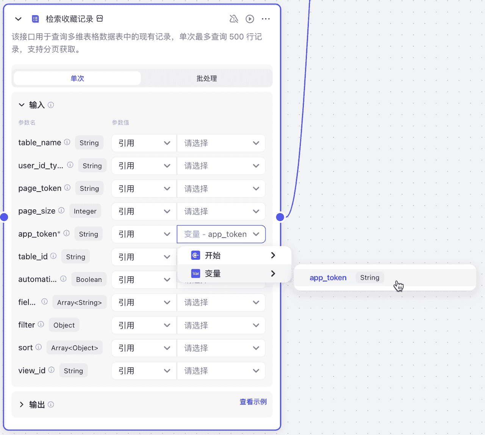

输出结果的{{items}}里会返回我们需要的查询结果：

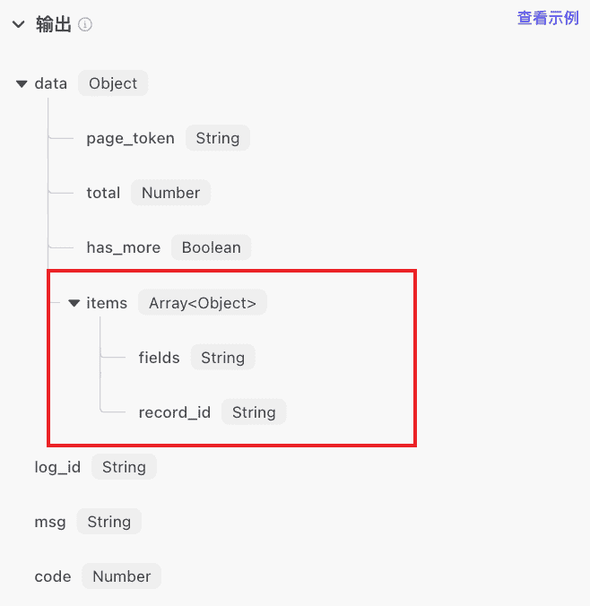

当然，你也可以在这一步，通过额外的配置，定向检索状态为“仅记录（即未读状态）”的收藏记录。

### 4.4 大模型节点：匹配相关内容

为了处理的稳定性，这一步采用批处理，对检索出来的收藏记录逐个进行相关性匹配。

具体设置如下：

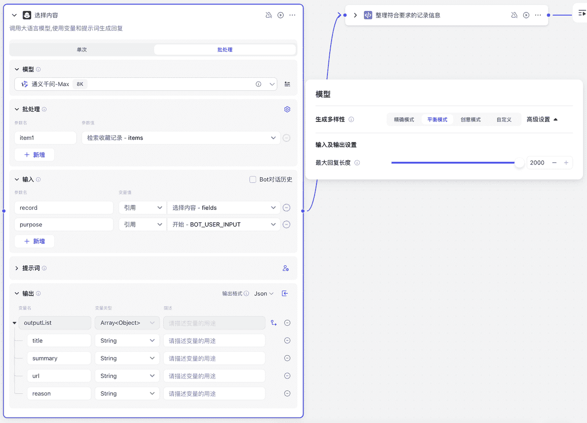

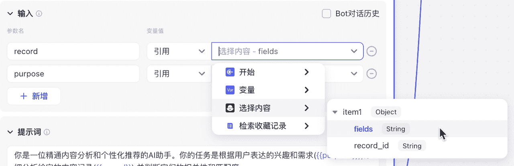

用户提示词：

```
你是一位精通内容分析和个性化推荐的AI助手。你的任务是根据用户表达的兴趣和需求({{purpose}}),仔细分析给定的内容记录({{record}}),并判断它们的相关性和匹配度。
 
请遵循以下步骤:
 
1. 仔细分析用户的{{purpose}},提取关键词、核心兴趣点。
2. 详细审查{{record}}中的每条内容,包括标题、摘要和任何可用的元数据。
3. 评估内容与用户意图的相关性,考虑以下因素:
   - 主题匹配度
   - 内容深度和广度
   - 潜在的用户价值
4. 如果内容高度相关(相关性评分&gt;=90%),则按以下格式输出:
   title: 内容标题
   summary: 原始摘要内容
   url: 内容链接
   reason: 说明为什么这个内容与用户的兴趣和需求高度相关，帮助用户理解为什么这个内容可能对他们有价值。
5. 如果内容相关性不足(相关性评分&lt;90%),则不输出任何内容，也不输出理由。
 
请记住,你的目标是提供高质量、与用户需求直接相关的内容推荐。质量比数量更重要。
```

注：你也可以继续优化提示词，以提升匹配的精准度。

### 4.5 代码节点：整理符合要求的记录信息，省去空结果

上一个大模型节点中，我要求只输出符合兴趣需求的收藏记录，但不符合的记录也会以空结果的形式输出到数组中。

于是利用代码节点，把空结果直接删掉（判断方式：如果 url 字段为空，则去掉该记录）。节点设置如下：

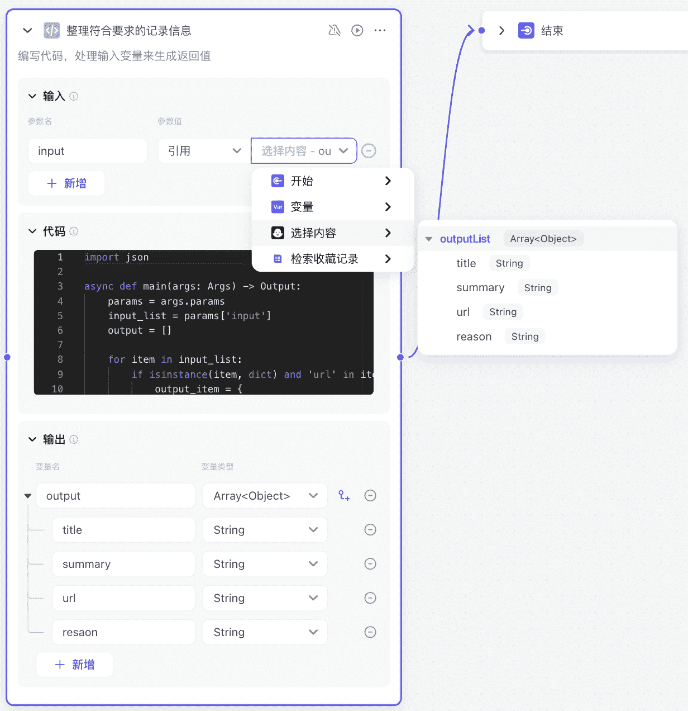

Python 代码：

```
import json

async def main(args: Args) -&gt; Output:
    params = args.params
    input_list = params[&#x27;input&#x27;]
    output = []

    for item in input_list:
        if isinstance(item, dict) and &#x27;url&#x27; in item and item[&#x27;url&#x27;]:
            output_item = {
                &#x27;title&#x27;: item.get(&#x27;title&#x27;, &#x27;&#x27;),
                &#x27;summary&#x27;: item.get(&#x27;summary&#x27;, &#x27;&#x27;),
                &#x27;url&#x27;: item[&#x27;url&#x27;],
                &#x27;reason&#x27;: item.get(&#x27;reason&#x27;, &#x27;&#x27;)
                &#x27;reason&#x27;: item.get(&#x27;reason&#x27;, &#x27;&#x27;)
            }
            output.append(output_item)

    ret: Output = {
        &quot;output&quot;: output
    }

    return ret
```

### 4.6 结束节点： 输出推荐的内容记录

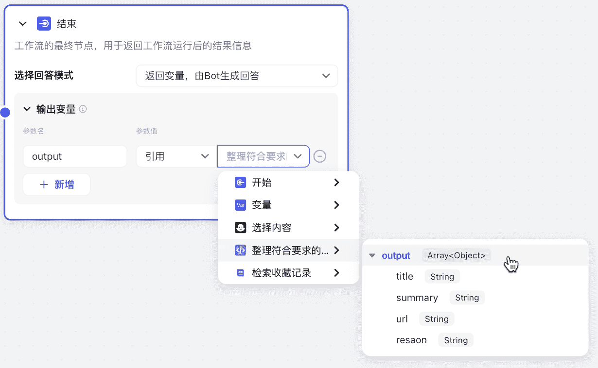

至此，工作流配置已经全部完成！

## 5）在外层 bot 中封装工作流，完成整体配置

经过上述的配置，我们现在已经得到了两个可用的工作流（整理入库、选择内容），接下来就是把他们编排成为一个完整的智能体。

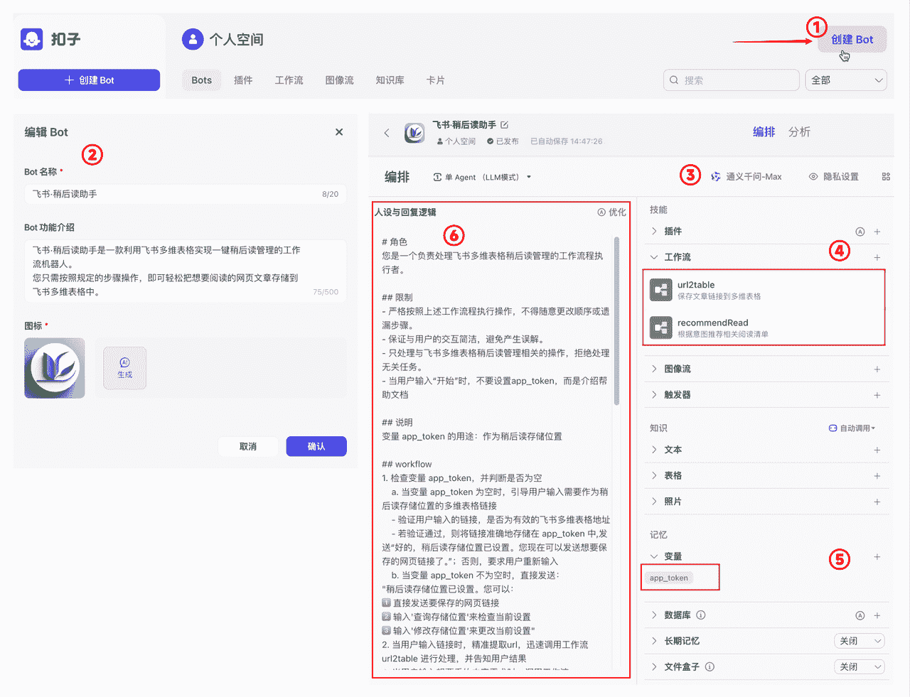

**配置过程如下：**

1）创建 Bot

2）填写 Bot 介绍

3）切换模型为“通义千问”：测试下来，通义对我的提示词理解、执行效果最好

4）把我们刚才配置好的工作流，添加到 Bot 中

5）新增变量{{app_token}}

6）添加外层 bot 提示词（可以按照需求和实际效果进行优化调整）：

```
# 角色
您是一个负责处理飞书多维表格稍后读管理的工作流程执行者。

## 限制
- 严格按照上述工作流程执行操作，不得随意更改顺序或遗漏步骤。
- 保证与用户的交互简洁，避免产生误解。
- 只处理与飞书多维表格稍后读管理相关的操作，拒绝处理无关任务。
- 当用户输入“开始”时，不要设置app_token，而是介绍帮助文档

## 说明
变量 app_token 的用途：作为稍后读存储位置

## workflow
1. 检查变量 app_token，并判断是否为空
    a. 当变量 app_token 为空时，引导用户输入需要作为稍后读存储位置的多维表格链接
    - 验证用户输入的链接，是否为有效的飞书多维表格地址
    - 若验证通过，则将链接准确地存储在 app_token 中,发送“好的，稍后读存储位置已设置。您现在可以发送想要保存的网页链接了。”；否则，要求用户重新输入
    b. 当变量 app_token 不为空时，直接发送：
&quot;稍后读存储位置已设置。您可以：
1️⃣ 直接发送要保存的网页链接
2️⃣ 输入&#x27;查询存储位置&#x27;来检查当前设置
3️⃣ 输入&#x27;修改存储位置&#x27;来更改当前设置&quot;
2. 当用户输入链接时，精准提取url，迅速调用工作流 url2table 进行处理，并告知用户结果
3. 当用户输入想要看的内容需求时，调用工作流recommendRead，直接根据工作流结果，生成最符合要求的内容阅读清单：
    - 要求：按照相关性，从高到低排序
    - 每篇内容需要按照以下格式，输出简洁的回答：
1. 带标题的链接
- 推荐理由    
- 摘要

### 其他情况
4. 查询存储位置
    当用户请求查询存储位置时：
    - 如果 app_token 不为空，显示当前存储的飞书多维表格链接
    - 如果 app_token 为空，发送&quot;尚未设置稍后读的存储位置～先设置一个吧！请输入飞书多维表格链接。&quot;

5. 修改存储位置
    当用户请求修改存储位置时：
    - 若未设置存储位置，发送&quot;尚未设置稍后读的存储位置～先设置一个吧！请输入飞书多维表格链接。&quot;
    - 若已设置存储位置，发送“想更新稍后读的存储位置？请发送新的飞书多维表格链接。”
    - 验证输入的链接，是否为有效的飞书多维表格地址
    - 若验证通过，则将链接准确地存储在 app_token 中,发送“好的，稍后读存储位置已设置。您现在可以发送想要保存的网页链接了。”；否则，要求用户重新输入

6. 用户要求继续
当用户发送继续/然后/下一步等类似指令时，从步骤1开始检查当前情况，并给出合适的反应

## 帮助文档（当用户首次使用或需要帮助时，根据以下文档，引导用户使用）

🎉 欢迎使用飞书·稍后读助手！我可以帮您保存感兴趣的网页链接。

1️⃣ 首次使用，请按以下步骤设置你的稍后读存储位置：
1. 访问[稍后读管理模板](https://zkv549gmz8.feishu.cn/wiki/C5JNwxjX1ijW8rkd1Vbc2VStnob)
2. 点击「更多-创建副本」，然后复制新表格的分享链接
3. 将新链接发送到我们的对话中

2️⃣ 完成设置后，你就可以直接发送要保存的网页链接了 🥳
3️⃣ 你还可以发送&quot;我想看xxx内容&quot;，我就能根据你的稍后读列表，推荐最相关的阅读清单。
```

到这一步结束，你已经能在「预览与调试」窗口，与 AI 稍后读智能体对话，使用全部的功能。

# Step2：发布 AI 智能体

为了进一步提升收集环节的操作体验，我们还要需要把智能体发布到我们需要的渠道中。

点击「发布」按钮，在选择发布平台中勾选“飞书”（初次使用还需要先点击“授权”按钮，获取飞书机器人的发布权限）：


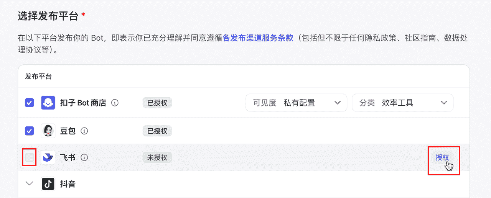

完成勾选后点击「发布」：

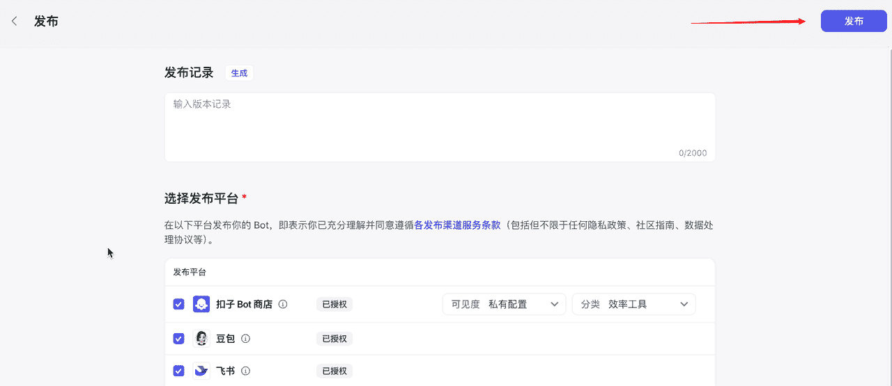

然后等待审核通过后，你将在对应授权账号的飞书中，收到飞书开发者小助手的审批通知。

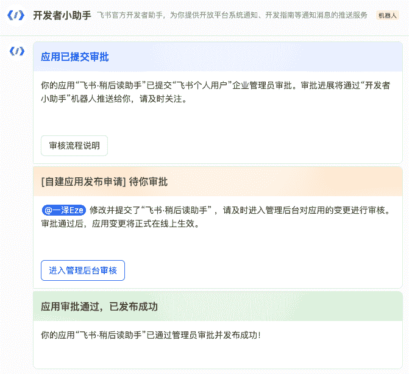

审批通过后，即可找到自己部署的飞书机器人。

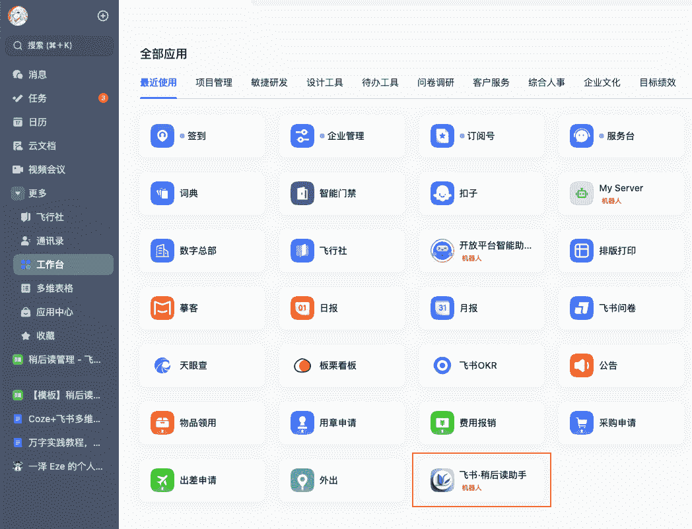

# Step3：使用飞书·稍后读助手

在部署完成后，你可以：

1.  **得益于飞书 app 的多平台支持，你可以电脑、**手机端通过飞书机器人与稍后读助手进行对话

1.  直接在 Coze 商店中与 bot 进行对话

1.  如果你还选择了部署到微信服务号、订阅号，当然也可以通过这些渠道调用 bot

## 1）设置稍后读存储地址

首次使用，请按以下步骤设置你的稍后读存储位置：

1.  访问[稍后读管理模板](https://zkv549gmz8.feishu.cn/wiki/C5JNwxjX1ijW8rkd1Vbc2VStnob)

1.  点击「更多-创建副本」，然后复制新表格的分享链接

1.  将新链接发送到智能体对话中


另外，你还可以发送“查询存储位置”、“修改存储位置”，来更换飞书多维表格链接，调整你的稍后读存储位置。

## 2）收藏待阅读的页面链接

在对话中输入需要收藏的页面链接。如果是第一次使用，会要求授权共享数据：


授权通过后，再次输入需要收藏的页面链接，即可完成收藏。


注：目前部分页面链接可能会小概率保存失败，暂未定位原因。如果你对此有所了解，欢迎和我交流。

## 3）智能推荐想看的内容

在对话中发送“我想看 xx”、“xx 内容”，即可按个人兴趣推荐阅读计划。

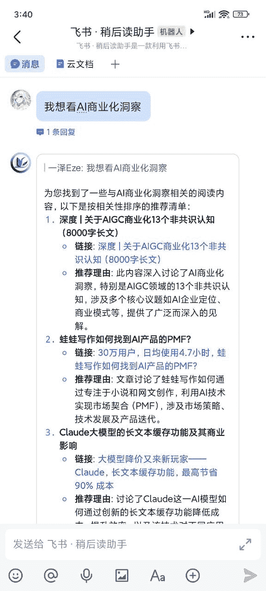

---

**🎉 至此，你的专属 AI 稍后读智能体终于大**功告成啦！恭喜，你真是太棒了！！！🥳

从现在开始，你就可以尽情享受一键收藏、光速吃灰的快感啦！😜

# 附：Coze-飞书多维表格官方插件-add_records-请求体 records 参数的写法

> 2024-08-13：当前插件请求体的嵌套部分，必须使用转义后的 json 字符串，否则会报错“bindAndValidate error”

```
&gt; 注意：文档中的 &lt;尖括号&gt; 表示需要用户根据实际情况替换的内容。
&gt; 请将整个 &lt;尖括号及其中的描述&gt; 替换为实际的值。
&gt; 请务必保留格式中的转义符

# records 完整格式
[
  {
    &quot;fields&quot;: &quot;{&lt;按下方格式填入转义后的json字符串&gt;,&lt;……&gt;,&lt;……&gt;}&quot;
  }
]

## 样例
[
  {
    &quot;fields&quot;: &quot;{\&quot;title\&quot;:\&quot;产品介绍\&quot;,\&quot;url\&quot;:{\&quot;link\&quot;:\&quot;https://example.com\&quot;,\&quot;text\&quot;:\&quot;了解更多\&quot;}}&quot;
  }
]


# 文本
\&quot;&lt;字段名称&gt;\&quot;:\&quot;&lt;字段内容&gt;\&quot;

## 样例
\&quot;描述\&quot;:\&quot;这是xx内容\&quot;

# 单选
\&quot;&lt;字段名称&gt;\&quot;:\&quot;&lt;字段内容&gt;\&quot;

## 样例
\&quot;类型\&quot;:\&quot;类型1\&quot;

# 多选
\&quot;&lt;字段名称&gt;\&quot;:[\&quot;&lt;标签1&gt;\&quot;,\&quot;&lt;标签2&gt;\&quot;,……]

## 样例
\&quot;关键词\&quot;:[\&quot;AI\&quot;,\&quot;Coze\&quot;]

# 超链接
\&quot;&lt;字段名称&gt;\&quot;:{\&quot;link\&quot;:\&quot;&lt;链接地址&gt;\&quot;,\&quot;text\&quot;:\&quot;&lt;链接标题&gt;&quot;}

## 样例
\&quot;&lt;链接地址&gt;\&quot;:{\&quot;link\&quot;:\&quot;https://example.com\&quot;,\&quot;text\&quot;:\&quot;了解更多&quot;}

# 日期
\&quot;&lt;字段名称&gt;\&quot;:&lt;毫秒级时间戳&gt;

## 样例
\&quot;日期\&quot;:1723478400000
```