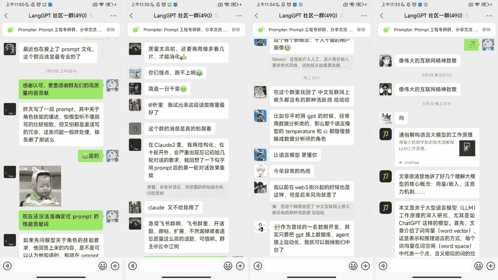
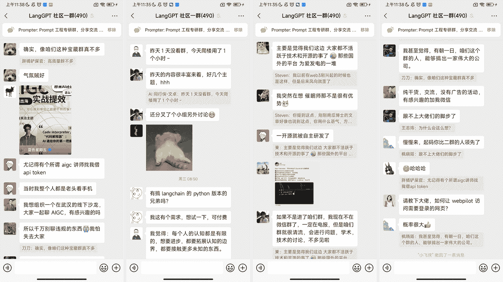
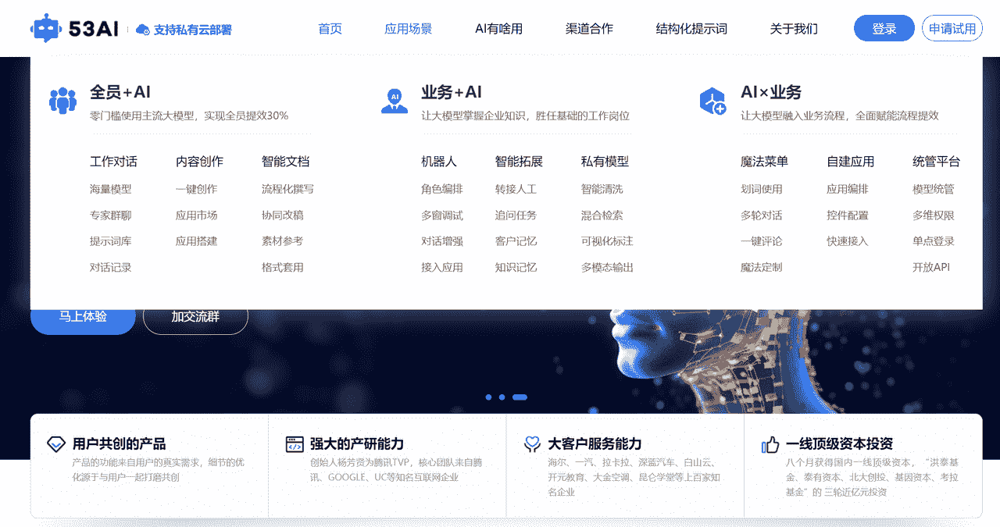

# 云中江树- LangGPT 提示词

> 来源：[https://waytoagi.feishu.cn/docx/VhI4dW7KmoIPJrxHfmQchU6vncc](https://waytoagi.feishu.cn/docx/VhI4dW7KmoIPJrxHfmQchU6vncc)

> 云中江树是Prompt提示词框架 LangGPT 的作者，并组建了EmbraceAGI学习社区

> 他早在2023年3月就提出了结构化构建提示词的方法，并发布在了Github，很快收藏破千

> 如果你期望了解更多关于大语言模型的Prompt提示词工程，请关注云中江树以下是社区介绍

> 也可以直达主页：[⭐LangGPT 结构化提示词](https://langgptai.feishu.cn/wiki/RXdbwRyASiShtDky381ciwFEnpe?fromScene=spaceOverview)

> LangGPT 是 **Lang****uage For**** GPT **的简称，中文名为结构化提示词。我们的愿景是让人人都能写出高质量提示词。我们希望揭开提示工程的神秘面纱，为大众提供一套可操作、可复现的提示词方法论、工具和交流社群。结构化提示词由云中江树提出，最早于 2023 年 5.4 青年节开源发布（GPT-4 发布后约一个月多）为 LangGPT 项目，一经发布便成为  GitHub 开源社区全球趋势热榜前十项目，并且撰写了学术论文开源发表。LangGPT 提出的结构化提示词已被百度、智谱、字节、华为等国内主流大模型智能体平台使用，当前已经发展成为国内最具影响力的高质量提示词工程师学习交流社群。

# 知识空间介绍

欢迎来到 LangGPT 知识空间页面！这里汇集了高质量的提示词工程技术、教程和工具相关内容。知识空间内容均来源于 LangGPT 提示词社群，社群内汇聚了国内一大批提示词爱好者，群内讨论气氛热烈，交流质量很高，在主要的大城市建立了提示词交流小分队。

1.  开源：知识空间内的文档阅读、复制都无限制，欢迎大家分享（请勿搬运）

1.  开放：欢迎加入“LangGPT 社群”，分享交流 Prompt 工程技术

1.  共享：群里分享的优质资源和知识，我们会吸收进知识空间开放共享

1.  共建：欢迎投稿优质内容，欢迎成为共建者（私信江树，微信: zephyr_ai）

> **权益声明**：开源不代表可以随意搬运，未经授权禁止搬运内容！

## 知识库文章索引

[1. LangGPT 社区年度分享：AI 交流的艺术](https://waytoagi.feishu.cn/wiki/YTnWwiGFZi37wqkzjvjcwuown7b?table=tblp81WDObH3I20H&view=vewM2PB3Iu)

[2. 系统论述文章： 构建高性能 Prompt 之路—结构化 Prompt](https://waytoagi.feishu.cn/wiki/OsEowcI67i6UBMk5ztac4Tsrned?table=tblp81WDObH3I20H&view=vewM2PB3Iu)

[3. 如何让 LLM 应用性能登峰造极](https://waytoagi.feishu.cn/wiki/LSlHw3FbWiNZupkBOVXcl7aVnrf)

[3. Prompt 进阶 — 提示链（Prompt Chain）和多提示词协同](https://waytoagi.feishu.cn/wiki/LOt0wYe5jiqbP0kafxqcWta2nnL?table=tblp81WDObH3I20H&view=vewM2PB3Iu)

[4. Agents 基石|提示词结构化方法论和实践](https://waytoagi.feishu.cn/wiki/UIhhwy31bifLL5knakfcAn00nMg)

[5. 提示工程培训：入门到精通系列课程](https://waytoagi.feishu.cn/wiki/NzStwHsNei0LqPkzWGocja90nPd?table=tblp81WDObH3I20H&view=vewM2PB3Iu)

[6. DALLE-3 的紧箍咒](https://waytoagi.feishu.cn/wiki/Yv41wFABvixzJAk1KQkc1ZGsnUc?table=tblp81WDObH3I20H&view=vewM2PB3Iu)

[7. 让机器来点人味](https://waytoagi.feishu.cn/wiki/ZNRmwSEeXinTR7kSlwQcGjqUnBb?table=tblp81WDObH3I20H&view=vewM2PB3Iu)

[8. 万字解读ChatGPT提示词最佳案例](https://waytoagi.feishu.cn/wiki/L2uTw3DFOimnE6kNSBKcXvUun6B?table=tblp81WDObH3I20H&view=vewM2PB3Iu)

[9. ChatGPT 最佳实践案例小白版](https://waytoagi.feishu.cn/wiki/ZW9Bwsc9JitdpRk39yMck7OTn1T?table=tblp81WDObH3I20H&view=vewM2PB3Iu)

[10. 我用这10个Prompt提示词做了产品经理AI助手，效果平替PMAI！](https://waytoagi.feishu.cn/wiki/UaGvw2kg3iO0wLkwdJFc2dMjnyb?table=tblp81WDObH3I20H&view=vewM2PB3Iu)

[11. 提示词市场初步分析](https://waytoagi.feishu.cn/wiki/RFGEwq63bibABWkZ0alcQLHAnWg?table=tblp81WDObH3I20H&view=vewM2PB3Iu)

[12. 使用 GPT 模仿创作内容的万能思路](https://waytoagi.feishu.cn/wiki/BKTbwPd8hinewBk1L4XcgOmynYd?table=tblp81WDObH3I20H&view=vewM2PB3Iu)

[13. 大模型一被夸智商就爆表！](https://waytoagi.feishu.cn/wiki/EODqwiGesiBZErk1qJpcJxsxnXb?table=tblp81WDObH3I20H&view=vewM2PB3Iu)

[14. Claude-2写作必知的4个Prompt模块](https://waytoagi.feishu.cn/wiki/MqqhwBX3PiljKVkTWIxcJiYLnge?table=tblp81WDObH3I20H&view=vewM2PB3Iu)

[15. 工程视角：对标Trickle的Prompt组合解决方案了解一下吗？Trickle-On-WeChat！](https://waytoagi.feishu.cn/wiki/FD8EwFKo0iclZjkjJiecAvaonff?table=tblp81WDObH3I20H&view=vewM2PB3Iu)

[19. RAG 提示工程系列（一）](https://waytoagi.feishu.cn/wiki/PfH5wmA0yiUXDGklEOZcy6Mln2g)

---

[1. AI写作秘籍：揭秘如何用AI创作出获奖科幻小说《机忆之地》-提示词写作系列1](https://langgptai.feishu.cn/wiki/IoaUw5z87i16qIkluAJcUWCUnHb?table=tblp81WDObH3I20H&view=vewM2PB3Iu)

[2. 高水平 AI 小说创作全程——《机忆之地》各版本及创作过程说明](https://langgptai.feishu.cn/wiki/ZfCNwlE1DiVyookC8lAcilJDnig?table=tblp81WDObH3I20H&view=vewM2PB3Iu)

[一个大佬观点PK Agent](https://langgptai.feishu.cn/wiki/IxTSwl9dvivul4k9vrCcoycjnnd)

[用coze实现一个论文检索工具](https://langgptai.feishu.cn/wiki/La7cwKUeJiF4qEkdocCcSEKWnxh?table=tblp81WDObH3I20H&view=vewM2PB3Iu)

## 社群交流

# LangGPT 相关视频 & 活动分享

+   [【中国 AIGC 开发者大会分享】](https://langgptai.feishu.cn/wiki/VXmowI2boiqVFVkj9vlcNkhNnce)AI 交流的艺术：Prompt Engineering 2023 年度视角

+   【文心一言特邀分享】LangGPT作者教你编写高质量提示词【直播回放】

+   [【FlowGPT圆桌会】第一期丨Prom](https://www.bilibili.com/video/BV1AN411q77L/?spm_id_from=333.337.search-card.all.click)pt Creator 向未来【直播回放】

+    [ LangGPT 视频教程](https://www.bilibili.com/video/BV1rj411q78a/)[ (感谢](https://www.bilibili.com/video/BV1rj411q78a/)[ AIGCLINK 占冰强](https://www.bilibili.com/video/BV1rj411q78a/)[占总) ](https://www.bilibili.com/video/BV1rj411q78a/)

+   [【AIGC LINK AI超级个体分享会】Agen](https://mp.weixin.qq.com/s/v8AYQKyc71qrjLpL7iD8ng)ts 的基石— 提示词结构化方法论和实践

+   【创业邦报道】欢迎来到提示词的美丽新世界

## 提示词文章

+   **【 LangGPT 项目】**云中江树：LangGPT —— 让人人都能编写高质量 Prompt

+   **【结构化 prompt 】**[云中江树：系统论述文章 构建高性能 ](https://mp.weixin.qq.com/s/N9BrkDqvkIHQD7TTnhNk6Q)Prompt 之路—结构化 Prompt

+   [【提示链 Prompt Chai](https://mp.weixin.qq.com/s/syzvo17WQcOVqajU-xxF6Q)n】Prompt 进阶 — 提示链（Prompt Chain）和多提示词协同

+   如何构建生产级鲁棒高性能 Prompt

+   提升大模型可靠性的 prompt方法汇总

+   为什么结构化 Prompt 如此有效？

+   **【 DALLE-3 】**[DALLE-3的紧箍咒](https://mp.weixin.qq.com/s/WYv0aq6a4W1tdNQKCR9oiw)

## 开源 GitHub 项目

+   [🚀 LangGPT —— 让人人都可快速编写高质量 P](https://github.com/yzfly/LangGPT/blob/main/README_zh.md)r[om](https://github.com/yzfly/wonderful-prompts)pt! (3K+ Stars)! 🔥

+   ChatGPT 中文指南（~1万+ Stars）🔥

+   中文 prompt 精选 (2K+ Stars)🔥

+   [🌐 社区开源项目](https://langgptai.feishu.cn/wiki/CZrFwzHw3iZVhkke2FucFAfxnAe)

# 如何加入社群？

1.  添加江树微信 zephyr_ai (若无法添加，可添加甲木微信 zuiyn_soul )

1.  私发**正经的**自我介绍（应该都会叭，不会的请参照面试标准）

1.  江树 / 甲木邀请进群。

# 社群建设

+   LangGPT GitHub 开源项目：https://github.com/yzfly/LangGPT

+   LangGPT 社区飞书知识库（本知识库）http://feishu.langgpt.ai/

+   **EmbraceAGI 开源社区** https://github.com/EmbraceAGI

+   **FlowGPT 主页：**[flowgpt.com](https://flowgpt.com/@aipromptcn)

+   FlowGPT Prompts 精选合集：https://bit.ly/448vjg0

+   **推特主页：**https://twitter.com/AIPromptCN

## 合作伙伴

> 英诺天使基金密切关注本次 AI 浪潮，欢迎有投融资需求的朋友直接联系，或者联系江树（wx: zephyr_ai）推荐

> http://www.innoangel.com/

> LangGPT战略合作伙伴53AI，在企业大模型落地应用领域有大量的成功案例和丰富的落地经验，有企业大模型落地应用需求的朋友欢迎联系 甲木（ zuiyn_soul） 对接

> http://www.53ai.com/

## 分享视频

<https://player.bilibili.com/player.html?bvid=1AN411q77L&spm_id_from=333.337.search-card.all.click&vd_source=290a2836f7818edc2c18c6eb525d4abe>