# 南瓜博士：让 AI 画了十万只猫后，我终于明白了人类的独特价值

> 来源：[https://waytoagi.feishu.cn/docx/U8kRdbHb4oE9QZxdLVtcbyN0n4g](https://waytoagi.feishu.cn/docx/U8kRdbHb4oE9QZxdLVtcbyN0n4g)

> 🔗 原文链接： h[ttps://mp.weixin.q](https://mp.weixin.qq.com/s/PwUkw4U9m1xf2f9MgJ3_pQ)q.com/s/PwUkw4U9...

> 原创 ElfeXu 南瓜博士 2024-06-18 15:15  上海

从去年年初开始，关于 AI 的创造力，我大脑中就一直在左右互搏。前阵子，我用代码让 AI 画了十万只风格各异的猫，在这个过程中，我终于明白了人与 AI 应该有怎样的协作创造、人在其中的独到价值究竟在哪里。

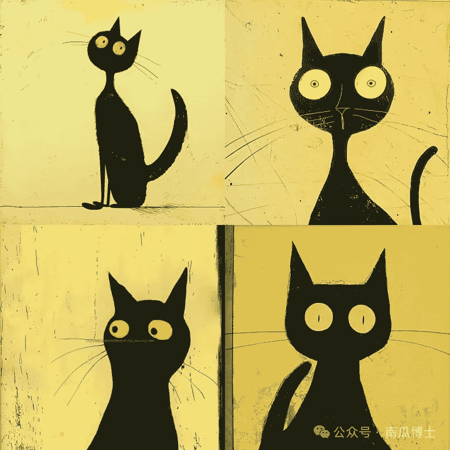

十万分之四的猫猫

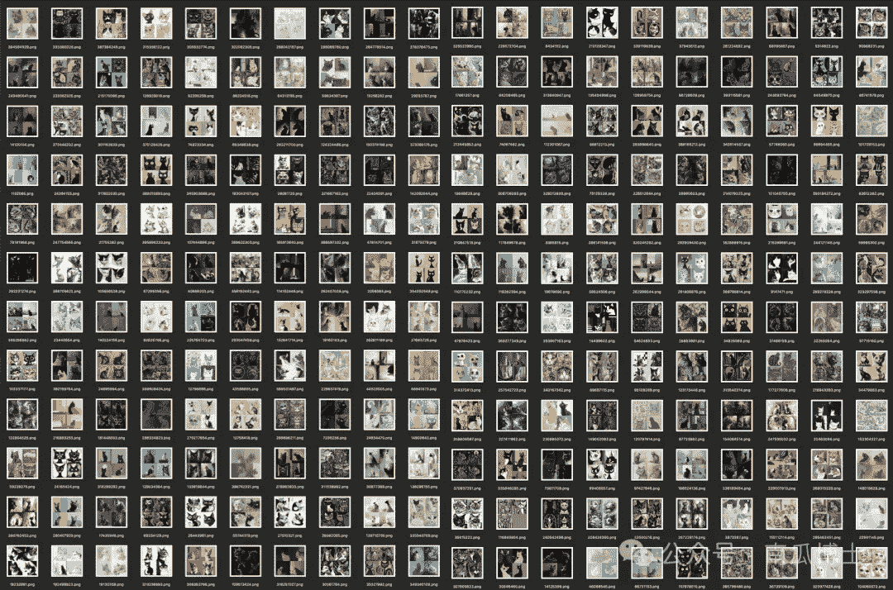

0.24% 的猫猫

今天这篇文章就是我左右互博观点的过程，希望能给你也带来些启发。

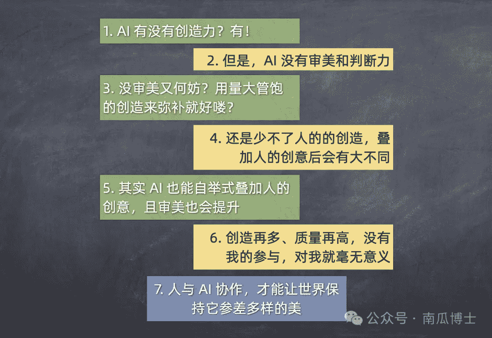

# **1**

##

# **AI 有没有创造力？有！**

我曾经斩钉截铁地说 AI 的创意就是比人强。 《ChatGPT 的创意有多强》 这篇文章就是证据：对于我想不出来的谜题，AI 总能用富有创造力的方法来给出回答。

其实这并不意外。创意是什么？是在你思考的范畴之外，远远的地方，找到一个点，然后想方设法让这个点和你思考范畴之内的事物产生关联，创意就来了。所谓 thinking out of the box，就是创意。要在大模型中远远的位置找一个点，这事儿对 AI 来说可真不难。

我至今一直特别频繁地利用 AI 的创造力：当自己卡壳的时候问问 AI，它总能帮我开脑洞。

# **2**

##

# **但是，AI 没有审美和判断力**

对于“AI 没有判断力”这个论断，你也许会不同意：“我让 AI 给学生的作文打分，AI 说得头头是道表现得很不错呀。”

我的建议是——不要凭感觉。设计一个实验来验证它。

我在写自动生成小说的 agent flow 时做过实验：A、B、C 三段文字，让 AI 根据一个明确的标准找出最好的。除非是“哪段文字更简短”这样的简单标准，只要标准稍一复杂稍多一点点感性，AI 就犯晕。当我以 ABC 的顺序提供文字时 AI 告诉我 A 最好，以 BCA 顺序提供时它说 B 最好，以 CAB 顺序提供时它又说 C 最好。

只有当我再加入两层裁判、用非常复杂的提示词和 flow 过程来教 AI，它才能勉强完成“哪个大纲有最深刻的转折”这样的分析。但那样做的成本，用到评判的排列组合里，就高到不可接受。

所以，我在 人有人的用处 这篇文章中写到： AI 脑暴，人类挑选；AI 划桨，人类掌舵 。

# **3**

##

# 没审美又何妨？用量大管饱的创造来弥补就好喽？

既然我和 AI 有着“船长 vs 水手”似的协作，就别在乎 AI 缺乏审美和判断力吧。用好它的长处，让它大量地创造。

但随着 AI 能力的上升，提示词越来越容易，让 AI 生成高质量内容也越来越容易。

以绘画为例。自从有了 --sref 风格参考参数，我就再不担心自己不懂艺术相关专业词汇。只需要找一张自己喜欢的风格图片，--sref 后面跟上图片链接，用再简单不过的提示词，也能得到漂亮同款。

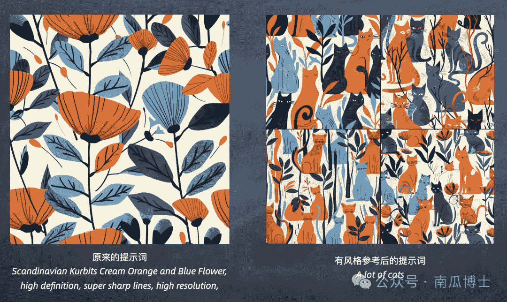

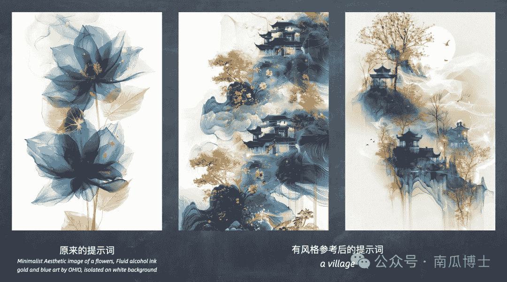

甚至你都不需要找参考图，只需要一个风格种子的数字就好。比如 --sref 238978694 画出来的图案是这样的（从上到下提示词分别为 environment, plants, animals, a boy, a girl）：

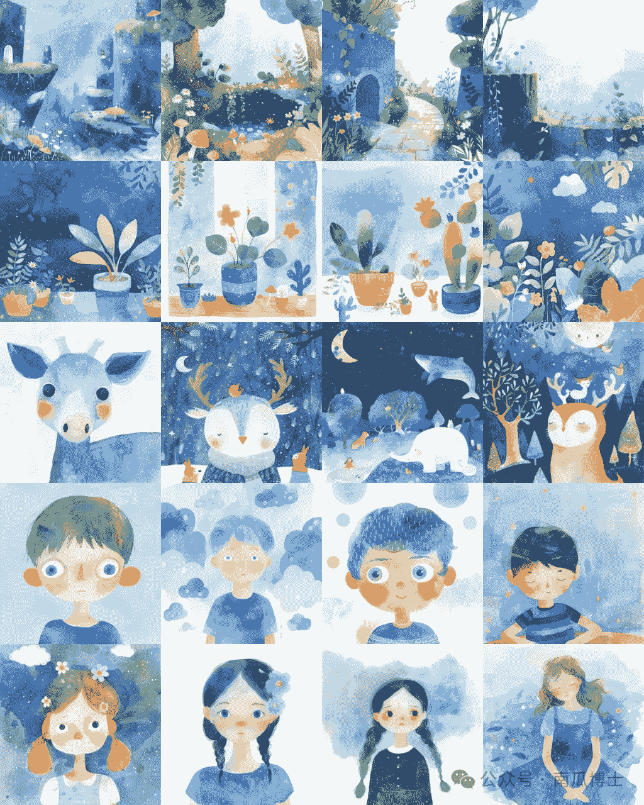

这多简单呀。在 --sref 后面添加随机数生成图片，然后挑出喜欢的，把风格种子收藏起来，想画画时就能用得上。

从此， 发明变成了发现 。让我从一大堆画里挑一个，可比让我画出一副漂亮的画，或自己写出一串用于生成漂亮图画的艺术词汇，难度低太多了。

# **4**

##

# 还是得叠加人的创造，才会有大不同

于是我写了个程序，让 AI 帮我自动生成风格各异的猫咪。

最初，我像老鼠掉进米缸里，看什么都觉得“哇！好看！真特别！”

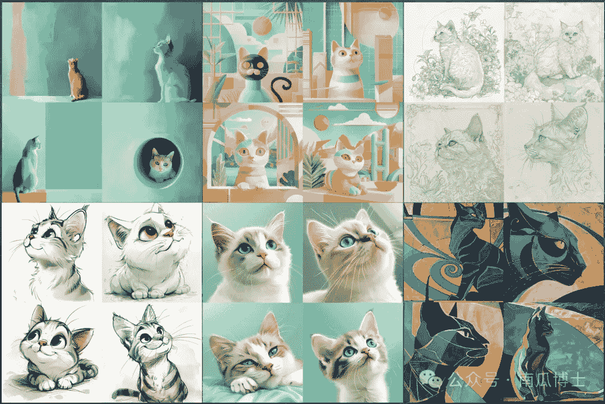

没过两天，就开始见怪不怪了——噢，又是这样的。

紧接着，我开始头疼——那么多风格堆在一起，最初觉得精彩的，都因为后来的“量大管饱”而失去了独特性，看起来没那么美了。当我想找风格种子的时候我怅然若失： 因为平庸的创造太多，“发现”再次变得费劲 。

还是去麦橘和 waytoagi 的种子库社群更有收获。在那里大家不贪多，每天就深度探索一个种子，感受一种风格的独特魅力。

[种子库 1 - 已投票](https://waytoagi.feishu.cn/wiki/OnrdwEkUXitL6ikv1L7cGLMVngM)

[--sref 40977194 ](https://waytoagi.feishu.cn/wiki/C8pdw7r4iihS1ykfmlfc46JNnlb)

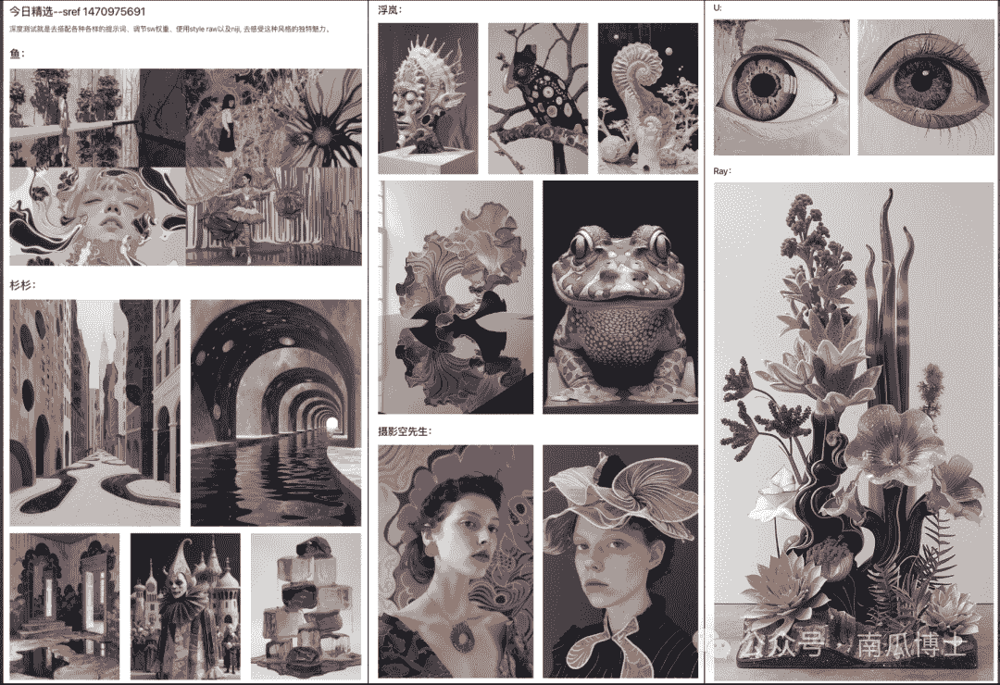

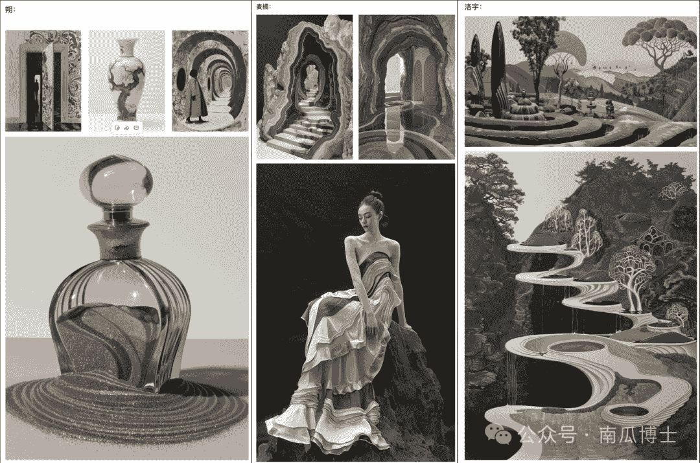

有潜力的风格种子， 叠加上人的创造 ，才有了真正精彩的产出。

# **5**

##

# **其实，AI 也能自举式创造**

那有没有可能用一套提示词架个 agent flow，让 AI 自举式的开始创造呢？

还真有可能。我给 AI 设计了一套工作流，依次做以下几件事：

1.  根据画风匹配作家

1.  从几个干扰选项中确认作家、排除步骤一瞎匹配的那些

1.  根据作家的作品描绘名场面

1.  将名场面转译成绘画指令

1.  将指令用对应画风画出来

例如下图左上角的猫猫，AI 能非常到位地识别匹配到作家奥斯卡·王尔德。从四幅图中挑出最配王尔德的它也能挑准，说明那是真匹配。（我做了好些这个实验，收到很多令人惊叹的结果，后面另写文章介绍。）

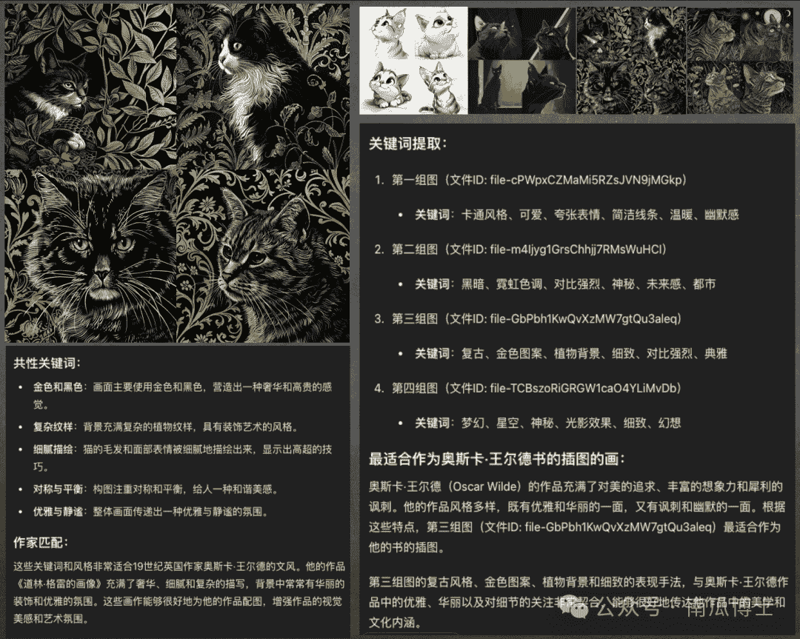

然后，它从《道林·格雷的画像》这部小说中提取出名场面，转译成 prompt，得到了如下的图画。

注意到左侧，年青俊美的道林格雷那空洞的眼神了吗？注意到右侧，手握匕首的道林，和都柏林 Merrion 广场里的王尔德雕塑是同样的姿势吗？

这些细节，真的让我鸡皮疙瘩都起来了。当给到的方法足够好，让 AI 能从人类知识的宝库里获取足够多信息，AI 也可以有精彩的自举式创造。

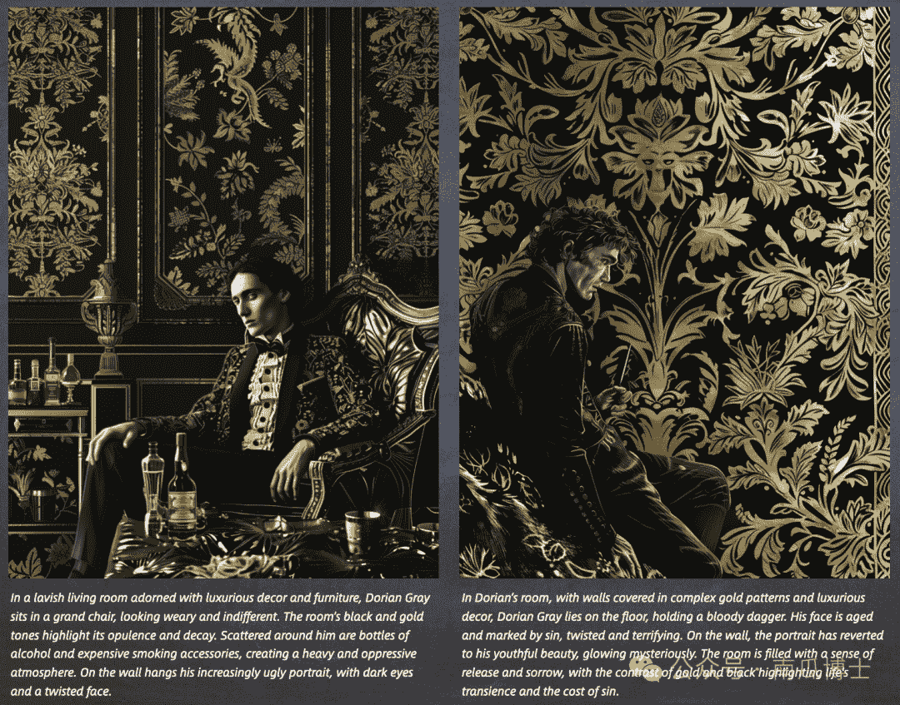

# **6**

##

# 创造再多、质量再高，没有我的参与，对我就毫无意义

上面这套流程看起来是能顺畅地运行的，只要不计成本，就可以得到海量的风格、海量的图片，精心调教过的 workflow 还能让生成的图片有 70 分以上的审美和足够精彩的故事。

那还要强调人的价值吗？让 AI 做，人歇着就好不是吗？

我的回答是——当然要坚持人的价值。

手握匕首的道林那幅图之所以让我起鸡皮疙瘩，是因为它让我想起了王尔德的《自深深处》，让我想起了 Marrion 广场那座雕像。它有价值，是因为有我在当观众。

不管是 AI 也好，人类世界里芸芸众生的创作也好，有十万只猫咪又如何呢？只有我自己在某一刻起心动念、用喷涌而出的表达意愿创作出的那一只猫，或者在茫茫多他人的创作中吸引住我眼神、让我有联想、被击中的那一只猫，才是 对我有意义的猫 。

# **7**

##

# 人与 AI 协作，保护好这个参差多样的美的世界

我终止了自动运行的脚本，把十万只猫咪封存起来。

AI 的创造像洪水一般，太过汹涌。大模型是人类智慧的加权平均。偷懒的人们用“一键出”的方式，让 AI 不断创造等于平均值的内容，而这些内容不知什么时候又会被用于 AI 的继续训练。我特别担心这样一来，AI 像做平滑降噪算法一样， 对人类的文化进行“高斯模糊”。那些独特的风格会渐渐被平均掉，变成灰蒙蒙的一片 。

我，是对我而言，最独特的存在。AI 是个平均值，但我能用我的创造和判断、为 AI 的创造注入灵魂，得到对我而言最有价值的作品。

麦橘和 waytoagi 风格库社群的人肉探索是有意义的；一个需要人不断参与其中挑挑拣拣的 agent flow 是有意义的。

每一个人，当他 积极地使用 AI 时，他就把他的独特性、留在了他和 AI 共创的作品里。

而保留着每个个体独特性的世界，才是对人类有意义的世界。

耳边响起了《流浪地球》里刘培强的声音：“ 没有人类的文明毫无意义 。”

##

[其实，之前就写过同](http://mp.weixin.qq.com/s?__biz=MzA4MjM5MDI0Ng==&mid=2648506612&idx=1&sn=129684629021064d627cf0831c1c795e&chksm=87afdd7db0d8546b12d47e66d6041de842ed7880d761a546c36de4bbe7cf1e70aa902dc3929a&scene=21#wechat_redirect)样观点的文章《 真的能醉生梦死吗 》。 只不过，这一次，看到 AI 像洪水一样给了我十万只猫咪后，我对此的感受更深了。

最后打个广告：今晚，我会和几个朋友一起做场直播，作为 7 月成都 LIFE 教育创新大会的预热。 LIFE直播预告 | 教育创新你怎么看——黄豆包AI机器人PK教育专家

“人何以为人”是 关注  AI 的教育 届的朋友们，会频频探讨的话题。 今晚我们一起聊 AI 的教育创新，应该会碰撞出不少火花。

