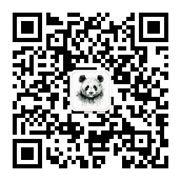
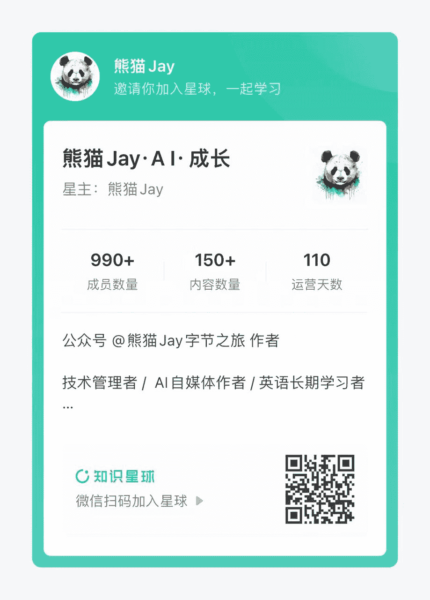

# 熊猫Jay-提示词

> 来源：[https://waytoagi.feishu.cn/docx/FnPZdFbe2oYlbzx8A8dc73E1nsg](https://waytoagi.feishu.cn/docx/FnPZdFbe2oYlbzx8A8dc73E1nsg)

> 聚焦于 AI提示词、智能体和职场提效、上市公司技术团队管理者。

> 公众号：**熊猫Jay字节之旅**

## 知识库文章索引

+   [熊猫Jay：万字解读ChatGPT提示词最佳实践](https://waytoagi.feishu.cn/wiki/FoJJwvwBNiEJYjkx1ygccO2CnVe)

+   [熊猫Jay：超全的AI工具生成PPT的思路和使用指南, 收获培训奖励1000](https://waytoagi.feishu.cn/wiki/IOlxwqVciiQwtmk3duPcfGH7nsR?table=tblp81WDObH3I20H&view=vewM2PB3Iu)

+   [熊猫Jay: 任何人都可以利用ChatGPT开发自己的谷歌插件](https://waytoagi.feishu.cn/wiki/CYD6wToChiPjrCk1KXvcy7oUnac?table=tblp81WDObH3I20H&view=vewM2PB3Iu)

+   [熊猫Jay ：用 AI + 思维模型 探索问题的全新解答](https://waytoagi.feishu.cn/wiki/CDxtwS8sVi9pZjksoUbcGmeonjd?table=tblp81WDObH3I20H&view=vewM2PB3Iu)

+   [熊猫Jay：GPTs 从入门、进阶、实践到防护的万字教程](https://waytoagi.feishu.cn/wiki/KFB4wy3cbi2BZ8k0Ak0cNAbanjc?table=tblp81WDObH3I20H&view=vewM2PB3Iu)

## 分享视频

<https://player.bilibili.com/player.html?bvid=1Y2421K7ve&spm_id_from=333.999.0.0&vd_source=290a2836f7818edc2c18c6eb525d4abe>

## 分享课件

[AI + 思维模型.pdf](https://internal-api-drive-stream.feishu.cn/space/api/box/stream/download/all/YxmabsLK4oyhyix5WFSceJ7fn8d)

## 联系作者

公众号： 熊猫Jay字节之旅；免费星球：熊猫Jay·AI·成长，欢迎关注。

