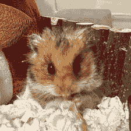
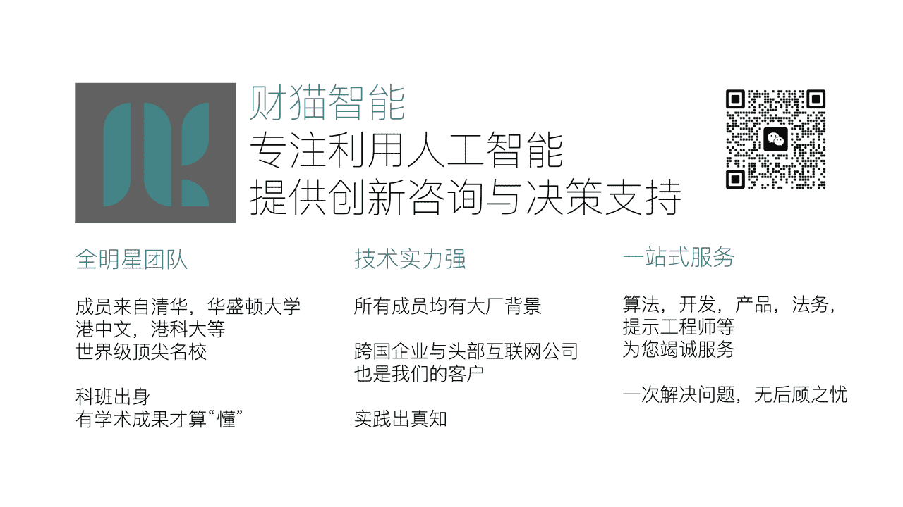

# 陈财猫团队-提示词

> 来源：[https://waytoagi.feishu.cn/docx/B25JdkbSZopaoOx7k0Fc6ppanWg](https://waytoagi.feishu.cn/docx/B25JdkbSZopaoOx7k0Fc6ppanWg)

> 陈财猫：Prompt Engineer，前AI产品经理

> 《ChatGPT进阶 提示工程入门》作者

> 财猫AI公众号主笔

> 目前在lead一个做AI应用与AI咨询的小团队

> 微信： xiaotu012chp

## 提供的服务

## 知识库文章索引

+   [陈财猫：BORE框架的产生过程，一个自动驾驶产品经理的ChatGPT方法论](https://waytoagi.feishu.cn/wiki/TLdHwb9WqiXQOlkINftc4wepnBc)

+   [陈财猫：可操作，可重复的GPT使用框架“BROKE”](https://waytoagi.feishu.cn/wiki/HIizwFasOiUcDmklRF2cVWuunac)

+   [陈财猫：如何用GPT写长篇科幻？用分治法完成复杂任务](https://waytoagi.feishu.cn/wiki/GY3sw4LQli5k9ckzrDZcRnVmnQf)

+   [陈财猫：推荐书单--了解各个领域的知识，并在恰当的时候调用它们](https://waytoagi.feishu.cn/wiki/YcHfwzWZZiQ9kjksVRwc9m6JnYf)

+   [陈财猫:  由GPT驱动的人生重开模拟器游戏，体验无穷变化的多重人生(已开源)](https://waytoagi.feishu.cn/wiki/WyJSwjvN5iZudhkd8iocrSy3njc)

+   [陈财猫：Prompt-Top100 GPTs 提示精灵小富贵](https://waytoagi.feishu.cn/wiki/Sv7uwNcjki40qYkSyfMcUI4tn2e)

+   [陈财猫：陈财猫-巨聪明仓鼠参谋 Prompt](https://waytoagi.feishu.cn/wiki/UfMGw7queiek5tk8qcUc5DnInSc)

## 分享视频

<https://player.bilibili.com/player.html?bvid=1Cj421Z73t&spm_id_from=333.999.0.0&vd_source=290a2836f7818edc2c18c6eb525d4abe>