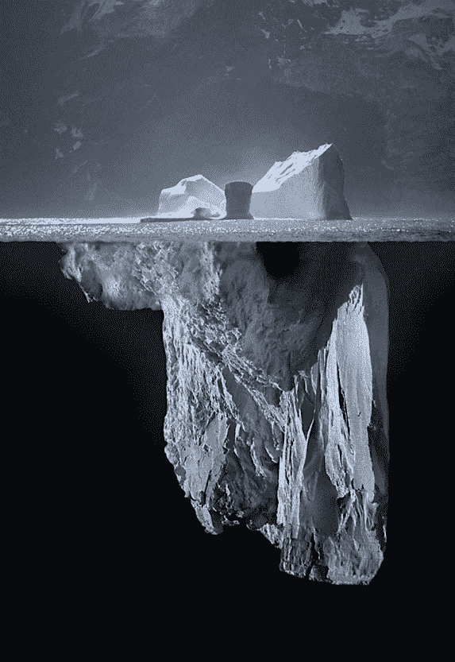

# 剧本创作指南 3 短片写作几点注意

> 来源：[https://waytoagi.feishu.cn/docx/CVz7dPaZ3o5rP8xRK4Fcm947nKg](https://waytoagi.feishu.cn/docx/CVz7dPaZ3o5rP8xRK4Fcm947nKg)

> 短片定义

> 什么是短片？ 短片是指时长不足以成为长片的视频。虽然没有官方的共识，但一般来说，短片的总播放时间包括片尾字幕在内不超过45分钟。

> 短片有多长？

> 短片的时长通常在15秒到45分钟之间。 如果你要将短片提交给电影节，这个时长也可能会有所不同。圣丹斯电影节将50分钟视为短片，而奥斯卡奖则将40分钟视为短片。

## 保持简单

**如果有一个编写短片的通用规则，那就是这个。记住要K.**I.S.S. — Keep it simple, students.（保持简单，学生们）。

许多编剧会将本来可以简单讲述的故事复杂化。这并不是**说你不应该挑战自己。挑**战极限，追求所爱，目的是写出感觉对的东西。

但是，小题大做从来都不是正面的。在构思短片时，不要试图塞入太多曲折和转折（要少许、适量）。

多条故事线、时间段或视角当然可以实现——但它们都应该引起极大的警觉。复杂性需要在短片中有令人信服的理由，但通常没有。

故事越复杂，就越有可能在与观众建立联系时遇到困难。这是因为你偏离了这个简单规则：K.I.S.S.

> 冰山叙事 - 简单有趣的叙事概念

> 1932年，海明威在他的纪实性作品《午后之死》中，提出著名的“冰山原则”：如果一个散文作家对他所写的东西有足够的了解，他可能会省略他所知道的东西，而读者，如果作家写得足够真实，就会对这些事情有一种强烈的感觉，就好像作者已经说过一样。冰山运动的尊严是由于只有八分之一在水面上。一个因为不了解事物而省略事物的作家，只会在他的写作中制造空洞的地方。

> 而他也真的写了一篇冰山文学：

> For Sale: Baby Shoes, Never Worn

> 出售：婴儿鞋，从未穿过

这是海明威臭名昭著的六字短篇小说，我们被迫想象的所有那些痛苦的细节和主题——都隐藏在表面之下。然而，所有这些潜台词构成了故事的核心，使它如此引人注目，即使我们没有被明确告知任何内容。

冰山故事如此强大的原因：**人类的想象力能够做出不可思议的事情，很大程度上是因为我**们倾向于用自己的经验和情感来填补这些空白。

作为讲故事的人，这为我们提供了一个难以置信**的机会。通过给观**众提供简单的故事线索，以激发他们的想象力，然后有意识地剥离其他故事元素和背景，我们有可能创造出比全盘托出更强大的体验。

## 选择一个独特的概念

你想要引人注目。你想要做出优秀的作品。于是想看看当下什么是热门的。

**跟风是让自己失败的可靠方法，**复制长片或电影节的最新趋势是让你在混乱中迷失的头号方式。

解决方案是什么？你需要找到一个独特的概念。即使你真的喜欢现在的流行元素，你仍然需要对你的素材提出一个出人意料、个人化的解读。

> 编写短片需要新颖和创新的想法。

## 找到一个巧妙的转折

选择一个独特的概念并不意味着你必须从头开始。无论你是编写戏剧短片、喜剧、科幻、恐怖还是其他类型的电影——以一种新颖的方式讲述一个熟悉的故事，都可以让你引人注目。

大多数最佳短片都以经过时间考验的故事为基础，这在长片中也经常发生。

想想《怪物史莱克》和《睡美人》。童话故事加上转折，一个新鲜的视角。

从民间故事、当前事件或历史中汲取灵感。将这些故事引向大胆的新方向，你可能会在短片电影节上获得成功。

你甚至可能会最终获得奥斯卡奖。

## 选择一个类型并全力以赴

**当编写一个能够进入短**片电影节并让你引人注目的短片时，选择一个类型并坚持它至关重要。记住，编写短片需要你保持简单。选择一个类型为你提供了一个预设的讲故事的简单指南。

好莱坞的电影墓地充满了各种大杂烩型的短片。这些电影让观众陷入了“我到底在看什么？”的迷茫状态。

恐怖片？喜剧？爱情片？西部片？特别是在编写短片时，你会希望能够指向你的类型并自信地说，“这就是这个！”

混合和颠覆类型——当然可以做，但如果你的目标是短片那就算了。

将你所有的想法、个性、激情，都融入到一个单一的类型中，并抓住此类型的头发不要撒手（好像哪里不对）。

> 编写短片意味着选择一个类型并坚持下去。

即使是世界上最棒的电影制作人在未能坚持一个类型时也会遇到麻烦。所以我们强调的是：

> 选择一个，只有一个类型，无论是什么，就选一个！

然后保持在类型的范围内编写你的短片。

## 保持短片...短

如上所述，好莱坞短片是指时长少于40-45分钟的电影。目前的世界充斥着短视频，人们不再有耐心，理想情况下你的短片控制在3-10分钟范围内。

> 越短越好。

你必须向世界展示，你能够在几分钟内创造情感，建立联系，并讲述一个故事。成为你自己的电影制作特种兵：进入，撤出，致命一击。

此外，如果你参加电影节或比赛，想象下评委看了太多拖沓的短（长）片后心情暴躁，是否还有耐心看完一个仅仅5分钟的长（短）片。

## 不要试图编写一部长片

我们听过很多短片又改编成长片的传说，这是真的，但，只有你的短片真正有价值时。

如果你的故事有长片潜质，那么就去编写长片剧本，不要截取一个片段充当短片剧本。

> 一个独立完整的故事不是长片的三分钟。

或者，从故事中的某个特定元素、时刻或感觉中寻找灵感。从那里开始，将其发展成一个引人入胜、完全实现的独立短片。

> 不要试图将一部长片塞进一个短片中，这也行不通。

> 韦斯·安德森在制作全长版本之前，给了世界一个13分钟的黑白短片《瓶装火箭》。

> Chazelle的《爆裂鼓手》成长为大型的《爆裂鼓手》。

> Blomkamp将他的五分钟短片《约翰内斯堡的活着》扩展成了《第九区》。

> 在这些情况下，制作人投入时间和精力编写了独立的短片。它们是情感丰富、有趣、戏剧性、引人入胜的短片，独立于它们所衍生的长片。

> 这些短片是真正的电影。它们讲述了完整的故事。它们有结局。如果做不到这一点，你就没有一部短片。

## 确定最佳格式

你的短片想法可能比短片更大。

+   编写短片时遇到困难结束？

+   是否有其他几个相关的故事受到启发？

+   你的主角如此充满活力，以至于他或她想要做更多、说更多？

也许，这不仅仅是一部短片。如果你有一个**可以发展成整个**系列的短片故事，这不奇怪，但还是做好当下。

## 讲述一个独立的故事

你可能是为了参赛而编写短片，但无论目标是什么，作品都需要独立存在。

**奥斯卡获奖的现场短片和动画短片的列表，就有一个共同点：它**们讲述了一个简洁而连贯的故事，当片尾字幕滚动时就结束了。它们不会让观众带着未回答的问题感到困惑（除非这是故事的重点）。

把自己放在观众席上。这个故事会让你满意吗——情感、发展、角色以及结局。

如果你编写的短片能够圆满结束，不会让观众因为错误的原因感到困惑，那么你就做对了。

## 观看短片

如果你想要清洁牙齿，你必须每天刷牙。如果你想成为职业健美运动员，你必须去健身房。

同样，如果你想在编写短片方面取得成功，好消息是你必须观看很多短片。你会被娱乐、激动、感动。

你可以通过观看他人的作品吸收知识和发现电影制作技巧。

你可以在网上找到许多最佳短片。奥斯卡短片总是值得一看的，圣丹斯短片也是如此。YouTube上的最佳短片也值得探索。

每周观看几部短片，然后选择你最喜欢的——与你友分享。