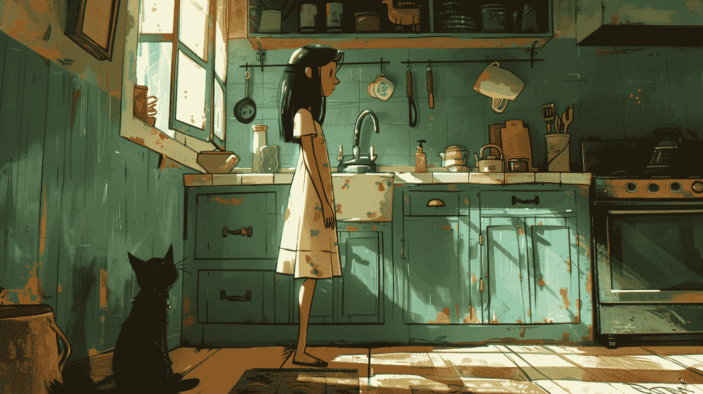

# 离家出走的猫——离谱小事系列

> 来源：[https://waytoagi.feishu.cn/docx/SUFYdgW8jolSxbxEoaEcXWIHnPe](https://waytoagi.feishu.cn/docx/SUFYdgW8jolSxbxEoaEcXWIHnPe)

**主**题：猫是女孩的避风港，但是她没有意识到，直到失去了才发现，但猫又是女孩的保护罩，让女孩不敢面对真实的世界

形式： 前半部采用主观视角，基本不出现主角形象，规避一致性问题

此为剧本，不包含分镜。

**INT. 小美的公寓 - 夜**

主观镜头，一只手推开门，环顾空荡的客厅。

小美：“小黑，你在哪儿？”

**INT 小美的公寓 - 夜**

四处寻找

小美 ：“小黑”，“小黑”，“小黑”

**EXT - 公寓楼周边 - 夜**

一只手在张贴寻猫启事

小美：我从没想到过它会消失

**EXT - 公寓楼周边 - 夜**

路过的行人看向镜头

小美：你见过这只猫吗。

行人摇头，转身走

**字幕：几天后**

**INT 小美的公寓 - 夜**

电话屏幕亮起，视频通话铃声

一只手拿起电话

屏幕亮起：朋友的脸，快看我发你的照片（主角露脸）

镜头转

**INT 小美的公寓 - 夜**

电脑屏幕：小黑在乡村的照片

**INT 小美的公寓 - 夜**

一只手拿着的电话屏幕，视频聊天继续（主角露脸）

朋友：你看看是不是小黑

小美：是，这绝对是，它怎么...

朋友：同事去旅游时看到的，这个地方靠离谱的动物在吸引人

**INT 小美的公寓 - 夜**

电脑屏幕上小黑在乡村的照片

主观镜头起身转

**INT 公交车 - 日**

窗外呼啸而过的美景

**EXT 离谱村 - 日**

很多游客

一个导游拿着旗：去海边的这边走，哎，别掉队了啊

村民在卖力的表演

游客拿着手机拍照，不时有点赞声响起

**EXT 离谱村 - 白天**

很多游客

一个导游拿着旗：去海边的这边走，哎，别掉队了啊

**EXT 大树下 - 白天**

一只手拨开巨大的叶子，看向后面

小黑趴在一块石头上晒着太阳，面前一群离谱小动物在追逐玩耍。

小黑惬意的表情，它停下来，好像听到了什么

镜头向下（小美躲起来）

**EXT 大树下 - 白天**

小黑睁着大大的眼睛缓缓走向镜头。

**EXT 大树下 - 白天**

小黑蹲坐下来：你不该找我的

镜头摇动，小美：你为什么离开我？你怎么会说话？

小黑：我很早就会说话

INT 小美童年老家 - 日（回忆）（注：这里开始到结束不用主观镜头）

幼年小美在和小黑玩

小黑：快来抓我呀

幼年小美蹒跚着，嘴里呀呀叫着

EXT 乡村路上 - 日（回忆）

小黑跑向穿着学生装的小美

小黑：你回来了

小美正在和朋友打电话，没有理会小黑

小黑坐下，看着小美远去

INT 城里公寓 - 日（回忆）

下班后疲惫的小美开门进屋

躺在床上

小黑静静地趴在床边

小美画外音：我已经忘记了小黑已经很老了

**EXT - 离谱海边 - 傍晚**

大全景，小美和小黑看着日落

小黑：我要走了

小美：我不想你走

小黑：我老了，我不想你陪我到最后一刻。

小美：我不听我不听

小黑向村里走：你不会永远独自面对世界，去找一个让你快乐的人吧。

泪水滑落，小美：再见了，小黑。

结尾多张照片形式静态画面

+   小美遇到一个男生

+   小黑的墓碑

+   小美结婚

+   宝宝出生

+   一只小黑猫在礼物盒里

+   宝宝和小黑猫在一起玩耍