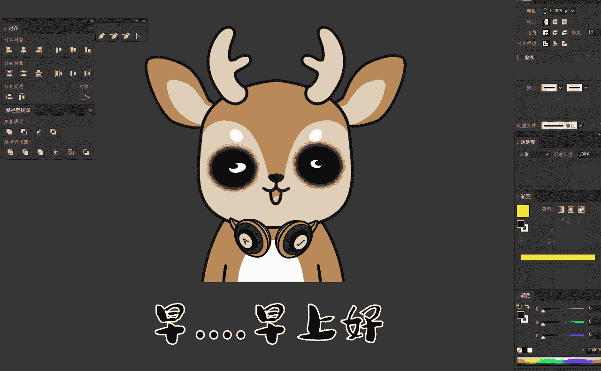

# 我是小鹿——离谱小事系列

> 来源：[https://waytoagi.feishu.cn/docx/IxljdrEKWov8SZxd350cdLRHnVf](https://waytoagi.feishu.cn/docx/IxljdrEKWov8SZxd350cdLRHnVf)

> 小鹿是waytoagi的吉祥物，谐音路，不过我寻思着光谐音不够离谱啊，于是灵光一闪，让它求锤得锤吧，于是它黑眼圈的原因有了（不睡觉不是原因）

小鹿：我是小鹿，我有个不可告人的秘密，离谱村的离谱有一半原因在我

小鹿：每到午夜两点，我的双角之间会开启一个时空门，经常有走错路的人穿过门来到我面前，就像现在，这位游客，麻烦从我脸上下去

茄子猪：哦哦，对不起，我还想为什么这条路有点偏软

小鹿：我懂，请快点下去就好了

茄子猪跳到地上，慢慢的走了 两步，回头问：章鱼大厨不在吧？！

小鹿：睡了

茄子猪：哦哦，谢谢

小鹿：这~就是我不睡觉的原因

小鹿：这位外国友人，可以下去了吗？

奥特曼山姆：刚才我还在采访怎么就来这了

小鹿：说来话长，GPT5什么时候上市？

奥特曼山姆：我还有点事，先走了

小鹿：这TM不是比twitter好用？

