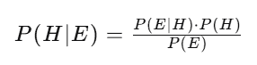
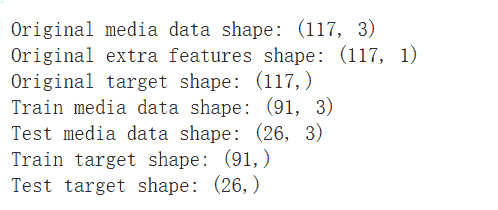
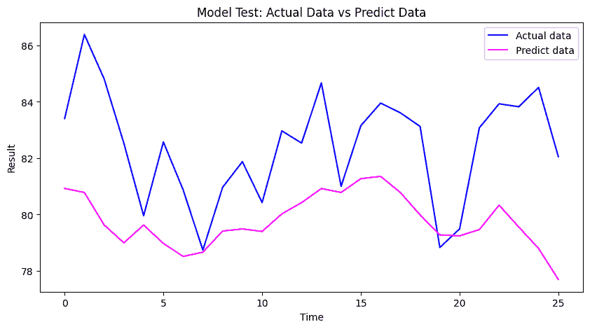
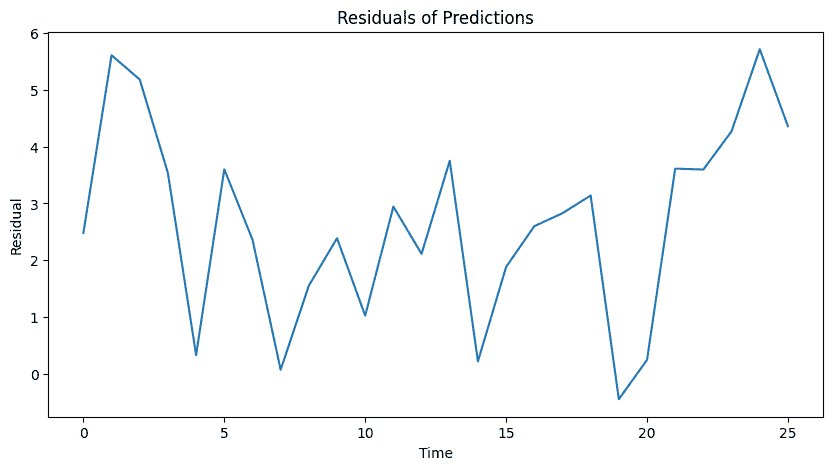
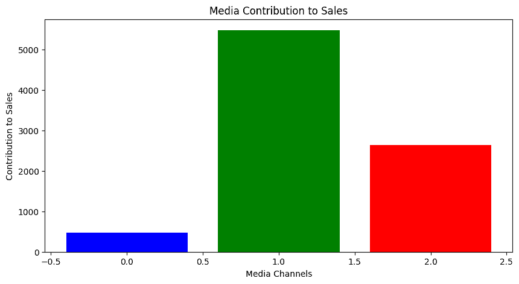
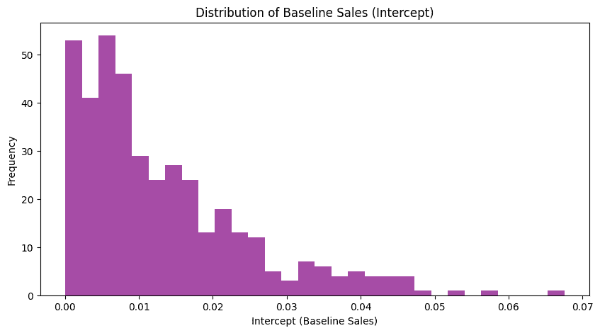
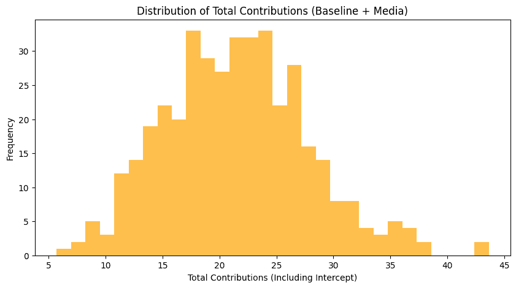
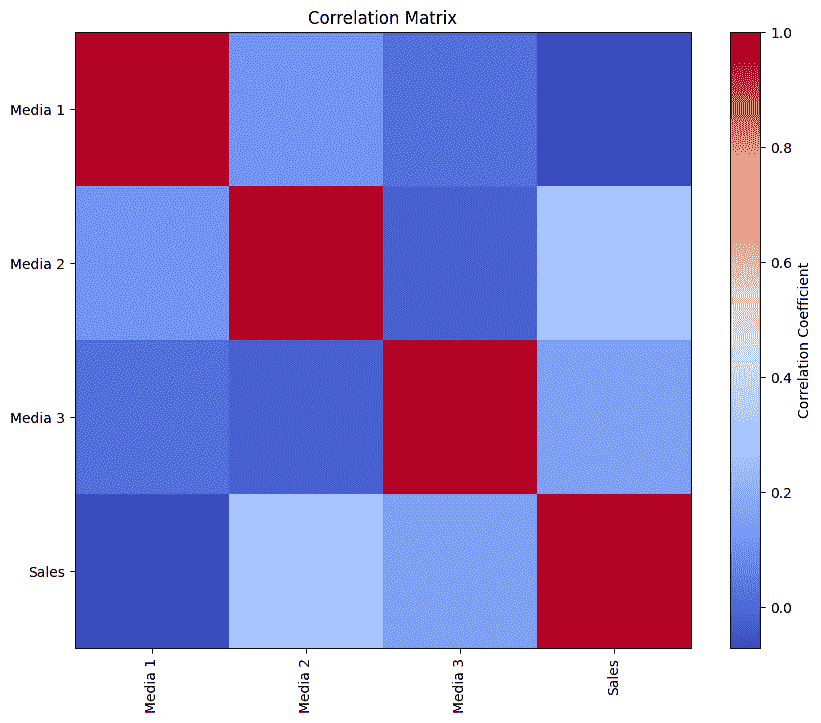
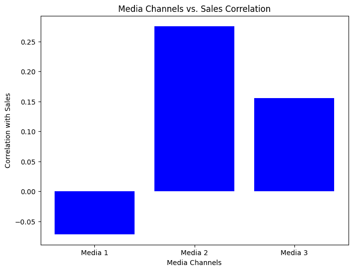

# [应用开发] 轻量化MMM (Marketing Mix Modelling) 的部署运行

> 来源：[https://waytoagi.feishu.cn/docx/PHlmdRgv9oZThbxscDvcLThan6e](https://waytoagi.feishu.cn/docx/PHlmdRgv9oZThbxscDvcLThan6e)

MMM(Marketing Mix Modelling) 做Marketing的同学应该都不陌生了，可以用大量的微分数据计算一系列因素参数（比如价格，媒体投放，季节气候等）对结果（最通用的是销售额，也可以是其他任何连续性的数据，品牌知名度也可以计算，但考虑品牌知名度的数据可微分性，平行维度的数据对模型的帮助有限）的趋势性影响。

# **为什么需要轻量化的MMM**

轻量化MMM（LightweightMMM）是一个由Google开发的轻量级贝叶斯营销组合建模（Bayesian Marketing Mix Modeling, MMM）库。相比传统的MMM，轻量化的产品具备更高的灵活性，更低的训练成本，可以在绝大部分的环境下运行。

https://github.com/google/lightweight_mmm?tab=readme-ov-file#theory

# 贝叶斯定理

## 概念

贝叶斯定理是概率论中的一个重要概念，它描述了在给定相关证据的情况下，某个假设的概率如何更新。公式为：



其中：

+   𝑃(𝐻∣𝐸) 是在证据 𝐸 出现后假设 𝐻 成立的概率，也称为后验概率。

+   𝑃(𝐸∣𝐻) 是在假设 𝐻成立的情况下，证据 𝐸 出现的概率，也称为似然度。

+   𝑃(𝐻) 是在没有考虑任何证据之前，假设 𝐻 成立的概率，也称为先验概率。

+   𝑃(𝐸) 是证据 𝐸E 出现的总概率，也称为边际概率。

结合概率论，我们可以对一定微分状态下的连续数据进行求导，从而预测在特定条件下，数据在未来时间内连贯延续发生的变化趋势（销售增加，增加多少，减少，减少多少，增加或减少的原因等等）。有兴趣的同学可以去系统学习贝叶斯定理和微积分，但运行这个模型暂时不需要。

## 贝叶斯方法在MMM中的工作流程

1.  **定义先验概率**：在没有考虑任何营销活动的影响之前，根据历史数据或专家意见，为每个营销渠道设定一个初始的影响概率（先验概率）。

1.  **收集数据**：收集与营销活动相关的数据，包括不同渠道的投入和相应的销售或品牌知名度结果。

1.  **计算似然度**：对于每个营销渠道，计算在给定该渠道投入的情况下，观察到的销售或品牌知名度结果的概率。

1.  **更新后验概率**：使用贝叶斯定理，结合先验概率和似然度，更新每个营销渠道对销售或品牌知名度的影响概率（后验概率）。

1.  **模型优化**：通过迭代过程，不断调整先验概率和模型参数，以最大化模型对数据的拟合度。

1.  **结果解释**：最终，模型提供了每个营销渠道对销售或品牌知名度的相对贡献度，帮助营销人员做出更明智的决策。

## 和反向传播算法（BP）的相似和不同

和反向传播类似，贝叶斯方法也是通过微分求导来实现相关性分析，我之前用反向传播方法尝试过一些简单的模型尝试一样的目标，但反向传播的结果通常不具备可解释性（也就是概率），更多用于模型参数的优化，而概率性预测可以让模型的结果更具备可解释性。

# 模型实现

下面是分步骤的执行代码，MMM因为做成了python库，因此非常容易部署，下面的代码是我基于colab环境写的，本地部署的话，相应调整文件的调用方式就可以：

## **第一步：安装运行需要的依赖项**

```
#colab每次要重新安装，（本地安装一次就可以，去掉！直接安装）
!pip install lightweight_mmm
!pip install jax jaxlib numpyro

#导入需要用到的库
import jax.numpy as jnp
import numpyro
import numpy as np
import matplotlib.pyplot as plt
import arviz as az
import pandas as pd

from lightweight_mmm import lightweight_mmm
from lightweight_mmm import preprocessing
from lightweight_mmm import utils
```

## **第二步：准备数据集**

用于实验的话，可以尝试用模拟数据集：

```
#模拟一组数据进行实验
data_size = 117
media_data, extra_features, target, media_costs = utils.simulate_dummy_data(
    data_size=data_size,
    n_media_channels=3,
    n_extra_features=1)

# 打印数据集大小以检查完整性
print(f&quot;Original media data shape: {media_data.shape}&quot;)
print(f&quot;Original extra features shape: {extra_features.shape}&quot;)
print(f&quot;Original target shape: {target.shape}&quot;)
```

模拟数据的批次是117，所以跑出来的形状是117组数据，训练集78% = 91， 测试集22% = 26



也可以用自己的数据集。如果本地运行的话，可以让GPT改成遍历本地文件地址

```
# 上传文件
uploaded = files.upload()

# 确认文件名
filename = list(uploaded.keys())[0]
print(f&#x27;Uploaded file: {filename}&#x27;)

# 读取CSV文件
data = pd.read_csv(filename)

# 打印数据集大小以检查完整性
print(f&quot;Original data shape: {data.shape}&quot;)

# 假设最后一列是目标变量（sales），其余列是特征数据
media_data = data.iloc[:, :-2].values  # 媒体数据（去除最后两列）
extra_features = data.iloc[:, -2].values.reshape(-1, 1)  # 额外特征（倒数第二列）
target = data.iloc[:, -1].values  # 目标变量（sales，最后一列）

# 打印拆分前的数组形状，这里主要用来确认数据集的正确性，避免之后报错
print(f&quot;Media data shape: {media_data.shape}&quot;)
print(f&quot;Extra features shape: {extra_features.shape}&quot;)
print(f&quot;Target shape: {target.shape}&quot;)
```

## **第三步：拆分数据**

```
# 拆分数据
split_point = int(data.shape[0] * 0.78)  # 使用 78% 的数据作为训练数据，22% 的数据作为测试数据，这里的0.78是超参数，可以根据需要调整
media_data_train = media_data[:split_point, ...]
media_data_test = media_data[split_point:, ...]
target_train = target[:split_point]
target_test = target[split_point:]
extra_features_train = extra_features[:split_point, ...]
extra_features_test = extra_features[split_point:, ...]

# 打印拆分后的数据集大小以检查完整性，用于检查错误
print(f&quot;Train media data shape: {media_data_train.shape}&quot;)
print(f&quot;Test media data shape: {media_data_test.shape}&quot;)
print(f&quot;Train target shape: {target_train.shape}&quot;)
print(f&quot;Test target shape: {target_test.shape}&quot;)
```

## 第四步：数据预处理

由于我们实际的数据绝对值落差会非常大，比如点击率（CTR）通常只有（1%），而媒体花费可能会是上百万，会影响模型对于每个因素的贡献率判断，因此这里会做一个缩放处理（归一化），让每个变量之间的关系是对等的。

```
# 数据预处理
media_scaler = preprocessing.CustomScaler(divide_operation=jnp.mean)
extra_features_scaler = preprocessing.CustomScaler(divide_operation=jnp.mean)
target_scaler = preprocessing.CustomScaler(divide_operation=jnp.mean)
cost_scaler = preprocessing.CustomScaler(divide_operation=jnp.mean)  # 添加了对成本数据的缩放处理

media_data_train = media_scaler.fit_transform(media_data_train)
extra_features_train = extra_features_scaler.fit_transform(extra_features_train)
target_train = target_scaler.fit_transform(target_train)
media_costs_scaled = cost_scaler.fit_transform(media_costs)  # 对成本数据进行缩放

# 打印预处理后的数据以检查
print(f&quot;Scaled train media data shape: {media_data_train.shape}&quot;)
print(f&quot;Scaled train extra features shape: {extra_features_train.shape}&quot;)
print(f&quot;Scaled train target shape: {target_train.shape}&quot;)
print(f&quot;Scaled media costs shape: {media_costs_scaled.shape}&quot;)
```

## 第五步：初始化模型

这一步数据集训练是最费时间的，取决于数据量的大小和训练步长

```
# 初始化模型
mmm = lightweight_mmm.LightweightMMM(model_name=&quot;carryover&quot;)

# 训练模型
mmm.fit(
    media=media_data_train,
    media_prior=media_costs_scaled,  # 使用缩放的成本数据
    target=target_train,
    extra_features=extra_features_train,
    number_warmup=100,  # 减少 warmup 次数以加快计算速度，实际应用可以选择更高的批次：1000-1500
    number_samples=200,  # 减少 samples 数量以加快计算速度，实际应用可以选择更高的批次：2000-3000
    seed=42  # 可选：用于结果的可重复性
```

## 第六步：运算可视化

这里的自由度就比较高了，我举了一些常用的例子供大家参考，也可以根据自己的需求增加自己需要的可视化图表

```
# 预测和可视化
media_data_test_scaled = media_scaler.transform(media_data_test)
predictions = mmm.predict(media_data_test_scaled)

# 逆缩放预测值
predictions_inverse_scaled = target_scaler.inverse_transform(predictions)

# 打印逆缩放后的预测数据形状
print(f&quot;Inverse scaled predictions shape: {predictions_inverse_scaled.shape}&quot;)

# 确保预测数据和实际数据的形状一致
predictions_mean = predictions_inverse_scaled.mean(axis=0).flatten()[:len(target_test)]

# 打印预测数据和实际数据的形状以检查一致性
print(f&quot;Predictions shape: {predictions_mean.shape}&quot;)
print(f&quot;Target test shape: {target_test.shape}&quot;)

# 绘制实际值与预测值
plt.close(&#x27;all&#x27;)
plt.figure(figsize=(10, 5))
plt.plot(target_test, label=&#x27;Actual data&#x27;, color=&#x27;blue&#x27;)
plt.plot(predictions_mean, label=&#x27;Predict data&#x27;, color=&#x27;magenta&#x27;)
plt.title(&#x27;Model Test: Actual Data vs Predict Data&#x27;)
plt.xlabel(&#x27;Time&#x27;)
plt.ylabel(&#x27;Result&#x27;)
plt.legend()
plt.show()

# 绘制残差图
residuals = target_test - predictions_mean
plt.figure(figsize=(10, 5))
plt.plot(residuals)
plt.title(&#x27;Residuals of Predictions&#x27;)
plt.xlabel(&#x27;Time&#x27;)
plt.ylabel(&#x27;Residual&#x27;)
plt.show()

# 获取和检查后验参数的元组
posterior_metrics = mmm.get_posterior_metrics()

# 假设 &#x27;media_transformed&#x27; 在元组的第二个位置
media_transformed_index = 1  # 根据之前的检查结果

contributions = posterior_metrics[media_transformed_index]

# 打印贡献值数组的内容以确认
print(&quot;Contributions shape:&quot;, contributions.shape)
print(&quot;Contributions data:&quot;, contributions)

# 计算偏置：所有媒体成本为 0 时的基线销售
# 获取模型的截距参数
intercept = posterior_metrics[0][:, 0]

# 计算每个数据点的贡献值总和（包括截距）
total_contributions = contributions.sum(axis=1) + intercept

# 绘制各媒体渠道对销售的贡献值
contribution_sum = contributions.sum(axis=0)

plt.figure(figsize=(10, 5))
plt.bar(range(len(contribution_sum)), contribution_sum, color=[&#x27;blue&#x27;, &#x27;green&#x27;, &#x27;red&#x27;])
plt.xlabel(&#x27;Media Channels&#x27;)
plt.ylabel(&#x27;Contribution to Sales&#x27;)
plt.title(&#x27;Media Contribution to Sales&#x27;)
plt.show()

# 绘制截距（偏置）
plt.figure(figsize=(10, 5))
plt.hist(intercept, bins=30, color=&#x27;purple&#x27;, alpha=0.7)
plt.xlabel(&#x27;Intercept (Baseline Sales)&#x27;)
plt.ylabel(&#x27;Frequency&#x27;)
plt.title(&#x27;Distribution of Baseline Sales (Intercept)&#x27;)
plt.show()

# 绘制所有媒体成本为 0 时的基线销售
plt.figure(figsize=(10, 5))
plt.hist(total_contributions, bins=30, color=&#x27;orange&#x27;, alpha=0.7)
plt.xlabel(&#x27;Total Contributions (Including Intercept)&#x27;)
plt.ylabel(&#x27;Frequency&#x27;)
plt.title(&#x27;Distribution of Total Contributions (Baseline + Media)&#x27;)
plt.show()

# 绘制参数的后验分布
samples_trace = mmm.trace
```

损失值（预测数值和实际数值的差异，用于辨别模型的准确性，曲线越一致，模型性能越好，极端情况下可能会有模型过拟合的情况，这时候可以通过一些非线性的函数进行处理）



绘制残差图（评估拟合性）



所有单一变量对最终销售的贡献



Baseline预测（在没有任何外因干预的情况下，销售额的走势，这里用的是模拟数据，趋势不准）



所有外因对销售的贡献度



## **第七步：关联性分析**

第六步其实MMM的运行步骤已经运行完了，这块是我另外自己加的，用来检验各项因素之间的关联性

```
    # 计算关联性矩阵
correlation_matrix = np.corrcoef(media_data_train.T, target_train.T)

# 提取媒体和销售的相关性
media_sales_correlation = correlation_matrix[:len(media_data_train[0]), -1]

# Print correlation matrix and media and sales correlation
print(&quot;Correlation Matrix:&quot;)
print(correlation_matrix)

print(&quot;Media and Sales Correlation:&quot;)
for i, corr in enumerate(media_sales_correlation):
    print(f&quot;Media Channel {i+1}: {corr:.2f}&quot;)

# 打印相关性结果
plt.figure(figsize=(10, 8))
plt.imshow(correlation_matrix, cmap=&#x27;coolwarm&#x27;, interpolation=&#x27;none&#x27;)
plt.colorbar(label=&#x27;Correlation Coefficient&#x27;)
plt.title(&#x27;Correlation Matrix&#x27;)
plt.xticks(range(correlation_matrix.shape[1]),
           [&#x27;Media &#x27; + str(i+1) for i in range(correlation_matrix.shape[1] - 1)] + [&#x27;Sales&#x27;], rotation=90)
plt.yticks(range(correlation_matrix.shape[0]),
           [&#x27;Media &#x27; + str(i+1) for i in range(correlation_matrix.shape[0] - 1)] + [&#x27;Sales&#x27;])
plt.show()

# 绘制热力图
plt.figure(figsize=(8, 6))
plt.bar(range(len(media_sales_correlation)), media_sales_correlation, color=&#x27;blue&#x27;)
plt.xlabel(&#x27;Media Channels&#x27;)
plt.ylabel(&#x27;Correlation with Sales&#x27;)
plt.title(&#x27;Media Channels vs. Sales Correlation&#x27;)
plt.xticks(range(len(media_sales_correlation)), [&#x27;Media &#x27; + str(i+1) for i in range(len(media_sales_correlation))])
plt.show()
```

热力图（画的有点丑，颜色什么的可以自行调~）



计算相关性，还是因为数据集原因看着有点奇怪，真实场景如果看到负相关性，就要注意是否需要缩减投入或者进行其他决策了。



模型流程主要是在前面几步，后面的可视化和其他分析自由度很高，欢迎各位大佬测试，提出新的优化意见。

Colab上部署的地址，可以直接用来测试：

https://colab.research.google.com/drive/1vzMbUuGsaFHlnl9CKFXgxXn8aqWaw60I?usp=sharing