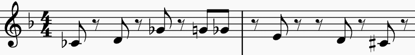
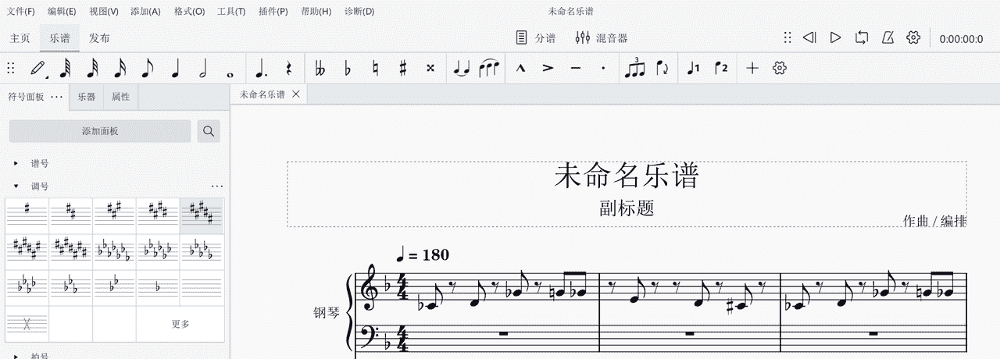
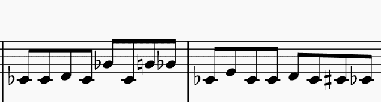
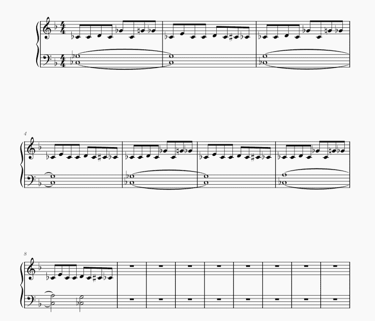
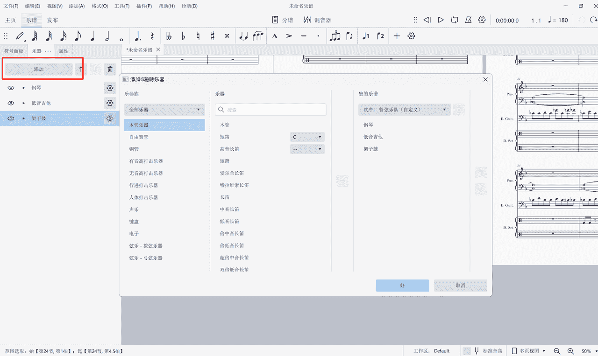
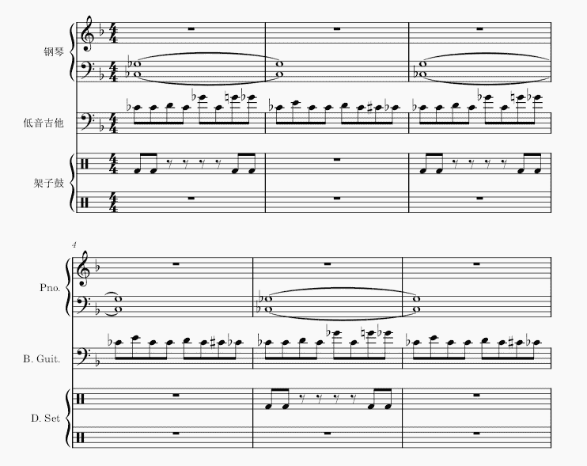
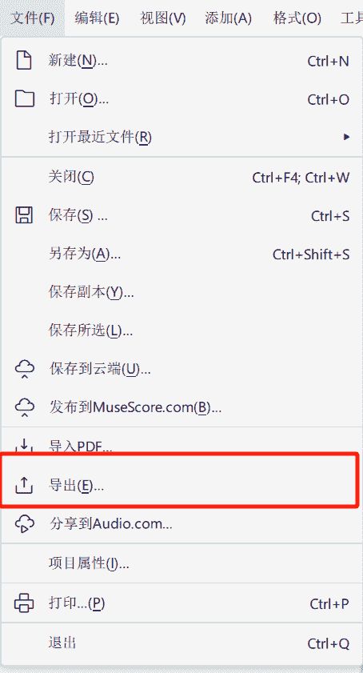
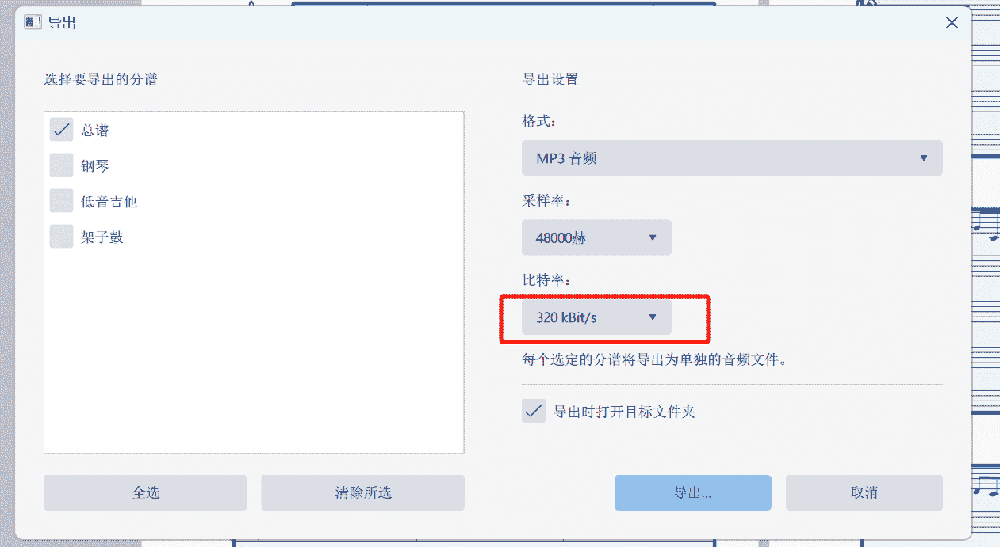

# [音乐学习] AI音乐-自定义前奏的一种工作流

> 来源：[https://waytoagi.feishu.cn/docx/F39Ad36gNo2aMgx6h62couDAncC](https://waytoagi.feishu.cn/docx/F39Ad36gNo2aMgx6h62couDAncC)

# 概述

Suno和Udio都推出了上传音频文件生成音乐的功能，很多行业大号都拿来做了各种无厘头编曲（像卡兹克的：倒车请注意），确实狠魔性~ 短期可以出很多流量。不过玩归玩，这个功能对于AI音乐的作用，在于精确的控制力。

有了前置的旋律，我们可以精确控制每首歌的：

**速度（Tempo）**

再也不用去背那些绕口的速度词了（什么Allegro，Moderato...)，可以精确控制我们想要的BPM

**旋律（Melody）**

通过自己制作一段简单的旋律，让AI补全并在整首歌贯穿，并且可以 旋律 + 速度 实现一谱变速，节省大量Roll旋律的时间。

配器（Instrumentation）

按照自己的想法选择音乐的乐器，减少提示词里乐器不灵光的情况（比如Suno的Drum solo），也可以自己开脑洞选择一些特殊的音色，比如用笛子吹小步舞曲~

**合成（synthesizer）**

当我们手上有两支BPM完全相同，调性也相同的音乐时，可以尝试更多的拆分组合，尝试一些更好玩的效果。这个还没试，之后会找时间试一些曲子。

既然上传音频大大节省了对着一首歌猛roll的点数消耗，那每个月的点数拿来干嘛呢？

首先，我们可以用提示词多Roll一些和流派，心情，场景相关的曲子。在减少了限制以后，AI音乐会发挥更多的创造力，Suno官方也提过（less is more），让AI音乐展现更强的一面。然后把这些好的旋律存起来，可能是前奏，副歌，或者一段和声，都可以作为之后制作的素材。

其次，把点数用来roll更多细节调整的部分，比如某段曲子里面，一定要让它升调，不走平调，把冲的钱用在提升每首作品的品质上。

下面用一个简单的例子来演示一下这个工作流：

# **步骤1：创建一段简单的riff**

这个步骤很开放，可以是之前积累的AI旋律素材，现有音乐里的一段旋律，或者完全自己演奏一段。考虑工作量问题，大部分玩家没有音乐基础，那我们尽量从前奏部分来创建（前奏的配器相对简单，没有特别复杂的织体），并且越干净的输入，可以帮助AI更好的联想，更好的强调基础节奏。

比如我发现了一个很好玩的音阶，可以随便手机上下个模拟钢琴或者其他演奏器把音高记录下来，输入到制谱软件里，我用的MuseScore https://musescore.org/zh-hans 免费的软件，音色很多，其他也有很多选择，只要是能打谱的，从ACE Studio到Cubase都可以用。

这段音阶是d小调，可以在软件里把调号设置下，速度符号也在左边的任务栏设置，假设我想做一首金属乐，把速度飙到了180。

这样我们就有了一段可以自由发挥的基础旋律了。转成Midi的好处在于，它可以非常干净，没有AI音乐的算法噪声污染，对输入给AI二次创作，会得到更干净的音色。

[riff1.mp3](https://internal-api-drive-stream.feishu.cn/space/api/box/stream/download/all/FtTdbmop4oyqRIxd3J5co4fGnLh)

# 步骤2：在这段旋律的基础上增加自己喜欢的调整

有了基础旋律谱以后，就可以放开玩了，比如我想让这段旋律的节奏更紧凑一点（中间穿插了休止符），可以用简单回跳的方式，用根音（root）把空白的休止符填满：

[riff2.mp3](https://internal-api-drive-stream.feishu.cn/space/api/box/stream/download/all/RZYqb6rpyoOGanxXqIEc5cQGnig)

如果你觉得还是单调，可以在低音部加入一些简单的进行和弦：

[riff3.mp3](https://internal-api-drive-stream.feishu.cn/space/api/box/stream/download/all/MY6ebh3Q5ozBV3xduFYcc7PXnSe)

也可以替换其他音色的乐器，比如低音吉他，然后把这段riff直接复制进去：

[riff4.mp3](https://internal-api-drive-stream.feishu.cn/space/api/box/stream/download/all/OSx2b0oXjo8qOjxNg99csLMdnNg)

加上一些强节奏的鼓点：

[riff5.mp3](https://internal-api-drive-stream.feishu.cn/space/api/box/stream/download/all/TOFxb9DINoOxQDx9QQxcr1FPnAe)

是不是已经有点内味儿了？

# 步骤3：把Midi导出到MP3虚拟演奏文件

可以直接导总谱，也可以分轨导出（适用于不同乐器组合，由于制谱软件有很重的midi味，有时需要调整乐器音色）

320kbit码率是各大音乐平台的门槛，而向Suno导出的是192k的，后期如果想输出到QQ音乐之类，需要转个码（虽然单纯转码对音质没有直接提升~）导出以后就可以喂给AI了

修改音色这一步不是必须，也有很多染色的软件可以用，比如我现在用的是Neutron4，从Youtube上面下载一些自己喜欢的乐器音色（比如雅马哈大钢琴），然后用宿主软件打开插件，导入这段音频，就可以实现渲染了（刚刚Studio One过期了，这里就先不放图了）

# 步骤4：丢给AI做二次创作：

我比较喜欢丢完整的小节给AI，这样节奏的识别性更好，当然也可以在中间掐断，AI的识别能力还是不错的：

接下来就是细化去roll后面的部分，这个就步细讲了，大家可以自由发挥

最后丢个完整版（前奏有点长没剪，AI生成的部分在53秒之后）：

输出响度调大了，大家可以把音量降下来点~

[Udio完整版.mp3](https://internal-api-drive-stream.feishu.cn/space/api/box/stream/download/all/Whlrbnuu4onXBvx5PvJcxoTzn7e)