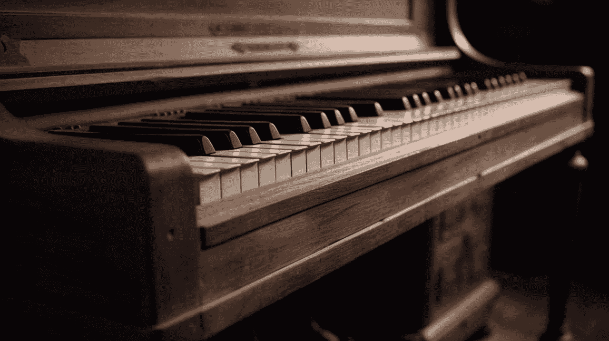
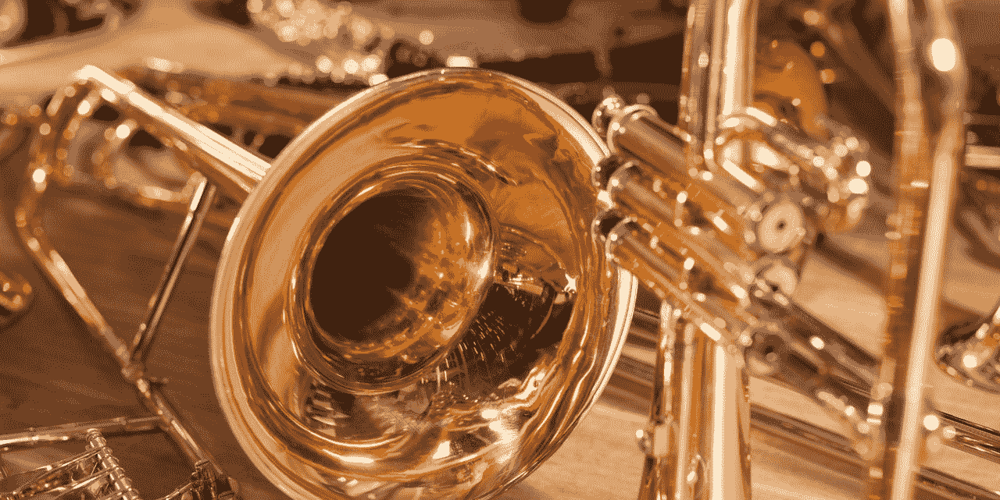
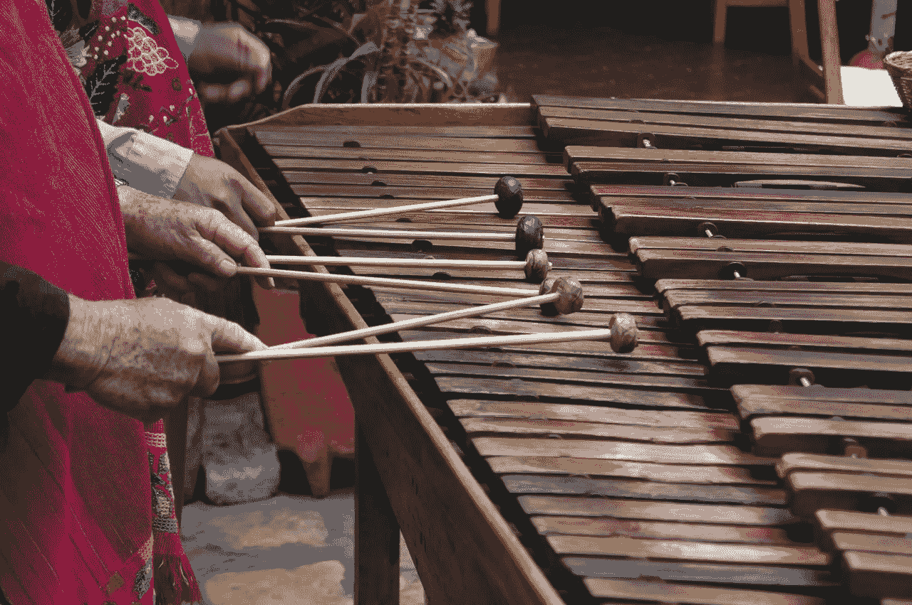
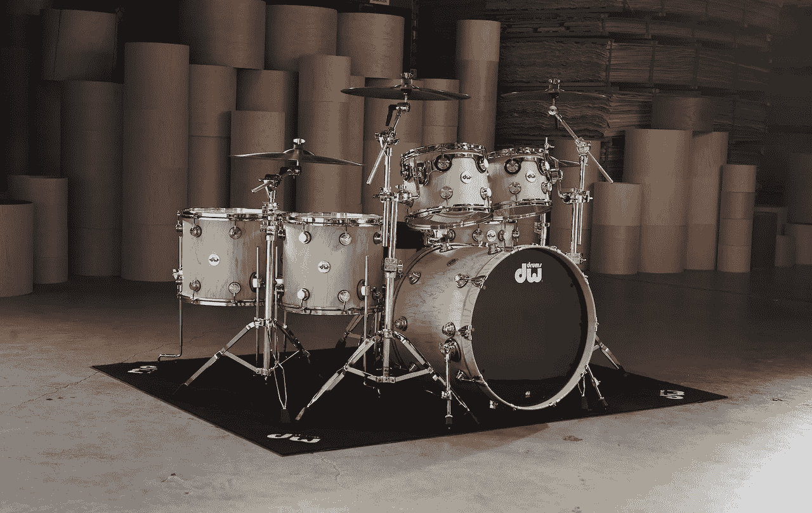
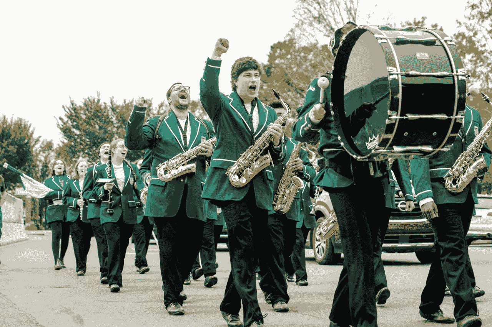

# [音乐学习] 乐理篇：配器

> 来源：[https://waytoagi.feishu.cn/docx/QJf8dp1oNoWnl5x0BYycqbrynoe](https://waytoagi.feishu.cn/docx/QJf8dp1oNoWnl5x0BYycqbrynoe)

为什么要理解配器？

配器是音乐创作中的重要部分，通过不同频率的乐器组合，可以让歌曲变得层次饱满丰富，通过不一样的音色，在相同的旋律下也能演奏出不同的情绪，充分发挥音乐的多样性。

Suno和Udio玩到一定程度，很多人已经可以跟随AI创作的过程，在脑子里联想自己理想中的音乐了（这个和听的曲目量会有一定关系，有时候明明脑子里是这个音色，但就是没办法描述出来是什么乐器，和写prompt的时候词穷是一个感觉，所以打算做个配器篇的字典，让大家可以第一时间找到自己理想中的音色）欢迎补充：

并不确保所有的乐器都可以被Suno/Udio精准识别，大家可以在AI里多做尝试，并反馈一些可以有效识别的乐器prompt.

# 键盘（Keyboard）

可以在prompt里面直接写keyboard，也可以根据自己想要的音色去指定单独的乐器

## 钢琴（Piano）

频率：27.5 - 4186Hz

钢琴的音域非常广，在实际演奏中，虽然钢琴的整个音域从A0可以延伸到C8，但大多数音乐作品会集中在A2 440Hz（或略低）到C6 1046.5Hz（或略高）这一范围内，这也是钢琴表现力最为丰富、动态范围最广的区域。不同风格和时期的音乐可能会有不同的侧重，比如古典音乐可能更多利用中低音区展现和声的复杂性，而现代流行或爵士乐则可能更频繁地使用高音区来突出旋律的亮丽。

[piano.m4a](https://internal-api-drive-stream.feishu.cn/space/api/box/stream/download/all/EvRKbHYkiog6KWxpVTWcD963nN6)

## 电钢琴 (Electric Piano)

电钢琴的音域与传统钢琴相似，从A0到C8，但其音色更加电子化和现代化。电钢琴在20世纪中期开始流行，广泛应用于流行音乐、摇滚、爵士和R&B等音乐风格中。由于其便携性和独特的音色，电钢琴成为录音室和现场演出的常用乐器，特别是在爵士乐和流行音乐中。

（类似钢琴音效）

## 电子琴 （Synthesizer）

频率：20 - 20kHz

电子琴在现代音乐中具有重要地位，能够产生丰富多样的音效和音色。它常用于流行音乐、电子音乐、电影配乐和实验音乐。由于其可编程性，电子琴在创造独特声音和音景方面具有极大的灵活性，适用于录音室制作和现场表演。

（多种模拟音色）

## 木管钢琴 (Pianoforte)

频率：27.5 - 4186Hz

木管钢琴的音域从A0到C8，音色温暖且富有表现力。木管钢琴是现代钢琴的前身，常用于古典音乐演奏中，通过击打木制弦槌来产生声音，具有细腻的动态表现力。虽然在现代演奏中较少见，但在复古演奏和古典音乐节中依然广受欢迎。

音色素材比较少，可以参考：https://www.youtube.com/watch?v=Ua_GHVEDCdI 贝多芬《月光奏鸣曲》

## 风琴（Organ）

频率：16Hz - 8kHz

风琴是一个非常大的分支，最具代表性的 5.1 管风琴（Pipe Organ）主要用于宗教音乐、古典音乐和教堂音乐中，具有宏大的音量和复杂的音色变化，适合在教堂和音乐厅中演奏。除此之外，风琴还有非常多的分支，分别用于不同的场合。

[Pipe organ.mp3](https://internal-api-drive-stream.feishu.cn/space/api/box/stream/download/all/DOCybp42zoFCufx09lkc82c8nKh)

### 5.2：手风琴 (Accordion)

[accordion .mp3](https://internal-api-drive-stream.feishu.cn/space/api/box/stream/download/all/DdZCbN4MwoQGCIxRi0ScjZlfn4d)

#### 5.2.1：全音阶手风琴 (Standard Chromatic Accordion)

结构简单，每个按钮对应一个音符，通常在传统民间音乐和舞会中使用。

#### 5.2.2：半音阶手风琴 (Chromatic Accordion)

具备演奏半音的能力，适合演奏更复杂的音乐作品。

#### 5.2.3：键钮式手风琴 (Button Accordion)

左侧为贝司和和弦键钮，右侧为旋律键钮，适合演奏多声部音乐。

#### 5.2.4：键盘式手风琴 (Piano Accordion)

右侧采用类似钢琴的键盘设计，左侧为贝司键钮，适用于钢琴演奏的习惯。

#### 5.2.5：电子手风琴 (Digital Accordion)

结合传统手风琴设计与电子音源技术，可模拟多种音色和效果。

#### 5.2.6：班东尼手风琴 (Bandoneon)

特指一种主要用于阿根廷探戈音乐的键钮式手风琴，结构独特，音色浓郁。

### 5.3: 口风琴（Mouth Organ / Harmonica）

方便携带，适用于蓝调、民谣、流行现场、街头表演

[Harmonica .mp3](https://internal-api-drive-stream.feishu.cn/space/api/box/stream/download/all/CAujbWgEYoWD6HxWtJHc9n0Gnnb)

### 5.4: 簧风琴 (Reed Organ)

通过脚踏板驱动风箱，使金属簧片振动发声，体积较小，常见于家庭和小型教堂。

[Reed organ.m4a](https://internal-api-drive-stream.feishu.cn/space/api/box/stream/download/all/Vm3nbVYl5oU3ORx3IGYcLt0knih)

### 5.5: 剧院风琴（Theater Organ）

特别设计用于增强无声电影的氛围，拥有丰富的音色和特殊效果，如模仿火车、鸟鸣等。

[Theater organ.mp3](https://internal-api-drive-stream.feishu.cn/space/api/box/stream/download/all/YbCHbznXXoA45oxZUcGcqZ0GnYb)

## 大键琴 (Harpsichord)

频率：80Hz - 4kHz

又称拨弦键琴或羽管键琴，音域从F1-F6，是一种古老的键盘乐器，其历史可以追溯到欧洲文艺复兴时期并盛行于巴洛克时期。大键琴的构造和发声原理与现代钢琴有着显著的不同，它的音色清脆且具有独特的金属质感。大键琴的音色特点是清晰、明亮且具有一定的穿透力，每个音符的音量基本恒定，无法像钢琴那样通过按键力度来改变音量（即没有动态变化）。

[Harpsichord.m4a](https://internal-api-drive-stream.feishu.cn/space/api/box/stream/download/all/X0oxbPUJEo5f9jxQhIccBvvfnaf)

## 钢片琴 (Celesta)

频率：261Hz - 4186Hz

钢片琴的音域从C4到C8，音色清脆明亮，类似钟声。钢片琴常用于古典音乐和电影配乐中，特别是在需要表现梦幻和神秘氛围的乐段中，认知度最广的应该就是哈利波特的配乐了。它在乐队中常作为一种特殊效果乐器，增加音乐的色彩和层次。

[Celesta.mp3](https://internal-api-drive-stream.feishu.cn/space/api/box/stream/download/all/Wjg6b0i7hoYmp0xbblwctsW0nVb)

## 竖琴吉他 (Harpejji)

频率：27.5Hz - 880Hz

虽然又是竖琴又是吉他，但它的演奏手法是键盘为主的，融合了一些弦乐的技巧。音域从A0到A5，结合了吉他和钢琴的特点。竖琴吉他是一种相对较新的乐器，常用于现代音乐、爵士和实验音乐中。它的独特设计使得演奏者能够使用手指按压琴键来产生声音，适合创造复杂的和声和旋律。

[Harpejji .m4a](https://internal-api-drive-stream.feishu.cn/space/api/box/stream/download/all/KZLOblRVDoTmI1xokpBcJErDnyb)

## 克拉维科德 (Clavichord)

频率：80Hz - 4kHz

克拉维科德的音域从F1到F6，音色柔和，适合演奏古典和巴洛克音乐。克拉维科德是早期键盘乐器之一，通过击打金属弦来产生声音，具有非常细腻的动态控制能力。由于音量较低，它主要用于室内演奏和作曲家用于创作的工具。（乍一听弦乐，其实是键盘，可以用其他弦乐代替）

[Clavichord .mp3](https://internal-api-drive-stream.feishu.cn/space/api/box/stream/download/all/ZVt3biaA0oTSQSx7grycLW6dnQe)

## 单簧管琴 (Clavioline)

频率：65.41Hz - 1046.5Hz

单簧管琴的音域从C2到C6，是一种电子键盘乐器，具有丰富的音色变化能力。单簧管琴常用于20世纪中期的流行音乐和电影配乐中，特别是在需要模拟单簧管或其他木管乐器音色的场合。

[Clavioline.mp3](https://internal-api-drive-stream.feishu.cn/space/api/box/stream/download/all/Bwszb1PCaoDVqGxaF9ocYxLQnKf)

## 电颤琴 (Electric Vibraphone)

频率：174.61Hz - 4kHz

电颤琴的音域从F3到F6，结合了电音和传统打击乐器的特点。电颤琴在爵士乐、流行音乐和实验音乐中广泛应用，通过电动马达产生的颤音效果使其音色独特而迷人，适用于丰富音乐的层次和情感。（这个我觉得应该归在打击乐里，先放一放）

[Electric Vibraphone.m4a](https://internal-api-drive-stream.feishu.cn/space/api/box/stream/download/all/KXl0bveOsooKqIxYmLkcLMLknEg)

## 波德曼琴 (Ondes Martenot)

频率：32.7Hz - 4186Hz

波德曼琴的音域从C1到C8，是一种电子键盘乐器，具有非常独特的音色和表现力。波德曼琴由法国工程师莫里斯·马尔泰诺发明，常用于现代古典音乐和电影配乐中，特别是需要表现神秘、梦幻和戏剧性氛围的场合。通过滑动指环和键盘控制，波德曼琴能够产生连续音高变化和丰富的音色效果。

[Ondes Martenot.mp3](https://internal-api-drive-stream.feishu.cn/space/api/box/stream/download/all/LIDIbwL4moBzd3xUSbMcnbT9n8d)

## 玻璃琴 (Glass Harmonica)

频率：261.63 Hz - 2093 Hz

玻璃琴的音域从C4到C7，音色清澈、梦幻，是一种历史悠久的键盘乐器。由本杰明·富兰克林发明，通过旋转玻璃碗和湿手指摩擦产生声音。玻璃琴常用于古典音乐和实验音乐中，适合表现宁静、神秘和超现实的音乐氛围。

[Glass Harmonica.mp3](https://internal-api-drive-stream.feishu.cn/space/api/box/stream/download/all/H4G3bzJCcoUl7XxEo80cT6DrnLe)

## 凯利奥琴 (Calliope)

频率：130.81 Hz - 1046.50 Hz

凯利奥琴的音域从C3到C6，是一种利用蒸汽或压缩空气驱动的键盘乐器。凯利奥琴常用于游乐场、马戏团和户外活动中，具有非常响亮和欢快的音色。由于其独特的音色和操作方式，凯利奥琴适合表现节日气氛和欢快的音乐。

[Calliope.mp3](https://internal-api-drive-stream.feishu.cn/space/api/box/stream/download/all/Igpxb4vInoQqStxXR3vcSWWBniJ)

## 磁带回声琴 (Mellotron)

频率：27.5Hz - 4186Hz

磁带回声琴的音域从A0到C8，是一种电子键盘乐器，通过播放预录磁带产生声音。磁带回声琴在20世纪60年代和70年代的摇滚和流行音乐中非常流行，能够模拟管弦乐器和人声的音色。其独特的音色和操作方式使其适合创造丰富多样的音景和音乐效果。

[Mellotron.mp3](https://internal-api-drive-stream.feishu.cn/space/api/box/stream/download/all/DDYxbuq1HotL9CxKxwXcX22YnYe)

## 水琴 (Hydraulophone)

频率：130.81 Hz - 1046.50 Hz

水琴的音域从C3到C6，通过按压水流产生声音，是一种非常独特和新奇的键盘乐器。水琴主要用于实验音乐和公共艺术项目，具有独特的视觉和听觉效果。由于其创新的音色和演奏方式，水琴常用于表现水元素和自然主题的音乐。

[Hydraulophone.mp3](https://internal-api-drive-stream.feishu.cn/space/api/box/stream/download/all/BSaYbPt62oWIGixDxdlc0usvnvh)

# 弦乐（弓弦乐器 Bowed stringed）

## 小提琴 (Violin)

频率：196Hz - 2637Hz

小提琴的音域从G3到A7，音色明亮而富有穿透力。小提琴常用于古典音乐、室内乐、交响乐团和独奏中，是乐队中最重要的弦乐器之一。其灵活的表现力使其适合演奏多种风格的音乐，从巴洛克到现代流行音乐。小提琴的高音区特别适合表现旋律的明亮和活泼，低音区则能展现出深沉和丰富的和声。

[Violin.mp3](https://internal-api-drive-stream.feishu.cn/space/api/box/stream/download/all/HUiEbXoUXoxOw4xQJe1cCFPYnEh)

## 中提琴 (Viola)

频率：130Hz - 1046Hz

中提琴的音域从C3到E6，音色温暖而柔和，比小提琴稍低。中提琴常用于古典音乐、室内乐和交响乐团中，通常扮演和声和填充音色的角色。其独特的音色适合表现中音区的旋律和和声，使音乐更加丰富和有层次感。中提琴在独奏中也能展现出优美和深沉的音色。

[Viola.mp3](https://internal-api-drive-stream.feishu.cn/space/api/box/stream/download/all/OOgpbKQHCoHMd0xTo0tceVWxnOd)

## 大提琴 (Cello)

频率：65Hz - 987Hz

大提琴的音域从C2到C6，音色深沉而丰满。大提琴常用于古典音乐、室内乐和交响乐团中，是弦乐四重奏中的重要组成部分。大提琴能够演奏出低音区的浑厚和中高音区的优美旋律，适合表现深沉的情感和复杂的和声。其广泛的音域使其既能担当旋律也能担当和声角色。

[Cello.m4a](https://internal-api-drive-stream.feishu.cn/space/api/box/stream/download/all/XnZ7bgk7goWkHaxwvg6cB8A0ntb)

## 低音提琴 (Double Bass)

频率：41Hz - 294Hz

低音提琴的音域从E1到C5，音色低沉而厚重。低音提琴常用于古典音乐、室内乐、交响乐团和爵士乐中，是乐队中最低音的弦乐器。低音提琴的低音区适合表现基础和支撑的作用，而其高音区则能够演奏出富有表现力的旋律。低音提琴在爵士乐中常用于即兴演奏和节奏部分的支撑。

[Double Bass.mp3](https://internal-api-drive-stream.feishu.cn/space/api/box/stream/download/all/BtKmb9z8koVtcMxJt7WcwQS8nAe)

## 高音提琴 (Piccolo Violin)

频率：523Hz - 4186Hz

高音提琴的音域从C5到C8，音色非常明亮且穿透力强。高音提琴在古典音乐和早期音乐中偶尔使用，主要用于演奏高音区的快速旋律和装饰音。其音色独特，适合表现轻快和活泼的音乐。

[Piccolo Violin.m4a](https://internal-api-drive-stream.feishu.cn/space/api/box/stream/download/all/AF9ObGit0o5MZ9x3K8Tc0jfcnxb)

## 袖珍提琴 (Pardessus de Viole)

频率：196Hz - 2637Hz

袖珍提琴的音域从G3到A7，音色明亮且富有穿透力。袖珍提琴是维奥尔琴家族中最小的成员，常用于巴洛克时期的室内乐和独奏。其小巧的尺寸使其便于携带，适合演奏快速的旋律和高音区的乐句。袖珍提琴在早期音乐复兴运动中得到了广泛关注，能够展现出独特的历史音色。

[Pardessus de Viole.m4a](https://internal-api-drive-stream.feishu.cn/space/api/box/stream/download/all/FS6wbPfF8osPGZx1BR4cRgEpnse)

## 瓦尔琴 (Hardanger Fiddle)

频率：196Hz - 2637Hz

瓦尔琴的音域从G3到A7，音色明亮且带有独特的共鸣。瓦尔琴主要用于挪威传统音乐，特别是在民间舞曲中。其独特的设计包括额外的共鸣弦，使其音色更加丰富和独特，适合表现传统和民族风格的音乐。

[hardanger-fiddle.mp3](https://internal-api-drive-stream.feishu.cn/space/api/box/stream/download/all/UZu9bPPCloB8xwxz2fEc6kkHn9d)

## 尼琴 (Nyckelharpa)

频率：130Hz - 987Hz

尼琴的音域从C3到C6，音色温暖且富有表现力。尼琴是一种传统的瑞典弓弦乐器，通过按键来调节音高。它在北欧传统音乐中有着重要地位，适合表现复杂的旋律和和声。尼琴的独特音色和演奏方式使其能够在现代音乐中创造出独特的音景。

[Nyckelharpa .m4a](https://internal-api-drive-stream.feishu.cn/space/api/box/stream/download/all/HG55b1u6so5BC4xs9PIc56mcnlc)

## 声带提琴 (Lirone)

频率：65Hz - 987Hz

声带提琴的音域从C2到C6，音色深沉且富有共鸣。声带提琴主要用于文艺复兴和巴洛克时期的音乐，特别是宗教和戏剧音乐。其多弦设计使其能够演奏复杂的和声，常用于合奏和伴奏，营造丰富的音乐层次和深度。

[lirone .mp3](https://internal-api-drive-stream.feishu.cn/space/api/box/stream/download/all/BDlFbJrdTovCDUxOWmdcLTwanFb)

## 维奥拉琴 (Vielle)

频率：65Hz - 987Hz

维奥拉琴的音域从C2到C6，音色温暖且富有古朴的共鸣。维奥拉琴在中世纪和文艺复兴时期的音乐中非常流行，常用于独奏和室内乐。其独特的形状和演奏技法使其能够再现历史时期的音乐风格和情感，是复古音乐表演中的重要乐器。

[Vielle.mp3](https://internal-api-drive-stream.feishu.cn/space/api/box/stream/download/all/B7vsbL0NFo4w3GxFbBccHybXnVd)

## 摩拉琴 (Morin Khuur)

频率：65Hz - 987Hz

摩拉琴的音域从C2到C6，音色独特且富有民族特色。摩拉琴是蒙古族传统乐器，常用于蒙古长调和民间音乐中。其独特的音色和演奏技法使其能够表现出浓郁的民族风情和深沉的情感，是蒙古音乐中的代表性乐器。

[Morin Khuur .m4a](https://internal-api-drive-stream.feishu.cn/space/api/box/stream/download/all/DPNpbScs6oe1dcx50eocq1Renqh)

## 印度萨朗吉 (Sarangi)

频率：65Hz - 987Hz

萨朗吉的音域从C2到C6，音色深沉且富有表现力。萨朗吉是印度传统弓弦乐器，常用于印度古典音乐和民间音乐中。其独特的音色和复杂的演奏技法使其能够表现出深厚的情感和复杂的旋律，是印度音乐中的重要乐器。

[Sarangi.m4a](https://internal-api-drive-stream.feishu.cn/space/api/box/stream/download/all/D8MSbviQioGTSEx13A7cP6AMnle)

## 二胡 (Erhu)

频率：196Hz - 2637Hz

二胡的音域从D3到D7，音色清晰且富有表现力。二胡是中国传统乐器，常用于独奏、合奏和戏曲伴奏。其独特的音色和演奏技法使其能够表现丰富的情感和细腻的音乐细节，是中国民族音乐中最具代表性的弓弦乐器之一。

## 高胡 (Gaohu)

频率：196Hz - 2637Hz

高胡的音域从G3到A7，音色明亮且富有穿透力。高胡是广东音乐和粤剧中常用的弓弦乐器，常用于独奏和伴奏。其高音区特别适合表现旋律的明亮和活泼，低音区则能展现出深沉和丰富的和声。

[Gaohu.mp3](https://internal-api-drive-stream.feishu.cn/space/api/box/stream/download/all/D4bObKKQDolrSPxySwGcVN9rnqf)

## 土耳其卡门琴 (Kemenche)

频率：130Hz - 1046Hz

土耳其卡门琴的音域从C3到E6，音色明亮且富有穿透力。卡门琴是土耳其传统弓弦乐器，常用于土耳其民间音乐和传统舞蹈中。其独特的音色和演奏方式使其能够表现出丰富的节奏和音乐风格，是土耳其音乐中的重要乐器。

[Kemenche.m4a](https://internal-api-drive-stream.feishu.cn/space/api/box/stream/download/all/LtM2bZO9looMH4xCmzccm7BHn1b)

## 日本胡弓 (Kokyū)

频率：130Hz - 1046Hz

胡弓的音域从C3到E6，音色柔和且富有古典韵味。胡弓是日本传统弓弦乐器，常用于独奏和室内乐中。其独特的音色和演奏技法使其能够表现出丰富的情感和音乐层次，是日本古典音乐中的重要代表。

[kokyu.mp3](https://internal-api-drive-stream.feishu.cn/space/api/box/stream/download/all/DYCrbQwLroUCWYxnke9cZuq8nxT)

## 维奥尔琴 (Viola da Gamba)

频率：65Hz - 987Hz

维奥尔琴的音域从C2到C6，音色柔和、深沉且富有共鸣。维奥尔琴是文艺复兴时期和巴洛克时期的欧洲乐器，常用于室内乐和独奏。其丰富的音色和复杂的演奏技巧使其能够表现出深厚的情感和复杂的音乐层次。

[Viola da Gamba.mp3](https://internal-api-drive-stream.feishu.cn/space/api/box/stream/download/all/Hz33bfCOxoxRx8xuQ7Jc9rHjnwh)

## 保加利亚琴 (Gadulka)

频率：65Hz - 987Hz

保加利亚琴的音域从C2到C6，音色独特且富有民族特色。保加利亚琴是保加利亚传统的弓弦乐器，常用于保加利亚民间音乐和舞蹈音乐中。其独特的音色和演奏技法使其能够表现出浓郁的民族风情和深沉的情感，是保加利亚音乐中的代表性乐器。

[Gadulka.mp3](https://internal-api-drive-stream.feishu.cn/space/api/box/stream/download/all/BnpebJ6GboCYMrxZlsQcSlA3nBe)

# 弦乐（拨弦乐器 Plucked）

## 吉他 (Guitar)

频率：82Hz - 880Hz

吉他的音域从E2到E6，音色丰富多样，可通过不同的演奏技巧和电声处理产生多种音色。吉他广泛应用于流行音乐、摇滚、爵士和古典音乐中。木吉他常用于独奏和伴奏，适合表现柔和的音色和复杂的和声；电吉他则常用于乐队演奏，适合表现强烈的节奏和富有表现力的旋律。

### 古典吉他 (Classical Guitar)

频率：82Hz - 880Hz

古典吉他的音域从E2到E6，音色温暖、柔和且富有表现力。古典吉他通常有六根尼龙弦，琴颈较宽，没有电声设备。古典吉他主要用于演奏古典音乐、弗拉门戈和民间音乐，适合表现细腻的旋律和复杂的和声。

[Classical guitar.m4a](https://internal-api-drive-stream.feishu.cn/space/api/box/stream/download/all/OCDUbWkzWoUWjQxZB2rc7pDfnUd)

### 四弦小吉他 (Tenor Guitar)

频率：98Hz - 784Hz

四弦小吉他的音域从G3到G6，音色明亮、清脆且富有节奏感。四弦小吉他通常用于爵士乐、民间音乐和早期流行音乐。其结构与标准吉他相似，但只有四根弦，适合演奏简单的和弦和旋律。

[Tenor Guitar.m4a](https://internal-api-drive-stream.feishu.cn/space/api/box/stream/download/all/V1YpbQh0io5QEVxvI8CcfNB3nmd)

### 巴西吉他 (Brazilian Guitar / Violão)

频率：82Hz - 880Hz

巴西吉他的音域从E2到E6，音色丰富、多样，既有古典吉他的温暖，又有钢弦吉他的明亮。巴西吉他主要用于演奏巴西传统音乐，如桑巴、波萨诺瓦等，其演奏技巧独特，适合表现多样的节奏和旋律。

[Brazilian Guitar.mp3](https://internal-api-drive-stream.feishu.cn/space/api/box/stream/download/all/KuWtbnr7io4jBwxJKnwckZnBnjb)

### 高音吉他 (Soprano Guitar)

频率：110Hz - 880Hz

高音吉他的音域从A2到E6，音色明亮、清脆且富有穿透力。高音吉他通常用于演奏高音区的旋律和快速乐段，适合与其他吉他或乐器合奏，增加音乐的层次感和明亮度。

[Soprano Guitar.m4a](https://internal-api-drive-stream.feishu.cn/space/api/box/stream/download/all/XHG4bmiy3oMSCixneRNclQnsnH9)

### 中音吉他 (Alto Guitar)

频率：65Hz - 523Hz

中音吉他的音域从C2到C5，音色温暖、柔和且富有共鸣。中音吉他适合演奏中低音区的旋律和和弦，常用于古典音乐和室内乐中，能够与其他吉他或乐器互补，增加音乐的深度和厚度。

[Alto Guitar.mp3](https://internal-api-drive-stream.feishu.cn/space/api/box/stream/download/all/ZUHsbsc6poegBNxl8L2cHJrRnDe)

### 电子吉他 (Electric Guitar)

频率：82Hz - 880Hz

电子吉他的音域从E2到E6，音色多样，可以通过不同的效果器和放大器设置产生各种音色。电子吉他常用于摇滚、流行音乐、蓝调、爵士和许多其他音乐风格中。其演奏技巧多样，能够表现出丰富的音乐情感和复杂的和声结构。

[Electric Guitar.m4a](https://internal-api-drive-stream.feishu.cn/space/api/box/stream/download/all/KHShbXg1Cohz9hx8GUKcBAgBnTd)

### 原音吉他 (Acoustic Guitar)

频率：82Hz - 880Hz

原音吉他的音域从E2到E6，音色明亮、温暖且富有共鸣。原音吉他通常有六根钢弦，通过共鸣箱放大声音，不依赖电声设备。原音吉他适合演奏民谣、乡村音乐、蓝调和许多其他音乐风格，能够表现丰富的音色和动态变化。

[Acoustic Guitar.m4a](https://internal-api-drive-stream.feishu.cn/space/api/box/stream/download/all/DBCMbDXlFob3L0xnxD6cAWH0nwe)

### 低音吉他/贝斯（Bass Guitar）

频率：41Hz - 392Hz

低音吉他，贝斯的音域从E1到G4，音色深沉、丰满且富有节奏感。贝斯是现代音乐中不可或缺的乐器，常用于流行音乐、摇滚、爵士和许多其他音乐风格中。贝斯的主要功能是提供低音和节奏支撑，通过不同的演奏技巧可以表现出多样的音色和情感。(Bass的分类很细，这里就不一一列举了）

[Bass Guitar.m4a](https://internal-api-drive-stream.feishu.cn/space/api/box/stream/download/all/FqZwbRD7hoefuTxVkvdcDpKrnhh)

## 尤克里里 (Ukulele)

频率：261Hz - 1567Hz

尤克里里的音域从C4到C6，音色明亮、轻快、富有节奏感。尤克里里常用于夏威夷音乐、流行音乐和儿童音乐中。其小巧的尺寸和简单的演奏方式使其成为初学者和旅行者的理想乐器，适合演奏轻松、愉快的旋律和和弦伴奏。

[Ukulele.mp3](https://internal-api-drive-stream.feishu.cn/space/api/box/stream/download/all/CPHTbLgEEob5bZxYVixcO09OnUb)

## 竖琴 (Harp)

频率：27.5Hz - 4186Hz

竖琴的音域从C1到C8，音色优美、柔和且富有共鸣。竖琴常用于古典音乐、室内乐和交响乐团中。其丰富的音域和多变的音色适合表现复杂的和声和细腻的情感。竖琴在独奏中能够展现出其独特的音色和广泛的表现力，在乐队中则常用于增加音乐的层次和色彩。

[Harp.mp3](https://internal-api-drive-stream.feishu.cn/space/api/box/stream/download/all/XhlobOodeohagJx1lUbcESdbnpc)

## 曼陀林 (Mandolin)

频率：196Hz - 1318Hz

曼陀林的音域从G3到E7，音色明亮、清脆且富有节奏感。曼陀林常用于蓝草音乐、乡村音乐和古典音乐中。其快速的拨弦技巧和独特的音色使其适合演奏快速的旋律和复杂的和弦。曼陀林在乐队中常用于增加音乐的节奏感和活力。

[Mandolin.mp3](https://internal-api-drive-stream.feishu.cn/space/api/box/stream/download/all/BTMsbkbXwoBz1jxIRGxcAAFGnUh)

## 琵琶 (Pipa)

频率：65Hz - 987Hz

琵琶的音域从C2到C6，音色清亮、细腻且富有表现力。琵琶是中国传统乐器，常用于独奏、合奏和戏曲伴奏中。其丰富的演奏技巧和独特的音色使其能够表现出深厚的情感和复杂的音乐层次。琵琶在传统音乐中具有重要地位，能够展现出中国音乐的独特魅力。

[Pipa.mp3](https://internal-api-drive-stream.feishu.cn/space/api/box/stream/download/all/D2eBbYW0jo6yiyx3goycpHGInCf)

## 古筝 (Guzheng)

频率：65Hz - 987Hz

古筝的音域从C2到C6，音色清脆、明亮且富有共鸣。古筝是中国传统乐器，常用于独奏、合奏和伴奏中。其丰富的音色和多变的演奏技巧使其能够表现出深厚的情感和复杂的音乐层次。古筝在传统音乐和现代音乐中都广泛应用，能够展现出中国音乐的独特风格。

[Guzheng.m4a](https://internal-api-drive-stream.feishu.cn/space/api/box/stream/download/all/Vyd9bxUSdo4Dw6xBzDGcqnU9nBh)

## 西塔琴 (Sitar)

频率：65Hz - 987Hz

西塔琴的音域从C2到C6，音色明亮、复杂且富有共鸣。西塔琴是印度传统乐器，常用于印度古典音乐和世界音乐中。其独特的音色和复杂的演奏技巧使其能够表现出深厚的情感和复杂的音乐层次。西塔琴在印度音乐中具有重要地位，能够展现出印度音乐的独特魅力。

[Sitar.mp3](https://internal-api-drive-stream.feishu.cn/space/api/box/stream/download/all/O7yEbkRuBozqXGxgt3zcaf7knzd)

## 巴拉莱卡 (Balalaika)

频率：82Hz - 880Hz

巴拉莱卡的音域从E2到E5，音色明亮、清脆且富有节奏感。巴拉莱卡是俄罗斯传统乐器，常用于俄罗斯民间音乐和舞蹈音乐中。其三角形琴身和独特的音色使其适合表现欢快的旋律和富有节奏感的音乐。巴拉莱卡在俄罗斯音乐中具有重要地位，能够展现出俄罗斯音乐的独特风格。

[Balalaika.mp3](https://internal-api-drive-stream.feishu.cn/space/api/box/stream/download/all/SIgxbFAG4oH3Pzx8KZtcT2Rfnuc)

## 哈萨克冬不拉 (Dombra)

频率：82Hz - 880Hz

冬不拉的音域从E2到E5，音色明亮且富有节奏感。冬不拉是哈萨克斯坦的传统拨弦乐器，常用于哈萨克民间音乐和传统舞蹈中。其独特的音色和演奏方式使其能够表现出丰富的节奏和音乐风格，是哈萨克音乐中的重要乐器。

[Dombra.mp3](https://internal-api-drive-stream.feishu.cn/space/api/box/stream/download/all/P6shbj5O4oulccxj60zcrOSsnwc)

## 班卓琴 (Banjo)

频率：82Hz - 1760Hz

班卓琴的音域从E2到A6，音色明亮、清脆且富有弹性。班卓琴常用于美国乡村音乐、蓝草音乐和民间音乐中。其独特的音色和快速的拨弦技巧使其适合演奏活泼的旋律和复杂的和弦。班卓琴在乐队中常用于增加音乐的节奏感和活力。

[Banjo.mp3](https://internal-api-drive-stream.feishu.cn/space/api/box/stream/download/all/RRbJbwep2oOsSCx6xl4cJCIfnfQ)

## 库科尔 (Charango)

频率：196Hz - 1318Hz

库科尔的音域从G3到E7，音色明亮、轻快且富有节奏感。库科尔是南美洲传统乐器，常用于安第斯山脉地区的民间音乐中。其小巧的尺寸和独特的音色使其适合演奏快速的旋律和和弦。库科尔在南美洲音乐中具有重要地位，能够展现出南美洲音乐的独特风格。

[Charango.m4a](https://internal-api-drive-stream.feishu.cn/space/api/box/stream/download/all/EVcRbhnStow2r9x2nRkcMuNZnsf)

## 日本三味线 (Shamisen)

频率：130Hz - 1046Hz

三味线的音域从C3到E6，音色明亮且富有节奏感。三味线是日本传统乐器，常用于日本民间音乐和戏剧音乐中。其独特的音色和演奏方式使其能够表现出丰富的情感和节奏，是日本音乐中的重要代表。

[Shamisen.mp3](https://internal-api-drive-stream.feishu.cn/space/api/box/stream/download/all/HmaTbj34WocFbhxZshyc8WpHnif)

## 齐特尔琴 (Zither)

频率：65Hz - 1975Hz

齐特尔琴的音域从C2到C6，音色清脆、明亮且富有共鸣。齐特尔琴是中欧和东欧的传统乐器，常用于民间音乐和室内乐中。其独特的音色和多样的演奏方式使其能够表现出丰富的情感和音乐层次。

[Zither.mp3](https://internal-api-drive-stream.feishu.cn/space/api/box/stream/download/all/CA4xbgGUPolja1x7E54cfS9An0b)

## 维纳琴 (Vihuela)

频率：82Hz - 880Hz

维纳琴的音域从E2到E6，音色温暖、明亮且富有共鸣。维纳琴是西班牙文艺复兴时期的传统乐器，常用于古典音乐和室内乐中。其丰富的音色和复杂的演奏技巧使其能够表现出深厚的情感和复杂的音乐层次。

[Vihuela.mp3](https://internal-api-drive-stream.feishu.cn/space/api/box/stream/download/all/LEP2bPG1ToVF6jxNLEbcnh8Bnoh)

## 锁琴 (Kantele)

频率：65Hz - 987Hz

锁琴的音域从C2到C6，音色清脆、明亮且富有共鸣。锁琴是芬兰的传统乐器，常用于民间音乐和现代音乐中。其独特的音色和多样的演奏方式使其能够表现出丰富的情感和音乐层次。

[Kantele.m4a](https://internal-api-drive-stream.feishu.cn/space/api/box/stream/download/all/V6C6bEj4aodEe6xsJTlckOYWn4e)

## 德鲁兹琴 (Dulcimer)

频率：65Hz - 987Hz

德鲁兹琴的音域从C2到C6，音色清脆、明亮且富有共鸣。德鲁兹琴是一种北美民间乐器，常用于传统音乐和现代民间音乐中。其独特的音色和简单的演奏方式使其适合演奏轻松愉快的旋律和和弦。

[Dulcimer.mp3](https://internal-api-drive-stream.feishu.cn/space/api/box/stream/download/all/O5sabj6UroJsJJxwintc9eDQntf)

## 琉特琴 (Lute)

频率：82Hz - 880Hz

琉特琴的音域从E2到E6，音色温暖、柔和且富有共鸣。琉特琴是欧洲文艺复兴时期的传统乐器，常用于古典音乐和室内乐中。其丰富的音色和复杂的演奏技巧使其能够表现出深厚的情感和复杂的音乐层次。

[Lute.mp3](https://internal-api-drive-stream.feishu.cn/space/api/box/stream/download/all/VknQbSHzLoUPEPxEt9ZcPYrZnHc)

## 普利姆琴 (Prim)

频率：196Hz - 2637Hz

普利姆琴的音域从G3到A7，音色明亮、清脆且富有节奏感。普利姆琴是斯洛文尼亚和克罗地亚传统的拨弦乐器，常用于民间音乐和舞蹈音乐中。其独特的音色和快速的拨弦技巧使其适合演奏欢快的旋律和复杂的和弦，在民族音乐中具有重要地位。

[Prim.mp3](https://internal-api-drive-stream.feishu.cn/space/api/box/stream/download/all/SxcPbqmPeoxzOPx6vjqcM1HhnNb)

## 巴里通琴 (Baritone Guitar)

频率：41Hz - 392Hz

巴里通琴的音域从E1到G4，音色深沉且富有共鸣。巴里通琴比标准吉他调得更低，常用于流行音乐、摇滚和爵士乐中。其低音区特别适合表现深沉和厚重的音色，能够在乐队中增加音乐的低频部分，常用于节奏吉他和独奏。

[Baritone Guitar.mp3](https://internal-api-drive-stream.feishu.cn/space/api/box/stream/download/all/QEd8bXnEKoNRSTxI4V0c8u4AnCf)

## 西非克拉音琴 (Kora)

频率：65Hz - 987Hz

克拉音琴的音域从C2到C6，音色柔和且富有共鸣。克拉音琴是西非传统弓弦乐器，常用于西非的民间音乐和传统仪式中。其独特的音色和演奏技法使其能够表现出丰富的情感和复杂的旋律，是西非音乐中的重要乐器。

[Kora.m4a](https://internal-api-drive-stream.feishu.cn/space/api/box/stream/download/all/ASECb16AxoEIsVxjX5ec9GPanKh)

# 木管 (Woodwind)

## 长笛 (Flute)

频率：261Hz - 2093Hz

长笛的音域从C4到C7，音色清澈明亮且富有穿透力。长笛常用于古典音乐、室内乐、交响乐团以及现代流行音乐中。其灵活的表现力使其适合演奏快速的旋律和复杂的乐句，特别是在高音区能够展现出明亮和欢快的音色。

[Flute.mp3](https://internal-api-drive-stream.feishu.cn/space/api/box/stream/download/all/Ae7iboGBfolgjHxhUMrcrXlynqd)

## 短笛 (Piccolo)

频率：523Hz - 4186Hz

短笛的音域从D5到C8，音色明亮、尖锐且富有穿透力。短笛常用于古典音乐、交响乐团和军乐队中，常用于表现欢快和活泼的旋律。其高音区特别适合在乐队中突出，增加音乐的亮度和层次。

[Piccolo.mp3](https://internal-api-drive-stream.feishu.cn/space/api/box/stream/download/all/U0kgbHMmvon6mrxo5Pyc3Hu0nzb)

## 单簧管 (Clarinet)

频率：146Hz - 1568Hz

单簧管的音域从D3到E6，音色圆润、温暖且富有表现力。单簧管常用于古典音乐、室内乐、交响乐团、爵士乐和现代音乐中。其广泛的音域和丰富的音色变化使其适合演奏多种风格的音乐，从悠扬的旋律到复杂的和声。

[Clarinet.mp3](https://internal-api-drive-stream.feishu.cn/space/api/box/stream/download/all/VTWLbEptqolFUYxampMcCi9JnMg)

## 低音单簧管 (Bass Clarinet)

频率：46Hz - 932Hz

低音单簧管的音域从Bb1到E5，音色深沉、柔和且富有共鸣。低音单簧管常用于古典音乐、室内乐和交响乐团中，常用于加强低音部分的和声和旋律。其独特的音色和广泛的音域使其在乐队中具有重要地位。

[Bass clarinet.m4a](https://internal-api-drive-stream.feishu.cn/space/api/box/stream/download/all/M5a6bucI6oskkdxlZiWcwEhsncf)

## 双簧管 (Oboe)

频率：174Hz - 1568Hz

双簧管的音域从C4到A6，音色明亮、尖锐且富有穿透力。双簧管常用于古典音乐、室内乐和交响乐团中，特别适合演奏高音区的旋律。其独特的音色使其能够在乐队中清晰地突出，常用于表现深沉和哀伤的情感。

[Oboe.mp3](https://internal-api-drive-stream.feishu.cn/space/api/box/stream/download/all/SVnbb9HkpoPqNOxUqKKczTxfnht)

## 巴松 (Bassoon)

频率：55Hz - 932Hz

巴松的音域从Bb1到E5，音色深沉、丰满且富有表现力。巴松常用于古典音乐、室内乐和交响乐团中，是管弦乐队中的低音木管乐器。其宽广的音域和独特的音色使其适合演奏复杂的和声和深沉的旋律，常用于表现幽默和戏剧性的音乐段落。

[Bassoon.m4a](https://internal-api-drive-stream.feishu.cn/space/api/box/stream/download/all/UPThbjXdMosg3cxne5XcQvrIng4)

## 萨克斯风 (Saxophone)

频率：110Hz - 1244Hz

萨克斯风是个特例，虽然是铜管制成，但演奏的手法和木管乐器更加近似。音域从A2到G5，音色温暖、丰富且富有表现力。萨克斯风常用于爵士乐、流行音乐和古典音乐中。其灵活的音色和广泛的音域使其适合演奏多种风格的音乐，从柔和的旋律到强烈的节奏。萨克斯风在爵士乐中尤其重要，常用于即兴演奏和独奏。

[Saxophone.m4a](https://internal-api-drive-stream.feishu.cn/space/api/box/stream/download/all/Dr6Cbsn9CoybD9xniCicS20Hn3d)

## 英国管 (English Horn)

频率：146Hz - 1568Hz

英国管的音域从E3到A6，音色温暖、柔和且富有表现力。英国管常用于古典音乐、室内乐和交响乐团中，常用于表现悠扬和哀伤的旋律。其音色介于双簧管和巴松之间，增加了乐队的音色层次。

[English Horn.mp3](https://internal-api-drive-stream.feishu.cn/space/api/box/stream/download/all/C4uwbvRXdoKnx0xVxzKcSfVzn0g)

## 竖笛 (Recorder)

频率：261Hz - 2093Hz

牧童笛的音域从C4到C7，音色明亮、清脆且富有节奏感。牧童笛常用于早期音乐、教育和现代音乐中。其简单的结构和易于上手的演奏方式使其成为初学者和儿童学习音乐的理想乐器。《哆啦A梦：地球交响乐》里面大雄拿的就是Recorder。

[Recorder.m4a](https://internal-api-drive-stream.feishu.cn/space/api/box/stream/download/all/TaCibM1Ejo1S0ExPqVGcpOXvnLa)

## 迪吉里杜管 (Didgeridoo)

频率：55Hz - 880Hz

迪吉里杜管的音域从A1到A5，音色深沉、共鸣强且富有节奏感。迪吉里杜管是澳大利亚原住民的传统乐器，常用于传统仪式和现代音乐中。其独特的音色和演奏技巧使其能够表现出丰富的情感和音乐层次。

[Didgeridoo.mp3](https://internal-api-drive-stream.feishu.cn/space/api/box/stream/download/all/G02UbpY2xo2BIvxCA7UcgcLlnOf)

## 日本尺八 (Shakuhachi)

频率：146Hz - 1568Hz

日本尺八的音域从D3到E6，音色温暖、柔和且富有古典韵味。日本尺八是日本传统乐器，常用于日本传统音乐和现代融合音乐中。其独特的音色和演奏技巧使其能够表现出深厚的情感和丰富的音乐层次。中国也有Chinese Shakuhachi（牧笛），但由于音乐作品的普及程度，没有尺八的影响那么广。

[shakuhachi .m4a](https://internal-api-drive-stream.feishu.cn/space/api/box/stream/download/all/SciCbBj2ComwcCxULlZchwKvnAd)

## 中国笛 (Dizi)

频率：261Hz - 2093Hz

中国笛子的音域从C4到C7，音色明亮、清脆且富有民族特色。中国笛子是中国传统乐器，常用于中国民间音乐、戏曲和现代音乐中。其独特的音色和丰富的演奏技巧使其能够表现出浓郁的民族风情。

[Dizi.mp3](https://internal-api-drive-stream.feishu.cn/space/api/box/stream/download/all/APHZb2icaou0bVx3JJGcRsZYnJf)

## 唢呐 (Suona)

**频率**：约220Hz - 1760Hz

唢呐是一种中国传统的吹奏乐器，音域从A3-A6。以音色高亢嘹亮而闻名，是许多中国传统音乐和民间活动中的重要乐器。（没找到好的音色，后面补）

## 爱尔兰锡笛 (Tin Whistle)

频率：261Hz - 2093Hz

爱尔兰锡笛的音域从C4到C7，音色清脆、明亮且富有节奏感。爱尔兰锡笛是爱尔兰传统乐器，常用于爱尔兰民间音乐和舞曲中。其简单的结构和明亮的音色使其适合表现欢快的旋律。

[Tin Whistle.mp3](https://internal-api-drive-stream.feishu.cn/space/api/box/stream/download/all/Q74hbCIqNozGu0xthFVcFmzFnpq)

##

## 苏格兰小笛 (Scottish Smallpipes)

频率：261Hz - 2093Hz

苏格兰小笛的音域从C4到C7，音色温暖、柔和且富有民族特色。苏格兰小笛是苏格兰传统乐器，常用于苏格兰民间音乐和舞曲中。其独特的音色和演奏技巧使其能够表现出浓郁的民族风情。

[Scottish Smallpipes.m4a](https://internal-api-drive-stream.feishu.cn/space/api/box/stream/download/all/OhEobSQEcoqXIyx7vGdcDGsXnte)

## 短箫 (Xiao)

频率：174Hz - 1046Hz

短箫的音域从D4到C6，音色柔和、清澈且富有古典韵味。短箫是中国传统的竹制乐器，常用于独奏和中国传统音乐中。其独特的音色适合表现宁静、深沉的情感和悠扬的旋律。

[Xiao.mp3](https://internal-api-drive-stream.feishu.cn/space/api/box/stream/download/all/QadHbx8FEo1WJHx2DfRc0g5jnHh)

## 陶笛 (Ocarina)

频率：261Hz - 1568Hz

陶笛的音域从C4到D6，音色柔和、圆润且富有民族特色。陶笛是一种古老的吹奏乐器，广泛用于世界各地的民间音乐中。其简单的结构和独特的音色使其适合表现轻松、愉快的旋律。

[Ocarina.m4a](https://internal-api-drive-stream.feishu.cn/space/api/box/stream/download/all/VSvybHRtaoHlwpxXrPwcoc8Fnpd)

## 角笛 (Hornpipe)

频率：196Hz - 1568Hz

角笛的音域从G3到D6，音色明亮、清脆且富有节奏感。角笛是英国和爱尔兰传统乐器，常用于民间音乐和舞曲中。其独特的音色和演奏技巧使其能够表现欢快和轻快的旋律。

[Hornpipe.m4a](https://internal-api-drive-stream.feishu.cn/space/api/box/stream/download/all/ZM7Lbrz29oZskAxQkfzcesognXc)

## 排箫 (Panpipes/Panflute)

频率：196Hz - 2093Hz

排箫的音域从G3到C7，音色清脆、明亮且富有民族特色。排箫是南美洲、东欧和亚洲的一种传统乐器，常用于民间音乐和舞曲中。其独特的音色适合表现悠扬和轻快的旋律。

[Panpipes.mp3](https://internal-api-drive-stream.feishu.cn/space/api/box/stream/download/all/BQFHbhSEwodVnvxT8KxcHlfsnef)

## 赫格管 (Heckelphone)

频率：55Hz - 698Hz

赫格管的音域从A1到F5，音色深沉、厚重且富有表现力。赫格管是双簧管的低音变种，常用于交响乐团和室内乐中。其音色适合表现庄重和深沉的音乐段落。

[Heckelphone.m4a](https://internal-api-drive-stream.feishu.cn/space/api/box/stream/download/all/VYEKbCJe2oN97gxjRs5c2h0jncd)

## 肖姆管 (Shawm)

频率：196Hz - 2093Hz

肖姆管的音域从G3到C7，音色尖锐、明亮且富有穿透力。肖姆管是欧洲中世纪和文艺复兴时期的乐器，常用于古典音乐和传统舞曲中。其音色适合表现欢快和活泼的旋律。

[Shawm.m4a](https://internal-api-drive-stream.feishu.cn/space/api/box/stream/download/all/ZKJybxJxpoy1wwxFCgLcdKynnfe)

## 克罗莫尼 (Cromorne)

频率：130Hz - 1046Hz

克罗莫尼的音域从C3到C6，音色温暖、柔和且富有古典韵味。克罗莫尼是欧洲文艺复兴时期的双簧管乐器，常用于古典音乐和传统舞曲中。其音色适合表现柔和和悠扬的旋律。

[Cromorne (bass).m4a](https://internal-api-drive-stream.feishu.cn/space/api/box/stream/download/all/F4H5bVXq2o4RwPxirWYcK9o4ngc)

[Cromorne .m4a](https://internal-api-drive-stream.feishu.cn/space/api/box/stream/download/all/Rvzqbbx2Towwwvx3t18cfD5inxo)

## 夏吕莫管 (Chalumeau)

频率：130Hz - 1046Hz

夏吕莫管的音域从C3到C6，音色温暖、柔和且富有表现力。夏吕莫管是单簧管的前身，常用于早期古典音乐和传统舞曲中。其音色适合表现柔和和悠扬的旋律。

[Chalumeau.mp3](https://internal-api-drive-stream.feishu.cn/space/api/box/stream/download/all/O2OdbGLt6oZlpnxCh1ncwjNJnMV)

## 萨鲁管 (Sarrusophone)

频率：55Hz - 932Hz

萨鲁管的音域从Bb1到E5，音色深沉、厚重且富有表现力。萨鲁管是一种金属制的双簧管乐器，常用于交响乐团和室内乐中。其音色适合表现庄重和深沉的音乐段落。

[Sarrusophone.mp3](https://internal-api-drive-stream.feishu.cn/space/api/box/stream/download/all/HCJ9bBH4cou684x01Gzc2BFAnVf)

## 哨子 (Whistle)

频率：500Hz - 5,000Hz

哨子是一种简单的吹奏乐器，通过吹气产生高频音。哨子在各种文化和音乐类型中都有广泛的应用.音域视哨子的类型和大小而定，可以产生不同音高的音色。（这个就不放音色了吧）

# 铜管 (Brass)

## 小号 (Trumpet)

频率：165Hz - 988Hz

小号的音域从E3到C6，音色明亮、清脆且富有穿透力。小号常用于古典音乐、爵士乐、流行音乐和军乐队中。其灵活的表现力和广泛的音域使其适合演奏快速的旋律和高音区的乐句。

[Trumpet .m4a](https://internal-api-drive-stream.feishu.cn/space/api/box/stream/download/all/BxAwbfugVoCxGjxjHXVcVIARnsd)

## 小小号 (Pocket Trumpet)

频率：165Hz - 988Hz

小小号的音域从E3到C6，音色明亮且富有穿透力。小小号是一种紧凑型的小号，常用于练习和便携演出中。其音色与标准小号相似，但体积更小。

[Pocket Trumpet.mp3](https://internal-api-drive-stream.feishu.cn/space/api/box/stream/download/all/GTuIbkVU5oSULLxWixnctpbXnjc)

## 长号 (Trombone)

频率：82Hz - 493Hz

长号的音域从E2到B4，音色深沉、饱满且富有表现力。长号常用于古典音乐、爵士乐和流行音乐中。其滑动管设计使其能够演奏出连续音高变化的滑音，适合表现庄重和戏剧性的音乐段落。

[Trombone .m4a](https://internal-api-drive-stream.feishu.cn/space/api/box/stream/download/all/I0oSbp5Qaoyx3wxxTQ1c6RZFneC)

## 圆号 (French Horn)

频率：65Hz - 880Hz

圆号的音域从C2到C6，音色温暖、柔和且富有共鸣。圆号常用于古典音乐、室内乐和交响乐团中。其广泛的音域和丰富的音色使其适合表现多种情感和音乐风格。

[French Horn.m4a](https://internal-api-drive-stream.feishu.cn/space/api/box/stream/download/all/Ss1vbrmzIoNbXWxxS0icfDHinRL)

## 大号 (Tuba)

频率：31Hz - 349Hz

大号的音域从B0到F4，音色深沉、厚重且富有共鸣。大号是管弦乐队和军乐队中的低音铜管乐器，常用于加强低音部分的和声和旋律。其音色适合表现庄重和深沉的音乐段落。

[Tuba.m4a](https://internal-api-drive-stream.feishu.cn/space/api/box/stream/download/all/PVZZbmlkvook2YxFrdIcGRIxnpg)

## 上低音号 (Euphonium)

频率：41Hz - 349Hz

上低音号的音域从E1到B4，音色温暖、圆润且富有共鸣。上低音号常用于军乐队和管弦乐队中，作为中低音部分的补充乐器。其音色适合表现柔和和深沉的音乐段落。

[Euphonium.m4a](https://internal-api-drive-stream.feishu.cn/space/api/box/stream/download/all/YVC7b7YfLoS7Y6xAIEdcnjPinWd)

## 短号 (Cornet)

频率：165Hz - 988Hz

短号的音域从E3到C6，音色明亮、柔和且富有穿透力。短号常用于古典音乐、爵士乐和军乐队中。其音色与小号相似，但更为柔和和圆润，适合表现快速的旋律和复杂的乐句。

[Cornet.mp3](https://internal-api-drive-stream.feishu.cn/space/api/box/stream/download/all/MilEb4S6MoFkgbx2zVscIsyEnqb)

## 苏萨风 (Sousaphone)

频率：31Hz - 349Hz

苏萨风的音域从B0到F4，音色深沉、厚重且富有共鸣。苏萨风是大号的一种，专为军乐队和游行乐队设计。其圆形设计使其便于携带，适合表现低音部分的旋律和和声。

[Sousaphone .m4a](https://internal-api-drive-stream.feishu.cn/space/api/box/stream/download/all/EIq4bmropo9jrexA66kca8MQnhe)

## 高音小号 (Piccolo Trumpet)

频率：329Hz - 2093Hz

音域从E4到C7，音色明亮、清脆且富有穿透力。高音小号常用于巴洛克音乐和古典音乐中，适合表现高音区的快速旋律和复杂乐句。

[Piccolo Trumpet.m4a](https://internal-api-drive-stream.feishu.cn/space/api/box/stream/download/all/WOhabt7N1oVn9YxhFUmcub1inUf)

## 双音号 (Flugelhorn)

频率：165Hz - 988Hz

双音号的音域从E3到C6，音色温暖、柔和且富有共鸣。双音号常用于爵士乐和流行音乐中，其音色介于小号和上低音号之间，适合表现柔和和悠扬的旋律。

[Flugelhorn .m4a](https://internal-api-drive-stream.feishu.cn/space/api/box/stream/download/all/Bjx3bXeBFoCYKVxb5avcYXYbndb)

## 行进号 (Marching Baritone)

频率：82Hz - 493Hz

行进号的音域从E2到B4，音色深沉、饱满且富有表现力。行进号专为军乐队和游行乐队设计，适合表现庄重和戏剧性的音乐段落。

[Marching Baritone.mp3](https://internal-api-drive-stream.feishu.cn/space/api/box/stream/download/all/HXnpbHr2PokL4Dxg9MEcXmcknif)

## 海军号 (Bugle)

频率：196Hz - 783Hz

海军号的音域从G3到G5，音色明亮、清脆且富有穿透力。海军号常用于军事仪式和传统音乐中，其简单的结构和明亮的音色使其适合表现简洁有力的旋律。

[Bugle.mp3](https://internal-api-drive-stream.feishu.cn/space/api/box/stream/download/all/JxzrbYLyioFcQVxsgQXcPyIQnYg)

## 巴里通号 (Baritone Horn)

频率：82Hz - 493Hz

巴里通号的音域从E2到B4，音色温暖、圆润且富有共鸣。巴里通号常用于军乐队和管弦乐队中，作为中低音部分的补充乐器。其音色适合表现柔和和深沉的音乐段落。

## 欧芬盖特 (Ophicleide)

频率：65Hz - 349Hz

欧芬盖特的音域从C2到E4，音色温暖且富有表现力。欧芬盖特是一种19世纪的铜管乐器，常用于早期管弦乐和军乐队中。其独特的音色适合表现柔和和庄重的音乐段落。

[ophicleide.mp3](https://internal-api-drive-stream.feishu.cn/space/api/box/stream/download/all/Zk48bKAEIoAqPzxU8kkcHId2nGg)

## 罗塔鼓 (Rotary Trumpet)

频率：165Hz - 988Hz

罗塔鼓的音域从E3到C6，音色明亮且富有穿透力。罗塔鼓是一种旋转阀小号，常用于欧洲古典音乐和管弦乐团中。其音色与活塞小号相似，但演奏技巧有所不同。

[Rotary Trumpet.mp3](https://internal-api-drive-stream.feishu.cn/space/api/box/stream/download/all/CCY8bdqaZoCys9xl8lpcGxMYn2c)

## 肖特瓦兹大号 (Serpent)

频率：55Hz - 349Hz

肖特瓦兹大号的音域从A1到E4，音色深沉且富有共鸣。肖特瓦兹大号是一种早期的低音铜管乐器，常用于教堂音乐和军乐队中。其音色适合表现庄重和深沉的音乐段落。（也叫蛇号）

[Serpent.mp3](https://internal-api-drive-stream.feishu.cn/space/api/box/stream/download/all/POkBbUQkgo7z6nxs7IXceHOJnle)

## 伦敦号 (London Horn)

频率：65Hz - 523Hz

伦敦号的音域从C2到C5，音色温暖且富有表现力。伦敦号是一种变种的法国号，常用于管弦乐团和室内乐中。其音色适合表现柔和和庄重的音乐段落。

## 波音大号 (Bass Bugle)

频率：41Hz - 349Hz

波音大号的音域从E1到F4，音色深沉且富有共鸣。波音大号是一种大号变种，常用于军乐队和管弦乐团中。其音色适合表现庄重和深沉的音乐段落。

## 法国古号 (Natural Horn)

频率：65Hz - 523Hz

法国古号的音域从C2到C5，音色温暖且富有表现力。法国古号是一种没有阀门的法国号，常用于早期古典音乐和巴洛克音乐中。其音色适合表现柔和和庄重的音乐段落。

[Natural Horn.mp3](https://internal-api-drive-stream.feishu.cn/space/api/box/stream/download/all/CeTlbEqWsoHwuRxQOfFczr1Gnoh)

## 奥尔塔号 (Austrian Horn)

频率：65Hz - 523Hz

奥尔塔号的音域从C2到C5，音色温暖且富有表现力。奥尔塔号是一种传统的奥地利铜管乐器，常用于管弦乐团和室内乐中。其音色适合表现柔和和庄重的音乐段落。

[Austrian Horn.mp3](https://internal-api-drive-stream.feishu.cn/space/api/box/stream/download/all/SNnqbCJofoTQoQx6gcVcnNgjnSh)

## 阿尔卑斯长号 (Alphorn)

频率：65Hz - 523Hz

阿尔卑斯长号的音域从C2到C5 (和Austrian感觉是一个东西)，音色深沉、悠扬且富有共鸣。阿尔卑斯长号是瑞士和阿尔卑斯地区传统乐器，常用于民间音乐和传统仪式中。其长长的管身和独特的音色使其适合在户外演奏，表现庄重和悠扬的旋律。

## 苏拉那 (Surla)

频率：98Hz - 784Hz

苏拉那的音域从G2到G5，音色尖锐、明亮且富有穿透力。苏拉那是巴尔干地区和中东的一种传统铜管乐器，常用于婚礼和庆典仪式中。其独特的音色适合表现欢快和热烈的旋律。

## 纳加斯瓦拉姆 (Nadaswaram)

频率：130Hz - 1046Hz

纳加斯瓦拉姆的音域从C3到C6，音色尖锐、明亮且富有穿透力。纳加斯瓦拉姆是印度南部的一种传统乐器，常用于宗教仪式和婚礼中。其独特的音色适合表现庄重和欢快的旋律。

[Nadaswaram.mp3](https://internal-api-drive-stream.feishu.cn/space/api/box/stream/download/all/WcAWbbiekounNmxkz09cYJGhnFb)

## 法国猎号 (French Hunting Horn)

频率：65Hz - 523Hz

法国猎号的音域从C2到C5，音色明亮且富有穿透力。法国猎号是一种用于狩猎的传统乐器，常用于传统仪式和早期古典音乐中。其独特的音色适合表现欢快和庄重的旋律。

## 安第斯号 (Andes Horn)

频率：82Hz - 494Hz

安第斯号的音域从E2到B4，音色温暖且富有民族特色。安第斯号是南美洲安第斯山脉地区的传统乐器，常用于民间音乐和舞曲中。其独特的音色适合表现轻松和欢快的旋律。

## 尼泊尔号 (Nepalese Trumpet)

频率：130Hz - 1046Hz

尼泊尔号的音域从C3到C6，音色尖锐且富有穿透力。尼泊尔号是尼泊尔传统的宗教乐器，常用于宗教仪式和庆典中。其独特的音色适合表现庄重和欢快的旋律。

## 凯尔特军号 (Carnyx)

频率：65Hz - 523Hz

凯尔特军号（carnyx）是一种军队专属乐器，所以它也是兵器。这种军号是凯尔特人特有的

## 西班牙马奇尔纳 (Spanish Machirna)

频率：82Hz - 494Hz

西班牙马奇尔纳的音域从E2到B4，音色明亮且富有穿透力。西班牙马奇尔纳是西班牙传统的铜管乐器，常用于民间音乐和舞曲中。其独特的音色适合表现欢快和热烈的旋律。

## 螺号 (Conch Shell)

频率：65Hz - 523Hz

螺号的音域从C2到C5，音色独特且富有共鸣。螺号是一种用海螺壳制作的天然乐器，常用于传统仪式和庆典中。其音色适合表现庄重和神秘的旋律，广泛应用于海洋文化相关的音乐中。

## 法螺贝 (Shankha)

频率：65Hz - 523Hz

法螺贝的音域从C2到C5，音色独特且富有共鸣。法螺贝是印度传统的宗教乐器，用海螺壳制作，常用于宗教仪式和庆典中。其音色适合表现庄重和神圣的旋律，是印度教和佛教文化的重要乐器。

## 景泰蓝号 (Cloisonné Trumpet)

频率：82Hz - 523Hz

景泰蓝号的音域从E2到C5，音色明亮且富有穿透力。景泰蓝号是一种装饰精美的铜管乐器，常用于中国传统音乐和庆典中。其独特的音色和外观使其适合表现欢快和庄重的旋律。

## 羊角号 (Shofar)

频率：98Hz - 523Hz

羊角号的音域从G2到C5，音色尖锐且富有穿透力。羊角号是用公羊角制成的传统乐器，常用于犹太教的宗教仪式和节庆中。其音色适合表现庄重和神圣的旋律。

## 呜呜祖拉 (Vuvuzela)

频率：233Hz - 587Hz

呜呜祖拉的音域从A3到D5，音色尖锐且富有穿透力。呜呜祖拉是南非的一种传统乐器，广泛用于体育赛事特别是足球比赛中。其独特的音色适合表现欢快和热烈的气氛。

# 自由簧管 (Free Reed Pipe)

注：手风琴属于自由簧管乐器，但由于和风琴大类一起写过了，这里就不另外写了

## 笙 (Sheng)

频率：130Hz - 2093Hz

笙的音域从C3到C7，音色明亮且富有表现力，是中国传统的自由簧管乐器，常用于中国传统音乐和戏曲中。通过吹气使多个簧片同时振动发声，适合演奏和声和旋律。

## 风笛 (Bagpipes)

频率：130Hz - 1046Hz

风笛的音域从C3到C6，音色尖锐、明亮且富有穿透力。风笛是苏格兰、爱尔兰和其他地区的传统乐器，常用于民间音乐和仪式中。其独特的音色和演奏技巧使其能够表现欢快和庄重的旋律。

# 有音高打击乐器 (Pitched Percussion)

## 定音鼓 (Timpani)

频率：65Hz - 523Hz

定音鼓的音域从C2到C5，音色深沉、强劲且富有共鸣。定音鼓常用于交响乐团、军乐队和现代音乐中。通过调节鼓皮的张力，定音鼓可以演奏特定的音高，适合表现庄重和戏剧性的音乐段落。

## 旋转鼓 (Rototom)

频率：82Hz - 494Hz

旋转鼓的音域从E2到B4，音色明亮、清脆且富有节奏感。旋转鼓常用于现代音乐、摇滚和打击乐合奏中。通过旋转鼓框，演奏者可以快速调整音高，适合表现快速的节奏和复杂的乐句。

## 钢鼓 (Steel Drum)

频率：130Hz - 1046Hz

钢鼓的音域从C3到C6，音色明亮、清脆且富有共鸣。钢鼓是加勒比地区的传统乐器，常用于卡里普索音乐和现代音乐中。通过敲击不同区域的钢板，演奏者可以产生不同的音高，适合表现欢快和轻快的旋律。

## 马林巴 (Marimba)

频率：65Hz - 1760Hz 马林巴的音域从C2到A6，音色温暖、柔和且富有共鸣。马林巴常用于古典音乐、室内乐和打击乐合奏中。其音条通常由木材制成，通过敲击不同长度的音条产生不同的音高，适合演奏复杂的旋律和和声。

## 木琴 (Xylophone)

频率：261Hz - 2093Hz 木琴的音域从C4到C7，音色明亮、清脆且富有穿透力。木琴常用于古典音乐、室内乐和打击乐合奏中。其音条通常由硬木制成，通过敲击不同长度的音条产生不同的音高，适合演奏快速的旋律和复杂的乐句。

## 铃鼓 (Crotales)

频率：523Hz - 4186Hz 铃鼓的音域从C5到C8，音色清脆、明亮且富有穿透力。铃鼓常用于古典音乐、现代音乐和打击乐合奏中。其音片通常由金属制成，通过敲击音片产生高音区的旋律，适合表现欢快和轻快的音乐。

## 颤音管 (Chimes)

频率：130Hz - 1046Hz 颤音管的音域从C3到C6，音色深沉、悠扬且富有共鸣。颤音管常用于古典音乐、现代音乐和打击乐合奏中。其音管通常由金属制成，通过敲击悬挂的金属管产生不同的音高，适合表现庄重和神圣的音乐段落。

## 钟琴 (Carillon)

频率：65Hz - 1760Hz 钟琴的音域从C2到A6，音色深沉、悠扬且富有共鸣。钟琴通常安装在钟楼中，常用于宗教仪式和庆典中。通过敲击不同大小的钟产生不同的音高，适合表现庄重和神圣的音乐段落。

## 扬琴 (Yangqin/Yōkin)

频率：65Hz - 1975Hz

扬琴的音域从C2到C6，音色清脆、明亮且富有共鸣。扬琴是中国传统乐器，常用于独奏、合奏和戏曲伴奏中。其丰富的音色和多变的演奏技巧使其能够表现出深厚的情感和复杂的音乐层次。扬琴在传统音乐和现代音乐中都广泛应用，能够展现出中国音乐的独特风格。

## 弹音器 (Flexatone)

频率：261Hz - 1046Hz

弹音器的音域从C4到C6，音色明亮、清脆且富有穿透力。弹音器常用于现代音乐和电影配乐中。通过摇动金属板和使用弯曲的弹簧，演奏者可以产生滑音效果，适合表现奇幻和怪异的音色。

## 锯琴 (Musical Saw)

频率：130Hz - 1568Hz

锯琴的音域从C3到C6，音色柔和、悠扬且富有共鸣。锯琴常用于现代音乐和电影配乐中。通过使用小提琴弓或敲击锯片，演奏者可以产生不同的音高，适合表现梦幻和神秘的音色。

## 杯琴 (Glass Harp)

频率：261Hz - 2093Hz

杯琴的音域从C4到C7，音色清脆、明亮且富有共鸣。杯琴是通过用湿润的手指摩擦玻璃杯口来演奏的，常用于古典音乐和现代音乐中。适合表现宁静和梦幻的旋律。

## 拇指琴 (Mbira / Kalimba)

频率：130Hz - 1046Hz

拇指琴的音域从C3到C6，音色温暖、柔和且富有共鸣。拇指琴是非洲的传统乐器，常用于非洲民间音乐和现代音乐中。通过用拇指弹拨金属片，演奏者可以产生不同的音高，适合表现柔和和悠扬的旋律。

## 手摇铃 (Handbell)

频率：261Hz - 2093Hz

手摇铃的音域从C4到C7，音色明亮、清脆且富有穿透力。手摇铃常用于宗教音乐、合唱团和现代音乐中。通过摇动手柄使铃内的舌片振动发声，适合表现欢快和轻快的旋律。

## 马克树 (Mark Tree)

频率：TBD

马克树（也常被称为Wind chime）的音色清脆、明亮且富有共鸣。马克树常用于电影配乐、现代音乐和打击乐合奏中。其结构由一系列悬挂的金属棒组成，通过手指或小锤轻敲金属棒或用手指从上到下滑动金属棒产生声音，适合表现梦幻和神秘的音效。

[Marktree.mp3](https://internal-api-drive-stream.feishu.cn/space/api/box/stream/download/all/MrnjbPUEFopZq2x9nrbcOoBgnJe)

## 贝尔树 (Bell Tree)

频率：TBD

贝尔树的音色清脆、明亮且富有穿透力。贝尔树常用于电影配乐、现代音乐和打击乐合奏中。其结构由一系列大小不一的金属铃铛组成，悬挂在一根垂直的杆子上，通过用鼓槌或手指敲击铃铛或用鼓槌从上到下滑动铃铛产生声音，适合表现闪光和梦幻的音效。

[Bell tree.mp3](https://internal-api-drive-stream.feishu.cn/space/api/box/stream/download/all/WsWUbVFuYovJAGxN4UUclyGNnsd)

注：Mark tree和Bell tree不适用于讨论典型的音域或精确频率值，它们更多的是提供一种色彩性的音响效果，而非旋律性或可量化的音高数据。在音乐制作和配器中，它们常用来增加乐曲的深度和空间感。

# 无音高打击乐器 (Unpitched Percussion)

## 军鼓 (Snare Drum)

军鼓的音色明亮、清脆且富有穿透力。军鼓常用于各种音乐风格，如摇滚、流行、爵士、古典和军乐队中。通过敲击鼓皮产生振动和声音，其特点是底部的金属丝网（即军鼓网）提供了独特的沙沙声，适合表现多种节奏和动态。

## 低音鼓 (Bass Drum)

低音鼓的音色深沉、强劲且富有节奏感。低音鼓常用于各种音乐风格，如摇滚、流行、爵士和古典音乐中。通过敲击鼓皮产生低频振动和声音，适合表现强烈的节奏和动态变化。

## 铜钹 (Crash Cymbal)

铜钹的音色明亮、尖锐且富有穿透力。铜钹常用于摇滚、流行、爵士和现代音乐中。通过敲击较大的金属盘产生响亮的声音，适合表现强烈的音效和动态变化。

## 三角铁 (Triangle)

三角铁的音色明亮、清脆且富有穿透力。三角铁常用于古典音乐、现代音乐和打击乐合奏中。通过敲击金属三角产生清脆的音色，适合表现轻快和明确的节奏。

## 沙锤 (Maracas)

沙锤的音色沙沙声、节奏感强。沙锤常用于拉丁音乐、民间音乐和流行音乐中。通过摇动内含种子或珠子的容器产生声音，适合表现丰富的节奏和动态。

## 鱼鳞板 (Guiro)

鱼鳞板的音色刮擦声、节奏感强。鱼鳞板常用于拉丁音乐和民间音乐中。通过刮擦刻有条纹的表面产生声音，适合表现多样的节奏和动态。

## 康加鼓 (Congas)

康加鼓的音色深沉、温暖且富有节奏感。康加鼓常用于拉丁音乐、爵士乐和流行音乐中。通过敲击不同部位产生不同音色和节奏，适合表现丰富的律动。

## 邦戈鼓 (Bongos)

邦戈鼓的音色明亮、清脆且富有节奏感。邦戈鼓常用于拉丁音乐、民间音乐和流行音乐中。由两个小鼓组成，通过敲击产生不同的音色，适合表现轻快和复杂的节奏。

## 铃鼓 (Tambourine)

铃鼓的音色清脆、明亮且富有节奏感。铃鼓常用于流行音乐、民间音乐和宗教音乐中。通过敲击或摇动，鼓框上的小金属片产生清脆的声音，适合表现多样的节奏和动态。

## 叉铃 (Castanets)

叉铃的音色清脆、明亮且富有节奏感。叉铃常用于西班牙弗拉门戈音乐和舞蹈中。通过手指弹拨产生声音，适合表现快速和复杂的节奏。

## 齿木 (Wood Block)

齿木的音色清脆、明亮且富有节奏感。齿木常用于古典音乐、现代音乐和打击乐合奏中。通过敲击木块产生清脆的音色，适合表现明确和快速的节奏。

## 牛铃 (Cowbell)

牛铃的音色明亮、清脆且富有穿透力。牛铃常用于拉丁音乐、摇滚音乐和打击乐合奏中。通过敲击金属钟体产生声音，适合表现强烈和明确的节奏。

## 掌鼓 (Hand Drum)

掌鼓的音色温暖、深沉且富有节奏感。掌鼓常用于非洲、中东和拉丁美洲的传统音乐和现代音乐中。通过用手掌和手指敲击鼓皮产生声音，适合表现多样的节奏和动态。

## 羊皮鼓 (Djembe)

羊皮鼓的音色深沉、强劲且富有节奏感。羊皮鼓是西非传统乐器，常用于非洲民间音乐和现代音乐中。通过敲击不同部位的鼓皮产生不同的音色，适合表现丰富的节奏和动态。

## 雨棒 (Rainstick)

雨棒的音色模仿雨声，节奏感强。雨棒常用于现代音乐和自然声音模拟中。通过倾斜内含种子或小石子的管子，产生模仿雨声的音效，适合表现自然和环境声音。

## 竹鼓 (Bamboo Drum)

竹鼓的音色清脆、明亮且富有节奏感。竹鼓常用于东南亚和非洲的传统音乐和现代音乐中。通过敲击不同部位的竹管产生不同的音色，适合表现丰富的节奏和动态。

## 龟壳鼓 (Turtle Shell Drum)

龟壳鼓的音色深沉、温暖且富有节奏感。龟壳鼓是北美土著传统乐器，常用于仪式和民间音乐中。通过敲击龟壳产生声音，适合表现多样的节奏和动态。

###

## 海贝响板 (Conch Shell Claves)

海贝响板的音色清脆、明亮且富有穿透力。海贝响板常用于加勒比和非洲的传统音乐中。通过敲击两块海贝产生声音，适合表现明确和强烈的节奏。

## 水镲 (Splash Cymbal)

水镲的音色明亮、清脆且富有穿透力。水镲常用于摇滚、流行、爵士和现代音乐中。通过敲击较小的金属盘产生短促的声音，适合表现快速和强烈的音效。

## 铜锣 (Gong)

铜锣的音色深沉、悠扬且富有共鸣。铜锣常用于中国传统音乐、戏曲、仪式和现代音乐中。通过敲击悬挂的金属盘产生振动和声音，适合表现庄重和戏剧性的音乐段落。

## 风铃 (Wind Chimes)

风铃的音色清脆、明亮且富有节奏感。风铃常用于现代音乐和环境音效中。通过风吹或轻触悬挂的金属棒或玻璃棒产生声音，适合表现轻快和梦幻的音效。

## 棘齿 (Ratchet)

棘齿的音色刮擦声、节奏感强。棘齿常用于现代音乐和打击乐合奏中。通过旋转带齿的木轮使其与固定的齿条摩擦产生声音，适合表现独特和特殊的音效。

# 进行打击乐器 (Marching Band)

## 进行小军鼓 (Marching Snare Drum)

进行小军鼓的音色明亮、清脆且富有穿透力。进行小军鼓常用于进行乐队和军乐队中。通过敲击鼓皮和使用底部的金属丝网（军鼓网）产生独特的沙沙声，适合表现明确的节奏和快速的鼓点。

## 进行次中音鼓 (Marching Tenor Drums)

进行次中音鼓的音色温暖、深沉且富有节奏感。进行次中音鼓通常由四到六个鼓组成，常用于进行乐队和军乐队中。通过敲击不同大小的鼓皮产生不同的音色，适合表现复杂和多样的节奏。

## 进行低音鼓 (Marching Bass Drum)

进行低音鼓的音色深沉、强劲且富有节奏感。进行低音鼓常用于进行乐队和军乐队中。通过敲击大鼓皮产生低频振动和声音，适合表现强烈的节奏和动态变化。

## 进行铜钹 (Marching Cymbals)

进行铜钹的音色明亮、尖锐且富有穿透力。进行铜钹常用于进行乐队和军乐队中。通过敲击两片金属钹相互撞击产生响亮的声音，适合表现强烈的音效和动态变化。

# 人体打击乐器 (Body Percussion)

## 响指 (Finger Snapping)

响指的音色清脆、明亮且富有节奏感。响指常用于流行音乐、爵士乐和即兴表演中。通过用拇指和中指快速摩擦产生声音，适合表现轻快和明确的节奏。

## 拍手 (Clapping)

拍手的音色明亮、清脆且富有穿透力。拍手常用于各种音乐风格，如流行音乐、民间音乐、合唱和即兴表演中。通过双手相互拍击产生声音，适合表现多样的节奏和动态变化。

## 拍打 (Patting)

拍打的音色温暖、深沉且富有节奏感。拍打常用于非洲音乐、舞蹈表演和即兴音乐中。通过用手拍打身体的不同部位（如大腿、胸部）产生声音，适合表现多样的节奏和动态。

## 跺脚 (Stomping)

跺脚的音色深沉、强劲且富有节奏感。跺脚常用于舞蹈表演、戏剧和即兴音乐中。通过用脚用力跺地产生声音，适合表现强烈的节奏和动态变化。

# 电子 （待更新）

电子乐器涵盖各种音色的合成器，不属于传统乐器范畴，后面会参考midi的乐器表做一些更新。Suno和Udio是可以写“synthesizer”的，但貌似还识别不了具体的细类，待做测试。

# 其他演奏形式

**古典音乐**

## 弦乐三重奏 (String Trio)

小提琴、中提琴、大提琴

## 弦乐四重奏  (String Quartet)

小提琴Ⅰ、小提琴Ⅱ、中提琴、大提琴

https://www.udio.com/songs/8ARQDDNUcgTd42xdtgdpEM Udio测试有效

## 弦乐五重奏  (String Quintet)

弦乐四重奏 + 中提琴或大提琴

## 钢琴三重奏 (Piano Trio)

钢琴、小提琴、大提琴或中提琴

## 钢琴四重奏 (Piano Quartet)

钢琴、小提琴、中提琴、大提琴

## 钢琴五重奏 (Piano Quintet)

钢琴 + 弦乐四重奏

## 木管五重奏 (Wind Quintet)

长笛、双簧管、单簧管、低音管、圆号

## 铜管五重奏 (Brass Quintet)

小号×2、圆号、长号、低音号

###

## 钢琴与小提琴二重奏 (Piano and Violin Duo)

**爵士乐**

## 爵士三重奏 (Jazz Trio)

钢琴/吉他、低音提琴、鼓

## 爵士四重奏 (Jazz Quartet)

加入萨克斯风、小号或钢琴的三重奏

## 爵士五重奏 (Jazz Quintet)

四重奏加另一件旋律乐器，比如：

+   钢琴、低音提琴、鼓、萨克斯风、小号

+   钢琴、低音提琴、鼓、萨克斯风、吉他

+   钢琴、低音提琴、鼓、小号、长号

+   钢琴、低音提琴、鼓、吉他、萨克斯风

+   钢琴、低音提琴、鼓、萨克斯风、打击乐

## 爵士六重奏 (Jazz Sextet)

五重奏加打击乐或另一件旋律乐器，比如：

+   钢琴、低音提琴、鼓、萨克斯风、小号、长号

+   钢琴、低音提琴、鼓、萨克斯风、小号、吉他

+   钢琴、低音提琴、鼓、萨克斯风、长号、打击乐

+   钢琴、低音提琴、鼓、萨克斯风、小号、低音萨克斯风

+   钢琴、低音提琴、鼓、吉他、萨克斯风、手风琴

**当代音乐与实验音乐**

## 混合媒体组合 (Mixed Media Ensemble)

包括电子音乐与传统乐器的结合

**其他组合形式**

## 吉他四重奏 (Guitar Quartet)

由四把吉他组成的乐团，演奏从古典到现代的各种作品。

## 竖琴与长笛二重奏 (Harp and Flute Duo)

清晰优雅的声音组合，常用于浪漫主义作品。

## 打击乐四重奏 (Percussion Quartet)

使用各种打击乐器，如定音鼓、小鼓、木琴等。

## 萨克斯管四重奏 (Saxophone Quartet)

由四种不同音域的萨克斯管组成，如高音、中音、次中音和低音萨克斯。

## 人声重唱 (Vocal Ensemble)

无伴奏合唱团，如男声四重唱、女声四重唱或男女混声重唱。