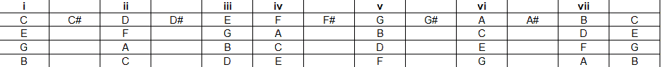
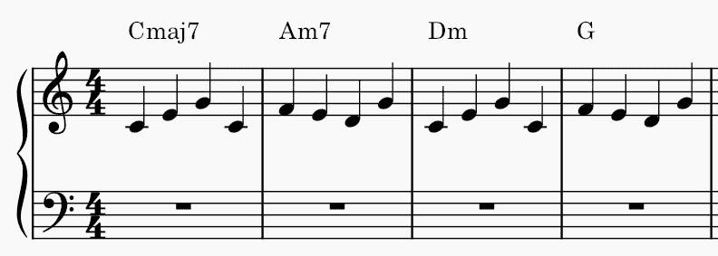
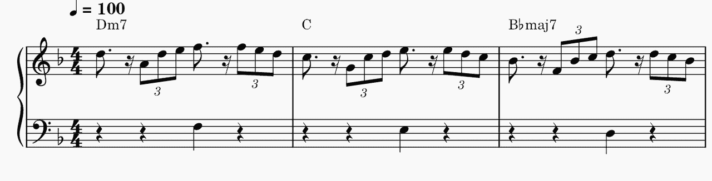

# [音乐学习] 乐理篇：和声学

> 来源：[https://waytoagi.feishu.cn/docx/MqIMdpHGNoz9znxTBnJcmnkfnIB](https://waytoagi.feishu.cn/docx/MqIMdpHGNoz9znxTBnJcmnkfnIB)

# 和声的基础概念

**和声（Harmony）**是音乐理论中的一个重要组成部分，它研究的是音符如何在时间上同时或相继组合，形成悦耳的听觉效果。和声的概念涉及多个层面，包括和弦、和弦进程、调性、和声功能等。下面是对和声基本概念的简要解释：

**音程（Interval）：**

和声的最基础单元是音程，指的是两个音符之间的距离。音程的性质（如纯五度、大三度等）决定了和声的性质。

**和弦（Chord）：**

当三个或更多音符同时演奏时，就形成了和弦。和弦的性质（如大三和弦、小七和弦等）决定了和声色彩的丰富程度。和弦是和声的主要构建块。

和弦进程（Chord Progression）：

和声不仅关注单个和弦，也关注和弦之间如何转换，即和弦进程。常见的和弦进程遵循一定的规律，如I-V-vi-IV（在C大调中就是C-G-Am-F）。

**调性（Tonality）：**

调性是指音乐围绕一个中心音或主音（Tonic）组织的方式。和声通常在一个特定的调性框架内进行，如C大调或A小调。调性赋予音乐方向感和稳定性。

和声功能（Harmonic Function）：

和弦在调性中扮演着不同的角色，这些角色称为和声功能。主要的功能有Tonic（稳定）、Dominant（推动）、Subdominant（过渡）等。和声功能帮助音乐建立紧张和放松的感觉，引导音乐的流动和发展。

和声分析（Harmonic Analysis）：

分析一首曲子的和声结构，包括识别和弦、和弦进程及其功能，可以帮助理解音乐的构造和情感表达。

对位法（Counterpoint）：

虽然对位法严格来说不属于和声，但它与和声密切相关。对位法关注的是旋律线之间的相互关系，当多个独立旋律线结合在一起时，它们共同创造了和声效果。

# 常用的和弦类型

## 2.1 **三和弦 (Triad)**

由根音、三度音和五度音构成的和弦。

### 大三和弦（Major Triad）

+   **构成音**：根音（Root）、大三度音（Major Third）、纯五度音（Perfect Fifth）

+   **例子**：C大三和弦（C-E-G）

+   根音：C

+   大三度音：E（比根音高4个半音）

+   纯五度音：G（比根音高7个半音）

+   **音响效果**：明亮、稳定、和谐。

### 小三和弦（Minor Triad）

+   **构成音**：根音（Root）、小三度音（Minor Third）、纯五度音（Perfect Fifth）

+   **例子**：C小三和弦（C-E♭-G）

+   根音：C

+   小三度音：E♭（比根音高3个半音）

+   纯五度音：G（比根音高7个半音）

+   **音响效果**：忧郁、柔和、暗淡。

### 减三和弦（Diminished Triad）

+   **构成音**：根音（Root）、小三度音（Minor Third）、减五度音（Diminished Fifth）

+   **例子**：C减三和弦（C-E♭-G♭）

+   根音：C

+   小三度音：E♭（比根音高3个半音）

+   减五度音：G♭（比根音高6个半音）

+   **音响效果**：紧张、不稳定、悬疑。

### 增三和弦（Augmented Triad）

+   **构成音**：根音（Root）、大三度音（Major Third）、增五度音（Augmented Fifth）

+   **例子**：C增三和弦（C-E-G♯）

+   根音：C

+   大三度音：E（比根音高4个半音）

+   增五度音：G♯（比根音高8个半音）

+   **音响效果**：不稳定、悬疑、开放。

## 2.2 七和弦 (Seventh Chord)：

在三和弦基础上再加一个七度音。

### 大七和弦（Major Seventh Chord）

+   **构成音**：根音（Root）、大三度音（Major Third）、纯五度音（Perfect Fifth）、大七度音（Major Seventh）

+   **例子**：C大七和弦（C-E-G-B）

+   根音：C

+   大三度音：E（比根音高4个半音）

+   纯五度音：G（比根音高7个半音）

+   大七度音：B（比根音高11个半音）

+   **音响效果**：优雅、抒情、和谐。

### 小七和弦（Minor Seventh Chord）

+   **构成音**：根音（Root）、小三度音（Minor Third）、纯五度音（Perfect Fifth）、小七度音（Minor Seventh）

+   **例子**：C小七和弦（C-E♭-G-B♭）

+   根音：C

+   小三度音：E♭（比根音高3个半音）

+   纯五度音：G（比根音高7个半音）

+   小七度音：B♭（比根音高10个半音）

+   **音响效果**：忧郁、柔和、深情。

### 减七和弦（Diminished Seventh Chord）

+   **构成音**：根音（Root）、小三度音（Minor Third）、减五度音（Diminished Fifth）、减七度音（Diminished Seventh）

+   **例子**：C减七和弦（C-E♭-G♭-B♭♭（A））

+   根音：C

+   小三度音：E♭（比根音高3个半音）

+   减五度音：G♭（比根音高6个半音）

+   减七度音：B♭♭（A）（比根音高9个半音）

+   **音响效果**：非常紧张、不稳定、悬疑。

# 和声的调性

## **调性（Tonality）**

指[乐理篇：声音和音乐的基础](https://waytoagi.feishu.cn/wiki/Fs6vwtLikiynaqk1CcscUWRUnOg)乐作品中某个特定的音高为中心的音响体系。主要包括大调和小调两种基本类型。（在基础乐理中讲过，这里不重复讲了  ）理解调性可以帮助我们选择合适的和弦进行，建立音乐作品的和声结构。

## **调的变换**

**同名调**：如C大调与C小调，具有相同的主音但音阶不同。

**关系大小调**：如C大调与A小调，具有相同的音阶但主音不同。

在写和声的时候，首先确立音乐的调性，根据上面讲到的和声音程关系，我们就可以确定和声是否合理了。通常和声中的所有音都包含在所属调性的音阶内，比如：

**D大调音阶中的所有三和弦**

音阶音：D - E - F♯ - G - A - B - C♯ - D

D大调中所有的三和弦就包括：

+   D大三和弦（D - F♯ - A）

+   E小三和弦（E - G - B）

+   F♯小三和弦（F♯ - A - C♯）

+   G大三和弦（G - B - D）

+   A大三和弦（A - C♯ - E）

+   B小三和弦（B - D - F♯）

+   C♯减三和弦（C♯ - E - G）

# 和声的功能分析

## 4.1 基本概念

### 主和弦（Tonic Chord）

**定义**：在调性音乐中，主和弦是以主音（调的第一个音）为根音的和弦，是调的中心和最稳定的和弦。

**功能**：提供稳定、休止和结束感。通常在和弦进行中起到开始和结束的作用。

**例子**：

+   C大调中的主和弦是C大三和弦（C - E - G）。

+   A小调中的主和弦是A小三和弦（A - C - E）。

### 属和弦（Dominant Chord）

**定义**：在调性音乐中，属和弦是以五度音（调的第五个音）为根音的和弦，是最不稳定的和弦，具有强烈的向主和弦解决的倾向。

**功能**：制造紧张感，推动音乐进行到主和弦，通常用于乐句的中间或结尾来制造冲突和解决的效果。

**例子**：

+   C大调中的属和弦是G大三和弦（G - B - D）。

+   A小调中的属和弦是E小三和弦（E - G - B）。

### 下属和弦（Subdominant Chord）

**定义**：在调性音乐中，下属和弦是以四度音（调的第四个音）为根音的和弦，是相对稳定的和弦。

**功能**：提供过渡作用，介于主和弦和属和弦之间，制造从稳定到不稳定的过渡。

**例子**：

+   C大调中的下属和弦是F大三和弦（F - A - C）。

+   A小调中的下属和弦是D小三和弦（D - F - A）。

### 其他和弦

除了主和弦、属和弦和下属和弦，还有其他类型的和弦，这些和弦扩展了和声的丰富性和复杂性。

II级和弦（Supertonic Chord）

+   **定义**：调的第二个音为根音的和弦，通常为小三和弦或减三和弦。

+   **功能**：常用于和弦进行的过渡，特别是用于次属和弦进行。

+   **例子**：C大调中的D小三和弦（D - F - A）。

III级和弦（Mediant Chord）

+   **定义**：调的第三个音为根音的和弦，通常为小三和弦或大三和弦。

+   **功能**：相对较少使用，常用于调性转换或丰富和声色彩。

+   **例子**：C大调中的E小三和弦（E - G - B）。

VI级和弦（Submediant Chord）

+   **定义**：调的第六个音为根音的和弦，通常为小三和弦或大三和弦。

+   **功能**：提供替代主和弦的解决，常用于复四循环。

+   **例子**：C大调中的A小三和弦（A - C - E）。

VII级和弦（Leading Tone Chord）

+   **定义**：调的第七个音为根音的和弦，通常为减三和弦或半减七和弦。

+   **功能**：提供强烈的向主和弦的解决，常用于属和弦进行的延续。

+   **例子**：C大调中的B减三和弦（B - D - F）。

## 4.2 和声的功能理论

和声的功能理论，简单说包括T-D-T的正格循环，T-S-T的变格循环，以及T-S-D-T的复式循环。尤其是复式功能和弦，在绝大多数乐曲里都具备这个功能。而在西方古典乐里，很少使用D-S的循环，一般把这种循环成为功能倒置错误或者反功能进行错误。但在现代音乐里，这一规则很多时候会被打破。

### 正格循环（Authentic Cadence）

+   **定义**：从属和弦到主和弦的进行，最常见的是V - I（大调）或v - i（小调），表示一种非常强烈的解决。

+   **功能**：制造明确的结束感和休止感，通常用于乐句或乐章的结尾。

### 变格循环（Plagal Cadence）

+   **定义**：从下属和弦到主和弦的进行，最常见的是IV - I（大调）或iv - i（小调），有时被称为“阿门和弦”。

+   **功能**：制造一种较弱的解决感，常用于宗教音乐中。

### 复式循环（Deceptive Cadence）

+   **定义**：从属和弦到除主和弦以外的和弦的进行，通常是V - vi（大调）或v - VI（小调），制造一种出乎意料的效果。

+   **功能**：制造悬念和延续感，使音乐得以继续发展而不是结束。

### **和声循环的规律从何而来？**

**导音**：在平均律理论中，一个音具有向相邻的半音的导向作用。比如C大调里的B，和高八度的C相隔一个半音，且它们都属于C大调的音阶，那么听到B(Si)这个音的时候，我们就会期待下一个音是C(do)的出现。

假设主调为C大调，主和弦i的构成是C（根音）- E（大三度）- G（纯五度）或者七和弦的大七度（B）

由于i和弦的三度音是E，而iv和弦的根音是F，这里形成了一个半音过度，听上去会比较流畅，但iv和弦本身并不稳定，而v和弦的功能是稳定导向主和弦，并且具备强烈倾向回归到i，所以在古典音乐，通常的解决就是1473625这个顺序来完成解决（俄系），即：i和弦可以接任何的和弦，但后面的和弦要遵循从左到右的规律，比如i接了iii和弦，后面就不能用iv和vii了，v是最稳定的和弦（强烈回归i），所以我们就能很容易写出来不会错的和弦，比如1325，145，165这样的进行。

现代音乐有更丰富的表达方式，因此也会出现像154（周杰伦）这样的反功能和弦。

## 4.3 根据循环功能理论为旋律搭配和弦的方法

### 分析旋律的调性

首先要确定旋律的调性（大调或小调），以及旋律的主音（根音）。这将帮助你选择合适的和弦进行。

### 标记旋律的重音和节拍

找出旋律中每个小节的重音位置和节拍，这些位置通常是和弦变化的关键点。

### 确定和弦的功能

根据旋律的重音和节拍，选择合适的和弦功能（主和弦、属和弦、下属和弦等）。通常，和弦的根音应与旋律的重音音符相匹配。

### 选择和弦进行

使用和弦功能理论中的常见进行，如I - IV - V - I或vi - ii - V - I等，来构建和弦进行。

### 和弦进行的变换

根据旋律的发展，适时使用和弦变换，如正格循环、变格循环或复式循环，来增强音乐的变化和层次感。

### 测试和调整

将选择的和弦进行与旋律结合，听取效果，并根据需要进行调整，确保和弦与旋律之间的和谐与统一。

# 和弦的色彩和变化

扩展和弦和和弦替代可以增加和声的复杂性和丰富性，使音乐更加多彩和有层次。非和弦音可以增加旋律的流动性和表现力。

## 5.1 扩展和弦（Extended Chords）

**九和弦（9th Chord）**：在七和弦基础上再加一个九度音。

例子：C9和弦（C - E - G - B♭ - D）

十一和弦（11th Chord）：在九和弦基础上再加一个十一度音。

例子：C11和弦（C - E - G - B♭ - D - F）

十三和弦（13th Chord）：在十一和弦基础上再加一个十三度音。

例子：C13和弦（C - E - G - B♭ - D - F - A）

## 5.2 和弦替代（Chord Substitution）

**平行和弦替代**：用同样功能的和弦替代，例如用vi替代I，或用ii替代IV。

例子：在C大调中，用Am替代C，用Dm替代F。

**三全音替代**：用三全音（减五度）和弦替代，例如用♭II替代V。

例子：在C大调中，用D♭替代G。

### 应用实例

**C9和弦的使用**：

+   和弦：C - E - G - B♭ - D

+   例子：在C大调中，可以用C9和弦替代C大三和弦，增加和声的色彩。

**Am替代C的和弦进行**：

+   和弦进行：C - F - G - C 替代为 Am - F - G - C

+   例子：在C大调中，用Am替代C，可以创造不同的情感效果。

## 5.3 非和弦音（Non-Chord Tones）

### 通过音（Passing Tone）

**时值**：通常是短时值音符，常见于八分音符或十六分音符。

**位置**：一般出现在两个和弦音之间的弱拍上。

### **挂留音（Suspension）**

**时值**：通常是较长时值音符，常见于四分音符或更长。

**位置**：通常出现在强拍上，并在解决到和弦音时发生变化。

### 辅助音（Neighboring Tone）

**时值**：通常是短时值音符，常见于八分音符或十六分音符。

**位置**：通常出现在和弦音的前后，并在弱拍上。

### 延留音（Pedal Point）

**时值**：可以是较长时值音符，甚至可以跨越多个小节。

**位置**：通常出现在低音部，并在和弦变化时保持不变。

### 举例说明

假设我们有一段旋律，和弦进行为C大调中的C - G - Am - F：

1.  通过音（Passing Tone）：

+   和弦：C（C - E - G）

+   旋律：C（和弦音） - D（通过音，八分音符） - E（和弦音）

+   解释：D作为C和E之间的通过音，时值为八分音符。

1.  **挂留音（Suspension）**：

+   和弦：G（G - B - D）

+   旋律：G（和弦音） - C（挂留音，四分音符） - B（解决音）

+   解释：C作为挂留音，时值为四分音符，解决到B上。

1.  辅助音（Neighboring Tone）：

+   和弦：Am（A - C - E）

+   旋律：C（和弦音） - D（辅助音，八分音符） - C（和弦音）

+   解释：D作为C的辅助音，时值为八分音符。

1.  延留音（Pedal Point）：

+   和弦：F（F - A - C）

+   旋律：C（延留音，跨越整个和弦变化） - A（和弦音） - C（和弦音）

+   解释：C作为延留音，时值较长，跨越和弦变化。

# 和声的应用

理解和应用和声是编曲的核心，通过合理的和声进行，可以增强音乐的情感表达，丰富音乐的层次和色彩。

## 实例分析1：

假设我们有一段旋律，和弦进行为C大调中的C - Am - Dm - G：

1.  **基本和声进行**：

+   C大三和弦（C - E - G）

+   Am小三和弦（A - C - E）

+   Dm小三和弦（D - F - A）

+   G大三和弦（G - B - D）

1.  **和弦的节奏变化**：

+   我们可以使用不同的节奏型来演奏和弦，例如每小节一个和弦，或每个拍子一个和弦。

+   示例：

+   每小节一个和弦：C - - - | Am - - - | Dm - - - | G - - -

+   每个拍子一个和弦：C - E - | Am - C - | Dm - F - | G - B -

1.  **和声层次的创建**：

+   通过添加七和弦或扩展和弦来增加和声的丰富性。

+   示例：

+   C大七和弦（C - E - G - B）

+   Am七和弦（A - C - E - G）

+   Dm七和弦（D - F - A - C）

+   G七和弦（G - B - D - F）

## 实例分析2：

假设我们要编配一段流行歌曲，旋律为：

+   C - E - G - C - F - E - D - G - C

#### 编曲过程：

1.  **选择和弦进行**：

+   使用C大调的常见和弦进行：C - Am - Dm - G

1.  **确定和弦节奏**：

+   每小节一个和弦：C - - - | Am - - - | Dm - - - | G - - -

1.  **创建和声层次**：

+   添加七和弦：Cmaj7 - Am7 - Dm7 - G7

#### 完整编曲：

+   Cmaj7（C - E - G - B）

+   Am7（A - C - E - G）

+   Dm7（D - F - A - C）

+   G7（G - B - D - F）

通过尝试不同的和弦组合，可以很明显体会到和弦带来的不同情绪变化，这里只是简单举个例子，大家可以自己多做尝试。

# 7.1 和声的创新和实验 (TBD)

## 现代和声的基础概念

爵士和声（Jazz Harmony）

常使用复杂和弦，如九和弦、十一和弦、十三和弦，强调和弦的色彩和变化。

流行音乐和声（Pop Harmony）

常使用简单和弦进行，但也会引入一些扩展和弦和替代和弦，以增加音乐的吸引力。

和声实验（Harmonic Experimentation）

通过不常见的和弦进行和和弦替代，创造独特的音乐效果。

