# 一个没想好的事情，先记下来

> 来源：[https://waytoagi.feishu.cn/docx/H4oJdUfxMotTZKx78D6ckuuynVf](https://waytoagi.feishu.cn/docx/H4oJdUfxMotTZKx78D6ckuuynVf)

**引言**

之前汉青老师分享的时候说过一段话，生成式AI的内容，并没有新的渠道去承载，它仍然和传统的社交媒体内容共存，小红书，抖音，微信之类。短期内大家可能因为新鲜感获得流量红利，但当潮水褪去，人们在意的仍然是高质量的内容。

我们或许已经掌握了各种先进的工具，会在MJ里用各种关键词出图，会用SD做复杂的工作流，会让老照片动起来，也可以做出很炫酷的宣传片。在这件事情里面，我们不去聊任何的工具，只去聊内容，让节奏慢下来，认真去感受周围真实的世界，感受身边每一个我们通常会一扫而过，关注不到的普通人。我们不会为了AI而生活，但AI让我们更热爱生活。

具体怎么做还没想好，也没完全想明白怎么和AI结合，先放着慢慢想

---

偶然在朋友的朋友圈刷到的题材：

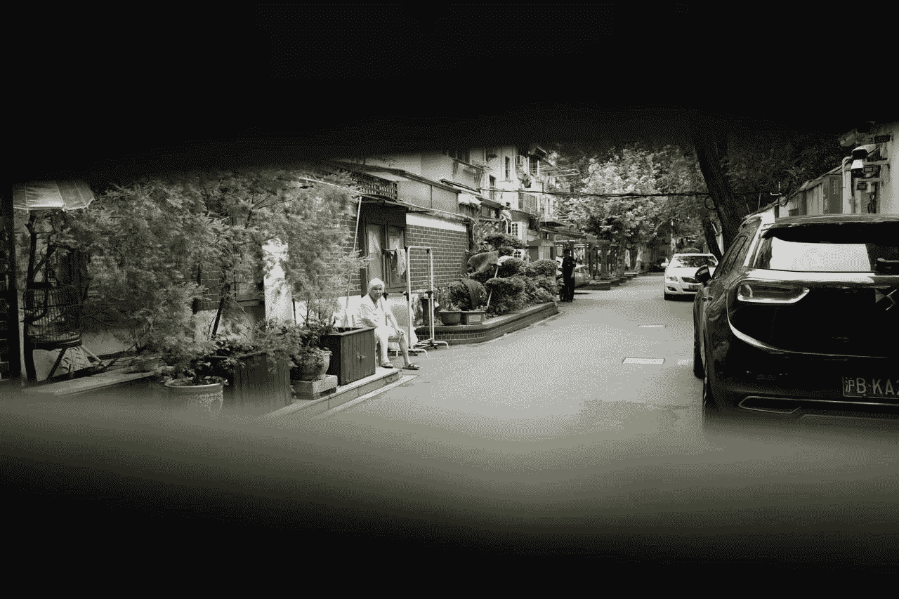

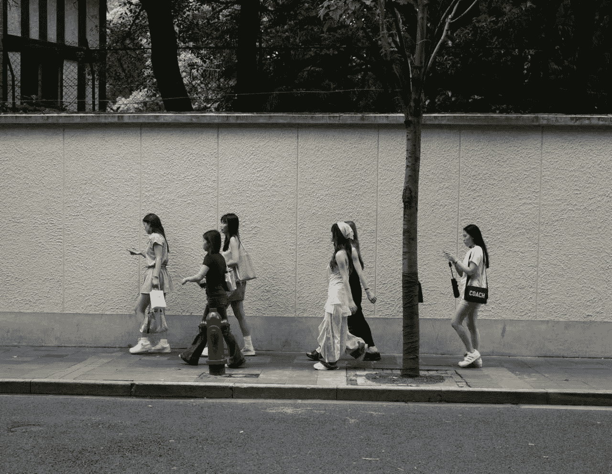

“这两张照片其实是在同一条街道上拍下的，只不过年轻的女孩在街上，孤独的老人在围墙里。”

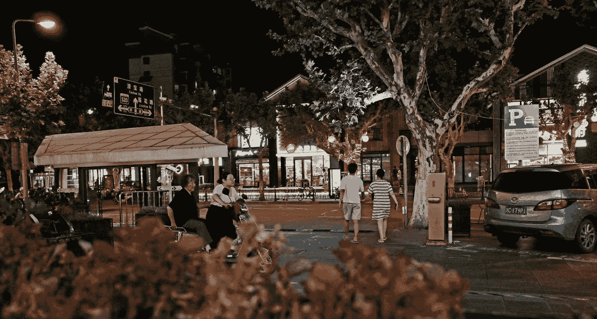

“这张照片传递两种关系、一种爱意，年轻人手牵着怀孕的爱人，老母亲扶着女儿坐上电动车，这应该是这个世界最稳固的两种关系，而现在他们相遇在一张照片当中。”

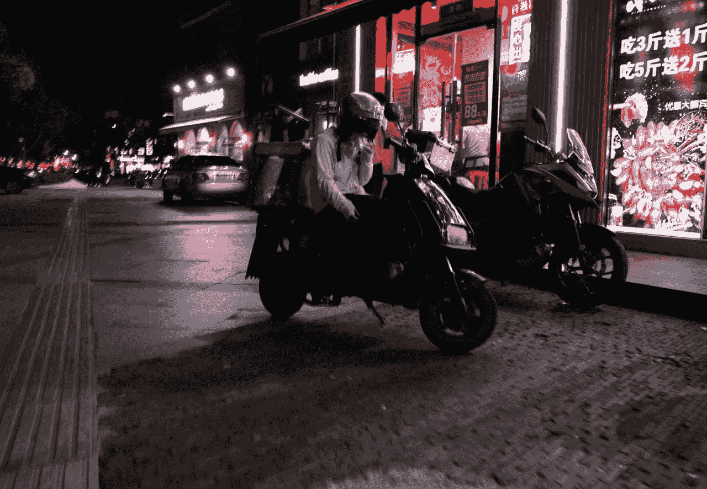

“很多人把生活当中的便利，比如电商快递外卖速度快便宜看着是我们的移动互联网优势，其实唯一的优势是我们的劳动力，无数个在深夜独自啃着馒头的年轻人支撑着美团阿里的市值...放大镜头看你会发现这其实是一个非常年轻的女孩子(为了不把自己晒黑穿了防晒服)，她瘦小，即使戴了头盔也比后面的箱子高不了多少，她进食的时候甚至都没玩手机——我骑车路上看到过很多快递小哥都是边骑车边刷短视频，这至少说明他们对生活中的乐子还充满期待，而图中的女孩看着让人垂头丧气，不仅是她，也包括我。”

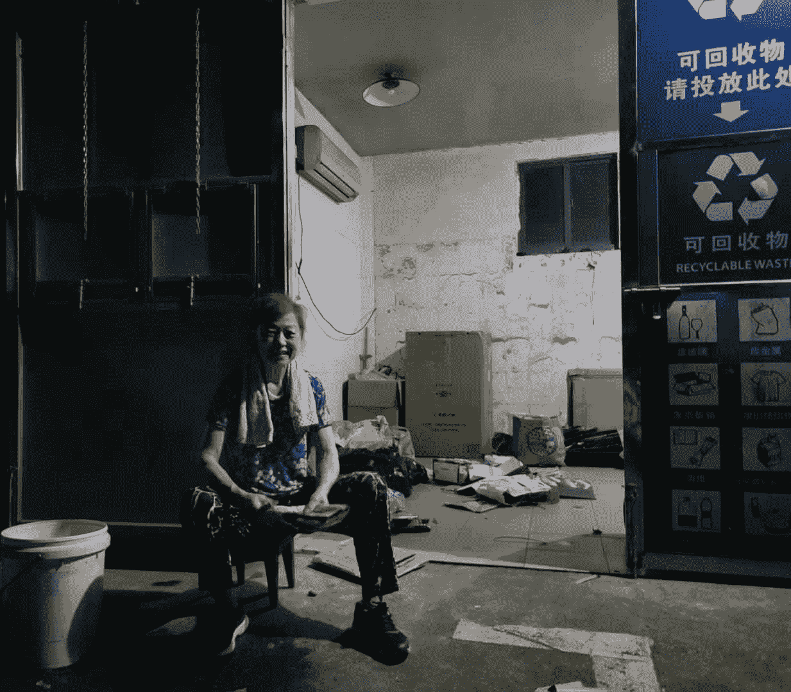

“倒垃圾的时候我说“阿姨能给你拍一张照吗？”，听完她赶紧把收拾的纸壳给收回去，然后露出她自然而灿烂的笑容。”

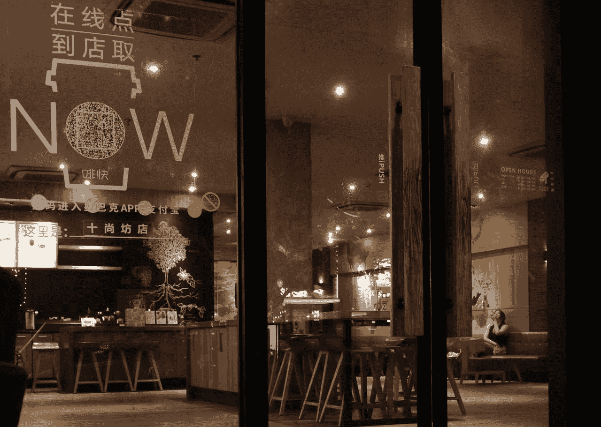

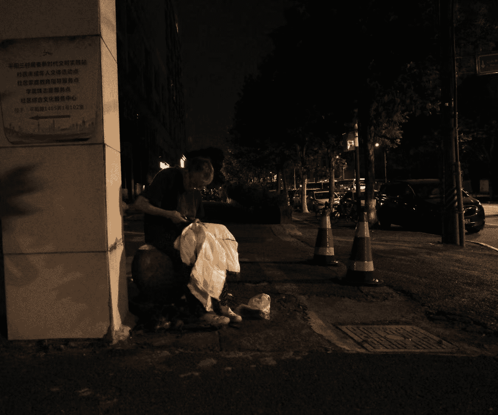

“夏夜，有人抬头补妆，有人低头补衣裳”

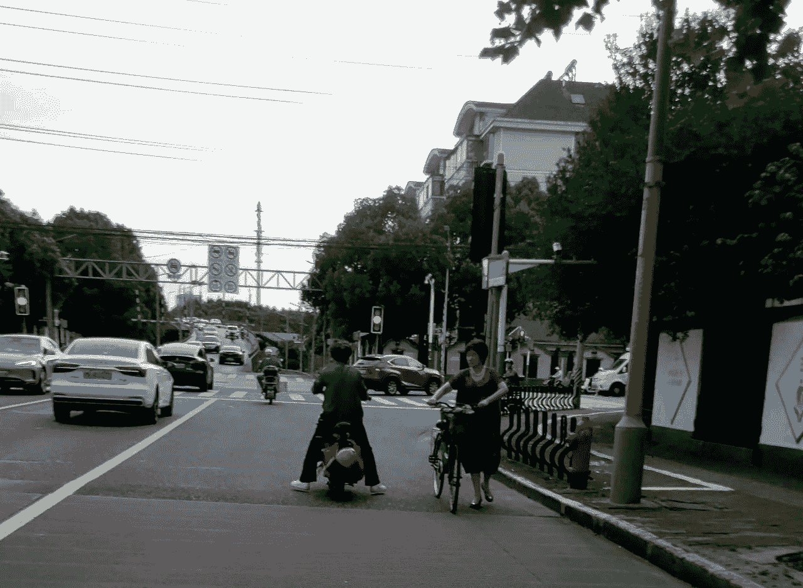

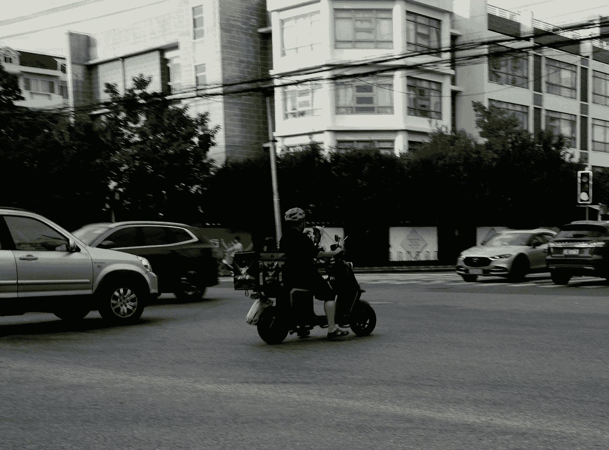

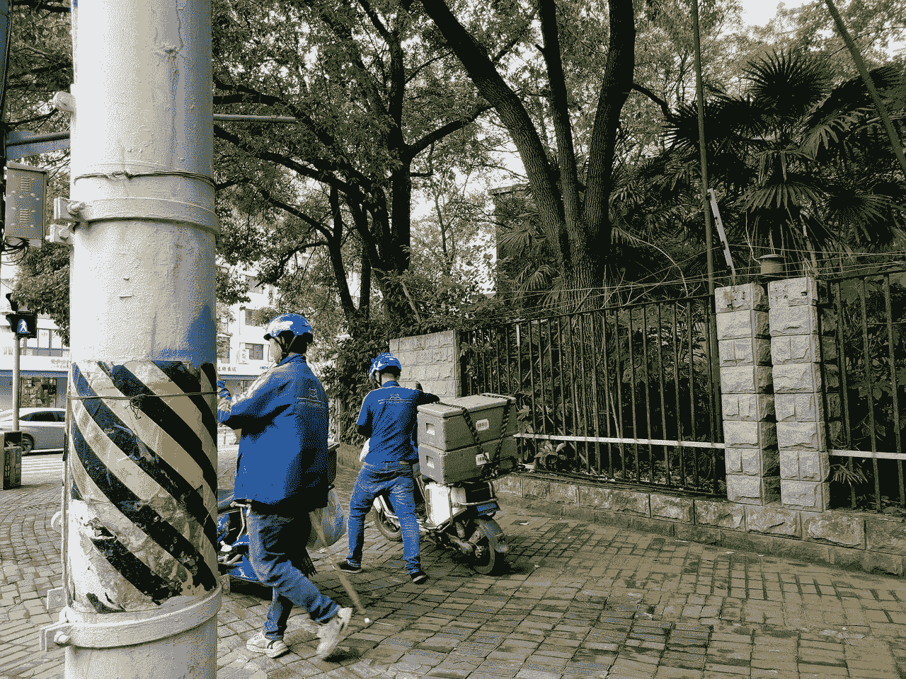

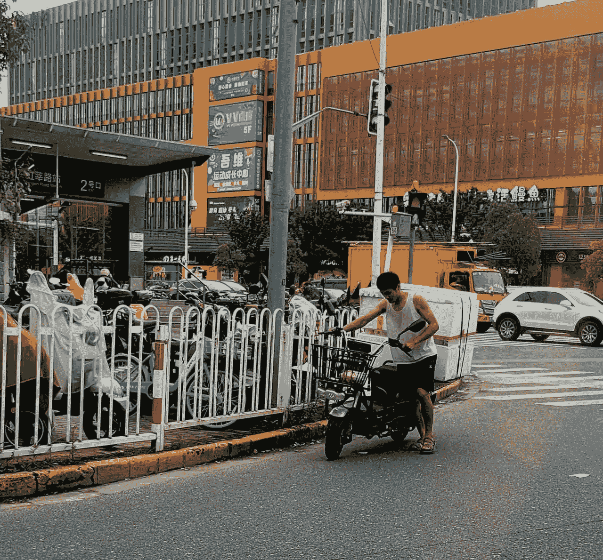

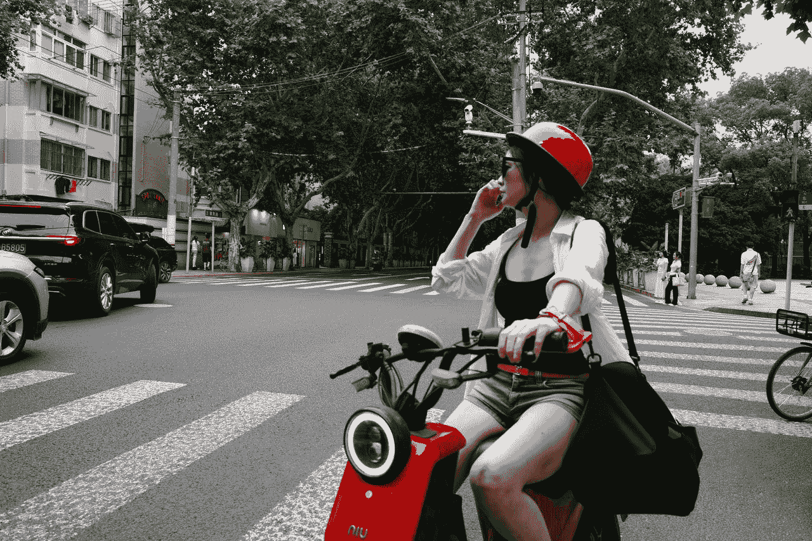

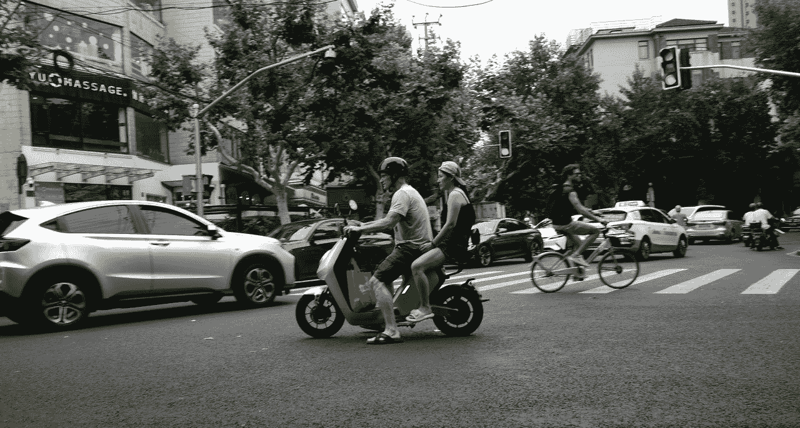

“当下中国其实正处于剧变当中”

“我的初衷是记录这些变化”

“打算去骑自行车送外卖，那样就能多拍”

“到时可能还会去别的地方拍一拍，县城啥的”

“那才是能看懂中国的地方”

---

我不想总是做对的事情

也想做一些好的事情