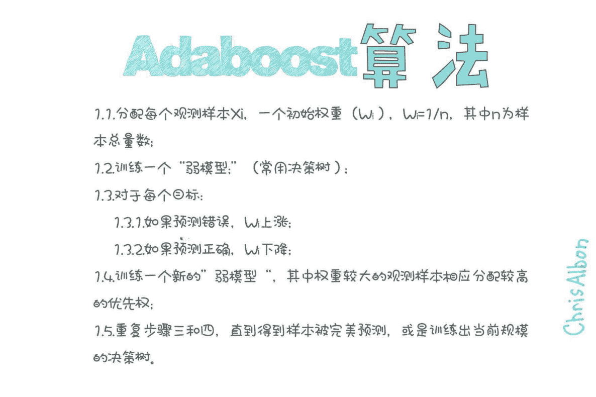

# [算法学习] Adaptive Boosting 分类/回归

> 来源：[https://waytoagi.feishu.cn/docx/VDMQdLSdUoFiNyxUQhAcJb2Knkd](https://waytoagi.feishu.cn/docx/VDMQdLSdUoFiNyxUQhAcJb2Knkd)



# 基础概念

AdaBoost（Adaptive Boosting），即自适应增强算法，是一种集成学习算法，主要用于分类问题，也可以用于回归问题。它通过组合多个弱学习器（通常是决策树桩）来构建一个强学习器，以提高模型的预测性能。

弱学习器（Weak Learner）

弱学习器是集成学习中的一个概念。在机器学习中，学习器通常被分类为强学习器（Strong Learner）和弱学习器。两者的基本区别有：

**强学习器**：

+   强学习器通常指的是具有高准确率的模型，能够很好地泛化到新的数据上。

+   它们可能是复杂的模型，比如深度神经网络或支持向量机，能够捕捉数据中的复杂模式。

**弱学习器**：

+   弱学习器的准确率仅略高于随机猜测。例如，在二分类问题中，如果随机猜测的准确率是50%，那么弱学习器的准确率可能只是略高于50%，比如51%。

+   弱学习器通常是简单的模型，比如决策树桩（Decision Stumps），它们只考虑单个特征的阈值来做出预测。(比如月收入高于30k，就有可能购买一个空气净化器)

# **核心思路**

1.  **迭代训练**：AdaBoost算法通过迭代的方式逐步训练弱学习器。在每一轮迭代中，它都会训练一个新的弱学习器，并将其加入到模型中。

1.  **权重调整**：在每一轮迭代中，AdaBoost都会根据前一轮的预测结果调整样本的权重。对于被当前弱学习器错误分类的样本，其权重会被增加，而对于正确分类的样本，其权重会被减少。这样做的目的是让模型在下一轮迭代中更加关注那些难以分类的样本。

1.  **弱学习器的组合**：AdaBoost算法将多个弱学习器的预测结果结合起来，形成一个最终的强学习器。每个弱学习器的预测结果会根据其在训练过程中的表现（即分类准确率）进行加权，表现越好的弱学习器在最终预测中的贡献越大。

# 算法步骤

可以通过一个简化的例子来理解AdaBoost算法的基本计算过程。

假设有一个二分类问题，数据集只包含两个特征：年龄和收入，我们的目标是预测一个人是否购买了某个产品（是/否）。

## **步骤1：初始化**

我们有10个样本，每个样本都有年龄、收入和标签（购买/未购买）。

我们初始化所有样本的权重为1/N，这里N是样本总数，即0.1。

## **步骤2：训练一个弱学习器**

选择一个简单的弱分类器，比如基于“收入 > 50k”的决策树桩。

**分类规则：“收入 > 50k”**

**结果：**

样本1（收入15k）：被分类为"否"，正确。

样本2（收入25k）：被分类为"否"，正确。

样本3（收入30k）：被分类为"否"，正确。

样本4（收入35k）：被分类为"否"，错误。

样本5（收入40k）：被分类为"否"，正确。

样本6（收入60k）：被分类为"是"，正确。

样本7（收入70k）：被分类为"是"，正确。

样本8（收入65k）：被分类为"是"，正确。

样本9（收入80k）：被分类为"是"，错误。

样本10（收入90k）：被分类为"是"，正确。

+   计算错误率：error = 0.1 + 0.1 = 0.2

+   计算弱学习器的权重：α = 1/2 ln((1-error)/error) = 1/2*ln(4) ≈ 0.693

由于 α1 = 0，样本权重在这一步不会变化。

## 步骤3：更新样本权重

根据弱学习器的表现更新样本权重。错误分类的样本权重增加，正确分类的样本权重减少。

假设y = 真实标签 h(x)为 y的预测标签 h(x)。

当 y*h(x)相同 = +1，将导致权重更新减少，否则 =-1，将导致权重更新增加

更新权重的公式：

w = 1/n(样本量) * e^ (-α*y*h(x))

+   对于分类正确的样本 = 0.1*e^ (-ln(4)*1）≈ 0.05

+   对于分类错误的样本 = 0.1*e^ (-ln(4)*-1） ≈ 0.2

## 步骤4：归一化权重

在AdaBoost算法中，归一化权重是一个重要的步骤。在每一轮迭代中，我们根据弱学习器的性能更新样本权重。由于弱学习器可能对某些样本的预测正确，对另一些样本的预测错误，这会导致样本权重的分布发生变化。归一化确保所有样本权重的总和等于1，这样在下一次迭代中，我们仍然可以公平地考虑每个样本。

归一化权重计算很简单：

总权重求和 = 0.05*8 + 0.2*2 = 0.8

分类正确的权重 = 0.05/0.8 = 0.0625

分类错误的权重 = 0.2/0.8 = 0.25

更新以后的权重表：

## 步骤5：训练第二个弱学习器并更新权重

使用更新后的样本权重，训练下一个弱分类器，这次选择“年龄 > 30”作为分类规则。

**分类规则：“年龄 > 30”**

结果：

样本1（18岁）：被分类为"否"，正确。

样本2（22岁）：被分类为"否"，正确。

样本3（25岁）：被分类为"否"，正确。

样本4（28岁）：被分类为"否"，错误。

样本5（32岁）：被分类为"是"，错误。

样本6（35岁）：被分类为"是"，正确。

样本7（40岁）：被分类为"是"，正确。

样本8（42岁）：被分类为"是"，正确。

样本9（50岁）：被分类为"是"，错误。

样本10（55岁）：被分类为"是"，正确。

+   计算错误率：error = 0.25 + 0.0625 + 0.25 = 0.5625

+   计算弱学习器的权重：

α2 = 1/2 * ln((1-0.5625)/0.5625)) ≈ -0.1256

+   对于分类正确的样本 = 0.0625*e^ (0.126）≈ 0.066, 归一化(0.067)

+   对于分类错误的样本

w4 = 0.25 * e^(-0.126) ≈ 0.235, 归一化(0.237)

w5 = 0.0625 * e^(-0.126) ≈ 0.059, 归一化(0.0595)

w9 = 0.25 * e^(-0.126) ≈ 0.235, 归一化(0.237)

## 步骤6：组合弱学习器，合成强学习器

重复上述步骤，直到达到预定的迭代次数或模型性能不再提升。最后，我们根据每个弱学习器的权重（α）和预测结果来计算最终的预测。

假设我们只迭代一次，得到 α1 = 0.693 α2 = -0.126

强分类器H(x)预测公式为：

H(x) = sign(a1*h1(x) + a2*h2(x))

这里的sign函数用于决定最终的分类结果。

如果输入值大于0，结果输出为+1，代表分类（是），反之为-1，代表（否）

**强分类器预测结果**

**和真实结果的比对**

上面的例子里，强分类器的错误率仍然是0.2，样本量太少的情况下，性能提升有限，但在多样本量和影响参数的时候，可以通过多次迭代来更新弱分类器的权重：

**提升弱分类器的准确性**：通过合成多个弱分类器，最终分类器可以更有效地捕捉样本的真实模式。尽管单个弱分类器的准确性不高，但它们的组合使得强分类器更具鲁棒性。

**聚焦误分类样本**：在步骤6中，我们增加了误分类样本的权重，让后续的弱分类器更重视这些样本。虽然在这个例子中并未解决所有误分类的问题（如样本4和样本9仍然被误分类），但总体上通过多个弱分类器的加权，错误率降低。

**强分类器的稳健性**：通过迭代调整和结合不同的弱分类器，Adaboosting可以逐步提升整体分类的准确性，即使某些样本在前几个分类器中被误分类，它们在最终组合中可能被正确分类。

# 应用场景

+   比如在程序化广告领域，通过弱分类器叠加的形式，就可以辅助在比如ocpx领域单一KPI的场景下进行“展示”或者“不展示”的逻辑门判断。

+   另外就是比如我需要用已有数据集证明一些观点，比如：40岁以上，收入>50k的人群更倾向于购买我们的商品，那么从样本里就有80%的样本支持我们的观点。反之这个观点不成立。

+   解决回归问题：假设我们并不是在预测标签，而是预测一个连续值，也可以用adaboosting来解决，通常叫做Adaptive boosting for Regression （adaboost R2）。这里只要把标签替换成连续值，用真实结果和预测结果计算方差就可以，通过权重迭代和组合得到最终的回归预测。

# Adaboost的优劣势

**优势**：

1.  **高准确性**：AdaBoost通过逐步优化弱学习器，通常能够达到较高的预测精度 。

1.  **灵活性**：可以与各种类型的弱学习器结合使用，例如决策树桩、神经网络等 。

1.  **自适应性**：AdaBoost算法在每一轮迭代中调整样本权重，使得模型更加关注难以分类的样本 。

1.  **自动特征选择**：AdaBoost能够自动选择有效特征并忽略不相关或噪声特征 。

1.  **不太容易过拟合**：在许多情况下，尽管模型复杂度增加，AdaBoost仍然表现出较好的泛化能力 。

**劣势**：

1.  **对噪声数据敏感**：AdaBoost可能会过度关注噪声和异常值，导致模型性能下降 。

可以通过手动调整权重参数减少噪声的影响

1.  **计算成本**：由于需要顺序训练多个弱学习器，AdaBoost在处理大规模数据集时可能计算量大 。

1.  **数据不平衡问题**：在面对极端不平衡的数据集时，AdaBoost可能表现不佳 。

**建议尽量用adaboost处理一些有一定正向相关性且边**界模糊（低方差，存在一些难以分类的样本）的数据集进行分类或回归任务（回归问题其实也有很多其他解决方案，也不一定都钻在里面）

1.  **迭代次数设定**：确定弱学习器的数量可能需要交叉验证等技术来辅助决定 。

下面脚本里面是手动设定的，因为懒...也可以自己写一个停止迭代的阈值（比如每次迭代正确率提升值小于0.1%则停止迭代）

1.  **训练时间**：每次迭代需要重新选择当前分类器的最佳切分点，可能导致训练耗时 。

处理太大数据量的样本集会比较吃力，可以结合其他算法（比如基于贝叶斯的MMM）选择使用。参考

[[应用开发] 轻量化MMM (Marketing Mix Modelling) 的部署运行](https://waytoagi.feishu.cn/wiki/EXwCw382FimXhvkdCKxctDfcnjg)

---

# Python运行脚本

下面是一个简单的运行脚本，大家可以根据自己的需求进行优化调整

```
import pandas as pd
import numpy as np
from sklearn.tree import DecisionTreeClassifier
from sklearn.metrics import accuracy_score

class AdaBoost:
    def __init__(self, n_estimators=50, error_threshold=1e-10):
        self.n_estimators = n_estimators
        self.error_threshold = error_threshold
        self.alphas = []
        self.models = []

    def fit(self, X, y):
        n_samples, n_features = X.shape
        w = np.ones(n_samples) / n_samples
        
        for _ in range(self.n_estimators):
            model = DecisionTreeClassifier(max_depth=1, random_state=42)
            model.fit(X, y, sample_weight=w)
            y_pred = model.predict(X)

            # 计算错误率
            error = np.sum(w * (y_pred != y)) / np.sum(w)
            
            # 当错误率接近0，停止迭代
            if error &lt; self.error_threshold:
                print(f&quot;Stopping early at iteration {_+1} due to low error rate: {error}&quot;)
                break

            # 计算模型权重 (alpha)
            alpha = 0.5 * np.log((1 - error) / (error + 1e-10))  
            
            # 更新权重
            w *= np.exp(-alpha * y * y_pred)
            w /= np.sum(w)  # 正则化

            # 保存模型权重 alpha
            self.models.append(model)
            self.alphas.append(alpha)

    def predict(self, X):
        # 计算所有的弱分类器
        model_preds = np.array([alpha * model.predict(X) for model, alpha in zip(self.models, self.alphas)])
        y_pred = np.sign(np.sum(model_preds, axis=0))
        return y_pred

def load_data(file_path):
    df = pd.read_excel(file_path)
    X = df.iloc[:, 1:-1].values  # 排除第一列（序号）和最后一列（标签）
    y = df.iloc[:, -1].values    # 标签列
    y = np.where(y == &#x27;是&#x27;, 1, -1)  # 将标签转换为 +1 (是) and -1 (否)，可以自己调整
    return X, y

def main():
    file_path = &#x27;input your file path&#x27;  # 在这里替换你的数据集地址（xlsx格式）
    X, y = load_data(file_path)

    # 迭代次数最大值控制，可以自行调整
    clf = AdaBoost(n_estimators=50)
    
    # 模型训练
    clf.fit(X, y)
    
    # 标签预测
    y_pred = clf.predict(X)
    
    # 打印预测正确率
    accuracy = accuracy_score(y, y_pred)
    print(f&#x27;Accuracy: {accuracy * 100:.2f}%&#x27;)
    
    # 输出预测
    predictions = pd.DataFrame({
        &#x27;Sample Index&#x27;: np.arange(1, len(y) + 1),
        &#x27;Actual Label&#x27;: y,
        &#x27;Predicted Label&#x27;: y_pred
    })
    print(predictions)

if __name__ == &quot;__main__&quot;:
    main()

```