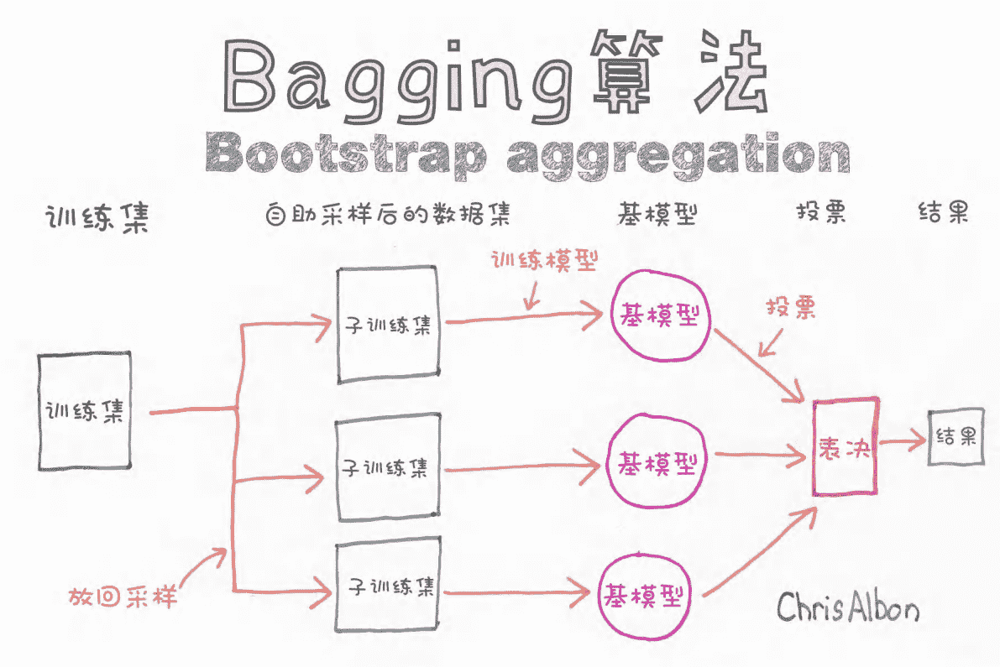

# [算法学习] Bootstrap Aggregating 分类/回归

> 来源：[https://waytoagi.feishu.cn/docx/IA4BdLflqoEJdlxc35Ecbggvnyb](https://waytoagi.feishu.cn/docx/IA4BdLflqoEJdlxc35Ecbggvnyb)



# 基础概念

Bagging（Bootstrap Aggregating）是一种集成学习方法，主要用于减少机器学习模型的方差，并提高其泛化能力。Bagging的核心思想是通过多次抽样生成多个数据集，训练多个模型，并将这些模型的结果进行平均（或投票）来提高整体预测的稳定性和准确性。

# Bagging的定义与核心

**Bootstrap抽样**：

从原始数据集中有放回地抽取多个子集。每个子集的大小与原始数据集相同，但由于是有放回的抽样，可能会出现重复样本。

**训练多个模型**：

每个子集都用于训练一个独立的模型。这些模型通常是相同的模型类型（如决策树，多项式等）。

**集成结果**：

对于回归任务，将多个模型的预测结果取平均；对于分类任务，通过多数投票来决定最终的分类结果。

# 算法步骤

我们随机生成一个具有2个特征的数据集，用于预测一个连续变量的回归任务。（同样适用于分类）

## 步骤1：Bootstrap抽样：

从原始数据集中随机有放回地抽取3个子集，每个子集大小为6（与原始数据集大小相同）。

子集1：

1.  样本1: X1 = 83, X2 = 60, Y = 67.24

1.  样本2: X1 = 24, X2 = 22, Y = 24.48

1.  样本3: X1 = 3, X2 = 89, Y = 60.20

1.  样本4: X1 = 87, X2 = 21, Y = 33.68

1.  样本5: X1 = 53, X2 = 91, Y = 76.59

1.  样本6: X1 = 15, X2 = 30, Y = 20.96

子集2：

1.  样本1: X1 = 22, X2 = 49, Y = 39.44

1.  样本2: X1 = 52, X2 = 2, Y = 11.94

1.  样本3: X1 = 72, X2 = 38, Y = 41.14

1.  样本4: X1 = 93, X2 = 88, Y = 91.07

1.  样本5: X1 = 87, X2 = 21, Y = 33.68

1.  样本6: X1 = 72, X2 = 38, Y = 41.14

子集3：

1.  样本1: X1 = 93, X2 = 88, Y = 91.07

1.  样本2: X1 = 22, X2 = 49, Y = 39.44

1.  样本3: X1 = 21, X2 = 64, Y = 49.97

1.  样本4: X1 = 21, X2 = 64, Y = 49.97

1.  样本5: X1 = 75, X2 = 76, Y = 76.25

1.  样本6: X1 = 72, X2 = 38, Y = 41.14

## 步骤2：模型训练

对每个子集使用线性回归模型进行训练。

+   每个子集生成一个线性回归方程，用最常见的线性方程表示为：

+   Y=β1*X1 + β2*X2 + β （β1，2代表不同特征的系数/斜率，β代表截距）

对于线性方程，我们要做的就是通过最小化MSE来求解最佳的系数和截距，通常可以用梯度下降算法来实现。由于这里只是个举例，我就用最简单的最小二乘法用正规方程来直接解不做迭代了：

[吵爷：机器学习-从0开始掌握反向传播算法](https://waytoagi.feishu.cn/wiki/XhFDwymwMiEMT6kkSCKc3LKinHd)于矩阵乘法，梯度下降，可以参考之前的文章：

### **最小二乘法**

最小二乘法（Ordinary Least Squares，OLS）是统计学中最常用的线性回归方法，用于拟合一条直线，使得预测值与实际值之间的误差平方和（即残差平方和）最小化。OLS方法通过直接计算解析解，找到线性回归模型的最佳系数和截距。

其中，X是设计矩阵，包含所有样本的特征；Y 是目标值向量。

**以子集1举例：**

#### Step1： 构建矩阵

##### A. 设计矩阵 (X）

构建一个矩阵x，其中包含每个样本的特征值。为了计算截距，我们在每一行的开头添加一个常数1。

##### B. 目标矩阵 (Y)

构建目标向量 Y，包含每个样本的目标值：

#### Step2: 计算X(T)X 和 X(T) Y （X(T)代表X矩阵的转置)

##### A. 计算X(T)X

##### B. 计算X(T)Y

#### Step3: 求解正规方程

求解代码：

```
import numpy as np

# 子集1的设计矩阵 (X) 和目标向量 (Y)
X_subset1 = np.array([
    [1, 83, 60],
    [1, 24, 22],
    [1, 3, 89],
    [1, 87, 21],
    [1, 53, 91],
    [1, 15, 30]
])

Y_subset1 = np.array([67.24, 24.48, 60.20, 33.68, 76.59, 20.96])

# 计算 X^T * X 和 X^T * Y
XtX = np.dot(X_subset1.T, X_subset1)
XtY = np.dot(X_subset1.T, Y_subset1)

# 计算正规方程的解 (系数和截距)
beta = np.linalg.inv(XtX).dot(XtY)
beta

```

通过正规方程的计算，得到子集1的线性回归模型参数：

系数: [0.2850, 0.7051]

截距: -2.1794

**同样计算子集2**

系数: [0.2538, 0.8067]

截距: -5.4969

**和子集3**

系数: [0.2694, 0.8725]

截距: -10.7854

## 步骤3：集成结果

假设我们现在有一个新的样本，x1 = 50 x2 = 60

带入三个子集的系数得出

子集1预测值：54.3758

子集2预测值：55.5931

子集3预测值：55.0323

最终预测结果是三个模型预测值的平均值，即 55.0004。

如果在分类任务里，则使用投票形式来表决（根据分类A和分类B的数量决定）

# **总结**

**Bagging算法的优势**

通过Bagging算法用不同子集抽样形式，每个子集的模型都有可能出现过拟合，但通过集成这些模型，可以缩小单一模型的波动，增加模型的泛化能力，提升回归预测的准确性。同时我们可以发现，每个子集的训练都是并行的，可以一定程度上减少整体模型训练的时间。Bagging算法特别适合处理高方差的模型，比如随机森林就是通过对决策树应用bagging算法来提升性能。

**Bagging算法的劣势**

Bagging主要降低的是模型的方差，对偏差的降低效果有限。如果基**础模型本身偏差很大（即模型本**身的表现不好），Bagging无法显著改善结果，所以通常用于高方差，低偏差的模型。Bagging的效果取决于基础模型的选择。对于低方差的模型（如线性回归），Bagging可能不会带来显著的性能提升。而由于使用多个模型的集成，导致Bagging算法的最终模型解释性相对单一来说解释性会更差