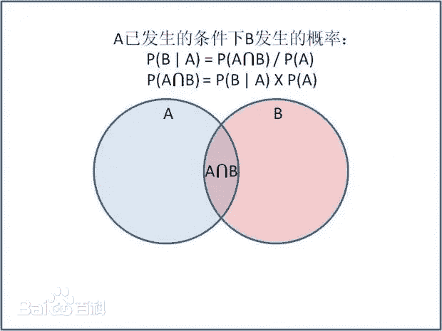

# [算法学习] Bayes formula 贝叶斯公式的实用意义

> 来源：[https://waytoagi.feishu.cn/docx/CSZ6dHR22oK8gcxmc0ac6wKJnUd](https://waytoagi.feishu.cn/docx/CSZ6dHR22oK8gcxmc0ac6wKJnUd)

之前写过一篇基于贝叶斯的MMM模型，最近正好看到有群里在讨论这个，拿着LLM给的解释敷衍着回答，看着说了很多，但是没解决问题，就新开一篇解释一下。

# 基础概念

贝叶斯公式又被称为贝叶斯定理、贝叶斯规则。是概率统计中的应用所观察到的现象对有关概率分布的主观判断（即先验概率）进行修正的标准方法。

简单理解就是，如果你看到一个人总是做一些好事，则那个人多半会是一个好人。当你不能准确知悉一个事物的本质时，可以依靠与事物特定本质相关的事件出现的多少去判断其本质属性的概率。 用数学语言表达就是：支持某项属性的事件发生得愈多，则该属性成立的可能性就愈大。

所谓贝叶斯公式，是指当分析样本大到接近总体数时，样本中事件发生的概率将接近于总体中事件发生的概率。很多经济学问题都会用到贝叶斯公式去分析，但实际上，人们在进行决策的时候很多情景会受到主观因素的影响。面对复杂而笼统的问题，人们往往走捷径，依据可能性而非根据概率来决策。这种对经典模型的系统性偏离称为“偏差”。但是因为没有更好的工具，所以很多场景还是要依赖贝叶斯定理进行分析。

# 贝叶斯公式

+   P (A∣B ) 是在事件 B 发生的条件下事件 A 发生的概率，称为后验概率。

+   P (B∣A) 是在事件 A 发生的条件下事件 B 发生的概率，通常可以从实验中得到。

+   P (A) 是事件 A 发生的独立概率，称为先验概率。

+   P (B) 是事件 B 发生的独立概率。

# 计算步骤

假设有一种罕见的疾病，其患病率为 0.5%（即每200个人中有1个人患病）。存在两种不同的测试方法来诊断这种疾病：

**测试1：**具有较高的灵敏度（95%），意味着如果一个人患病，那么95%的概率测试结果会是阳性；但它的特异性较低（80%），即如果一个人没有患病，只有80%的概率测试结果会是阴性。

**测试2：**具有较低的灵敏度（85%），意味着如果一个人患病，那么85%的概率测试结果会是阳性；但它的特异性较高（90%），即如果一个人没有患病，有90%的概率测试结果会是阴性。

如果一个人先进行了测试1，结果为阳性，之后又进行了测试2，结果也为阳性。计算这个人真正患病的概率。

## 步骤分析

### 定义事件

+   A：这个人患有该疾病。

+    ：测试1的结果为阳性。

+    ：测试2的结果为阳性。

### 先验概率

+     = 0.005 (患病率)

### 条件概率

**对于测试1： **

（如果患病，则测试1阳性的概率）；

如果未患病，则测试1阳性的概率）。

**对于测试2：**

（如果患病，则测试2阳性的概率）；

（如果未患病，则测试2阳性的概率）。

### 计算后验概率

**在未测试**的情况下，一个人患病的概率为0.5%

#### 步骤1 计算  ：

首先计算在测试1结果为阳性的条件下，这个人患病的概率

使用贝叶斯公式：

= 0.95*0.005 + 0.2*0.995 = 0.20375  #测出阳性的总概率

**第一次检测**出阳性后，真正患病的概率为2.33%

#### 步骤2 计算

= 0.95*0.85 = 0.8075  #如果患病，两次阳性的概率

= 0.2*0.1 = 0.02 #如果没患病，两次阳性的概率

= 0.8075*0.005 + 0.02*0.995 = 0.0239375 #如果第二次阳性，第一次是阳性的概率

所以：

**两次检测出阳**性后，真正患病的概率为16.56%

# 总结

可以看到，第一步计算和第二步计算的结果没有直接的线性关联，但都是通过同样的边缘概率来得到条件下的结果概率。（可以依次类推）除了医学诊断领域，贝叶斯公式也在机器学习的分类任务（比如文本分类，垃圾邮件过滤，推荐系统，NLP），金融风险评估（比如违约率，回归分析）等领域有非常广泛的应用。

当然贝叶斯也存在很多缺陷，比如先验信息涉及一定主观性，后验分布需要大量的计算，尤其针对高维的问题，需要借助其他的计算方法完成任务。在机器学习领域，一些特定的回归或者分类任务也会用其他算法来完成，像之前提到的OLS，SVM，随机森林或者神经网络算法等，这些算法并不外显使用概率模型，更加注重预测的性能和结果，可以选择性或者集成方法使用。