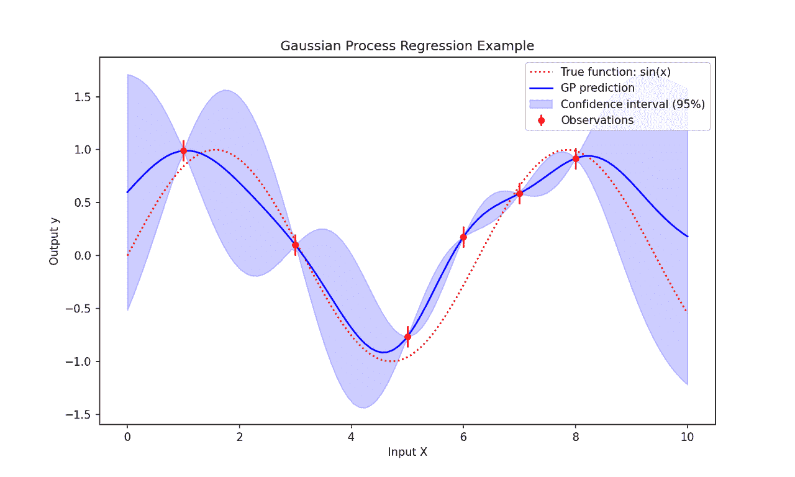

# [算法学习] Gaussian Process Regression 高斯过程回归

> 来源：[https://waytoagi.feishu.cn/docx/TJB4dvz5aoECz1xyHPtchcpZnCg](https://waytoagi.feishu.cn/docx/TJB4dvz5aoECz1xyHPtchcpZnCg)

# **高斯过程回归（Gaussian Proc**ess Regression, GPR）

高斯过程回归是一种贝叶斯非参数方法，常用于回归问题。与传统的线性回归或多项式回归不同，高斯过程回归不依赖特定的函数形式，而是通过对数据点之间的关系进行建模，从而预测未知点的分布。

# 基础知识：

## 1.1 高斯分布（Gaussian Distribution）

高斯分布（或正态分布）是统计学中最常见的连续概率分布之一，通常用来描述数据点围绕某一均值对称分布的情况。其概率密度函数为：

其中

是均值 (mean)

是方差 (varience)

## 1.2 高斯过程（Gaussian Process, GP）

高斯过程是一个由多维高斯分布构成的随机过程，它用来描述函数空间上的概率分布。简单来说，高斯过程定义了每个输入（自变量）对应的输出（因变量）都是一个高斯分布，而这些分布之间具有相关性。

高斯过程由以下两部分完全定义：

均值函数  表示给定输入时的期望值

核函数  表示输入之间的相似度（即相关性）。

对于输入集合  , 其对应的输出向量  将服从多元高斯分布：

其中m是均值向量， K是协方差矩阵，由核函数  计算得到

## 1.3 核函数

核函数（Kernel function）是用来衡量不同输入点之间相似度的核心工具。不同的核函数表达了不同的假设，即我们对数据背后隐藏函数的形状和复杂度的假设。下面是一些常用的核函数：

### **RBF 核函数（Radial Ba**sis Function Kernel）

也称为高斯核或平方指数核（Squared Exponential Kernel）。

定义为：

RBF 核函数假设函数是非常平滑的，适用于大多数情况，尤其是当数据表现出平滑的变化趋势时。

### Matern 核函数（Matern Kernel）

Matern 是 RBF 核的广义形式，提供了对平滑性更灵活的控制。

定义为：

Matern 核函数常用于处理包含较小或较大尺度的变化数据。适用于希望对平滑度有更精确控制的场景。

### 线性核函数（Linear Kernel）

定义为：

线性核函数适用于线性数据建模。适合数据没有明显非线性关系的情况，如简单的回归任务。

### 多项式核函数（Polynomial Kernel）

定义为：

其中 c 是常数， d是多项式的阶数。

用于捕捉数据中的非线性关系，适合用于多项式关系或数据存在明显的非线性结构的情况。

### 指数核函数（Exponential Kernel）

指数核函数是 Matern 核函数的特例（当 v = 0.5）

定义为：

比 RBF 核函数捕捉到的相关性更低，适合有突变的情况，数据不需要太平滑。

### 有理二次核函数（Rational Quadratic Kernel）

定义为：

有理二次核函数是 RBF 核函数的扩展形式，适用于处理不同尺度变化的数据，如多尺度变化的时间序列数据。

### 周期核函数（Periodic Kernel）

定义为：

周期核函数适用于具有周期性趋势的数据，如季节性数据建模。

# 高斯过程回归的原理

高斯过程回归的目标是通过观测到的数据点，对新的未观测到的数据点进行预测。核心思想是基于已有的数据，通过高斯过程来推断未知点的概率分布。

具体步骤如下：

## **2.1 训练阶段：**

通过给定的数据集  , 计算协方差矩阵 K 和均值函数

## **2.2 预测阶段**:

对于新的输入的 x，使用高斯过程对其输出进行预测。预测结果也是一个高斯分布，给出预测均值和不确定性（方差）。

预测公式为：

其中：

是新输入点与已有数据点的协方差向量。

是新点的预测方差，表明模型的不确定性。

# 计算实例

## 3.1 预设数据

假设我现在围绕函数   随机生成了一些数据点（1，3，5，6，7，8），并增加了0.0-0.3的噪声（对应的y值）

```
np.random.seed(42)
X = np.array([1, 3, 5, 6, 7, 8]).reshape(-1, 1)  # 训练数据点，reshape是将数据点转换成二维数组
y = np.sin(X).ravel() + np.random.normal(0, 0.3, X.shape[0])  # 增加随机噪声的真实输出
```

## 3.2 定义核函数

定义高斯过程的核函数，这里用最简单的RBF

```
kernel = C(1.0, (1e-4, 1e1)) * RBF(1, (1e-4, 1e1) #定义RBF核函数
```

这里的RBF(1, (1e-4,1e1))是核函数的超参数，1.0是初始值，(1e-4 即  , 1e1 即  ）指幅度范围。这个范围定义了在模型优化过程中，算法可以尝试的参数值的上下限。

这些范围通常基于对问题的先验知识和实验经验来设定。范围较广时，模型能够探索更多的可能性，但可能需要更多的计算资源。范围较窄时，模型的搜索更精确，但可能会错过全局最优解。

## 3.3 模型训练

创建一个高斯过程回归模型并进行训练

```
#创建回归模型
gp = GaussianProcessRegressor(kernel=kernel, n_restarts_optimizer=10) 

#训练模型
gp.fit(X, y) 

# 生成测试数据点
X_test = np.linspace(0, 10, 100).reshape(-1, 1)

# 预测结果
y_pred, sigma = gp.predict(X_test, return_std=True)
```

3.4 绘制图表

```
#设定图表尺寸
plt.figure(figsize=(10, 6))
#绘制真实的正弦函数曲线（红色虚线）
plt.plot(X_test, np.sin(X_test), &#x27;r:&#x27;, label=&quot;True function: sin(x)&quot;) 
#绘制观测数据点及其误差条（红色实心点）
plt.errorbar(X, y, 0.1, fmt=&#x27;r.&#x27;, markersize=10, label=&#x27;Observations&#x27;)
#绘制高斯过程回归的预测曲线（蓝色实线）
plt.plot(X_test, y_pred, &#x27;b-&#x27;, label=&#x27;GP prediction&#x27;)
#绘制95%置信区间（浅蓝色阴影区域）蓝色区域越宽，表示模型在该区域的预测不确定性越大；蓝色区域越窄，表示模型对该区域的预测越有信心。
plt.fill_between(X_test.ravel(), y_pred - 1.96*sigma, y_pred + 1.96*sigma, alpha=0.2, color=&#x27;blue&#x27;, label=&#x27;Confidence interval (95%)&#x27;)
#设置 X 轴和 Y 轴的标签
plt.xlabel(&#x27;Input X&#x27;) 
plt.ylabel(&#x27;Output y&#x27;)
plt.legend()
plt.title(&#x27;Gaussian Process Regression Example&#x27;) #标题
plt.show()

```

因为这个数据的生成本身是基于正弦函数，所以误差不会特别大，模型拟合度也比较好。但在处理一些比较复杂的，没有明显线性关系的数组时，我们就需要尝试更多的解决办法（如其他的核函数，超参数调整，或者集成其他算法来获得更好的拟合度）

