# 景淮：利用 AI 批量生成、模仿和复刻《小林漫画》（内涵 Coze 搭建视频教程）

> 来源：[https://waytoagi.feishu.cn/docx/Cu2kdgHHHoOCKAxvhaVczcqEnKd](https://waytoagi.feishu.cn/docx/Cu2kdgHHHoOCKAxvhaVczcqEnKd)

> 🔗 原文链接： h[ttps://mp.weixin.q](https://mp.weixin.qq.com/s/s4uZHpHqBfRd4abt-MdDUw)q.com/s/s4uZHpHq...

> ⏰ 剪存时间：2024-07-28

> 公众号：景淮AI探索之旅

嘿，大家好呀，我是景淮，一个在加拿大的朋友，每天陪你一起玩转 AI。

上一周写的复刻和模仿《小林漫画》的帖子发出后，反响很好，也有很多朋友们问我可以批量生产和制作吗？还有就是国内没有 GPT 和 Claude 那要怎么玩？

有的朋友加了我好友，要了文章中的提示词，说是用 Kimi 等产品效果也挺好的。

**今天就让我带着大家一起来**试着搭建一个 扣子（Coze）工作流 来直接生成文字和图片。

利用 AI 批量生成、模仿和复刻《小林漫画》

本文会根据以下内容顺序进行：

+   需求分析

+   扣子搭建

+   扣子使用链接分享

+   批量生产图片

+   总结

#  **一、需求分析 **

需求分析其实上一篇文章中已经写过了，这次我们的主要需求是国内可以直接使用，并且可以批量生产。

综合考虑，我们这边选用 **扣子 **来搭建工作流，解决这个问题。

既然考虑批量生产，我们可能就需要考虑一个问题，就是牺牲一定质量的文案和图片效果。因为在步骤中缺少了，认为筛选的过程。

##  **一）批量生成句子 **

不同于我们使用 OpenAI 和 Claude 的方式全程手动搭建，可以摘选对应的句子。我们可能会把一次性生成的句子，都进行生成图片处理。

但是基于之前的经验，各类大模型，在创造句子的时候，句子过多会导致句子的质量迅速下降。所以我这边建议还是不要一次生成太多，所以我只设置了一次生成五句。

因为是走一个流程，所以五句的话，生成图片的处理时间也不会太长。

##  **二）句子提取 **

既然是根据句子的内容来画图，那么我们就需要注意到，我们要把生成的句子一个一个的提取出来，然后针对于每一个图片进行画图。

##  **三）图片生成 **

需要根据生成的句子，结合一些特有的画风等描述，来绘图。

##  **四）图片和句子结合 **

其实扣子的工作流本身是支持 Python 的代码的，但是我发现他的环境中缺少画图、图片处理所应该使用的包。所以只能无奈替换成搞定设计的方式来处理图片了。

当然如果大家会用 PS 的脚本，效果应该也会不错的，但方法其实是相似的。

##  **五）逻辑图 **

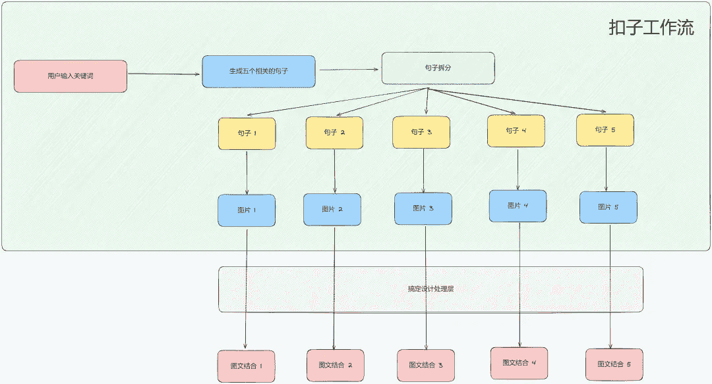

#  **二、扣子搭建 **

这是第一次给大家分享有关扣子搭建的内容，所以就尽量给大家写的完整全面一些。避免一些步骤的跳转让大家比较疑惑。

##  **一）登陆扣子官网 **

https://www.coze.cn/

这是扣子官网的链接，大家可以先点开注册一下。

登录后的主页面如图所示。

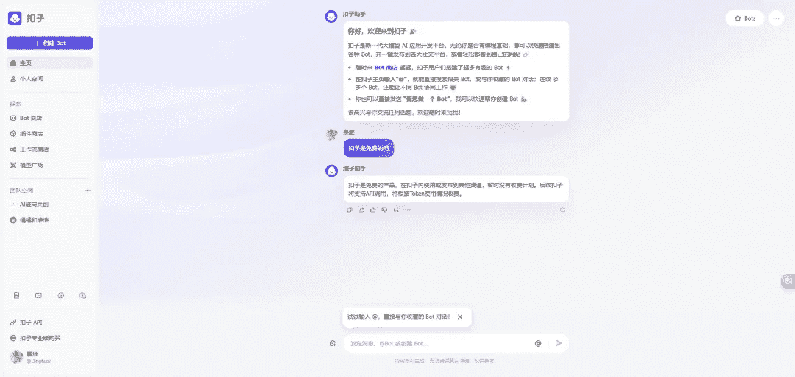

##  **二）创建个人 BOT **

###   **1、点击个人空间 **

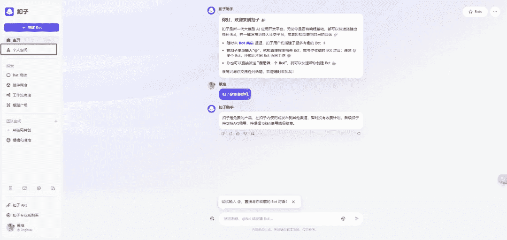

###   **2、点击创建 Bot **

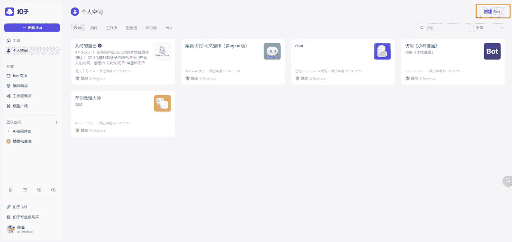

###   **3、填入 Bot 的信息 **

填入 Bot 的名字和功能介绍，以及上传或生成对应的头像。

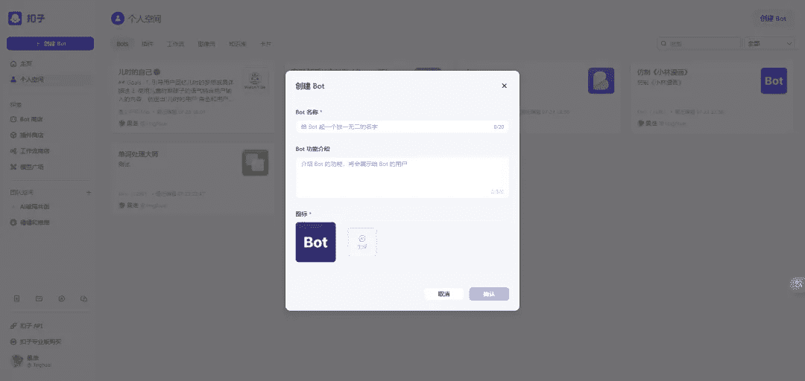

如果没想好，可以先随便填一下，后面可以进行更改。

###   **4、创建完成 **

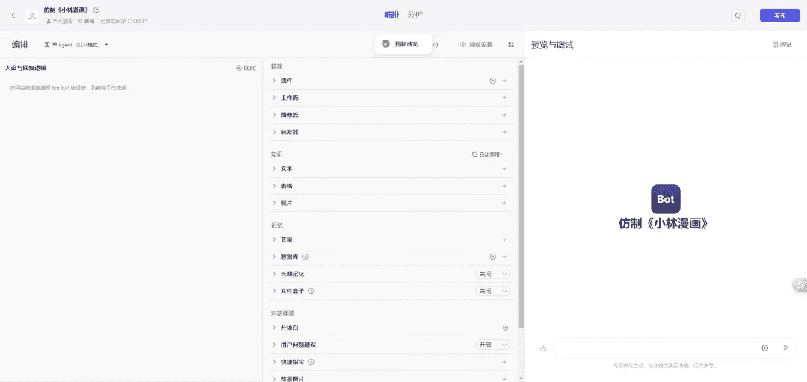

##  **三）创建工作流 **

###   1、点击工作流后面的 ➕ 来添加一个工作流

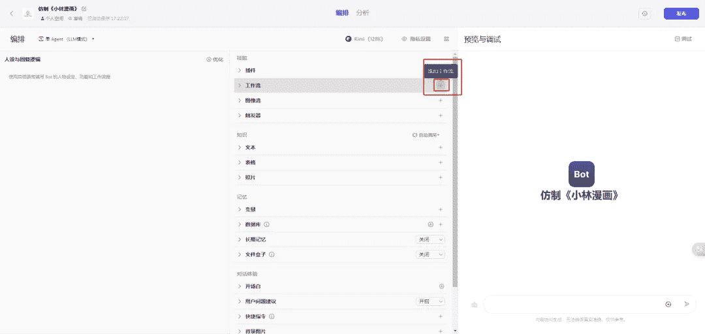

###   **2、点击 创建工作流 **

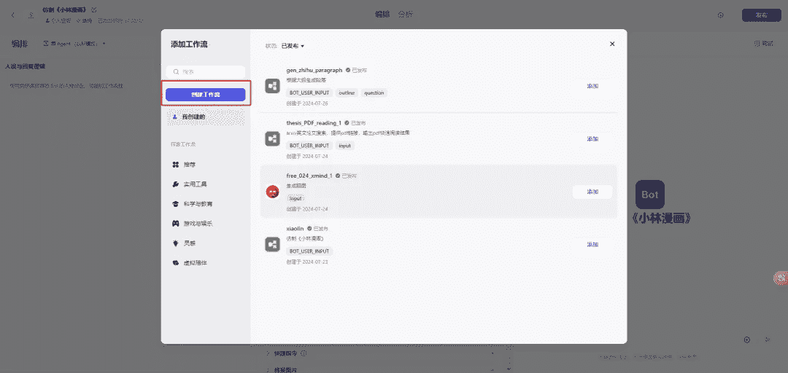

###   **3、给工作流起名字和描述 **

这边注意下，工作流起名字的时候只能用字母、数字和下划线的方式。大家只要符合要求自己看的懂分辨的清楚即可。

描述可以写的清晰一些，避免之后自己会误会、混乱。大家按照自己的理解写就好。头像我这边就没改。

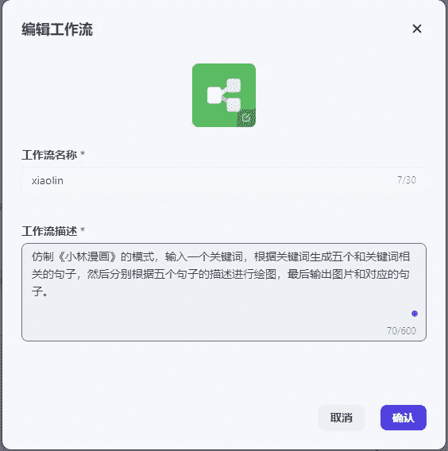

###   **4、初始化的工作流 **

> 左边是我们可以使用的各种插件和搭建 Agent 的一些工具，直接点击加号或者直接拖拽可以直接拉出来。

> 插件的使用，一般都会有个对应的参数说明，这个我们之后只介绍我们需要使用的插件。其他的大家可以自己试试。

初始化后，会直接生成开始模块和结束模块。默认生成，且有且只有一个，即只能以开始模块启动，结束模块终结工作流。

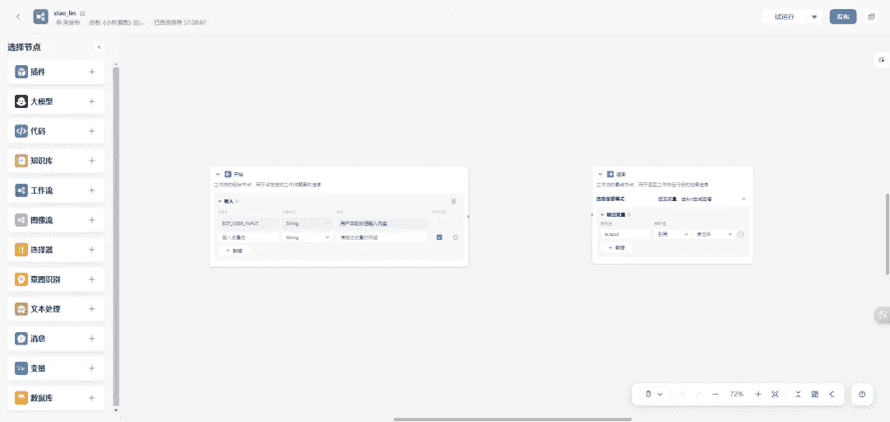

## **四）BOT 的配置 **

#  **三、扣子使用链接分享 **

##  **一）试用链接分享 **

**豆包使用链接 **：还未发布出来，之后会放在评论区置顶

**扣子使用链接 **：https://www.coze.cn/s/iMCq73wp/

##  **二）效果展示 **

**豆包**

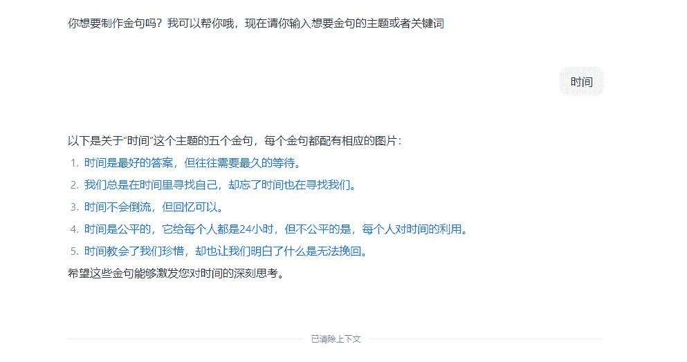

**扣子**

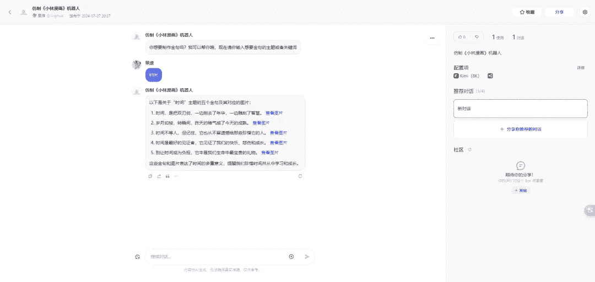

> 其实这里最后工作流的返回值可以设置一下固定的格式处理，这样就能保证每次的输出内容一致。大家自己可以试试哦~

#  **四、批量生产图片 **

#  **五、总结 **

第一次用录视频的方式给大家展示内容，其实就是怕截图说的不够清楚，所以就用视频的方式了。

文字处理，包括如何批量放入 excel 文件中的操作，其实都可以用 ai 辅助。大家感兴趣可以试试，有问题可以留言呀~

好啦，写到这里我们今天的内容也结束啦，感谢大家的观看，也希望我的内容能够让大家喜欢，有所收获。感兴趣的小伙伴可以点个关注跟随我一起学习，观看更多往期文章。

下次见，我是景淮，祝你有个开心美好的一天~