# 安仔：喂饭教程 - Coze AI 机器人对接上我的微信群了！

> 来源：[https://waytoagi.feishu.cn/docx/ACf3dOmECowZHDxE9sdchQOOnZe](https://waytoagi.feishu.cn/docx/ACf3dOmECowZHDxE9sdchQOOnZe)

> 作者：安仔

> [安仔：不用黑魔法，小白也能做一个对接 GPT 大模型的微信聊天机器人](https://waytoagi.feishu.cn/wiki/RasqwfBnvibeswkoFC7cMGbgnhg)意：在学习这篇教程内容前，建议如果不熟悉相关技术的小伙伴，可以先从我以下这篇入门教程开始学习，然后再回过头来学习这篇内容，理解和实战起来会更加得心应手：

>

最近 AI 浪潮下，各种 AI Agent 逐渐走进了我们的工作和生活，这段时间听得最多的无疑就是 Coze 平台了，它是一个 AI 智能体创作平台，可以根据我们的需求帮助我们快速构建一个甚至多个 AI 机器人，然后发布到各种社交平台给用户使用，比如微信订阅号/服务号/企业微信、飞书、掘金社区等。

我们首先了解下微信的几种不同功能和它们之间的差异。微信作为一个多功能的社交平台，提供了多种方式让用户进行交流和服务获取。以下是微信中几种主要功能的区别：

+   个人微信/微信群：个人微信和微信群是我们日常使用的聊天工具，用于与朋友、家人进行一对一或者一对多交流。然而，Coze AI 平台目前不支持直接与这两个进行功能对接。

+   微信公众号：微信公众号是一个信息发布和用户管理的平台，企业和个人可以通过它向关注者推送消息。Coze AI 平台支持与微信公众号的对接，使得 AI 机器人能够自动回复用户的消息。

+   微信服务号：微信服务号是公众号的一种，提供更丰富的服务功能，如在线支付、预约服务等。Coze AI 平台同样支持与微信服务号的对接，帮助企业提升服务效率。

+   微信客服：微信客服是企业与用户进行实时沟通的渠道。Coze AI 平台支持与微信客服的对接，使得 AI 机器人能够自动回答用户的咨询，提高客服响应速度。

所以到现研究了这么久，我却总是困惑，为什么就没有直接对上我们常用的个人微信和微信群聊天上呢？这才是我们日常更加常用的场景啊！这不，最近 Coze 的国内版终于正式发布了 API 接口功能，直接对接我们的个人微信甚至是微信群已经成为可能了！

所以今天我就来分享一下，如何使用 Coze AI 机器人对接上我的微信群，让它回复我甚至是群组小伙伴的信息，帮我们尤其是群主更好地解决一些社群运营上的问题吧！

对了，**这次教程的相关部署方法对接****国外版或国内版的 Coze 都是直**接适用的，唯一的前提是，对接国外版 Coze 平台需要你部署的服务支持黑魔法才行哦！

## 依赖工具

1.  安装了宝塔服务的轻量应用服务器 x 1（主要针对新手方便上手配置）

1.  设计好并授权发布到 API 功能的 Coze AI Bot x 1 （对接到我们作为机器人的微信号上）

1.  闲置并且已通过实名认证的微信号 x 1（作为机器人的微信号）

## 部署步骤

这次的步骤演示我会继续基于上一篇入门教程的部署服务进行进一步配置，所以如果你还没有看过上一篇教程，强烈建议先看一下。

### Coze 相关配置

#### 创建 Coze API 令牌

首先第一步我们肯定是要先**创建一个新的 API 令牌**，这个令牌就是我们后续用来对接到我们的服务上的凭证。记得自己保存好，不要泄露给别人。

1.  进入到 [Coze 平台](https://www.coze.cn/home)，点击左下角的扣子 API选项，进入到 API 管理页面：

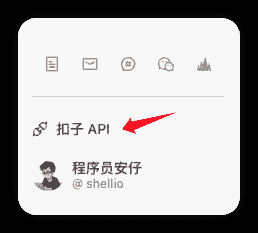

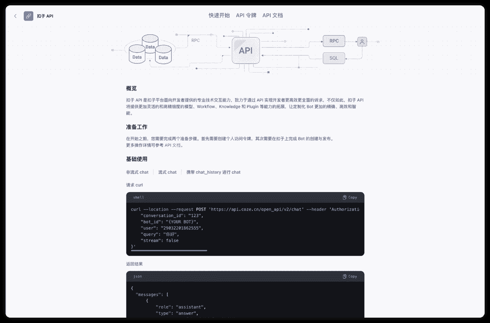

1.  点击API 令牌，然后跟着以下的图示创建你的第一个 API 令牌：

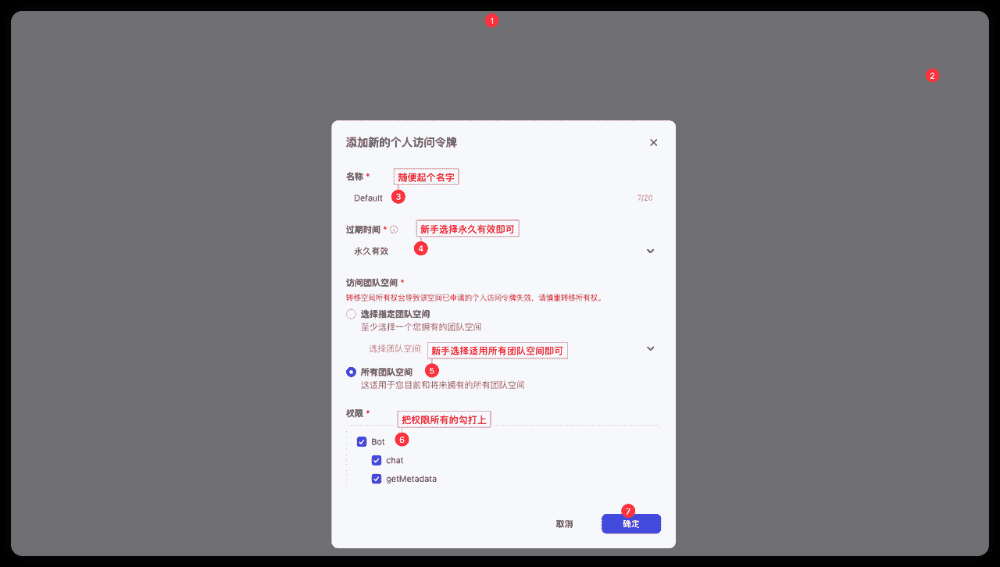

1.  创建成功后，你就可以看到你的 API 令牌，记得保存好，因为这个 API 令牌只会在创建成功后显示一次，之后就不再显示了：

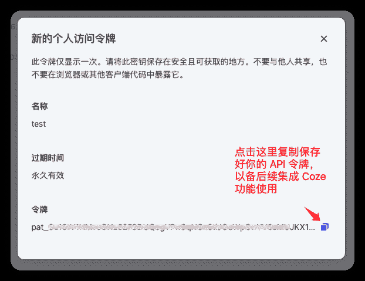

1.  至此，我们的 Coze 平台的 API 令牌已经创建成功了，接下来我们就可以继续进行下一步的配置了。

#### 记下 Coze AI Bot 的 Bot ID

接下来我们就要顺便去记一下我们想要对接的 Coze AI Bot 的 Bot ID，这个 Bot ID 是我们后续需要绑定我们微信机器人的唯一标识。这里我就拿我之前写的一个社群运营的 AI Bot 来做演示吧。

其实很简单，你只需要去到你要绑定的 AI Bot 的设计界面，它所在的那个链接里面，就有我们对应需要的 Bot ID 在，具体看下图：

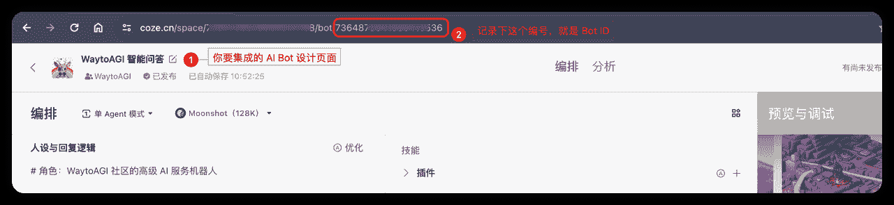

就这样，我们就可以记下我们的 Bot ID 了，我们继续下一步，我们需要将这个 Bot 发布到 Bot as API 上，不然我们是无法对接到我们的微信机器人上的：

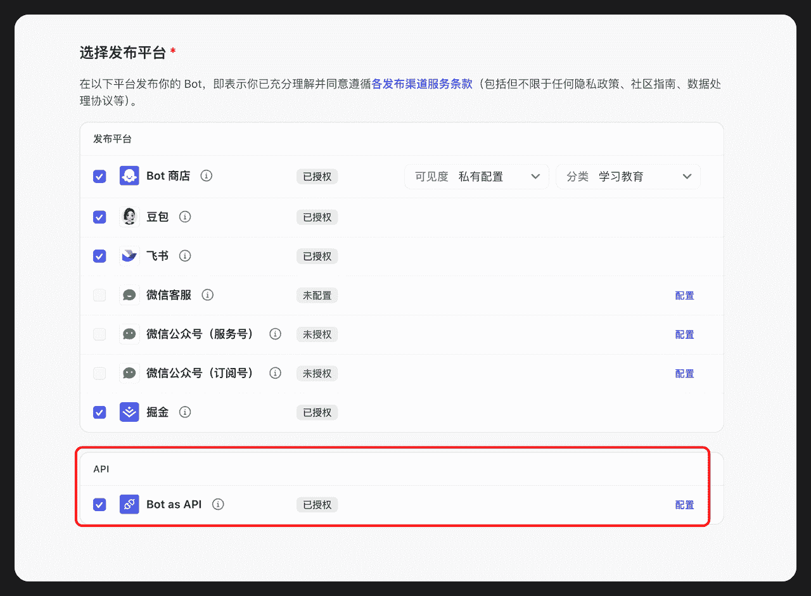

### 服务器相关配置

其实这篇教程是我社群上一个大神级好友小雨的启发，他其实也写了一篇类似的文章内容但他跟我讨论了下，要不我来出篇更喂饭级的教程，受他的启发，所以这篇内容就来了！

这个新的服务器配置其实也是整篇内容最复杂的地方，但是既然是喂饭级教程，我帮大家将很多代码相关的集成全部隐藏和优化掉了，你们接下来用的就是一些很简单的模板配置，只要基于上一篇教程的编排模板进行修改就可以切换对接上 Coze 了，是不是要感谢我一下哈哈！

接下来我们就开始配置我们的服务器环境吧！

1.  如果大家是按照我的上一篇教程来的，那么这次的配置就非常简单了，只需要修改一下我们的容器编排模板就可以了。最新的容器编排模板如下：

```
version: &quot;3&quot;
services:
  wc-andy-ai-bot:
    image: zhayujie/chatgpt-on-wechat
    container_name: wc-andy-ai-bot
    restart: always
    security_opt:
      - seccomp:unconfined
    environment:
      OPEN_AI_API_KEY: &quot;pat_dfdsfsegkemgkesmgkmfgksdmgsgsgdg&quot; # 这里填写你的 Coze API 令牌
      MODEL: &quot;&quot; # 这里留空即可
      OPEN_AI_API_BASE: &quot;http://coze2openai:3000/v1&quot; # 这里直接用这个地址就可以了
      PROXY: &quot;&quot;
      SINGLE_CHAT_PREFIX: &#x27;[&quot;bot&quot;, &quot;@bot&quot;]&#x27;
      SINGLE_CHAT_REPLY_PREFIX: &#x27;&quot;[bot] &quot;&#x27;
      GROUP_CHAT_PREFIX: &#x27;[&quot;@bot&quot;]&#x27;
      GROUP_NAME_WHITE_LIST: &#x27;[&quot;ChatGPT测试群&quot;, &quot;ChatGPT测试群2&quot;]&#x27;
      IMAGE_CREATE_PREFIX: &#x27;[&quot;画&quot;, &quot;看&quot;, &quot;找&quot;]&#x27;
      CONVERSATION_MAX_TOKENS: 1000
      SPEECH_RECOGNITION: &quot;False&quot;
      CHARACTER_DESC: &quot;你是基于大语言模型的AI智能助手，旨在回答并解决人们的任何问题，并且可以使用多种语言与人交流。&quot;
      EXPIRES_IN_SECONDS: 3600
      USE_GLOBAL_PLUGIN_CONFIG: &quot;True&quot;
      USE_LINKAI: &quot;False&quot; # 这里取消使用 Link.AI 平台的服务
      LINKAI_API_KEY: &quot;&quot;
      LINKAI_APP_CODE: &quot;&quot;
  coze2openai:
    image: andywuwu/coze2openai:latest
    container_name: coze2openai
    restart: always
    ports:
      - &quot;3000:3000&quot;
    environment:
      - BOT_ID=1111111111111 # 这里填写你的 Coze AI Bot 的 Bot ID
      - COZE_API_BASE=api.coze.cn # 国外版就填 &#x27;api.coze.com&#x27;，国内版就填 &#x27;api.coze.cn&#x27;
```

再给一个没有任何描述性的参考配置吧，方便新手小伙伴们直接参考使用：

```
version: &quot;3&quot;
services:
  wc-andy-ai-bot:
    image: zhayujie/chatgpt-on-wechat
    container_name: wc-andy-ai-bot
    restart: always
    security_opt:
      - seccomp:unconfined
    environment:
      OPEN_AI_API_KEY: &quot;demo_coze_api_key_1111111111111111111&quot;
      MODEL: &quot;&quot;
      OPEN_AI_API_BASE: &quot;http://coze2openai:3000/v1&quot;
      PROXY: &quot;&quot;
      SINGLE_CHAT_PREFIX: &#x27;[&quot;bot&quot;, &quot;@bot&quot;]&#x27;
      SINGLE_CHAT_REPLY_PREFIX: &#x27;&quot;[bot] &quot;&#x27;
      GROUP_CHAT_PREFIX: &#x27;[&quot;@bot&quot;]&#x27;
      GROUP_NAME_WHITE_LIST: &#x27;[&quot;ChatGPT测试群&quot;, &quot;ChatGPT测试群2&quot;]&#x27;
      IMAGE_CREATE_PREFIX: &#x27;[&quot;画&quot;, &quot;看&quot;, &quot;找&quot;]&#x27;
      CONVERSATION_MAX_TOKENS: 1000
      SPEECH_RECOGNITION: &quot;False&quot;
      CHARACTER_DESC: &quot;你是基于大语言模型的AI智能助手，旨在回答并解决人们的任何问题，并且可以使用多种语言与人交流。&quot;
      EXPIRES_IN_SECONDS: 3600
      USE_GLOBAL_PLUGIN_CONFIG: &quot;True&quot;
      USE_LINKAI: &quot;False&quot;
      LINKAI_API_KEY: &quot;&quot;
      LINKAI_APP_CODE: &quot;&quot;
  coze2openai:
    image: andywuwu/coze2openai:latest
    container_name: coze2openai
    restart: always
    ports:
      - &quot;3000:3000&quot;
    environment:
      - BOT_ID=demo_coze_bot_id_1111111111111111111
      - COZE_API_BASE=api.coze.cn
```

1.  如果之前没有容器编排模板的小伙伴，新建一个即可，新建和修改逻辑都是如下图类似的：

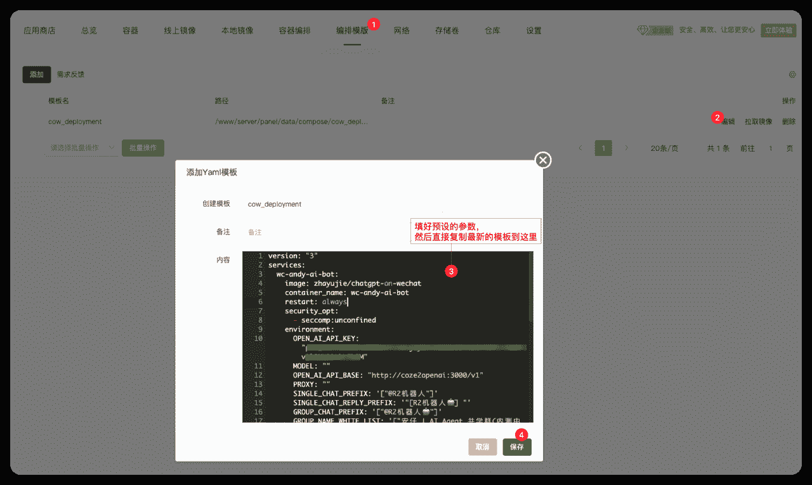

1.  记住，更新好后的编排模板，如果之前自己已经创建过相似的机器人容器编排服务，建议先删掉，以防同一个微信机器人的绑定有冲突，删除步骤如下：

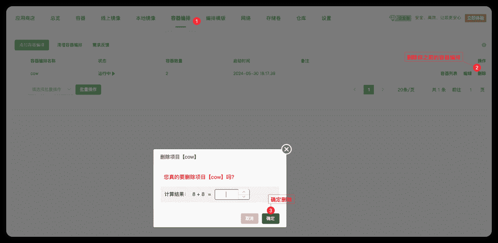

1.  最后就是基于新的编排模板创建一个新的容器编排，然后启动服务即可：

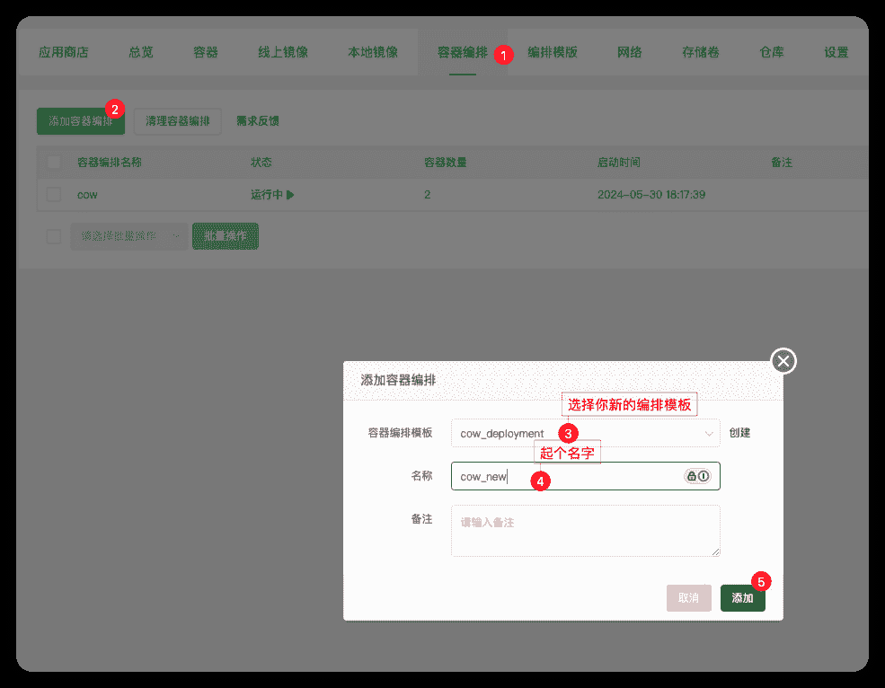

1.  等服务启动成功后，我们就可以进入到 COW 服务扫码绑定我们的微信机器人了！这个具体步骤可以参考我上一篇入门教程：

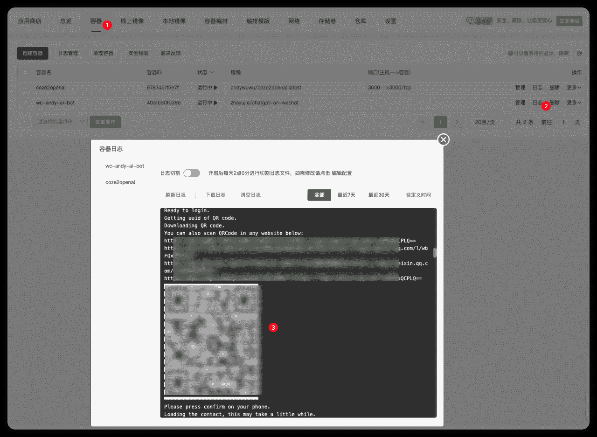

1.  至此，我们的服务就已经部署成功了，接下来就可以在我们的微信群里面测试我们的 AI 机器人了！

### 来一起聊天吧

来，我们来看看 Coze AI Bot 在平台上和微信上的区别吧：

**Coze 平台端**

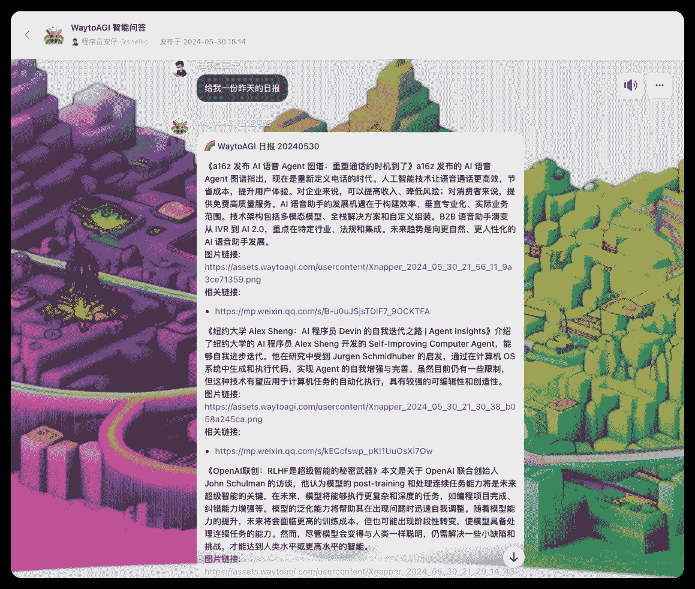

**微信端**

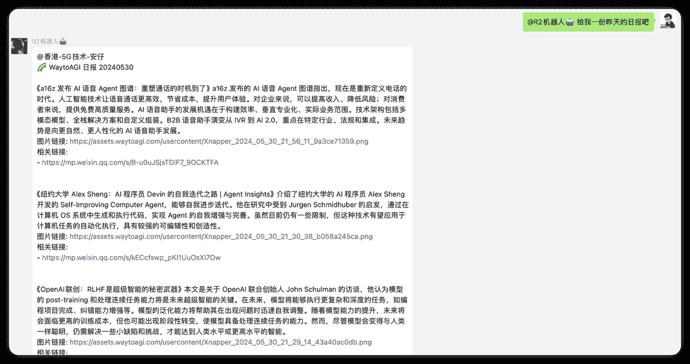

输出效果是一样的，但是在微信端的体验就更加贴近我们的日常使用了，我再也不用担心我妈妈不会用 Coze 平台或者豆包了，哈哈！

## 疑问解答

**Q1: 什么是 API 令牌？**

**A1:** API 令牌类似于你家门的钥匙，只有拥有这个钥匙的人才能进你的家。它用于认证程序，使其能够安全地访问和使用 Coze 平台的功能。每次你访问 Coze 的服务时，都需要提供这个令牌来证明你有权限。

Q2: 为什么需要用 Coze AI 机器人？

**A2:** Coze AI 机器人可以帮助你自动处理微信群中的常见问题，发送通知等，就像一个聪明的助手，节省你的时间和精力。举个例子，它可以在你忙的时候自动回复群里的问题，确保群成员得到及时回应。

Q3: 什么是轻量应用服务器？为什么需要它？

**A3:** 轻量应用服务器就像一台随时在线的高性能计算机，能够 24 小时不停地工作，确保你的 AI 机器人随时可用。相比家里的电脑，它更稳定，不会因为断电或网络问题而停机。

Q4: 什么是宝塔面板和 Docker？为什么需要它们？

**A4:** 宝塔面板是一个服务器管理工具，有直观的图形界面，让你可以方便地管理服务器。Docker 是一种容器技术，可以让你在独立的环境中运行应用，确保在任何环境下都能正常运行。使用宝塔面板和 Docker，你可以轻松地安装、配置和管理你的 AI 机器人。

**Q5: 什么是容器编排模板？**

**A5:** 容器编排模板是一种配置文件，定义了如何在 Docker 中部署和管理多个容器。就像一个食谱，按照这个模板操作，你可以轻松部署复杂的应用环境，而不需要逐个配置每个容器。

Q6: 我不太明白“放行端口”是什么意思？

**A6:** 放行端口就像是给你的房子安装一个门铃，让外面的人可以按门铃和你沟通。通过放行特定的端口（例如 8888 端口），你可以通过互联网访问宝塔面板，管理和配置服务器上的服务。

**Q7: 什么是 Bot ID？**

**A7:** Bot ID 是你在 Coze 平台上创建的 AI 机器人的唯一标识，就像每个人都有身份证号码一样。这个 ID 用于将你的微信号与特定的 AI 机器人关联起来，确保机器人可以正确响应微信上的请求。

Q8: 如果我的微信账号被封了怎么办？

**A8:** 如果你的微信账号因为使用机器人被封，可以尝试联系客服说明情况。为了避免这种情况，建议使用一个专门的微信号来作为机器人的账号，并遵守微信的使用规范。

Q9: 我需要一直让服务器开着吗？

**A9:** 是的，服务器需要一直开着，才能保证你的机器人随时在线，随时可以响应你的请求。就像你的路由器需要一直开着，才能确保你随时上网一样。

Q10: 我不懂编程，能配置好这个机器人吗？

**A10:** 完全可以！这篇教程就是为不懂编程的小伙伴准备的。只要按照教程一步一步操作，不需要编程知识也能配置好机器人。如果遇到问题，可以查阅教程或求助。

Q11: 配置过程中遇到问题怎么办？

**A11:** 如果在配置过程中遇到问题，可以检查每一步是否按照教程操作，特别是 API 令牌和 Bot ID 是否正确。如果仍然无法解决问题，可以到 Coze 平台的论坛或微信群求助，相信会有热心的伙伴愿意帮助你。

Q12: 为什么需要配置多个前缀来触发机器人回复？

**A12:** 配置多个前缀（如“bot”、“@bot”）可以确保机器人只在特定情况下回复，避免在群聊或私聊中频繁干扰。这种设置可以提高机器人的响应准确性和用户体验。

Q13: 如果遇到扫码登录失败怎么办？

**A13:** 如果扫码登录失败，可以尝试以下步骤：

1.  重启 Docker 容器：在宝塔面板中找到对应的容器，点击“重启”。

1.  重新扫描二维码：等待容器重新启动后，重新扫描日志中生成的二维码。

Q15: 使用腾讯云的轻量应用服务器的费用是多少？

**A15:** 腾讯云轻量应用服务器的价格非常划算，特别是新用户优惠活动。例如，一个 2 核 2G3M 的服务器套餐一年只需 82 元。这样，即使是技术小白也能低成本试错，体验在云端部署和运行服务的乐趣。

对了，如果大家有兴趣学习相关的 AI Agent 知识，可以加入我免费的 AI Agent 共学群，这个群组会基于 WaytoAGI 社区等其他高质量信息源，来分享时下 AI Agent 相关的各种玩法和经验分享，以及各种最新的 AI 前沿资讯。

搜索我的微信号Andywuwu07 或扫描以下二维码加我微信，备注AI共学，以便我会拉你进去共学群。

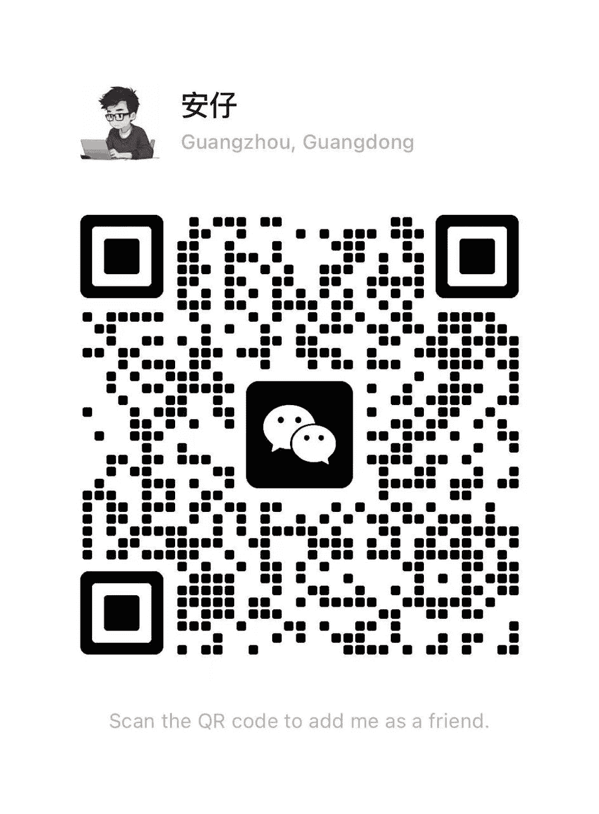